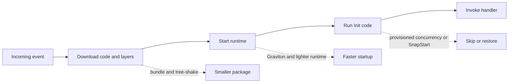
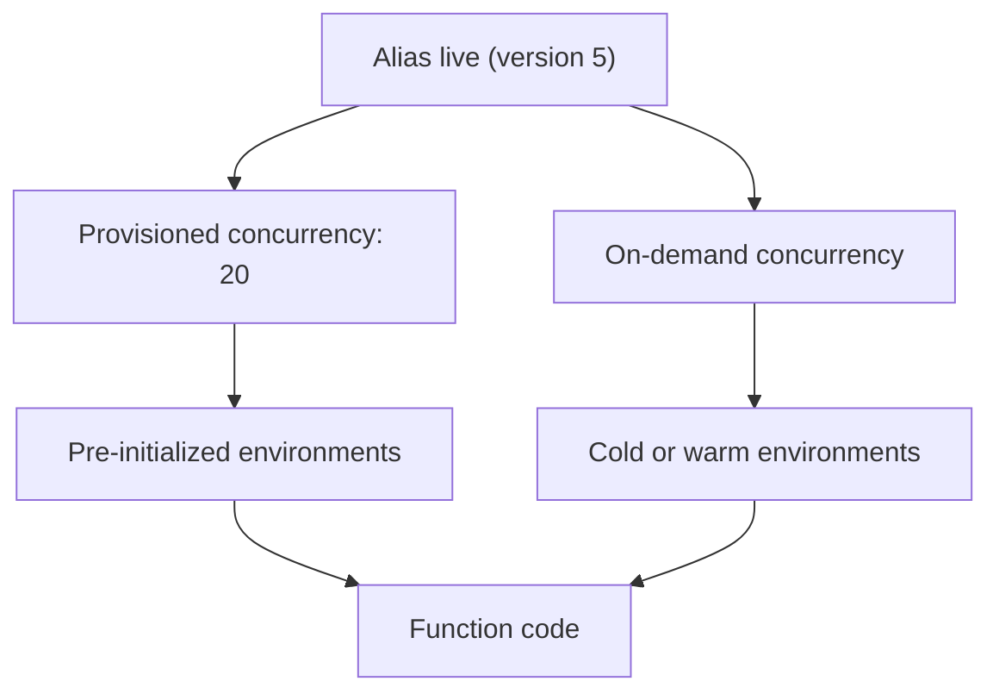

# 02 · Lambda Performance Tuning

> **Phase 4 — Serverless Architectures** · Lesson 02 of 09
> ⬅️ Previous: [Lambda Fundamentals](./01-lambda-fundamentals.md) · ➡️ Next: [API Gateway](./03-api-gateway.md) · 🏠 [Phase overview](./README.md)

## 🎯 Learning Objectives

By the end of this lesson you will be able to:

- Break a cold start into its phases and identify which part you can influence
- Explain how allocated memory maps to vCPU and why more memory can be cheaper
- Eliminate cold starts with provisioned concurrency and SnapStart
- Move to ARM64/Graviton and cut both cost and duration
- Shrink deployment packages with bundling and tree-shaking
- Right-size a function empirically with AWS Lambda Power Tuning

**Estimated time:** 75 min · **Difficulty:** Advanced

---

## 🧠 Core Concepts

A **cold start** is the time between an event arriving and your handler beginning to run, on an execution environment that does not exist yet. It has three parts: **download** (fetching your code and layers), **runtime startup** (booting the language runtime), and **Init** (running the module-level code you wrote). Only the third is under your direct control — but it is usually the largest one, because it is where SDK clients, database pools, and config loads happen.

The single most counter-intuitive fact about Lambda tuning is that **memory is the CPU dial**. Lambda allocates CPU proportionally to memory: one full vCPU per 1,769 MB, up to 6 vCPUs at 10,240 MB. A function at 128 MB gets roughly one-fourteenth of a vCPU, so CPU-bound work crawls. Doubling memory often more than halves duration, which means the *cost stays flat or even drops* while latency improves. That is why guessing memory sizes is the wrong approach and measuring is the right one.

**Provisioned concurrency** keeps a configured number of execution environments initialized and ready, so requests never pay Init. You attach it to a published version or alias, and you can autoscale it with Application Auto Scaling on a schedule or a utilization target. **SnapStart** takes a different route: it initializes the environment once when you publish a version, takes a Firecracker snapshot of the memory and disk state, and restores from that snapshot instead of replaying Init. SnapStart works for Java 11 and later, Python 3.12 and later, and .NET 8 and later — SnapStart is a per-version setting, unlike provisioned concurrency.

**Architecture** is the cheapest lever. ARM64 (AWS Graviton2) functions cost about 20 percent less per GB-second than x86 and frequently run faster. **Package size** is the next cheapest: a smaller ZIP means a shorter download phase, so bundling with tree-shaking beats shipping `node_modules` or a full virtualenv.

### Key terminology

| Term | Meaning |
|------|---------|
| **Init duration** | Time spent in the Init phase; reported in cold-start `REPORT` log lines |
| **Cold start** | Download plus runtime startup plus Init for a brand-new environment |
| **Warm start** | An invocation reusing a frozen environment; Init is not repeated |
| **Provisioned concurrency** | Pre-initialized environments billed per GB-hour, idle or not |
| **SnapStart** | Snapshot-based restore of a pre-initialized environment for published versions |
| **Graviton2 / ARM64** | AWS-designed CPU architecture that is roughly 20 percent cheaper per GB-second |
| **Power tuning** | Running the same workload at many memory sizes and comparing cost against duration |
| **Restore hook** | Code that runs after a SnapStart restore to re-establish connections |

---

## 🗺️ Architecture Diagram

Where the time goes during a cold start and which lever attacks each phase:



How provisioned concurrency and on-demand concurrency coexist behind one alias:



---

## 🧪 Hands-on Lab: Measure, Then Fix, a Cold Start

**Goal:** Prove that a cold start exists, then remove it with provisioned concurrency and compare the numbers.

**Prerequisites:** Lesson 01 completed; a deployed function named `rides-api`; permission to write CloudWatch metrics.

### Step 1 — Measure the baseline

```bash
# Generate 30 invocations and capture the log stream
for i in $(seq 1 30); do
  aws lambda invoke --function-name rides-api \
    --payload '{"rideId":"perf-'"$i"'"}' \
    --cli-binary-format raw-in-base64-out \
    --log-type Tail response.json --query 'LogResult' --output text | base64 --decode
done
```

Look for two lines in the output:

```
INIT_START Runtime Version: python:3.12.v26  Runtime Version ARN: arn:aws:lambda:...
REPORT RequestId: ...  Duration: 12.41 ms  Billed Duration: 13 ms  Memory Size: 256 MB  Max Memory Used: 71 MB  Init Duration: 412.88 ms
```

`Init Duration` only appears on cold starts. Record the average.

### Step 2 — Find the cold starts at scale

```bash
# Count cold starts in the last 24 hours using CloudWatch Logs Insights
aws logs start-query \
  --log-group-name /aws/lambda/rides-api \
  --start-time $(($(date +%s) - 86400)) \
  --end-time $(date +%s) \
  --query-string 'filter @type = "REPORT" | stats count(*) as invocations, count(InitDuration) as coldStarts, avg(InitDuration) as avgInitMs, pct(Duration, 99) as p99Ms'

# Then fetch the query results with the queryId that was returned
aws logs get-query-results --query-id <query-id-from-previous-output>
```

### Step 3 — Shrink the package

Node.js gets the biggest win from bundling, because the runtime already includes AWS SDK v3:

```bash
# Bundle and minify, keeping the SDK external to the deployment package
npx esbuild src/index.ts \
  --bundle \
  --minify \
  --platform=node \
  --target=node20 \
  --external:@aws-sdk/* \
  --outfile=dist/index.js

# Ship only the bundle, not node_modules
cd dist && zip -r ../function.zip index.js && cd ..
```

For Python, avoid compiling wheels that do not match the Lambda platform:

```bash
# Install Linux-compatible wheels into a folder, then zip it
pip install \
  --platform manylinux2014_x86_64 \
  --implementation cp \
  --python-version 3.12 \
  --only-binary=:all: \
  --target package \
  boto3 requests

# Strip metadata and tests to save tens of megabytes
find package -name "*.dist-info" -type d -exec rm -rf {} +
find package -name "tests" -type d -exec rm -rf {} +
cd package && zip -r -q ../function.zip . && cd ..
```

### Step 4 — Switch to ARM64

```bash
# Graviton2 costs about 20 percent less and is often faster per millisecond
aws lambda update-function-configuration \
  --function-name rides-api \
  --architectures arm64

aws lambda wait function-updated --function-name rides-api
```

Re-run the measurement loop from Step 1 and compare a pure-computation handler. If your handler uses a native module, rebuild it for `aarch64` first — an x86-only wheel fails with an architecture error.

### Step 5 — Add provisioned concurrency

```bash
# Publish the tuned version and point the alias at it
aws lambda publish-version --function-name rides-api
aws lambda update-alias \
  --function-name rides-api --name live --function-version 3

# Keep 20 environments permanently initialized
aws lambda put-provisioned-concurrency-config \
  --function-name rides-api \
  --qualifier live \
  --provisioned-concurrent-executions 20
```

### Step 6 — Autoscale provisioned concurrency

```bash
# Register the alias as a scalable target
aws application-autoscaling register-scalable-target \
  --service-namespace lambda \
  --resource-id function:rides-api:live \
  --scalable-dimension lambda:function:ProvisionedConcurrency \
  --min-capacity 5 \
  --max-capacity 200

# Follow a utilization target so capacity tracks demand
aws application-autoscaling put-scaling-policy \
  --service-namespace lambda \
  --resource-id function:rides-api:live \
  --scalable-dimension lambda:function:ProvisionedConcurrency \
  --policy-name rides-api-pc-utilization \
  --policy-type TargetTrackingScaling \
  --target-tracking-scaling-policy-configuration '{
    "TargetValue": 0.7,
    "PredefinedMetricSpecification": {
      "PredefinedMetricType": "LambdaProvisionedConcurrencyUtilization"
    }
  }'
```

### Step 7 — Try SnapStart instead (Java, Python 3.12+, or .NET 8+)

```bash
# SnapStart applies to published versions, so publish first
aws lambda publish-version --function-name rides-api

aws lambda update-function-configuration \
  --function-name rides-api \
  --snap-start ApplyOn=PublishedVersions

aws lambda wait function-updated --function-name rides-api
```

Because a snapshot freezes memory, anything network-related opened during Init is captured in a stale state. Register a **before-snapshot** hook to close connections and an **after-restore** hook to reopen them. In Java this uses the CRaC `Core.getGlobalContext().register(...)` API; in Python and .NET the SnapStart runtime exposes `register_before_snapshot` and `register_after_restore` decorators. Also note that unique values generated during Init — request IDs, UUIDs, random seeds — are frozen into the snapshot and reused by every restored environment, so move that generation inside the handler.

### Step 8 — Verify

```bash
# Confirm provisioned concurrency is active
aws lambda get-provisioned-concurrency-config \
  --function-name rides-api --qualifier live

# Re-run the load loop; Init Duration should disappear from the REPORT lines
for i in $(seq 1 30); do
  aws lambda invoke --function-name rides-api \
    --payload '{"rideId":"perf-'"$i"'"}' \
    --cli-binary-format raw-in-base64-out \
    --log-type Tail response.json --query 'LogResult' --output text | base64 --decode | grep REPORT
done
```

Success is a log line with no `Init Duration` field, and a p99 duration that no longer has a long tail.

---

## 💻 CLI Reference

```bash
# Inspect current memory and architecture for a function
aws lambda get-function-configuration \
  --function-name rides-api \
  --query '{Memory:MemorySize,Arch:Architectures,Timeout:Timeout}'

# Deploy an ARM64 zipped function in one call
aws lambda update-function-configuration \
  --function-name rides-api --memory-size 1024 --architectures arm64 --timeout 15

# Turn on X-Ray tracing to see downstream latency in the trace map
aws lambda update-function-configuration \
  --function-name rides-api --tracing-config Mode=Active

# Raise ephemeral storage when a function writes large temporary files
aws lambda update-function-configuration \
  --function-name rides-api --ephemeral-storage Size=1024

# Check what the runtime reports about cold starts
aws logs filter-log-events \
  --log-group-name /aws/lambda/rides-api \
  --filter-pattern "Init Duration" \
  --limit 20

# Run Lambda Power Tuning (AWS's own Step Functions state machine from AWS Samples)
aws stepfunctions start-execution \
  --state-machine-arn arn:aws:states:eu-west-1:123456789012:stateMachine:powerTuningStateMachine \
  --input '{
    "lambdaARN": "arn:aws:lambda:eu-west-1:123456789012:function:rides-api",
    "powerValues": [128, 256, 512, 1024, 1536, 2048, 3008],
    "num": 50,
    "payload": {"rideId": "benchmark"},
    "parallelInvocation": true,
    "strategy": "cost"
  }'

# Read the tuning result, including the recommended memory and the savings
aws stepfunctions describe-execution \
  --execution-arn arn:aws:states:eu-west-1:123456789012:execution:powerTuningStateMachine:run-1 \
  --query 'output'
```

| Command | Purpose |
|---------|---------|
| `update-function-configuration --architectures arm64` | Move to Graviton for about 20 percent lower cost |
| `put-provisioned-concurrency-config` | Pre-initialize environments to remove cold starts |
| `register-scalable-target` | Make provisioned concurrency elastic |
| `update-function-configuration --snap-start` | Enable snapshot restore for a published version |
| `logs filter-log-events --filter-pattern "Init Duration"` | Find cold starts in historical logs |
| `stepfunctions start-execution` | Kick off a Power Tuning sweep |
| `update-function-configuration --tracing-config Mode=Active` | Enable X-Ray for dependency-level latency |

`strategy` accepts `cost`, `speed`, or `balanced`. Use `cost` when latency is acceptable, `speed` when a p99 target is contractual.

---

## ✅ Best Practices

| Practice | Why it matters |
|----------|----------------|
| Measure before tuning | Intuition about memory sizing is wrong more often than right |
| Right-size memory with Power Tuning | Often cuts both duration and cost at once |
| Prefer ARM64 unless a native dependency forbids it | Cheapest per-GB-second option with equal or better throughput |
| Tree-shake and bundle Node.js functions | Removes megabytes from the download phase |
| Build Python packages for `manylinux2014` | Avoids shipping compiler artifacts and source build trees |
| Use provisioned concurrency for latency-critical, predictable traffic | Removes cold starts where they hurt most |
| Use SnapStart for large, Java-style Init costs | Cheap fix when Init dominates the cold start |
| Cache config and secrets at Init, never per request | Each request otherwise pays a network round trip |
| Enable X-Ray on critical paths | Shows whether the bottleneck is Lambda or a downstream call |

---

## ⚠️ Common Pitfalls

| Pitfall | Symptom | Fix |
|---------|---------|-----|
| Under-allocated memory on a CPU-bound function | Duration pinned at the timeout with low `Max Memory Used` | Raise memory; CPU scales with it |
| Provisioned concurrency on `$LATEST` | `InvalidParameterValueException` | Publish a version and use an alias or version qualifier |
| Provisioned concurrency scaling to zero on a schedule | Requests during the race still cold start | Set `MinCapacity` above zero for known peak windows |
| SnapStart and unique IDs at Init | Every restored environment returns the same UUID | Generate unique values inside the handler |
| SnapStart with open connections at Init | Restored environments use dead sockets | Add after-restore hooks to reconnect |
| ARM64 with an x86 native wheel | `Unable to import module` or an ELF class error | Rebuild the dependency for `aarch64` |
| Bundling `@aws-sdk/*` into the ZIP | Package is tens of megabytes larger and version-pinned | Mark it external; the Node.js runtime provides v3 |
| CloudWatch Logs Insights query timeout | `StartQuery` succeeds but results are empty | Narrow the time window, then re-run |
| SnapStart on an unsupported runtime or architecture | `InvalidParameterValueException` | Use Java 11+, Python 3.12+, or .NET 8+ |

---

## 💰 Cost Considerations

Duration is `allocated GB × seconds × rate`, so the memory dial moves cost in two directions at once. A function at 128 MB that takes 900 ms and the same function at 1024 MB taking 120 ms cost:

- 128 MB: `0.125 × 0.9 × $0.0000166667 = $0.00000187` per invocation
- 1024 MB: `1.0 × 0.12 × $0.0000166667 = $0.00000200` per invocation

Nearly identical cost, **7.5× better latency**. That is the entire point of Power Tuning: find the knee of the curve where duration stops improving faster than memory grows.

Provisioned concurrency is billed per GB-hour even when idle: $0.015 per GB-hour on x86 and $0.012 on ARM64. 20 environments at 1 GB costs `20 × 24 × 30 × $0.015 = $216` per month before a single request. Autoscale it, or schedule it only for business hours.

SnapStart costs nothing extra. ARM64 saves roughly 20 percent on every GB-second. Ephemeral storage beyond 512 MB is charged at $0.0000000309 per GB-second, so a 10 GB `/tmp` on a long-running function is not free.

What drives the bill: total GB-seconds, plus idle provisioned capacity. Cutting Init work and shipping smaller packages lowers both without touching memory.

---

## 🔐 Security Considerations

- **SnapStart snapshots contain your in-memory state.** Snapshots are encrypted at rest and scoped per version, but everything you leave in a module-level variable is inside the snapshot — never cache credentials in plaintext globals.
- **Treat `/tmp` as sensitive too.** SnapStart excludes `/tmp` from the snapshot, but within a warm environment `/tmp` persists between invocations, so do not leave one request's data where the next request can read it.
- **Scope the auto scaling role.** The CloudWatch alarm and Application Auto Scaling integration needs an IAM role; grant it only the provisioned concurrency actions on the specific alias.
- **Provisioned concurrency increases your attack surface.** You now have always-on environments. Ensure the execution role is least privilege, because a compromised function is instantly exploitable rather than scaling from zero.
- **Keep X-Ray from leaking payloads.** X-Ray records metadata, and Lambda does not record request bodies by default — do not add annotations containing personal data or tokens.
- **Use AWS Signer with SnapStart.** Signed versions prevent an attacker with pipeline access from publishing a snapshot built from tampered code.

---

## 🧩 Exercise

Take one function from Lesson 01 and run a Power Tuning sweep with `powerValues` from 128 to 3008 MB and `num` set to 50, using `strategy: "cost"`. Read the `output` field to find the recommended memory. Then re-deploy at that memory value with ARM64, enable X-Ray, and re-run the 30-invocation loop from Step 1 of the lab. Record three numbers before and after: p99 duration, average `Init Duration`, and estimated monthly cost at one million invocations.

Success looks like: a short written comparison showing a lower p99 duration *and* a lower or equal monthly cost after tuning, with the Power Tuning recommendation matching the memory value you deployed.

---

## 📚 Resources

- [Lambda function scaling and concurrency](https://docs.aws.amazon.com/lambda/latest/dg/lambda-concurrency.html)
- [Configuring provisioned concurrency](https://docs.aws.amazon.com/lambda/latest/dg/provisioned-concurrency.html)
- [Lambda SnapStart](https://docs.aws.amazon.com/lambda/latest/dg/snapstart.html)
- [Lambda SnapStart for Python and .NET functions](https://aws.amazon.com/blogs/compute/building-faster-more-efficient-python-net-applications-with-aws-lambda-snapstart/)
- [AWS Lambda Power Tuning (AWS Samples)](https://github.com/alexcasalboni/aws-lambda-power-tuning)
- [Best practices for working with AWS Lambda functions](https://docs.aws.amazon.com/lambda/latest/dg/best-practices.html)
- [Lambda pricing](https://aws.amazon.com/lambda/pricing/)

---

## ➡️ Next Steps

Your function is now fast and cheap, but nothing outside your team can call it safely yet. The next lesson puts API Gateway in front of it and covers the three API flavors, stages, throttling, authorizers, and usage plans.

> ⬅️ Previous: [Lambda Fundamentals](./01-lambda-fundamentals.md) · ➡️ Next: [API Gateway](./03-api-gateway.md) · 🏠 [Phase overview](./README.md)
