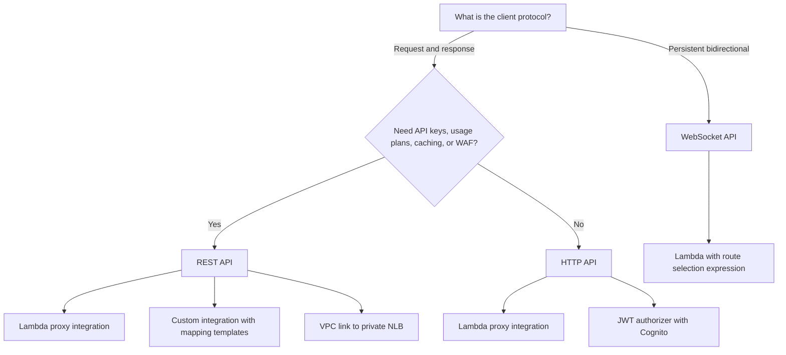
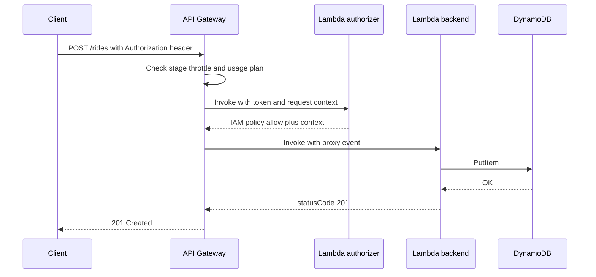

# 03 · API Gateway

> **Phase 4 — Serverless Architectures** · Lesson 03 of 09
> ⬅️ Previous: [Lambda Performance Tuning](./02-lambda-performance-tuning.md) · ➡️ Next: [Step Functions](./04-step-functions.md) · 🏠 [Phase overview](./README.md)

## Learning Objectives

By the end of this lesson you will be able to:

- Choose between REST APIs, HTTP APIs, and WebSocket APIs for a given workload
- Wire a Lambda proxy integration and a custom (non-proxy) integration
- Model environments with stages and stage variables
- Protect an API with API keys, Lambda authorizers, or a Cognito JWT authorizer
- Apply throttling, request validation, and usage plans, and reach private backends with a VPC link

**Estimated time:** 75 min · **Difficulty:** Intermediate

---

## Core Concepts

**API Gateway** is the front door for your serverless backend. It terminates TLS, authenticates callers, validates payloads, throttles traffic, and forwards requests to a backend — most often a Lambda function, but also an HTTP endpoint, a private VPC service, or a direct AWS service action. You pay per request, which makes it a natural fit for spiky workloads.

There are three API flavors, and picking the right one is the first design decision:

| | REST API | HTTP API | WebSocket API |
|---|----------|----------|---------------|
| Price | $3.50 per million | $1.00 per million | $1.00 per million messages, plus connection minutes |
| Auth | IAM, Lambda, Cognito, API key | IAM, Lambda, JWT (Cognito or any OIDC) | IAM, Lambda |
| Request validation | Models plus validators, headers and body | JSON Schema body validation only | Custom in your handler |
| API keys and usage plans | Yes | No | No |
| Caching | Yes | No | No |
| Private integration | VPC link to NLB | VPC link to ALB, NLB, or Cloud Map | VPC link to NLB |
| AWS WAF | Yes | No (terminate at CloudFront instead) | No |
| Best for | Full feature set, partners, caching | Cheap, fast, JWT-authenticated APIs | Chat, live tracking, push |

An **integration** is how a route reaches its backend. A **Lambda proxy integration** (`AWS_PROXY`) passes the entire request through as a structured event and takes the Lambda response as the HTTP response — no mapping templates, no response translation. A **custom integration** uses **mapping templates** (Velocity Template Language) to reshape the request and response, which is how you integrate with a legacy HTTP endpoint or call an AWS service action directly.

A **stage** is a named deployment of your API, such as `dev`, `test`, and `prod`. Each stage has its own URL path prefix, its own throttling limits, its own logs, and its own set of **stage variables** — key-value pairs you can interpolate into integration URIs so one API definition points at different Lambda aliases per environment, for example `.../functions:${stageVariables.lambdaAlias}/invocations`.

Authorization has three practical options. **API keys** are not a security mechanism — they identify a caller for metering and usage plans. A **Lambda authorizer** calls your function with the request context and returns an IAM policy, which is how you implement custom token or header-based auth. A **Cognito (or generic JWT) authorizer** validates a JWT signature and claims at the edge without invoking your code, which is faster and cheaper when you already use a user pool.

### Key terminology

| Term | Meaning |
|------|---------|
| **Route / method** | The HTTP verb and path (`POST /rides`) that maps to a backend |
| **Integration** | The backend connection; `AWS_PROXY` forwards the raw request to Lambda |
| **Stage** | A named, deployed snapshot of the API with its own URL and settings |
| **Stage variable** | A per-stage value interpolated into integration URIs |
| **Usage plan** | Throttle and quota limits associated with API keys |
| **Lambda authorizer** | A function that authenticates a request and returns an allow/deny policy |
| **JWT authorizer** | Native token validation against an OIDC issuer and audience |
| **VPC link** | A private connection from API Gateway into a VPC load balancer |
| **Mapping template** | VTL that transforms request or response payloads |
| **Payload format version** | The event shape passed to Lambda: `1.0` or `2.0` |

---

## Architecture Diagram

Choose the flavor first, then the integration:



How a request is authorized and throttled before it reaches the function:



---

## Hands-on Lab: HTTP API with a JWT Authorizer

**Goal:** Deploy an HTTP API in front of a Lambda, protect it with a Cognito JWT authorizer, and add per-stage throttling.

**Prerequisites:** Lesson 01 completed, a Lambda function named `rides-api`, a Cognito user pool with an app client, AWS CLI v2.

### Step 1 — Create the API

```bash
# Create an HTTP API (cheaper and lower latency than a REST API)
aws apigatewayv2 create-api \
  --name rides-http \
  --protocol-type HTTP \
  --query 'ApiId' --output text
```

Note the `ApiId` returned — call it `$API_ID` for the rest of the lab.

### Step 2 — Create the Lambda proxy integration

```bash
# AWS_PROXY passes the full request to Lambda; payload format 2.0 is the simpler event shape
aws apigatewayv2 create-integration \
  --api-id $API_ID \
  --integration-type AWS_PROXY \
  --integration-uri arn:aws:lambda:eu-west-1:123456789012:function:rides-api \
  --payload-format-version 2.0 \
  --query 'IntegrationId' --output text
```

### Step 3 — Add routes

```bash
# POST /rides and GET /rides/{id} both target the same integration here
aws apigatewayv2 create-route \
  --api-id $API_ID \
  --route-key "POST /rides" \
  --target integrations/$INTEGRATION_ID

aws apigatewayv2 create-route \
  --api-id $API_ID \
  --route-key "GET /rides/{id}" \
  --target integrations/$INTEGRATION_ID

# Allow API Gateway to invoke the function
aws lambda add-permission \
  --function-name rides-api \
  --statement-id apigw-invoke \
  --action lambda:InvokeFunction \
  --principal apigateway.amazonaws.com \
  --source-arn "arn:aws:execute-api:eu-west-1:123456789012:$API_ID/*/*/rides"
```

### Step 4 — Add a JWT authorizer

```bash
# Validate tokens issued by a Cognito user pool, checking issuer and audience
aws apigatewayv2 create-authorizer \
  --api-id $API_ID \
  --name cognito-jwt \
  --authorizer-type JWT \
  --identity-source '$request.header.Authorization' \
  --jwt-configuration 'Issuer=https://cognito-idp.eu-west-1.amazonaws.com/eu-west-1_abc123xyz,Audience=4example123appclientid'

# Recreate the route so it requires the authorizer
aws apigatewayv2 update-route \
  --api-id $API_ID \
  --route-id $ROUTE_ID \
  --authorization-type JWT \
  --authorizer-id $AUTHORIZER_ID
```

### Step 5 — Create the stage and throttle it

```bash
# Auto-deploy creates a stage tied to the latest deployment
aws apigatewayv2 create-stage \
  --api-id $API_ID \
  --stage-name prod \
  --auto-deploy

# Cap the whole stage at 100 requests per second with a 200-request burst
aws apigatewayv2 update-stage \
  --api-id $API_ID \
  --stage-name prod \
  --default-route-settings 'ThrottlingRateLimit=100,ThrottlingBurstLimit=200'
```

### Step 6 — Add a second stage with different settings

```bash
# A dev stage with much lower limits, demonstrating stage isolation
aws apigatewayv2 create-stage \
  --api-id $API_ID \
  --stage-name dev \
  --auto-deploy

aws apigatewayv2 update-stage \
  --api-id $API_ID \
  --stage-name dev \
  --default-route-settings 'ThrottlingRateLimit=10,ThrottlingBurstLimit=20'
```

### Step 7 — Verify

```bash
# Without a token the API must reject the request
curl -s -o /dev/null -w "%{http_code}\n" \
  -X POST "https://$API_ID.execute-api.eu-west-1.amazonaws.com/prod/rides" \
  -d '{"pickup":"A","dropoff":"B"}'

# With a Cognito ID token it must succeed
TOKEN=$(aws cognito-idp initiate-auth \
  --auth-flow USER_PASSWORD_AUTH \
  --client-id 4example123appclientid \
  --auth-parameters USERNAME=demo,PASSWORD='Demo1234!' \
  --query 'AuthenticationResult.IdToken' --output text)

curl -s -X POST "https://$API_ID.execute-api.eu-west-1.amazonaws.com/prod/rides" \
  -H "Authorization: $TOKEN" \
  -H "Content-Type: application/json" \
  -d '{"pickup":"A","dropoff":"B"}'
```

The first call returns `401`; the second returns the Lambda response body.

---

## CLI Reference

```bash
# --- REST APIs (apigateway) ---

# Create a regional REST API
aws apigateway create-rest-api --name rides-rest --endpoint-configuration types=REGIONAL

# Create a resource under the root, then a method and a proxy integration
aws apigateway create-resource \
  --rest-api-id abc123def4 --parent-id $ROOT_ID --path-part rides

aws apigateway put-method \
  --rest-api-id abc123def4 --resource-id $RES_ID \
  --http-method POST --authorization-type NONE --api-key-required

aws apigateway put-integration \
  --rest-api-id abc123def4 --resource-id $RES_ID --http-method POST \
  --type AWS_PROXY --integration-http-method POST \
  --uri arn:aws:apigateway:eu-west-1:lambda:path/2015-03-31/functions/arn:aws:lambda:eu-west-1:123456789012:function:rides-api/invocations

# Deploy to a stage — REST APIs do not auto-deploy
aws apigateway create-deployment --rest-api-id abc123def4 --stage-name prod

# Validate request bodies against a JSON Schema model
aws apigateway create-model \
  --rest-api-id abc123def4 --name RideRequest \
  --content-type application/json --schema file://ride-schema.json

aws apigateway create-request-validator \
  --rest-api-id abc123def4 --name body-validator --validate-request-body

# Meter and limit partners with API keys and usage plans
aws apigateway create-usage-plan \
  --name partner-standard \
  --throttle 'burstLimit=200,rateLimit=100' \
  --quota 'limit=100000,period=MONTH' \
  --api-stages 'apiId=abc123def4,stage=prod'

aws apigateway create-api-key --name partner-a --enabled

aws apigateway create-usage-plan-key \
  --usage-plan-id $PLAN_ID --key-id $KEY_ID --key-type API_KEY

# Register a Lambda authorizer (TOKEN type, cached for 300 seconds)
aws apigateway create-authorizer \
  --rest-api-id abc123def4 --name lambda-token-auth --type TOKEN \
  --authorizer-uri 'arn:aws:apigateway:eu-west-1:lambda:path/2015-03-31/functions/arn:aws:lambda:eu-west-1:123456789012:function:rides-auth/invocations' \
  --identity-source method.request.header.Authorization \
  --authorizer-result-ttl-in-seconds 300

# Cache responses at the stage to cut Lambda and database load
aws apigateway update-stage \
  --rest-api-id abc123def4 --stage-name prod \
  --patch-operations op=replace,path=/cacheClusterEnabled,value=true \
                      op=replace,path=/cacheClusterSize,value=0.5

# --- Private backends ---

# HTTP API VPC link: send traffic to a private ALB without traversing the internet
aws apigatewayv2 create-vpc-link \
  --name rides-vpc-link \
  --subnet-ids subnet-0aa11bb22cc33dd44 subnet-0ee55ff66aa77bb88 \
  --security-group-ids sg-0abc1234567890abc

# --- WebSocket APIs ---

# Route messages by an action field in the JSON body
aws apigatewayv2 create-api \
  --name rides-ws --protocol-type WEBSOCKET \
  --route-selection-expression '$request.body.action'

# The three reserved routes every WebSocket API should implement
aws apigatewayv2 create-route --api-id $WS_ID --route-key '$connect'
aws apigatewayv2 create-route --api-id $WS_ID --route-key '$disconnect'
aws apigatewayv2 create-route --api-id $WS_ID --route-key '$default'

# --- Observability ---

# Watch request rate, latency, and error counts
aws cloudwatch get-metric-statistics \
  --namespace AWS/ApiGateway --metric-name Latency \
  --dimensions Name=ApiId,Value=$API_ID Name=Stage,Value=prod \
  --start-time "$(date -u -v-1H +%Y-%m-%dT%H:%M:%SZ)" \
  --end-time "$(date -u +%Y-%m-%dT%H:%M:%SZ)" \
  --period 300 --statistics p99
```

| Command | Purpose |
|---------|---------|
| `apigateway create-deployment` | Publish changes to a REST API stage |
| `apigatewayv2 create-stage --auto-deploy` | Keep an HTTP API stage always current |
| `create-request-validator` | Reject malformed bodies before they cost you a Lambda call |
| `create-usage-plan` | Throttle and quota a partner by API key |
| `create-authorizer` | Wire a Lambda or JWT authorizer to a route |
| `create-vpc-link` | Reach private ALB, NLB, or Cloud Map services |
| `add-permission --principal apigateway.amazonaws.com` | Let API Gateway invoke your function |

A SAM template for the same HTTP API keeps it reproducible:

```yaml
AWSTemplateFormatVersion: "2010-09-09"
Transform: AWS::Serverless-2016-10-31
Resources:
  RidesApi:
    Type: AWS::Serverless::HttpApi
    Properties:
      StageName: prod
      Auth:
        Authorizers:
          CognitoAuth:
            IdentitySource: $request.header.Authorization
            JwtConfiguration:
              issuer: https://cognito-idp.eu-west-1.amazonaws.com/eu-west-1_abc123xyz
              audience:
                - 4example123appclientid
        DefaultAuthorizer: CognitoAuth

  RidesFunction:
    Type: AWS::Serverless::Function
    Properties:
      Runtime: python3.12
      Handler: app.handler
      Architectures: [arm64]
      MemorySize: 512
      Events:
        CreateRide:
          Type: HttpApi
          Properties:
            ApiId: !Ref RidesApi
            Path: /rides
            Method: POST
        GetRide:
          Type: HttpApi
          Properties:
            ApiId: !Ref RidesApi
            Path: /rides/{id}
            Method: GET
```

---

## Best Practices

| Practice | Why it matters |
|----------|----------------|
| Default to HTTP APIs unless you need REST-only features | One third the price and lower latency |
| Use `AWS_PROXY` with payload format `2.0` | No mapping templates to maintain, simpler events |
| Keep stages minimal: `dev`, `prod` | Each stage is a separate config surface to drift |
| Put environment values in stage variables | One API definition, many backends |
| Use a JWT authorizer when you already have an identity provider | Cheaper and faster than invoking a Lambda authorizer |
| Cache authorizer results for 300 seconds (REST) | Cuts authorizer invocations by an order of magnitude |
| Enable access logging with JSON format | Gives you per-request latency and caller identity for debugging |
| Set per-method throttling, not just stage throttling | Prevents one hot endpoint from consuming the whole stage budget |
| Validate requests at the gateway | Rejects bad input before paying for a Lambda invocation |

---

## Common Pitfalls

| Pitfall | Symptom | Fix |
|---------|---------|-----|
| Treating an API key as authentication | Anyone with a leaked key has full access | Combine keys with a JWT or Lambda authorizer |
| Expecting usage plans on an HTTP API | `create-usage-plan` has no HTTP API target | Use a REST API when you need keys and quotas |
| Forgetting `add-permission` | `500 Internal server error` with `Invalid permission` in the log | Grant `apigateway.amazonaws.com` invoke rights |
| Forgetting to deploy a REST API | Changes appear in the console but not at the URL | Run `create-deployment` after every change |
| Wrong `source-arn` in the Lambda permission | Works in `test` stage, fails in `prod` | Wildcard the stage: `$API_ID/*/POST/rides` |
| Lambda proxy returning a bare object | `502 Bad Gateway`, `Malformed Lambda proxy response` | Return `statusCode`, `headers`, and `body` |
| Throttling applied only to the stage | A single client can monopolize capacity | Add per-method or per-usage-plan limits |
| Payload format version mismatch | `event.body` missing or already parsed unexpectedly | Pin `--payload-format-version 2.0` and read `event.body` |
| VPC link subnets without route tables | Intermittent `504` from the private integration | Use private subnets with a route to the load balancer |

---

## Cost Considerations

HTTP APIs cost **$1.00 per million requests** for the first 300 million per month. REST APIs cost **$3.50 per million** for the first 333 million — 3.5× more for the same traffic. At 50 million requests per month that is $50 versus $175: a $125 monthly difference for choosing the wrong flavor.

WebSocket APIs charge $1.00 per million messages (up to 128 KB each) plus **$0.25 per million connection-minutes**. A thousand users connected for an hour a day for a month is `1000 × 60 × 30 = 1.8 million` connection-minutes, or about $0.45 — cheap, but a long-lived socket fleet at scale is not free.

REST-only extras add up: a 0.5 GB cache cluster is billed hourly (around $0.02 per hour for the smallest tier, roughly $15 per month) and CloudWatch Logs charges for every access-log line you emit. VPC link is free, but the NLB or ALB behind it is not — an idle NLB is about $16 per month plus data processing.

What drives the bill: request volume, REST-versus-HTTP flavor choice, and caching hours. Choose the flavor deliberately and validate requests at the gateway so bad input never becomes a billed Lambda invocation.

---

## Security Considerations

- **API keys are for metering, not security.** They leak from mobile apps and browser JavaScript. Always pair them with a real authorizer.
- **Cache authorizer results carefully.** A 300-second TTL means a revoked token stays valid for up to 300 seconds. For revocation-sensitive flows, set the TTL to 0.
- **Attach AWS WAF to REST APIs** for managed rules covering SQL injection and known bad inputs. HTTP APIs have no WAF support — put CloudFront in front if you need it.
- **Lock down the `execute-api` endpoint** with a resource policy that denies requests not coming through CloudFront, using `aws:SourceArn`, so clients cannot bypass your WAF.
- **Do not log tokens or request bodies.** Access logs capture headers by default if you ask for them; explicitly exclude `Authorization` and any personal data.
- **Enforce TLS 1.2** with a security policy on custom domains, and use mutual TLS when partners need certificate-based identity.
- **Scope the authorizer's returned policy** to the exact route and method, not `execute-api:Invoke` on `*`, so one valid token cannot call an unrelated endpoint.
- **Keep stage names out of the security model.** Never rely on a hidden stage as protection; assume every stage URL is discoverable.

---

## Exercise

Create a REST API with a single `/quotes` resource that has an API key plus a Lambda authorizer, then create a usage plan that allows 5 requests per second with a burst of 10 and a monthly quota of 1,000. Prove the quota by invoking the endpoint more than 1,000 times in a loop and confirming that API Gateway returns `429 Too Many Requests` while your Lambda's invocation count stops climbing.

Success looks like: `aws apigateway get-usage --usage-plan-id $PLAN_ID --key-id $KEY_ID` shows the quota being consumed, and one of the loop iterations returns HTTP `429` with the message `Limit Exceeded`.

---

## Resources

- [Choose between REST APIs and HTTP APIs](https://docs.aws.amazon.com/apigateway/latest/developerguide/http-api-vs-rest.html)
- [Working with HTTP APIs](https://docs.aws.amazon.com/apigateway/latest/developerguide/http-api.html)
- [Working with WebSocket APIs](https://docs.aws.amazon.com/apigateway/latest/developerguide/apigateway-websocket-api.html)
- [Lambda authorizers](https://docs.aws.amazon.com/apigateway/latest/developerguide/apigateway-use-lambda-authorizers.html)
- [JWT authorizers for HTTP APIs](https://docs.aws.amazon.com/apigateway/latest/developerguide/http-api-jwt-authorizer.html)
- [Throttling and usage plans](https://docs.aws.amazon.com/apigateway/latest/developerguide/api-gateway-api-usage-plans.html)
- [API Gateway pricing](https://aws.amazon.com/api-gateway/pricing/)

---

## Next Steps

API Gateway gives you a scalable front door for single-shot requests. The moment a business process has more than two steps — reserve a driver, charge a card, notify the rider — chaining Lambdas becomes unmaintainable. The next lesson replaces that chain with an explicit state machine.

> ⬅️ Previous: [Lambda Performance Tuning](./02-lambda-performance-tuning.md) · ➡️ Next: [Step Functions](./04-step-functions.md) · 🏠 [Phase overview](./README.md)
