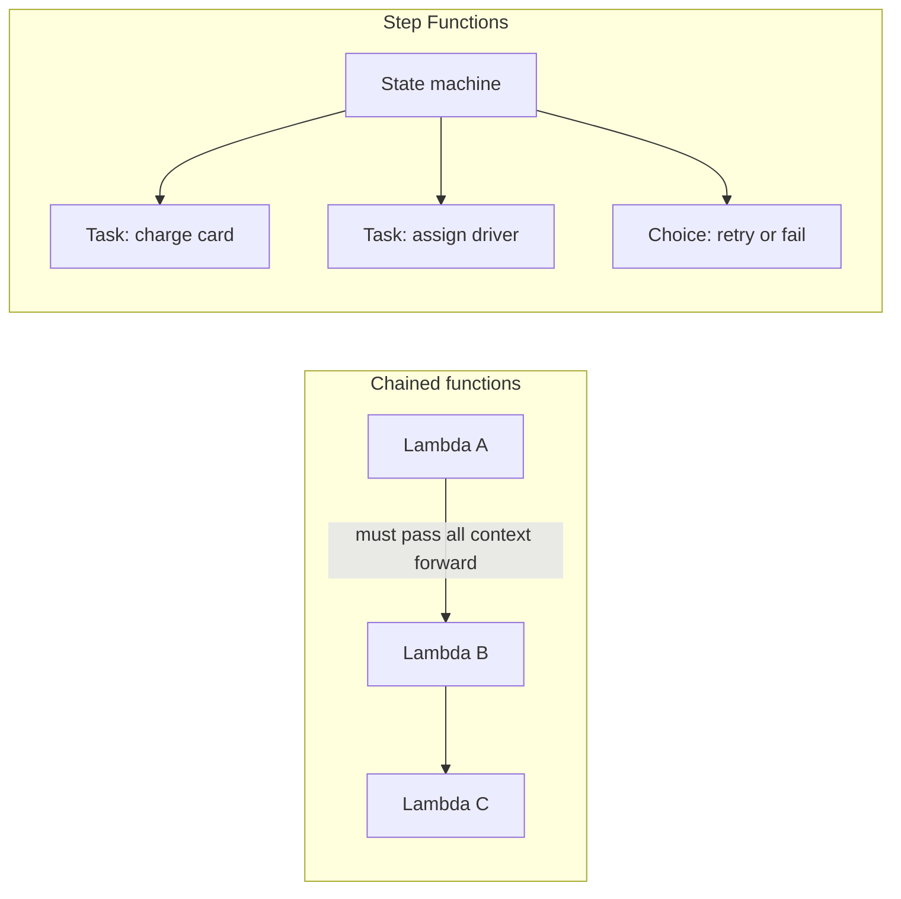
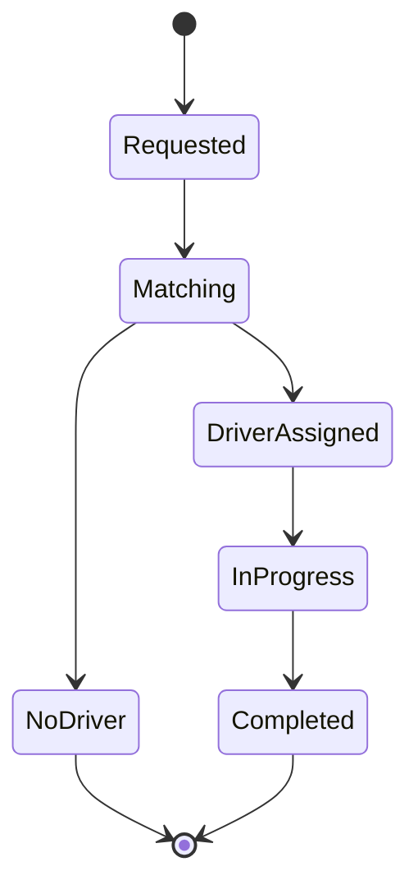
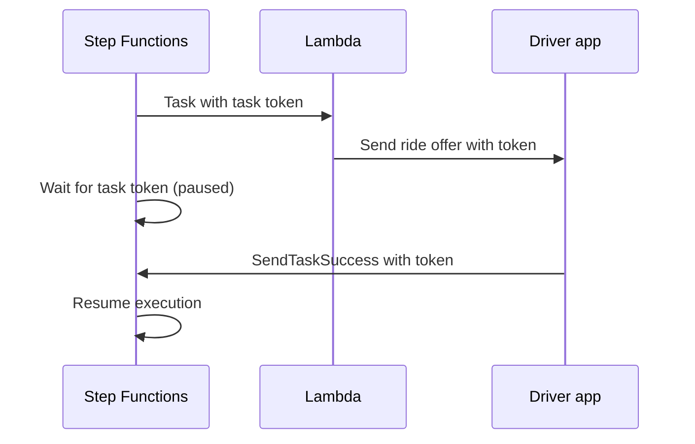

# 04 · Step Functions

> **Phase 4 — Serverless Architectures** · Lesson 04 of 09
> ⬅️ Previous: [API Gateway](./03-api-gateway.md) · ➡️ Next: [EventBridge](./05-eventbridge.md) · 🏠 [Phase overview](./README.md)

## 🎯 Learning Objectives

By the end of this lesson you will be able to:

- Model a business process as an Amazon States Language state machine
- Choose between task types: Lambda, AWS SDK integrations, HTTP, and `.sync` runs
- Handle failures with `Retry` and `Catch` instead of try/catch inside Lambda
- Fan out work with the `Map` state, in both Inline and Distributed modes
- Pick Standard or Express workflows based on duration, semantics, and cost
- Implement human-in-the-loop and long-running flows with the task token callback pattern

**Estimated time:** 80 min · **Difficulty:** Intermediate

---

## 🧠 Core Concepts

**Step Functions** is a state machine as a service. You describe a workflow as JSON in **Amazon States Language (ASL)** — a list of states with transitions between them — and AWS keeps the execution state durably between steps. This differs fundamentally from chaining Lambdas: with chaining, each function must pass forward everything the next function needs, must implement its own retries, and the overall progress lives only in logs and hope. With Step Functions, the orchestrator holds the state, retries the failing step, and shows you exactly where a run stopped.

A **state** is one unit of work or control flow. The ones you will use constantly are `Task` (do something, usually invoke a service), `Choice` (branch on a comparison), `Parallel` (run branches concurrently), `Map` (iterate over an array), `Wait` (delay), `Pass` (reshape data), `Succeed`, and `Fail`.

A **Task** state has a *resource* — what it invokes. Lambda is `arn:aws:lambda:...:function:name`. **Optimized integrations** exist for a set of services with first-class ARNs, so you can call DynamoDB without a Lambda in the middle: `arn:aws:states:::dynamodb:putItem`. The full **AWS SDK integration** namespace covers over 200 services as `arn:aws:states:::aws-sdk:service:action`. Adding `.sync` to a supported integration (for example `arn:aws:states:::ecs:runTask.sync`) makes Step Functions wait for the job to finish and return its output — no polling code required.

Error handling is declarative. A `Retry` block says "on these errors, retry with this backoff this many times"; a `Catch` block says "on these errors, transition to this state instead". The `States.ALL` wildcard matches every error name and must be the last entry in a `Retry` array. Because retries happen inside the orchestrator, your Lambda stays a small, focused function.

**Standard** and **Express** workflows are different products sharing a language. Standard is for long-running, auditable processes: up to one year per execution, exactly-once semantics, full execution history in the console. Express is for high-volume, short-lived work: up to five minutes, at-least-once semantics, and no console history (you use CloudWatch Logs instead).

### Key terminology

| Term | Meaning |
|------|---------|
| **Amazon States Language (ASL)** | The JSON format that defines a state machine |
| **Execution** | One run of a state machine, with its own input and history |
| **Task token** | A unique token that lets an external system resume a paused execution |
| **`.sync`** | Suffix that makes an integration wait for a job to complete |
| **Inline Map** | Map state running in parallel inside the parent execution, up to 40 concurrent iterations |
| **Distributed Map** | Map state that reads a dataset from S3 and processes up to 10,000 items per execution |
| **Express workflow** | High-throughput, short-duration workflow with at-least-once semantics |
| **State transition** | One move from one state to another; the Standard billing unit |

---

## 🗺️ Architecture Diagram

Chained Lambdas versus an orchestrator that owns the state:



The ride lifecycle implemented as a state machine:



The callback pattern, where the workflow pauses and waits for an external system:



---

## 🧪 Hands-on Lab: Orchestrate a Ride with Retry, Catch, and Map

**Goal:** Deploy a Standard state machine that charges a rider, notifies drivers in parallel, and recovers from a failed charge.

**Prerequisites:** Lessons 01 and 03 completed; two Lambda functions, `charge-card` and `notify-driver`; permission to create IAM roles.

### Step 1 — Create the execution role

```bash
# Allow the state machine to invoke Lambda, write logs, and publish to SNS
aws iam create-role \
  --role-name ride-state-machine-role \
  --assume-role-policy-document '{
    "Version": "2012-10-17",
    "Statement": [{
      "Effect": "Allow",
      "Principal": {"Service": "states.amazonaws.com"},
      "Action": "sts:AssumeRole"
    }]
  }'
```

### Step 2 — Write the state machine definition

Save this as `ride-lifecycle.asl.json`. The `Retry` block handles a transient issuer failure; the `Catch` block routes a declined card to a terminal state.

```json
{
  "Comment": "Charge the rider, then notify drivers in parallel",
  "StartAt": "ChargeCard",
  "States": {
    "ChargeCard": {
      "Type": "Task",
      "Resource": "arn:aws:lambda:eu-west-1:123456789012:function:charge-card",
      "Parameters": {
        "rideId.$": "$.rideId",
        "amount.$": "$.fareEstimate"
      },
      "Retry": [
        {
          "ErrorEquals": ["States.TaskFailed", "Lambda.ServiceException"],
          "IntervalSeconds": 2,
          "MaxAttempts": 3,
          "BackoffRate": 2.0
        }
      ],
      "Catch": [
        {
          "ErrorEquals": ["PaymentDeclined"],
          "ResultPath": "$.error",
          "Next": "RideFailed"
        },
        {
          "ErrorEquals": ["States.ALL"],
          "ResultPath": "$.error",
          "Next": "RideFailed"
        }
      ],
      "Next": "NotifyDrivers"
    },
    "NotifyDrivers": {
      "Type": "Map",
      "ItemsPath": "$.nearbyDrivers",
      "MaxConcurrency": 5,
      "ItemProcessor": {
        "ProcessorConfig": {"Mode": "INLINE"},
        "StartAt": "OfferRide",
        "States": {
          "OfferRide": {
            "Type": "Task",
            "Resource": "arn:aws:lambda:eu-west-1:123456789012:function:notify-driver",
            "Parameters": {
              "driverId.$": "$.driverId",
              "rideId.$": "$.rideId"
            },
            "End": true
          }
        }
      },
      "ResultPath": "$.offers",
      "Next": "PersistRide"
    },
    "PersistRide": {
      "Type": "Task",
      "Resource": "arn:aws:states:::dynamodb:putItem",
      "Parameters": {
        "TableName": "rides",
        "Item": {
          "rideId": {"S.$": "$.rideId"},
          "status": {"S": "DRIVER_ASSIGNED"}
        }
      },
      "Next": "RideComplete"
    },
    "RideComplete": {"Type": "Succeed"},
    "RideFailed": {"Type": "Fail", "Error": "RideFailed", "Cause": "Payment declined"}
  }
}
```

Note `PersistRide`: it writes to DynamoDB directly through an optimized integration. No Lambda needed.

### Step 3 — Validate before deploying

```bash
# Catch syntax errors and unreachable states without creating anything
aws stepfunctions validate-state-machine-definition \
  --definition file://ride-lifecycle.asl.json
```

### Step 4 — Create the state machine

```bash
# STANDARD gives exactly-once semantics and up to a year per execution
aws stepfunctions create-state-machine \
  --name ride-lifecycle \
  --type STANDARD \
  --definition file://ride-lifecycle.asl.json \
  --role-arn arn:aws:iam::123456789012:role/ride-state-machine-role \
  --logging-configuration 'level=ALL,includeExecutionData=false,destinations=arn:aws:logs:eu-west-1:123456789012:log-group:/aws/vendedlogs/states/ride-lifecycle' \
  --tracing-configuration enabled=true
```

Set `includeExecutionData=false` unless you need it: execution data can contain personal information.

### Step 5 — Run it

```bash
# Start an execution with a ride request
aws stepfunctions start-execution \
  --state-machine-arn arn:aws:states:eu-west-1:123456789012:stateMachine:ride-lifecycle \
  --name ride-r-1001 \
  --input '{
    "rideId": "r-1001",
    "fareEstimate": 18.50,
    "nearbyDrivers": [{"driverId": "d-1"}, {"driverId": "d-2"}, {"driverId": "d-3"}]
  }'

# Inspect the result
aws stepfunctions describe-execution \
  --execution-arn arn:aws:states:eu-west-1:123456789012:execution:ride-lifecycle:ride-r-1001 \
  --query '{Status:status,Output:output,StartDate:startDate,StopDate:stopDate}'
```

### Step 6 — Try the callback pattern

To pause for a human or an external system, pass `$$.Task.Token` into a task and resume it later.

```json
{
  "WaitForDriverResponse": {
    "Type": "Task",
    "Resource": "arn:aws:lambda:eu-west-1:123456789012:function:offer-ride",
    "Parameters": {
      "rideId.$": "$.rideId",
      "taskToken.$": "$$.Task.Token"
    },
    "TimeoutSeconds": 60,
    "Catch": [{"ErrorEquals": ["States.Timeout"], "Next": "NoDriver"}],
    "Next": "DriverAccepted"
  }
}
```

```bash
# The driver app resumes the paused execution, which can wait up to a year
aws stepfunctions send-task-success \
  --task-token "$TASK_TOKEN" \
  --task-output '{"driverId":"d-2","accepted":true}'

# Or rejects the offer
aws stepfunctions send-task-failure \
  --task-token "$TASK_TOKEN" \
  --error "OfferRejected" \
  --cause "Driver declined the ride"
```

### Step 7 — Verify

```bash
# Find failed executions and step through where they stopped
aws stepfunctions list-executions \
  --state-machine-arn arn:aws:states:eu-west-1:123456789012:stateMachine:ride-lifecycle \
  --status-filter FAILED --max-results 5

# Walk the event history of one execution to see each state transition
aws stepfunctions get-execution-history \
  --execution-arn arn:aws:states:eu-west-1:123456789012:execution:ride-lifecycle:ride-r-1001 \
  --max-results 100 \
  --query 'events[].{Id:id,Type:type,State:stateEnteredEventDetails.name}'
```

Success is an execution that reaches `Succeed`, plus a history showing `TaskScheduled`, `TaskSucceeded`, and `MapIterationStarted` events.

---

## 💻 CLI Reference

```bash
# List state machines and their types
aws stepfunctions list-state-machines --query 'stateMachines[].{Name:name,Type:type}'

# Create an Express workflow for high-volume, short-lived jobs
aws stepfunctions create-state-machine \
  --name ride-events-express --type EXPRESS \
  --definition file://ride-events.asl.json \
  --role-arn arn:aws:iam::123456789012:role/ride-state-machine-role

# Update a definition — the previous version stays available for rollback
aws stepfunctions update-state-machine \
  --state-machine-arn arn:aws:states:eu-west-1:123456789012:stateMachine:ride-lifecycle \
  --definition file://ride-lifecycle-v2.asl.json

# Publish an immutable version so callers can pin to it
aws stepfunctions publish-state-machine-version \
  --state-machine-arn arn:aws:states:eu-west-1:123456789012:stateMachine:ride-lifecycle

# Encrypt execution data with a customer managed KMS key
aws stepfunctions update-state-machine \
  --state-machine-arn arn:aws:states:eu-west-1:123456789012:stateMachine:ride-lifecycle \
  --encryption-configuration '{
    "kmsKeyId": "arn:aws:kms:eu-west-1:123456789012:key/1234abcd-12ab-34cd-56ef-1234567890ab",
    "type": "CUSTOMER_MANAGED_KMS_KEY",
    "kmsDataKeyReusePeriodSeconds": 600
  }'

# Run a child workflow and wait for it to finish before continuing
aws stepfunctions start-sync-execution \
  --state-machine-arn arn:aws:states:eu-west-1:123456789012:stateMachine:driver-onboarding \
  --input '{"driverId":"d-2"}'

# Stop a runaway execution
aws stepfunctions stop-execution \
  --execution-arn arn:aws:states:eu-west-1:123456789012:execution:ride-lifecycle:ride-r-1001 \
  --cause "Rider canceled"

# Inspect the definition actually deployed
aws stepfunctions describe-state-machine \
  --state-machine-arn arn:aws:states:eu-west-1:123456789012:stateMachine:ride-lifecycle \
  --query definition --output text
```

| Command | Purpose |
|---------|---------|
| `validate-state-machine-definition` | Catch ASL errors before deploying |
| `create-state-machine --type EXPRESS` | Deploy a high-throughput workflow |
| `start-sync-execution` | Run and wait for a child workflow |
| `send-task-success` / `send-task-failure` | Resume a paused callback task |
| `get-execution-history` | Debug exactly which state failed |
| `publish-state-machine-version` | Pin callers to an immutable definition |
| `--encryption-configuration` | Encrypt execution data with your own KMS key |

A SAM definition keeps the state machine in version control:

```yaml
Resources:
  RideStateMachine:
    Type: AWS::Serverless::StateMachine
    Properties:
      Name: ride-lifecycle
      Type: STANDARD
      DefinitionUri: statemachine/ride-lifecycle.asl.json
      Role: !GetAtt RideStateMachineRole.Arn
      Tracing:
        Enabled: true
      Events:
        EveryFiveMinutes:
          Type: Schedule
          Properties:
            Schedule: rate(5 minutes)
```

---

## ✅ Best Practices

| Practice | Why it matters |
|----------|----------------|
| Orchestrate, do not compute, in Step Functions | Keep branching logic in ASL and business logic in Lambda |
| Set `Retry` with exponential backoff on every external call | Transient failures should not fail an execution |
| Always end `Retry`/`Catch` chains with `States.ALL` | Guarantees no error escapes unhandled |
| Use `ResultPath` to keep the original input | Downstream states keep the full context |
| Prefer optimized integrations over Lambda wrappers | Fewer moving parts, one less cold start, no glue code |
| Use Expressions (`$`) for payload shaping | `"rideId.$": "$.detail.rideId"` replaces a Lambda transform |
| Choose Express when a run is under five minutes and high volume | Roughly 25× cheaper per execution at high volume |
| Set `MaxConcurrency` on Map states | Protects downstream databases from sudden fan-out |
| Enable CloudWatch Logs with `includeExecutionData=false` | Observability without leaking payloads |
| Use `TimeoutSeconds` on callback tasks | A lost callback otherwise pauses an execution for up to a year |

---

## ⚠️ Common Pitfalls

| Pitfall | Symptom | Fix |
|---------|---------|-----|
| `States.ALL` not last in a `Retry` array | Deployment fails with a validation error | Order `Retry` entries from specific to general |
| JSONPath starting with `$` but written as a literal | Task receives the string `$.rideId` | Use the `.$` suffix on keys whose values are paths |
| Lambda errors not classified | `Catch` never fires because the error name is `States.TaskFailed` | Match on `States.TaskFailed` or the error your function raises |
| Runtime exceeding the state machine limit | Express run fails at five minutes | Move long work to Standard, or use `.sync` |
| Payload above 256 KB | `The state/task returned a result with a size exceeding the maximum` | Write large payloads to S3 and pass the key |
| Map state with more than 40 inline iterations | `The Map state 'X' has too many items` | Use Distributed Map for larger datasets |
| Expecting Express history in the console | Executions show no history | Configure CloudWatch Logs logging on the state machine |
| Task token never returned | Execution stays `RUNNING` until timeout | Set `TimeoutSeconds` and catch `States.Timeout` |
| Retries inside Lambda *and* in ASL | Double retries multiply load on a failing dependency | Retry in one place — preferably ASL |

---

## 💰 Cost Considerations

**Standard** workflows cost **$0.025 per 1,000 state transitions**, with 4,000 transitions free each month. **Express** workflows cost **$1.00 per million requests** plus **$0.00001667 per GB-second** of execution duration.

Compare a 10-transition orchestration at 1 million executions per month:

- Standard: `1,000,000 × 10 / 1,000 × $0.025 = $250`
- Express (1 million executions, 2 seconds each, 64 MB): `$1.00` plus `1,000,000 × 2 × 0.0625 GB-s × $0.00001667 ≈ $2.08` — about **$3**

That is why Express exists. The catch: Express has five-minute duration limits and at-least-once semantics, so it is unsuitable for payment or inventory flows where a duplicated step is unacceptable.

The hidden cost of Step Functions is usually the *work* it triggers, not the transitions. An unbounded `Map` with `MaxConcurrency` unset can invoke thousands of concurrent Lambdas at once. Distributed Map charges per state transition for items processed, so a 10 million item Map is a 10 million transition bill on Standard.

What drives the bill: number of state transitions per execution (Standard) or executions plus GB-seconds (Express). Fold trivial `Pass` and `Choice` states together and keep payloads small to hold transitions down.

---

## 🔐 Security Considerations

- **CloudWatch Logs AI2 policy.** Step Functions writes execution logs through the `AWSLambdaRole`-style trust relationship; if you change the state machine's logging configuration, update the log-delivery resource policy or logging silently stops.
- **Turn off `includeExecutionData` by default.** With the flag enabled, full inputs and outputs are written to CloudWatch Logs, where they may contain personal data, tokens, or card details.
- **Encrypt execution data with a customer managed KMS key** when payloads contain regulated data. This also lets you control key rotation and revocation independently of AWS.
- **Treat task tokens as bearer credentials.** Anyone with the token can resume the execution. Send them over an authenticated channel and never log them.
- **Scope the execution role tightly.** A state machine calling `dynamodb:putItem` on one table should not also have `dynamodb:*`, and `iam:PassRole` should be limited to specific role ARNs.
- **Block cross-account `StartExecution`** unless intended. Resource policies on the state machine are the control point, and identity-based policies alone do not restrict other accounts.
- **Do not put secrets in the state machine definition.** `Parameters` are stored in plaintext in the definition; fetch secrets inside a Lambda task instead.
- **Set `TimeoutSeconds` on every callback task** so a leaked or lost token cannot hold an execution open for a year.

---

## 🧩 Exercise

Extend `ride-lifecycle` with an `AssignDriver` step that uses the callback pattern, a `Choice` state that branches on whether the driver accepted within 60 seconds, and a Distributed Map that reads a driver list from an S3 object using `ItemReader` with `"Resource": "arn:aws:states:::s3:getObject"`. Add a `Fail` state for the no-driver case, and stop the execution cleanly.

Success looks like: starting an execution with a driver list in S3 produces a `SUCCEEDED` execution whose history contains `MapRunStarted` and `MapRunSucceeded` events, and a run where no driver accepts ends in the `NoDriver` state without a timeout error.

---

## 📚 Resources

- [AWS Step Functions Developer Guide](https://docs.aws.amazon.com/step-functions/latest/dg/welcome.html)
- [Amazon States Language specification](https://states-language.net/spec.html)
- [Service integration patterns](https://docs.aws.amazon.com/step-functions/latest/dg/connect-to-resource.html)
- [Map state and Distributed Map](https://docs.aws.amazon.com/step-functions/latest/dg/state-map.html)
- [Error handling with Retry and Catch](https://docs.aws.amazon.com/step-functions/latest/dg/concepts-error-handling.html)
- [Choosing between Standard and Express workflows](https://docs.aws.amazon.com/step-functions/latest/dg/concepts-standard-vs-express.html)
- [Step Functions pricing](https://aws.amazon.com/step-functions/pricing/)

---

## ➡️ Next Steps

Step Functions is *directed* orchestration: you decide the order of every step. The next lesson covers *choreography* — EventBridge lets services react to facts that already happened, without either service knowing about the other.

> ⬅️ Previous: [API Gateway](./03-api-gateway.md) · ➡️ Next: [EventBridge](./05-eventbridge.md) · 🏠 [Phase overview](./README.md)
