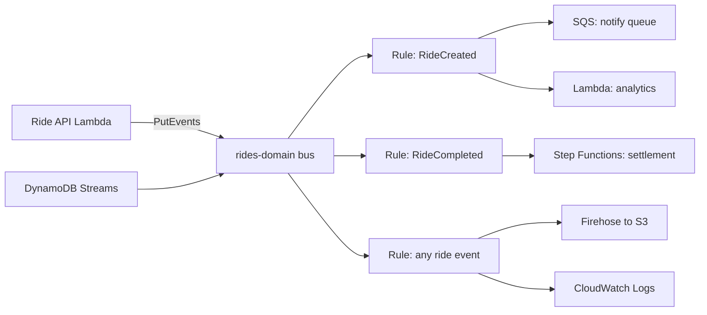
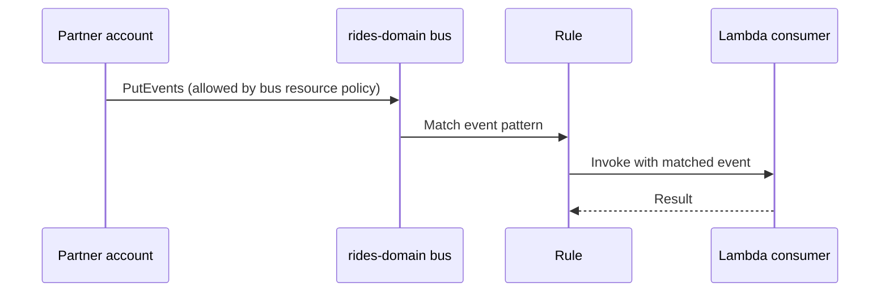
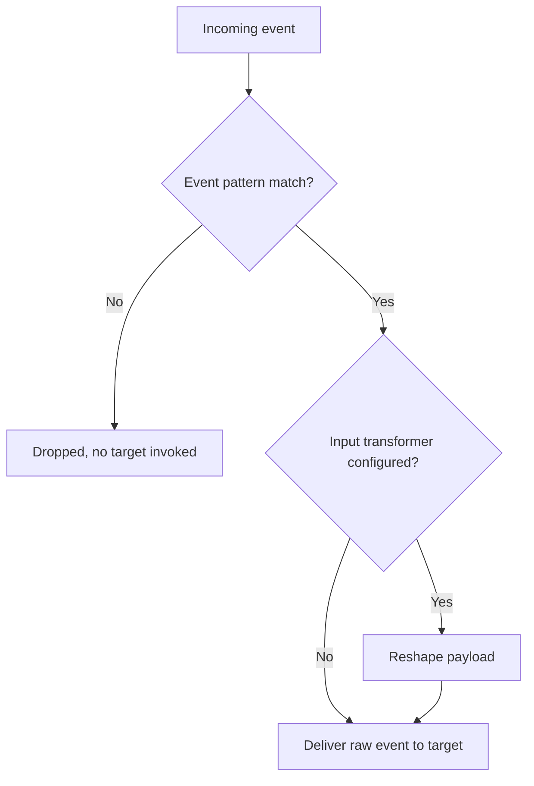

# 05 · EventBridge

> **Phase 4 — Serverless Architectures** · Lesson 05 of 09
> ⬅️ Previous: [Step Functions](./04-step-functions.md) · ➡️ Next: [Amazon SQS](./06-amazon-sqs.md) · 🏠 [Phase overview](./README.md)

## Learning Objectives

By the end of this lesson you will be able to:

- Explain event buses, rules, and why content-based routing beats direct invocation
- Write event patterns that match on source, detail type, and nested detail fields
- Route events to multiple targets and reshape payloads with input transformers
- Run recurring work with scheduled rules and EventBridge Scheduler
- Route events across accounts safely, and archive and replay them after an incident
- Discover event schemas, and connect two services point-to-point with EventBridge Pipes

**Estimated time:** 75 min · **Difficulty:** Intermediate

---

## Core Concepts

**EventBridge** is a serverless event bus. Producers call `PutEvents` with a structured event; EventBridge matches that event against every **rule** on the bus and delivers a copy to each rule's **targets**. Producers never learn who consumes their events, and consumers never learn who produces them. That decoupling is the whole point: you can add a fraud-check consumer next quarter without touching the ride-creation code.

An event has a fixed envelope. `Source`, `DetailType`, `Detail` (a free-form JSON object), plus `Time`, `Id`, `Account`, and `Region`. Rules match on the envelope and on fields inside `Detail` using an **event pattern** — a JSON structure where arrays mean "any of these values" and the whole pattern is ANDed together.

An **event bus** is a namespace for events. Every account has a **default bus** that receives AWS service events (S3 object created, EC2 state change, and so on) automatically. **Custom buses** carry your own domain events and are where you should put application traffic. **Partner buses** receive events from SaaS providers. Custom events on custom buses are billed; AWS service events are free.

Rules have targets: Lambda functions, SQS queues, SNS topics, Step Functions state machines, Kinesis streams, Firehose delivery streams, API Gateway endpoints, ECS tasks, and more. A single rule can have up to five targets, and an **input transformer** lets you reshape the event before it reaches each target, so one event can be delivered in five different shapes.

Two features separate EventBridge from a simple fan-out service. **Archive and replay** stores events from a bus for up to 30 days and lets you re-deliver them to a rule later — invaluable when a consumer had a bug and you need to re-process the last six hours. **Schema registry** discovers the shape of the events flowing on your bus and can generate code bindings in TypeScript, Python, and Java from them.

### Key terminology

| Term | Meaning |
|------|---------|
| **Event bus** | A namespace for events: default, custom, or partner |
| **Rule** | A pattern plus a list of targets; each matching event is delivered to every target |
| **Event pattern** | JSON that matches on envelope fields and nested detail fields |
| **Input transformer** | `InputPathsMap` plus `InputTemplate` to reshape the payload per target |
| **Archive** | Stored events kept from a bus, up to 30 days of retention |
| **Replay** | Re-delivering archived events to a rule |
| **Schema registry** | Discovered event schemas with generated code bindings |
| **EventBridge Pipes** | Point-to-point source to filter to enrichment to target, without glue code |
| **EventBridge Scheduler** | The newer, higher-quota service for scheduled invocations |

---

## Architecture Diagram

One domain event, many consumers, nobody coupled:



Cross-account routing, where a partner account publishes onto your bus:



How a rule filters before paying for a target invocation:



---

## Hands-on Lab: A Domain Event Bus with Rules, Archives, and Replay

**Goal:** Publish ride events to a custom bus, route them to different targets with transformed payloads, then archive and replay them.

**Prerequisites:** Lesson 01 completed; a Lambda function and an SQS queue you can use as targets.

### Step 1 — Create the bus

```bash
# A custom bus carries your own domain events
aws events create-event-bus --name rides-domain
```

### Step 2 — Publish an event

```bash
# PutEvents accepts up to 10 entries per call; each entry is one event
aws events put-events --entries '[{
  "Source": "ridenow.rides",
  "DetailType": "RideCreated",
  "Detail": "{\"rideId\":\"r-1001\",\"city\":\"Berlin\",\"fare\":18.50,\"riderTier\":\"gold\"}",
  "EventBusName": "rides-domain"
}]'
```

A successful call returns `FailedEntryCount: 0`. A non-zero count means at least one entry was rejected — check `Entries` in the response for `ErrorCode` and `ErrorMessage`.

### Step 3 — Create a rule with a content-based pattern

Save this as `ride-created-pattern.json`:

```json
{
  "source": ["ridenow.rides"],
  "detail-type": ["RideCreated"],
  "detail": {
    "city": ["Berlin", "Munich"],
    "fare": [{"numeric": [">", 15]}],
    "riderTier": ["gold", {"prefix": "plat"}]
  }
}
```

```bash
aws events put-rule \
  --name ride-created-high-value \
  --event-bus-name rides-domain \
  --event-pattern file://ride-created-pattern.json \
  --description "High-value rides in German cities"
```

Test the pattern against a sample event **before** wiring up targets:

```bash
# Reports whether a specific event would match the pattern
aws events test-event-pattern \
  --event-pattern file://ride-created-pattern.json \
  --event file://sample-event.json
```

### Step 4 — Add targets with an input transformer

The consumer only needs three fields, so send it exactly three fields:

```bash
aws events put-targets \
  --rule ride-created-high-value \
  --event-bus-name rides-domain \
  --targets '[{
    "Id": "notify-queue",
    "Arn": "arn:aws:sqs:eu-west-1:123456789012:rides-notify",
    "InputTransformer": {
      "InputPathsMap": {
        "ride": "$.detail.rideId",
        "city": "$.detail.city",
        "fare": "$.detail.fare"
      },
      "InputTemplate": "{\"rideId\": <ride>, \"city\": <city>, \"fare\": <fare>, \"channel\": \"push\"}"
    }
  },{
    "Id": "analytics-lambda",
    "Arn": "arn:aws:lambda:eu-west-1:123456789012:function:ride-analytics"
  }]'
```

### Step 5 — Add a scheduled rule

```bash
# A rate expression runs on a fixed interval from when the rule is created
aws events put-rule --name nightly-settlement --schedule-expression "cron(0 2 * * ? *)"

aws events put-targets \
  --rule nightly-settlement \
  --targets '[{
    "Id": "settlement-state-machine",
    "Arn": "arn:aws:states:eu-west-1:123456789012:stateMachine:nightly-settlement",
    "RoleArn": "arn:aws:iam::123456789012:role/events-invoke-role"
  }]'
```

For anything new, prefer EventBridge Scheduler, which has higher quotas, timezone support, and one-time schedules:

```bash
# Scheduler needs a role it can assume to invoke the target
aws scheduler create-schedule \
  --name rides-daily-report \
  --schedule-expression "cron(0 7 * * ? *)" \
  --schedule-expression-timezone "Europe/Berlin" \
  --flexible-time-window '{"Mode":"OFF"}' \
  --target '{
    "Arn": "arn:aws:lambda:eu-west-1:123456789012:function:rides-daily-report",
    "RoleArn": "arn:aws:iam::123456789012:role/scheduler-invoke-role"
  }'
```

### Step 6 — Archive the bus

```bash
# Keep every event on the bus for 30 days so you can replay after a bad deploy
aws events create-archive \
  --archive-name rides-domain-archive \
  --event-source-arn arn:aws:events:eu-west-1:123456789012:event-bus/rides-domain \
  --retention-days 30 \
  --description "Ride domain events for replay"
```

### Step 7 — Replay after an incident

```bash
# Re-deliver a time window of archived events to a specific rule
aws events start-replay \
  --replay-name ride-created-replay-1 \
  --event-source-arn arn:aws:events:eu-west-1:123456789012:event-bus/rides-domain \
  --destination '{
    "Arn": "arn:aws:events:eu-west-1:123456789012:event-bus/rides-domain",
    "FilterArns": ["arn:aws:events:eu-west-1:123456789012:rule/rides-domain/ride-created-high-value"]
  }' \
  --event-start-time "2026-10-14T00:00:00Z" \
  --event-end-time "2026-10-14T06:00:00Z"
```

### Step 8 — Grant another account permission to publish

```bash
# The bus resource policy is what allows a different account to call PutEvents
aws events put-permission \
  --event-bus-name rides-domain \
  --action events:PutEvents \
  --principal 222222222222 \
  --statement-id AllowPartnerAccount
```

### Step 9 — Verify

```bash
# Confirm the rule exists and is enabled
aws events describe-rule --name ride-created-high-value --event-bus-name rides-domain

# Confirm targets and their transformers
aws events list-targets-by-rule \
  --rule ride-created-high-value --event-bus-name rides-domain

# Look for successful deliveries in the metrics
aws cloudwatch get-metric-statistics \
  --namespace AWS/Events --metric-name SuccessfulInvocationAttempts \
  --dimensions Name=RuleName,Value=ride-created-high-value \
  --start-time "$(date -u -v-1H +%Y-%m-%dT%H:%M:%SZ)" \
  --end-time "$(date -u +%Y-%m-%dT%H:%M:%SZ)" \
  --period 300 --statistics Sum
```

Success is `State: ENABLED`, two targets listed, and a non-zero `SuccessfulInvocationAttempts` sum within a minute of publishing the event.

---

## CLI Reference

```bash
# List every bus, including partner buses
aws events list-event-buses

# List the rules on a custom bus
aws events list-rules --event-bus-name rides-domain

# Disable a rule without deleting it
aws events disable-rule --name ride-created-high-value --event-bus-name rides-domain

# Add a dead-letter queue so dropped events are recoverable
aws events put-targets \
  --rule ride-created-high-value --event-bus-name rides-domain \
  --targets '[{
    "Id": "notify-queue",
    "Arn": "arn:aws:sqs:eu-west-1:123456789012:rides-notify",
    "DeadLetterConfig": {"Arn": "arn:aws:sqs:eu-west-1:123456789012:rides-dlq"},
    "RetryPolicy": {"MaximumRetryAttempts": 10, "MaximumEventAgeInSeconds": 3600}
  }]'

# Send events to an external HTTPS endpoint through a connection
aws events create-connection \
  --name partner-webhook \
  --authorization-type API_KEY \
  --auth-parameters '{"ApiKeyAuthParameters":{"ApiKeyName":"x-api-key","ApiKeyValue":"REPLACE_ME"}}'

aws events create-api-destination \
  --name partner-webhook-dest \
  --invocation-endpoint https://partner.example.com/hooks/rides \
  --http-method POST \
  --connection-arn arn:aws:events:eu-west-1:123456789012:connection/partner-webhook/abc123

# Discover event schemas from the bus
aws schemas create-discoverer \
  --source-arn arn:aws:events:eu-west-1:123456789012:event-bus/rides-domain

aws schemas list-schemas --registry-name discovered-schemas

# Check replay status
aws events describe-replay --replay-name ride-created-replay-1

# Connect SQS to a Lambda with a filter and an enrichment step, no glue code
aws pipes create-pipe \
  --name rides-enrichment-pipe \
  --source arn:aws:sqs:eu-west-1:123456789012:rides-raw \
  --target arn:aws:lambda:eu-west-1:123456789012:function:ride-enricher \
  --role-arn arn:aws:iam::123456789012:role/pipes-execution-role \
  --source-parameters '{"SqsQueueParameters":{"BatchSize":10}}'
```

| Command | Purpose |
|---------|---------|
| `put-events` | Publish up to 10 events in one call |
| `test-event-pattern` | Dry-run a pattern against a sample event |
| `put-targets` | Attach up to five targets, each with its own transformer and DLQ |
| `create-archive` / `start-replay` | Capture and re-deliver events after an incident |
| `put-permission` | Let another account publish onto your bus |
| `create-connection` / `create-api-destination` | Deliver events to external HTTPS endpoints |
| `pipes create-pipe` | Wire source to target with optional filtering and enrichment |

---

## Best Practices

| Practice | Why it matters |
|----------|----------------|
| Use custom buses for application events | Keeps your domain traffic separate from the noisy default bus |
| Name events deliberately: `Source` plus `DetailType` | Consumers match on names, so treat them as a public API |
| Version your event schemas | Lets consumers support old and new shapes during a migration |
| Attach a DLQ to every target | Undeliverable events are otherwise lost after 24 hours of retries |
| Layer rules for broad and narrow consumers | One narrow rule per concern beats one rule with complex patterns |
| Prefer `test-event-pattern` before deploying | Catches pattern mistakes that would silently drop events |
| Use input transformers to trim payloads | Reduces cost and leaks nothing the consumer does not need |
| Archive high-value buses | Makes replay-ability a design property rather than luck |
| Prefer Scheduler over scheduled rules for new work | Higher quotas, timezone support, one-time schedules |
| Use Pipes instead of a Lambda that only copies data | Cheaper and less code for pure source-to-target plumbing |

---

## Common Pitfalls

| Pitfall | Symptom | Fix |
|---------|---------|-----|
| Pattern uses exact string where a list is intended | Only one city ever matches | Pattern arrays are ORed; a bare string is a single equality |
| Rule matches but nothing arrives | `Invocations` metric flat while `MatchedEvents` rises | Check the target's resource policy and the rule's target list |
| Missing Lambda permission | `InvocationAttempts` fails with a permission error | Add `events.amazonaws.com` to the function's resource policy |
| Assuming ordered delivery | Events arrive out of order | EventBridge does not guarantee ordering; include a timestamp |
| Assuming exactly-once | A duplicate notification is sent | Consumers must be idempotent |
| Detail is sent as a JSON object, not a string | `ValidationException: Detail must be a string` | Stringify `Detail` in `put-events` |
| Scheduled rule expression in local time | Job runs six hours off | Cron expressions are UTC; use Scheduler for timezones |
| Archive created after the incident | Nothing to replay | Create archives before you need them |
| Using the default bus for high-volume domain events | Hard to reason about and slower to debug | Dedicate a custom bus |

---

## Cost Considerations

Publishing **custom and partner events** costs **$1.00 per million events**. **AWS service events on the default bus are free** — a high-volume S3 bucket emitting millions of object-created events costs nothing at the bus. Cross-account deliveries are billed as custom events.

Costs per event on a custom bus: `$1.00 / 1,000,000 = $0.000001`. A million ride events per month is about **$1.00**. At 500 million events per month, that is $500 — and at that volume you should be asking whether every event needs to be published, or whether some can be batched.

The features around the bus cost more than the bus itself:

| Feature | Price | Notes |
|---------|-------|-------|
| Archive storage | $0.10 per GB-month | 30-day retention max |
| Replay | $1.00 per million events replayed | Charged on top of delivery to targets |
| Scheduler | $1.00 per million invocations | Includes free tier of 14 million per month |
| Pipes | $0.40 per million events processed | Plus the source, enrichment, and target costs |
| API destinations | Billed per million events delivered, plus data transfer | External HTTP delivery |

Schema registry and schema discovery add no charge.

What drives the bill: how many events you publish, how many times you replay them, and the cost of the *targets* those events invoke. A rule with a Lambda target effectively doubles the cost per event once you count the invocation, which is why input transformers and precise patterns matter.

---

## Security Considerations

- **Bus resource policies are the cross-account control.** Use `put-permission` with a specific `principal`, and add a `Condition` limiting it to a `aws:PrincipalOrgID` so only accounts in your organization can publish.
- **Never trust event content.** Anything can call `PutEvents` on a bus you exposed. Validate `detail` fields in the consumer and treat `account` and `source` as claims to check, not facts.
- **Use an encrypted archive.** Archives are encrypted with an AWS-owned key by default; supply a customer managed KMS key when events contain regulated data.
- **Prefer HTTPS targets with connections.** API destination credentials are stored in a connection, which keeps secrets out of rule definitions.
- **Do not put secrets in `Detail`.** Events are logged by targets, archived, and often copied to data lakes. Put a reference (an ARN or key) instead of the sensitive value.
- **Restrict `events:PutEvents` on producer roles** to the specific bus ARN; a wide-open policy lets a compromised function pollute your domain bus with arbitrary events.
- **Set `MaximumEventAgeInSeconds` on target retry policies** so a stuck target does not replay stale events for 24 hours.
- **Monitor with CloudWatch alarms on `FailedInvocations`** — a rule that silently fails to deliver is worse than a service that is down, because nothing pages you.

---

## Exercise

Create a second custom bus named `payments-domain`, add a rule that matches only `PaymentFailed` events with `detail.amount` greater than 100, and route it to both an SQS queue and a Step Functions state machine. Give each target a different input transformer, attach a DLQ to the state machine target, then publish five events — two matching, three not — and confirm with `describe-replay`, metrics, and queue depth that exactly two reached the queue.

Success looks like: `aws sqs get-queue-attributes --attribute-names ApproximateNumberOfMessages` reports `2`, and the state machine shows two new executions derived from one event source.

---

## Resources

- [Amazon EventBridge User Guide](https://docs.aws.amazon.com/eventbridge/latest/userguide/eb-what-is.html)
- [Event patterns](https://docs.aws.amazon.com/eventbridge/latest/userguide/eb-event-patterns.html)
- [Input transformers](https://docs.aws.amazon.com/eventbridge/latest/userguide/eb-transform-target-input.html)
- [Archive and replay](https://docs.aws.amazon.com/eventbridge/latest/userguide/eb-archive.html)
- [EventBridge Pipes](https://docs.aws.amazon.com/eventbridge/latest/userguide/eb-pipes.html)
- [EventBridge Scheduler](https://docs.aws.amazon.com/scheduler/latest/UserGuide/what-is-scheduler.html)
- [EventBridge pricing](https://aws.amazon.com/eventbridge/pricing/)

---

## Next Steps

EventBridge is a many-to-many router: it does not store work, and it drops events nobody matches. The next lesson covers the queue that absorbs bursts, guarantees delivery through retries, and gives Lambda somewhere to pull work from at its own pace.

> ⬅️ Previous: [Step Functions](./04-step-functions.md) · ➡️ Next: [Amazon SQS](./06-amazon-sqs.md) · 🏠 [Phase overview](./README.md)
