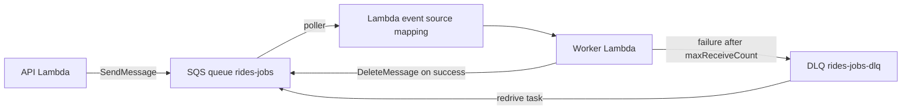
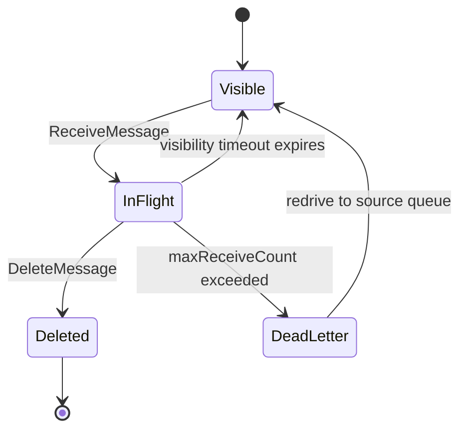

# 06 · Amazon SQS

> **Phase 4 — Serverless Architectures** · Lesson 06 of 09
> ⬅️ Previous: [EventBridge](./05-eventbridge.md) · ➡️ Next: [Amazon SNS](./07-amazon-sns.md) · 🏠 [Phase overview](./README.md)

## Learning Objectives

By the end of this lesson you will be able to:

- Explain how visibility timeout, long polling, and the receive-delete cycle work
- Choose between standard and FIFO queues for a given workload
- Configure dead-letter queues and redrive messages back for reprocessing
- Wire SQS to Lambda with an event source mapping, and handle partial batch failures
- Make consumers idempotent, and reason about how Lambda scales on a queue

**Estimated time:** 75 min · **Difficulty:** Intermediate

---

## Core Concepts

**Amazon SQS** is a fully managed message queue. A producer calls `SendMessage`; the message is stored redundantly across multiple Availability Zones; a consumer calls `ReceiveMessage`, processes the message, and calls `DeleteMessage`. If the consumer never deletes it — because it crashed, timed out, or ran out of memory — the message becomes visible again and another consumer receives it. That single behavior is what makes SQS reliable: **delivery is guaranteed, processing is retried**.

When a consumer receives a message it becomes **in flight** and invisible to other consumers for the duration of the **visibility timeout**. The default is 30 seconds. Set it too low and a slow consumer's message reappears while it is still being processed, producing duplicate work. Set it too high and a crash means a long wait before retry. The standard guidance is six times your consumer's p99 processing time, and it can be extended mid-flight with `ChangeMessageVisibility` for long jobs.

**Long polling** changes how `ReceiveMessage` behaves. With `WaitTimeSeconds` at 0 the call returns immediately, often empty. With 20 seconds, the call waits until a message arrives — fewer API calls, lower cost, and near-instant delivery. Always use long polling.

**Standard** queues offer effectively unlimited throughput and at-least-once delivery, which means occasional duplicates and no ordering. **FIFO** queues guarantee exactly-once processing and strict ordering within a **message group**, at the cost of throughput and a name ending in `.fifo`. FIFO achieves ordering by requiring a `MessageGroupId`: messages in the same group are delivered in order, and independent groups are processed in parallel.

A **dead-letter queue (DLQ)** is just another queue that receives messages that failed too many times. The **redrive policy** on the source queue sets `maxReceiveCount`; after that many failed receives the message moves to the DLQ with its original metadata intact. From there you can inspect it, fix the bug, and **redrive** the messages back to the source with a message move task — far better than losing them.

### Key terminology

| Term | Meaning |
|------|---------|
| **Visibility timeout** | How long a received message stays invisible to other consumers |
| **In flight** | Received but not yet deleted; counts against the in-flight limit |
| **Long polling** | `ReceiveMessage` waiting up to 20 seconds for a message |
| **Message group ID** | FIFO ordering key; messages in one group are strictly ordered |
| **Deduplication ID** | FIFO key that suppresses duplicates within a five-minute window |
| **Redrive policy** | `maxReceiveCount` plus the DLQ ARN |
| **Partial batch failure** | Response that tells Lambda which records in a batch failed |
| **Event source mapping** | Lambda's poller that reads a queue and invokes your function |

---

## Architecture Diagram

The full path of a message, including the failure branch:



The message lifecycle inside the queue:



How Lambda scales on an SQS queue:

```mermaid
flowchart TD
    depth["Queue depth grows"] --> add["Lambda adds up to 60 pollers per minute"]
    add --> cap{"Reached MaximumConcurrency or account limit?"}
    cap -->|"No" --> more["More concurrent workers"]
    cap -->|"Yes"| hold["Queue absorbs the backlog"]
    hold --> drain["Pollers drain the backlog as capacity frees up"]
```

---

## Hands-on Lab: A Reliable Queue with a DLQ and Partial Batch Failures

**Goal:** Build a queue that retries failures, moves poison messages to a DLQ, and processes batches without reprocessing successful records.

**Prerequisites:** Lesson 01 completed; permission to create queues and modify Lambda functions.

### Step 1 — Create the DLQ first

```bash
# The DLQ must exist before the redrive policy can reference it
aws sqs create-queue \
  --queue-name rides-jobs-dlq \
  --attributes MessageRetentionPeriod=1209600
```

Retention of 14 days on the DLQ gives you a fortnight to notice and fix a broken consumer.

### Step 2 — Create the source queue

Create `queue-attributes.json`:

```json
{
  "VisibilityTimeout": "90",
  "MessageRetentionPeriod": "345600",
  "ReceiveMessageWaitTimeSeconds": "20",
  "RedrivePolicy": "{\"deadLetterTargetArn\":\"arn:aws:sqs:eu-west-1:123456789012:rides-jobs-dlq\",\"maxReceiveCount\":\"3\"}"
}
```

```bash
aws sqs create-queue --queue-name rides-jobs --attributes file://queue-attributes.json
```

`VisibilityTimeout` of 90 seconds assumes a Lambda timeout of about 15 seconds — six times the processing time. `ReceiveMessageWaitTimeSeconds` of 20 turns on long polling for every consumer of this queue.

### Step 3 — Send messages

```bash
# A single message
aws sqs send-message \
  --queue-url https://sqs.eu-west-1.amazonaws.com/123456789012/rides-jobs \
  --message-body '{"rideId":"r-1001","action":"match"}'

# Up to 10 messages per batch call — 10x fewer API requests
cat > entries.json <<'JSON'
[
  {"Id": "m1", "MessageBody": "{\"rideId\":\"r-1002\",\"action\":\"match\"}"},
  {"Id": "m2", "MessageBody": "{\"rideId\":\"r-1003\",\"action\":\"match\"}"}
]
JSON

aws sqs send-message-batch \
  --queue-url https://sqs.eu-west-1.amazonaws.com/123456789012/rides-jobs \
  --entries file://entries.json
```

### Step 4 — Wire Lambda to the queue with partial batch failures

```bash
# Batch of 10, a 5-second batching window, and partial batch response reporting
aws lambda create-event-source-mapping \
  --function-name rides-worker \
  --event-source-arn arn:aws:sqs:eu-west-1:123456789012:rides-jobs \
  --batch-size 10 \
  --maximum-batching-window-in-seconds 5 \
  --function-response-types ReportBatchItemFailures \
  --scaling-config MaximumConcurrency=20
```

`ReportBatchItemFailures` changes everything about failure handling: instead of returning the whole batch to the queue, Lambda deletes the records you did not list and returns only the failed ones.

```python
import json
import logging
import os

logger = logging.getLogger()
logger.setLevel(os.environ.get("LOG_LEVEL", "INFO"))


def handler(event, context):
    failures = []

    for record in event["Records"]:
        message_id = record["messageId"]
        try:
            body = json.loads(record["body"])
            logger.info("processing %s", body["rideId"])
            match_ride(body["rideId"])
        except Exception:
            # Only this record goes back to the queue for retry
            logger.exception("failed to process %s", message_id)
            failures.append({"itemIdentifier": message_id})

    return {"batchItemFailures": failures}


def match_ride(ride_id: str) -> None:
    if ride_id.endswith("999"):
        raise ValueError("poison message")
```

### Step 5 — Prove the DLQ works

```bash
# Send a message that always fails, then let it exhaust its three receives
aws sqs send-message \
  --queue-url https://sqs.eu-west-1.amazonaws.com/123456789012/rides-jobs \
  --message-body '{"rideId":"r-9999","action":"match"}'

# Watch the DLQ fill up
watch -n 10 "aws sqs get-queue-attributes \
  --queue-url https://sqs.eu-west-1.amazonaws.com/123456789012/rides-jobs-dlq \
  --attribute-names ApproximateNumberOfMessages"

# Inspect the poison message, including the original receipt history
aws sqs receive-message \
  --queue-url https://sqs.eu-west-1.amazonaws.com/123456789012/rides-jobs-dlq \
  --max-number-of-messages 1 --attribute-names All
```

### Step 6 — Redrive messages back

```bash
# Move everything from the DLQ back to the source queue after deploying a fix
aws sqs start-message-move-task \
  --source-arn arn:aws:sqs:eu-west-1:123456789012:rides-jobs-dlq \
  --destination-arn arn:aws:sqs:eu-west-1:123456789012:rides-jobs

# Track the move task
aws sqs list-message-move-tasks \
  --source-arn arn:aws:sqs:eu-west-1:123456789012:rides-jobs-dlq
```

### Step 7 — Try a FIFO queue

```bash
# FIFO requires the .fifo suffix and content-based deduplication to be enabled
aws sqs create-queue \
  --queue-name rides-ordered.fifo \
  --attributes FifoQueue=true,ContentBasedDeduplication=true,VisibilityTimeout=90

aws sqs send-message \
  --queue-url https://sqs.eu-west-1.amazonaws.com/123456789012/rides-ordered.fifo \
  --message-body '{"rideId":"r-2001","event":"created"}' \
  --message-group-id ride-r-2001 \
  --message-deduplication-id r-2001-created-1
```

Using the ride ID as the message group ID means events for one ride stay ordered while different rides are processed in parallel.

### Step 8 — Verify

```bash
# Depth, in-flight count, and the age of the oldest message
aws sqs get-queue-attributes \
  --queue-url https://sqs.eu-west-1.amazonaws.com/123456789012/rides-jobs \
  --attribute-names All

# Confirm the mapping picked up the response type
aws lambda list-event-source-mappings --function-name rides-worker

# Alert on backlog age rather than depth
aws cloudwatch get-metric-statistics \
  --namespace AWS/SQS --metric-name ApproximateAgeOfOldestMessage \
  --dimensions Name=QueueName,Value=rides-jobs \
  --start-time "$(date -u -v-1H +%Y-%m-%dT%H:%M:%SZ)" \
  --end-time "$(date -u +%Y-%m-%dT%H:%M:%SZ)" \
  --period 300 --statistics Maximum
```

Success is a `rides-jobs-dlq` with a non-zero `ApproximateNumberOfMessages`, a source queue that drains to zero, and `FunctionResponseTypes: ["ReportBatchItemFailures"]` on the mapping.

---

## CLI Reference

```bash
# Receive a batch with long polling and a longer visibility timeout than the default
aws sqs receive-message \
  --queue-url https://sqs.eu-west-1.amazonaws.com/123456789012/rides-jobs \
  --max-number-of-messages 10 \
  --wait-time-seconds 20 \
  --visibility-timeout 120 \
  --attribute-names All \
  --message-attribute-names All

# Delete a processed message using its receipt handle
aws sqs delete-message --queue-url $QUEUE_URL --receipt-handle "$HANDLE"

# Extend the visibility timeout of a long-running job mid-flight
aws sqs change-message-visibility \
  --queue-url $QUEUE_URL --receipt-handle "$HANDLE" --visibility-timeout 300

# Batch delete up to 10 messages in one call
aws sqs delete-message-batch --queue-url $QUEUE_URL --entries file://delete-entries.json

# Rewrite queue attributes, for example to raise maxReceiveCount
aws sqs set-queue-attributes \
  --queue-url $QUEUE_URL --attributes '{"RedrivePolicy":"{\"deadLetterTargetArn\":\"arn:aws:sqs:eu-west-1:123456789012:rides-jobs-dlq\",\"maxReceiveCount\":\"5\"}"}'

# Restrict which queues may use this one as a DLQ
aws sqs set-queue-attributes \
  --queue-url $QUEUE_URL --attributes '{"RedriveAllowPolicy":"{\"redrivePermission\":\"byQueue\",\"sourceQueueArns\":[\"arn:aws:sqs:eu-west-1:123456789012:rides-jobs\"]}"}'

# List queues by prefix
aws sqs list-queues --queue-name-prefix rides-

# Pause the event source mapping without deleting it — useful during an incident
aws lambda update-event-source-mapping --uuid $UUID --enabled false

# Raise the consumer concurrency ceiling beyond the default scaling behaviour
aws lambda update-event-source-mapping --uuid $UUID --scaling-config MaximumConcurrency=50

# Emergency: discard everything in a queue (takes up to 60 seconds to take effect)
aws sqs purge-queue --queue-url $QUEUE_URL
```

| Command | Purpose |
|---------|---------|
| `receive-message --wait-time-seconds 20` | Long polling to cut empty-response charges |
| `change-message-visibility` | Buy more time for a slow job without causing duplicates |
| `set-queue-attributes` | Update redrive policy and DLQ permissions |
| `start-message-move-task` | Redrive DLQ messages back to the source queue |
| `update-event-source-mapping --enabled false` | Pause consumption during an incident |
| `--scaling-config MaximumConcurrency` | Protect a downstream database from unbounded fan-out |
| `purge-queue` | Last-resort clear-out of a backlog |

---

## Best Practices

| Practice | Why it matters |
|----------|----------------|
| Always use long polling (`WaitTimeSeconds: 20`) | Fewer empty receives means lower cost and faster delivery |
| Set visibility timeout to about 6× the consumer timeout | Prevents duplicate processing of in-flight messages |
| Always attach a DLQ with `maxReceiveCount` between 3 and 5 | Poison messages should not loop forever |
| Use `ReportBatchItemFailures` with batching | One bad record stops failing the other nine |
| Make consumers idempotent | At-least-once delivery means duplicates are normal, not exceptional |
| Batch sends and deletes | Up to 10 operations per request cuts API cost by 10× |
| Alarm on `ApproximateAgeOfOldestMessage` | Depth alone does not tell you whether work is stuck |
| Set `MaximumConcurrency` on the event source mapping | Protects databases and downstream APIs from fan-out spikes |
| Use `MessageGroupId` per entity in FIFO queues | Ordering per ride, parallelism across rides |
| Keep messages small | 1 MB is the limit, and large payloads are copied on every receive |

---

## Common Pitfalls

| Pitfall | Symptom | Fix |
|---------|---------|-----|
| Visibility timeout shorter than processing time | The same message is processed repeatedly by different workers | Raise to roughly 6× the function timeout |
| No DLQ configured | A poison message is retried forever and blocks throughput | Set `RedrivePolicy` with `maxReceiveCount` |
| Standard queue assumed ordered | Events for one ride arrive out of order | Use FIFO with a per-ride `MessageGroupId` |
| Whole-batch retry on one bad record | Nine good messages are reprocessed repeatedly | Enable `ReportBatchItemFailures` |
| Non-idempotent consumer | Duplicate charges or duplicate notifications | Use a conditional write with a message-ID key |
| FIFO throughput hit without warning | `RequestThrottled` errors at a few hundred messages per second | Batch, use more message groups, or enable high throughput mode |
| Messages larger than 1 MB | `InvalidParameterValue: Message too long` | Store the payload in S3 and pass the key |
| Lambda scaling overwhelms a database | Connection errors as concurrency spikes | Set `MaximumConcurrency` and use a connection proxy |
| Empty receives without long polling | Millions of billed requests with no messages processed | Set `ReceiveMessageWaitTimeSeconds` to 20 |
| Deleting messages manually in the console | Messages vanish before processing | Never delete outside the consumer |

---

## Cost Considerations

**Standard** queues cost **$0.40 per million requests** after the first 1 million free each month. **FIFO** queues cost **$0.50 per million requests**. A request is a single API action — each 64 KB chunk of a payload counts separately.

The expensive mistake is empty polling. A consumer that calls `ReceiveMessage` every second on a queue with no traffic makes 2.6 million requests per month, which is **$1.04** — small, but it is pure waste. With 20-second long polling the same consumer costs about **$0.05**. Long polling is a 20× cost reduction on idle queues.

Batching compounds the savings. Sending 10 million messages one at a time costs `10 × $0.40 = $4.00`; using `SendMessageBatch` in batches of 10 costs **$0.40**. Lambda's event source mapping already batches receives, so the main lever on the send side is your producer.

Lambda's polling counts as SQS requests: each poller's receive — matched or empty — is billed, and the Lambda invocations are billed separately. A queue with 100 pollers scanning an empty queue is 100 long-poll requests every 20 seconds.

Storage is not billed, and standard queues have no charge for retention. Data transfer out to the internet is charged normally.

What drives the bill: total API requests, especially empty receives, plus the Lambda invocations the queue triggers.

---

## Security Considerations

- **Encrypt in transit and at rest.** SQS encrypts with an AWS-owned key by default; pass `--kms-master-key-id` (plus `--kms-data-key-reuse-period-seconds`) on `create-queue` when messages carry regulated data, and always use HTTPS queue URLs.
- **Do not put secrets or personal data in message bodies.** Messages sit in the DLQ for up to 14 days and are visible to anyone with `sqs:ReceiveMessage`.
- **Scope queue policies tightly.** A `Principal` of `*` with `sqs:SendMessage` lets the internet inject work. Restrict by `aws:SourceArn` and `aws:SourceAccount` when a service like SNS publishes.
- **Protect the DLQ.** Give consumers read access to the DLQ from only one break-glass role, and use `RedriveAllowPolicy` to state exactly which queues may use it.
- **Grant only what the consumer needs:** `sqs:ReceiveMessage`, `sqs:DeleteMessage`, `sqs:GetQueueAttributes`. A worker with `sqs:*` can send messages to itself and create infinite loops.
- **Watch for a data-exfiltration channel.** A compromised function with receive access to a sensitive queue is a direct read path to that data — treat queue access as data access.
- **Use `MessageSystemAttribute` `AWSTraceHeader`** with X-Ray so you can trace a message across producer and consumer without logging payloads.
- **Enable server-side encryption with a KMS key in the same Region** and grant `kms:Decrypt` only to the consumer role, so a leaked send-only credential cannot read back messages.

---

## Exercise

Build a producer-consumer pair where a Lambda writes 20 ride events to a FIFO queue using the ride ID as the message group ID, and a second Lambda consumes them with `BatchSize: 10` and `ReportBatchItemFailures`. Deliberately make one ride ID always fail, then prove three things: the failing ride's messages land in the DLQ after `maxReceiveCount` receives, the successful rides were never reprocessed, and after `start-message-move-task` the messages return to the source queue and are processed successfully once you remove the bug.

Success looks like: a DLQ message count matching only the broken ride, a CloudWatch `NumberOfEmptyReceives` metric near zero thanks to long polling, and a message move task reporting `Succeeded` with `ApproximateNumberOfMessagesMoved` equal to the DLQ depth.

---

## Resources

- [Amazon SQS Developer Guide](https://docs.aws.amazon.com/AWSSimpleQueueService/latest/SQSDeveloperGuide/welcome.html)
- [Visibility timeout](https://docs.aws.amazon.com/AWSSimpleQueueService/latest/SQSDeveloperGuide/sqs-visibility-timeout.html)
- [Dead-letter queues and redrive](https://docs.aws.amazon.com/AWSSimpleQueueService/latest/SQSDeveloperGuide/sqs-dead-letter-queues.html)
- [FIFO queues](https://docs.aws.amazon.com/AWSSimpleQueueService/latest/SQSDeveloperGuide/FIFO-queues.html)
- [Lambda event source mapping for SQS](https://docs.aws.amazon.com/lambda/latest/dg/with-sqs.html)
- [Partial batch responses](https://docs.aws.amazon.com/lambda/latest/dg/services-sqs-errorhandling.html)
- [Amazon SQS pricing](https://aws.amazon.com/sqs/pricing/)

---

## Next Steps

SQS has one consumer per message. The next lesson covers the opposite pattern: one event delivered to many subscribers at once, with filtering so each subscriber receives only what it asked for.

> ⬅️ Previous: [EventBridge](./05-eventbridge.md) · ➡️ Next: [Amazon SNS](./07-amazon-sns.md) · 🏠 [Phase overview](./README.md)
