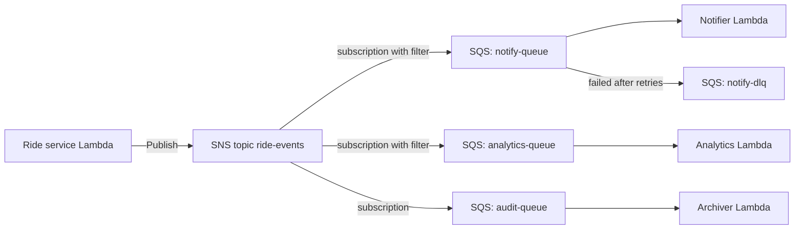
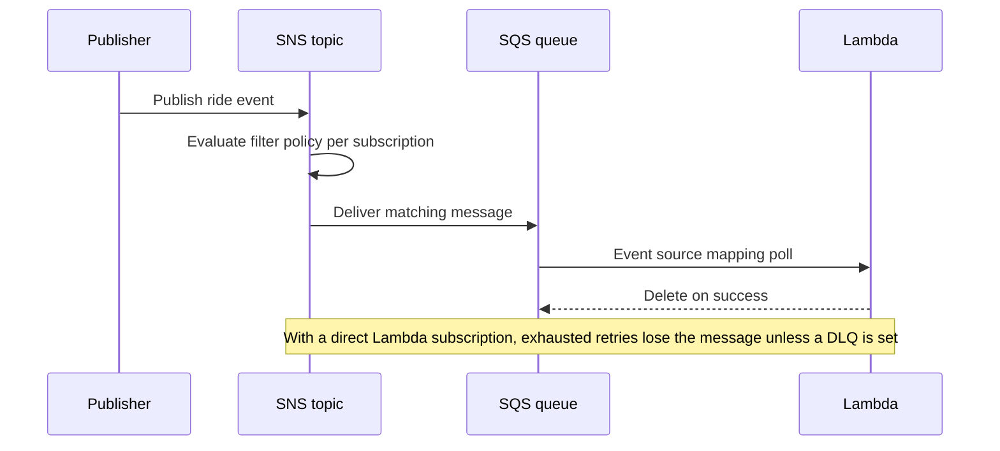
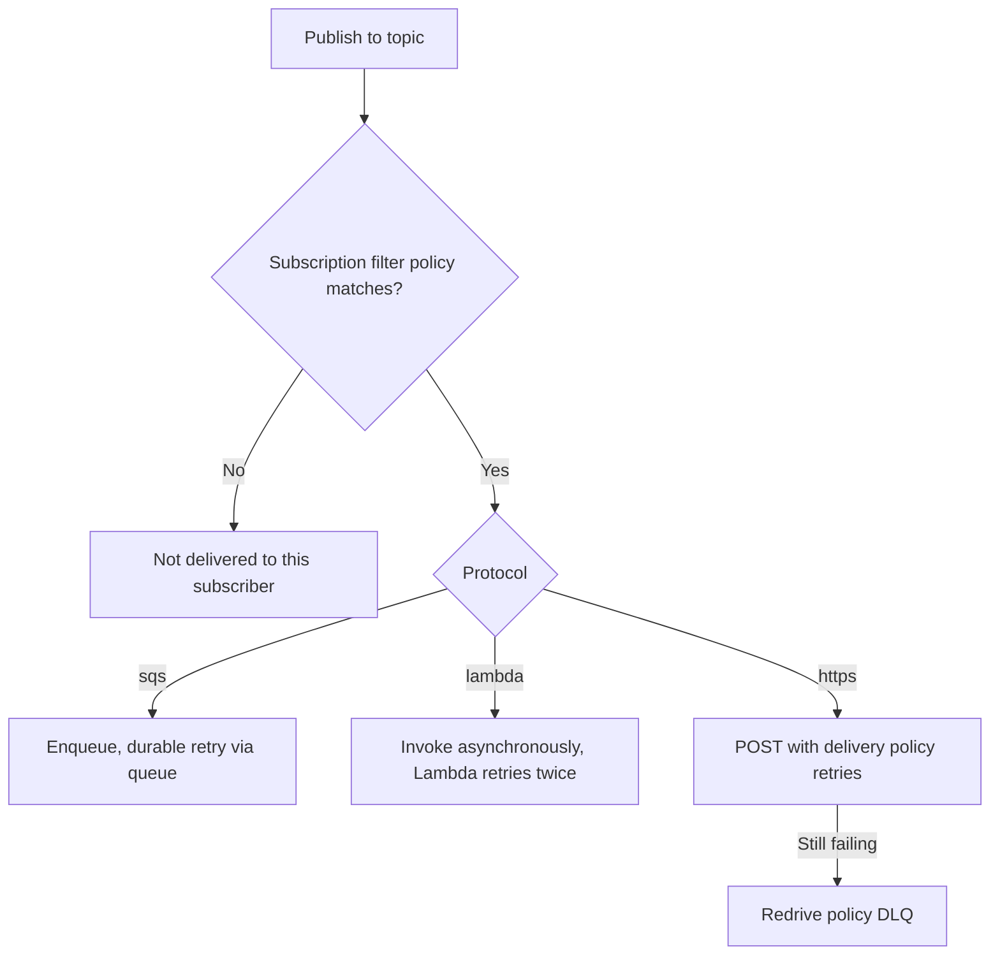

# 07 · Amazon SNS

> **Phase 4 — Serverless Architectures** · Lesson 07 of 09
> ⬅️ Previous: [Amazon SQS](./06-amazon-sqs.md) · ➡️ Next: [Amazon Kinesis](./08-amazon-kinesis.md) · 🏠 [Phase overview](./README.md)

## 🎯 Learning Objectives

By the end of this lesson you will be able to:

- Explain topics, subscriptions, and how publish-and-subscribe differs from a queue
- Implement the SNS plus SQS fan-out pattern so each consumer buffers its own work
- Filter deliveries per subscription with filter policies on attributes or message body
- Choose a FIFO topic when strict ordering matters, and know its constraints
- Configure delivery retries and a DLQ so failed deliveries are recoverable

**Estimated time:** 60 min · **Difficulty:** Beginner

---

## 🧠 Core Concepts

**Amazon SNS** is a publish-subscribe service. A publisher sends one message to a **topic**, and SNS delivers a copy to every **subscription** on that topic. There is no polling and no receiver to address by hand: the publisher does not know or care how many subscribers exist. Where SQS is a *buffer with one consumer per message*, SNS is a *broadcast to many consumers per message*.

A subscription names a **protocol** and an **endpoint**. The protocols that matter in serverless work are `sqs` (queue ARN), `lambda` (function ARN), `https` (a URL), `email` and `email-json`, `sms`, `firehose` (delivery stream ARN), and `application` for mobile push. Each subscription is independent: it has its own filter policy, its own raw delivery setting, its own retry behaviour, and its own DLQ.

**Filtering** is what stops SNS from being a blunt instrument. Without a filter, every subscriber receives every message and wastes money ignoring most of them. A **filter policy** is JSON attached to a subscription; SNS evaluates it against the message's fields and only delivers matching messages. By default the policy matches **message attributes**; setting `FilterPolicyScope` to `MessageBody` lets it match against keys inside a JSON payload instead — useful when producers cannot set attributes.

The most important pattern in this lesson is **SNS fan-out to SQS**. SNS alone cannot buffer: if a Lambda subscriber fails and retries are exhausted, the message is gone unless you configured a DLQ. An SQS subscription adds a durable queue per consumer, so each consumer gets its own backlog, its own retry semantics, and its own DLQ — and a slow consumer cannot drop messages meant for a fast one.

**FIFO topics** end in `.fifo` and guarantee strict ordering within a **message group**. Their subscribers must be FIFO SQS queues or Lambda functions; HTTP/S, email, and SMS are not supported. Use them when the order of events for a single entity is business-critical — status transitions for one ride, for example.

### Key terminology

| Term | Meaning |
|------|---------|
| **Topic** | The publish target; subscribers attach to it |
| **Subscription** | A protocol plus endpoint plus its own settings |
| **Fan-out** | One publish delivered to many subscribers |
| **Filter policy** | Per-subscription JSON that decides which messages are delivered |
| **FilterPolicyScope** | Whether filtering reads `MessageAttributes` or `MessageBody` |
| **Raw message delivery** | Deliver the payload without the SNS envelope, for SQS and Lambda |
| **Message group ID** | FIFO ordering key; messages in one group are delivered in order |
| **Delivery policy** | Retry timing rules for HTTP/S subscriptions |
| **Redrive policy** | The SQS DLQ attached to a subscription for failed deliveries |

---

## 🗺️ Architecture Diagram

The fan-out pattern: one publish, many independent backlogs:



Why SNS alone is not a buffer, and why SNS plus SQS is:



The delivery decision for every subscriber:



---

## 🧪 Hands-on Lab: Fan Out Ride Events to Two Filtered Queues

**Goal:** Publish one ride event that reaches a notifications queue and an analytics queue, each with its own filter, and capture undeliverable messages in a DLQ.

**Prerequisites:** Lesson 06 completed; you have `rides-notify`, `rides-analytics`, and `rides-notify-dlq` queues.

### Step 1 — Create the topic

```bash
# Encrypt the topic with a customer managed KMS key
aws sns create-topic \
  --name ride-events \
  --attributes '{"KmsMasterKeyId":"alias/ride-events-key"}'
```

### Step 2 — Subscribe two queues

```bash
# Raw delivery skips the SNS envelope so consumers parse your payload directly
aws sns subscribe \
  --topic-arn arn:aws:sns:eu-west-1:123456789012:ride-events \
  --protocol sqs \
  --notification-endpoint arn:aws:sqs:eu-west-1:123456789012:rides-notify \
  --attributes '{"RawMessageDelivery":"true"}'

aws sns subscribe \
  --topic-arn arn:aws:sns:eu-west-1:123456789012:ride-events \
  --protocol sqs \
  --notification-endpoint arn:aws:sqs:eu-west-1:123456789012:rides-analytics \
  --attributes '{"RawMessageDelivery":"true"}'
```

The `subscribe` call returns a `SubscriptionArn`. Grant SNS permission to write to each queue:

```json
{
  "Version": "2012-10-17",
  "Statement": [{
    "Sid": "AllowSnsRideEvents",
    "Effect": "Allow",
    "Principal": {"Service": "sns.amazonaws.com"},
    "Action": "sqs:SendMessage",
    "Resource": "arn:aws:sqs:eu-west-1:123456789012:rides-notify",
    "Condition": {
      "ArnEquals": {"aws:SourceArn": "arn:aws:sns:eu-west-1:123456789012:ride-events"}
    }
  }]
}
```

```bash
aws sqs set-queue-attributes \
  --queue-url https://sqs.eu-west-1.amazonaws.com/123456789012/rides-notify \
  --attributes file://notify-queue-policy.json
```

### Step 3 — Add filter policies

The notifications queue should only see high-value rides in Berlin or Munich:

```json
{
  "eventType": ["RideCreated", "RideCompleted"],
  "city": ["Berlin", "Munich"],
  "fare": [{"numeric": [">=", 15]}],
  "riderTier": [{"anything-but": "basic"}]
}
```

```bash
aws sns set-subscription-attributes \
  --subscription-arn arn:aws:sns:eu-west-1:123456789012:ride-events:8a1b2c3d-4e5f-6789-abcd-ef0123456789 \
  --attribute-name FilterPolicy \
  --attribute-value file://notify-filter.json
```

The analytics queue wants every completed ride regardless of city:

```bash
aws sns set-subscription-attributes \
  --subscription-arn arn:aws:sns:eu-west-1:123456789012:ride-events:9f8e7d6c-5b4a-3210-fedc-ba9876543210 \
  --attribute-name FilterPolicy \
  --attribute-value '{"eventType":["RideCompleted"]}'
```

To filter on payload fields instead of attributes, switch the scope:

```bash
# Filter on keys inside the JSON body when producers cannot set attributes
aws sns set-subscription-attributes \
  --subscription-arn arn:aws:sns:eu-west-1:123456789012:ride-events:9f8e7d6c-5b4a-3210-fedc-ba9876543210 \
  --attribute-name FilterPolicyScope \
  --attribute-value MessageBody
```

### Step 4 — Attach a DLQ to the subscription

```bash
# Messages that fail delivery go here instead of disappearing
aws sns set-subscription-attributes \
  --subscription-arn arn:aws:sns:eu-west-1:123456789012:ride-events:8a1b2c3d-4e5f-6789-abcd-ef0123456789 \
  --attribute-name RedrivePolicy \
  --attribute-value '{"deadLetterTargetArn":"arn:aws:sqs:eu-west-1:123456789012:rides-notify-dlq"}'
```

### Step 5 — Publish a message that matches

```bash
cat > attrs.json <<'JSON'
{
  "eventType": {"DataType": "String", "StringValue": "RideCreated"},
  "city": {"DataType": "String", "StringValue": "Berlin"},
  "fare": {"DataType": "Number", "StringValue": "18.50"},
  "riderTier": {"DataType": "String", "StringValue": "gold"}
}
JSON

aws sns publish \
  --topic-arn arn:aws:sns:eu-west-1:123456789012:ride-events \
  --subject "RideCreated" \
  --message '{"rideId":"r-1001","city":"Berlin","fare":18.50,"riderTier":"gold"}' \
  --message-attributes file://attrs.json
```

### Step 6 — Verify filtering worked

```bash
# The notify queue should have one message; the analytics queue should not
aws sqs get-queue-attributes \
  --queue-url https://sqs.eu-west-1.amazonaws.com/123456789012/rides-notify \
  --attribute-names ApproximateNumberOfMessages

aws sqs get-queue-attributes \
  --queue-url https://sqs.eu-west-1.amazonaws.com/123456789012/rides-analytics \
  --attribute-names ApproximateNumberOfMessages

# Confirm the filter policies on both subscriptions
aws sns get-subscription-attributes \
  --subscription-arn arn:aws:sns:eu-west-1:123456789012:ride-events:8a1b2c3d-4e5f-6789-abcd-ef0123456789
```

Then publish a `RideCompleted` message with a fare of 9.00 and confirm the notify queue stays at zero while the analytics queue grows by one.

### Step 7 — Try a FIFO topic

```bash
# FIFO topics require the .fifo suffix and can only deliver to FIFO SQS queues
aws sns create-topic \
  --name ride-status.fifo \
  --attributes '{"FifoTopic":"true","ContentBasedDeduplication":"false"}'

aws sns subscribe \
  --topic-arn arn:aws:sns:eu-west-1:123456789012:ride-status.fifo \
  --protocol sqs \
  --notification-endpoint arn:aws:sqs:eu-west-1:123456789012:rides-status.fifo \
  --attributes '{"RawMessageDelivery":"true"}'

# Ordering is per message group, so use the ride ID
aws sns publish \
  --topic-arn arn:aws:sns:eu-west-1:123456789012:ride-status.fifo \
  --message '{"rideId":"r-1001","status":"DRIVER_ASSIGNED"}' \
  --message-group-id ride-r-1001 \
  --message-deduplication-id r-1001-driver-assigned
```

### Step 8 — Verify end to end

```bash
# List subscriptions and their protocols
aws sns list-subscriptions-by-topic \
  --topic-arn arn:aws:sns:eu-west-1:123456789012:ride-events

# Check delivery failures
aws cloudwatch get-metric-statistics \
  --namespace AWS/SNS --metric-name NumberOfNotificationsFailed \
  --dimensions Name=TopicName,Value=ride-events \
  --start-time "$(date -u -v-1H +%Y-%m-%dT%H:%M:%SZ)" \
  --end-time "$(date -u +%Y-%m-%dT%H:%M:%SZ)" \
  --period 300 --statistics Sum
```

Success is: the topic listing shows two SQS subscriptions with filter policies, `rides-notify` receives only matching events, and `NumberOfNotificationsFailed` stays at zero.

---

## 💻 CLI Reference

```bash
# List topics
aws sns list-topics

# Subscribe an email address — the recipient must confirm the subscription
aws sns subscribe \
  --topic-arn arn:aws:sns:eu-west-1:123456789012:ride-events \
  --protocol email --notification-endpoint rider@example.com

aws sns confirm-subscription \
  --topic-arn arn:aws:sns:eu-west-1:123456789012:ride-events \
  --token "$CONFIRMATION_TOKEN"

# Publish up to 10 messages in a single batch call
aws sns publish-batch \
  --topic-arn arn:aws:sns:eu-west-1:123456789012:ride-events \
  --publish-batch-request-entries file://publish-entries.json

# Restrict who may publish: an explicit topic policy
aws sns set-topic-attributes \
  --topic-arn arn:aws:sns:eu-west-1:123456789012:ride-events \
  --attribute-name Policy \
  --attribute-value file://topic-policy.json

# Grant a single action to another account without a full policy rewrite
aws sns add-permission \
  --topic-arn arn:aws:sns:eu-west-1:123456789012:ride-events \
  --label AllowPartnerPublish \
  --aws-account-id 222222222222 \
  --action-name Publish

# Tune HTTP/S retry timing for a subscription
aws sns set-subscription-attributes \
  --subscription-arn $SUBSCRIPTION_ARN \
  --attribute-name DeliveryPolicy \
  --attribute-value '{
    "healthyRetryPolicy": {
      "minDelayTarget": 20,
      "maxDelayTarget": 600,
      "numRetries": 20,
      "numMaxDelayRetries": 10,
      "backoffFunction": "exponential"
    },
    "throttlePolicy": {"maxReceivesPerSecond": 100}
  }'

# Mobile push: register a platform application and an endpoint
aws sns create-platform-application \
  --name ridenow-apns \
  --platform APNS \
  --attributes '{"PlatformCredential":"REPLACE_WITH_APNS_KEY"}'

aws sns create-platform-endpoint \
  --platform-application-arn arn:aws:sns:eu-west-1:123456789012:app/APNS/ridenow-apns \
  --token "$DEVICE_TOKEN"

# Send an SMS directly, without a topic
aws sns publish --phone-number "+4915112345678" --message "Your driver is arriving"

# Review the account-level SMS spend limit
aws sns get-sms-attributes --attributes MonthlySpendLimit
```

| Command | Purpose |
|---------|---------|
| `subscribe --protocol sqs` | Add a durable buffered subscriber to a topic |
| `set-subscription-attributes --attribute-name FilterPolicy` | Deliver only matching messages |
| `--attribute-name RedrivePolicy` | Capture undeliverable messages in a DLQ |
| `--attribute-name DeliveryPolicy` | Control HTTP/S retry timing per subscriber |
| `add-permission` | Let another account publish without editing the topic policy |
| `publish-batch` | Publish up to 10 messages per request |
| `get-sms-attributes --attributes MonthlySpendLimit` | Guard against runaway SMS costs |

---

## ✅ Best Practices

| Practice | Why it matters |
|----------|----------------|
| Fan out to SQS, not directly to Lambda, for critical events | Queues buffer, retry, and DLQ; failed Lambda subscriptions lose messages |
| Enable raw message delivery for SQS and Lambda | Consumers parse your payload instead of unwrapping an envelope |
| Add a filter policy to every subscription | Stops paying for and processing messages nobody wants |
| Use a DLQ on every subscription | Delivery failures are otherwise invisible |
| Encrypt topics that carry personal data | KMS on the topic protects messages at rest |
| Keep messages under 256 KB | Larger payloads must be fetched from S3 by reference |
| Use `MessageGroupId` per entity on FIFO topics | Ordering per ride with parallelism across rides |
| Set `MonthlySpendLimit` before sending SMS | SMS pricing is per message and per destination country |
| Monitor `NumberOfNotificationsFailed` | A silent delivery failure looks identical to no traffic |
| Store the subscription ARN you receive back | It is required for every subsequent attribute change |

---

## ⚠️ Common Pitfalls

| Pitfall | Symptom | Fix |
|---------|---------|-----|
| Missing SQS queue policy | Messages never arrive; DLQ grows silently | Allow `sns.amazonaws.com` to call `sqs:SendMessage` with an `aws:SourceArn` condition |
| Filter policy on attributes with no attributes published | Nothing is ever delivered | Set attributes on publish, or switch `FilterPolicyScope` to `MessageBody` |
| Assuming an unconfirmed email subscription works | No emails arrive | Confirm via the link before publishing |
| FIFO topic with a standard SQS subscription | Subscription is rejected | FIFO topics require FIFO queues or Lambda endpoints |
| Same `MessageDeduplicationId` reused across different messages | Messages are silently dropped within five minutes | Use a deterministic, unique ID such as ride ID plus status |
| Large fan-out with no queue in front | One slow subscriber causes delivery failures for others | Insert SQS per subscriber |
| Filter policy treats a numeric attribute as a string | Numeric comparisons never match | Publish the attribute with `DataType: Number` |
| Publishing to a topic without a policy check | Another account can spam your subscribers | Restrict `sns:Publish` in the topic policy to known principals |
| Expecting SMS to be cheap | Unexpectedly large bill | SMS is priced per message by destination; set a spend limit |

---

## 💰 Cost Considerations

Standard SNS publishes cost **$0.50 per million requests** after the first 1 million free each month. **Deliveries to SQS, Lambda, and Firehose are free** — you pay the destination service instead. HTTP/S deliveries cost **$0.60 per million**, and email is billed in blocks of 100,000 (roughly $2.00 per 100,000 notifications). Mobile push and SMS are priced separately, with SMS varying widely by destination country.

A 10-million-message-per-month ride platform publishing to a topic with two SQS subscribers costs:

- Publishes: `10 × $0.50 = $5.00`
- Deliveries to SQS: free
- Consumer Lambda invocations and SQS requests: billed by those services

Compare that with publishing the same 10 million messages **twice**, once per consumer, from your application code: $10.00. Fan-out is cheaper and simpler.

The real cost trap is **unfiltered fan-out**. If a topic has eight subscribers and you publish 10 million messages, SNS delivers 80 million messages, and eight consumers each process 10 million events. Filter policies cut that to only the messages each subscriber actually needs.

FIFO topics are priced separately per million requests, and every delivery to a FIFO SQS queue is additionally charged by SQS. High-throughput ordered messaging is measurably more expensive than unordered — use it only where ordering is a business requirement.

What drives the bill: publish volume, subscriber count, and protocol. Delivery to SQS is free, which is one more argument for the fan-out pattern.

---

## 🔐 Security Considerations

- **Topic policies are mandatory for cross-account publishing.** Use `add-permission` or an explicit policy with a specific `aws:PrincipalAccount`, and add an `aws:PrincipalOrgID` condition so only your organization can publish.
- **Encrypt topics at rest** with a customer managed KMS key for anything containing personal data, and remember that KMS API calls are then billed on publish and subscribe.
- **Encrypt subscribers too.** An encrypted topic delivering to an unencrypted queue leaves the data unprotected at rest in the queue.
- **Never publish secrets into a topic.** Messages persist in DLQs, in email inboxes, and on push devices.
- **Validate HTTPS endpoints.** SNS POSTs messages that include a `SigningCertURL`; consumers should verify the signature and check the URL ends in `amazonaws.com` before trusting it. Never fetch a certificate from a URL supplied in the message without validation.
- **Require HTTPS for webhook endpoints**. An `http` subscription transmits message content in plaintext.
- **Restrict `sns:Subscribe` on SMS topics** so an attacker cannot add expensive phone numbers, and set `MonthlySpendLimit` as a hard ceiling.
- **Filter before you deliver, not after.** A subscriber with wide access to a busy topic is a data-access path; narrow filter policies reduce both cost and exposure.

---

## 🧩 Exercise

Add a third subscriber to `ride-events`: an HTTPS endpoint that also has a `filterPolicyScope` of `MessageBody`, matching only `{"eventType":["RideCompleted"],"rating":[{"numeric":["<=",3]}]}`. Attach a DLQ and a custom delivery policy with 5 retries and an exponential backoff. Then publish five messages — three matching and two not — and prove that exactly three HTTP POSTs were attempted by checking the `NumberOfNotificationsDelivered` metric.

Success looks like: `NumberOfNotificationsDelivered` equals `3` for the subscription, the two non-matching messages produced no HTTP attempts at all, and a deliberately broken endpoint URL pushed its messages into the DLQ.

---

## 📚 Resources

- [Amazon SNS Developer Guide](https://docs.aws.amazon.com/sns/latest/dg/welcome.html)
- [Fan-out to SQS queues](https://docs.aws.amazon.com/sns/latest/dg/sns-common-scenarios.html)
- [Subscription filter policies](https://docs.aws.amazon.com/sns/latest/dg/sns-subscription-filter-policies.html)
- [Message delivery retries and DLQs](https://docs.aws.amazon.com/sns/latest/dg/sns-message-delivery-retries.html)
- [FIFO topics](https://docs.aws.amazon.com/sns/latest/dg/sns-fifo-topics.html)
- [Amazon SNS pricing](https://aws.amazon.com/sns/pricing/)

---

## ➡️ Next Steps

SNS is built for broadcast, not for volume: it does not retain history and cannot replay. The next lesson covers Kinesis, which keeps an ordered, replayable log of millions of records per hour that multiple consumers can read independently.

> ⬅️ Previous: [Amazon SQS](./06-amazon-sqs.md) · ➡️ Next: [Amazon Kinesis](./08-amazon-kinesis.md) · 🏠 [Phase overview](./README.md)
