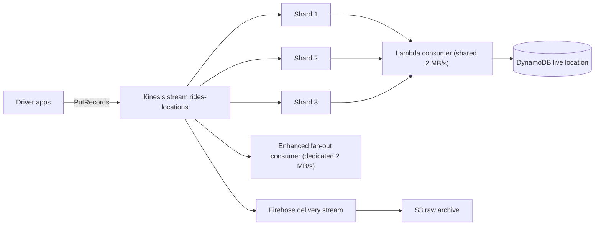
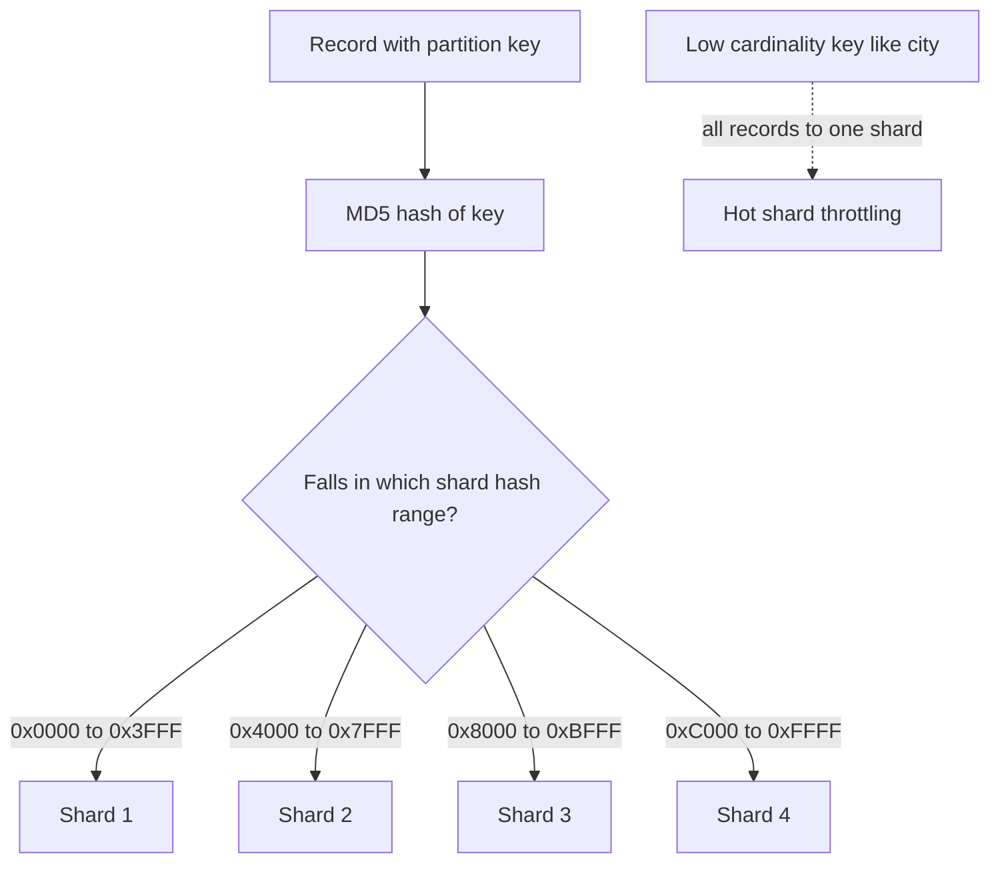
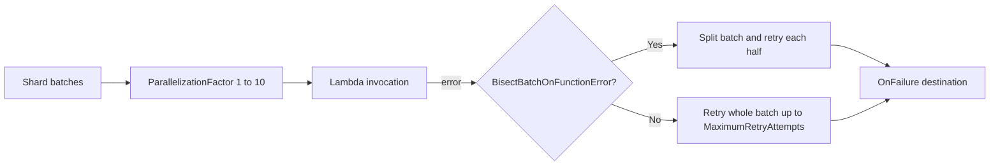

# 08 · Amazon Kinesis

> **Phase 4 — Serverless Architectures** · Lesson 08 of 09
> ⬅️ Previous: [Amazon SNS](./07-amazon-sns.md) · ➡️ Next: [Capstone — Uber-like Serverless Backend](./09-project-uber-like-serverless-backend.md) · 🏠 [Phase overview](./README.md)

## Learning Objectives

By the end of this lesson you will be able to:

- Choose between Kinesis Data Streams, Data Firehose, and Managed Service for Apache Flink
- Reason about shards, partition keys, and throughput limits
- Diagnose and fix hot shards caused by poor partition key design
- Configure Lambda and KCL consumers, including enhanced fan-out
- Re-shard a stream and adjust retention without losing data

**Estimated time:** 80 min · **Difficulty:** Advanced

---

## Core Concepts

**Kinesis Data Streams** is a durable, ordered, replayable log. Producers append records with a **partition key**; Kinesis hashes the key to pick a **shard**, and every record for that key lands in the same shard in the order it arrived. Consumers read a shard sequentially and track their own position with a **shard iterator**. Unlike SQS, reading a record does not delete it — many independent consumers can read the same data, and each can replay from any point in the retention window.

A stream is made of **shards**, and each shard is the unit of capacity. One shard ingests 1 MB per second or 1,000 records per second, whichever comes first, and provides 2 MB per second of read throughput *shared* by all consumers polling it. With **enhanced fan-out**, a registered consumer gets its own dedicated 2 MB per second per shard over HTTP/2, which removes the consumer-contention problem entirely — at an extra charge.

The critical design decision is the **partition key**, because it decides the shard. A key with low cardinality — say `city` — sends every record for Berlin into one shard while other shards sit idle. That is a **hot shard**: you are paying for capacity you cannot use, and the overloaded shard throttles with `ProvisionedThroughputExceededException`. Effective keys are high-cardinality and evenly distributed: `driverId`, `rideId`, or a composite like `rideId#eventType`.

Three related services get confused constantly:

| | Data Streams | Data Firehose | Managed Service for Apache Flink |
|---|--------------|---------------|----------------------------------|
| Model | Durable replayable log | Delivery pipeline to a destination | Managed stream processing |
| Latency | ~70 ms | 60 seconds at best (buffered) | Milliseconds to seconds |
| Replay | Yes, within retention | No | Not applicable |
| Scaling unit | Shard (provisioned or on-demand) | Automatic, up to limits | KPUs |
| Typical use | Real-time apps, multiple consumers | Load streams into S3, Redshift, OpenSearch | Windowing, aggregation, joins |

The pattern that uses all three: producers write to **Data Streams**, a Lambda or Flink job computes live state, and a **Firehose** subscription off the same stream archives raw events into S3 for later batch analysis.

### Key terminology

| Term | Meaning |
|------|---------|
| **Shard** | The unit of capacity: 1 MB/s in, 2 MB/s out |
| **Partition key** | The value hashed to select a shard, and the ordering key |
| **Shard iterator** | A cursor that identifies a read position in a shard |
| **Sequence number** | A unique, ordered identifier per record within a shard |
| **Hot shard** | A shard receiving disproportionate traffic due to a skewed key |
| **Enhanced fan-out** | Dedicated 2 MB/s per consumer per shard over HTTP/2 |
| **KCL** | Kinesis Client Library; tracks checkpoints in a DynamoDB lease table |
| **Re-sharding** | Splitting or merging shards to change capacity |
| **Retention period** | How long records are readable: 24 hours by default, up to 365 days |
| **On-demand mode** | A stream that scales shards automatically; no shard math |

---

## Architecture Diagram

One stream, three consumers, no interference when each has what it needs:



How a partition key becomes a shard, and why a skewed key hurts:



Lambda's Kinesis consumer options, all of which affect failure behaviour:



---

## Hands-on Lab: Stream Location Pings and Deal with a Hot Shard

**Goal:** Create a stream, publish location records with a good partition key, prove a skewed key causes throttling, then re-shard and consume with Lambda.

**Prerequisites:** Lesson 01 completed; an SQS queue for failures; permission to create Kinesis streams.

### Step 1 — Create the stream

```bash
# Provisioned mode: 4 shards gives 4 MB/s in and 8 MB/s out
aws kinesis create-stream \
  --stream-name rides-locations \
  --shard-count 4 \
  --stream-mode-details StreamMode=PROVISIONED

# Wait until the stream is ACTIVE before writing
aws kinesis wait stream-exists --stream-name rides-locations

aws kinesis describe-stream-summary --stream-name rides-locations \
  --query 'StreamDescriptionSummary.{Status:StreamStatus,Shards:OpenShardCount,Mode:StreamModeDetails.StreamMode}'
```

### Step 2 — Publish records with a high-cardinality key

```bash
# driverId spreads evenly across shards because it is high cardinality
aws kinesis put-record \
  --stream-name rides-locations \
  --partition-key driver-d-1001 \
  --data '{"driverId":"d-1001","lat":52.5200,"lon":13.4050,"ts":"2026-10-14T23:00:00Z"}' \
  --cli-binary-format raw-in-base64-out
```

```bash
# Up to 500 records or 5 MiB per PutRecords call
cat > records.json <<'JSON'
[
  {"Data": "{\"driverId\":\"d-1002\",\"lat\":52.51,\"lon\":13.40}", "PartitionKey": "driver-d-1002"},
  {"Data": "{\"driverId\":\"d-1003\",\"lat":52.53,\"lon\":13.39}", "PartitionKey": "driver-d-1003"},
  {"Data": "{\"driverId\":\"d-1004\",\"lat\":52.49,\"lon\":13.42}", "PartitionKey": "driver-d-1004"}
]
JSON

aws kinesis put-records \
  --stream-name rides-locations \
  --records file://records.json \
  --cli-binary-format raw-in-base64-out
```

`PutRecords` returns a `FailedRecordCount`. It is a partial-success API: some records can be rejected while others succeed, and you must retry only the failures.

### Step 3 — Demonstrate a hot shard

```bash
# A low-cardinality key sends every Berlin record to a single shard
for i in $(seq 1 20); do
  aws kinesis put-record \
    --stream-name rides-locations \
    --partition-key Berlin \
    --data '{"city":"Berlin","ping":'"$i"'}' \
    --cli-binary-format raw-in-base64-out >/dev/null
done

# Watch incoming records concentrate on one shard
aws cloudwatch get-metric-statistics \
  --namespace AWS/Kinesis --metric-name IncomingRecords \
  --dimensions Name=StreamName,Value=rides-locations \
  --start-time "$(date -u -v-5M +%Y-%m-%dT%H:%M:%SZ)" \
  --end-time "$(date -u +%Y-%m-%dT%H:%M:%SZ)" \
  --period 60 --statistics Sum
```

Then push a sustained burst so the shard genuinely exceeds 1 MB/s:

```bash
# Generate roughly 2 MB of data against one shard to trigger throttling
python3 - <<'PY'
import json, subprocess
payload = json.dumps({"city": "Berlin", "blob": "x" * 900})
for _ in range(2200):
    subprocess.run(
        ["aws", "kinesis", "put-record", "--stream-name", "rides-locations",
         "--partition-key", "Berlin", "--data", payload,
         "--cli-binary-format", "raw-in-base64-out"],
        stdout=subprocess.DEVNULL, stderr=subprocess.DEVNULL,
    )
PY
```

The shard now returns `ProvisionedThroughputExceededException`. Fixing it means changing the key, not adding shards: use `driverId`, or a composite like `Berlin#driverId`, or distribute deliberately. As a last resort you can bypass the hash entirely:

```bash
# ExplicitHashKey overrides hash-based shard selection — use with care
aws kinesis put-record \
  --stream-name rides-locations \
  --partition-key driver-d-2001 \
  --explicit-hash-key 0 \
  --data '{"driverId":"d-2001"}' \
  --cli-binary-format raw-in-base64-out
```

### Step 4 — Extend retention

```bash
# Keep 7 days of history instead of the default 24 hours
aws kinesis increase-stream-retention-period \
  --stream-name rides-locations \
  --retention-period-hours 168
```

### Step 5 — Consume with Lambda

```bash
# ParallelizationFactor 4 means up to 4 concurrent invocations per shard
aws lambda create-event-source-mapping \
  --function-name rides-location-processor \
  --event-source-arn arn:aws:kinesis:eu-west-1:123456789012:stream/rides-locations \
  --starting-position LATEST \
  --batch-size 100 \
  --maximum-batching-window-in-seconds 1 \
  --parallelization-factor 4 \
  --bisect-batch-on-function-error \
  --maximum-retry-attempts 5 \
  --maximum-record-age-in-seconds 3600 \
  --destination-config '{"OnFailure":{"Destination":"arn:aws:sqs:eu-west-1:123456789012:rides-locations-dlq"}}'
```

`BisectBatchOnFunctionError` splits a failing batch in half and retries each half, which isolates the poison record instead of blocking the shard forever. `MaximumRecordAgeInSeconds` stops Lambda from retrying stale data indefinitely.

### Step 6 — Register an enhanced fan-out consumer

```bash
# A dedicated 2 MB/s per shard for this consumer, independent of pollers
aws kinesis register-stream-consumer \
  --stream-name rides-locations \
  --consumer-name rides-live-tracking

aws kinesis describe-stream-consumer \
  --stream-name rides-locations \
  --consumer-name rides-live-tracking \
  --query 'ConsumerDescription.{Status:ConsumerStatus,Arn:ConsumerARN}'
```

### Step 7 — Re-shard for more capacity

```bash
# Double the shards; keys are redistributed by hash range automatically
aws kinesis update-shard-count \
  --stream-name rides-locations \
  --target-shard-count 8 \
  --scaling-type UNIFORM_SCALING

# Follow the progress until the status returns to ACTIVE
watch -n 15 "aws kinesis describe-stream-summary --stream-name rides-locations \
  --query 'StreamDescriptionSummary.{Status:StreamStatus,Shards:OpenShardCount}'"

# Equivalent single-shard operations, if you prefer to control the split point
aws kinesis split-shard --stream-name rides-locations \
  --shard-to-split shardId-000000000000 \
  --new-starting-hash-key 170141183460469231731687303715884105728
```

### Step 8 — Archive with Firehose

```bash
# Deliver the same stream to S3 with dynamic partitioning by date
aws firehose create-delivery-stream \
  --delivery-stream-name rides-locations-archive \
  --delivery-stream-type KinesisStreamAsSource \
  --kinesis-stream-source-configuration '{
    "KinesisStreamARN": "arn:aws:kinesis:eu-west-1:123456789012:stream/rides-locations",
    "RoleARN": "arn:aws:iam::123456789012:role/firehose-kinesis-role"
  }' \
  --extended-s3-destination-configuration '{
    "RoleARN": "arn:aws:iam::123456789012:role/firehose-s3-role",
    "BucketARN": "arn:aws:s3:::ridenow-location-archive",
    "Prefix": "locations/",
    "BufferingHints": {"IntervalInSeconds": 60, "SizeInMBs": 5},
    "CompressionFormat": "GZIP",
    "DynamicPartitioningConfiguration": {"Enabled": true}
  }'
```

### Step 9 — Verify

```bash
# Confirm shard state and hash key ranges
aws kinesis list-shards --stream-name rides-locations \
  --query 'Shards[].{Id:ShardId,Start:HashKeyRange.StartingHashKey,End:HashKeyRange.EndingHashKey}'

# Read from the start of a shard without disturbing the Lambda consumer
ITER=$(aws kinesis get-shard-iterator --stream-name rides-locations \
  --shard-id shardId-000000000000 --shard-iterator-type TRIM_HORIZON \
  --query 'ShardIterator' --output text)

aws kinesis get-records --shard-iterator "$ITER" --limit 5

# Turn on shard-level metrics for per-shard diagnosis
aws kinesis enable-enhanced-monitoring --stream-name rides-locations --shard-level-metrics ALL
```

Success is: the stream reports twice the original open shard count, the Lambda mapping shows `ParallelizationFactor: 4`, and `WriteProvisionedThroughputExceeded` stops rising once the partition key is high cardinality.

---

## CLI Reference

```bash
# Create an on-demand stream — no shard math, scales automatically
aws kinesis create-stream \
  --stream-name rides-events-ondemand \
  --stream-mode-details StreamMode=ON_DEMAND

# Check stream health and mode
aws kinesis describe-stream-summary --stream-name rides-locations

# Merge two adjacent shards to reduce cost during off-peak hours
aws kinesis merge-shards --stream-name rides-locations \
  --shard-to-merge shardId-000000000004 \
  --adjacent-shard-to-merge shardId-000000000005

# Encrypt the stream with a customer managed KMS key
aws kinesis start-stream-encryption \
  --stream-name rides-locations \
  --encryption-type KMS \
  --key-id alias/rides-locations-key

# List registered enhanced fan-out consumers
aws kinesis list-stream-consumers --stream-name rides-locations

# Deregister a consumer you no longer pay for
aws kinesis deregister-stream-consumer \
  --stream-name rides-locations --consumer-name rides-live-tracking

# Reduce retention once the replay window is no longer needed
aws kinesis decrease-stream-retention-period \
  --stream-name rides-locations --retention-period-hours 24

# Firehose buffering, compression, and error handling
aws firehose describe-delivery-stream --delivery-stream-name rides-locations-archive

# A managed Apache Flink application reading the same stream
aws kinesisanalyticsv2 create-application \
  --application-name rides-aggregator \
  --runtime-environment FLINK-1_18 \
  --service-execution-role arn:aws:iam::123456789012:role/kda-execution-role

# Delete a stream — keep a snapshot first if the data matters to you
aws kinesis delete-stream --stream-name rides-events-ondemand \
  --enforce-consumer-deletion
```

| Command | Purpose |
|---------|---------|
| `put-records` | Batch up to 500 records; check `FailedRecordCount` every time |
| `get-shard-iterator` / `get-records` | Read a shard manually for debugging or replay |
| `update-shard-count` | Re-shard with `UNIFORM_SCALING` |
| `increase-stream-retention-period` | Buy a longer replay window, up to 365 days |
| `register-stream-consumer` | Give one consumer dedicated throughput |
| `enable-enhanced-monitoring` | Per-shard metrics for finding hot shards |
| `start-stream-encryption` | Encrypt at rest with your own key |

---

## Best Practices

| Practice | Why it matters |
|----------|----------------|
| Choose a high-cardinality partition key | Even shard distribution is the difference between 4 MB/s and 0.25 MB/s usable |
| Use on-demand mode when traffic is unpredictable | Removes re-sharding from your critical path |
| Set `BisectBatchOnFunctionError` on Lambda consumers | Isolates poison records without stalling a shard |
| Always set `MaximumRecordAgeInSeconds` and `MaximumRetryAttempts` | Prevents a shard from blocking forever on unrecoverable data |
| Attach an `OnFailure` destination | Failed batches are otherwise discarded silently |
| Use `ParallelizationFactor` above 1 for per-shard parallelism | Gets more throughput out of each shard without re-sharding |
| Register an enhanced fan-out consumer for latency-sensitive readers | Removes read contention with the other consumers |
| Turn on shard-level metrics | Aggregate stream metrics hide hot shards |
| Batch `PutRecords` up to 500 records | Cuts API calls and cost by up to 500× |
| Use Firehose for archival, not Data Streams | Firehose needs no consumer code and compresses automatically |
| Retry only failed records from `PutRecords` | Blindly retrying everything duplicates data |

---

## Common Pitfalls

| Pitfall | Symptom | Fix |
|---------|---------|-----|
| Low-cardinality partition key | `ProvisionedThroughputExceededException` while most shards are idle | Use `driverId`/`rideId`, or a composite key |
| Assuming five consumers each get 2 MB/s per shard | Throughput drops as more pollers attach | Use enhanced fan-out for dedicated read bandwidth |
| Ignoring `FailedRecordCount` | Silent data loss from partial `PutRecords` failures | Retry the failed subset with backoff |
| One bad record blocks the shard | Shard iterator stops advancing; `GetRecords` repeated | `BisectBatchOnFunctionError` plus `MaximumRecordAgeInSeconds` |
| `SplitShard` with an out-of-range hash key | `InvalidArgumentException` | The new starting hash key must fall inside the shard's range |
| Re-sharding an on-demand stream | `ValidationException` | `UpdateShardCount` is for provisioned mode only |
| Lambda consumer processing records twice | Duplicates after a retry | Make the consumer idempotent with sequence numbers |
| Assuming retention is infinite | `ExpiredIteratorException` during replay | Raise retention before you need the old data |
| Ordering assumed across the stream | Records appear out of order | Ordering is guaranteed only within a shard |
| Firehose used for real-time processing | Latency far above expectations | Firehose buffers for at least 60 seconds; use Data Streams |

---

## Cost Considerations

Provisioned mode has two charges:

- **Shard hour:** **$0.015 per shard-hour**, which is about **$10.95 per shard per month** whether or not data flows.
- **PUT payload units:** **$0.014 per million units**, where each 25 KB of payload counts as one unit. A 5 KB record costs `$0.014 × 0.2 = $0.0000028`.

A 4-shard stream runs **$43.80 per month** in shard hours alone — before ingestion. That is the trap: a stream you create for a demo and forget about costs $44 a month. Delete it or switch to on-demand, which is billed per gigabyte written with no shard-hour charge and scales automatically.

Read-side costs: `GetRecords` is free, but **enhanced fan-out** costs **$0.015 per consumer-shard hour** plus **$0.013 per GB retrieved**. One consumer on four shards is another $43.80 per month. Long retention adds **$0.023 per GB-month** beyond 24 hours.

Firehose is charged per GB delivered to the destination (around **$0.029 per GB** for the first 500 TB per month to S3), plus the S3 storage itself.

What drives the bill: shard-hours (fixed, whether used or not), ingress volume in 25 KB units, retention, and any enhanced fan-out consumers. The cheapest optimization is almost always to reduce the shard count or move to on-demand during low traffic — merging shards at night is a real and effective pattern.

---

## Security Considerations

- **Encrypt at rest.** New streams use KMS with an AWS-owned key by default; call `start-stream-encryption` with a customer managed key so you control rotation, revocation, and audit.
- **Use HTTPS endpoints only** and prefer an interface VPC endpoint for `kinesis-streams` so producer and consumer traffic never crosses the public internet.
- **Never put sensitive values in a partition key.** Partition keys appear in CloudWatch dimensions and logs, and they influence shard-level metrics that may be visible to a wider audience than the data itself.
- **Scope `kinesis:PutRecord`, `PutRecords`, and `GetRecords` to a specific stream ARN.** A consumer with `GetRecords` on a stream can read every record in it, for every tenant.
- **Use `kinesis:GetShardIterator` restrictions** together with the stream ARN so a rogue consumer cannot walk the whole stream and rebuild your dataset.
- **Restrict the Firehose role to the single stream and bucket.** Its role needs only `kinesis:GetRecords`, `kinesis:DescribeStream`, and `s3:PutObject` on the archive prefix — not `s3:*` on the bucket.
- **Consider record-level access control.** Kinesis has no per-record authorization: anything reading a shard reads all tenants' records. For multi-tenant data, encrypt per tenant at the application layer with a key the consumer must obtain.
- **Monitor for anomalous `GetRecords` calls.** An unexpectedly large read pattern from one principal is a strong signal of data exfiltration; alarm on it.

---

## Exercise

Create a stream with three shards and a partition key that is deliberately skewed, then publish one million small records with `PutRecords` in batches of 500. Enable shard-level enhanced monitoring, identify the hot shard from the `IncomingBytes` per-shard metrics, and fix the design by switching to a composite key of `city#driverId`. Then extend retention to 7 days, register an enhanced fan-out consumer, and compare the consumer's read throughput before and after registration.

Success looks like: a written before-and-after table showing the per-shard `IncomingBytes` distribution flattening after the key change, no `WriteProvisionedThroughputExceeded` in the second run, and a monthly cost estimate for both provisioned and on-demand modes for the same volume.

---

## Resources

- [Amazon Kinesis Data Streams Developer Guide](https://docs.aws.amazon.com/streams/latest/dev/introduction.html)
- [Kinesis Data Streams quotas and limits](https://docs.aws.amazon.com/streams/latest/dev/service-sizes-and-limits.html)
- [Enhanced fan-out consumers](https://docs.aws.amazon.com/streams/latest/dev/enhanced-consumers.html)
- [Lambda event source mapping for Kinesis](https://docs.aws.amazon.com/lambda/latest/dg/with-kinesis.html)
- [Kinesis Client Library](https://docs.aws.amazon.com/streams/latest/dev/kcl.html)
- [Amazon Data Firehose](https://docs.aws.amazon.com/firehose/latest/dev/what-is-this-service.html)
- [Amazon Kinesis pricing](https://aws.amazon.com/kinesis/pricing/)

---

## Next Steps

You now have every building block of this phase. The capstone puts them together into one coherent system: an Uber-like backend where API Gateway fronts writes, SQS absorbs matching work, SNS notifies riders, EventBridge carries domain facts, Step Functions owns the ride lifecycle, and Kinesis streams location updates.

> ⬅️ Previous: [Amazon SNS](./07-amazon-sns.md) · ➡️ Next: [Capstone — Uber-like Serverless Backend](./09-project-uber-like-serverless-backend.md) · 🏠 [Phase overview](./README.md)
