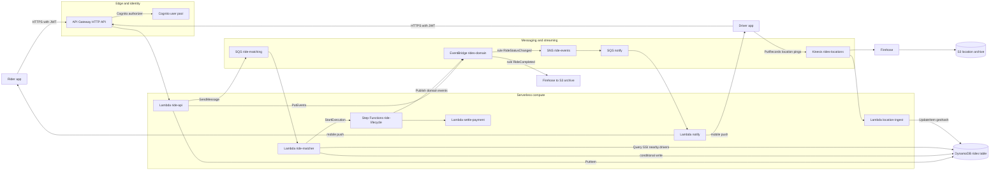
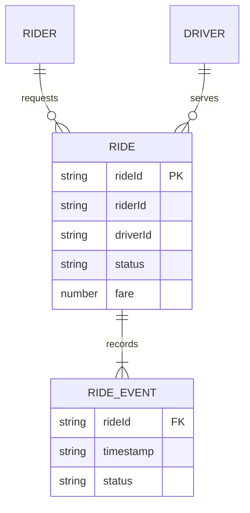
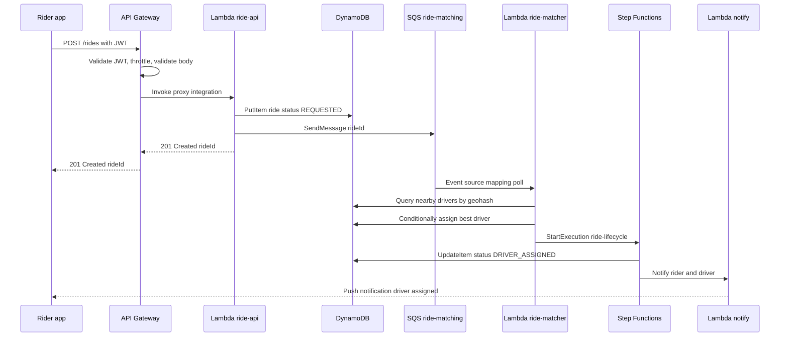
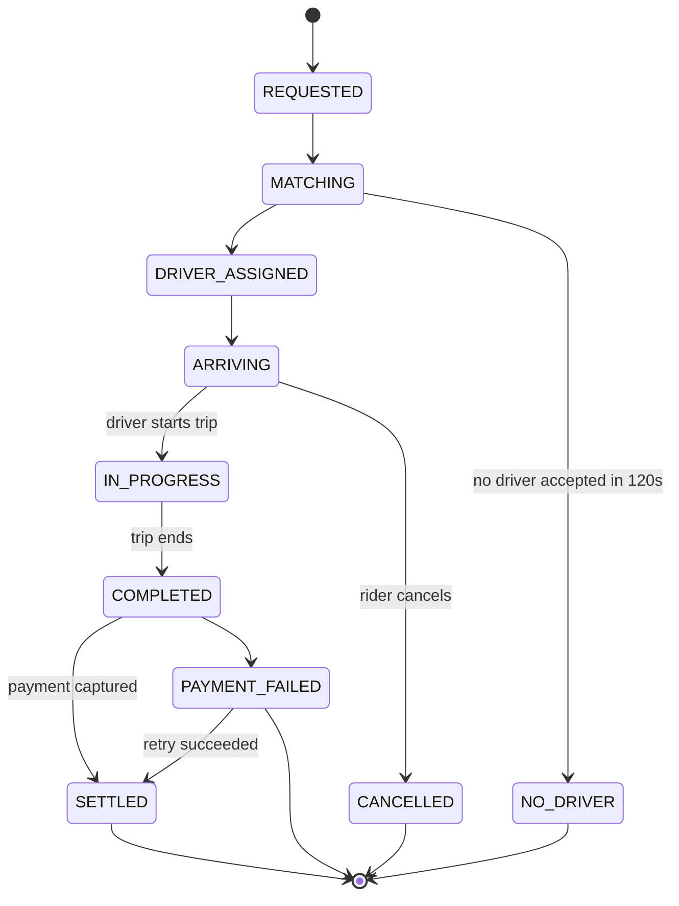

# 09 · Capstone — Uber-like Serverless Backend

> **Phase 4 — Serverless Architectures** · Lesson 09 of 09
> ⬅️ Previous: [Amazon Kinesis](./08-amazon-kinesis.md) · ➡️ Next: [Phase 5 — Data and AI](../phase-5-data-and-ai/README.md) · 🏠 [Phase overview](./README.md)

## 🎯 Learning Objectives

By the end of this lesson you will be able to:

- Decompose a real product into serverless services with clear responsibilities
- Design an event contract that every producer and consumer agrees on
- Compose API Gateway, Lambda, DynamoDB, SQS, SNS, EventBridge, Step Functions, and Kinesis into one system
- Make every asynchronous consumer idempotent so retries are safe
- Produce a defensible cost model for 100,000 rides per day

**Estimated time:** 4-6 hours · **Difficulty:** Advanced

---

## 🧠 Core Concepts

**RideNow** is the system you are building: a ride-hailing backend. The product surface is small — a rider requests a ride, a driver accepts, the trip runs, the trip completes, the rider is charged — but the internal fan-out is wide, which is exactly why it makes a good capstone.

The first design move is to **separate synchronous from asynchronous work**. Requesting a ride must answer in under a second, so the API path is bare: validate, write the ride to DynamoDB, publish an event, return `201`. Everything else — matching a driver, notifying devices, streaming locations, settling payment — is asynchronous. The rider's app learns what happened by polling the ride record or through a push notification, not by waiting on a long HTTP request.

The second design move is to give every service **one job and one input**. `ride-matching` reads from a queue. `notify` reads from a queue. `location-ingest` reads from a stream. None of them call each other directly. When one breaks, the others keep draining their own queues, and you can deploy a fix for a single consumer without touching the rest.

The third move is an **event contract**. Everything RideNow publishes follows one envelope: `source`, `detail-type`, and a versioned `detail` object carrying `rideId`, `riderId`, `driverId`, `status`, and `occurredAt`. Because the contract is stable, the analytics team can add a consumer next quarter without a single change to the producer. Treat event names and field names as a public API: adding a field is safe, renaming one is a breaking change that needs a version.

The fourth move is **idempotency everywhere**, because every asynchronous path in this design is at-least-once. SQS redelivers after a visibility timeout, SNS retries, EventBridge retries, and Lambda retries on error. Charging a rider twice is not an edge case — it is the default outcome of a naive consumer. The fix is a conditional write to DynamoDB keyed by an idempotency key derived from the message, so the second attempt is a no-op.

### Key terminology

| Term | Meaning |
|------|---------|
| **Ride lifecycle** | The state machine a ride moves through, from `REQUESTED` to `COMPLETED` or `CANCELLED` |
| **Dispatch** | The process of selecting and offering a ride to nearby drivers |
| **Geohash** | A string encoding a lat/long square, used as a DynamoDB sort key for proximity queries |
| **Idempotency key** | A deterministic key that makes a repeated operation safe to apply twice |
| **Domain event** | A fact that already happened, published on the `rides-domain` bus |
| **Fan-out** | One event delivered to many independent consumers |
| **Live path** | The latency-sensitive path (request, accept) measured in hundreds of milliseconds |
| **Backfill path** | Analytics and archival work with no latency requirement |

---

## 🗺️ Architecture Diagram

The complete system. Every arrow is a real integration covered in this phase:



### Data model

A single DynamoDB table keeps the access patterns cheap:

| Item type | Partition key | Sort key | Purpose |
|-----------|---------------|----------|---------|
| Ride | `RIDE#<rideId>` | `META` | Current ride state and fare |
| Ride event | `RIDE#<rideId>` | `EVENT#<timestamp>` | Append-only audit of status changes |
| Driver location | `DRIVER#<driverId>` | `LOC#<geohash>` | Live position for proximity queries |
| Idempotency record | `IDEMP#<key>` | `LOCK` | Conditional write to suppress duplicates |



### Ride-booking sequence

The synchronous path plus the asynchronous fan-out it triggers:



### Ride lifecycle

The state machine, including the paths that are easy to forget:



---

## 🧪 Hands-on Lab: Build RideNow

**Goal:** Deploy the live path end to end, then add the asynchronous consumers one at a time.

**Prerequisites:** Lessons 01–08 completed; an AWS account with admin access; AWS CLI v2 and AWS SAM CLI installed; a Cognito user pool with one rider and one driver user.

**Deliverables for this lab:**

- Working `POST /rides` returning `201` in under 400 ms at p99
- A ride record that advances through the lifecycle states
- A notification delivered to the rider's device on assignment
- Location pings visible in DynamoDB and archived in S3
- A written cost model for 100,000 rides per day

### Step 1 — Create the DynamoDB table

```bash
# On-demand billing so a burst of rides does not throttle
aws dynamodb create-table \
  --table-name rides \
  --attribute-definitions \
      AttributeName=PK,AttributeType=S \
      AttributeName=SK,AttributeType=S \
      AttributeName=geohash,AttributeType=S \
  --key-schema AttributeName=PK,KeyType=HASH AttributeName=SK,KeyType=RANGE \
  --billing-mode PAY_PER_REQUEST \
  --global-secondary-indexes '[{
    "IndexName": "geohash-index",
    "KeySchema": [{"AttributeName": "geohash", "KeyType": "HASH"}],
    "Projection": {"ProjectionType": "INCLUDE", "NonKeyAttributes": ["driverId", "status"]}
  }]'

# Enable point-in-time recovery — you will want it the first time a bug corrupts state
aws dynamodb update-continuous-backups \
  --table-name rides \
  --point-in-time-recovery-specification PointInTimeRecoveryEnabled=true

# Stream changes for audit and analytics
aws dynamodb update-table \
  --table-name rides \
  --stream-specification StreamEnabled=true,StreamViewType=NEW_AND_OLD_IMAGES
```

### Step 2 — Define the event contract

Nothing else works until this file is agreed. Save it as `events/ride-status-changed.json`:

```json
{
  "Source": "ridenow.rides",
  "DetailType": "RideStatusChanged",
  "Detail": {
    "schemaVersion": "1.0",
    "rideId": "r-1001",
    "riderId": "u-42",
    "driverId": "d-1001",
    "status": "DRIVER_ASSIGNED",
    "city": "Berlin",
    "fare": 18.50,
    "occurredAt": "2026-10-14T23:00:00Z"
  }
}
```

### Step 3 — Build the synchronous API path

Save as `template.yaml` and deploy with SAM. Everything at the edge uses Cognito, and the function is ARM64 with an explicit timeout.

```yaml
AWSTemplateFormatVersion: "2010-09-09"
Transform: AWS::Serverless-2016-10-31
Globals:
  Function:
    Runtime: python3.12
    Architectures: [arm64]
    MemorySize: 512
    Timeout: 10
    Environment:
      Variables:
        TABLE_NAME: rides
        EVENT_BUS: rides-domain
        MATCH_QUEUE_URL: !Ref MatchQueue
Resources:
  RidesTable:
    Type: AWS::DynamoDB::Table
    Properties:
      TableName: rides
      BillingMode: PAY_PER_REQUEST
      AttributeDefinitions:
        - {AttributeName: PK, AttributeType: S}
        - {AttributeName: SK, AttributeType: S}
        - {AttributeName: geohash, AttributeType: S}
      KeySchema:
        - {AttributeName: PK, KeyType: HASH}
        - {AttributeName: SK, KeyType: RANGE}
      GlobalSecondaryIndexes:
        - IndexName: geohash-index
          KeySchema:
            - {AttributeName: geohash, KeyType: HASH}
          Projection: {ProjectionType: ALL}

  MatchQueue:
    Type: AWS::SQS::Queue
    Properties:
      QueueName: ride-matching
      VisibilityTimeout: 90
      RedrivePolicy:
        deadLetterTargetArn: !GetAtt MatchDlq.Arn
        maxReceiveCount: 3

  MatchDlq:
    Type: AWS::SQS::Queue
    Properties: {QueueName: ride-matching-dlq}

  EventBus:
    Type: AWS::Events::EventBus
    Properties: {Name: rides-domain}

  RidesApi:
    Type: AWS::Serverless::HttpApi
    Properties:
      StageName: prod
      Auth:
        Authorizers:
          CognitoAuth:
            IdentitySource: $request.header.Authorization
            JwtConfiguration:
              issuer: https://cognito-idp.eu-west-1.amazonaws.com/eu-west-1_REPLACE
              audience: [REPLACE_APP_CLIENT_ID]
        DefaultAuthorizer: CognitoAuth

  RideApiFunction:
    Type: AWS::Serverless::Function
    Properties:
      Handler: app.handler
      ReservedConcurrentExecutions: 500
      Policies:
        - DynamoDBCrudPolicy: {TableName: !Ref RidesTable}
        - SQSSendMessagePolicy: {QueueName: !GetAtt MatchQueue.QueueName}
        - EventBridgePutEventsPolicy: {EventBusName: !Ref EventBus}
      Events:
        CreateRide:
          Type: HttpApi
          Properties: {ApiId: !Ref RidesApi, Path: /rides, Method: POST}
        GetRide:
          Type: HttpApi
          Properties: {ApiId: !Ref RidesApi, Path: /rides/{id}, Method: GET}
```

Deploy it:

```bash
# Build with the container flag when dependencies need the Lambda platform
sam build

# First deploy is interactive; later ones are not
sam deploy --guided

# Or non-interactively with a config file
sam deploy --config-file samconfig.toml
```

### Step 4 — Wire the matching consumer

```bash
# Batch of 1 keeps matching latency low; concurrency caps database load
aws lambda create-event-source-mapping \
  --function-name ride-matcher \
  --event-source-arn arn:aws:sqs:eu-west-1:123456789012:ride-matching \
  --batch-size 1 \
  --function-response-types ReportBatchItemFailures \
  --scaling-config MaximumConcurrency=100
```

The matcher must claim a driver atomically, or two concurrent matchers will assign the same driver to two rides:

```python
import json
import os
from datetime import datetime, timezone

import boto3
from botocore.exceptions import ClientError

ddb = boto3.client("dynamodb")
TABLE = os.environ["TABLE_NAME"]


def handler(event, context):
    failures = []
    for record in event["Records"]:
        try:
            assign(json.loads(record["body"]))
        except ClientError as exc:
            if exc.response["Error"]["Code"] == "ConditionalCheckFailedException":
                continue  # another matcher already claimed this driver
            failures.append({"itemIdentifier": record["messageId"]})
    return {"batchItemFailures": failures}


def assign(ride: dict) -> None:
    now = datetime.now(timezone.utc).isoformat()
    # The condition makes assignment idempotent and race-free
    ddb.update_item(
        TableName=TABLE,
        Key={"PK": {"S": f"RIDE#{ride['rideId']}"}, "SK": {"S": "META"}},
        UpdateExpression="SET #s = :s, driverId = :d, updatedAt = :t",
        ConditionExpression="attribute_not_exists(driverId) AND #s = :requested",
        ExpressionAttributeNames={"#s": "status"},
        ExpressionAttributeValues={
            ":s": {"S": "DRIVER_ASSIGNED"},
            ":requested": {"S": "REQUESTED"},
            ":d": {"S": ride["driverId"]},
            ":t": {"S": now},
        },
    )
```

### Step 5 — Add the domain bus and the notification fan-out

```bash
# Rules turn domain events into work for independent consumers
aws events put-rule \
  --name ride-status-changed \
  --event-bus-name rides-domain \
  --event-pattern '{"source":["ridenow.rides"],"detail-type":["RideStatusChanged"]}'

aws events put-targets \
  --rule ride-status-changed \
  --event-bus-name rides-domain \
  --targets '[{
    "Id": "ride-events-topic",
    "Arn": "arn:aws:sns:eu-west-1:123456789012:ride-events"
  },{
    "Id": "rides-archive",
    "Arn": "arn:aws:firehose:eu-west-1:123456789012:deliverystream/rides-archive",
    "RoleArn": "arn:aws:iam::123456789012:role/events-firehose-role"
  }]'

# Notifications queue, filtered to the statuses users care about
aws sns subscribe \
  --topic-arn arn:aws:sns:eu-west-1:123456789012:ride-events \
  --protocol sqs \
  --notification-endpoint arn:aws:sqs:eu-west-1:123456789012:rides-notify \
  --attributes '{"RawMessageDelivery":"true"}'

aws sns set-subscription-attributes \
  --subscription-arn arn:aws:sns:eu-west-1:123456789012:ride-events:REPLACE-SUB-ARN \
  --attribute-name FilterPolicyScope \
  --attribute-value MessageBody

aws sns set-subscription-attributes \
  --subscription-arn arn:aws:sns:eu-west-1:123456789012:ride-events:REPLACE-SUB-ARN \
  --attribute-name FilterPolicy \
  --attribute-value '{"detail": {"status": ["DRIVER_ASSIGNED", "ARRIVING", "COMPLETED"]}}'
```

### Step 6 — Stream driver locations

```bash
# Two shards handle normal load; on-demand would also work
aws kinesis create-stream \
  --stream-name rides-locations \
  --shard-count 2 \
  --stream-mode-details StreamMode=PROVISIONED

aws kinesis increase-stream-retention-period \
  --stream-name rides-locations --retention-period-hours 48

# driverId is high cardinality, so records spread evenly across shards
aws kinesis put-record \
  --stream-name rides-locations \
  --partition-key driver-d-1001 \
  --data '{"driverId":"d-1001","lat":52.5200,"lon":13.4050,"ts":"2026-10-14T23:00:00Z"}' \
  --cli-binary-format raw-in-base64-out

aws lambda create-event-source-mapping \
  --function-name location-ingest \
  --event-source-arn arn:aws:kinesis:eu-west-1:123456789012:stream/rides-locations \
  --starting-position LATEST \
  --batch-size 100 \
  --parallelization-factor 4 \
  --bisect-batch-on-function-error \
  --maximum-retry-attempts 5 \
  --maximum-record-age-in-seconds 3600 \
  --destination-config '{"OnFailure":{"Destination":"arn:aws:sqs:eu-west-1:123456789012:rides-locations-dlq"}}'
```

### Step 7 — Add the ride lifecycle and settlement

```bash
# Standard mode: a ride can wait 20 minutes for a driver, which Express cannot do
aws stepfunctions create-state-machine \
  --name ride-lifecycle \
  --type STANDARD \
  --definition file://statemachine/ride-lifecycle.asl.json \
  --role-arn arn:aws:iam::123456789012:role/ride-state-machine-role
```

Inside the definition, the settlement task uses the callback pattern so a payment provider can resolve it asynchronously:

```json
{
  "SettlePayment": {
    "Type": "Task",
    "Resource": "arn:aws:states:::lambda:invoke.waitForTaskToken",
    "Parameters": {
      "FunctionName": "settle-payment",
      "Payload": {"rideId.$": "$.rideId", "taskToken.$": "$$.Task.Token"}
    },
    "TimeoutSeconds": 900,
    "Retry": [{
      "ErrorEquals": ["States.TaskFailed"],
      "IntervalSeconds": 5,
      "MaxAttempts": 3,
      "BackoffRate": 2.0
    }],
    "Catch": [{"ErrorEquals": ["States.ALL"], "Next": "PaymentFailed"}],
    "Next": "PublishSettled"
  }
}
```

### Step 8 — Verify

```bash
# The live path must answer fast
time curl -s -X POST "https://$API_ID.execute-api.eu-west-1.amazonaws.com/prod/rides" \
  -H "Authorization: $ID_TOKEN" -H "Content-Type: application/json" \
  -d '{"pickup":"52.5200,13.4050","dropoff":"52.4900,13.4200","city":"Berlin"}'

# The ride should reach DRIVER_ASSIGNED within a few seconds
aws dynamodb get-item --table-name rides \
  --key '{"PK":{"S":"RIDE#r-1001"},"SK":{"S":"META"}}' \
  --query 'Item.{Status:status.S,Driver:driverId.S}'

# No unexplained failures anywhere
aws sqs get-queue-attributes \
  --queue-url https://sqs.eu-west-1.amazonaws.com/123456789012/ride-matching-dlq \
  --attribute-names ApproximateNumberOfMessages

aws cloudwatch get-metric-statistics \
  --namespace AWS/SNS --metric-name NumberOfNotificationsFailed \
  --dimensions Name=TopicName,Value=ride-events \
  --start-time "$(date -u -v-1H +%Y-%m-%dT%H:%M:%SZ)" \
  --end-time "$(date -u +%Y-%m-%dT%H:%M:%SZ)" --period 300 --statistics Sum
```

Success is: `201` returned in under 400 ms, the ride record advancing to `DRIVER_ASSIGNED`, one notification delivered per status change, location records appearing in DynamoDB and S3, and all DLQ depths at zero.

---

## 💻 CLI Reference

```bash
# Inspect the whole system state in one pass
aws dynamodb describe-table --table-name rides --query 'Table.TableStatus'
aws sqs get-queue-attributes --queue-url $MATCH_QUEUE --attribute-names All
aws events list-rules --event-bus-name rides-domain
aws stepfunctions list-executions \
  --state-machine-arn $SF_ARN --status-filter RUNNING --max-results 10
aws kinesis describe-stream-summary --stream-name rides-locations
aws lambda get-account-settings --query 'AccountLimit.ConcurrentExecutions'

# Read a ride's full audit trail
aws dynamodb query --table-name rides \
  --key-condition-expression 'PK = :pk' \
  --expression-attribute-values '{":pk":{"S":"RIDE#r-1001"}}'

# Pause the matcher during an incident without losing queued work
aws lambda update-event-source-mapping --uuid $MATCH_ESM_UUID --enabled false

# Redrive anything the matcher could not process
aws sqs start-message-move-task \
  --source-arn arn:aws:sqs:eu-west-1:123456789012:ride-matching-dlq \
  --destination-arn arn:aws:sqs:eu-west-1:123456789012:ride-matching

# Replay yesterday's domain events into a rebuilt consumer
aws events start-replay \
  --replay-name rides-backfill-1 \
  --event-source-arn arn:aws:events:eu-west-1:123456789012:event-bus/rides-domain \
  --destination '{"Arn":"arn:aws:events:eu-west-1:123456789012:event-bus/rides-domain"}' \
  --event-start-time "2026-10-13T00:00:00Z" \
  --event-end-time "2026-10-14T00:00:00Z"

# Trace one request across every service it touched
aws xray get-trace-summaries \
  --start-time "$(date -u -v-1H +%s)" --end-time "$(date -u +%s)"
```

| Command | Purpose |
|---------|---------|
| `dynamodb query --key-condition-expression 'PK = :pk'` | Read a ride and its event history in one call |
| `update-event-source-mapping --enabled false` | Pause a consumer without deleting its backlog |
| `start-message-move-task` | Redrive failed rides back through matching |
| `events start-replay` | Rebuild a consumer from archived domain events |
| `xray get-trace-summaries` | Follow one ride across Lambda, DynamoDB, SQS, and Step Functions |

---

## ✅ Best Practices

| Practice | Why it matters |
|----------|----------------|
| Keep the synchronous path to one write and one publish | Latency is the product; every extra call is visible to the rider |
| Publish events after the write succeeds, never before | An event describing a write that failed causes ghost rides |
| Make every consumer idempotent | At-least-once delivery is the norm across SQS, SNS, and EventBridge |
| Use conditional writes for state transitions | Prevents two drivers being assigned to one ride |
| Version the event schema from day one | Lets consumers migrate without a flag day |
| Give each consumer its own queue or stream subscription | Isolates backlogs and deploys |
| Set `MaximumConcurrency` on every event source mapping | Protects DynamoDB when a backlog drains at once |
| Cap `ReservedConcurrentExecutions` on the API function | Guarantees the live path is never starved by batch work |
| Alarm on DLQ depth, backlog age, and p99 latency | These three catch nearly every real incident |
| Keep the fast path in Express and long waits in Standard | The cost difference is an order of magnitude |

---

## ⚠️ Common Pitfalls

| Pitfall | Symptom | Fix |
|---------|---------|-----|
| Publishing the event before the DynamoDB write | Consumers look up a ride that does not exist | Write first, then publish |
| Non-idempotent payment consumer | A rider is charged twice after an SQS redelivery | Conditional write keyed by idempotency key |
| Rounding the ride lifecycle into one Lambda | A 20-minute function times out at 15 minutes | Use Step Functions with `waitForTaskToken` |
| Unbounded matcher concurrency | DynamoDB throttles; matching slows for everyone | `--scaling-config MaximumConcurrency=100` |
| Hot shard on the location stream | `ProvisionedThroughputExceededException` while shards are idle | Partition by `driverId`, never by `city` |
| Same SQS queue for matching and notifications | One slow consumer delays the other | One queue per consumer |
| Rides stuck in `MATCHING` | DLQ fills silently; no driver ever assigned | Add `States.Timeout` handling and a `NO_DRIVER` transition |
| Step Functions cost surprise | A huge bill from state transitions at volume | Batch transitions, or move settlement to Express |
| No `PointInTimeRecovery` before a bad deploy | Corrupted ride records cannot be recovered | Enable PITR on day one |
| Returning internal errors to riders | 500 with a stack trace in the body | Map exceptions to a stable error envelope |

---

## 💰 Cost Considerations

Assume **100,000 rides per day**, which is about 3 million rides per month. Estimate 10 API calls and 10 domain events per ride.

| Service | Assumption | Monthly cost |
|---------|-----------|--------------|
| API Gateway (HTTP API) | 30M requests at $1.00/M | $30 |
| Lambda (API + workers) | ~60M invocations, 200 ms at 512 MB | ~$112 |
| DynamoDB (on-demand) | 15M writes, 30M reads, 5 GB stored | ~$28 |
| SQS | ~20M requests | ~$8 |
| SNS | 3M publishes at $0.50/M | ~$2 |
| EventBridge | 30M custom events at $1.00/M | $30 |
| Kinesis Data Streams | 2 shards, ~10 GB in | ~$22 |
| Firehose | ~10 GB delivered at $0.029/GB | ~$1 |
| Step Functions (Standard) | 3M executions × 15 transitions | **$1,125** |
| **Total** | | **~$1,358** |

The Step Functions line dominates, and it is the single most valuable insight in this capstone: **Standard workflows are billed per state transition**, so orchestration granularity is a cost decision, not just a readability one. Three fixes, in order of preference:

1. **Move the short-lived settlement flow to Express.** A 6-second payment orchestration belongs in Express at roughly `$1.00 per million executions` — about **$3** plus GB-seconds — instead of `$0.025 per 1,000 transitions`.
2. **Fewer transitions per execution.** Folding `Pass` and `Choice` states and using Expressions instead of transform Lambdas can take 15 transitions down to 6, cutting the Standard line to about **$450**.
3. **Model the long wait outside Step Functions.** A ride waiting 20 minutes for a driver is mostly *time*, not transitions. Recording status in DynamoDB and driving transitions from events removes the wait from the workflow entirely.

With all three applied, the same system lands near **$250-300 per month** — a working, defensible answer for the architecture review.

Also remember the fixed cost of a forgotten stream: 2 provisioned shards cost **$21.90 per month** even at zero traffic, and an idle 4-shard dev stream quietly costs **$43.80**. Delete dev streams, and prefer on-demand mode when traffic is unpredictable.

---

## 🔐 Security Considerations

- **Authenticate every request with Cognito and authorize per user.** A JWT proves who is calling; your Lambda must still check that the rider in the token owns the ride ID in the path. Returning another user's ride is a broken-access-control bug, not a convenience.
- **Never trust client-supplied `riderId` or `fare`.** Take identity from the verified token claims and compute the fare server-side. Every field a client can set is a field an attacker will set.
- **Grant each function only its own slice.** `ride-api` needs DynamoDB write and `sqs:SendMessage`; `ride-matcher` needs DynamoDB update and `states:StartExecution`; `notify` needs push credentials only. No function should have `dynamodb:*` or `sns:*`.
- **Restrict the API to a schema.** Validate the request body at API Gateway so malformed or oversized payloads never reach Lambda.
- **Encrypt everything at rest.** Customer managed KMS keys on DynamoDB, SQS, SNS, Kinesis, and Firehose; S3 bucket keys plus TLS-only bucket policies on the archive.
- **Keep personal data out of event payloads where possible.** Events are archived to S3 and often read by analytics with broader access than the operational system. Publish IDs, and let authorized services resolve them.
- **Treat driver location as sensitive.** Precise location for a named driver is high-risk data: restrict `GetRecords` to the ingest function, use an interface VPC endpoint, and set a short retention with an automated deletion job.
- **Prevent the IDOR in a graph of queues.** Every consumer must re-check authorization-relevant facts rather than trusting upstream messages, because anything with `sqs:SendMessage` can inject work.
- **Add a WAF and rate limits at the edge.** Per-rider throttling stops a single client from exhausting matching capacity, and usage-plan-free HTTP APIs still support stage throttling as shown in Lesson 03.
- **Audit with CloudTrail data events on DynamoDB** and alarm on unusual `GetRecords` volume from any principal.

---

## 🧩 Exercise

Take the deployed system and make it survive a deliberate failure. Stop the matcher's event source mapping, submit 500 rides, then restart it and watch the backlog drain. While the backlog is draining, break the `notify` consumer so its messages land in the DLQ, and then repair it and redrive the messages back with `start-message-move-task`. Finally, replay the last six hours of `rides-domain` events into the archive consumer with `events start-replay` and confirm the S3 archive now contains the replayed events exactly once per original event.

Success looks like: no ride stuck in `MATCHING` after the backlog drained, a DLQ that went up and back down to zero after the redrive, an S3 archive with no duplicated `rideId` and `status` pairs, and a one-page incident write-up listing which metric alerted you first.

---

## 📚 Resources

- [Serverless Applications Lens — AWS Well-Architected](https://docs.aws.amazon.com/wellarchitected/latest/serverless-applications-lens/welcome.html)
- [Amazon DynamoDB single-table design](https://docs.aws.amazon.com/amazondynamodb/latest/developerguide/bp-general-nosql-design.html)
- [Choosing between messaging services for serverless applications](https://aws.amazon.com/blogs/compute/choosing-between-messaging-services-for-serverless-applications/)
- [Event-driven architecture with EventBridge](https://docs.aws.amazon.com/eventbridge/latest/userguide/eb-event-bus.html)
- [AWS Lambda event source mapping scaling](https://docs.aws.amazon.com/lambda/latest/dg/invocation-eventsourcemapping.html)
- [Step Functions pricing and state transition costs](https://aws.amazon.com/step-functions/pricing/)
- [Serverless Land — production patterns](https://serverlessland.com/patterns)
- [AWS Prescriptive Guidance — event-driven architectures](https://docs.aws.amazon.com/prescriptive-guidance/latest/cloud-design-patterns/event-driven-architecture.html)

---

## ➡️ Next Steps

You have built a complete serverless backend: a fast synchronous edge, durable queues, schema-stable domain events, orchestrated long-running workflows, and a replayable stream of high-volume telemetry. Phase 5 takes the data these services produce and turns it into a data lake with lakehouse analytics, so the same ride events that drive the product also drive reporting, pricing models, and machine learning.

> ⬅️ Previous: [Amazon Kinesis](./08-amazon-kinesis.md) · ➡️ Next: [Phase 5 — Data and AI](../phase-5-data-and-ai/README.md) · 🏠 [Phase overview](./README.md)
