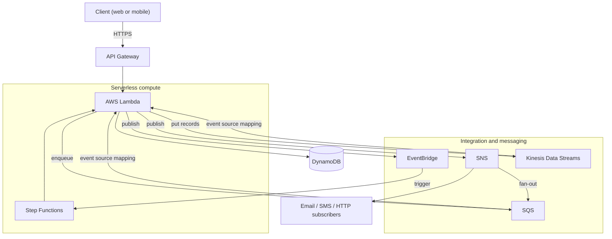

# Phase 4 — Serverless Architectures

Phase 3 taught you how to *ship* software — pipelines, containers, infrastructure as code. Phase 4 teaches you how to make that software **disappear into the platform**. Serverless means you stop paying for idle servers and start paying per request, per millisecond, and per gigabyte-second. That shift is not just a billing model: it changes how you design failure handling, concurrency, and data flow. By the end of this phase you will be able to compose Lambda, API Gateway, Step Functions, EventBridge, SQS, SNS, and Kinesis into a production-grade event-driven backend — and know exactly which service to reach for at each step.

## 🎯 Phase Goals

- Understand the AWS Lambda execution model deeply enough to reason about cold starts, concurrency, and cost
- Design HTTP APIs with API Gateway across REST, HTTP, and WebSocket flavors, with correct auth and throttling
- Orchestrate multi-step business processes with Step Functions instead of chaining Lambdas
- Route domain events with EventBridge and decouple services with SQS and SNS
- Stream and process high-volume data with Kinesis
- Ship a complete Uber-like serverless backend as the phase capstone

## 🗺️ Phase Map

## 📚 Lessons in this Phase

| # | Lesson | Focus | Difficulty |
|---|--------|-------|------------|
| 01 | [Lambda Fundamentals](./01-lambda-fundamentals.md) | Execution model, handlers, invocation types, layers, versions and aliases, concurrency basics | Beginner |
| 02 | [Lambda Performance Tuning](./02-lambda-performance-tuning.md) | Cold starts, memory/CPU, provisioned concurrency, SnapStart, ARM64, bundling, Power Tuning | Advanced |
| 03 | [API Gateway](./03-api-gateway.md) | REST vs HTTP vs WebSocket, stages, integrations, throttling, authorizers, usage plans, VPC link | Intermediate |
| 04 | [Step Functions](./04-step-functions.md) | State machines, task types, Retry and Catch, Map state, Express vs Standard, wait and callback patterns | Intermediate |
| 05 | [EventBridge](./05-eventbridge.md) | Event buses, rules, event patterns, schedules, cross-account routing, archive and replay, schema registry, Pipes | Intermediate |
| 06 | [Amazon SQS](./06-amazon-sqs.md) | Visibility timeout, DLQs, FIFO vs standard, long polling, idempotency, scaling, batch failures | Intermediate |
| 07 | [Amazon SNS](./07-amazon-sns.md) | Topics, fan-out, filter policies, FIFO topics, SNS plus SQS pattern, delivery retries and DLQs | Beginner |
| 08 | [Amazon Kinesis](./08-amazon-kinesis.md) | Streams vs Firehose vs Analytics, shards, partition keys, hot shards, consumers, re-sharding | Advanced |
| 09 | [Capstone — Uber-like Serverless Backend](./09-project-uber-like-serverless-backend.md) | Full event-driven backend tying every service in this phase together | Advanced |

## 🛠️ Capstone Project

**RideNow** — an Uber-like serverless backend.

The capstone wires the whole phase together: API Gateway fronts a Lambda that writes rides to DynamoDB, SQS drives asynchronous ride matching, SNS pushes rider and driver notifications, EventBridge carries domain events and schedules periodic work, Step Functions owns the ride lifecycle, and Kinesis streams driver location pings for live tracking.

**Deliverables:**

- A complete architecture diagram showing every service and data store
- A sequence diagram for the ride-booking flow, from tap to driver assigned
- A state diagram for the ride lifecycle, including failure and cancellation paths
- Event schemas for each domain event published to EventBridge
- A cost model for 100,000 rides per day

## ✅ Phase Checklist

- [ ] Deploy a Lambda function by CLI and by SAM, and invoke it synchronously and asynchronously
- [ ] Publish a version, create an alias, and shift traffic between versions
- [ ] Cut a cold start with SnapStart or provisioned concurrency and measure the difference
- [ ] Build an HTTP API with two routes, one Lambda authorizer, and per-route throttling
- [ ] Orchestrate a multi-step workflow with a Map state and a Catch block
- [ ] Route events to three targets using EventBridge rules and input transformers
- [ ] Configure an SQS queue with a DLQ and a partial batch failure response
- [ ] Fan out one SNS topic to two SQS queues with filter policies
- [ ] Produce and consume records from a Kinesis stream with an enhanced fan-out consumer
- [ ] Ship the RideNow capstone end to end

## 📚 Phase Resources

- [AWS Lambda Developer Guide](https://docs.aws.amazon.com/lambda/latest/dg/welcome.html)
- [Amazon API Gateway Developer Guide](https://docs.aws.amazon.com/apigateway/latest/developerguide/welcome.html)
- [AWS Step Functions Developer Guide](https://docs.aws.amazon.com/step-functions/latest/dg/welcome.html)
- [Amazon EventBridge User Guide](https://docs.aws.amazon.com/eventbridge/latest/userguide/eb-what-is.html)
- [Amazon SQS Developer Guide](https://docs.aws.amazon.com/AWSSimpleQueueService/latest/SQSDeveloperGuide/welcome.html)
- [Amazon SNS Developer Guide](https://docs.aws.amazon.com/sns/latest/dg/welcome.html)
- [Amazon Kinesis Data Streams Developer Guide](https://docs.aws.amazon.com/streams/latest/dev/introduction.html)
- [Serverless Land — patterns and sample code](https://serverlessland.com/)

## ➡️ Next Phase

[Phase 5 — Data and AI](../phase-5-data-and-ai/README.md)
