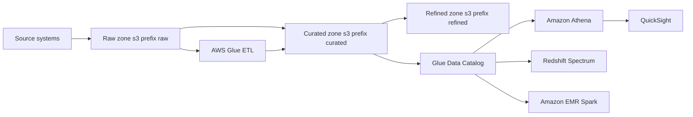
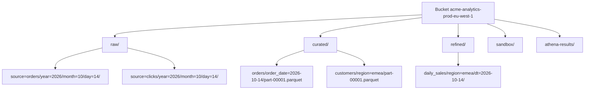
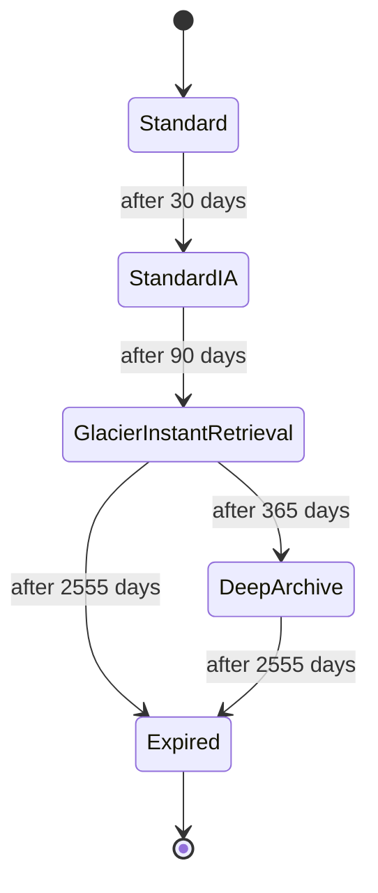

# 01 · Data Lakes on Amazon S3

> **Phase 5 — Data and AI** · Lesson 01 of 09
> ⬅️ Previous: [Phase 4 — Serverless Architectures](../phase-4-serverless-architectures/README.md) · ➡️ Next: [AWS Glue](./02-aws-glue.md) · 🏠 [Phase overview](./README.md)

## Learning Objectives

By the end of this lesson you will be able to:

- Explain how a data lake differs from a data warehouse and when each is the right tool
- Lay out raw, curated, and refined zones in S3 with a predictable prefix scheme
- Choose partition keys and file formats that keep downstream queries fast and cheap
- Detect and fix the small-file problem with compaction
- Measure what your lake actually stores and reads with S3 Storage Lens

**Estimated time:** 60 min · **Difficulty:** Intermediate

---

## Core Concepts

A **data lake** is object storage plus a convention. The storage is Amazon S3; the convention is a set of rules about where files live, how they are named, what format they use, and how they are partitioned. Get the convention right and every downstream service — Glue, Athena, Redshift Spectrum, EMR, SageMaker — can read your data with zero transformation. Get it wrong and every lesson after this one becomes an exercise in debugging.

The defining property of a lake is **schema-on-read**. You store files as they arrive and let the query engine interpret them. That is the opposite of a warehouse, which enforces a schema on write. Schema-on-read is what lets a lake absorb a new data source in minutes; it is also what lets a lake silently contain five incompatible versions of the same column name.

### Zones

Almost every production lake splits objects into three zones:

| Zone | Other names | Contents | Who writes it |
|------|-------------|----------|---------------|
| **Raw** | Landing, bronze, staging | Immutable copies exactly as received (CSV, JSON, gzip) | Ingestion jobs (Firehose, DMS, Lambda) |
| **Curated** | Processed, silver, cleansed | Deduplicated, typed, partitioned, columnar | ETL (Glue, EMR, Spark) |
| **Refined** | Presentation, gold, marts | Business-level aggregates and wide tables | ETL or BI tooling |

Raw data is your replay button. If a transformation has a bug, you re-run it against raw rather than re-asking the source system for data it may no longer have. That is why raw is never overwritten and usually never deleted — lifecycle it to Glacier instead (see the diagram below).

### Partitioning

A partition is just a folder whose name encodes a column value, in **Hive style**: `key=value`. Engines like Athena, Glue, and Spark recognize this convention automatically and skip any prefix that cannot match your `WHERE` clause. That prefix pruning is the single biggest performance lever you have.

Guidelines that hold in practice:

- Partition on columns you filter by constantly: `order_date`, `region`, `tenant_id`.
- Target **100 MB to 1 GB per partition file** after compression. Smaller and per-file overhead dominates; larger and you lose parallelism.
- Do **not** partition on high-cardinality columns such as `order_id` or a full timestamp. 10,000 partitions per table is already a lot; a million will break the catalog and the query planner.
- Use a coarse key (`year/month/day`) for most datasets and switch to `order_date` only when daily volume justifies it.
- Bucketing (fixed number of hash-cut files per partition) is the right tool when high cardinality is unavoidable — it is covered in Lesson 03.

### File formats

| Format | Layout | Splittable | Best for |
|--------|--------|-----------|----------|
| **CSV / JSON** | Row | Yes (JSON lines) | Arrival, debugging, tiny datasets |
| **Parquet** | Columnar | Yes | Default for analytics — best engine support |
| **ORC** | Columnar | Yes | Hive-heavy stacks, strong predicate pushdown |
| **Avro** | Row, schema in header | Yes | Streaming and schema evolution for row-wise writes |
| **Iceberg** | Table format over Parquet | Yes | ACID updates, time travel, hidden partitioning |

Columnar formats win because an analytical query usually touches 3 of 60 columns. Parquet reads only those column chunks, and per-column statistics let the reader skip row groups entirely.

Compression is chosen per column in Parquet. **Snappy** is the default compromise, **ZSTD** compresses 20–40% smaller at similar read speed, and **gzip** is smaller still but slower. Never store Parquet uncompressed.

### The small-file problem

One 8 MB Parquet file is harmless. Ten million of them will ruin your week: each file costs at least one S3 GET, one metadata entry in the catalog, and one task-scheduling decision in Spark. Queries that should take 5 seconds take 4 minutes, and the bill is dominated by request charges rather than storage.

Causes are predictable — streaming sinks that flush every minute, `INSERT` statements that write one file per commit, and unbounded partition counts. The fix is **compaction**: a scheduled job that reads many small files and rewrites them into few large ones. Glue has an optimized compaction utility, Athena has `OPTIMIZE` for Iceberg, and a trivial Glue job can do it for plain Parquet.

### Bucket and prefix design

Bucket names are globally unique, 3–63 characters, lowercase, and must not contain underscores. Beyond that, pick something that tells a human what is inside: `acme-analytics-prod-eu-west-1` beats `acme-bucket-2`. One bucket per environment and region, with layer separation by prefix rather than by bucket, keeps lifecycle and IAM policies manageable.

S3 automatically scales request throughput and supports at least 3,500 write and 5,500 read requests per second per partitioned prefix — so do not build a fake hash prefix scheme. Design prefixes for *humans and lifecycle rules*, not for throughput.

### S3 Storage Lens

Storage Lens aggregates storage and activity metrics across every bucket in an account or organization. The free tier gives you bucket-level storage, object count, and request metrics; advanced metrics add prefix-level detail, activity breakdowns by status code, and cost-efficiency indicators such as the percentage of objects that are incomplete multipart uploads. Advanced tiers are billed per million objects monitored.

### Key terminology

| Term | Meaning |
|------|---------|
| **Partition pruning** | An engine skipping prefixes that cannot match the query predicate |
| **Hive-style partition** | Folder naming convention `column=value` that engines recognize |
| **Columnar format** | Storage layout that keeps each column's values contiguous |
| **Compaction** | Rewriting many small files into few large files |
| **Table format** | Metadata layer (Iceberg, Delta, Hudi) adding ACID and snapshots over files |
| **Storage class** | S3 pricing/durability tier: Standard, Intelligent-Tiering, Glacier, Deep Archive |
| **Storage Lens** | Account/organization-wide S3 metrics service |

---

## Architecture Diagram

The zone model, with the lifecycle destination of each zone:



A concrete prefix layout for one bucket:



How a raw object ages out of expensive storage without ever being deleted:



---

## Hands-on Lab: Build a Partitioned Lake by Hand

**Goal:** Create a bucket, land raw data, produce a partitioned Parquet curated dataset, verify the layout, and attach a lifecycle policy.

**Prerequisites:** AWS CLI v2 configured with an IAM principal that can create buckets and objects, Python 3 with `pandas` and `pyarrow` installed, a region chosen (examples use `eu-west-1`).

### Step 1 — Create the bucket with the right defaults

```bash
# Globally unique name, region pinned, public access blocked at creation time
aws s3api create-bucket \
  --bucket acme-analytics-prod-eu-west-1 \
  --region eu-west-1 \
  --create-bucket-configuration LocationConstraint=eu-west-1

aws s3api put-public-access-block \
  --bucket acme-analytics-prod-eu-west-1 \
  --public-access-block-configuration \
  "BlockPublicAcls=true,IgnorePublicAcls=true,BlockPublicPolicy=true,RestrictPublicBuckets=true"
```

Create the zone prefixes. S3 has no real directories, but `put-object` with a trailing slash makes the prefix visible in the console for humans.

```bash
# Placeholder objects make each zone obvious to a human browsing the console
for zone in raw curated refined sandbox athena-results; do
  aws s3api put-object --bucket acme-analytics-prod-eu-west-1 --key "$zone/"
done
```

### Step 2 — Land the raw data unchanged

```bash
# Raw is an append-only archive: date-stamped prefix, original format, no edits
aws s3 cp orders.csv \
  "s3://acme-analytics-prod-eu-west-1/raw/source=orders/year=2026/month=10/day=14/orders.csv"

aws s3 ls "s3://acme-analytics-prod-eu-west-1/raw/source=orders/year=2026/month=10/day=14/"
```

Do not "fix" the CSV before landing it. Landing is a copy operation, not a transformation.

### Step 3 — Produce the curated Parquet dataset

In this lab you do the conversion locally so the mechanics are obvious. In Lesson 02, Glue does the same work at scale.

```python
import pandas as pd
import pyarrow as pa
import pyarrow.parquet as pq

# Read the raw CSV and give it the types the lake expects
df = pd.read_csv("orders.csv", parse_dates=["order_ts"])
df["order_date"] = df["order_ts"].dt.strftime("%Y-%m-%d")

# Write one directory per partition, with Hive-style folder names
pq.write_to_dataset(
    pa.Table.from_pandas(df),
    root_path="curated/orders",
    partition_cols=["order_date"],
    compression="snappy",
    basename_template="part-{i}.parquet",
)
```

```bash
# Sync the curated tree into the lake
aws s3 sync curated/orders "s3://acme-analytics-prod-eu-west-1/curated/orders/"
```

### Step 4 — Verify the layout

```bash
# Confirm one folder per day, Hive style
aws s3 ls "s3://acme-analytics-prod-eu-west-1/curated/orders/" --recursive | head -20

# Total bytes and object count per prefix: spot small files before they multiply
aws s3api list-objects-v2 \
  --bucket acme-analytics-prod-eu-west-1 \
  --prefix "curated/orders/" \
  --query "Contents[].Size" --output text | tr '\t' '\n' | awk '{sum+=$1; n++} END {print n" objects, "sum/1024/1024" MB"}'
```

If the object count is in the thousands and the average size is under 32 MB, schedule compaction now rather than later.

### Step 5 — Attach a lifecycle policy

```bash
# Save as lifecycle.json, then apply it to the whole bucket
cat > lifecycle.json <<'JSON'
{
  "Rules": [
    {
      "ID": "raw-archive",
      "Filter": {"Prefix": "raw/"},
      "Status": "Enabled",
      "Transitions": [
        {"Days": 30, "StorageClass": "STANDARD_IA"},
        {"Days": 90, "StorageClass": "GLACIER_IR"},
        {"Days": 365, "StorageClass": "DEEP_ARCHIVE"}
      ],
      "NoncurrentVersionExpiration": {"NoncurrentDays": 90}
    },
    {
      "ID": "abort-incomplete-multipart",
      "Filter": {"Prefix": ""},
      "Status": "Enabled",
      "AbortIncompleteMultipartUpload": {"DaysAfterInitiation": 7}
    }
  ]
}
JSON

aws s3api put-bucket-lifecycle-configuration \
  --bucket acme-analytics-prod-eu-west-1 \
  --lifecycle-configuration file://lifecycle.json
```

### Step 6 — Turn on visibility with Storage Lens

```bash
# Enable the free default account dashboard
aws s3control put-storage-lens-configuration \
  --account-id 123456789012 \
  --config-id default-account-dashboard \
  --storage-lens-configuration file://s3-lens.json

# Confirm it exists and is enabled
aws s3control list-storage-lens-configurations --account-id 123456789012
```

Where `s3-lens.json` enables prefix-level metrics down to three levels deep:

```json
{
  "Id": "default-account-dashboard",
  "IsEnabled": true,
  "AccountLevel": {
    "ActivityMetrics": {"IsEnabled": true},
    "BucketLevel": {
      "ActivityMetrics": {"IsEnabled": true},
      "PrefixLevel": {
        "StorageMetrics": {
          "IsEnabled": true,
          "SelectionCriteria": {"MaxDepth": 3, "MinStorageBytesPercentage": 1.0}
        }
      }
    }
  }
}
```

### Step 7 — Verify

```bash
# Expect Hive-style folders, Parquet files, and a lifecycle policy in place
aws s3 ls "s3://acme-analytics-prod-eu-west-1/curated/orders/" --recursive

aws s3api get-bucket-lifecycle-configuration \
  --bucket acme-analytics-prod-eu-west-1 --query "Rules[].ID"
```

You should see `order_date=2026-10-14/part-0.parquet`-style keys and two lifecycle rule IDs. If the curated prefix contains a `.csv` file, your transformation step silently failed.

---

## CLI Reference

```bash
# Create a bucket in a non-us-east-1 region
aws s3api create-bucket --bucket my-lake --region eu-west-1 \
  --create-bucket-configuration LocationConstraint=eu-west-1

# Show every object with size and storage class (useful for cost forensics)
aws s3api list-objects-v2 --bucket my-lake --prefix "raw/" \
  --query "Contents[].{Key:Key,Size:Size,Class:StorageClass}" --output table

# Aggregate storage by storage class across a bucket
aws s3api list-objects-v2 --bucket my-lake --query "Contents[].StorageClass" --output text \
  | tr '\t' '\n' | sort | uniq -c

# Restore an archived object temporarily so a query can read it
aws s3 restore-object --bucket my-lake --key "raw/old.parquet" \
  --restore-request Days=5,GlacierJobParameters={Tier=Standard}

# Create an Iceberg table directly in the Glue Data Catalog (no crawler needed)
aws glue create-table --database-name analytics --name orders \
  --open-table-format-input '{"IcebergInput":{"MetadataOperation":"CREATE","Version":"2"}}'

# List Storage Lens configurations
aws s3control list-storage-lens-configurations --account-id 123456789012
```

| Command | Purpose |
|---------|---------|
| `s3api list-objects-v2` | Inventory a prefix with sizes — the fastest way to find small files |
| `s3api restore-object` | Pull an object back from Glacier so a query can read it |
| `s3api put-bucket-lifecycle-configuration` | Move data between storage classes automatically |
| `glue create-table --open-table-format-input` | Create an Iceberg or Hudi table without a crawler |
| `s3control put-storage-lens-configuration` | Enable account-wide storage and activity metrics |

---

## Best Practices

| Practice | Why it matters |
|----------|----------------|
| Treat the raw zone as immutable and append-only | You can always rebuild curated data; you cannot rebuild an overwritten raw file |
| Write Hive-style `key=value` prefixes | Every AWS analytics engine prunes partitions from this convention |
| Target 100 MB–1 GB files in curated | Balances per-file overhead against read parallelism |
| Land as JSON/CSV, publish as Parquet | Ingestion stays simple; analytics stays fast |
| Compress every columnar file (Snappy or ZSTD) | 3–10x smaller scans, which is exactly what Athena bills on |
| Separate zones by prefix, environments by bucket | Lifecycle and IAM policies stay readable |
| Enable versioning on curated and refined | Recover from a bad ETL deploy without a restore |
| Run Storage Lens (free tier at minimum) | Finds orphaned prefixes, stale data, and failed multipart uploads |
| Use `AbortIncompleteMultipartUpload` on every bucket | Incomplete uploads are invisible but billed forever |

---

## Common Pitfalls

| Pitfall | Symptom | Fix |
|---------|---------|-----|
| Partitioning on a timestamp to the second | Crawler times out, catalog has millions of partitions | Partition on `year/month/day` or a date column |
| Millions of tiny files from streaming | Queries scan slowly, request costs exceed storage costs | Schedule compaction hourly or daily |
| Mixed formats in one prefix | Athena returns nulls or schema errors | Keep one format per prefix; version new schemas under a new prefix |
| Overwriting raw data in place | No way to reprocess after a logic bug | Write to an immutable date-stamped prefix |
| Case-sensitive column names assumed | `Order_Date` and `order_date` become two columns | Normalize names before landing; columnar readers are case-sensitive |
| Glacier data queried directly | `InvalidObjectState` errors | Lifecycle to Glacier IR, or restore before querying |
| No public access block | Bucket policy accidentally exposes data | Enable Block Public Access on every lake bucket |
| Unbounded sandbox prefix | Junk data accumulates and is never cleaned | Lifecycle `sandbox/` to expire after 30 days |

---

## Cost Considerations

What drives the bill, in order of impact for a typical lake:

| Component | Approximate price | Note |
|-----------|-------------------|------|
| S3 Standard storage | $0.023 per GB-month | Compress and columnarize to shrink this |
| S3 Glacier Instant Retrieval | $0.004 per GB-month | Millisecond reads, ideal for old raw data |
| S3 Deep Archive | ~$0.00099 per GB-month | 12-hour restore; compliance copies only |
| PUT requests | ~$0.005 per 1,000 | Small-file lakes are billed here, not on storage |
| GET requests | ~$0.0004 per 1,000 | Every file read by every query |
| Athena scans | $5.00 per TB scanned | Parquet plus partitioning is typically a 10–100x reduction |
| Storage Lens advanced metrics | ~$0.20 per million objects/month | Free tier covers most learning accounts |

Two counter-intuitive facts. First, **small files cost more in requests than they save in storage** — a 1 KB object is billed as 128 KB of storage and as one PUT. Second, **saving money by not compressing is impossible**: Snappy Parquet is usually 4–8x smaller than the equivalent CSV, and every downstream scan is billed per byte.

A concrete comparison: 1 TB of raw CSV queried with a 3-column `SELECT` scans about 1 TB and costs $5.00 per query. The same data as partitioned, Snappy-compressed Parquet scans roughly 8 GB and costs about $0.04 — with a partition filter on top, often under $0.01.

---

## Security Considerations

- **Block Public Access on every bucket, at the account level too.** Accidental public lakes are the most common AWS data breach story.
- **Encrypt with SSE-KMS, not just SSE-S3**, when the data is sensitive. KMS gives you per-key access control and CloudTrail records of every decrypt.
- **Enforce TLS with a bucket policy condition** so no client can send plaintext:
  ```json
  {"Sid":"DenyInsecureTransport","Effect":"Deny","Principal":"*","Action":"s3:*",
   "Resource":["arn:aws:s3:::acme-analytics-prod-eu-west-1/*"],
   "Condition":{"Bool":{"aws:SecureTransport":"false"}}}
  ```
- **Require a bucket owner or organization condition** to stop cross-account reads: `"aws:PrincipalOrgID": "o-abc123"`.
- **Log data events selectively.** CloudTrail data events for S3 cost per 100,000 events, so log the curated and refined zones, not the raw firehose prefix.
- **Use Lake Formation for fine-grained access** (Lesson 04) rather than bucket policies once more than one team reads the lake — bucket policies cannot express "hide this column".
- **Turn on Macie** for the curated and refined zones so PII is discovered automatically rather than by a query that happens to return unexpected output.

---

## Exercise

Rebuild the lab dataset as an **Iceberg table** instead of a Hive-partitioned Parquet prefix:

1. Create the table with `aws glue create-table --open-table-format-input`.
2. Load the same CSV rows into it with an Athena `INSERT INTO` statement.
3. Update one row and query the table twice with and without a `FOR SYSTEM_TIME AS OF` clause so you can see the previous snapshot.

Success looks like: the second query returns the pre-update value, and `aws glue get-table` shows an `OpenTableFormat`/Iceberg table with a `metadata_location` pointing at a `metadata/*.metadata.json` object in S3.

---

## Resources

- [Amazon S3 Best Practices — Performance](https://docs.aws.amazon.com/AmazonS3/latest/userguide/optimizing-performance.html)
- [Organizing Objects Using Prefixes](https://docs.aws.amazon.com/AmazonS3/latest/userguide/using-prefixes.html)
- [Partitioning Data in Athena](https://docs.aws.amazon.com/athena/latest/ug/partitions.html)
- [Amazon S3 Storage Classes](https://docs.aws.amazon.com/AmazonS3/latest/userguide/storage-class-intro.html)
- [S3 Storage Lens](https://docs.aws.amazon.com/AmazonS3/latest/userguide/storage_lens.html)
- [Apache Iceberg on AWS](https://docs.aws.amazon.com/prescriptive-guidance/latest/apache-iceberg-on-aws/introduction.html)

---

## Next Steps

You now have a lake with the right shape. The next lesson adds the layer that makes it usable by everyone else: AWS Glue, which catalogs those files into tables and transforms raw data into curated data on a schedule.

> ⬅️ Previous: [Phase 4 — Serverless Architectures](../phase-4-serverless-architectures/README.md) · ➡️ Next: [AWS Glue](./02-aws-glue.md) · 🏠 [Phase overview](./README.md)
