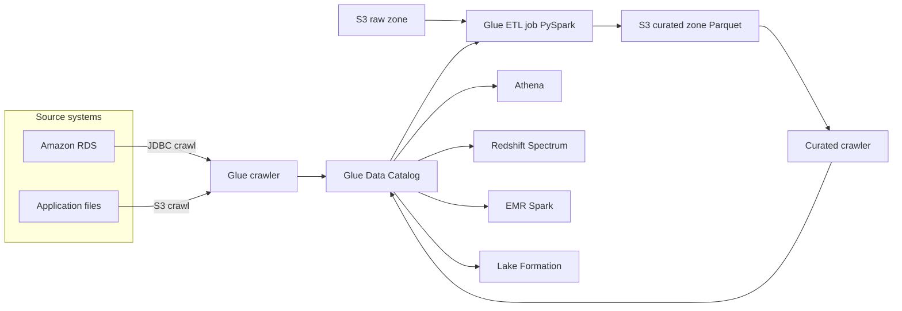
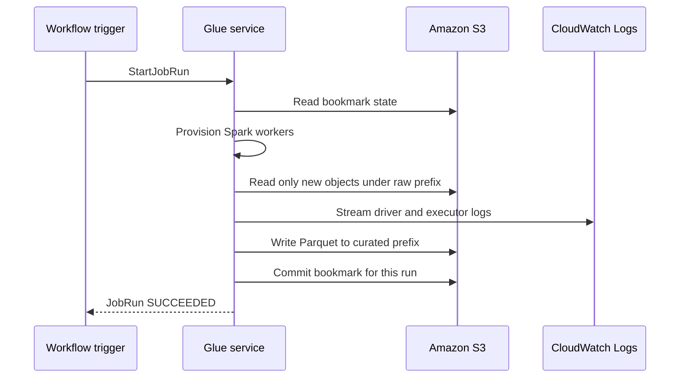
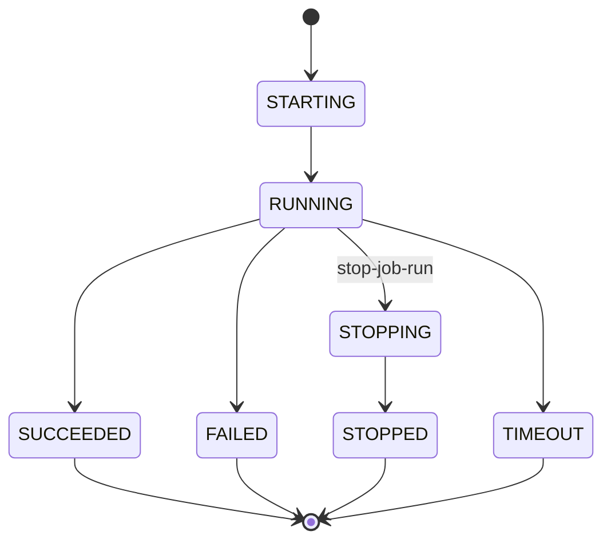

# 02 · AWS Glue

> **Phase 5 — Data and AI** · Lesson 02 of 09
> ⬅️ Previous: [Data Lakes on Amazon S3](./01-data-lakes-on-s3.md) · ➡️ Next: [Amazon Athena](./03-amazon-athena.md) · 🏠 [Phase overview](./README.md)

## Learning Objectives

By the end of this lesson you will be able to:

- Explain what the Glue Data Catalog is and why every other analytics service depends on it
- Register S3 prefixes as queryable tables with crawlers, classifiers, and explicit DDL
- Write and run Spark ETL jobs in Glue with the right worker type and DPU count
- Use job bookmarks to process only new data on every run
- Orchestrate crawlers and jobs with Glue workflows and triggers
- Decide when to reach for Glue DataBrew instead of writing PySpark

**Estimated time:** 75 min · **Difficulty:** Intermediate

---

## Core Concepts

**AWS Glue** is a serverless data integration service with four moving parts: a **catalog** (metadata), **crawlers** (metadata discovery), **jobs** (compute), and **workflows** (orchestration). You never manage a cluster; you hand Glue a script and a worker count and it provisions Spark, runs, and tears down.

The **Glue Data Catalog** is the important part. It is a Hive-compatible metastore that stores databases, tables, schemas, partition indexes, and connection definitions. Athena, Redshift Spectrum, EMR Spark, Lake Formation, and SageMaker all read from the same catalog, which is why you catalog data once instead of redefining it per engine.

A **crawler** samples your S3 prefix, infers a schema, and writes or updates a table in the catalog. Crawlers are convenient for exploration and dangerous for production: a crawler that runs after a partial file lands will happily publish a schema with the wrong types. The mature pattern is to let the crawler create the table once, then manage the schema with `ALTER TABLE` (or better, with a table format like Iceberg), and only re-run the crawler when new partitions appear.

Glue **jobs** are Spark applications with a managed runtime. Job types matter:

| Job type | Runtime | Use |
|----------|---------|-----|
| `glueetl` | Apache Spark (PySpark or Scala) | The default: any real transformation |
| `gluestreaming` | Spark Structured Streaming | Legacy streaming jobs — prefer Managed Flink (Lesson 07) |
| `pythonshell` | Plain Python, no Spark | Small scripts, API calls, orchestration glue |

**Capacity** is measured in **DPUs**. One DPU is 4 vCPU and 16 GB of memory. For Spark jobs you choose a worker type and a worker count:

| Worker type | DPUs per worker | vCPU / memory per worker |
|-------------|-----------------|--------------------------|
| `G.1X` | 1 | 4 vCPU / 16 GB |
| `G.2X` | 2 | 8 vCPU / 32 GB |
| `G.4X` | 4 | 16 vCPU / 64 GB |
| `G.8X` | 8 | 32 vCPU / 128 GB |

Spark jobs need **at least 2 workers** on Glue 3.0 and later: one becomes the driver and the rest are executors. For memory-hungry work on a small dataset, prefer fewer `G.2X` workers over many `G.1X` workers — executors with more memory spill less.

Runtime versions decide the language and library versions available. **Glue 4.0** is Spark 3.3 with Python 3.10; **Glue 5.0** is Spark 3.5 with Python 3.11 and Java 17. Glue 5.0 also supports Spark Connect and finer-grained job bookmarks. New jobs should start on 5.0 unless a library pins you to 4.0.

**Job bookmarks** are Glue's incremental-processing feature. Glue persists state after each successful run — for S3 sources, the last processed path and modification time — and the next run reads only what changed. Bookmarks work with `from_catalog` and `from_options` readers when the job has a stable `transformation_ctx`. They do not work if you change the script structure between runs; use the `pause` option while you refactor.

**Workflows** combine crawlers, jobs, and triggers into a DAG. A trigger can be `SCHEDULED` (cron), `CONDITIONAL` (depends on other triggers), or `ON_DEMAND`. Conditional triggers are how you express "crawl, then transform, then crawl the output".

**DataBrew** is the no-code option: 250+ built-in transformations, a visual recipe builder, and profiling. It is billed per node-hour and is worth it for analyst-owned cleansing, but it is not a replacement for PySpark on multi-terabyte joins.

### Key terminology

| Term | Meaning |
|------|---------|
| **Data Catalog** | Serverless Hive metastore shared by Athena, Spectrum, EMR, Lake Formation |
| **Classifier** | Logic that infers schema/format — built-in (CSV, JSON, Parquet, Avro, ORC) or custom (Grok, XML) |
| **Crawler** | Runs classifiers over a data store and writes table definitions into the catalog |
| **DPU** | Data Processing Unit — 4 vCPU and 16 GB; the billing and sizing unit |
| **Transformation context** | `transformation_ctx` string that Glue uses to track state per read/write node |
| **Job bookmark** | Persisted state that makes a job read only new data |
| **DynamicFrame** | Glue's schema-flexible collection; converts to/from Spark DataFrames |
| **Workflow** | Directed acyclic graph of crawlers, jobs, and triggers |

---

## Architecture Diagram

The catalog as the hub that every other service reads:



What happens during a single job run, including the bookmark write:



Job run states you will see in the console and in `get-job-run`:



---

## Hands-on Lab: Catalog Raw Data and Publish Curated Parquet

**Goal:** Crawl a curated prefix, then run a PySpark Glue job that deduplicates new raw JSON and writes partitioned Parquet using job bookmarks.

**Prerequisites:** The bucket from Lesson 01, an IAM role for Glue with S3 access (see Step 1), and the AWS CLI.

### Step 1 — Create the Glue service role

```bash
# Glue assumes this role; it needs S3 access to the lake plus the managed Glue policy
aws iam create-role \
  --role-name AWSGlueServiceRole-Lake \
  --assume-role-policy-document '{
    "Version":"2012-10-17",
    "Statement":[{"Effect":"Allow","Principal":{"Service":"glue.amazonaws.com"},"Action":"sts:AssumeRole"}]
  }'

aws iam attach-role-policy --role-name AWSGlueServiceRole-Lake \
  --policy-arn arn:aws:iam::aws:policy/service-role/AWSGlueServiceRole
```

### Step 2 — Create a database and crawler

```bash
# A catalog database is just a namespace for tables
aws glue create-database --database-input '{"Name":"analytics","Description":"Curated lake tables"}'

# Crawl only the curated prefix; exclude Spark and checksum noise files
aws glue create-crawler \
  --name lake-curated-crawler \
  --role arn:aws:iam::123456789012:role/AWSGlueServiceRole-Lake \
  --database-name analytics \
  --table-prefix "curated_" \
  --targets '{"S3Targets":[{"Path":"s3://acme-analytics-prod-eu-west-1/curated/orders/","Exclusions":["**.crc","**.tmp","_SUCCESS"]}]}' \
  --schema-change-policy '{"UpdateBehavior":"UPDATE_IN_DATABASE","DeleteBehavior":"LOG"}' \
  --configuration '{"Version":1.0,"CrawlerOutput":{"Partitions":{"AddOrUpdateBehavior":"InheritFromTable"}}}'
```

```bash
# Run it and wait for the state to leave RUNNING
aws glue start-crawler --name lake-curated-crawler
aws glue get-crawler --name lake-curated-crawler \
  --query "Crawler.LastCrawl.{Status:Status,Summary:Summary}" --output json

# Inspect the table the crawler created
aws glue get-table --database-name analytics --name curated_orders \
  --query "Table.{Name:Name,Location:StorageDescriptor.Location,Partitions:PartitionKeys,Format:StorageDescriptor.InputFormat}"
```

### Step 3 — Write the PySpark job script

Save this as `orders_etl.py` and upload it to `s3://acme-analytics-prod-eu-west-1/scripts/`.

```python
import sys
from awsglue.transforms import *
from awsglue.utils import getResolvedOptions
from awsglue.context import GlueContext
from awsglue.job import Job
from awsglue.dynamicframe import DynamicFrame
from pyspark.context import SparkContext
from pyspark.sql import functions as F

args = getResolvedOptions(sys.argv, ["JOB_NAME", "raw_path", "target_path"])

sc = SparkContext()
glueContext = GlueContext(sc)
spark = glueContext.spark_session
job = Job(glueContext)
job.init(args["JOB_NAME"], args)

# Bookmarked read: the next run sees only objects written after this run started
raw = glueContext.create_dynamic_frame.from_options(
    connection_type="s3",
    connection_options={"paths": [args["raw_path"]], "recurse": True},
    format="json",
    transformation_ctx="raw_orders",
)

orders = raw.toDF()
orders = (
    orders
    .dropDuplicates(["order_id"])
    .withColumn("order_date", F.to_date("order_ts"))
    .withColumn("amount", F.col("amount").cast("double"))
    .filter(F.col("order_id").isNotNull())
    # Repartition on the partition key so each task writes one folder, not hundreds
    .repartition(4, "order_date")
)

out = DynamicFrame.fromDF(orders, glueContext, "curated_orders")

glueContext.write_dynamic_frame.from_options(
    frame=out,
    connection_type="s3",
    connection_options={"path": args["target_path"], "partitionKeys": ["order_date"]},
    format="glueparquet",
    format_options={"compression": "snappy"},
    transformation_ctx="curated_orders",
)

job.commit()
```

`job.commit()` is what persists the bookmark. Without it, the next run reprocesses everything.

### Step 4 — Create and run the job

```bash
aws glue create-job \
  --name orders-curated-etl \
  --role arn:aws:iam::123456789012:role/AWSGlueServiceRole-Lake \
  --glue-version "5.0" \
  --worker-type G.2X \
  --number-of-workers 10 \
  --execution-class STANDARD \
  --timeout 60 \
  --command '{"Name":"glueetl","ScriptLocation":"s3://acme-analytics-prod-eu-west-1/scripts/orders_etl.py","PythonVersion":"3"}' \
  --default-arguments '{
      "--job-bookmark-option":"job-bookmark-enable",
      "--enable-continuous-cloudwatch-log":"true",
      "--enable-metrics":"true",
      "--TempDir":"s3://acme-analytics-prod-eu-west-1/tmp/",
      "--raw_path":"s3://acme-analytics-prod-eu-west-1/raw/source=orders/",
      "--target_path":"s3://acme-analytics-prod-eu-west-1/curated/orders/"
  }'

aws glue start-job-run --job-name orders-curated-etl
```

```bash
# Poll the run; RUN_ID is returned by start-job-run
aws glue get-job-run --job-name orders-curated-etl --run-id "$RUN_ID" \
  --query "JobRun.{State:JobRunState,DPUSeconds:ExecutionClass,Seconds:ExecutionTime}"
```

`--execution-class FLEX` cuts the rate to about $0.29 per DPU-hour in exchange for runs that can start within minutes rather than seconds and may be interrupted.

### Step 5 — Verify the bookmark

```bash
# The bookmark records what the last successful run processed
aws glue get-job-bookmark --job-name orders-curated-etl --query "JobBookmarkEntry.Run"

# Land one new file, run again, and confirm the second run reads only that file
aws s3 cp new_orders.json "s3://acme-analytics-prod-eu-west-1/raw/source=orders/year=2026/month=10/day=15/new_orders.json"
aws glue start-job-run --job-name orders-curated-etl
```

### Step 6 — Orchestrate with a workflow

```bash
aws glue create-workflow --name orders-workflow

aws glue create-trigger \
  --name daily-recrawl \
  --workflow-name orders-workflow \
  --type SCHEDULED \
  --schedule "cron(30 3 * * ? *)" \
  --actions '[{"CrawlerName":"lake-curated-crawler"}]' \
  --start-on-creation

aws glue create-trigger \
  --name daily-etl-after-crawl \
  --workflow-name orders-workflow \
  --type CONDITIONAL \
  --start-on-creation \
  --predicate '{"Conditions":[{"LogicalOperator":"EQUALS","CrawlerName":"lake-curated-crawler","CrawlState":"SUCCEEDED"}]}' \
  --actions '[{"JobName":"orders-curated-etl"}]'

aws glue start-workflow-run --name orders-workflow
aws glue get-workflow-run --name orders-workflow --run-id "$WORKFLOW_RUN_ID" \
  --query "Run.{Status:Status,Statistics:Statistics}"
```

### Step 7 — Verify

```bash
# Curated Parquet partitions must exist and be a sensible size
aws s3 ls "s3://acme-analytics-prod-eu-west-1/curated/orders/" --recursive \
  | awk '{print $3, $4}' | head

# Both triggers must show as ACTIVATED
aws glue get-triggers --query "Triggers[].{Name:Name,State:State,Type:Type}"
```

You should see `order_date=.../part-*.parquet` objects averaging at least tens of MB, an advanced bookmark (`Run` greater than 1) after the second execution, and two activated triggers.

---

## CLI Reference

```bash
# List databases and tables in the catalog
aws glue get-databases --query "DatabaseList[].Name"
aws glue get-tables --database-name analytics --query "TableList[].Name"

# Inspect the partitions of a cataloged table
aws glue get-partitions --database-name analytics --table-name curated_orders \
  --query "Partitions[].Values" --output text

# Update job capacity without recreating the job
aws glue update-job --job-name orders-curated-etl \
  --job-update '{"Role":"arn:aws:iam::123456789012:role/AWSGlueServiceRole-Lake","Command":{"Name":"glueetl","ScriptLocation":"s3://acme-analytics-prod-eu-west-1/scripts/orders_etl.py","PythonVersion":"3"},"GlueVersion":"5.0","WorkerType":"G.2X","NumberOfWorkers":20}'

# Start a run with argument overrides for a backfill
aws glue start-job-run --job-name orders-curated-etl \
  --arguments '{"--job-bookmark-option":"job-bookmark-disable","--raw_path":"s3://acme-analytics-prod-eu-west-1/raw/source=orders/year=2025/"}'

# DataBrew: point a dataset at the curated prefix and profile it
aws databrew create-dataset --name orders-dataset --format PARQUET \
  --input '{"S3InputDefinition":{"Bucket":"acme-analytics-prod-eu-west-1","Key":"curated/orders/"}}'
aws databrew start-job-run --name orders-profile --dataset-name orders-dataset \
  --recipe-reference '{"Name":"orders-recipe"}' --role-arn arn:aws:iam::123456789012:role/AWSGlueServiceRole-Lake \
  --outputs '[{"Location":{"Bucket":"acme-analytics-prod-eu-west-1","Key":"sandbox/profile/"}}]'
```

| Command | Purpose |
|---------|---------|
| `glue create-crawler` / `start-crawler` | Register S3 or JDBC data as catalog tables |
| `glue create-job` / `start-job-run` | Define and execute a Spark ETL job |
| `glue get-job-bookmark` | Confirm incremental processing state |
| `glue reset-job-bookmark` | Force a full reprocess after a logic change |
| `glue create-trigger` | Build scheduled or conditional workflow DAGs |
| `databrew create-dataset` | Register data for no-code transformation and profiling |

---

## Best Practices

| Practice | Why it matters |
|----------|----------------|
| Let the crawler create the table once, then manage schema explicitly | Crawlers infer wrong types from a partial file and republish them |
| Always set `transformation_ctx` on bookmarked reads and writes | Without it Glue cannot track state and reprocesses everything |
| Write with `partitionKeys` rather than `.partitionBy()` | Glue's writer handles the Hive layout and catalog consistency |
| Set `--enable-continuous-cloudwatch-log` and `--enable-metrics` | You cannot debug a finished Spark run without logs |
| Set a job `--timeout` | A runaway job bills until it finishes or hits the 48-hour default |
| Prefer `G.2X`+ for shuffles and joins | More memory per executor means less spill to disk |
| Repartition before writing | Controls file count, which controls query cost downstream |
| Use `--execution-class FLEX` for backfills | Roughly a third of the price for work with no deadline |

---

## Common Pitfalls

| Pitfall | Symptom | Fix |
|---------|---------|-----|
| Forgetting `job.commit()` | Every run reprocesses the whole dataset | Add `job.commit()` as the last line of the script |
| Changing the script between runs with bookmarks on | Data silently skipped | Set `job-bookmark-pause` while refactoring, then reset |
| One worker configured | Job fails at start with a worker count error | Spark jobs on Glue 3.0+ need at least 2 workers |
| Crawler runs on a half-written prefix | Wrong schema, nulls, or duplicate tables | Land data atomically, or create the table with explicit DDL |
| `getResolvedOptions` name mismatch | `KeyError` at job start | Argument names must match `--default-arguments` keys exactly |
| Aggressive `.coalesce(1)` | Single output file, no read parallelism | Repartition by the partition key with a sane count |
| `DynamicFrame` schema drift on JSON | New fields appear as nulls | Enable `--enable-auto-scaling`/schema evolution, or map with `ApplyMapping` |
| Catalog table points at the wrong prefix | Athena returns zero rows | Check `StorageDescriptor.Location` and the partition `Location` values |
| Triggers created but never started | Workflow runs do nothing | Pass `--start-on-creation`, or call `start-trigger` |

---

## Cost Considerations

Glue bills per **DPU-hour**, and the pricing differs by workload:

| Workload | Approximate rate | Billing granularity |
|----------|------------------|---------------------|
| ETL job (STANDARD execution class) | $0.44 per DPU-hour | Per second, 1-minute minimum |
| ETL job (FLEX execution class) | ~$0.29 per DPU-hour | Per second, 1-minute minimum |
| Crawler | $0.44 per DPU-hour | 10-minute minimum per run |
| DataBrew job | ~$0.48 per node-hour, 1 node minimum | Per minute |
| Glue Studio interactive sessions | ~$0.44 per DPU-hour | Per minute |

The three levers that matter:

1. **Worker count and type.** 10 `G.2X` workers for 60 seconds is 20 DPU × 1 minute = 20 DPU-minutes ≈ $0.15. The same job on 100 workers costs 10x that even if it finishes 5x faster — and it often does not. Right-size by watching the CloudWatch `glue.driver.aggregate.numCompletedTasks` and executor utilization metrics.
2. **Run duration.** Most of a badly tuned job's time is a shuffle spill or a skewed partition. Fix the data skew before adding workers.
3. **Crawler frequency.** A crawler has a 10-minute minimum charge. Crawling hourly across 40 tables is real money; for stable datasets, crawl nightly or use explicit `ALTER TABLE ADD PARTITION`.

Sizing rule of thumb: start at 10 `G.2X` workers for datasets under 100 GB, watch peak executor memory, and change one variable at a time. If DPU-seconds per GB processed grows month over month, your partitions or join keys are the problem.

The Data Catalog itself is free for the first million objects and requests per month, then billed per 100,000 objects — negligible unless you crawl millions of tiny files.

---

## Security Considerations

- **The Glue service role is the blast radius.** Never attach `AmazonS3FullAccess`. Scope it to the lake bucket prefixes and to the specific catalog databases the job needs.
- **Use connections for JDBC sources** and store credentials in Secrets Manager (`aws glue create-connection` with `SECRET_ID`), never inline in a job argument.
- **Encrypt the job's temporary directory.** Glue writes shuffle data and `--TempDir` output to S3, so apply SSE-KMS there too and delete the prefix with a lifecycle rule.
- **Encrypt catalog metadata** with a KMS key via `--security-configuration`, which also enables CloudWatch log encryption and S3 encryption settings:
  ```bash
  aws glue create-security-configuration --name lake-sec --security-configuration-input '{
    "EncryptionConfiguration":{"S3Encryptions":[{"S3EncryptionMode":"SSE-KMS","KmsKeyArn":"arn:aws:kms:eu-west-1:123456789012:key/abcd-1234"}]},
    "CloudWatchEncryption":{"CloudWatchEncryptionMode":"SSE-KMS","KmsKeyArn":"arn:aws:kms:eu-west-1:123456789012:key/abcd-1234"},
    "JobBookmarksEncryption":{"JobBookmarksEncryptionMode":"CSE-KMS","KmsKeyArn":"arn:aws:kms:eu-west-1:123456789012:key/abcd-1234"}}'
  ```
- **Restrict the catalog with Lake Formation**, not IAM alone, once more than one team reads the lake. Glue resource policies (`aws glue put-resource-policy`) only cover cross-account catalog access.
- **VPC-attach jobs that read RDS.** Give the job a connection with the right subnets and security groups so the database stays private; then you also need an S3 VPC gateway endpoint or a NAT gateway for the ETL output.
- **Treat job arguments as untrusted input.** A `--glue_parameter` that reaches a path string can be used for path traversal into other prefixes.
- **Never run DataBrew recipes as an admin role.** Recipes are written by analysts; the execution role decides what the recipe can actually touch.

---

## Exercise

Build a second job called `orders-dq-etl` that reads the curated Parquet and writes two outputs:

1. A cleaned prefix where `amount > 0` and `customer_id` is present.
2. A quarantine prefix (`sandbox/quarantine/orders/`) where those conditions fail, including a `reject_reason` string column.

Enable job bookmarks, run it twice without landing new data, and prove the second run processed zero rows.

Success looks like: `aws glue get-job-run` shows a second `SUCCEEDED` run whose DPU-seconds is a fraction of the first, and the quarantine prefix contains only the deliberately malformed rows.

---

## Resources

- [AWS Glue Developer Guide](https://docs.aws.amazon.com/glue/latest/dg/what-is-glue.html)
- [Glue Data Catalog](https://docs.aws.amazon.com/glue/latest/dg/components-overview.html)
- [Job Bookmarks](https://docs.aws.amazon.com/glue/latest/dg/monitor-continuations.html)
- [AWS Glue Versions and Worker Types](https://docs.aws.amazon.com/glue/latest/dg/glue-version-differences.html)
- [Glue Workflows and Triggers](https://docs.aws.amazon.com/glue/latest/dg/workflows_overview.html)
- [AWS Glue DataBrew](https://docs.aws.amazon.com/databrew/latest/dg/what-is.html)
- [AWS Glue Pricing](https://aws.amazon.com/glue/pricing/)

---

## Next Steps

Your catalog now describes the lake, and jobs turn raw data into curated data. The next lesson puts a SQL engine on top of that catalog: Amazon Athena, where the cost model makes your partition and format choices from Lesson 01 measurable in dollars per query.

> ⬅️ Previous: [Data Lakes on Amazon S3](./01-data-lakes-on-s3.md) · ➡️ Next: [Amazon Athena](./03-amazon-athena.md) · 🏠 [Phase overview](./README.md)
