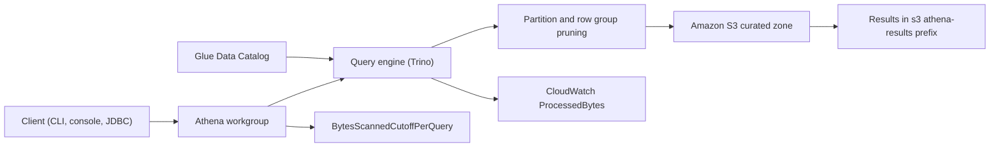
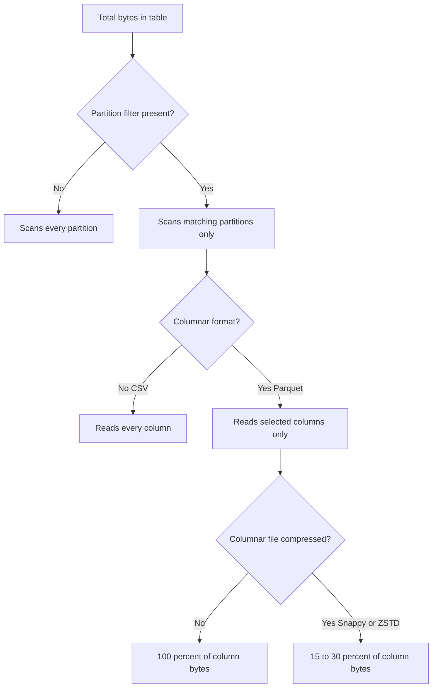

# 03 · Amazon Athena

> **Phase 5 — Data and AI** · Lesson 03 of 09
> ⬅️ Previous: [AWS Glue](./02-aws-glue.md) · ➡️ Next: [AWS Lake Formation](./04-aws-lake-formation.md) · 🏠 [Phase overview](./README.md)

## 🎯 Learning Objectives

By the end of this lesson you will be able to:

- Query S3 data with Athena through the Glue Data Catalog without provisioning anything
- Configure workgroups that cap query cost and separate teams, results, and encryption
- Choose between engine version 2 and version 3 and know which features they unlock
- Convert repeated expensive queries into CTAS and `INSERT INTO` tables
- Replace partition maintenance with partition projection
- Predict and reduce the bytes scanned by a query, which is the only thing you are billed for

**Estimated time:** 70 min · **Difficulty:** Intermediate

---

## 🧠 Core Concepts

**Amazon Athena** is a serverless, distributed SQL engine over data in S3. You submit SQL, it plans the query, reads only the objects it needs, and returns results — no cluster, no startup, no capacity planning. Under the hood it is a Trino-based engine, so the SQL is ANSI-flavored with Trino extensions.

Because there is no cluster to pay for, Athena's pricing is entirely consumption-based: **$5 per terabyte scanned**, with a 10 MB minimum per query. DDL statements and `EXPLAIN` are free because they scan nothing. This single fact drives every design decision in this lesson: you optimize Athena by scanning less, never by buying more of it.

Athena reads metadata from the **Glue Data Catalog**. A table is a pointer: a schema, a SerDe, and an S3 location. The data never moves into Athena. That is why the same Parquet file queried through a well-partitioned catalog table costs $0.002, while the identical file profiled as an unpartitioned CSV costs $5.

### Workgroups

A **workgroup** is the unit of isolation and control. Every query belongs to exactly one workgroup, and the workgroup supplies:

- The **results location** in S3 and its **encryption** settings.
- **`EnforceWorkGroupConfiguration`** — when true, per-query client overrides are ignored, which is the only way a cost cap is actually a cap.
- **`BytesScannedCutoffPerQuery`** — a hard ceiling; queries that exceed it fail instead of billing.
- **`PublishCloudWatchMetricsEnabled`** — publishes `ProcessedBytes` and query-state metrics so you can alarm on spend.
- **Requester-pays** and **customer-managed KMS** options for cross-account and compliance scenarios.

The `primary` workgroup exists by default and should be treated as a sandbox, not a shared resource.

### Engine versions

| | Engine version 2 | Engine version 3 |
|---|---|---|
| Based on | Presto 0.217 | Trino |
| Status | Deprecated | Current default |
| Performance | Baseline | Faster joins, better filter and dynamic partition pruning |
| SQL surface | Smaller | More functions, richer `array`/`map`/`row` support, `EXPLAIN` improvements |
| Table formats | Hive, some Iceberg | Hive, Iceberg with full DML (`MERGE INTO`, `OPTIMIZE`, time travel) |

New workgroups should specify version 3. If you are pinning version 2 for a compatibility reason, migrate: the differences that bite are minor function signatures and stricter type coercion.

### CTAS and INSERT INTO

**`CREATE TABLE AS SELECT` (CTAS)** is Athena's materialization primitive. It runs a query and writes the result as a new table in a format, partition scheme, and bucket count you choose. This is how you turn a repeated 400 GB scan into a 4 GB scan.

```sql
CREATE TABLE curated.orders_daily
WITH (
  format = 'PARQUET',
  parquet_compression = 'SNAPPY',
  partitioned_by = ARRAY['order_date'],
  bucketed_by = ARRAY['customer_id'],
  bucket_count = 16
) AS
SELECT order_id, customer_id, amount, date(order_ts) AS order_date
FROM curated.orders
WHERE order_date >= DATE '2026-10-01';
```

**`INSERT INTO`** appends to an existing table. It is the incremental half of the pattern: create the table once with CTAS, then append daily with `INSERT INTO`. Note that a plain (non-bucketed) Hive table gets **one file per partition per insert**, so a daily job that writes 365 days of data produces 365 small files — exactly the small-file problem from Lesson 01.

### Partition projection

Classic Hive tables need the catalog to know every partition. You add them with `MSCK REPAIR TABLE`, `ALTER TABLE ADD PARTITION`, or a crawler — all of which cost time and, for the crawler, money.

**Partition projection** computes partition locations from a rule instead. You declare a type (integer, enum, date, injected) and a range, and Athena derives the prefixes arithmetically. Nothing to maintain, no catalog lookups, and no crawler bill.

```sql
CREATE EXTERNAL TABLE curated.orders_projected (
  order_id       string,
  customer_id    string,
  amount         double
)
PARTITIONED BY (order_date string)
STORED AS PARQUET
LOCATION 's3://acme-analytics-prod-eu-west-1/curated/orders/'
TBLPROPERTIES (
  'projection.enabled'                = 'true',
  'projection.order_date.type'        = 'date',
  'projection.order_date.range'       = '2025-01-01,NOW',
  'projection.order_date.format'      = 'yyyy-MM-dd',
  'projection.order_date.interval'    = '1',
  'projection.order_date.interval.unit' = 'DAYS',
  'storage.location.template'         = 's3://acme-analytics-prod-eu-west-1/curated/orders/order_date=${order_date}/'
);
```

Projection is not free of constraints: the prefixes must match the template exactly, and the range must be bounded (use `NOW` rather than an open upper bound).

### Key terminology

| Term | Meaning |
|------|---------|
| **Workgroup** | Isolation boundary holding result location, encryption, and cost controls |
| **BytesScannedCutoffPerQuery** | Hard per-query scan cap that fails the query instead of billing |
| **CTAS** | `CREATE TABLE AS SELECT` — materializes a query result as a new table |
| **Partition projection** | Deriving partition paths from a rule instead of catalog entries |
| **Federated query** | Querying non-S3 sources through a Lambda connector |
| **Bucketing** | Hash-partitioning rows into a fixed number of files per partition |
| **SerDe** | Serializer/deserializer that tells the engine how to read the files |
| **`UNLOAD`** | Writing query results to S3 in a chosen format and partitioning |

---

## 🗺️ Architecture Diagram

The query path, including where cost is determined:



Where the scanned bytes go — every branch reduces the bill:



---

## 🧪 Hands-on Lab: Cut a Query from $5 to Under a Cent

**Goal:** Create a cost-capped workgroup, register raw CSV and curated Parquet tables, measure the scan cost of the same question against both, and materialize a compressed aggregate.

**Prerequisites:** The lake from Lessons 01 and 02, the `athena-results/` prefix, and an IAM principal that can start queries.

### Step 1 — Create a workgroup with a hard scan cap

Save as `wg.json`. The cutoff is 10 GB (`10737418240` bytes):

```json
{
  "ResultConfiguration": {
    "OutputLocation": "s3://acme-analytics-prod-eu-west-1/athena-results/",
    "EncryptionConfiguration": {"EncryptionOption": "SSE_S3"}
  },
  "EnforceWorkGroupConfiguration": true,
  "PublishCloudWatchMetricsEnabled": true,
  "BytesScannedCutoffPerQuery": 10737418240,
  "RequesterPaysEnabled": false,
  "EngineVersion": {"SelectedEngineVersion": "Athena engine version 3"}
}
```

```bash
# Enforced configuration means no client can override the cap or the output location
aws athena create-workgroup \
  --name analytics-team \
  --description "Team workgroup with a 10 GB per-query scan cap" \
  --configuration file://wg.json

aws athena get-work-group --work-group analytics-team \
  --query "WorkGroup.Configuration.{Cap:BytesScannedCutoffPerQuery,Enforced:EnforceWorkGroupConfiguration}"
```

### Step 2 — Register the raw CSV and the curated Parquet

```bash
# Run each statement with the workgroup and database context set
run_athena() {
  aws athena start-query-execution \
    --work-group analytics-team \
    --query-execution-context Database=analytics \
    --query-string "$1" \
    --query "QueryExecutionId" --output text
}

run_athena "CREATE DATABASE IF NOT EXISTS analytics"
```

```sql
-- Raw CSV table: no partitions, row-oriented, uncompressed
CREATE EXTERNAL TABLE analytics.raw_orders_csv (
  order_id     string,
  order_ts     string,
  customer_id  string,
  amount       string,
  region       string
)
ROW FORMAT SERDE 'org.apache.hadoop.hive.serde2.OpenCSVSerde'
LOCATION 's3://acme-analytics-prod-eu-west-1/raw/source=orders/'
TBLPROPERTIES ('skip.header.line.count' = '1');
```

```sql
-- Curated Parquet table with partition projection used instead of maintenance
CREATE EXTERNAL TABLE analytics.curated_orders (
  order_id     string,
  order_ts     timestamp,
  customer_id  string,
  amount       double,
  region       string
)
PARTITIONED BY (order_date string)
STORED AS PARQUET
LOCATION 's3://acme-analytics-prod-eu-west-1/curated/orders/'
TBLPROPERTIES (
  'projection.enabled'                  = 'true',
  'projection.order_date.type'          = 'date',
  'projection.order_date.range'         = '2025-01-01,NOW',
  'projection.order_date.format'        = 'yyyy-MM-dd',
  'projection.order_date.interval'      = '1',
  'projection.order_date.interval.unit' = 'DAYS',
  'storage.location.template'           = 's3://acme-analytics-prod-eu-west-1/curated/orders/order_date=${order_date}/'
);
```

### Step 3 — Measure the cost of the same question twice

```sql
-- Expensive: reads every byte of every column in every file
SELECT region, sum(CAST(amount AS double)) AS revenue
FROM analytics.raw_orders_csv
WHERE order_ts LIKE '2026-10-%'
GROUP BY region;
```

```sql
-- Cheap: prunes partitions and touches three columns
SELECT region, sum(amount) AS revenue
FROM analytics.curated_orders
WHERE order_date BETWEEN '2026-10-01' AND '2026-10-14'
GROUP BY region;
```

```bash
# Read the scanned bytes and engine time after the run finishes
aws athena get-query-execution --query-execution-id "$QID" \
  --query "QueryExecution.Statistics.{Scanned:DataScannedInBytes,EngineMs:EngineExecutionTimeInMillis,QueuedMs:QueryQueueTimeInMillis}"
```

Compute the price as `DataScannedInBytes / 1024^4 * 5.00`. A CSV scan of 200 GB costs about $0.98; the projected Parquet equivalent usually lands between $0.001 and $0.01.

### Step 4 — Materialize with CTAS

```sql
-- One Parquet file per day, bucketed by customer for efficient joins later
CREATE TABLE analytics.orders_daily
WITH (
  format = 'PARQUET',
  parquet_compression = 'SNAPPY',
  partitioned_by = ARRAY['order_date']
) AS
SELECT
  region,
  customer_id,
  sum(amount)   AS revenue,
  count(*)      AS order_count,
  order_date
FROM analytics.curated_orders
WHERE order_date >= DATE '2026-10-01'
GROUP BY region, customer_id, order_date;
```

### Step 5 — Append incrementally

```sql
-- Small inserts are the main source of new small files; batch them daily
INSERT INTO analytics.orders_daily (region, customer_id, revenue, order_count, order_date)
SELECT region, customer_id, sum(amount), count(*), order_date
FROM analytics.curated_orders
WHERE order_date = DATE '2026-10-15'
GROUP BY region, customer_id, order_date;
```

```sql
-- Inspect file sizes per partition so you can spot fragmentation early
SELECT "$path" AS file_path, count(*) AS rows
FROM analytics.orders_daily
GROUP BY 1
ORDER BY 1;
```

### Step 6 — Export results without writing Parquet by hand

```sql
UNLOAD (SELECT * FROM analytics.curated_orders WHERE order_date = DATE '2026-10-14')
TO 's3://acme-analytics-prod-eu-west-1/refined/orders_export/'
WITH (
  format = 'PARQUET',
  compression = 'SNAPPY',
  partitioned_by = ARRAY['order_date'],
  max_file_size = '256MB'
);
```

### Step 7 — Verify

```bash
# A blocked query proves the cap works
run_athena "SELECT * FROM analytics.raw_orders_csv LIMIT 5"

# The aggregate table must be tiny compared with its source
aws athena get-query-execution --query-execution-id "$QID" \
  --query "QueryExecution.Status.{State:State,Reason:StateChangeReason}"
```

You should see `orders_daily` scan in the low megabytes, `refined/orders_export/` populated with Parquet, and a query that exceeded the 10 GB cap failing with `Query exhausted resources at this scale factor` or a `BytesScannedCutoffPerQuery` error instead of billing.

---

## 💻 CLI Reference

```bash
# Create and list workgroups
aws athena create-workgroup --name analytics-team --configuration file://wg.json
aws athena list-work-groups --query "WorkGroups[].Name"

# Update a workgroup's scan cap in place
aws athena update-workgroup --work-group analytics-team --configuration file://wg-updated.json

# Run a statement and fetch the execution id
aws athena start-query-execution \
  --query-string "SELECT count(*) FROM analytics.curated_orders" \
  --work-group analytics-team \
  --query-execution-context Database=analytics \
  --result-configuration OutputLocation=s3://acme-analytics-prod-eu-west-1/athena-results/

# Poll and read results
aws athena get-query-execution --query-execution-id "$QID" --query "QueryExecution.Status.State"
aws athena get-query-results --query-execution-id "$QID" --max-items 10

# Federated query through a connector catalog
aws athena start-query-execution --work-group analytics-team \
  --query-string 'SELECT * FROM "lambda:postgresql".public.customers LIMIT 10'
```

| Command | Purpose |
|---------|---------|
| `create-workgroup` | Sets result location, encryption, and the per-query scan cap |
| `start-query-execution` | Submits SQL and returns the execution id |
| `get-query-execution` | Reads state plus `DataScannedInBytes` — the billing number |
| `get-query-results` | Retrieves rows, paginated by `NextToken` |

---

## ✅ Best Practices

| Practice | Why it matters |
|----------|----------------|
| Always filter on the partition column | Pruning is the largest single cost reduction available |
| Use Parquet or ORC, never CSV, for queried data | Cuts scanned bytes by an order of magnitude |
| Enable partition projection for date-based prefixes | Removes `MSCK REPAIR` and crawler cost entirely |
| Enforce the workgroup configuration | Without enforcement, `BytesScannedCutoffPerQuery` is advisory |
| Publish workgroup metrics to CloudWatch | Lets you alarm on `ProcessedBytes` per team |
| `SELECT` only the columns you need | Columnar engines bill per column read, not per row |
| Materialize hot aggregates with CTAS | Turns a repeated full scan into a small one |
| Test the query plan with `EXPLAIN` first | Free, and it reveals a missing partition predicate |

---

## ⚠️ Common Pitfalls

| Pitfall | Symptom | Fix |
|---------|---------|-----|
| Missing partition predicate | Query scans the full table and may hit the scan cap | Add a `WHERE` on the partition column; `EXPLAIN` shows it |
| Partition column stored as a string in the wrong format | Zero rows returned, no error | Match `projection.<col>.format` to the actual prefix values |
| `MSCK REPAIR TABLE` run repeatedly | Slow, costly, and it silently ignores invalid prefixes | Use partition projection |
| CSV ingested with `OpenCSVSerde` | All columns come back as `string` | Cast explicitly, or convert to Parquet |
| One-file-per-insert growth | Query latency climbs week over week | Compact with CTAS or rewrite the partition |
| Results prefix used as a data source | Growth and duplicate data | Keep results in a separate, expiring prefix |
| Table location has a trailing slash mismatch | `Zero rows` from a table that clearly has data | Verify `Location` and `storage.location.template` are byte-identical |
| Workgroup cap set too low | Everyday queries fail in production | Start generous, then tighten with real metrics |
| Assuming canceled queries are free | Bill includes bytes already scanned | Cancel early, not late |

---

## 💰 Cost Considerations

The entire cost model is one line: **$5.00 per TB scanned, 10 MB minimum per query**. There is no charge for DDL, for `EXPLAIN`, or for the service itself.

| Scenario | Bytes scanned | Cost per run | Monthly cost at 10 runs/day |
|----------|---------------|--------------|-----------------------------|
| 500 GB CSV, no filter | ~500 GB | $2.50 | ~$750 |
| Same data, Parquet, partition filter, 3 columns | ~2 GB | $0.01 | ~$3 |
| Pre-aggregated CTAS table, 200 MB | ~0.2 GB | $0.0011 | ~$0.33 |

Secondary costs that surprise people:

- **`INSERT INTO` and CTAS are billed on bytes read**, not written. A CTAS that reads 1 TB costs $5 and produces a much smaller table.
- **Canceled queries are billed** for whatever was scanned before cancellation.
- **Repeated dashboard queries** are the classic silent expense: a BI tool refreshing a 4 GB scan every 15 minutes costs about $1,440 a month. Materialize the aggregate or use a workgroup with a scan cap plus a cached extract.
- **Federated queries** add Lambda invocation and source-system read costs on top of Athena's per-byte charge.
- **S3 requests and lifecycle transitions** for result sets that accumulate in the results prefix.

Cost-control checklist: set `BytesScannedCutoffPerQuery` on every non-sandbox workgroup, publish metrics, alarm on a daily `ProcessedBytes` threshold, and delete or expire the results prefix after 7–30 days.

---

## 🔐 Security Considerations

- **Encrypt results with SSE-KMS** (`EncryptionOption: "SSE_KMS"` plus a `KmsKeyId`) when query output can contain sensitive data. `SSE_S3` is the default and is weaker.
- **Enforce the workgroup configuration** so a user cannot redirect results to a bucket they control — that is an exfiltration path, not just a configuration drift.
- **Separate results prefixes per workgroup** and scope IAM to them: `arn:aws:s3:::acme-analytics-prod-eu-west-1/athena-results/*`.
- **Grant `athena:StartQueryExecution` per workgroup ARN**, not `*`, and pair it with the S3 and Glue read permissions the query needs. Athena permissions alone never grant data access.
- **Add `aws:SourceVpce` conditions** for private endpoints when queries must originate inside a VPC.
- **Enable CloudTrail data events on the results bucket only** — result sets are where PII tends to leak, and logging every lake read is expensive.
- **Do not use IAM to express column-level rules.** Once more than one role reads the lake, move to Lake Formation (next lesson); IAM can only allow or deny whole tables.
- **Watch `SELECT *` on tables with PII columns.** A single ad-hoc query can put government IDs into a results CSV that lives for a year.
- **Turn on `RequesterPays` only deliberately** — it shifts cost to the caller but also changes who can read objects.

---

## 🧩 Exercise

Take the `orders_daily` aggregate and make it survive a growing dataset:

1. Convert it to an **Iceberg** table with `CREATE TABLE ... TBLPROPERTIES ('table_type'='ICEBERG')`.
2. Run an `UPDATE` that corrects one region's revenue for a single day, then a `MERGE INTO` that upserts a full day from `curated_orders`.
3. Query the table `FOR SYSTEM_TIME AS OF` the previous snapshot to prove the update is reversible.
4. Compare `DataScannedInBytes` for the Iceberg `MERGE` against the equivalent `INSERT INTO` plus delete.

Success looks like: the `MERGE INTO` produces no duplicate rows, time travel returns the pre-update revenue, and the Iceberg table needs no `MSCK REPAIR TABLE` or crawler to stay queryable.

---

## 📚 Resources

- [Amazon Athena User Guide](https://docs.aws.amazon.com/athena/latest/ug/what-is.html)
- [Athena Engine Versions](https://docs.aws.amazon.com/athena/latest/ug/engine-versions.html)
- [Partition Projection](https://docs.aws.amazon.com/athena/latest/ug/partition-projection.html)
- [CTAS Statements](https://docs.aws.amazon.com/athena/latest/ug/ctas.html)
- [Athena Workgroups](https://docs.aws.amazon.com/athena/latest/ug/workgroups.html)
- [Querying AWS Data Sources with Connectors](https://docs.aws.amazon.com/athena/latest/ug/connectors-available.html)
- [Amazon Athena Pricing](https://aws.amazon.com/athena/pricing/)

---

## ➡️ Next Steps

Athena lets anyone with the right IAM policy read the entire lake. The next lesson replaces that blunt model with Lake Formation, which is what lets you say "this analyst sees these columns and only the rows for their region".

> ⬅️ Previous: [AWS Glue](./02-aws-glue.md) · ➡️ Next: [AWS Lake Formation](./04-aws-lake-formation.md) · 🏠 [Phase overview](./README.md)
