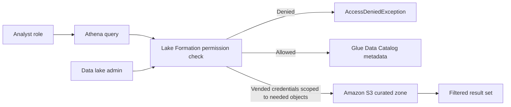
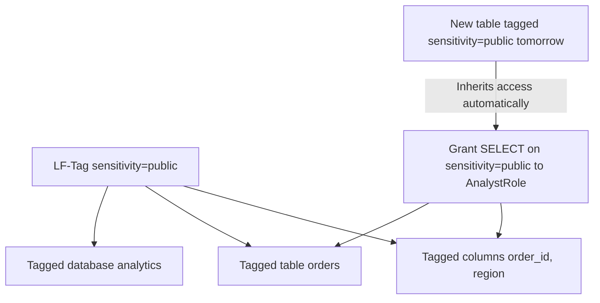
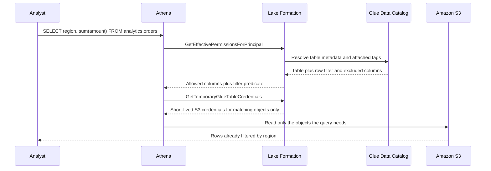

# 04 · AWS Lake Formation

> **Phase 5 — Data and AI** · Lesson 04 of 09
> ⬅️ Previous: [Amazon Athena](./03-amazon-athena.md) · ➡️ Next: [Amazon Redshift](./05-amazon-redshift.md) · 🏠 [Phase overview](./README.md)

## 🎯 Learning Objectives

By the end of this lesson you will be able to:

- Explain why IAM alone cannot express column-level or row-level access to a lake
- Register S3 locations and delegate administration in Lake Formation
- Grant table, column, and row-level permissions using both named resources and LF-Tags
- Create data cells filters that give one principal a filtered view of a shared table
- Choose between Lake Formation permissions, governed tables, and Iceberg for a new dataset
- Understand how Lake Formation vends credentials so consumers never need S3 access

**Estimated time:** 75 min · **Difficulty:** Advanced

---

## 🧠 Core Concepts

**AWS Lake Formation (LF)** is the permission layer for the data lake. It sits between consumers (Athena, Redshift Spectrum, EMR, QuickSight, SageMaker) and the Glue Data Catalog plus S3. Before LF, access control meant IAM policies on buckets and IAM policies on catalog objects — which is coarse. IAM can say "you may read this bucket prefix" or "you may read this table". It cannot say "you may read these columns, but only these rows".

LF replaces that with a table-level permission model in which the consumer never gets S3 credentials. When an Athena query runs against an LF-managed table, Lake Formation decides what the principal may see, then **vends short-lived credentials** scoped to the objects the query actually needs. An analyst with zero S3 permissions can query a governed table and cannot download the underlying object directly. That is the core security property, and it is worth stating plainly: **LF moves authorization from "can you read the bucket?" to "what may you see in the table?"**

### The permission layers

| Layer | Example | Granularity |
|-------|---------|-------------|
| IAM | `s3:GetObject` on `arn:aws:s3:::bucket/curated/*` | Bucket/prefix/table |
| LF named resources | `GRANT SELECT ON TABLE analytics.orders` | Table, columns |
| LF data cells filter | `GRANT SELECT ON <filter emea-orders>` | Rows within a table |
| LF-Tags | tag `sensitivity=pii` on a column | Everything tagged, at scale |

Named-resource grants are explicit and readable: you list the database, table, and columns. They do not scale — 400 tables times 30 principals is 12,000 grant objects — and they must be updated every time a table is added. **LF-Tags** invert this. You tag resources (databases, tables, columns) with key/value pairs, then grant permissions on *tag expressions*. A new table tagged `domain=sales,sensitivity=public` is immediately visible to everyone holding a grant for that expression, with no new grant call. This is the model to use in production.

### Roles inside Lake Formation

- **Data lake administrator** — a principal (user or role) with `lakeformation:PutDataLakeSettings` rights; can grant anything and manage LF-Tags. Keep this list short.
- **Database creator** — may create databases in the catalog.
- **Table creator** — may create tables (crawlers, Glue jobs, Athena DDL).
- **IAM_ALLOWED_PRINCIPALS** — a synthetic principal representing "IAM policies still apply here". If a table carries a grant to this principal, LF steps aside and classic IAM rules decide. Every new database/table created while the default settings allow it gets this grant, which is exactly how a lake stays silently open.

### Registering locations

An S3 path must be **registered** with LF before LF can manage it. Registration tells LF to check permissions on that path and to take over credential vending. Without it, access falls back to IAM and the Grants tab shows nothing.

### Row-level security

Row filtering comes in two forms. A **data cells filter** is a named, reusable row-and-column restriction on one table (`region = 'EMEA'`, all columns except `ssn`) that can be granted to principals like an object. LF also supports row-level grant expressions directly (`GRANT SELECT ON analytics.orders WITH ROW FILTER`). Both are enforced in the engine: the filter predicate is injected into the query plan, so a `SELECT *` returns pre-filtered rows rather than being denied.

Filtering is not free. Row filters can defeat partition pruning when the filter column is not the partition key, and they can slow the query planner on very large tables. Design partitions so the common row filters align with partition keys.

### Governed tables versus Iceberg

**Lake Formation governed tables** provide ACID transactions, automatic compaction, and time travel on Parquet data managed by LF. They solved the small-file and concurrent-write problems before open table formats matured on AWS. AWS now steers new workloads to **Apache Iceberg** with the Glue Data Catalog, which delivers the same transactional guarantees as an open standard and works across engines (Athena, EMR, Spark, Redshift, Snowflake). Use governed tables only for existing workloads; start new transactional datasets with Iceberg.

### Key terminology

| Term | Meaning |
|------|---------|
| **Data lake administrator** | Principal that can grant any LF permission and manage LF-Tags |
| **Registered location** | S3 path handed to LF for permission enforcement and credential vending |
| **LF-Tag** | Key/value label attached to databases, tables, or columns |
| **Tag expression** | Grant target such as `(sensitivity=public OR internal)` |
| **Data cells filter** | Named row/column restriction granted to a principal |
| **Credential vending** | LF issuing short-lived, scoped S3 credentials for a query |
| **Hybrid access mode** | Table mode where both LF grants and IAM policies apply |
| **IAMAllowedPrincipals** | Synthetic principal meaning "IAM policies still govern this resource" |

---

## 🗺️ Architecture Diagram

The two paths side by side — with LF, S3 credentials are never handed to the consumer:



How LF-Tags propagate a grant to resources that do not exist yet:



What happens on a governed query, step by step:



---

## 🧪 Hands-on Lab: Column and Row Security with LF-Tags

**Goal:** Register the lake, tag a PII column, create a row filter, and prove that an analyst role sees neither the `ssn` column nor other regions' rows.

**Prerequisites:** The account lake from Lessons 01–03, an Athena workgroup, and two IAM roles: `LakeAdminRole` (you) and `AnalystRole` (the test consumer).

### Step 1 — Register the S3 location

```bash
# Without registration, Lake Formation cannot enforce or vend anything on this path
aws lakeformation register-resource \
  --resource-arn arn:aws:s3:::acme-analytics-prod-eu-west-1 \
  --use-service-linked-role

aws lakeformation list-resources \
  --query "ResourceInfoList[].{Arn:ResourceArn,Role:RoleArn,Verified:LastModified}"
```

### Step 2 — Declare the data lake administrators

```bash
# Keep this list small; admins bypass every check below
cat > settings.json <<'JSON'
{
  "DataLakeAdmins": [
    {"DataLakePrincipalIdentifier": "arn:aws:iam::123456789012:role/LakeAdminRole"}
  ],
  "CreateDatabaseDefaultPermissions": [
    {"Principal": {"DataLakePrincipalIdentifier": "arn:aws:iam::123456789012:role/LakeAdminRole"}, "Permissions": ["ALL"]}
  ],
  "CreateTableDefaultPermissions": [
    {"Principal": {"DataLakePrincipalIdentifier": "arn:aws:iam::123456789012:role/LakeAdminRole"}, "Permissions": ["ALL"]}
  ]
}
JSON

aws lakeformation put-data-lake-settings --data-lake-settings file://settings.json
```

Note what the default permissions deliberately **exclude**: `IAM_ALLOWED_PRINCIPALS`. Removing that principal is what turns LF on for new tables instead of leaving them IAM-governed.

### Step 3 — Create LF-Tags and attach them

```bash
aws lakeformation create-lf-tag --tag-key sensitivity --tag-values pii public internal
aws lakeformation create-lf-tag --tag-key domain --tag-values sales marketing finance

# Tag the table
aws lakeformation add-lf-tags-to-resource \
  --resource '{"Table":{"DatabaseName":"analytics","Name":"curated_orders"}}' \
  --lf-tags '[{"TagKey":"sensitivity","TagValues":["internal"]},{"TagKey":"domain","TagValues":["sales"]}]'

# Tag the PII column specifically — column-level tags are enforced for SELECT
aws lakeformation add-lf-tags-to-resource \
  --resource '{"TableWithColumns":{"DatabaseName":"analytics","Name":"curated_orders","ColumnNames":["ssn","customer_email"]}}' \
  --lf-tags '[{"TagKey":"sensitivity","TagValues":["pii"]}]'
```

### Step 4 — Grant access by tag expression

```bash
# Analysts get non-PII data across every table tagged internal or public in sales
aws lakeformation grant-permissions \
  --principal '{"DataLakePrincipalIdentifier":"arn:aws:iam::123456789012:role/AnalystRole"}' \
  --resource '{"LFTagPolicy":{"ResourceType":"TABLE","Expression":[{"TagKey":"sensitivity","TagValues":["public","internal"]},{"TagKey":"domain","TagValues":["sales"]}]}}' \
  --permissions "SELECT" "DESCRIBE"
```

The grant covers the table and its non-PII columns; the `pii`-tagged columns are outside the expression's scope, so they are not selectable.

### Step 5 — Add a row filter

```bash
# Table reference
cat > cells-table.json <<'JSON'
{"CatalogId": "123456789012", "DatabaseName": "analytics", "Name": "curated_orders"}
JSON

# Restrict rows to EMEA, and exclude two columns outright
cat > cells-row.json <<'JSON'
{
  "FilterExpression": "region = 'EMEA'",
  "ColumnWildcard": {"ExcludedColumnNames": ["ssn", "customer_email"]}
}
JSON

aws lakeformation create-data-cells-filter \
  --name emea-orders \
  --table-data file://cells-table.json \
  --row-filter file://cells-row.json

# Grant the filter itself, not the table
aws lakeformation grant-permissions \
  --principal '{"DataLakePrincipalIdentifier":"arn:aws:iam::123456789012:role/AnalystRole"}' \
  --resource '{"DataCellsFilter":{"TableCatalogId":"123456789012","DatabaseName":"analytics","TableName":"curated_orders","Name":"emea-orders"}}' \
  --permissions "SELECT" "DESCRIBE"
```

### Step 6 — Verify with the effective permissions API

```bash
# What can the analyst actually do?
aws lakeformation get-effective-permissions-for-principal \
  --principal '{"DataLakePrincipalIdentifier":"arn:aws:iam::123456789012:role/AnalystRole"}' \
  --resource '{"Table":{"DatabaseName":"analytics","Name":"curated_orders"}}' \
  --query "PrincipalPermissionsList[].Permissions"

# Full inventory of grants on the catalog
aws lakeformation list-permissions \
  --resource-type TABLE \
  --query "PrincipalResourcePermissions[].{Principal:Principal.DataLakePrincipalIdentifier,Resource:Resource.Table.Name}"
```

### Step 7 — Verify from the analyst's side

```bash
# Switch profiles and query the table through the same Athena workgroup
aws athena start-query-execution --profile analyst \
  --work-group analytics-team \
  --query-string "SELECT region, count(*) FROM analytics.curated_orders GROUP BY region" \
  --query-execution-context Database=analytics

aws athena get-query-results --profile analyst --query-execution-id "$QID"
```

Expected: only `EMEA` appears in the results. Now the same profile must fail on the PII column:

```bash
# This must fail — the column is outside the analyst's tag expression
aws athena start-query-execution --profile analyst --work-group analytics-team \
  --query-string "SELECT ssn FROM analytics.curated_orders LIMIT 10"
```

If `ssn` returns data, either the column tag was never attached or the table is still in hybrid access mode with `IAM_ALLOWED_PRINCIPALS` granted.

---

## 💻 CLI Reference

```bash
# Turn LF on or off for a specific table (hybrid access mode)
aws lakeformation get-resource-lf-tags --resource '{"Table":{"DatabaseName":"analytics","Name":"curated_orders"}}'

# Remove the IAM-escape hatch from one table so LF fully governs it
aws lakeformation revoke-permissions \
  --principal '{"DataLakePrincipalIdentifier":"IAM_ALLOWED_PRINCIPALS"}' \
  --resource '{"Table":{"DatabaseName":"analytics","Name":"curated_orders"}}' \
  --permissions "ALL"

# Grant at column granularity instead of by tag
aws lakeformation grant-permissions \
  --principal '{"DataLakePrincipalIdentifier":"arn:aws:iam::123456789012:role/BiRole"}' \
  --resource '{"TableWithColumns":{"DatabaseName":"analytics","Name":"curated_orders","ColumnNames":["order_id","order_date","region","amount"]}}' \
  --permissions "SELECT"

# Let a principal create tables without being a full admin
aws lakeformation grant-permissions \
  --principal '{"DataLakePrincipalIdentifier":"arn:aws:iam::123456789012:role/GlueServiceRole"}' \
  --resource '{"Database":{"Name":"analytics"}}' \
  --permissions "CREATE_TABLE" "DESCRIBE"

# Give a team its own database and let them manage grants inside it
aws lakeformation grant-permissions \
  --principal '{"DataLakePrincipalIdentifier":"arn:aws:iam::123456789012:role/SalesTeamRole"}' \
  --resource '{"Database":{"Name":"sales"}}' \
  --permissions "CREATE_TABLE" "DESCRIBE" \
  --permissions-with-grant-option "DESCRIBE"

# Audit every grant in the account, with filters
aws lakeformation list-permissions --resource-type TABLE \
  --principal '{"DataLakePrincipalIdentifier":"arn:aws:iam::123456789012:role/AnalystRole"}'

# Inspect and delete a cells filter
aws lakeformation get-data-cells-filter --table-catalog-id 123456789012 \
  --database-name analytics --table-name curated_orders --name emea-orders
aws lakeformation delete-data-cells-filter --table-catalog-id 123456789012 \
  --database-name analytics --table-name curated_orders --name emea-orders

# See what tags exist and which resources carry them
aws lakeformation list-lf-tags
aws lakeformation list-lf-tag-resources \
  --resource-share-type FOREIGN --max-results 50
```

| Command | Purpose |
|---------|---------|
| `register-resource` | Hands an S3 path to LF for enforcement and credential vending |
| `put-data-lake-settings` | Defines admins and default permissions for new objects |
| `create-lf-tag` / `add-lf-tags-to-resource` | Build the tag taxonomy and label resources |
| `grant-permissions` | Grants on named resources, tag expressions, or cells filters |
| `create-data-cells-filter` | Names a reusable row and column restriction |
| `get-effective-permissions-for-principal` | Answers "what can this principal actually see?" |
| `list-permissions` | Full audit surface for compliance reviews |

---

## ✅ Best Practices

| Practice | Why it matters |
|----------|----------------|
| Register S3 locations per bucket, not per prefix | Prefix-level registration multiplies administrative work |
| Grant to tag expressions, not table names | New tables inherit access with zero grant calls |
| Keep the data lake admin list to one or two roles | Admins bypass every control, including row filters |
| Remove `IAM_ALLOWED_PRINCIPALS` defaults | Otherwise IAM silently remains the real authority |
| Always exclude PII columns in tag expressions | Column tagging only helps if the grant is narrower than the table |
| Use cells filters for "same table, different rows" | Gives each team a filtered view without copying data |
| Align row-filter columns with partition keys | A filter on a non-partition column forces full scans |
| Test with `get-effective-permissions-for-principal` after every change | Grants inherit and intersect in ways that surprise people |
| Log LF API calls in CloudTrail | Grants are your access-control change record |
| Use Iceberg rather than governed tables for new ACID needs | Governed tables predate open table formats on AWS |

---

## ⚠️ Common Pitfalls

| Pitfall | Symptom | Fix |
|---------|---------|-----|
| Location never registered | Grants exist but Athena returns `AccessDenied` | `register-resource` the bucket and verify with `list-resources` |
| `IAM_ALLOWED_PRINCIPALS` still granted | Column and row filters appear to do nothing | Revoke `ALL` from that principal on the table |
| Granting `ALL` instead of `SELECT`/`DESCRIBE` | Principals can drop or alter tables | Grant the minimum set; reserve `ALL` for admins |
| Tag attached to the table only, not the column | `ssn` is still selectable by tagged grantees | Tag the column via `TableWithColumns` |
| Analysts querying without LF enforcement because they have S3 IAM | Row filters bypassed entirely | Remove direct S3 `GetObject` from consumer roles |
| Row filter on a high-cardinality column | Query time balloons | Filter on the partition column where possible |
| Granting `SELECT` with grant option widely | An analyst can widen their own access | Restrict `--permissions-with-grant-option` to admins |
| Mixing crawler-created tables with LF expectations | New tables land IAM-governed | Fix default permissions, then re-create or re-grant |
| Expecting LF to govern non-S3 sources | Grants on DynamoDB do nothing | LF covers S3 data and Glue catalog objects only |
| Using LF on the results prefix | Athena result writes fail | Keep results outside LF-registered locations |

---

## 💰 Cost Considerations

**Lake Formation itself has no additional charge.** You pay for the services that consume it: Athena per byte scanned, Glue jobs per DPU-hour, Redshift per second, EMR per instance-hour. So the cost section here is really about the costs your access design *causes*.

| Design choice | Cost impact |
|---------------|-------------|
| Row filter on a non-partition column | Turns a pruned scan into a full-table scan, multiplying Athena spend |
| Per-team cells filters on the same table | Multiplies scans; materialize a shared aggregate instead |
| Granting `ALL` broadly | Allows table creation and accidental full-table copies |
| Using LF to expose a table to EMR | EMR cluster hours, not LF charges, dominate |
| Iceberg tag grants with hidden partitioning | Prunes as intended — cheaper than a filter expression on a raw column |
| Registered locations covering the whole bucket | Easier administration, but the `athena-results/` prefix lands in scope |

Two habits keep cost predictable. First, monitor Athena `ProcessedBytes` per workgroup after adding row filters — a filter that kills pruning shows up as a spike within a day. Second, prefer **materialized aggregates** for cross-team sharing over row-filtered access to the base table: a 200 MB daily aggregate with LF grants is cheaper to serve to 30 analysts than a 4 TB table filtered 30 different ways.

---

## 🔐 Security Considerations

- **Least privilege on grants.** `SELECT` and `DESCRIBE` cover read use cases; `ALTER`, `DROP`, and `ALL` belong to owners only.
- **Never grant `--permissions-with-grant-option` outside the admin group.** It is a privilege-escalation primitive: the grantee can hand access onward.
- **Remove S3 `GetObject` from consumer roles** so LF is the only path in. A role with both LF grants and raw S3 access defeats row filtering.
- **Encrypt with SSE-KMS and control the key policy.** LF credential vending assumes the consumer can use the key; if the key policy denies the principal, queries fail with a KMS error rather than an S3 one — a confusing but correct failure.
- **Audit grants as code.** Export `list-permissions` output to version control on a schedule; grants are invisible in application repositories.
- **Use CloudTrail to record `GrantPermissions`, `RevokePermissions`, and `PutDataLakeSettings`.** These are the crown-jewel changes in the account.
- **Watch for filter-bypass paths.** A principal that can create a view, run a Glue job, or use Redshift Spectrum under a different role may reach unfiltered data. Grant `CREATE_TABLE` only where views are genuinely needed.
- **Protect the raw zone's PII at rest.** Row filters restrict queries; they do not stop a principal with S3 access from downloading the source files. Raw zone access should be limited to a service role and the data lake admin.
- **Enable Macie on registered locations** to catch PII you tagged incorrectly.

---

## 🧩 Exercise

Design and implement access for three teams on one governed table:

1. `SalesAnalystRole` — columns `order_id`, `region`, `amount`; rows where `region = 'EMEA'` only.
2. `FinanceRole` — all columns except `ssn`; all rows.
3. `AuditRole` — all columns, all rows, but read-only and no ability to create tables.

Implement every grant with LF-Tags plus at most one named-resource exception, then prove the model with `get-effective-permissions-for-principal` for each role and one Athena query per role.

Success looks like: all three roles query successfully through Athena, only `AuditRole` can read `ssn`, `SalesAnalystRole` sees no non-EMEA rows even with `SELECT *`, and adding a fourth table tagged `domain=sales,sensitivity=internal` requires no new grant calls.

---

## 📚 Resources

- [AWS Lake Formation Developer Guide](https://docs.aws.amazon.com/lake-formation/latest/dg/what-is-lake-formation.html)
- [Lake Formation Permissions Model](https://docs.aws.amazon.com/lake-formation/latest/dg/access-control-overview.html)
- [LF-Tags and Tag-Based Access Control](https://docs.aws.amazon.com/lake-formation/latest/dg/tag-based-access-control.html)
- [Data Filters (Row and Column Security)](https://docs.aws.amazon.com/lake-formation/latest/dg/data-filters-about.html)
- [Lake Formation and IAM Permissions](https://docs.aws.amazon.com/lake-formation/latest/dg/lf-permissions-overview.html)
- [Lake Formation Pricing](https://aws.amazon.com/lake-formation/pricing/)

---

## ➡️ Next Steps

The lake is now queryable and governed. The next lesson moves to the warehouse side of the same data — Amazon Redshift — where you trade serverless per-query billing for provisioned compute and gain the ability to tune physical layout directly.

> ⬅️ Previous: [Amazon Athena](./03-amazon-athena.md) · ➡️ Next: [Amazon Redshift](./05-amazon-redshift.md) · 🏠 [Phase overview](./README.md)
