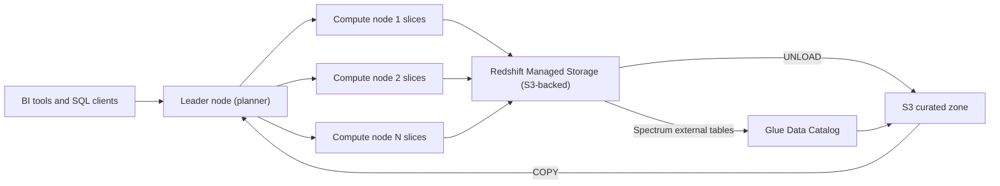
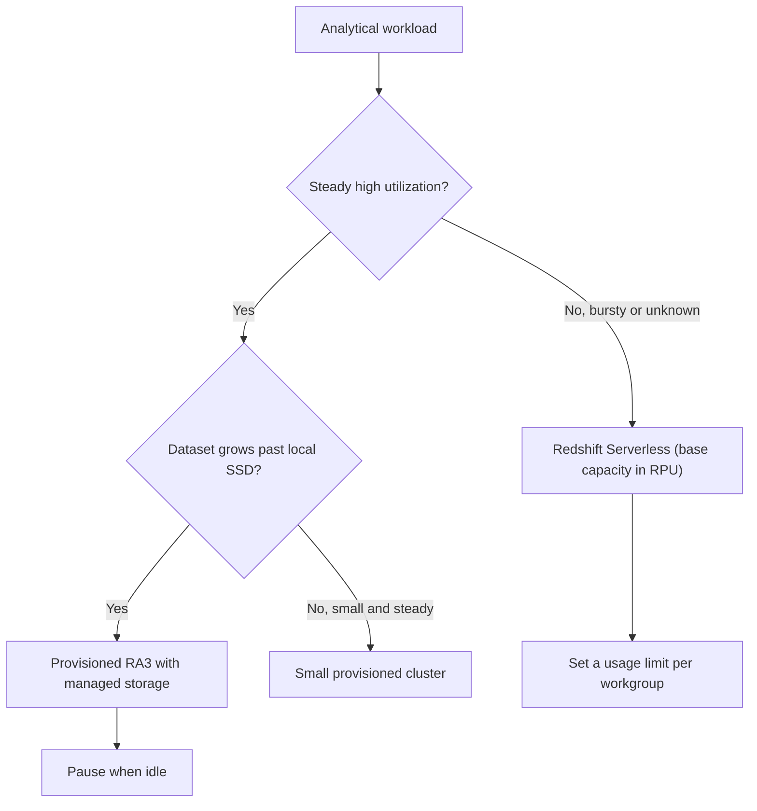

# 05 · Amazon Redshift

> **Phase 5 — Data and AI** · Lesson 05 of 09
> ⬅️ Previous: [AWS Lake Formation](./04-aws-lake-formation.md) · ➡️ Next: [Amazon EMR and Spark](./06-amazon-emr-and-spark.md) · 🏠 [Phase overview](./README.md)

## 🎯 Learning Objectives

By the end of this lesson you will be able to:

- Decide between Redshift Serverless and a provisioned cluster, and pick a node type
- Choose distribution styles and sort keys that match your real query patterns
- Load data efficiently with `COPY`, export with `UNLOAD`, and query S3 with Spectrum
- Configure workload management so ETL and dashboards stop fighting for the same capacity
- Keep statistics fresh with `ANALYZE` and control historical growth with `VACUUM`
- Recognize the cost traps: idle provisioned clusters, over-scaling, and unmanaged concurrency

**Estimated time:** 80 min · **Difficulty:** Advanced

---

## 🧠 Core Concepts

**Amazon Redshift** is a columnar, massively parallel data warehouse. Where Athena is serverless SQL over files, Redshift gives you a database with a leader node that plans queries, compute nodes that own fixed slices of data, and storage that can be managed locally (DC2/RMS) or backed by S3 (**Redshift Managed Storage**, RMS) on RA3. That physical layout is the whole point: with the right distribution and sort keys, a join becomes a co-located read and a range filter becomes a slice seek.

### Serverless versus provisioned

| | Redshift Serverless | Provisioned cluster |
|---|---|---|
| Capacity unit | RPU (Redshift Processing Unit) | Nodes (ra3.xlplus, ra3.4xlarge, ra3.16xlarge) |
| Scaling | Automatic between base and max capacity | Manual resize, elastic resize, or concurrency scaling |
| Billing | Per RPU-second while active, plus storage | Per node-hour, running or paused |
| Idle behavior | Scales to zero; no compute charge | Keeps billing until you pause the cluster |
| Best for | Variable or unpredictable workloads, dev/test | Steady, high, predictable workloads; full control |

Serverless is billed in RPU-seconds and stops charging compute when nobody queries it, which makes it the right default for learning and for bursty workloads. Provisioned clusters are cheaper per unit of sustained throughput once utilization is stable and high — but only if you actually pause them when idle (paused clusters bill storage only).

RA3 nodes are the current choice for new clusters: they separate compute from RMS storage, allow independent scaling, and enable **data sharing** (live data shared across clusters and accounts without copies) and cross-region snapshots. DC2 nodes only make sense for small, steady datasets where local SSD storage is enough.

### Distribution styles

A distribution style decides which node holds each row, and therefore whether a join needs to move data across the network.

| Style | Behavior | Use when |
|-------|----------|----------|
| `EVEN` | Round-robins rows across slices | No obvious join key; default for fact tables with no dominant join |
| `KEY` | Hashes one column so matching rows co-locate | The table is joined on that column constantly |
| `ALL` | Copies the whole table to every node | Small dimension tables (a few million rows at most) |
| `AUTO` | Redshift picks and can change over time | You are unsure — a sound default to start |

`AUTO` is genuinely good: Redshift monitors usage and re-distributes automatically. Override it only when you have measured a specific problem, such as a `DS_BCAST_INNER` step in `EXPLAIN` output on a large table.

### Sort keys

Sort keys determine the physical order of rows on disk, which drives zone-map pruning.

- **Compound** — a classic multi-column sorted order. Excellent for range filters on the leading column; later columns only help if the earlier ones are constrained.
- **Interleaved** — equal weight to every column in the key. Good for independent filters on several columns, but `VACUUM` is much slower and rarely finishes on large tables.
- **Auto** — Redshift picks compound keys based on workload and may change them.

Rule of thumb: sort on the column your queries filter with a range most often (`order_date`), keep the sort key column count small, and let column compression stay on `ENCODE AUTO`.

### Workload management

WLM decides how many queries run concurrently and how memory is divided. Recent Redshift versions use **automatic WLM** with query priorities and, for provisioned clusters, the option of manual queues for hard isolation. Two features matter more than the queue layout:

- **Short Query Acceleration (SQA)** — routes fast queries to a dedicated lane so a dashboard refresh is not stuck behind a 20-minute ETL join.
- **Query Monitoring Rules (QMR)** — actions taken automatically when a query crosses a threshold (for example, abort a query that has been running longer than 60 minutes, or log one that spilled more than 1 GB per slice).

**Concurrency scaling** adds transient clusters when the queue is backed up. The primary cluster earns free scaling credit each day; beyond that, scaling clusters bill per second. It solves bursty dashboard load without provisioning for peak.

### Loading, exporting, and Spectrum

`COPY` is the only load path that uses Redshift's parallel readers — never insert row by row. It reads from S3 (or DynamoDB, EMR, or a remote host) in parallel across slices, with `IAM_ROLE` for credentials. `UNLOAD` is the mirror image, writing query results to S3 in Parquet with optional partitioning.

Redshift **Spectrum** lets the same cluster query S3 data through external tables defined in the Glue Data Catalog. Spectrum is billed per terabyte scanned (like Athena) and is ideal for cold data or data shared with the lake, while hot data stays in RMS for performance.

### Keeping the database healthy

- **`ANALYZE`** refreshes statistics; without it the planner makes bad join and distribution decisions. Run it after bulk loads, or enable `analyze` in `COPY`.
- **`VACUUM`** reclaims space from deleted rows and restores sorted order. `VACUUM FULL ... TO 75 PERCENT` handles heavily unsorted tables; for compound sort keys on large tables, a **deep copy** (create a new table with `CREATE TABLE ... AS SELECT`, then swap) is usually faster than a full vacuum.
- **Materialized views** precompute expensive aggregates and can auto-refresh, with the planner transparently rewriting matching queries. Automatic materialized views (auto-MV) let Redshift create and maintain them for you.

### Key terminology

| Term | Meaning |
|------|---------|
| **RPU** | Redshift Processing Unit — Serverless capacity unit (billed per RPU-hour) |
| **RMS** | Redshift Managed Storage — S3-backed storage layer used by RA3 nodes |
| **Slice** | A fixed compute-plus-storage partition inside a compute node |
| **Distribution key** | Column whose hash determines which slice holds a row |
| **Sort key** | Column order that determines on-disk ordering and zone maps |
| **Zone map** | Per-block min/max metadata that lets the scan skip blocks |
| **Deep copy** | Rebuilding a table with `CREATE TABLE AS` and renaming to fully sort it |
| **Data sharing** | Producing live data from one cluster to others across accounts without copying |

---

## 🗺️ Architecture Diagram

The cluster internals, plus the two ways data gets in:



Choosing a deployment shape:



---

## 🧪 Hands-on Lab: Load, Tune, and Serve a Table

**Goal:** Create a serverless workgroup, load a Parquet dataset with `COPY`, define distribution and sort keys, prove pruning with `EXPLAIN`, and build an auto-refreshing materialized view.

**Prerequisites:** The refined Parquet export from Lesson 03, an IAM role with S3 read access for Redshift, and VPC subnets if the workgroup is not public.

### Step 1 — Create a namespace and workgroup

```bash
# Namespace holds the database, users, and admin credentials
aws redshift-serverless create-namespace \
  --namespace-name lake-warehouse \
  --admin-username awsuser \
  --admin-user-password 'UseASecretFromSecretsManager!' \
  --db-name dev

# Workgroup holds the compute; base capacity is in RPU
aws redshift-serverless create-workgroup \
  --workgroup-name lake-warehouse-wg \
  --namespace-name lake-warehouse \
  --base-capacity 32 \
  --publicly-accessible \
  --query "workgroup.{Name:workgroupName,Status:status,Capacity:baseCapacity}"
```

```bash
# Cap spend: deactivate the workgroup if it exceeds 60 RPU-hours in a month
aws redshift create-usage-limit \
  --resource-arn arn:aws:redshift-serverless:eu-west-1:123456789012:workgroup/lake-warehouse-wg \
  --usage-type SERVERLESS_COMPUTE \
  --amount 60 \
  --period monthly \
  --breach-action deactivate
```

### Step 2 — Create the table with a deliberate physical design

```sql
-- customer_id is the join key, so distribution follows it;
-- order_date leads the sort key because every query filters on the date range
CREATE TABLE analytics.orders (
    order_id      VARCHAR(64)  NOT NULL,
    order_ts      TIMESTAMP,
    customer_id   VARCHAR(64),
    amount        DECIMAL(12,2),
    region        VARCHAR(16),
    order_date    DATE
)
DISTSTYLE KEY
DISTKEY (customer_id)
COMPOUND SORTKEY (order_date, customer_id);
```

### Step 3 — Load with COPY

```sql
-- Parquet loads faster than JSON or CSV; ANALYZE keeps statistics current
COPY analytics.orders
FROM 's3://acme-analytics-prod-eu-west-1/refined/orders_export/'
IAM_ROLE 'arn:aws:iam::123456789012:role/RedshiftCopyRole'
FORMAT AS PARQUET
STATUPDATE ON
COMPUPDATE ON;
```

```sql
-- Same table, streaming JSON arrival straight from the raw zone
COPY analytics.orders
FROM 's3://acme-analytics-prod-eu-west-1/raw/source=orders/'
IAM_ROLE 'arn:aws:iam::123456789012:role/RedshiftCopyRole'
FORMAT AS JSON 'auto'
GZIP
TIMEFORMAT AS 'auto'
REGION 'eu-west-1';
```

Redshift does **not** infer Hive partition values from object paths. Copy a flat export for `COPY`, or use Spectrum for partitioned data (Step 6).

### Step 4 — Inspect the plan and the load

```sql
-- Look for DS_BCAST_INNER (a broadcast of a big table) and for scan range filters
EXPLAIN
SELECT region, sum(amount)
FROM analytics.orders
WHERE order_date BETWEEN DATE '2026-10-01' AND DATE '2026-10-14'
GROUP BY region;

-- Confirm rows landed and stats are present
SELECT count(*) AS rows_loaded FROM analytics.orders;
SELECT "table", size, tbl_rows, unsorted, stats_off
FROM svv_table_info
WHERE "table" = 'orders';
```

`unsorted` above 20 percent on a large table means the sort key is not doing its job — plan a `VACUUM` or deep copy. `stats_off` above 10 means `ANALYZE` is overdue.

### Step 5 — Build an auto-refreshing materialized view

```sql
CREATE MATERIALIZED VIEW analytics.mv_daily_sales AS
SELECT region, order_date, sum(amount) AS revenue, count(*) AS order_count
FROM analytics.orders
GROUP BY region, order_date;

-- Let Redshift refresh it automatically as base data changes
ALTER MATERIALIZED VIEW analytics.mv_daily_sales AUTO REFRESH YES;

REFRESH MATERIALIZED VIEW analytics.mv_daily_sales;

-- The planner rewrites matching queries to read the MV instead of the base table
EXPLAIN SELECT region, sum(amount) FROM analytics.orders GROUP BY region;
```

### Step 6 — Query the lake with Spectrum

```sql
-- External schema points at the same Glue catalog the lake already uses
CREATE EXTERNAL SCHEMA spectrum_curated
FROM DATA CATALOG
DATABASE 'analytics'
IAM_ROLE 'arn:aws:iam::123456789012:role/RedshiftSpectrumRole'
REGION 'eu-west-1';

-- Join hot warehouse data with cold lake data in one statement
SELECT o.region, count(*) AS events, sum(s.amount) AS revenue
FROM spectrum_curated.curated_orders s
JOIN analytics.orders o USING (order_id)
WHERE s.order_date >= DATE '2026-10-01'
GROUP BY o.region;
```

### Step 7 — Maintain and export

```sql
ANALYZE analytics.orders;

-- Reclaim space and restore order; use a deep copy instead for very large tables
VACUUM FULL analytics.orders TO 75 PERCENT;

-- Export a partitioned Parquet copy for Athena and Spectrum consumers
UNLOAD ('SELECT * FROM analytics.orders WHERE order_date >= ''2026-10-01''')
TO 's3://acme-analytics-prod-eu-west-1/refined/rs_orders/'
IAM_ROLE 'arn:aws:iam::123456789012:role/RedshiftUnloadRole'
FORMAT AS PARQUET
PARTITION BY (order_date)
ALLOWOVERWRITE
PARALLEL ON;
```

### Step 8 — Verify

```bash
# Run statements without opening a client, using the Redshift Data API
aws redshift-data execute-statement \
  --workgroup-name lake-warehouse-wg \
  --database dev \
  --sql "SELECT region, sum(revenue) FROM analytics.mv_daily_sales GROUP BY region ORDER BY 2 DESC"

aws redshift-data get-statement-result --id "$STMT_ID" \
  --query "{Status:Status,Rows:Records}"
```

You should see one row per region, a statement status of `FINISHED`, and `svv_table_info.unsorted` below 20 percent after the vacuum.

---

## 💻 CLI Reference

```bash
# Provisioned cluster with RA3 nodes and a dedicated IAM role
aws redshift create-cluster \
  --cluster-identifier lake-dwh \
  --node-type ra3.4xlarge \
  --number-of-nodes 2 \
  --master-username awsuser \
  --master-user-password 'UseASecretFromSecretsManager!' \
  --db-name dev \
  --iam-roles arn:aws:iam::123456789012:role/RedshiftCopyRole \
  --cluster-subnet-group-name lake-subnets \
  --publicly-accessible false

# Stop compute billing on a provisioned cluster (storage still bills)
aws redshift pause-cluster --cluster-identifier lake-dwh
aws redshift resume-cluster --cluster-identifier lake-dwh

# Snapshot before a risky change; snapshots restore into a new cluster
aws redshift create-cluster-snapshot --cluster-identifier lake-dwh --snapshot-identifier before-resize

# Grow the cluster without downtime
aws redshift modify-cluster --cluster-identifier lake-dwh --number-of-nodes 4

# Change WLM and caching parameters through the parameter group
aws redshift create-cluster-parameter-group \
  --parameter-group-name lake-wlm --parameter-group-family redshift-2.1 \
  --description "WLM, result cache, concurrency scaling"
aws redshift modify-cluster-parameter-group --parameter-group-name lake-wlm \
  --parameters '[
    {"ParameterName":"max_concurrency_scaling_clusters","ParameterValue":"4"},
    {"ParameterName":"enable_result_cache_for_session","ParameterValue":"true"},
    {"ParameterName":"enable_user_activity_logging","ParameterValue":"true"}
  ]'
aws redshift modify-cluster --cluster-identifier lake-dwh --cluster-parameter-group-name lake-wlm

# Serverless: inventory workgroups, namespaces, and usage limits
aws redshift-serverless list-workgroups --query "workgroups[].workgroupName"
aws redshift-serverless list-namespaces --query "namespaces[].namespaceName"
aws redshift list-usage-limits --query "UsageLimits[].{Type:UsageType,Amount:Amount,Breach:BreachAction}"

# Advisor and query history for tuning
aws redshift describe-clusters --query "Clusters[].{State:ClusterStatus,Health:ClusterAvailabilityStatus}"
aws redshift-data list-statements --status FINISHED --max-results 20
```

| Command | Purpose |
|---------|---------|
| `redshift create-cluster` | Provisions a classic cluster with a chosen node type |
| `pause-cluster` / `resume-cluster` | Stops compute billing on provisioned clusters |
| `redshift-serverless create-workgroup` | Creates on-demand compute with a base RPU capacity |
| `redshift create-usage-limit` | Hard stop or alert before a serverless bill surprises you |
| `redshift-data execute-statement` | Runs SQL without a client, returning an id to poll |
| `modify-cluster-parameter-group` | Applies WLM, cache, and logging settings |

---

## ✅ Best Practices

| Practice | Why it matters |
|----------|----------------|
| Start with `DISTSTYLE AUTO` and `SORTKEY AUTO` | Redshift tunes layout from real workload data; overtune later with evidence |
| Distribute fact tables on the highest-volume join key | Turns a network broadcast into a co-located join |
| Use `ALL` distribution only for small dimensions | Every node stores a full copy; large tables blow up storage |
| Sort on the range-filter column | Zone maps skip blocks; that is the main scan reduction |
| Load only with `COPY` | Parallel readers across slices; row-by-row inserts are orders of magnitude slower |
| Run `ANALYZE` after bulk loads | Stale statistics cause broadcast joins and bad plans |
| Give dashboards an SQA lane or an MV | Keeps interactive queries out of the ETL queue |
| Pause provisioned clusters off-hours | Idle node-hours are the single largest avoidable cost |
| Set a serverless usage limit | Prevents an unbounded query experiment from becoming a bill |
| Export with `UNLOAD ... PARTITION BY` for lake consumers | Keeps one copy of the data, in the format everyone reads |

---

## ⚠️ Common Pitfalls

| Pitfall | Symptom | Fix |
|---------|---------|-----|
| `DS_BCAST_INNER` on a large table | Join step is far slower than the scans | Fix the distribution key so the join is co-located |
| Interleaved sort key on a big table | `VACUUM` never completes | Switch to compound sort keys and use a deep copy |
| No `ANALYZE` after loads | Plans change unexpectedly; row estimates are far off | `ANALYZE` the table or load with `STATUPDATE ON` |
| Row-by-row `INSERT` for bulk data | Load takes hours | Use `COPY` from S3 |
| `COPY` on a Hive-partitioned prefix | Partition columns come back `NULL` | `UNLOAD` a flat export, or query with Spectrum |
| Forgetting `IAM_ROLE` or its S3 policy | `S3ServiceException: Access Denied` on load | Fix the role's policy, not the cluster's |
| `SELECT *` from Spectrum on cold data | Large per-terabyte charges | Project only needed columns and filter partitions |
| `VACUUM FULL` on a huge table during business hours | Long lock and heavy load | Use a deep copy in a maintenance window |
| Provisioned cluster left running | Round-the-clock node-hour billing | Pause it, or move the workload to Serverless |

---

## 💰 Cost Considerations

| Component | Approximate price (eu-west-1, on-demand) | Notes |
|-----------|------------------------------------------|-------|
| Redshift Serverless | ~$0.42 per RPU-hour | Billed per RPU-second while active |
| RA3.4xlarge node | ~$3.70 per node-hour | Two nodes minimum for a cluster |
| RA3.xlplus node | ~$1.24 per node-hour | Smaller entry point |
| Managed storage (RMS) | ~$0.027 per GB-month | RA3 only; grows with your data |
| Concurrency scaling | Same rate as cluster nodes, per second | One free hour of credit per day for the primary cluster |
| Redshift Spectrum | ~$5.00 per TB scanned + S3 requests | Same model as Athena |

What actually drives the bill, in order:

1. **Idle provisioned nodes.** A 2-node RA3.4xlarge cluster left running costs roughly $5,400 a month. Pausing it off-hours is usually the biggest single saving in a data platform.
2. **Serverless RPU-hours.** A 32 RPU workgroup used 4 hours a day is about 128 RPU-hours a month, near $54. The same workgroup left busy 24/7 is over $300. Monitoring RPU consumption per query is the same skill as watching Athena bytes scanned.
3. **Spectrum scans.** Querying cold S3 data with `SELECT *` costs $5/TB. Keep hot, frequently queried data in RMS and cold data in Parquet with partition filters.
4. **Concurrency scaling.** Bursts are cheap; permanently scaling is not. If scaling is on all day, buy more base capacity instead.
5. **Storage duplication.** Copying lake data into Redshift as well as keeping it in S3 doubles storage. Use Spectrum, data sharing, or `UNLOAD` for the second consumer instead of a second copy.

Practical controls: set a serverless usage limit with a `deactivate` breach action, pause provisioned clusters outside business hours, and review `svv_table_info` monthly for tables that are big, unsorted, or never queried.

---

## 🔐 Security Considerations

- **Never make a warehouse publicly accessible unless a VPC design forces it.** Use private subnets and a VPN or Direct Connect path; if you enable `--publicly-accessible`, restrict the security group to specific CIDRs.
- **Use IAM roles for `COPY` and `UNLOAD`, not access keys in SQL.** `COPY ... CREDENTIALS 'aws_access_key_id=...'` embeds credentials in query history forever.
- **Scope the load role to specific prefixes**, not the whole bucket, and add `s3:GetObject` plus `s3:ListBucket` only where required.
- **Encrypt clusters with KMS** (`--encrypted --kms-key-id`) and check that snapshots inherit encryption; a snapshot of an encrypted cluster is encrypted, but a copy taken without a key is not.
- **Turn on audit logging** to S3 (`--logging` options or the `enable_user_activity_logging` parameter) and keep connection and user-activity logs for compliance review.
- **Enforce TLS** with `--require-ssl` (or `require_ssl` in the parameter group) so no client can send credentials in the clear.
- **Separate schemas by team and grant with `GRANT USAGE`/`GRANT SELECT`** rather than giving teams one shared superuser. Use database roles (`CREATE ROLE ... GRANT ROLE`) rather than per-user grants.
- **Treat Spectrum external tables as an access path to S3.** The Spectrum role's S3 permissions — not Redshift grants — decide what external data can be read; combine with Lake Formation for column and row filtering.
- **Mask sensitive columns with dynamic data masking** policies on roles that should see partial values, and use row-level security (`CREATE RLS POLICY`) for tenant isolation.
- **Log data sharing as a privileged operation.** `ALTER DATABASE ... ADD DATASHARE` exports live data across accounts.

---

## 🧩 Exercise

Tune a query that is currently slow:

1. Find a query in `STL_QUERY` or the console's query history that ran for more than 60 seconds.
2. Run `EXPLAIN` and identify the most expensive step — look for `DS_BCAST_INNER`, `DS_DIST_BOTH`, or a `Seq Scan` with no range restriction.
3. Fix exactly one thing: the distribution key, the sort key, the statistics, or the WLM queue.
4. Re-run and record the change in elapsed time and bytes read from `SVL_QUERY_SUMMARY`.

Success looks like: the second `EXPLAIN` shows no broadcast of the large table, wall-clock time drops by at least a third, and `svv_table_info.unsorted` is under 20 percent. Document the before/after numbers — the measurement is the deliverable.

---

## 📚 Resources

- [Amazon Redshift Management Guide](https://docs.aws.amazon.com/redshift/latest/mgmt/welcome.html)
- [Database Developer Guide — Design Tables](https://docs.aws.amazon.com/redshift/latest/dg/c_designing-tables-best-practices.html)
- [Amazon Redshift Serverless](https://docs.aws.amazon.com/redshift/latest/mgmt/serverless-whatis.html)
- [Loading Data with COPY](https://docs.aws.amazon.com/redshift/latest/dg/r_COPY.html)
- [Workload Management](https://docs.aws.amazon.com/redshift/latest/dg/cm-c-implementing-workload-management.html)
- [Amazon Redshift Spectrum](https://docs.aws.amazon.com/redshift/latest/dg/c-using-spectrum.html)
- [Amazon Redshift Pricing](https://aws.amazon.com/redshift/pricing/)

---

## ➡️ Next Steps

Redshift is the structured, high-concurrency end of the analytics spectrum. The next lesson takes the other extreme: arbitrary Spark workloads on petabyte-scale data, running on clusters you size yourself with EMR.

> ⬅️ Previous: [AWS Lake Formation](./04-aws-lake-formation.md) · ➡️ Next: [Amazon EMR and Spark](./06-amazon-emr-and-spark.md) · 🏠 [Phase overview](./README.md)
