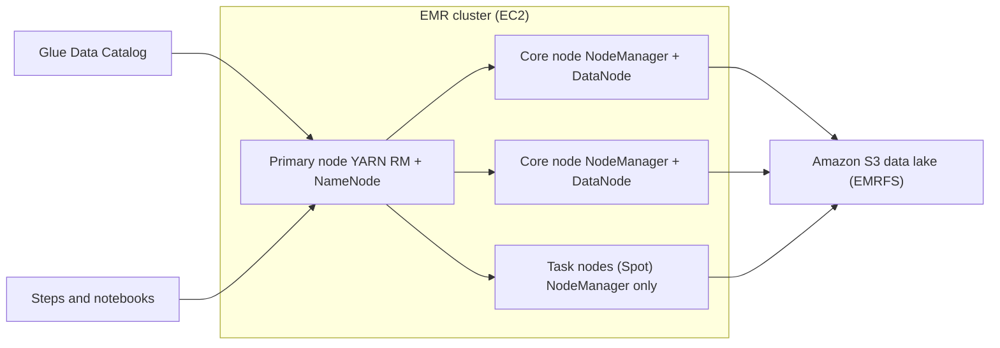
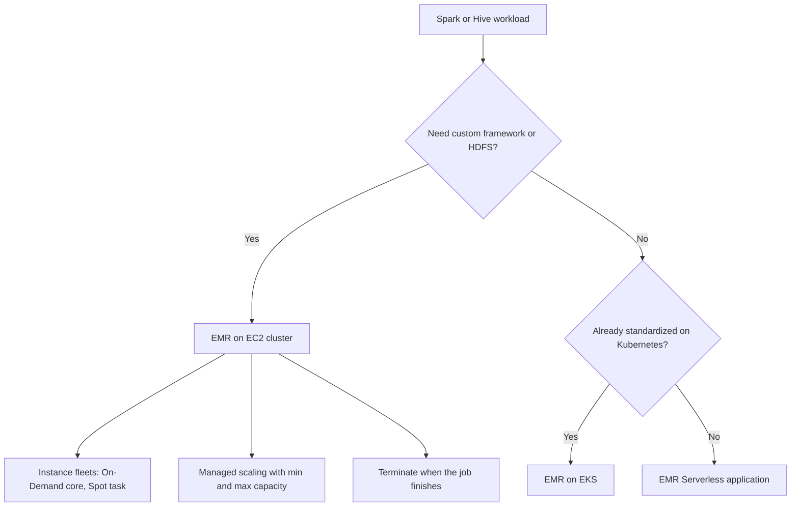

# 06 · Amazon EMR and Spark

> **Phase 5 — Data and AI** · Lesson 06 of 09
> ⬅️ Previous: [Amazon Redshift](./05-amazon-redshift.md) · ➡️ Next: [Kinesis Real-Time Analytics](./07-kinesis-real-time-analytics.md) · 🏠 [Phase overview](./README.md)

## 🎯 Learning Objectives

By the end of this lesson you will be able to:

- Explain the roles of primary, core, and task nodes and what belongs on each
- Choose between transient EC2 clusters, long-running clusters, EMR Serverless, and EMR on EKS
- Run Spark on Spot with instance fleets and graceful decommissioning
- Submit steps to a cluster and jobs to EMR Serverless without touching a console
- Apply the handful of Spark tuning settings that actually change runtime and cost

**Estimated time:** 80 min · **Difficulty:** Advanced

---

## 🧠 Core Concepts

**Amazon EMR** runs distributed processing frameworks — Spark, Hive, Presto/Trino, HBase, Flink — on EC2 capacity that EMR provisions and configures for you. It handles Hadoop, YARN, the framework versions, and the glue code that makes S3 behave like a filesystem.

The key architectural idea is that **S3 is the storage layer and the cluster is disposable compute**. A transient cluster starts, processes, and terminates; your data never lived on it. This decoupling is what makes Spot capacity and aggressive autoscaling safe.

### Cluster architecture

| Node type | Role | Runs HDFS? | Notes |
|-----------|------|------------|-------|
| **Primary (master)** | YARN ResourceManager, HDFS NameNode, job history | Yes | One per cluster; a single point of failure — EMR restarts it, but treat it as fragile |
| **Core** | YARN NodeManager and HDFS DataNode | Yes | Must stay up while data lives on them; never put core nodes only on Spot |
| **Task** | YARN NodeManager only | No | Pure compute — the right place for Spot |

That last row is the most important sentence in this lesson: **put Spot on task nodes and On-Demand on core nodes.** Task node loss costs you a recomputed task; core node loss can cost you data locality and job failure.

**EMRFS** is the S3 connector that makes `s3://` paths work inside Spark and Hive. It handles multipart uploads, optional consistent views, and the `fs.s3://` versus `s3a://` distinction. When you see "file system" behaviour that looks odd on S3 — no renames, no atomic directory deletes — that is EMRFS being honest about object storage rather than a bug.

### Cluster lifecycle and sizing

Clusters are either **transient** (created for one workload, terminated after) or **long-running** (shared, serving notebooks and scheduled jobs). Transient clusters avoid idle billing but pay cluster startup every time — typically 3 to 10 minutes. Long-running clusters start instantly but bill whether or not someone is using them unless you combine them with **managed scaling**, which adds and removes core/task nodes based on YARN metrics.

An **instance fleet** mixes instance types and purchase options within one node type, and EMR picks the cheapest capacity that satisfies your targets. That is how you make Spot reliable: request five instance types for task nodes and let EMR take whichever has capacity. **Instance groups** are the older model with one instance type per group, still useful when you need exact control.

**Graceful decommissioning** is the safety net for Spot. When a Spot task node is reclaimed and graceful decommissioning is enabled, YARN marks the node as decommissioning, stops assigning new containers to it, and waits for running tasks to finish up to a timeout. Without it, a Spot reclaim kills tasks in flight and your job re-runs whatever work was lost. EMR also stops scaling in nodes while a shuffle is in flight, which prevents the other classic Spot failure: a shrunken cluster with nowhere to find its shuffle data.

### The four deployment shapes

| Option | What it is | When to use |
|--------|------------|-------------|
| **EMR on EC2** | You own the cluster; EMR manages YARN and scaling | Custom frameworks, HDFS persistence, HBase, fine control |
| **EMR Serverless** | Queued jobs on capacity EMR manages, billed per vCPU-second and GB-second | Spark or Hive jobs with no cluster to babysit — the strongest default |
| **EMR on EKS** | Spark jobs scheduled as Kubernetes pods on an existing cluster | You already run EKS and want one compute platform |
| **EMR Studio / notebooks** | Managed notebooks attached to a cluster or Serverless app | Interactive development |

EMR Serverless removes startup time, capacity planning, and idle billing in one move. Its limits are worth knowing: no custom frameworks, no HDFS-backed storage, and a per-application quota on concurrent job runs. For most new Spark work it is the right answer; use EC2 clusters when you need something Serverless cannot provide.

### Spark tuning that matters

Nine times out of ten, a slow Spark job is caused by one of four things: too many small tasks, data skew, an unnecessary shuffle, or a broadcast that did not happen. The settings that address them:

| Setting | Purpose |
|---------|---------|
| `spark.executor.cores` | Tasks per executor — 4 to 5 on EMR with YARN |
| `spark.executor.memory` + `spark.executor.memoryOverhead` | Executor heap plus off-heap (10 to 20 percent of heap) |
| `spark.sql.shuffle.partitions` | Shuffle partition count; 2–3x total cores is a sane start |
| `spark.sql.adaptive.enabled` | Adaptive Query Execution — coalesces partitions and handles skew at runtime |
| `spark.sql.adaptive.skewJoin.enabled` | Splits oversized partitions during joins |
| `spark.sql.autoBroadcastJoinThreshold` | Size below which a table is broadcast instead of shuffled |
| `spark.sql.sources.partitionOverwriteMode` | `dynamic` so a single partition can be replaced |
| `spark.dynamicAllocation.enabled` | Scale executors with workload (must be coordinated with managed scaling) |

Adaptive Query Execution in Spark 3.x solves in minutes what used to require manual repartitioning, so enable it before hand-tuning partition counts.

### Key terminology

| Term | Meaning |
|------|---------|
| **Transient cluster** | Cluster created for one workload and terminated when it finishes |
| **Instance fleet** | A mixed set of instance types and purchase options for one node type |
| **Task node** | Compute-only node with no HDFS — the correct home for Spot capacity |
| **Graceful decommissioning** | Letting running tasks finish before a Spot node is removed |
| **Bootstrap action** | Script run on every node at startup, before the framework starts |
| **Step** | A unit of work submitted to a cluster (usually a Spark application) |
| **EMR Serverless application** | A named Spark or Hive environment that jobs are submitted to |
| **Managed scaling** | EMR adding and removing nodes based on YARN demand metrics |

---

## 🗺️ Architecture Diagram

Node roles and where data actually lives:



Choosing a deployment shape, in the order worth trying:



---

## 🧪 Hands-on Lab: Transient Cluster with Spot Task Nodes, Then Serverless

**Goal:** Create a cluster with On-Demand core nodes and Spot task nodes, submit a Spark step that writes partitioned Parquet, then run the same job on EMR Serverless.

**Prerequisites:** An EMR service role and an EC2 instance profile for EMR (`EMR_EC2_DefaultRole` and `EMR_DefaultRole` are the managed defaults), a VPC with a default subnet, and the scripts bucket from Lesson 02.

### Step 1 — Create the cluster with instance fleets

Save the graceful decommissioning configuration first:

```bash
cat > graceful-decommissioning.json <<'JSON'
[
  {
    "Classification": "yarn-site",
    "Properties": {
      "yarn.resourcemanager.nodemanager-graceful-decommission.enable": "true",
      "yarn.resourcemanager.decommissioning.timeout": "3600"
    }
  }
]
JSON
```

```bash
# Core nodes stay On-Demand (HDFS lives there); task nodes take Spot at up to 60% of On-Demand
aws emr create-cluster \
  --name lake-spark-transient \
  --release-label emr-7.1.0 \
  --applications Name=Spark Name=Hive \
  --service-role EMR_DefaultRole \
  --ec2-attributes '{"InstanceProfile":"EMR_EC2_DefaultRole","SubnetId":"subnet-0abc123","KeyName":"my-key"}' \
  --configurations file://graceful-decommissioning.json \
  --instance-fleets '[
    {
      "Name":"primary","InstanceFleetType":"MASTER","TargetOnDemandCapacity":1,
      "InstanceTypeConfigs":[{"InstanceType":"m5.xlarge"}]
    },
    {
      "Name":"core","InstanceFleetType":"CORE","TargetOnDemandCapacity":4,
      "InstanceTypeConfigs":[{"InstanceType":"m5.xlarge","WeightedCapacity":1}]
    },
    {
      "Name":"task","InstanceFleetType":"TASK","TargetSpotCapacity":8,
      "InstanceTypeConfigs":[
        {"InstanceType":"m5.xlarge","WeightedCapacity":1,"BidPriceAsPercentageOfOnDemandPrice":60},
        {"InstanceType":"m5a.xlarge","WeightedCapacity":1,"BidPriceAsPercentageOfOnDemandPrice":60},
        {"InstanceType":"m4.xlarge","WeightedCapacity":1,"BidPriceAsPercentageOfOnDemandPrice":60}
      ],
      "LaunchSpecifications":{"SpotSpecification":{"TimeoutDurationMinutes":20,"TimeoutAction":"SWITCH_TO_ON_DEMAND"}}
    }
  ]' \
  --auto-terminate \
  --log-uri s3://acme-analytics-prod-eu-west-1/emr-logs/ \
  --query "ClusterId" --output text
```

`--auto-terminate` means the cluster shuts itself down when the last step finishes — the cheapest possible failure mode.

### Step 2 — Add managed scaling

```bash
cat > scaling-policy.json <<'JSON'
{
  "ClusterId": "j-XXXXXXXXXXXXX",
  "ManagedScalingPolicy": {
    "ComputeLimits": {
      "UnitType": "InstanceFleetUnits",
      "MinimumCapacityUnits": 2,
      "MaximumCapacityUnits": 40,
      "MaximumOnDemandCapacityUnits": 4,
      "MaximumCoreCapacityUnits": 4
    }
  }
}
JSON

aws emr put-managed-scaling-policy \
  --cluster-id j-XXXXXXXXXXXXX \
  --managed-scaling-policy file://scaling-policy.json
```

`MaximumCoreCapacityUnits` is what keeps your expensive HDFS-backed nodes from growing while task nodes absorb the burst.

### Step 3 — Submit a Spark step

```bash
# The step runs spark-submit on the primary node with these arguments
aws emr add-steps --cluster-id j-XXXXXXXXXXXXX --steps '[{
  "Name":"curated-orders-aggregate",
  "ActionOnFailure":"CONTINUE",
  "Type":"Spark",
  "Args":[
    "--deploy-mode","client",
    "--conf","spark.executor.cores=4",
    "--conf","spark.executor.memory=12g",
    "--conf","spark.executor.memoryOverhead=2g",
    "--conf","spark.sql.adaptive.enabled=true",
    "--conf","spark.sql.adaptive.skewJoin.enabled=true",
    "--conf","spark.sql.shuffle.partitions=800",
    "--conf","spark.sql.sources.partitionOverwriteMode=dynamic",
    "s3://acme-analytics-prod-eu-west-1/scripts/orders_aggregate.py",
    "--input","s3://acme-analytics-prod-eu-west-1/curated/orders/",
    "--output","s3://acme-analytics-prod-eu-west-1/refined/orders_daily/"
  ]
}]'
```

The same settings can live in a `spark-defaults` classification so every job inherits them:

```bash
# Add to --configurations when creating the cluster
cat > spark-defaults.json <<'JSON'
[
  {
    "Classification": "spark-defaults",
    "Properties": {
      "spark.sql.adaptive.enabled": "true",
      "spark.sql.adaptive.skewJoin.enabled": "true",
      "spark.dynamicAllocation.enabled": "true",
      "spark.dynamicAllocation.minExecutors": "2",
      "spark.dynamicAllocation.maxExecutors": "200",
      "spark.sql.autoBroadcastJoinThreshold": "52428800"
    }
  }
]
JSON
```

### Step 4 — Watch and verify the run

```bash
aws emr list-steps --cluster-id j-XXXXXXXXXXXXX \
  --query "Steps[].{Name:Name,State:State,Started:Status.Timeline.StartDateTime}"

# Spot interruption history for the task nodes, if any were reclaimed
aws emr list-instance-fleets --cluster-id j-XXXXXXXXXXXXX \
  --query "InstanceFleets[].{Name:Name,Provisioned:ProvisionedSpotCapacity,Target:TargetSpotCapacity}"
```

### Step 5 — Run the same job on EMR Serverless

```bash
aws emr-serverless create-application \
  --name lake-spark-serverless \
  --type SPARK \
  --release-label emr-7.1.0 \
  --maximum-capacity '{"cpu":"200vCPU","memory":"1600GB"}' \
  --auto-stop-configuration '{"idleTimeoutMinutes":15}' \
  --auto-start-configuration '{"enabled":true}' \
  --query "applicationId" --output text
```

```bash
aws emr-serverless start-job-run \
  --application-id "$APP_ID" \
  --execution-role-arn arn:aws:iam::123456789012:role/EMRServerlessExecutionRole \
  --name orders-aggregate \
  --job-driver '{
    "sparkSubmit": {
      "entryPoint": "s3://acme-analytics-prod-eu-west-1/scripts/orders_aggregate.py",
      "entryPointArguments": ["--input","s3://acme-analytics-prod-eu-west-1/curated/orders/","--output","s3://acme-analytics-prod-eu-west-1/refined/orders_daily/"],
      "sparkSubmitParameters": "--conf spark.executor.cores=4 --conf spark.executor.memory=12g --conf spark.dynamicAllocation.maxExecutors=50"
    }
  }' \
  --configuration-overrides '{
    "monitoringConfiguration": {
      "s3MonitoringConfiguration": {"logUri": "s3://acme-analytics-prod-eu-west-1/emr-serverless-logs/"}
    }
  }'
```

```bash
aws emr-serverless get-job-run --application-id "$APP_ID" --job-run-id "$JOB_ID" \
  --query "jobRun.{State:state,Reason:stateDetails,ResourceUtilization:totalResourceUtilization}"
```

`autoStopConfiguration` is the Serverless equivalent of pausing a cluster: idle capacity shuts down automatically, so you only pay while jobs run.

### Step 6 — Verify

```bash
# Expect SUCCEEDED for the step and COMPLETED for the serverless job run
aws emr list-steps --cluster-id j-XXXXXXXXXXXXX --query "Steps[].State"

aws s3 ls "s3://acme-analytics-prod-eu-west-1/refined/orders_daily/" --recursive | head
```

Both runs should produce the same partitioned Parquet output. If the Serverless job fails while the cluster step succeeded, the usual cause is a missing dependency in the execution role's S3 policy — not a code difference.

---

## 💻 CLI Reference

```bash
# Inventory clusters still running (a common source of surprise bills)
aws emr list-clusters --active --query "Clusters[].{Id:Id,Name:Name,State:State}"

# Cluster detail, including the task node Spot capacity actually acquired
aws emr describe-cluster --cluster-id j-XXXXXXXXXXXXX \
  --query "Cluster.{State:Status.State,InstanceFleets:InstanceCollection.InstanceFleets}"

# EMR on EKS: create a virtual cluster and start a Spark job run
# Serverless: list applications and running jobs
aws emr-serverless list-job-runs --application-id "$APP_ID" --query "jobRuns[].{Id:jobRunId,State:state}"
aws emr-serverless stop-application --application-id "$APP_ID"

# EMR on EKS: create a virtual cluster and start a Spark job run
aws emr-containers create-virtual-cluster \
  --name lake-spark-eks \
  --container-provider '{"id":"my-eks-cluster","type":"EKS","info":{"eksInfo":{"namespace":"emr-jobs"}}}'

aws emr-containers start-job-run \
  --virtual-cluster-id "$VC_ID" \
  --name orders-aggregate \
  --execution-role-arn arn:aws:iam::123456789012:role/EMRContainersJobRole \
  --release-label emr-7.1.0-latest \
  --job-driver file://job-driver.json

# Read the Spark event log from S3 for a completed step
aws s3 cp s3://acme-analytics-prod-eu-west-1/emr-logs/j-XXXX/steps/s-XXXX/ ./step-logs/ --recursive
```

| Command | Purpose |
|---------|---------|
| `emr create-cluster` | Provisions a cluster with instance fleets and configurations |
| `emr put-managed-scaling-policy` | Lets EMR add and remove core/task nodes automatically |
| `emr add-steps` | Submits a Spark, Hive, or custom JAR step |
| `emr-serverless start-job-run` | Runs a Spark job with no cluster to manage |
| `emr-containers start-job-run` | Runs Spark as pods on an existing EKS cluster |
| `emr list-clusters --active` | Finds clusters you forgot were running |

---

## ✅ Best Practices

| Practice | Why it matters |
|----------|----------------|
| On-Demand core nodes, Spot task nodes | Task loss is recoverable; core loss can take the job down |
| Enable graceful decommissioning | Running tasks finish instead of dying with the Spot instance |
| Request several instance types per fleet | Spot capacity is per type, so a wider net interrupts less |
| `TimeoutAction: SWITCH_TO_ON_DEMAND` on task fleets | The job completes instead of waiting indefinitely for Spot |
| Prefer transient clusters for scheduled work | No idle cluster-hours |
| Use `--auto-terminate` | The cluster cannot outlive its last step |
| Enable managed scaling with a `MaximumCoreCapacityUnits` | Prevents the expensive node class from growing |
| Keep your data in S3, not HDFS | Makes Spot, autoscaling, and termination safe |
| Enable AQE before hand-tuning partitions | Solves skew and partition sizing without manual work |
| Store logs in S3 via `--log-uri` | Logs vanish with a terminated cluster otherwise |
| Make EMR Serverless your default for Spark | No clusters, no idle cost, no startup wait |

---

## ⚠️ Common Pitfalls

| Pitfall | Symptom | Fix |
|---------|---------|-----|
| Spot on core nodes | Job fails mid-shuffle with lost map output | Move Spot to task nodes only |
| Graceful decommissioning not configured | Tasks fail on Spot reclaim and re-run | Enable the `yarn-site` configuration |
| Tiny executors (1 core, 2 GB) | Hundreds of executors, YARN overhead, no memory for joins | Use 4–5 cores and ≥12 GB heap per executor |
| Thousands of tasks with no data | `shuffle.partitions` far above data size | Enable AQE, or set partitions to 2–3x total cores |
| Broadcast threshold too high | Driver OOM during a broadcast join | Lower `autoBroadcastJoinThreshold` or remove the hint |
| Cluster left running after the job | Idle cluster-hours | `--auto-terminate`, managed scaling, or a shutdown Lambda |
| Serverless job fails on missing dependency | `ClassNotFoundException` in the job run | Package dependencies in the jar/zip and pass `--extra-jars` |
| Logs written to `/mnt` only | No post-mortem after termination | Set `--log-uri` to S3 |

---

## 💰 Cost Considerations

EMR pricing is EC2 cost plus an EMR premium per instance-hour, and the premium is lower for Spot. Approximate figures for an `m5.xlarge` in `eu-west-1`: about $0.19 per On-Demand instance-hour, with EMR adding roughly $0.06 per hour for that instance class.

| Scenario | Capacity | Approximate cost |
|----------|----------|------------------|
| Transient job, 1 primary + 4 core On-Demand, 30 minutes | 5 × m5.xlarge | ~$0.63 |
| Same job with 8 Spot task nodes for 20 minutes | 8 × m5.xlarge Spot | ~$0.15 (Spot at ~20–40% of On-Demand) |
| Long-running cluster left up 720 hours | 5 × m5.xlarge | ~$900/month |
| EMR Serverless, 20 vCPU and 80 GB for 20 minutes | Billed per vCPU-second and GB-second | ~$0.30–0.50 |
| EMR on EKS | EKS cluster cost + EC2 for pods | No EMR premium for the nodes, but you pay for EKS |

The economics are stark: a transient cluster plus Spot task nodes typically costs 5–20 percent of an always-on cluster doing the same work. The three levers, in order of impact:

1. **Terminate.** An idle cluster is pure waste. Auto-termination plus managed scaling with a low minimum is the baseline.
2. **Spot for task nodes.** Interruptions are a scheduling problem you can engineer around; the discount is 60–80 percent.
3. **Right-size executors.** One 16 vCPU executor per node with 4 cores used wastes 12 vCPUs of YARN allocation. Aim for high core utilization per node, which usually means 4–5 cores per executor and 2–3 executors per `m5.xlarge`.

Watch `TotalResourceUtilization` (or `totalResourceUtilization` on Serverless job runs) to see vCPU-seconds and memory GB-seconds actually consumed. If memory GB-seconds dwarfs vCPU-seconds by more than about 8:1, your executors are over-provisioned on memory.

---

## 🔐 Security Considerations

- **Separate the two roles.** The EMR service role allows EMR to act on your behalf; the EC2 instance profile is what the nodes use to read S3 and Glue. Scope the instance profile to the lake prefixes the jobs actually need.
- **Never use long-lived keys in bootstrap actions.** Use the instance profile so metadata-based credentials rotate automatically.
- **Use security configurations** for at-rest and in-transit encryption:
  ```bash
  aws emr create-security-configuration --name lake-emr-sec --security-configuration '{
    "EncryptionConfiguration":{"EnableInTransitEncryption":true,"EnableAtRestEncryption":true,
      "InTransitEncryptionConfiguration":{"TLSCertificateConfiguration":{"CertificateProviderType":"PEM","S3Object":"s3://acme-analytics-prod-eu-west-1/certs/privateKey.pem"}},
      "AtRestEncryptionConfiguration":{"S3EncryptionConfiguration":{"EncryptionMode":"SSE-KMS","AwsKmsKey":"arn:aws:kms:eu-west-1:123456789012:key/abcd-1234"}}}
  }'
  ```
- **Launch clusters in private subnets.** Public subnets with permissive security groups expose YARN and HDFS UI ports; restrict the master security group to your bastion or VPN CIDR.
- **Use Lake Formation with EMR** (`--configurations` with the `spark-hive-site` classification pointing at the LF-enabled catalog) so table, column, and row permissions are enforced at query time, not just by S3 policy.
- **Keep SSH keys out of reproducible configs** and consider disabling key-less login on long-running clusters by removing the EC2 key pair.
- **Audit steps and job runs.** Steps are arbitrary code with the cluster's IAM permissions; treat `add-steps` as a privileged action and log it in CloudTrail.
- **Bootstrap actions run as root on every node.** Pin them to a versioned script in S3 with restricted write access — an attacker who can edit that object owns every node.

---

## 🧩 Exercise

Build a job that is resilient to Spot interruption and prove it:

1. Create a cluster with 2 On-Demand core nodes and a Spot task fleet with graceful decommissioning enabled.
2. Run a Spark job that takes at least 20 minutes, reading a dataset large enough to require the task nodes.
3. While it runs, reduce the task fleet target with `modify-instance-fleet`, forcing a scale-in.
4. Confirm the job completes with no failed stages.

Success looks like: `list-steps` reports `COMPLETED`, the Spark UI history shows no failed tasks attributable to lost executors, and `TotalResourceUtilization` confirms the work moved to remaining capacity rather than being recomputed from scratch.

---

## 📚 Resources

- [Amazon EMR Management Guide](https://docs.aws.amazon.com/emr/latest/ManagementGuide/emr-what-is-emr.html)
- [EMR Cluster and Node Types](https://docs.aws.amazon.com/emr/latest/ManagementGuide/emr-master-core-task-nodes.html)
- [Using Instance Fleets](https://docs.aws.amazon.com/emr/latest/ManagementGuide/emr-instance-fleets.html)
- [Graceful Decommissioning](https://docs.aws.amazon.com/emr/latest/ManagementGuide/emr-plan-node-graceful-decommissioning.html)
- [EMR Managed Scaling](https://docs.aws.amazon.com/emr/latest/ManagementGuide/emr-managed-scaling.html)
- [EMR Serverless User Guide](https://docs.aws.amazon.com/emr/latest/EMR-Serverless-UserGuide/emr-serverless.html)
- [Spark Tuning on EMR](https://docs.aws.amazon.com/emr/latest/ReleaseGuide/emr-spark-performance.html)
- [Amazon EMR Pricing](https://aws.amazon.com/emr/pricing/)

---

## ➡️ Next Steps

EMR handles batch science at scale. The next lesson keeps Spark's windowing and stateful processing ideas but applies them to data that never stops arriving, using Kinesis and the Managed Service for Apache Flink.

> ⬅️ Previous: [Amazon Redshift](./05-amazon-redshift.md) · ➡️ Next: [Kinesis Real-Time Analytics](./07-kinesis-real-time-analytics.md) · 🏠 [Phase overview](./README.md)
