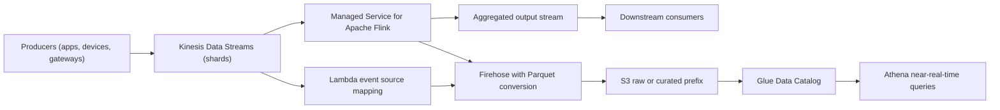
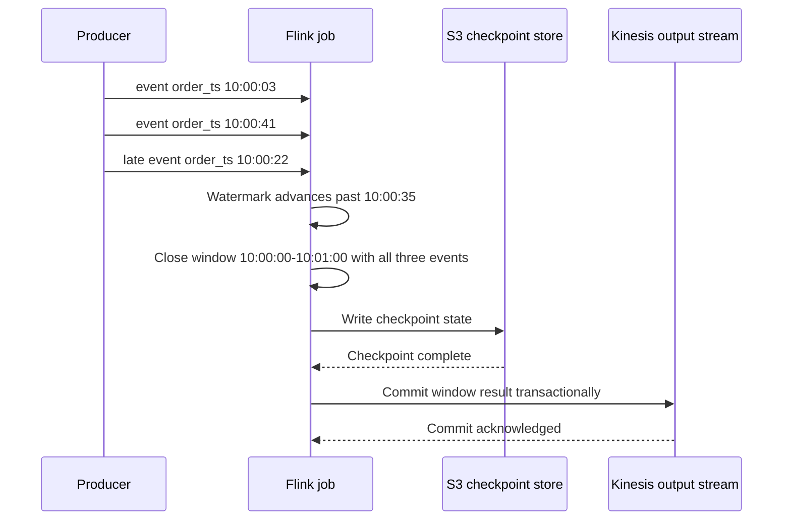

# 07 · Kinesis Real-Time Analytics

> **Phase 5 — Data and AI** · Lesson 07 of 09
> ⬅️ Previous: [Amazon EMR and Spark](./06-amazon-emr-and-spark.md) · ➡️ Next: [SageMaker Training and Deployment](./08-sagemaker-training-and-deployment.md) · 🏠 [Phase overview](./README.md)

## 🎯 Learning Objectives

By the end of this lesson you will be able to:

- Size and scale a Kinesis data stream, and explain what a shard actually limits
- Load streaming data into S3 with Firehose, including Parquet conversion and dynamic partitioning
- Write windowed, event-time aggregations with the Managed Service for Apache Flink
- Achieve exactly-once output with checkpoints and transactional sinks
- Choose between Managed Flink and a Lambda consumer for a given streaming requirement

**Estimated time:** 80 min · **Difficulty:** Advanced

---

## 🧠 Core Concepts

Streaming analytics means answering questions about a window of time — "revenue in the last five minutes" — while events are still arriving. Two things make that hard. Events arrive **out of order**, so "the last five minutes" cannot mean "the last five minutes of wall-clock time you happened to receive them". And a stream **never ends**, so there is no moment at which the answer is final.

The AWS stack for this splits neatly: **Kinesis Data Streams** is the transport, **Firehose** is the delivery mechanism into storage, and the **Managed Service for Apache Flink** is the compute engine that does stateful, windowed work.

### Kinesis Data Streams

A stream is made of **shards**. A shard is the unit of both capacity and ordering:

| Limit | Per shard |
|-------|-----------|
| Write throughput | 1 MB/s, up to 1,000 records/s |
| Read throughput (shared) | 2 MB/s across all consumers using `GetRecords` |
| Read throughput (enhanced fan-out) | 2 MB/s per registered consumer, dedicated |

Records with the same **partition key** always land in the same shard and are delivered in the order they were written. That is the only ordering guarantee Kinesis makes: ordering per shard, by partition key, not globally. Choose the partition key from the entity whose events must be ordered — `customer_id`, `device_id`, `session_id` — not from something evenly distributed but meaningless for ordering.

Capacity modes matter for cost:

- **Provisioned** — you set the shard count. Predictable price, and you must reshard when traffic changes.
- **On-demand** — Kinesis scales with observed throughput (up to a default ceiling) and bills per GB written plus per-shard-hour. Best when traffic is unknown or spiky, but the per-GB cost is higher.

**Retention** starts at 24 hours and can be extended to 365 days for an hourly charge, which is what lets you replay a stream after a consumer bug. **Enhanced fan-out** gives each registered consumer its own 2 MB/s pipe with push delivery in about 70 ms, which is the fix when several consumers share a shard's 2 MB/s and each gets a fraction.

### Firehose

**Firehose** is a fully managed delivery stream: you point it at a source and a destination and it buffers, optionally transforms, optionally converts format, and writes. There is no code and no capacity to manage.

- **Buffering hints** (buffer size and buffer interval) decide latency versus file size. The default of 5 MB or 300 seconds produces large files; a 1 MB or 60 second hint produces faster visibility and more, smaller files. Because S3 query cost is dominated by file count, favour larger buffers unless latency genuinely matters.
- **Record format conversion** turns JSON into Parquet or ORC using a Glue table schema, which is what makes Firehose output directly queryable at low cost.
- **Dynamic partitioning** derives partition prefixes from a JSON field (for example `region`) instead of storing everything under a timestamp-only prefix.
- **Lambda processing** allows arbitrary transformation, at the cost of latency and a Lambda invocation per batch.

Firehose destinations include S3, Redshift (through S3 plus `COPY`), OpenSearch, Splunk, Datadog, and generic HTTP endpoints. It has no replay and no ordering guarantee across the whole stream — treat it as a delivery pipeline, not a queue.

### Managed Service for Apache Flink

The **Managed Service for Apache Flink** (formerly Kinesis Data Analytics for Apache Flink) runs your Flink application on managed capacity, billed in **KPU-hours**. One KPU is 1 vCPU and 4 GB of memory, which backs one parallelism unit of your job.

Flink's model, in four terms:

- **Event time** — when the event happened, taken from the record's own timestamp.
- **Watermark** — Flink's assertion that it has seen all events up to a certain time. `WATERMARK FOR order_ts AS order_ts - INTERVAL '5' SECOND` means "expect up to 5 seconds of lateness".
- **Window** — tumbling (fixed, non-overlapping), sliding (overlapping), or session (gap-based). All are evaluated in event time, so late-but-valid events still land in the correct window as long as they arrive before the watermark passes.
- **Allowed lateness / side outputs** — what to do with events that arrive after the watermark. Dropping them silently is the most common production surprise.

**Checkpoints** are Flink's fault-tolerance mechanism: a consistent snapshot of operator state written to durable storage (S3) at an interval. On restart, the job resumes from the last completed checkpoint rather than reprocessing from the beginning. **Exactly-once** requires two things: checkpointing enabled with a durable state backend, and a sink that supports transactional or idempotent writes.

| Sink | Exactly-once behavior |
|------|-----------------------|
| Kinesis Data Streams sink | Exactly-once with `FlinkKinesisProducer` — writes are transactional |
| FileSink to S3 | Exactly-once with `withRollingPolicy` and checkpoint-triggered file commits |
| Firehose | At-least-once only — no transactional API |
| Custom HTTP / database sinks | Whatever your code implements; usually at-least-once |
| Kafka sink | Exactly-once with transactional producers |

If exactly-once holds end to end, downstream consumers must either tolerate duplicates or deduplicate on the record key.

### Key terminology

| Term | Meaning |
|------|---------|
| **Shard** | The unit of stream capacity and of ordering |
| **Partition key** | Value that hashes a record to a shard and defines ordering scope |
| **Enhanced fan-out** | Dedicated 2 MB/s per consumer per shard, push delivery |
| **KPU** | Kinesis Processing Unit — 1 vCPU and 4 GB, the billing unit for Managed Flink |
| **Watermark** | Global progress marker in event time |
| **Checkpoint** | Consistent snapshot of operator state for recovery |
| **Exactly-once** | Output that neither duplicates nor loses records across failures |

---

## 🗺️ Architecture Diagram

Transport, delivery, and compute — the three layers together:



How an event-time tumbling window handles a late event, and where the checkpoint boundary falls:



---

## 🧪 Hands-on Lab: Stream to Windowed Aggregate to S3

**Goal:** Create a stream, produce sample events, run a windowed aggregation in Managed Flink, and land raw events in S3 through Firehose with Parquet conversion.

**Prerequisites:** The lake bucket from Lesson 01, an IAM role for Firehose, and an execution role for the Flink application with Kinesis, S3, and CloudWatch permissions.

### Step 1 — Create the stream

```bash
# Two shards: 2 MB/s write and 2,000 records/s of headroom
aws kinesis create-stream \
  --stream-name orders-stream \
  --shard-count 2 \
  --stream-mode-details StreamMode=PROVISIONED

aws kinesis describe-stream-summary --stream-name orders-stream \
  --query "StreamDescriptionSummary.{Status:StreamStatus,Shards:OpenShardCount,Mode:StreamModeDetails.StreamMode}"

# Keep a week of data so you can replay after a bug fix
aws kinesis increase-stream-retention-period \
  --stream-name orders-stream --retention-period-hours 168

# Encrypt at rest with a KMS key
aws kinesis start-stream-encryption \
  --stream-name orders-stream \
  --encryption-type KMS \
  --key-id alias/aws/kinesis
```

### Step 2 — Produce events

```bash
# --cli-binary-format matters: Kinesis expects base64-encoded Data
aws kinesis put-record \
  --stream-name orders-stream \
  --partition-key customer-4711 \
  --data '{"order_id":"o-1001","customer_id":"customer-4711","region":"EMEA","amount":42.50,"order_ts":"2026-10-14T10:00:03Z"}' \
  --cli-binary-format raw-in-base64-out \
  --query "ShardId"

# A loop gives you enough events for a window to close
for i in $(seq 1 200); do
  aws kinesis put-record --stream-name orders-stream \
    --partition-key "customer-$((i % 20))" \
    --data "{\"order_id\":\"o-$i\",\"customer_id\":\"customer-$((i % 20))\",\"region\":\"EMEA\",\"amount\":$i.25,\"order_ts\":\"$(date -u +%Y-%m-%dT%H:%M:%SZ)\"}" \
    --cli-binary-format raw-in-base64-out > /dev/null
done
```

### Step 3 — Create the Firehose delivery stream with Parquet conversion

Firehose converts JSON to Parquet using a Glue table, so create that table first from the raw prefix, then reference it by name.

```bash
cat > firehose-s3.json <<'JSON'
{
  "RoleARN": "arn:aws:iam::123456789012:role/FirehoseDeliveryRole",
  "BucketARN": "arn:aws:s3:::acme-analytics-prod-eu-west-1",
  "Prefix": "raw/source=orders-stream/dt=!{timestamp:yyyy-MM-dd}/",
  "ErrorOutputPrefix": "raw/errors/!{firehose:error-output-type}/",
  "BufferingHints": {"SizeInMBs": 64, "IntervalInSeconds": 300},
  "CompressionFormat": "UNCOMPRESSED",
  "RecordFormatConversionConfiguration": {
    "Enabled": true,
    "InputFormatConfiguration": {"Deserializer": {"OpenXJsonSerDe": {}}},
    "OutputFormatConfiguration": {"Serializer": {"ParquetSerDe": {"Compression": "SNAPPY"}}},
    "SchemaConfiguration": {
      "RoleARN": "arn:aws:iam::123456789012:role/FirehoseDeliveryRole",
      "DatabaseName": "analytics",
      "TableName": "raw_orders_schema",
      "Region": "eu-west-1",
      "VersionId": "LATEST"
    }
  },
  "DynamicPartitioningConfiguration": {"Enabled": true, "RetryOptions": {"DurationInSeconds": 300}},
  "CloudWatchLoggingOptions": {"Enabled": true, "LogGroupName": "/aws/kinesisfirehose/orders", "LogStreamName": "S3Delivery"}
}
JSON

aws firehose create-delivery-stream \
  --delivery-stream-name orders-to-s3 \
  --delivery-stream-type KinesisStreamAsSource \
  --kinesis-stream-source-configuration '{"KinesisStreamARN":"arn:aws:kinesis:eu-west-1:123456789012:stream/orders-stream","RoleARN":"arn:aws:iam::123456789012:role/FirehoseDeliveryRole"}' \
  --extended-s3-destination-configuration file://firehose-s3.json
```

Dynamic partitioning needs the partition columns in the record, so add a `region` key to the source data and Firehose will route each batch to `region=EMEA/...` instead of the literal prefix above.

### Step 4 — Deploy a Flink application

Package the application as a jar (or a zip with `mainClass`) and upload it, then create the application.

```bash
aws kinesisanalyticsv2 create-application \
  --application-name orders-windowed-flink \
  --runtime-environment FLINK-1_20 \
  --service-execution-role arn:aws:iam::123456789012:role/FlinkServiceRole \
  --application-configuration '{
    "FlinkApplicationConfiguration": {
      "ParallelismConfiguration": {"ConfigurationType":"CUSTOM","Parallelism":4,"ParallelismPerKPU":1,"AutoScalingEnabled":true},
      "CheckpointConfiguration": {"ConfigurationType":"CUSTOM","CheckpointingEnabled":true,"CheckpointInterval":60000,"MinPauseBetweenCheckpoints":30000},
      "MonitoringConfiguration": {"ConfigurationType":"CUSTOM","MetricsLevel":"TASK","LogLevel":"INFO"}
    },
    "ApplicationCodeConfiguration": {
      "CodeContent": {"S3ContentLocation": {
        "BucketARN":"arn:aws:s3:::acme-analytics-prod-eu-west-1","FileKey":"flink/orders-windowed-1.0.0.jar"}},
      "CodeContentType":"ZIPFILE"
    },
    "EnvironmentProperties": {"PropertyGroups":[{
      "PropertyGroupId":"FlinkApplicationProperties",
      "PropertyMap":{"inputStream":"orders-stream","outputStream":"orders-aggregated","region":"eu-west-1"}
    }]}
  }'
```

```bash
# Snapshots let you restart from a known-good application state
aws kinesisanalyticsv2 create-application-snapshot \
  --application-name orders-windowed-flink \
  --snapshot-name v1-before-tuning

aws kinesisanalyticsv2 start-application \
  --application-name orders-windowed-flink \
  --run-configuration '{"FlinkRunConfiguration":{"AllowNonRestoredState":false}}'

aws kinesisanalyticsv2 describe-application --application-name orders-windowed-flink \
  --query "ApplicationDetail.{Status:ApplicationStatus,Parallelism:ApplicationConfigurationDescription.FlinkApplicationConfigurationDescription.ParallelismConfigurationDescription.Parallelism}"
```

If your team prefers SQL over Java, the same job in Flink SQL — this is what you run in Studio notebooks — is far shorter:

```sql
-- Source table with an event-time watermark allowing 5 seconds of lateness
CREATE TABLE orders (
  order_id    VARCHAR(64),
  customer_id VARCHAR(64),
  region      VARCHAR(16),
  amount      DOUBLE,
  order_ts    TIMESTAMP(3),
  WATERMARK FOR order_ts AS order_ts - INTERVAL '5' SECOND
) WITH (
  'connector' = 'kinesis',
  'stream' = 'orders-stream',
  'aws.region' = 'eu-west-1',
  'scan.stream.initpos' = 'LATEST',
  'format' = 'json',
  'json.timestamp-format.standard' = 'ISO-8601'
);

CREATE TABLE orders_per_minute (
  window_start TIMESTAMP(3),
  window_end   TIMESTAMP(3),
  region       VARCHAR(16),
  revenue      DOUBLE,
  order_count  BIGINT
) WITH (
  'connector' = 'kinesis',
  'stream' = 'orders-aggregated',
  'aws.region' = 'eu-west-1',
  'format' = 'json'
);

-- One tumbling window per minute, evaluated in event time
INSERT INTO orders_per_minute
SELECT window_start, window_end, region, SUM(amount) AS revenue, COUNT(*) AS order_count
FROM TABLE(TUMBLE(TABLE orders, DESCRIPTOR(order_ts), INTERVAL '1' MINUTE))
GROUP BY window_start, window_end, region;
```

### Step 5 — Compare with the Lambda alternative

For simple per-record enrichment or fan-out with no windowing, a Lambda consumer is cheaper and far less code:

```bash
aws lambda create-event-source-mapping \
  --function-name orders-processor \
  --event-source-arn arn:aws:kinesis:eu-west-1:123456789012:stream/orders-stream \
  --starting-position LATEST \
  --batch-size 100 \
  --maximum-batching-window-in-seconds 5 \
  --parallelization-factor 4 \
  --bisect-batch-on-function-error \
  --function-response-types ReportBatchItemFailures \
  --destination-config '{"OnFailure":{"Destination":"arn:aws:s3:::acme-analytics-prod-eu-west-1/raw/errors/lambda/"}}'
```

`--function-response-types ReportBatchItemFailures` requires the handler to report per-record failures so only the failed records are retried:

```python
import base64
import json

def handler(event, context):
    failures = []
    for record in event["Records"]:
        try:
            payload = json.loads(base64.b64decode(record["kinesis"]["data"]))
            if not payload.get("order_id"):
                raise ValueError("missing order_id")
            # Your enrichment or fan-out logic goes here
        except Exception:
            failures.append({"itemIdentifier": record["kinesis"]["sequenceNumber"]})
    return {"batchItemFailures": failures}
```

### Step 6 — Verify

```bash
# Firehose must show ACTIVE and deliver Parquet objects under the raw prefix
aws firehose describe-delivery-stream --delivery-stream-name orders-to-s3 \
  --query "DeliveryStreamDescription.{Status:DeliveryStreamStatus,Type:DeliveryStreamType}"

aws s3 ls "s3://acme-analytics-prod-eu-west-1/raw/source=orders-stream/" --recursive | head

# The windowed output must appear on the aggregated stream
aws kinesis describe-stream-summary --stream-name orders-aggregated

# Check consumer lag for the Flink application (substitute your own UTC timestamps)
aws cloudwatch get-metric-statistics \
  --namespace AWS/Kinesis \
  --metric-name MillisBehindLatest \
  --dimensions Name=StreamName,Value=orders-stream \
  --start-time 2026-10-14T09:00:00Z \
  --end-time 2026-10-14T10:00:00Z \
  --period 300 --statistics Maximum
```

Expected: Parquet objects (not JSON) under the raw prefix, `orders-aggregated` receiving one record per region per minute, and `MillisBehindLatest` staying under a few hundred milliseconds. If lag grows without bound, increase parallelism or check for a skew in the partition key.

---

## 💻 CLI Reference

```bash
# Scale a provisioned stream up or down
aws kinesis update-shard-count --stream-name orders-stream \
  --target-shard-count 4 --scaling-type UNIFORM_SCALING

# Register a dedicated 2 MB/s consumer with enhanced fan-out
aws kinesis register-stream-consumer \
  --stream-arn arn:aws:kinesis:eu-west-1:123456789012:stream/orders-stream \
  --consumer-name analytics-dashboard

# Watch Firehose delivery health (substitute your own UTC timestamps)
aws cloudwatch get-metric-statistics --namespace AWS/Firehose \
  --metric-name DeliveryToS3.Success \
  --dimensions Name=DeliveryStreamName,Value=orders-to-s3 \
  --start-time 2026-10-14T09:00:00Z --end-time 2026-10-14T10:00:00Z \
  --period 300 --statistics Sum

# Managed Flink: change parallelism without a redeploy
aws kinesisanalyticsv2 update-application \
  --application-name orders-windowed-flink \
  --current-application-version-id 3 \
  --application-configuration-update '{"FlinkApplicationConfigurationUpdate":{"ParallelismConfigurationUpdate":{"ConfigurationTypeUpdate":"CUSTOM","ParallelismUpdate":8}}}'
```

| Command | Purpose |
|---------|---------|
| `kinesis create-stream` | Creates a stream in provisioned or on-demand mode |
| `kinesis put-record` | Writes one record; needs `--cli-binary-format raw-in-base64-out` |
| `kinesis update-shard-count` | Reshards without recreating the stream |
| `kinesis register-stream-consumer` | Enables dedicated enhanced fan-out throughput |
| `firehose create-delivery-stream` | Builds the S3 delivery pipeline with optional conversion |
| `kinesisanalyticsv2 create-application` | Deploys a Flink application with checkpoints and parallelism |
| `kinesisanalyticsv2 create-application-snapshot` | Saves state so a restart starts from a known point |

---

## ✅ Best Practices

| Practice | Why it matters |
|----------|----------------|
| Choose the partition key from the entity that needs ordering | Ordering is per shard only, and hot keys cause hot shards |
| Never use a constant or single-value partition key | One shard absorbs all traffic and throttles |
| Extend retention beyond 24 hours | You cannot replay what has already expired |
| Enable Firehose format conversion to Parquet | Output lands directly queryable at Athena-friendly cost |
| Enable checkpoints with a 1–5 minute interval | Bounds reprocessing on restart without excessive overhead |
| Use exactly-once sinks where duplication is unacceptable | Kinesis and S3 FileSink support transactional commits |
| Define explicit watermark lateness | Silent dropping of late events is the most confusing failure mode |
| Alarm on `MillisBehindLatest` | It is the clearest early signal of an under-scaled consumer |

---

## ⚠️ Common Pitfalls

| Pitfall | Symptom | Fix |
|---------|---------|-----|
| Hot partition key | `WriteProvisionedThroughputExceeded` on one shard while others idle | Use a higher-cardinality key; never a constant |
| Two consumers on `GetRecords` | Each sees a fraction of throughput and both lag | Register consumers with enhanced fan-out |
| Late events dropped silently | Aggregate totals lower than the source | Increase allowed lateness or route to a side output |
| Checkpointing disabled with autoscaling | Rescale restarts lose state | Enable checkpointing with a durable backend |
| Firehose buffer set to 60 seconds and 1 MB | Thousands of tiny objects in S3 | Raise buffer size to 64 MB and interval to 300 seconds |
| Lambda ESM retrying the whole batch | The same records reprocessed repeatedly after one bad record | `--bisect-batch-on-function-error` plus `ReportBatchItemFailures` |
| Expecting global ordering | Records for one customer arrive out of order | Order on the partition key only — never assume global order |
| Assuming exactly-once everywhere | Duplicate rows after a restart | Check the sink: Firehose and HTTP sinks are at-least-once |

---

## 💰 Cost Considerations

| Component | Approximate price | Notes |
|-----------|-------------------|-------|
| Kinesis Data Streams, provisioned | ~$0.015 per shard-hour plus ~$0.014 per GB written | 2 shards always on ≈ $22/month before data |
| Kinesis Data Streams, on-demand | ~$0.04 per GB written plus shard-hour charge | Simpler, per-GB cost is roughly 3x provisioned |
| Retention beyond 24 hours | ~$0.023 per GB-month | Worth it for replay capability |
| Firehose | ~$0.029 per GB ingested | Format conversion adds a per-GB processing charge |
| Managed Flink | ~$0.11 per KPU-hour, 1-minute minimum | 4 KPU all month ≈ $320 |
| Lambda consumer | Per request and GB-second | Usually fractions of a cent per thousand records |

Three rules of thumb. First, **provisioned streams are cheapest at steady load**: 2 shards at $0.015/hour is under $22 a month, so a stream with constant traffic rarely justifies on-demand's per-GB premium. Second, **Managed Flink is the expensive component** — a 4 KPU application running continuously is roughly $320 a month, so stop the application when nobody needs the aggregate, and use Lambda for anything without state. Third, **Firehose buffering is a cost lever, not just a latency lever**: 1 MB buffers produce 50x more objects than 64 MB buffers, and every one of those objects is read by every downstream query and catalog operation.

---

## 🔐 Security Considerations

- **Encrypt streams with KMS** (`start-stream-encryption --encryption-type KMS`) and restrict `kms:Decrypt` to consumer roles.
- **Use IAM policies scoped to stream ARNs**, with `kinesis:PutRecord` granted only to producers and `kinesis:GetRecords`/`SubscribeToShard` only to consumers. `kinesis:*` on `*` lets any principal read every tenant's data.
- **Generate the Firehose delivery role narrowly**: `s3:PutObject` on the target prefix, `glue:GetTable` on the one conversion schema, `lambda:InvokeFunction` on the processor function only.
- **Watch for PII in event payloads.** Streaming data tends to be raw. Filter or hash identifiers in the producer or the Lambda processor before Firehose writes to the lake, because Lake Formation governs the table, not the object.
- **Record Lambda failures to a destination** rather than discarding them: a DLQ or S3 destination is both an operations tool and an audit trail.
- **Treat Flink application code as production code.** It holds credentials via its execution role, so review it and pin the jar version in S3 with restricted write access.

---

## 🧩 Exercise

Build a per-customer sessionization job:

1. Produce events with `customer_id` and `order_ts` into `orders-stream`.
2. Deploy a Flink job with a session window of 30 seconds of inactivity per `customer_id`, emitting `customer_id`, session start, session end, and total amount.
3. Send a deliberately late event that falls inside a closed session and confirm it is handled by the allowed-lateness setting rather than dropped.

Success looks like: the session output streams into `orders-aggregated` within a few seconds of the gap closing, and the late event appears in the correct session.

---

## 📚 Resources

- [Amazon Kinesis Data Streams Developer Guide](https://docs.aws.amazon.com/streams/latest/dev/introduction.html)
- [Kinesis Data Streams Quotas and Limits](https://docs.aws.amazon.com/streams/latest/dev/service-sizes-and-limits.html)
- [Amazon Data Firehose Developer Guide](https://docs.aws.amazon.com/firehose/latest/dev/what-is-this-service.html)
- [Managed Service for Apache Flink](https://docs.aws.amazon.com/managed-flink/latest/java/what-is.html)
- [Flink Windows and Watermarks](https://nightlies.apache.org/flink/flink-docs-stable/docs/dev/datastream/operators/windows/)
- [AWS Lambda Event Source Mapping for Kinesis](https://docs.aws.amazon.com/lambda/latest/dg/with-kinesis.html)
- [Amazon Kinesis Pricing](https://aws.amazon.com/kinesis/pricing/)

---

## ➡️ Next Steps

You can now move data continuously and answer questions about it in near real time. The next lesson changes the question from "what happened?" to "what will happen?" — training and deploying models with Amazon SageMaker.

> ⬅️ Previous: [Amazon EMR and Spark](./06-amazon-emr-and-spark.md) · ➡️ Next: [SageMaker Training and Deployment](./08-sagemaker-training-and-deployment.md) · 🏠 [Phase overview](./README.md)
