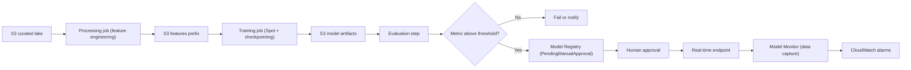
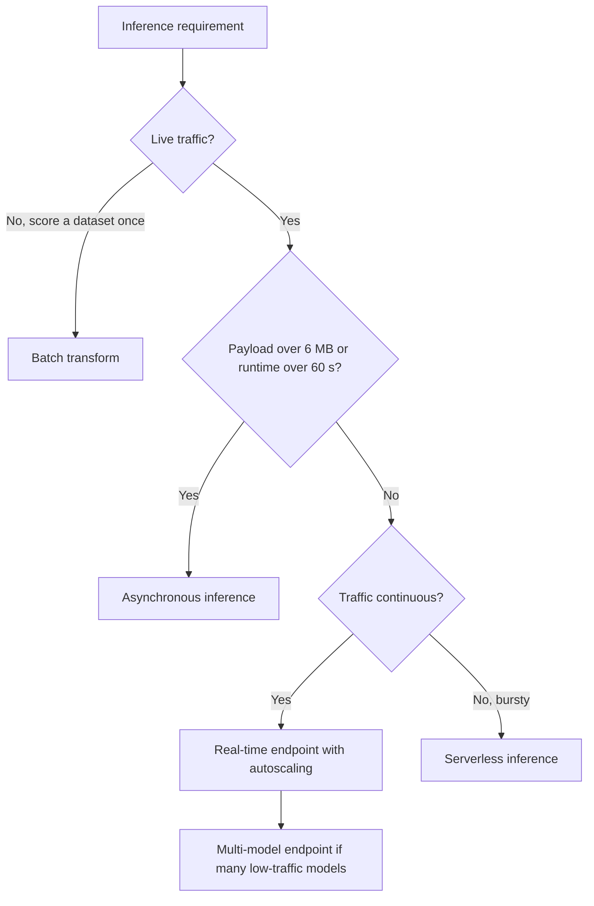

# 08 · SageMaker Training and Deployment

> **Phase 5 — Data and AI** · Lesson 08 of 09
> ⬅️ Previous: [Kinesis Real-Time Analytics](./07-kinesis-real-time-analytics.md) · ➡️ Next: [Capstone — Serverless Data Pipeline](./09-project-serverless-data-pipeline.md) · 🏠 [Phase overview](./README.md)

## Learning Objectives

By the end of this lesson you will be able to:

- Set up a SageMaker Studio domain with VPC isolation and idle shutdown
- Run a training job on managed Spot capacity with checkpointing so interruptions cost minutes, not hours
- Run a hyperparameter tuning job and read its results
- Choose the right inference option for a workload: real-time, serverless, batch, or asynchronous
- Register models in the Model Registry with an approval gate before deployment
- Deploy an endpoint with autoscaling and understand exactly what makes it expensive

**Estimated time:** 90 min · **Difficulty:** Advanced

---

## Core Concepts

**Amazon SageMaker** is a set of services that cover the machine learning lifecycle: a development environment (Studio), managed training compute, automatic hyperparameter search, a model registry, orchestration (Pipelines), and several deployment targets. The important conceptual split is between three phases that have completely different cost and scaling characteristics.

**Training** is batch work. You pick an instance type, run a container with your data, write model artifacts to S3, and stop paying. Training containers are stateless: every job starts from the image and the data you give it. Therefore training is the natural home for Spot capacity, since an interrupted job costs only the time since the last checkpoint.

**Inference** is a service. A real-time endpoint runs continuously and bills per instance-hour whether it serves traffic or not. This is the single most common source of unexpected SageMaker bills, and the reason the choice of inference option deserves more thought than the choice of training algorithm.

**Automation** is the connective tissue: Pipelines orchestrate processing, training, evaluation, registration, and deployment, and the Model Registry gives you a gate between "a model exists" and "a model serves production traffic".

### SageMaker Studio

A Studio **domain** is the container for users, storage, execution roles, and network configuration. Within a domain, each user gets a **user profile**, and each user profile launches **apps** — JupyterLab, Code Editor, or Studio Classic — backed by an instance.

Three settings matter most: the **execution role** (the effective permission boundary for everything a data scientist does), **VPC-only mode** (without it, traffic goes over the public internet, and with it you need VPC endpoints for S3, ECR, and the SageMaker APIs), and **idle shutdown** (`IdleTimeoutInMinutes` on the domain, so an abandoned app stops itself). Notebook instance storage bills even when the app is stopped — only deleting the app or the domain releases it.

### Training jobs

A training job is defined by an image, an entry point, input channels, an instance configuration, and an output location. SageMaker supports three flavors:

| Flavor | What you provide |
|--------|------------------|
| Built-in algorithm | Just an algorithm name and hyperparameters (XGBoost, linear learner, and so on) |
| Framework container | Your script plus a framework image (PyTorch, TensorFlow, Hugging Face, scikit-learn) |
| Bring your own container | A full custom image that implements the training contract |

**Managed Spot training** can cut cost by up to 90 percent. Two settings make it safe: `MaxWaitTimeInSeconds` (how long SageMaker may wait for Spot capacity, which must exceed `MaxRuntimeInSeconds`) and a **checkpoint S3 URI**. Without checkpoints, an interruption restarts from scratch; with them, the job resumes from the last checkpoint, so a 4-hour job interrupted at hour 3 costs 20 minutes of rework instead of 4 hours.

### Hyperparameter tuning

A tuning job launches many training jobs, each with a different hyperparameter combination, and reports results against a single objective metric. Key decisions:

- **Strategy** — `Bayesian` (efficient, learns from previous trials), `Random` (good baseline, embarrassingly parallel), `Hyperband` (aggressive early stopping of weak trials).
- **Objective metric** — a metric the training container emits, such as `validation:auc`. If your script does not log it, the tuner cannot optimize for it.
- **`max_parallel_training_jobs`** — how many trials run at once. This multiplies your instance-hours, so it is the primary cost control.
- **Early stopping** (`early_stopping_type="Auto"`) — stops clearly bad trials early, saving both time and money.

### Inference options

| Option | Latency | Scales to zero | Billed | Use when |
|--------|---------|----------------|--------|----------|
| **Real-time endpoint** | Tens of ms | No (unless autoscaling min is 0) | Per instance-hour | Interactive, steady traffic, strict latency |
| **Serverless inference** | Cold start on first call | Yes | Per millisecond of compute plus requests | Bursty or unpredictable traffic, tolerant of cold starts |
| **Asynchronous inference** | Seconds to minutes | Yes | Per instance-hour while processing | Large payloads (up to 1 GB), long-running inference, queues |
| **Batch transform** | Job duration | N/A (no endpoint) | Per instance-hour during the job | Scoring an entire dataset once, no live traffic |

The heuristic: if traffic is continuous, use real-time with autoscaling. If traffic is intermittent and requests are small, use serverless. If requests are large or slow, use asynchronous. If there is no live traffic at all, use batch transform — it is by far the cheapest way to score a million rows.

Multi-model endpoints and inference components let one endpoint host many models, which is how you avoid paying for 50 endpoints that each serve one tenant occasionally.

### Model Registry and Pipelines

The **Model Registry** stores model packages: a versioned group of artifacts, inference specification, metrics, and approval status (`PendingManualApproval`, `Approved`, `Rejected`). The approval gate is the mechanism that keeps an automated pipeline from pushing an unvalidated model into production.

**Pipelines** express the whole flow as a DAG of steps: `Processing`, `Training`, `Tuning`, `Evaluation`, `Condition`, `RegisterModel`, `CreateModel`, `Lambda`, `QualityCheck`, `ClarifyCheck`. A `Condition` step on an accuracy threshold, followed by `RegisterModel`, is the core of responsible automation.

### Key terminology

| Term | Meaning |
|------|---------|
| **Domain** | Studio container for users, storage, roles, and networking |
| **Training job** | One run of a container with input channels, producing model artifacts |
| **Managed Spot training** | Training on reclaimed capacity with checkpoint-based resume |
| **Tuning job** | A search over hyperparameter combinations for one objective metric |
| **Model package** | Versioned, approvable entry in the Model Registry |
| **Async inference** | Queue-based inference with large payload support and scale to zero |

---

## Architecture Diagram

The end-to-end lifecycle, with the registry as the gate:



Choosing an inference option — walk this before provisioning anything:



---

## Hands-on Lab: Train, Tune, Register, and Serve

**Goal:** Create a Studio domain with idle shutdown, train an XGBoost model on Spot with checkpoints, run a small tuning job, register the best model behind an approval gate, and deploy a serverless endpoint.

**Prerequisites:** A SageMaker execution role with S3 and ECR access, the curated orders dataset from earlier lessons, and the SageMaker Python SDK installed (`pip install sagemaker`).

### Step 1 — Create the Studio domain with idle shutdown

```bash
aws sagemaker create-domain \
  --domain-name lake-ml \
  --auth-mode IAM \
  --vpc-id vpc-0abc123 \
  --subnet-ids subnet-0abc123 subnet-0def456 \
  --default-user-settings '{
    "ExecutionRole": "arn:aws:iam::123456789012:role/SageMakerExecutionRole",
    "JupyterLabAppSettings": {"AppLifecycleManagement": {"IdleSettings": {"IdleTimeoutInMinutes": 60}}},
    "KernelGatewayAppSettings": {"AppLifecycleManagement": {"IdleSettings": {"IdleTimeoutInMinutes": 60}}}
  }'

aws sagemaker describe-domain --domain-id d-abc123 \
  --query "DefaultUserSettings.JupyterLabAppSettings.AppLifecycleManagement.IdleSettings.IdleTimeoutInMinutes"
```

Sixty minutes of idleness stops the app automatically. Without this, an abandoned `ml.p3.2xlarge` JupyterLab app costs about $3.83 per hour, indefinitely.

### Step 2 — Preprocess the data

Feature engineering belongs in a processing job so the transformations are reproducible and versioned, not locked inside a notebook.

```python
from sagemaker.processing import ScriptProcessor, ProcessingInput, ProcessingOutput

processor = ScriptProcessor(
    image_uri=sagemaker.image_uris.retrieve("sklearn", session.boto_region_name, version="1.2-1"),
    role=role, instance_count=1, instance_type="ml.m5.xlarge", command=["python3"],
)

processor.run(
    code="preprocess.py",                    # writes train.csv and validation.csv
    inputs=[ProcessingInput(source=f"s3://{bucket}/curated/orders/", destination="/opt/ml/processing/input")],
    outputs=[ProcessingOutput(source="/opt/ml/processing/output", destination=f"s3://{bucket}/sagemaker/features/")],
)
```

### Step 3 — Train on Spot with checkpoints

```python
from sagemaker.estimator import Estimator

estimator = Estimator(
    image_uri=sagemaker.image_uris.retrieve("xgboost", session.boto_region_name, version="1.7-1"),
    role=role,
    instance_count=1,
    instance_type="ml.m5.xlarge",
    volume_size=30,
    max_run=3600,
    # Spot: allow up to 2 hours of waiting, resume from checkpoints on interruption
    use_spot_instances=True,
    max_wait=7200,
    checkpoint_s3_uri=f"s3://{bucket}/sagemaker/checkpoints/",
    output_path=f"s3://{bucket}/sagemaker/models/",
)

estimator.set_hyperparameters(
    objective="binary:logistic",
    eval_metric="auc",
    num_round=200,
    eta=0.15,
    max_depth=6,
)

estimator.fit(
    {"train": f"s3://{bucket}/sagemaker/features/train.csv",
     "validation": f"s3://{bucket}/sagemaker/features/validation.csv"},
    job_name="orders-xgb-baseline",
    logs=True,
)
```

To inspect the same job from the CLI, including whether Spot caused a restart:

```bash
aws sagemaker describe-training-job --training-job-name orders-xgb-baseline \
  --query "{Status:TrainingJobStatus,Spot:EnableManagedSpotTraining,Wait:StoppingCondition.MaxWaitTimeInSeconds,Checkpoint:CheckpointConfig.S3Uri}"
```

### Step 4 — Tune the model

```python
from sagemaker.tuner import HyperparameterTuner, IntegerParameter, ContinuousParameter

tuner = HyperparameterTuner(
    estimator=estimator,
    objective_metric_name="validation:auc",
    objective_type="Maximize",
    hyperparameter_ranges={
        "eta": ContinuousParameter(0.01, 0.3),
        "max_depth": IntegerParameter(3, 10),
        "min_child_weight": ContinuousParameter(1, 10),
    },
    strategy="Bayesian",
    max_jobs=20,
    max_parallel_jobs=4,          # 4 parallel trials = 4x the instance-hours
    early_stopping_type="Auto",
)

tuner.fit(
    {"train": f"s3://{bucket}/sagemaker/features/train.csv",
     "validation": f"s3://{bucket}/sagemaker/features/validation.csv"},
    job_name="orders-xgb-tuning",
    wait=True,
)

print(tuner.best_training_job())
print(tuner.best_hyperparameters())
```

```bash
# Read the tuning results, including every trial's objective value
aws sagemaker describe-hyper-parameter-tuning-job --hyper-parameter-tuning-job-name orders-xgb-tuning \
  --query "{Status:HyperParameterTuningJobStatus,Best:BestTrainingJob.{Name:TrainingJobName,Metric:FinalHyperParameterTuningJobObjectiveMetric.Value}}"
```

### Step 5 — Register the model behind an approval gate

```bash
aws sagemaker create-model-package-group \
  --model-package-group-name orders-xgb \
  --model-package-group-description "Orders propensity model"
```

```bash
# Inference specification points at the artifacts the training job wrote
cat > inference-spec.json <<'JSON'
{
  "Containers": [
    {
      "Image": "683313688378.dkr.ecr.eu-west-1.amazonaws.com/sagemaker-xgboost:1.7-1",
      "ModelDataUrl": "s3://acme-analytics-prod-eu-west-1/sagemaker/models/orders-xgb-tuning-004/output/model.tar.gz",
      "Environment": {"SAGEMAKER_PROGRAM": "inference.py"}
    }
  ],
  "SupportedContentTypes": ["text/csv"],
  "SupportedResponseMIMETypes": ["text/csv"]
}
JSON

aws sagemaker create-model-package \
  --model-package-group-name orders-xgb \
  --model-package-description "XGBoost baseline after tuning" \
  --inference-specification file://inference-spec.json \
  --model-approval-status PendingManualApproval \
  --customer-metadata-properties '{"owner":"data-platform","dataset":"curated/orders"}'
```

```bash
# The gate: nothing is deployable until a human or a pipeline approves it
aws sagemaker update-model-package \
  --model-package-arn arn:aws:sagemaker:eu-west-1:123456789012:model-package/orders-xgb/1 \
  --model-approval-status Approved

aws sagemaker list-model-packages --model-package-group-name orders-xgb \
  --query "ModelPackageSummaryList[].{Version:ModelPackageVersion,Status:ModelApprovalStatus}"
```

### Step 6 — Deploy a serverless endpoint

```bash
aws sagemaker create-model \
  --model-name orders-xgb-v1 \
  --primary-container '{"Image":"683313688378.dkr.ecr.eu-west-1.amazonaws.com/sagemaker-xgboost:1.7-1","ModelDataUrl":"s3://acme-analytics-prod-eu-west-1/sagemaker/models/orders-xgb-tuning-004/output/model.tar.gz"}' \
  --execution-role-arn arn:aws:iam::123456789012:role/SageMakerExecutionRole

# Serverless scales to zero: no instance-hour charge while idle
aws sagemaker create-endpoint-config \
  --endpoint-config-name orders-xgb-serverless \
  --production-variants '[{
    "VariantName":"primary",
    "ModelName":"orders-xgb-v1",
    "ServerlessConfig":{"MemorySizeInMB":2048,"MaxConcurrency":5}
  }]'

aws sagemaker create-endpoint \
  --endpoint-name orders-xgb \
  --endpoint-config-name orders-xgb-serverless

aws sagemaker describe-endpoint --endpoint-name orders-xgb --query "EndpointStatus"
```

```bash
# Invoke with a small CSV payload (no header, one row)
aws sagemaker invoke-endpoint \
  --endpoint-name orders-xgb \
  --content-type text/csv \
  --body file://one_row.csv \
  result.json

cat result.json
```

### Step 7 — Add autoscaling to a real-time variant

Serverless scales to zero but has cold starts. If latency matters, switch to a real-time endpoint and scale on invocations per instance instead:

```bash
aws application-autoscaling register-scalable-target \
  --service-namespace sagemaker \
  --resource-id endpoint/orders-xgb-rt/variant/primary \
  --scalable-dimension sagemaker:variant:DesiredInstanceCount \
  --min-capacity 1 --max-capacity 4

aws application-autoscaling put-scaling-policy \
  --policy-name orders-xgb-invocations \
  --service-namespace sagemaker \
  --resource-id endpoint/orders-xgb-rt/variant/primary \
  --scalable-dimension sagemaker:variant:DesiredInstanceCount \
  --policy-type TargetTrackingScaling \
  --target-tracking-scaling-policy-configuration '{
    "TargetValue": 70.0,
    "PredefinedMetricSpecification": {"PredefinedMetricType": "SageMakerVariantInvocationsPerInstance"},
    "ScaleOutCooldown": 60,
    "ScaleInCooldown": 300
  }'
```

### Step 8 — Verify, then clean up

```bash
# Confirm the endpoint is InService and see what it costs to keep alive
aws sagemaker describe-endpoint --endpoint-name orders-xgb \
  --query "{Status:EndpointStatus,Config:EndpointConfigName,Created:CreationTime}"

# Tear down in dependency order — an orphaned endpoint bills forever
aws sagemaker delete-endpoint --endpoint-name orders-xgb
aws sagemaker delete-endpoint-config --endpoint-config-name orders-xgb-serverless
aws sagemaker delete-model --model-name orders-xgb-v1
```

You should see an `InService` endpoint that returns predictions without any provisioned capacity, a model package whose status is `Approved`, and zero endpoints after cleanup.

---

## CLI Reference

```bash
# Training jobs: history, artifacts, and failure reason
aws sagemaker list-training-jobs --max-results 20 \
  --query "TrainingJobSummaries[].{Name:TrainingJobName,Status:TrainingJobStatus}"
aws sagemaker describe-training-job --training-job-name orders-xgb-baseline \
  --query "{Status:TrainingJobStatus,Reason:FailureReason,Artifacts:OutputDataConfig.S3OutputPath}"
aws sagemaker stop-training-job --training-job-name orders-xgb-baseline

# Async inference configuration for large payloads

# Pipelines: run the whole flow as one orchestrated DAG
aws sagemaker create-pipeline --pipeline-name orders-mlops \
  --pipeline-definition file://pipeline-definition.json \
  --role-arn arn:aws:iam::123456789012:role/SageMakerExecutionRole
aws sagemaker start-pipeline-execution --pipeline-name orders-mlops
```

| Command | Purpose |
|---------|---------|
| `describe-training-job` | Reads status, Spot usage, checkpoint path, and failure reason |
| `describe-hyper-parameter-tuning-job` | Reports the best trial and its objective value |
| `create-model-package` | Adds a versioned, approvable model to the registry |
| `create-endpoint-config` | Defines instance/serverless capacity and variants |
| `application-autoscaling put-scaling-policy` | Scales a variant on invocation load |

---

## Best Practices

| Practice | Why it matters |
|----------|----------------|
| Always set `IdleTimeoutInMinutes` on Studio apps | Idle notebooks are the most common waste in ML accounts |
| Use Spot for training plus an S3 checkpoint path | Up to 90% cheaper with interruptions costing minutes |
| Set `max_wait` above `max_run` for Spot jobs | Otherwise the job fails the moment Spot capacity is unavailable |
| Cap `max_parallel_training_jobs` | Parallel trials multiply spend linearly |
| Enable early stopping on tuning jobs | Weak trials stop instead of running to completion |
| Default to serverless or batch instead of real-time | Both scale to zero; real-time endpoints bill while idle |
| Gate deployments through Model Registry approval | Keeps an automated pipeline from shipping an unvalidated model |
| Delete endpoints, configs, models, and apps as one unit | Orphaned resources are the usual cause of a surprised invoice |

---

## Common Pitfalls

| Pitfall | Symptom | Fix |
|---------|---------|-----|
| Real-time endpoint for intermittent traffic | Bills all month, serves a few hundred requests | Serverless inference or batch transform |
| No checkpoints on a Spot training job | Interruption restarts training from scratch | Set `checkpoint_s3_uri` and save state per epoch |
| `max_wait` not greater than `max_run` | Spot job fails immediately with a capacity error | Make `max_wait` at least `max_run` plus waiting tolerance |
| Objective metric never logged | Tuning job fails with "no objective metric" | Print the metric in the documented format from the training script |
| `max_parallel_training_jobs` set high by default | Tuning bill far exceeds the estimate | Start at 2–4 parallel trials |
| Notebook storage kept after the app stops | EBS continues to bill | Delete the app or the domain to release storage |
| Endpoint left after the experiment | Instance-hour billing continues silently | Delete endpoints in your teardown script |
| Model package never approved | Deployment fails with an approval error | `update-model-package --model-approval-status Approved` |
| Hard-coded ECR image URIs for the wrong region | `ImageNotFound` at job start | Use `sagemaker.image_uris.retrieve` or a region-correct URI |

---

## Cost Considerations

| Component | Approximate price (eu-west-1) | Notes |
|-----------|-------------------------------|-------|
| Training, `ml.m5.xlarge` | ~$0.27 per instance-hour | Billed per second with a 1-minute minimum |
| Training, `ml.p3.2xlarge` (GPU) | ~$4.40 per instance-hour | The main reason to checkpoint carefully |
| Managed Spot training | Up to 90% off On-Demand | Requires `max_wait` and checkpoints |
| Studio JupyterLab, `ml.t3.medium` | ~$0.06 per instance-hour | Cheap — but idle by default |
| Studio JupyterLab, `ml.p3.2xlarge` | ~$4.40 per instance-hour | Idle shutdown is essential here |
| Real-time endpoint, `ml.m5.large` | ~$0.14 per instance-hour | ~$100/month per instance, always on |
| Serverless inference | Per millisecond of compute plus per request | Scales to zero, cold starts on first call |
| Asynchronous inference | Per instance-hour while processing | Scale to zero between batches |
| Batch transform | Per instance-hour during the job | No idle cost; often the cheapest option |
| Hyperparameter tuning | The cost of the training jobs it launches | `max_jobs` × `max_parallel_jobs` is your exposure |

**What drives the bill, in order:** idle real-time endpoints, idle Studio apps with GPU instances, tuning jobs with high parallelism, and unattached EBS volumes. Training itself is usually the smallest line item once you use Spot and checkpoint.

A practical safety routine: before any experiment, write down the expected cost as instances × hours × price; set `max_run` so a runaway training job stops itself; use serverless or batch as the default deployment; and finish every session with a teardown script that deletes endpoints, endpoint configs, models, and apps. Tag every training job and endpoint with `cost-center` and `owner` so the bill is attributable — the AWS CLI accepts `--tags` on nearly every SageMaker create call.

---

## Security Considerations

- **The execution role is everything.** Scope it to the specific buckets, ECR repositories, and KMS keys the workload needs, and use a different role per environment. Never attach `AmazonSageMakerFullAccess` plus `AmazonS3FullAccess`.
- **Run Studio in VPC-only mode** with interface endpoints for S3, ECR, and the SageMaker APIs, so no notebook traffic traverses the internet.
- **Encrypt everything.** Set `--output-data-config KmsKeyId` on training jobs, `--enable-inter-container-traffic-encryption` for distributed training, and `VolumeKmsKeyId` on notebooks and endpoints.
- **Enable network isolation for jobs that should not reach the internet**: `--enable-network-isolation` blocks outbound calls except to the required S3 and ECR paths.
- **Restrict who can register and approve models.** `sagemaker:UpdateModelPackage` with `ModelApprovalStatus` is a production-deployment power. Gate it with IAM and require a second reviewer.
- **Turn on endpoint data capture with KMS encryption** and treat the capture bucket as sensitive — it contains raw request payloads, which frequently include PII.
- **Log API calls in CloudTrail** and alert on `CreateEndpoint`, `UpdateEndpoint`, and `CreateDomain` in production accounts — these are the operations that create persistent, billable, internet-reachable resources.
- **Never train on data you would not show the model owner.** Managed training reads your S3 data with the execution role, so an over-broad role is also a data-exfiltration path through a notebook.

---

## Exercise

Build a complete, gated deployment workflow with Amazon SageMaker Pipelines:

1. Define a pipeline with four steps: a `Processing` step that produces features, a `Training` step, an `Evaluation` step that writes an accuracy metric, and a `Condition` step that only continues if accuracy exceeds a threshold.
2. Behind the condition, add a `RegisterModel` step that creates a model package with `PendingManualApproval`.
3. Run the pipeline once with a threshold the model cannot meet, and once with a threshold it can.
4. Approve only the passing model, then deploy it and invoke the endpoint once.

Success looks like: the first execution stops at the condition step with the later steps skipped, the second registers a model package, and only the manually approved version can be deployed to an endpoint. Then delete the endpoint and confirm the billing stops.
---

## Resources

- [Amazon SageMaker Developer Guide](https://docs.aws.amazon.com/sagemaker/latest/dg/whatis.html)
- [SageMaker Studio Domains](https://docs.aws.amazon.com/sagemaker/latest/dg/studio-updated.html)
- [Managed Spot Training](https://docs.aws.amazon.com/sagemaker/latest/dg/model-managed-spot-training.html)
- [Automatic Model Tuning](https://docs.aws.amazon.com/sagemaker/latest/dg/automatic-model-tuning.html)
- [Model Hosting Options](https://docs.aws.amazon.com/sagemaker/latest/dg/deploy-model.html)
- [Model Registry](https://docs.aws.amazon.com/sagemaker/latest/dg/model-registry.html)
- [SageMaker Pipelines](https://docs.aws.amazon.com/sagemaker/latest/dg/pipelines.html)
- [Amazon SageMaker Pricing](https://aws.amazon.com/sagemaker/pricing/)

---

## Next Steps

You now have every component of the phase. The capstone puts them together: a streaming ingestion path, a Glue transformation, an Athena query layer, a governed permission model, and a dashboard — built entirely from managed services.

> ⬅️ Previous: [Kinesis Real-Time Analytics](./07-kinesis-real-time-analytics.md) · ➡️ Next: [Capstone — Serverless Data Pipeline](./09-project-serverless-data-pipeline.md) · 🏠 [Phase overview](./README.md)
