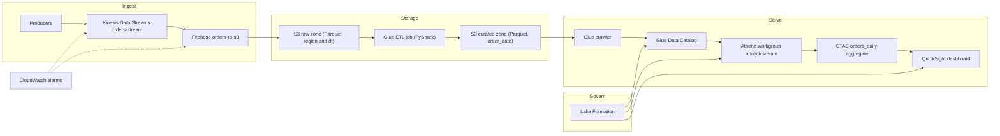
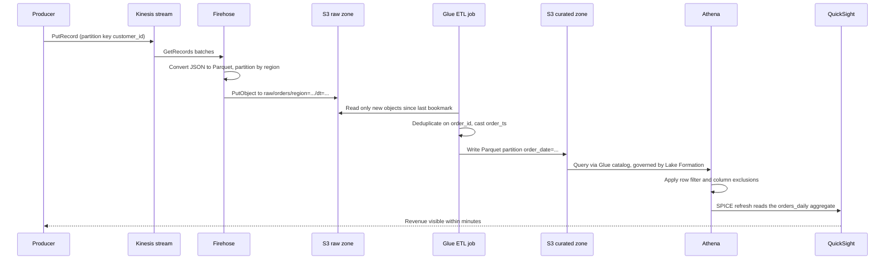

# 09 · Capstone — Serverless Data Pipeline

> **Phase 5 — Data and AI** · Lesson 09 of 09
> ⬅️ Previous: [SageMaker Training and Deployment](./08-sagemaker-training-and-deployment.md) · ➡️ Next: [Phase 6 — Security and Governance](../phase-6-security-and-governance/README.md) · 🏠 [Phase overview](./README.md)

## 🎯 Learning Objectives

By the end of this capstone you will have:

- Built an end-to-end streaming pipeline from producer to dashboard with no servers to manage
- Landed Parquet in a raw zone using Firehose format conversion and dynamic partitioning
- Transformed raw events into a partitioned curated dataset with a bookmarked Glue job
- Queried the lake with Athena and materialized a dashboard-ready aggregate
- Governed the dataset with Lake Formation, hiding one PII column and one region's rows
- Wired monitoring, cost guardrails, and a complete teardown procedure

**Estimated time:** 4–6 hours · **Difficulty:** Advanced

---

## 🧠 Core Concepts

This capstone connects every lesson in the phase into one story: orders arrive from producers, land in S3, become a clean partitioned dataset, get queried with SQL, and appear in a dashboard — while an analyst role sees business metrics but never customer emails or other regions' rows. There are no EC2 instances, clusters, or containers anywhere in the path. Every component is managed, scales on its own, and bills only while it works.

| Layer | Service | Responsibility |
|-------|---------|----------------|
| Ingest | Kinesis Data Streams | Durable, ordered buffer of raw events with replay |
| Deliver | Data Firehose | Buffer, convert to Parquet, partition, write to S3 |
| Store | Amazon S3 | Raw and curated zones in a partitioned layout |
| Catalog | AWS Glue Data Catalog | Tables, schemas, and partitions shared by every engine |
| Transform | AWS Glue (PySpark) | Deduplicate, type, and materialize the curated dataset |
| Query | Amazon Athena | SQL over the lake with a hard scan cap |
| Aggregate | Athena CTAS | A small, dashboard-ready table |
| Govern | AWS Lake Formation | Column and row-level access control |
| Visualize | Amazon QuickSight | Dashboards over the Athena aggregate |
| Observe | CloudWatch and AWS Budgets | Lag alarms, delivery alarms, spend guardrails |

Three design decisions explain the shape of the pipeline. **Kinesis sits in front of S3** because producers need a durable buffer that survives a failed consumer, and because replay matters: after a transformation bug you re-read the stream window instead of asking producers for data they no longer have. **Firehose writes the files** because it handles buffering, retries, Parquet conversion, and dynamic partitioning with no code to own. **Raw is partitioned by `region` and `dt` while curated is partitioned by `order_date`**, because ingestion needs cheap routing and analysts filter by date — partition keys follow query patterns, not ingestion convenience.

### Data contract

Fix the event schema before writing producer code:

| Field | Type | Notes |
|-------|------|-------|
| `order_id` | string | Unique; the deduplication key |
| `customer_id` | string | Partition key for the stream |
| `customer_email` | string | PII — hidden from analysts by Lake Formation |
| `region` | string | `EMEA`, `AMER`, `APAC`; the Firehose dynamic partition key |
| `amount` | double | Order total |
| `order_ts` | string | ISO 8601 UTC, cast to `TIMESTAMP` in curated |

### Key terminology

| Term | Meaning |
|------|---------|
| **Dynamic partitioning** | Firehose deriving S3 prefixes from record fields |
| **Record format conversion** | Firehose converting input JSON to Parquet via a Glue schema |
| **Job bookmark** | Glue state that makes each run process only new raw objects |
| **CTAS** | Athena `CREATE TABLE AS SELECT`, materializing the dashboard aggregate |
| **LF-Tag** | Lake Formation tag driving grants for whole classes of tables |
| **Data cells filter** | Named row and column restriction granted to a principal |
| **SPICE** | QuickSight's in-memory engine, refreshed on a schedule |

---

## 🗺️ Architecture Diagram

The complete pipeline. Read it left to right: ingest, process, serve, govern.



What happens to a single order event, end to end:



---

## 🧪 Hands-on Lab: Build the Pipeline

**Goal:** Deploy the pipeline, produce live events, and verify data flows from the stream to a governed Athena aggregate.

**Prerequisites:** Permissions to create Kinesis, Firehose, Glue, Athena, Lake Formation, QuickSight, and IAM resources; AWS CLI v2. Examples use `eu-west-1` and account `123456789012`.

### Step 1 — Foundation

Reuse the lake bucket and zone prefixes from Lesson 01, then register the catalog database that conversion, ETL, and query layers share.

```bash
BUCKET=acme-analytics-prod-eu-west-1
aws glue create-database --database-input '{"Name":"analytics","Description":"Capstone lake tables"}'
```

### Step 2 — Create the stream

```bash
# Two shards: 2 MB/s and 2,000 records/s of write headroom
aws kinesis create-stream --stream-name orders-stream --shard-count 2 \
  --stream-mode-details StreamMode=PROVISIONED

# Keep a week for replay after a bug fix, and encrypt at rest
aws kinesis increase-stream-retention-period --stream-name orders-stream --retention-period-hours 168
aws kinesis start-stream-encryption --stream-name orders-stream \
  --encryption-type KMS --key-id alias/aws/kinesis
```

### Step 3 — Create the Firehose role and delivery stream

```bash
# One role: read the stream, write the bucket, read the conversion schema, use KMS
cat > firehose-policy.json <<'JSON'
{"Version":"2012-10-17","Statement":[
  {"Effect":"Allow","Action":["kinesis:DescribeStreamSummary","kinesis:GetShardIterator","kinesis:GetRecords","kinesis:ListShards"],"Resource":"arn:aws:kinesis:eu-west-1:123456789012:stream/orders-stream"},
  {"Effect":"Allow","Action":["s3:GetObject","s3:PutObject","s3:ListBucket","s3:AbortMultipartUpload"],"Resource":["arn:aws:s3:::acme-analytics-prod-eu-west-1","arn:aws:s3:::acme-analytics-prod-eu-west-1/*"]},
  {"Effect":"Allow","Action":["glue:GetTable","glue:GetTableVersion","glue:GetTableVersions","glue:GetDatabase","kms:Decrypt","kms:GenerateDataKey","logs:PutLogEvents"],"Resource":"*"}
]}
JSON

aws iam create-role --role-name FirehoseDeliveryRole --assume-role-policy-document \
  '{"Version":"2012-10-17","Statement":[{"Effect":"Allow","Principal":{"Service":"firehose.amazonaws.com"},"Action":"sts:AssumeRole"}]}'
aws iam put-role-policy --role-name FirehoseDeliveryRole \
  --policy-name firehose-inline --policy-document file://firehose-policy.json
```

Register the input schema so Firehose knows how to write Parquet:

```bash
# Firehose uses only the column definitions from this table
aws athena start-query-execution --work-group primary \
  --query-string "CREATE EXTERNAL TABLE analytics.raw_orders_schema (order_id string, customer_id string, customer_email string, region string, amount double, order_ts string) ROW FORMAT SERDE 'org.openx.data.jsonserde.JsonSerDe' LOCATION 's3://acme-analytics-prod-eu-west-1/raw/orders/'" \
  --query-execution-context Database=analytics
```

```bash
# Buffer at 64 MB / 300 s: file count drives every downstream query cost
cat > firehose-s3.json <<'JSON'
{
  "RoleARN": "arn:aws:iam::123456789012:role/FirehoseDeliveryRole",
  "BucketARN": "arn:aws:s3:::acme-analytics-prod-eu-west-1",
  "Prefix": "raw/orders/region=!{partitionKeyFromQuery:region}/dt=!{timestamp:yyyy-MM-dd}/",
  "ErrorOutputPrefix": "raw/errors/!{firehose:error-output-type}/",
  "BufferingHints": {"SizeInMBs": 64, "IntervalInSeconds": 300},
  "CompressionFormat": "UNCOMPRESSED",
  "RecordFormatConversionConfiguration": {
    "Enabled": true,
    "InputFormatConfiguration": {"Deserializer": {"OpenXJsonSerDe": {}}},
    "OutputFormatConfiguration": {"Serializer": {"ParquetSerDe": {"Compression": "SNAPPY"}}},
    "SchemaConfiguration": {"RoleARN": "arn:aws:iam::123456789012:role/FirehoseDeliveryRole", "DatabaseName": "analytics", "TableName": "raw_orders_schema", "Region": "eu-west-1", "VersionId": "LATEST"}
  },
  "DynamicPartitioningConfiguration": {"Enabled": true, "RetryOptions": {"DurationInSeconds": 300}}
}
JSON

aws firehose create-delivery-stream --delivery-stream-name orders-to-s3 \
  --delivery-stream-type KinesisStreamAsSource \
  --kinesis-stream-source-configuration '{"KinesisStreamARN":"arn:aws:kinesis:eu-west-1:123456789012:stream/orders-stream","RoleARN":"arn:aws:iam::123456789012:role/FirehoseDeliveryRole"}' \
  --extended-s3-destination-configuration file://firehose-s3.json
```

### Step 4 — Produce events and verify the raw zone

```bash
# Simulate a producer (use PutRecords batching in production)
for i in $(seq 1 300); do
  case $((i % 3)) in
    0) R=EMEA ;; 1) R=AMER ;; 2) R=APAC ;;
  esac
  aws kinesis put-record --stream-name orders-stream \
    --partition-key "customer-$((i % 25))" \
    --data "{\"order_id\":\"o-$i\",\"customer_id\":\"customer-$((i % 25))\",\"customer_email\":\"user$((i % 25))@example.com\",\"region\":\"$R\",\"amount\":$((i)).75,\"order_ts\":\"$(date -u +%Y-%m-%dT%H:%M:%SZ)\"}" \
    --cli-binary-format raw-in-base64-out > /dev/null
done

# Firehose buffers up to 300 seconds before flushing
sleep 300
aws s3 ls "s3://$BUCKET/raw/orders/" --recursive | head -20
```

Expect `raw/orders/region=EMEA/dt=2026-10-14/` prefixes containing `.parquet` objects. If they are `.json`, format conversion is off; if all regions share one prefix, dynamic partitioning is off and records are in the error prefix.

### Step 5 — Transform with Glue

Save as `orders_etl.py`, upload to `s3://$BUCKET/glue-scripts/`, and reuse the Glue role from Lesson 02.

```python
import sys
from awsglue.utils import getResolvedOptions
from awsglue.context import GlueContext
from awsglue.job import Job
from awsglue.dynamicframe import DynamicFrame
from pyspark.context import SparkContext
from pyspark.sql import functions as F

args = getResolvedOptions(sys.argv, ["JOB_NAME", "raw_path", "target_path"])
sc = SparkContext()
glueContext = GlueContext(sc)
job = Job(glueContext)
job.init(args["JOB_NAME"], args)

# Bookmarked read: only objects landed since the last successful run
raw = glueContext.create_dynamic_frame.from_options(
    connection_type="s3",
    connection_options={"paths": [args["raw_path"]], "recurse": True},
    format="parquet",
    transformation_ctx="raw_orders",
)

df = (
    raw.toDF()
    .dropDuplicates(["order_id"])
    .withColumn("order_ts", F.to_timestamp("order_ts"))
    .withColumn("order_date", F.to_date("order_ts"))
    .withColumn("amount", F.col("amount").cast("double"))
    .filter(F.col("order_id").isNotNull() & (F.col("amount") > 0))
    .repartition(4, "order_date")
)

glueContext.write_dynamic_frame.from_options(
    frame=DynamicFrame.fromDF(df, glueContext, "curated_orders"),
    connection_type="s3",
    connection_options={"path": args["target_path"], "partitionKeys": ["order_date"]},
    format="glueparquet", format_options={"compression": "snappy"},
    transformation_ctx="curated_orders",
)
job.commit()
```

```bash
aws glue create-job --name orders-curated-etl \
  --role arn:aws:iam::123456789012:role/AWSGlueServiceRole-Lake \
  --glue-version "5.0" --worker-type G.2X --number-of-workers 6 --timeout 30 \
  --command '{"Name":"glueetl","ScriptLocation":"s3://acme-analytics-prod-eu-west-1/glue-scripts/orders_etl.py","PythonVersion":"3"}' \
  --default-arguments '{"--job-bookmark-option":"job-bookmark-enable","--enable-continuous-cloudwatch-log":"true","--TempDir":"s3://acme-analytics-prod-eu-west-1/glue-tmp/","--raw_path":"s3://acme-analytics-prod-eu-west-1/raw/orders/","--target_path":"s3://acme-analytics-prod-eu-west-1/curated/orders/"}'

aws glue start-job-run --job-name orders-curated-etl --query JobRunId --output text

# Poll until the run leaves RUNNING
aws glue get-job-runs --job-name orders-curated-etl --max-results 1 \
  --query "JobRuns[0].{State:JobRunState,Seconds:ExecutionTime,Error:ErrorMessage}"
```

### Step 6 — Catalog and query

```bash
aws glue create-crawler --name curated-orders-crawler \
  --role arn:aws:iam::123456789012:role/AWSGlueServiceRole-Lake --database-name analytics \
  --targets '{"S3Targets":[{"Path":"s3://acme-analytics-prod-eu-west-1/curated/orders/","Exclusions":["**.crc","_SUCCESS"]}]}'

aws glue start-crawler --name curated-orders-crawler
aws glue get-table --database-name analytics --name curated_orders \
  --query "Table.{Location:StorageDescriptor.Location,Partitions:PartitionKeys}"
```

Run these through the workgroup created in Lesson 03, which already enforces a 10 GB per-query scan cap.

```sql
-- Revenue by region from the governed table
SELECT region, sum(amount) AS revenue, count(*) AS orders
FROM analytics.curated_orders
WHERE order_date = DATE '2026-10-14'
GROUP BY region
ORDER BY revenue DESC;

-- Materialize the dashboard aggregate: small table, cheap refreshes
CREATE TABLE analytics.orders_daily
WITH (format = 'PARQUET', parquet_compression = 'SNAPPY', partitioned_by = ARRAY['order_date']) AS
SELECT region, order_date, sum(amount) AS revenue,
       count(DISTINCT customer_id) AS customers, count(*) AS orders
FROM analytics.curated_orders
WHERE order_date >= DATE '2026-10-01'
GROUP BY region, order_date;
```

### Step 7 — Govern with Lake Formation

```bash
aws lakeformation register-resource --resource-arn arn:aws:s3:::acme-analytics-prod-eu-west-1 --use-service-linked-role

aws lakeformation create-lf-tag --tag-key sensitivity --tag-values pii internal public
aws lakeformation create-lf-tag --tag-key domain --tag-values sales marketing

aws lakeformation add-lf-tags-to-resource \
  --resource '{"Table":{"DatabaseName":"analytics","Name":"curated_orders"}}' \
  --lf-tags '[{"TagKey":"sensitivity","TagValues":["internal"]},{"TagKey":"domain","TagValues":["sales"]}]'

# Tag the PII column too, so no tag-based grant can reach it
aws lakeformation add-lf-tags-to-resource \
  --resource '{"TableWithColumns":{"DatabaseName":"analytics","Name":"curated_orders","ColumnNames":["customer_email"]}}' \
  --lf-tags '[{"TagKey":"sensitivity","TagValues":["pii"]}]'

aws lakeformation grant-permissions \
  --principal '{"DataLakePrincipalIdentifier":"arn:aws:iam::123456789012:role/AnalystRole"}' \
  --resource '{"LFTagPolicy":{"ResourceType":"TABLE","Expression":[{"TagKey":"sensitivity","TagValues":["public","internal"]},{"TagKey":"domain","TagValues":["sales"]}]}}' \
  --permissions "SELECT" "DESCRIBE"
```

```bash
# Row filter: EMEA only, with the PII column excluded outright
aws lakeformation create-data-cells-filter --name emea-orders \
  --table-data '{"CatalogId":"123456789012","DatabaseName":"analytics","Name":"curated_orders"}' \
  --row-filter '{"FilterExpression":"region = \u0027EMEA\u0027","ColumnWildcard":{"ExcludedColumnNames":["customer_email"]}}'

aws lakeformation grant-permissions \
  --principal '{"DataLakePrincipalIdentifier":"arn:aws:iam::123456789012:role/AnalystRole"}' \
  --resource '{"DataCellsFilter":{"TableCatalogId":"123456789012","DatabaseName":"analytics","TableName":"curated_orders","Name":"emea-orders"}}' \
  --permissions "SELECT" "DESCRIBE"
```

### Step 8 — Visualize with QuickSight

QuickSight needs an account subscription first (a console step with per-user charges). Then:

```bash
aws quicksight create-data-source --aws-account-id 123456789012 \
  --data-source-id orders-athena --name "Orders (Athena)" --type ATHENA \
  --data-source-parameters '{"AthenaParameters":{"WorkGroup":"analytics-team"}}'

# SPICE keeps dashboard refreshes off Athena's per-byte meter
aws quicksight create-data-set --aws-account-id 123456789012 \
  --data-set-id orders-daily --name "Orders Daily" --import-mode SPICE \
  --physical-table-map file://physical-table-map.json
```

where `physical-table-map.json` maps only the columns the dashboard needs:

```json
{
  "ordersDaily": {"RelationalTable": {
    "DataSourceArn": "arn:aws:quicksight:eu-west-1:123456789012:datasource/orders-athena",
    "Catalog": "AwsDataCatalog", "Schema": "analytics", "Name": "orders_daily",
    "InputColumns": [
      {"Name": "region", "Type": "STRING"},
      {"Name": "order_date", "Type": "DATETIME"},
      {"Name": "revenue", "Type": "DECIMAL"}
    ]}}
}
```

Build the analysis in the console from this dataset: one line chart of `revenue` over `order_date`, one bar chart of `revenue` by `region`. Schedule a daily SPICE refresh.

### Step 9 — Monitor, verify, and tear down

```bash
# Consumer lag: the earliest signal that the pipeline cannot keep up
aws cloudwatch put-metric-alarm --alarm-name orders-consumer-lag \
  --namespace AWS/Kinesis --metric-name MillisBehindLatest \
  --dimensions Name=StreamName,Value=orders-stream \
  --statistic Maximum --period 60 --threshold 60000 \
  --comparison-operator GreaterThanThreshold --evaluation-periods 3 \
  --alarm-actions arn:aws:sns:eu-west-1:123456789012:data-platform-alerts

# Firehose delivery failures are silent, so also alarm on data freshness
aws cloudwatch put-metric-alarm --alarm-name orders-firehose-freshness \
  --namespace AWS/Firehose --metric-name DeliveryToS3.DataFreshness \
  --dimensions Name=DeliveryStreamName,Value=orders-to-s3 \
  --statistic Maximum --period 300 --threshold 900 \
  --comparison-operator GreaterThanThreshold --evaluation-periods 2

# Budget guardrail for the whole capstone
aws budgets create-budget --account-id 123456789012 \
  --budget '{"BudgetName":"phase5-capstone","BudgetLimit":{"Amount":"50","Unit":"USD"},"TimeUnit":"MONTHLY","BudgetType":"COST"}'
```

```bash
# Only EMEA rows and no customer_email for the analyst role
aws athena start-query-execution --profile analyst --work-group analytics-team \
  --query-string "SELECT region, count(*) FROM analytics.curated_orders GROUP BY region"

# The bookmark proves the second run processed deltas only
aws glue get-job-bookmark --job-name orders-curated-etl --query JobBookmarkEntry.Run

# Teardown in dependency order — orphaned streams and Firehose bill forever
aws firehose delete-delivery-stream --delivery-stream-name orders-to-s3 --allow-force-deletion
aws kinesis delete-stream --stream-name orders-stream --enforce-consumer-deletion
aws glue delete-job --job-name orders-curated-etl
aws glue delete-crawler --name curated-orders-crawler
aws quicksight delete-data-set --aws-account-id 123456789012 --data-set-id orders-daily
aws quicksight delete-data-source --aws-account-id 123456789012 --data-source-id orders-athena
```

Success looks like: one row per region in the aggregate, only `EMEA` for the analyst, a column-not-found or access error when the analyst selects `customer_email`, and a bookmark `Run` value greater than 1.

---

## 💻 CLI Reference

```bash
# Pipeline health in one pass
aws kinesis describe-stream-summary --stream-name orders-stream --query StreamDescriptionSummary.StreamStatus
aws firehose describe-delivery-stream --delivery-stream-name orders-to-s3 --query DeliveryStreamDescription.DeliveryStreamStatus

# Replay a stream into the lake after fixing a transformation bug
aws kinesis get-shard-iterator --stream-name orders-stream \
  --shard-id shardId-000000000000 --shard-iterator-type TRIM_HORIZON --query ShardIterator --output text

# Force a full reprocess of the raw zone
aws glue reset-job-bookmark --job-name orders-curated-etl
aws glue start-job-run --job-name orders-curated-etl

# Add a partition without crawling, when a day's data is late
aws glue create-partition --database-name analytics --table-name curated_orders \
  --partition-input '{"Values":["2026-10-15"],"StorageDescriptor":{"Location":"s3://acme-analytics-prod-eu-west-1/curated/orders/order_date=2026-10-15/"}}'

# Cost check: bytes scanned per workgroup today
aws cloudwatch get-metric-statistics --namespace AWS/Athena --metric-name ProcessedBytes \
  --dimensions Name=WorkGroup,Value=analytics-team \
  --start-time 2026-10-14T00:00:00Z --end-time 2026-10-14T23:59:59Z \
  --period 86400 --statistics Sum

# Governance audit and leftover-resource inventory
aws lakeformation list-permissions --resource-type TABLE \
  --query "PrincipalResourcePermissions[].{Principal:Principal.DataLakePrincipalIdentifier,Table:Resource.Table.Name}"
aws firehose list-delivery-streams --query DeliveryStreamNames
```

| Command | Purpose |
|---------|---------|
| `kinesis get-shard-iterator` | Replay a stream from any point in the retention window |
| `glue reset-job-bookmark` | Force a full reprocess after a logic change |
| `glue create-partition` | Add a partition without a crawler run |
| `cloudwatch get-metric-statistics` | Read Athena `ProcessedBytes` for the workgroup |
| `lakeformation list-permissions` | Audit every grant on the lake |
| `firehose delete-delivery-stream --allow-force-deletion` | Tears down delivery even with in-flight data |

---

## ✅ Best Practices

| Practice | Why it matters |
|----------|----------------|
| Fix and version the event schema before writing producers | Schema drift is the most expensive kind of rework |
| Land Parquet, not JSON, in the raw zone | Removes conversion cost from every downstream query |
| Buffer Firehose at 64 MB / 300 s unless latency demands less | File count drives query cost and catalog size |
| Treat the raw zone as the source of truth | Curated data is always reproducible from raw |
| Bookmark the Glue job and reset it deliberately | Incremental by default, full when you need it |
| Partition curated data by the column analysts filter on | `order_date` beats `region/dt` for business queries |
| Keep the dashboard on a materialized aggregate in SPICE | Dashboards must never scan the base table per page load |
| Cap the Athena workgroup and alarm on scanned bytes | Cost control that survives an unfamiliar analyst |
| Tag and grant with LF-Tags, not per-table grants | New tables inherit access with no grant calls |
| Alarm on `MillisBehindLatest` and Firehose freshness | The two earliest indicators of a broken pipeline |
| Tear down in dependency order and verify | Orphaned endpoints and streams bill silently |

---

## ⚠️ Common Pitfalls

| Pitfall | Symptom | Fix |
|---------|---------|-----|
| Dynamic partitioning disabled | All regions under one prefix; queries cannot prune | Enable `DynamicPartitioningConfiguration` and add the field to the JSON |
| Schema table columns do not match the payload | Records land in the error prefix as `.json` | Align the Glue schema table with the producer contract |
| Firehose role missing `glue:GetTable` | Delivery stream fails activation | Add Glue read permissions for the schema table |
| Glue job wrote a single partition | All data under `order_date=2026-10-14` | Cast the timestamp before deriving the partition column |
| Crawler run before the ETL finished | Table has no partitions or a partial schema | Order the workflow, or create partitions explicitly |
| Athena returns zero rows for a real prefix | Partition projection or location mismatch | Compare `$path` in a query with the actual S3 keys |
| Grant made before registration | `AccessDenied` despite a grant | `register-resource` first, then re-check with `get-effective-permissions-for-principal` |
| QuickSight dataset left on direct query | Every dashboard view scans Athena | Switch to SPICE with a scheduled refresh |
| Budget created after the fact | The first surprise bill already arrived | Create the budget in Step 1 of the build |
| Stream or Firehose left running after the demo | Small but permanent monthly charge | Include both in the teardown script |

---

## 💰 Cost Considerations

Standing cost at learning scale — a few GB ingested per day and a few hundred queries:

| Component | Configuration | Approximate monthly cost |
|-----------|---------------|--------------------------|
| Kinesis Data Streams | 2 shards provisioned, 24/7, 1 week retention | ~$25 |
| Data Firehose | ~10 GB ingested with Parquet conversion | ~$1 |
| S3 storage | ~50 GB across raw, curated, and refined | ~$2 |
| Glue job and crawler | Daily ETL plus a twice-daily crawl | ~$15 |
| Athena | ~20 GB scanned with Parquet and partitions | ~$0.10 |
| QuickSight | 1 author after the free trial | ~$24 |
| CloudWatch and Budgets | 3 alarms plus Firehose logs | ~$3 |
| **Total** | | **~$70 per month** |

What would blow this up: **Firehose buffers cut to 1 MB / 60 s** (tens of thousands of tiny objects, so request charges and planning time replace storage cost); **dashboards on direct query instead of SPICE** (20 users refreshing a 2 GB scan is 40 GB per cycle, hundreds of dollars a month rather than cents); **an on-demand stream at real volume** (roughly 3x the per-GB cost of provisioned); **hourly crawlers** (a 10-minute minimum charge each); and **a forgotten SageMaker endpoint from Lesson 08** (about $100 a month on its own).

Track two numbers weekly: Athena `ProcessedBytes` per workgroup and the object count under `raw/`. If object count grows faster than data volume, fix the Firehose buffer before it becomes a query-cost problem.

---

## 🔐 Security Considerations

- **Least-privilege roles per component.** Firehose reads one stream, writes one bucket prefix, and reads one Glue table. Glue reads raw and writes curated. The analyst role has no direct S3 access at all — Lake Formation vends credentials.
- **Encrypt end to end.** KMS on the stream, SSE-KMS on the bucket, KMS on the Glue job's security configuration, and a bucket policy that denies non-TLS requests.
- **Never grant S3 `GetObject` to consumers.** A role with both an LF grant and raw S3 access bypasses row filters and column exclusions, quietly defeating the governance layer.
- **Treat `customer_email` as PII everywhere.** Tokenize it in the producer if downstream consumers do not need it; the Lake Formation exclusion protects Athena reads, not objects in `raw/`.
- **Restrict who can `PutRecord`.** A stream is a write path into your lake, and an untrusted producer is an injection path.
- **Enable CloudTrail data events for the curated prefix** so reads are auditable, and run Macie on it to verify the PII you excluded is the PII that is there.
- **Audit Lake Formation grants monthly** with `list-permissions` and store the output in version control. Grants are code and should be reviewed like code.

---

## 🧩 Exercise

Extend the pipeline to answer a new question without adding a single server:

1. Add a second aggregate — hourly revenue by region — written by a Glue job reading `curated/orders/` and writing `refined/orders_hourly/`.
2. Add a `RegionalAnalystRole` and prove a row filter restricts it to its own region even with `SELECT *`.
3. Write `docs/capstone-runbook.md` covering deploy order, verification queries, replay procedure, and teardown.

Success looks like: the hourly aggregate refreshes on a schedule, `RegionalAnalystRole` sees only its own region, and the runbook lets someone who has never seen the pipeline rebuild it in under an hour.

---

## 📚 Resources

- [Build a Modern Data Architecture on AWS](https://docs.aws.amazon.com/whitepapers/latest/build-modern-data-streaming-analytics-architectures/build-modern-data-streaming-analytics-architectures.html)
- [Firehose Record Format Conversion](https://docs.aws.amazon.com/firehose/latest/dev/record-format-conversion.html)
- [Firehose Dynamic Partitioning](https://docs.aws.amazon.com/firehose/latest/dev/dynamic-partitioning.html)
- [AWS Glue ETL Programming Guide](https://docs.aws.amazon.com/glue/latest/dg/aws-glue-programming.html)
- [AWS Lake Formation Best Practices](https://docs.aws.amazon.com/lake-formation/latest/dg/lf-best-practices.html)
- [AWS Well-Architected — Data Analytics Lens](https://docs.aws.amazon.com/wellarchitected/latest/analytics-lens/analytics-lens.html)

---

## ➡️ Next Steps

You have built a governed, serverless, end-to-end analytics pipeline and used every service in this phase. Phase 6 shifts from building to protecting: encryption with KMS and CloudHSM, threat detection with GuardDuty and Security Hub, compliance frameworks, and multi-account governance with AWS Organizations — all of which apply directly to the lake you just created.

> ⬅️ Previous: [SageMaker Training and Deployment](./08-sagemaker-training-and-deployment.md) · ➡️ Next: [Phase 6 — Security and Governance](../phase-6-security-and-governance/README.md) · 🏠 [Phase overview](./README.md)
