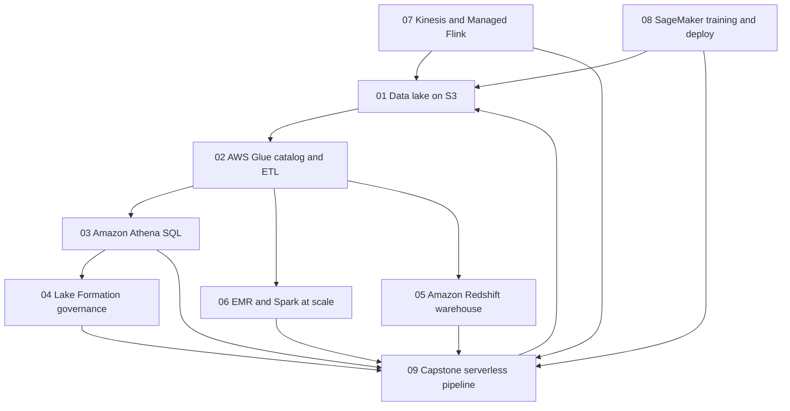
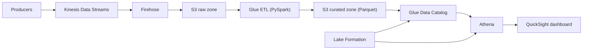

# Phase 5 — Data and AI

Phase 4 taught you how to move *requests* through AWS. Phase 5 is about moving *data*: landing it cheaply, cataloging it, transforming it, querying it, governing who can see which rows, and training models on top of it. This is the phase where AWS stops being a place where you run servers and becomes a platform where data and models are the product.

The through-line is Amazon S3. Every lesson either writes to a lake, reads from a lake, or governs a lake. Master the lake layout in Lesson 01 and the rest of the phase is about specializing the tools around it — ETL, SQL, permissions, warehousing, Spark, streaming, and machine learning.

## Phase Goals

- Design and operate a partitioned, columnar data lake on Amazon S3
- Catalog and transform data with AWS Glue without hand-rolled infrastructure
- Query the lake directly with Amazon Athena and predict the cost of every query
- Enforce table, column, and row-level access with AWS Lake Formation
- Tune Amazon Redshift for analytical workloads instead of treating it like a database
- Run Spark at scale on EMR, EMR Serverless, and EMR on EKS
- Build real-time analytics with Kinesis and Managed Service for Apache Flink
- Train, tune, register, deploy, and monitor models with Amazon SageMaker
- Assemble all of the above into one governed, end-to-end pipeline

## Phase Map

How the lessons fit together. Solid arrows are the "happy path" of the capstone; the rest are the specializations you choose between.

The end-to-end flow the capstone builds:

## Lessons in this Phase

| # | Lesson | Focus | Difficulty |
|---|--------|-------|------------|
| 01 | [Data Lakes on Amazon S3](./01-data-lakes-on-s3.md) | Zones, partitioning, file formats, compaction, Storage Lens | Intermediate |
| 02 | [AWS Glue](./02-aws-glue.md) | Crawlers, Data Catalog, PySpark ETL, bookmarks, workflows | Intermediate |
| 03 | [Amazon Athena](./03-amazon-athena.md) | Workgroups, engine v3, CTAS, partition projection, cost control | Intermediate |
| 04 | [AWS Lake Formation](./04-aws-lake-formation.md) | LF-Tags, column and row-level security, governed tables | Advanced |
| 05 | [Amazon Redshift](./05-amazon-redshift.md) | Serverless vs RA3, dist/sort keys, COPY, WLM, Spectrum | Advanced |
| 06 | [Amazon EMR and Spark](./06-amazon-emr-and-spark.md) | Cluster roles, instance fleets, Spot, Serverless, EKS, tuning | Advanced |
| 07 | [Kinesis Real-Time Analytics](./07-kinesis-real-time-analytics.md) | Streams, windows, watermarks, exactly-once, Managed Flink | Advanced |
| 08 | [SageMaker Training and Deployment](./08-sagemaker-training-and-deployment.md) | Studio, training jobs, HPO, inference options, Pipelines | Advanced |
| 09 | [Capstone — Serverless Data Pipeline](./09-project-serverless-data-pipeline.md) | Streaming ingestion to dashboard, governed end to end | Advanced |

## Capstone Project

**Name:** Serverless Real-Time Sales Pipeline

**Goal:** Ingest an event stream, land it in S3, transform it into a partitioned Parquet dataset with Glue, catalogue it, query it with Athena, visualize it in QuickSight, and restrict sensitive columns with Lake Formation — with no servers to manage anywhere in the path.

**Deliverables:**

- A Kinesis Data Stream plus a Firehose delivery stream that converts JSON to Parquet
- An S3 lake with `raw/` and `curated/` prefixes and a documented partition scheme
- A Glue crawler and a PySpark Glue job that produce the curated dataset
- Athena workgroup with a per-query data-scan limit and saved named queries
- Lake Formation LF-Tags that hide a PII column from an analyst role
- A QuickSight dataset and one dashboard with a trend visual
- A runbook in `docs/` describing how to deploy, test, and tear it down

## Phase Checklist

- [ ] I can explain why `s3://bucket/curated/orders/order_date=2026-10-14/part-000.parquet` is a good object path
- [ ] I have run a Glue crawler and read the resulting table in the Data Catalog
- [ ] I have written a Glue PySpark job that uses job bookmarks
- [ ] I have cut an Athena query's scanned bytes by switching to Parquet plus partition projection
- [ ] I have granted column-level access with Lake Formation LF-Tags and verified it as a second principal
- [ ] I have loaded a table into Redshift with `COPY` and seen the effect of a dist key
- [ ] I have submitted a Spark step to an EMR cluster and to EMR Serverless
- [ ] I have written a windowed aggregation over a Kinesis stream
- [ ] I have trained a model, registered it, and invoked a real-time endpoint
- [ ] I have destroyed every resource from the capstone (or paused/snapshotted it)

## Phase Resources

- [AWS Analytics Services Overview](https://docs.aws.amazon.com/whitepapers/latest/aws-analytics-services/aws-analytics-services.html)
- [Modern Data Architecture on AWS](https://docs.aws.amazon.com/whitepapers/latest/build-modern-data-streaming-analytics-architectures/build-modern-data-streaming-analytics-architectures.html)
- [Amazon S3 User Guide](https://docs.aws.amazon.com/AmazonS3/latest/userguide/Welcome.html)
- [AWS Glue Developer Guide](https://docs.aws.amazon.com/glue/latest/dg/what-is-glue.html)
- [Amazon Athena User Guide](https://docs.aws.amazon.com/athena/latest/ug/what-is.html)
- [AWS Lake Formation Developer Guide](https://docs.aws.amazon.com/lake-formation/latest/dg/what-is-lake-formation.html)
- [Amazon Redshift Management Guide](https://docs.aws.amazon.com/redshift/latest/mgmt/welcome.html)
- [Amazon EMR Management Guide](https://docs.aws.amazon.com/emr/latest/ManagementGuide/emr-what-is-emr.html)
- [Amazon SageMaker Developer Guide](https://docs.aws.amazon.com/sagemaker/latest/dg/whatis.html)
- [AWS Well-Architected — Data Analytics Lens](https://docs.aws.amazon.com/wellarchitected/latest/analytics-lens/analytics-lens.html)

## Next Phase

[Phase 6 — Security and Governance](../phase-6-security-and-governance/README.md)
