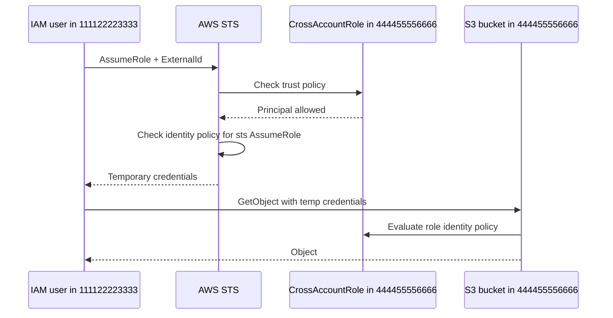
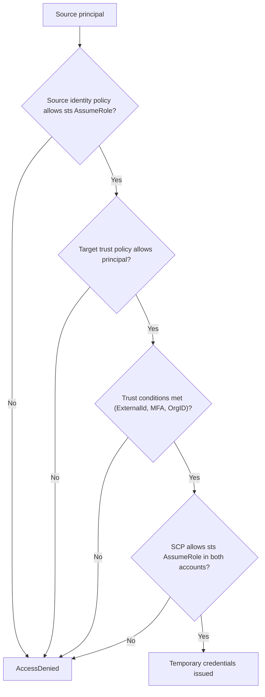
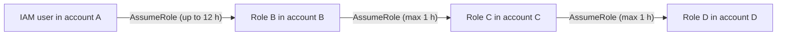

# 01 · IAM Cross-Account Access

> **Phase 6 — Security and Governance** · Lesson 01 of 11
> ➡️ Next: [Identity Federation and IAM Identity Center](./02-identity-federation-and-iam-identity-center.md) · 🏠 [Phase overview](./README.md)

## 🎯 Learning Objectives

By the end of this lesson you will be able to:

- Explain why cross-account access always goes through `sts:AssumeRole` instead of shared credentials
- Write a trust policy and an identity policy that work together as a pair
- Use an `ExternalId` condition to defeat the confused deputy problem
- Choose between a role assumption and a resource-based policy for a given integration
- Verify cross-account access with `aws sts get-caller-identity` and CloudTrail

**Estimated time:** 60 min · **Difficulty:** Intermediate

---

## 🧠 Core Concepts

An AWS account ID is a hard security boundary. IAM users, roles, and policies are scoped to exactly one account, and nothing you attach inside account A can grant access to a resource in account B by itself. The only supported way to cross that line with temporary credentials is **AWS Security Token Service (STS)**: a principal in account A calls `sts:AssumeRole` against a role in account B, and if account B's *trust policy* permits it, STS returns short-lived credentials for that role.

The key insight — and the thing interviewers probe — is that **two policies must both allow the call**. The role in the target account has a **trust policy** (a resource-based policy on the role itself) that answers "who may assume me?". The principal in the source account needs an **identity policy** with `sts:AssumeRole` on the target role ARN that answers "may this identity call assume-role there?". Missing either one produces the same unhelpful `AccessDenied`, so debug both sides.

Roles that are assumed are not chained by default. When role A assumes role B, the resulting session's permissions come from role B's policies only — the original identity's permissions are discarded. You can then assume role C from role B if it is allowed, which is **role chaining**, but session duration is capped at one hour for the chained hop. Long chains are an anti-pattern: they are hard to audit and they quietly lock you to that one-hour ceiling.

The last concept is the **confused deputy**. A third-party SaaS vendor asks you to give their AWS account the ability to assume a role in yours. Because the vendor uses one shared account for many customers, one customer could hand the vendor a role ARN and ask the vendor to act as *another* customer. The defense is the `ExternalId` condition: a value you both know, generated per customer, placed in the trust policy and passed in the `AssumeRole` call.

### Key terminology

| Term | Meaning |
|------|---------|
| **Trust policy** | Resource-based policy attached to a role that lists which principals may assume it and under what conditions. |
| **Identity policy** | Permissions policy attached to a user, group, or role in the *source* account. |
| **sts:AssumeRole** | API call that exchanges a permitted identity for temporary credentials for the target role. |
| **ExternalId** | Shared secret-like identifier in a trust policy that prevents the confused deputy problem. |
| **Role chaining** | Assuming a second role using credentials from a first assumed role. |
| **Session policy** | Optional inline policy passed at assume time that can only *reduce* the resulting permissions. |
| **Resource-based policy** | Policy attached directly to a resource (S3 bucket, KMS key, SQS queue, SNS topic) naming principals who may access it. |

---

## 🗺️ Architecture Diagram

A two-account role assumption, showing that both the source identity policy and the target trust policy are evaluated:



The decision points an `AssumeRole` call passes through:



Role chaining, and why the second hop is capped:



---

## 🧪 Hands-on Lab: Give a User Cross-Account Read Access with an ExternalId

**Goal:** Let a user in account A read objects from a bucket in account B through a role that requires an `ExternalId`.

**Prerequisites:** Two AWS accounts you control, AWS CLI v2, credentials for an admin principal in each account, one S3 bucket in account B. This lab uses `111122223333` (source) and `444455556666` (target). Replace the account IDs and the ExternalId with your own.

### Step 1 — Create the role in the target account with a trust policy

The trust policy is the *only* thing that lets an outside principal in. Note that the ExternalId is mandatory here.

```json
{
  "Version": "2012-10-17",
  "Statement": [
    {
      "Sid": "AllowPartnerAccountWithExternalId",
      "Effect": "Allow",
      "Principal": {
        "AWS": "arn:aws:iam::111122223333:root"
      },
      "Action": "sts:AssumeRole",
      "Condition": {
        "StringEquals": {
          "sts:ExternalId": "acme-8f3c1d9e"
        },
        "Bool": {
          "aws:MultiFactorAuthPresent": "true"
        }
      }
    }
  ]
}
```

```bash
# Target account: create the role using the trust policy above
aws iam create-role \
  --role-name CrossAccountReadRole \
  --assume-role-policy-document file://trust-policy.json \
  --max-session-duration 3600 \
  --description "Read-only role assumed by the partner account"

# Confirm what the trust policy actually says
aws iam get-role --role-name CrossAccountReadRole --query 'Role.AssumeRolePolicyDocument'
```

`Principal` as `arn:aws:iam::111122223333:root` means "any principal in account 111122223333 that an administrator there allows to call AssumeRole" — it does *not* grant that account access by itself. It is the standard target for cross-account trust.

### Step 2 — Attach the permissions policy in the target account

The trust policy only permits the assumption. The role still needs permission to touch the bucket.

```json
{
  "Version": "2012-10-17",
  "Statement": [
    {
      "Sid": "ReadPartnerBucket",
      "Effect": "Allow",
      "Action": ["s3:GetObject", "s3:ListBucket"],
      "Resource": [
        "arn:aws:s3:::partner-shared-bucket",
        "arn:aws:s3:::partner-shared-bucket/*"
      ]
    }
  ]
}
```

```bash
# Target account: give the role something to do once assumed
aws iam put-role-policy \
  --role-name CrossAccountReadRole \
  --policy-name ReadPartnerBucket \
  --policy-document file://role-permissions.json
```

### Step 3 — Grant the source identity permission to assume the role

```json
{
  "Version": "2012-10-17",
  "Statement": [
    {
      "Sid": "AssumePartnerReadRole",
      "Effect": "Allow",
      "Action": "sts:AssumeRole",
      "Resource": "arn:aws:iam::444455556666:role/CrossAccountReadRole",
      "Condition": {
        "StringEquals": {
          "sts:ExternalId": "acme-8f3c1d9e"
        }
      }
    }
  ]
}
```

```bash
# Source account: attach the identity policy to the caller
aws iam put-user-policy \
  --user-name partner-integration \
  --policy-name AssumeCrossAccountReadRole \
  --policy-document file://assume-policy.json
```

### Step 4 — Assume the role and check who you are

```bash
# Assume the cross-account role, passing the ExternalId
CREDS=$(aws sts assume-role \
  --role-arn arn:aws:iam::444455556666:role/CrossAccountReadRole \
  --role-session-name lab-cross-account \
  --external-id acme-8f3c1d9e \
  --query 'Credentials.[AccessKeyId,SecretAccessKey,SessionToken]' \
  --output text)

export AWS_ACCESS_KEY_ID=$(echo "$CREDS" | cut -f1)
export AWS_SECRET_ACCESS_KEY=$(echo "$CREDS" | cut -f2)
export AWS_SESSION_TOKEN=$(echo "$CREDS" | cut -f3)

# This must show the ROLE ARN and the target account, not your user
aws sts get-caller-identity
```

### Step 5 — Verify the boundary is real

```bash
# Must succeed: the bucket named in the role policy
aws s3 ls s3://partner-shared-bucket/

# Must fail with AccessDenied: the role has no permissions here
aws s3 ls s3://any-other-bucket-in-target-account/

# Must fail with AccessDenied: wrong ExternalId
aws sts assume-role \
  --role-arn arn:aws:iam::444455556666:role/CrossAccountReadRole \
  --role-session-name bad-external-id \
  --external-id wrong-value
```

Finally, confirm the assumption is visible in CloudTrail as a separate `AssumeRole` event in **both** accounts — the target account records the role creation and usage, while the source account records the identity calling STS.

---

## 💻 CLI Reference

```bash
# See which identity your current credentials resolve to (account, ARN, user/role id)
aws sts get-caller-identity

# Assume a role and cache it as a named CLI profile for repeated use
aws configure set role_arn arn:aws:iam::444455556666:role/CrossAccountReadRole --profile partner
aws configure set source_profile default --profile partner
aws configure set external_id acme-8f3c1d9e --profile partner
aws iam list-buckets --profile partner

# Assume a role and then narrow it further with an inline session policy
aws sts assume-role \
  --role-arn arn:aws:iam::444455556666:role/CrossAccountReadRole \
  --role-session-name read-only-session \
  --external-id acme-8f3c1d9e \
  --policy file://session-policy.json \
  --duration-seconds 900

# Assume a role using multi-factor authentication
aws sts assume-role \
  --role-arn arn:aws:iam::444455556666:role/CrossAccountReadRole \
  --role-session-name mfa-session \
  --serial-number arn:aws:iam::111122223333:mfa/dev-user \
  --token-code 123456 \
  --external-id acme-8f3c1d9e

# Trace every assumption of a role in CloudTrail
aws cloudtrail lookup-events \
  --lookup-attributes AttributeKey=EventName,AttributeValue=AssumeRole \
  --start-time 2026-01-01T00:00:00Z

# Get a labelled credential report to audit who can assume what
aws iam generate-credential-report && aws iam get-credential-report

# Who can access the bucket — including cross-account grants
aws s3api get-bucket-policy-status --bucket partner-shared-bucket
```

| Command | Purpose |
|---------|---------|
| `aws sts get-caller-identity` | Confirms which identity (and account) your credentials map to |
| `aws sts assume-role` | Exchanges an identity for temporary credentials in another account |
| `aws iam get-role` | Reads the trust policy so you can see *who* may assume the role |
| `aws cloudtrail lookup-events` | Audits actual role assumptions after the fact |
| `aws accessanalyzer list-findings` | Finds cross-account access you did not intend to grant |

---

## ✅ Best Practices

| Practice | Why it matters |
|----------|----------------|
| Always use temporary credentials via STS | Nothing to rotate, leak, or accidentally commit to Git |
| Require `ExternalId` for every third-party trust | Blocks the confused deputy attack on shared vendor accounts |
| Keep trust policies as narrow as possible | Condition on `aws:PrincipalArn`, `aws:PrincipalOrgID`, or `aws:PrincipalTag` rather than bare account root |
| Prefer one hop over chained roles | Each hop is denied the previous role's permissions and caps the session at 1 hour |
| Use `aws:PrincipalOrgID` to scope organization-internal trust | Automatically excludes accounts that leave the organization |
| Tag the assumed session with `--tags` | Makes CloudTrail attribution unambiguous in shared accounts |
| Alert on `AssumeRole` to privileged roles | Assumption of an admin role is a high-signal security event |

---

## ⚠️ Common Pitfalls

| Pitfall | Symptom | Fix |
|---------|---------|-----|
| Missing identity policy in the source account | `AccessDenied` even though the trust policy looks correct | Add `sts:AssumeRole` on the role ARN to the caller's identity policy |
| Forgetting the ExternalId on the assume call | `AccessDenied` with a confusing "not authorized to perform sts:AssumeRole" | Pass `--external-id` exactly as written in the trust policy |
| Using `arn:aws:iam::123456789012:user/x` as a cross-account principal | Works only for that exact user; breaks with federation | Trust the account root plus conditions, or trust the specific role used by your IdP |
| Expecting role chaining to inherit permissions | Permissions from the first role vanish after the second hop | Attach all needed permissions to the final role, or use `sts:TagSession` and ABAC |
| Session duration longer than allowed | `DurationSeconds exceeds MaxSessionDuration` | Raise `--max-session-duration` on the role (up to 12 h, or 1 h when chained) |
| Bucket policy and role policy both required but only one written | Access denied for object reads | Resource policies and identity policies are both evaluated — in the same account an allow in either is enough, across accounts both must allow |

---

## 💰 Cost Considerations

STS itself is free — there is no charge for `AssumeRole` calls, and unlike long-lived IAM user access keys there is nothing to rotate on a schedule. What costs money is everything the assumed role can then do, and cross-account access quietly expands the blast radius of a compromised integration. Govern it with **service quotas**: `AssumeRole` is a rate-limited API (`Rate exceeded` errors appear long before any bill does), so add exponential backoff in automation threads that fan out assumptions.

The real financial argument for roles over users is audit and containment cost: a leaked IAM user key that can create GPU instances is a five-figure weekend; a leaked role session expires on its own, and CloudTrail attributes every action to a named `roleSessionName` so incident response can pinpoint the source in minutes rather than days.

---

## 🔐 Security Considerations

- **Both sides of the trust relationship must be audited.** A permissive trust policy in account B is an open door regardless of how disciplined account A is. Run IAM Access Analyzer in *both* accounts — it flags resources that grant access to principals outside the account or organization.
- **Condition on the principal, not just the account.** Prefer `"Condition": {"ArnLike": {"aws:PrincipalArn": "arn:aws:iam::111122223333:role/PartnerIntegration"}}` over trusting the whole source account root for third-party access.
- **Use `aws:PrincipalOrgID`** for internal cross-account trust. It is a single condition that covers every account in your organization and automatically stops working if an account leaves.
- **ExternalId is not a secret**, but it must be unpredictable per customer and never reused across tenants. Generate it with a cryptographically random generator and treat rotation as a first-class operational task.
- **Reduce with session policies.** If a single role is assumed by several workloads, pass a `--policy` at assume time so each session gets only what it needs. A session policy can never *add* permissions, which makes it a safe delegation tool.
- **Watch for `AssumeRole` on `Resource: "*"`.** An identity policy like that lets a compromised principal assume any role in any account that trusts it — a common privilege-escalation path.
- **Never use account root access keys for cross-account work.** Root should have no access keys at all; use a role with MFA enforced.

---

## 🧩 Exercise

Create a third account (or reuse one) and build a two-hop setup: a user in account A assumes `DeployRole` in account B (with an MFA condition and an ExternalId), and `DeployRole` then assumes `PipelineRole` in account C without any permission to touch account C's S3 buckets directly. Prove with `aws sts get-caller-identity` and a deliberately failing `aws s3 ls` that the second hop does not inherit the first role's bucket permissions, and that a session created by chaining cannot exceed one hour.

Success looks like: the chained session returns `arn:aws:iam::333344445555:assumed-role/PipelineRole/...` from `get-caller-identity`, the S3 listing fails with `AccessDenied`, and CloudTrail in all three accounts shows the corresponding `AssumeRole` events.

---

## 📚 Resources

- [AWS Identity and Access Management — Switching to a role (AssumeRole)](https://docs.aws.amazon.com/IAM/latest/UserGuide/id_roles_use_switch-role-api.html)
- [The confused deputy problem](https://docs.aws.amazon.com/IAM/latest/UserGuide/confused-deputy.html)
- [AWS STS AssumeRole API reference](https://docs.aws.amazon.com/STS/latest/APIReference/API_AssumeRole.html)
- [Cross-account access with IAM roles](https://docs.aws.amazon.com/IAM/latest/UserGuide/id_roles_common-scenarios_aws-accounts.html)
- [IAM Access Analyzer](https://docs.aws.amazon.com/IAM/latest/UserGuide/what-is-access-analyzer.html)
- [Global condition key aws:PrincipalOrgID](https://docs.aws.amazon.com/IAM/latest/UserGuide/reference_policies_condition-keys.html)

---

## ➡️ Next Steps

Cross-account roles solve machine-to-machine access, but you do not want to create a role for every one of your engineers — or an IAM user for every contractor. The next lesson replaces hand-built identities with federation, so that your existing identity provider becomes the single source of truth and IAM Identity Center hands out short-lived, permission-set-scoped sessions.

> ➡️ Next: [Identity Federation and IAM Identity Center](./02-identity-federation-and-iam-identity-center.md) · 🏠 [Phase overview](./README.md)
