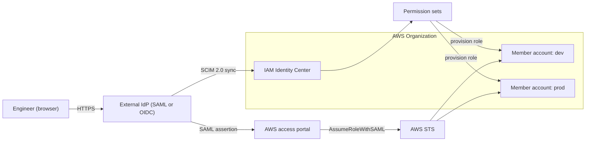
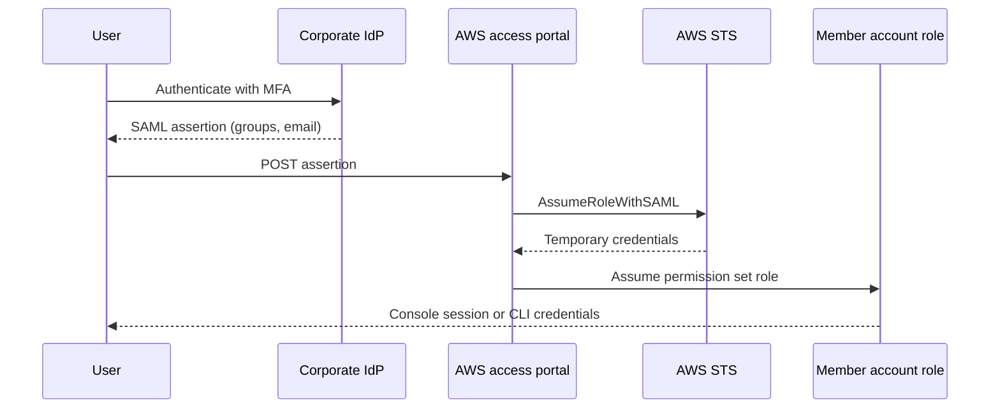
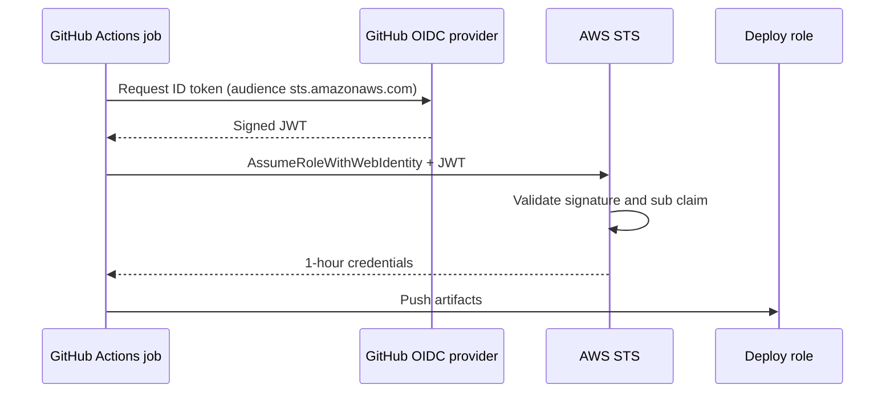

# 02 · Identity Federation and IAM Identity Center

> **Phase 6 — Security and Governance** · Lesson 02 of 11
> ⬅️ Previous: [IAM Cross-Account Access](./01-iam-cross-account-access.md) · ➡️ Next: [AWS KMS](./03-aws-kms.md) · 🏠 [Phase overview](./README.md)

## Learning Objectives

By the end of this lesson you will be able to:

- Explain how SAML 2.0 and OIDC federation each turn an external identity into AWS credentials
- Deploy IAM Identity Center with an external identity provider and SCIM provisioning
- Design permission sets that map cleanly to job roles, and assign them to accounts and groups
- Choose between role-based and attribute-based access control for a given organization
- Tune session duration and understand what a federated session can and cannot do

**Estimated time:** 75 min · **Difficulty:** Intermediate

---

## Core Concepts

**Federation** means AWS trusts somebody else's authentication. Instead of creating an IAM user with a password for each engineer, your identity provider (Okta, Entra ID, Google Workspace, Ping) authenticates the human, and AWS only issues credentials *after* receiving a signed assertion from that provider. Federation is not a nicety — it removes the largest category of long-lived credentials in most accounts.

Two protocols do the work. **SAML 2.0** is the enterprise standard: the IdP signs an XML assertion containing the user's attributes and group memberships, the browser POSTs it to the AWS sign-in endpoint, and STS returns a console session or role credentials. **OIDC** is the modern, JSON/web-native alternative: the IdP issues a signed JWT ID token, and AWS verifies it against the provider's JWKS endpoint. Use SAML for interactive human console access from a corporate IdP; use OIDC for workloads (GitHub Actions, Kubernetes service accounts, Terraform Cloud) that need short-lived credentials with no secrets at all.

**AWS IAM Identity Center** (the successor to AWS Single Sign-On) is the service that makes federation practical across many accounts. You configure an external IdP once, enable SCIM so users and groups sync automatically, then define **permission sets** — reusable bundles of policies with a session duration — and assign them to groups for specific accounts. A permission set materializes inside each target account as an IAM role, so the account still sees a normal role; Identity Center simply automates provisioning, assignment, and the assumption flow.

The access model you choose matters more than the tooling. **RBAC** assigns permissions per role ("Developers get PowerUserAccess in dev accounts"): easy to reason about, but it multiplies assignments as you add accounts. **ABAC** assigns permissions using tags on the principal and the resource ("a user tagged `CostCenter=Retail` may manage resources tagged `CostCenter=Retail`"), which scales to hundreds of accounts with one policy. Start with permission sets and role thinking; graduate to ABAC once your tagging is trustworthy.

### Key terminology

| Term | Meaning |
|------|---------|
| **SAML 2.0** | XML-based federation protocol used for browser-based console sign-in from corporate IdPs. |
| **OIDC** | JSON/JWT-based federation protocol used for both console access and workload identity. |
| **IdP-initiated / SP-initiated** | Whether the sign-in starts at the identity provider or at AWS. |
| **Permission set** | Identity Center construct holding policies, a session duration, and a relay state, provisioned as a role in each assigned account. |
| **SCIM** | System for Cross-domain Identity Management — automatic user/group create, update, and — critically — *disable*. |
| **Identity Center instance** | A single directory per AWS Organization with its own sign-in URL and (optionally) its own built-in directory. |
| **Session duration** | How long a federated session lasts before re-authentication (1–12 h for permission sets). |
| **ABAC** | Attribute-based access control driven by tags and condition keys such as `aws:PrincipalTag`. |

---

## Architecture Diagram

Identity Center with an external IdP, SCIM, and permission sets materializing as roles in member accounts:



The SAML sign-in handshake, step by step:



Workload federation with OIDC — no secrets stored anywhere:



---

## Hands-on Lab: Federate a Group into Two Accounts

**Goal:** Wire an external OIDC provider, create permission sets, and prove that group membership alone decides who can reach production.

**Prerequisites:** An AWS Organization with Identity Center enabled, an external IdP you can configure (Okta, Entra ID, or Google Workspace), administrator access to both.

### Step 1 — Enable Identity Center and capture the values your IdP needs

```bash
# Create the Identity Center instance (skip if one already exists)
aws sso-admin create-instance

# Get the instance ARN, sign-in URL, and issuer URL to paste into your IdP
aws sso-admin list-instances

# Enable SCIM so users and groups sync automatically
aws sso-admin get-instance --instance-arn arn:aws:sso:::instance/ssoins-1234567890abcdef0
```

In your IdP, create a SAML or OIDC application using the ACS URL, entity ID, and issuer URL reported above, then start the SCIM provisioning token flow. Map these attributes:

| IdP attribute | Identity Center attribute | Why |
|---------------|---------------------------|-----|
| `email` | `email` | Username match |
| `displayName` | `displayName` | Readability in the portal |
| `groups` | `groups` | Drives every permission set assignment |
| `costCenter` | `costCenter` (custom) | Enables ABAC later in this lab |

### Step 2 — Create permission sets for two job roles

```bash
# Read-only observer across the organization
aws sso-admin create-permission-set \
  --instance-arn arn:aws:sso:::instance/ssoins-1234567890abcdef0 \
  --name ReadOnlyAuditor \
  --description "Read-only visibility for auditors and on-call" \
  --session-duration PT4H

# Developer access, capped by an inline policy that blocks IAM changes
aws sso-admin create-permission-set \
  --instance-arn arn:aws:sso:::instance/ssoins-1234567890abcdef0 \
  --name DeveloperAccess \
  --description "PowerUser minus IAM and Organizations" \
  --session-duration PT8H
```

```json
{
  "Version": "2012-10-17",
  "Statement": [
    {
      "Sid": "BlockIdentityEscalation",
      "Effect": "Deny",
      "Action": [
        "iam:CreateUser",
        "iam:CreateAccessKey",
        "iam:AttachUserPolicy",
        "iam:PutRolePolicy",
        "iam:UpdateAssumeRolePolicy",
        "organizations:LeaveOrganization"
      ],
      "Resource": "*"
    }
  ]
}
```

```bash
# Attach the managed policy and the inline guardrail to the permission set
aws sso-admin attach-managed-policy-to-permission-set \
  --instance-arn arn:aws:sso:::instance/ssoins-1234567890abcdef0 \
  --permission-set-arn arn:aws:sso:::permissionSet/ssoins-1234567890abcdef0/ps-abcdef0123456789 \
  --managed-policy-arn arn:aws:iam::aws:policy/PowerUserAccess

aws sso-admin put-inline-policy-to-permission-set \
  --instance-arn arn:aws:sso:::instance/ssoins-1234567890abcdef0 \
  --permission-set-arn arn:aws:sso:::permissionSet/ssoins-1234567890abcdef0/ps-abcdef0123456789 \
  --inline-policy file://block-escalation.json
```

### Step 3 — Provision the permission sets into accounts and assign groups

```bash
# Turn the permission set into a real IAM role in the listed accounts
aws sso-admin provision-permission-set \
  --instance-arn arn:aws:sso:::instance/ssoins-1234567890abcdef0 \
  --permission-set-arn arn:aws:sso:::permissionSet/ssoins-1234567890abcdef0/ps-abcdef0123456789 \
  --target-type AWS_ACCOUNT \
  --target-id 111122223333

# Assign the synced group to the account. Use the group ID from Identity Center,
# which you can list with: aws identitystore list-groups --identity-store-id d-9067a1b2c3
aws sso-admin create-account-assignment \
  --instance-arn arn:aws:sso:::instance/ssoins-1234567890abcdef0 \
  --target-id 111122223333 \
  --target-type AWS_ACCOUNT \
  --permission-set-arn arn:aws:sso:::permissionSet/ssoins-1234567890abcdef0/ps-abcdef0123456789 \
  --principal-type GROUP \
  --principal-id 94d8a7e2-1c33-7058-8b4f-2f9c1e0a1234
```

### Step 4 — Verify from the user's point of view

```bash
# Configure the CLI to use Identity Center (browser-based device authorization)
aws configure sso

# List every account and permission set the signed-in user can reach
aws sso list-accounts --access-token "$(aws sso login --no-browser | tail -1)"
aws sso list-account-roles \
  --access-token "$ACCESS_TOKEN" \
  --account-id 111122223333

# Prove the session identity and confirm the inline deny is present
aws sts get-caller-identity
aws iam list-users   # must fail: DeveloperAccess denies iam:ListUsers via the deny above
```

### Step 5 — Add attribute-based access control

Tag a permission set session with the user's cost center so one policy can serve many teams.

```json
{
  "Version": "2012-10-17",
  "Statement": [
    {
      "Sid": "ManageOnlyOwnCostCenter",
      "Effect": "Allow",
      "Action": ["ec2:StartInstances", "ec2:StopInstances", "ec2:TerminateInstances"],
      "Resource": "*",
      "Condition": {
        "StringEquals": {
          "aws:ResourceTag/CostCenter": "${aws:PrincipalTag/costCenter}"
        }
      }
    }
  ]
}
```

Attach that as the inline policy of a permission set and pass the tag through the assertion: Identity Center forwards IdP attributes such as `costCenter` as principal tags, which is what makes `${aws:PrincipalTag/costCenter}` resolve at request time.

---

## CLI Reference

```bash
# Identity Center instance inventory
aws sso-admin list-instances

# List all permission sets in the instance
aws sso-admin list-permission-sets \
  --instance-arn arn:aws:sso:::instance/ssoins-1234567890abcdef0

# Manage the identity store behind Identity Center
aws identitystore list-users --identity-store-id d-9067a1b2c3
aws identitystore list-groups --identity-store-id d-9067a1b2c3
aws identitystore list-group-memberships --identity-store-id d-9067a1b2c3 --group-id 94d8a7e2-1c33-7058-8b4f-2f9c1e0a1234

# Manage the external provider trust
aws sso-admin create-application-assignment \
  --application-arn arn:aws:sso::111122223333:application/ssoins-1234567890abcdef0/apl-1234567890abcdef0 \
  --principal-id 94d8a7e2-1c33-7058-8b4f-2f9c1e0a1234 \
  --principal-type GROUP

# See which service providers trust your organization's SAML metadata
aws iam list-saml-providers
aws iam get-saml-provider --saml-provider-arn arn:aws:iam::111122223333:saml-provider/CorporateOkta

# Workload federation with OIDC: create a provider for GitHub Actions
aws iam create-open-id-connect-provider \
  --url https://token.actions.githubusercontent.com \
  --client-id-list sts.amazonaws.com \
  --thumbprint-list 6938fd4d98bab03faadb97b34396831e3780aea1

# Sign in the CLI against Identity Center and run a command with that session
aws sso login --profile prod-admin
aws s3 ls --profile prod-admin
```

| Command | Purpose |
|---------|---------|
| `aws sso-admin create-permission-set` | Defines a reusable, account-agnostic role template |
| `aws sso-admin provision-permission-set` | Creates the backing IAM role in a target account |
| `aws sso-admin create-account-assignment` | Grants a group access to an account/permission-set pair |
| `aws identitystore list-group-memberships` | Audits who is actually in an entitlement group |
| `aws iam create-open-id-connect-provider` | Enables secretless CI/CD workload federation |
| `aws sso login` | Obtains short-lived CLI credentials from Identity Center |

---

## Best Practices

| Practice | Why it matters |
|----------|----------------|
| Make the IdP the single source of truth | Onboarding and — more importantly — *offboarding* happen in one place |
| Enable SCIM before you assign anything | Manual group management drifts within days; SCIM removes stale access automatically |
| Model permission sets on job functions, not on people | Assignments stay small, reviewable, and auditable |
| Keep permission sets few (5–15) | Hundreds of near-duplicate sets is a sign the model is wrong |
| Use the organization access portal as the only console entry point | Root and IAM-user console access become the exception, not the default |
| Set session duration by risk: 1–4 h for prod, 8 h for dev | Short prod sessions force re-authentication around sensitive work |
| Prefer ABAC once tags are trustworthy | One policy replaces hundreds of group-to-account assignments |
| Federate CI/CD with OIDC, never with IAM user keys | Removes static secrets from build systems entirely |

---

## Common Pitfalls

| Pitfall | Symptom | Fix |
|---------|---------|-----|
| SCIM not enabled, users only added manually | Terminated employees keep access; group changes do not propagate | Enable SCIM automatic provisioning and de-provisioning |
| Permission set never provisioned to an account | User signs in and sees no account tile | Run `provision-permission-set` for each target account |
| Name ID mismatch between IdP and Identity Center | `InvalidNameID` or users appear as unknown | Set the NameID format to `emailAddress` and match the mapping exactly |
| Assuming a permission set can grant more than the identity policy | Actions fail despite an `Allow` in the permission set | Identity Center sessions are still subject to SCPs and resource policies |
| Duplicate emails (alias addresses) for one person | Two identities, divergent permissions | Enforce one canonical email per person at the IdP; SCIM updates the existing user |
| Building ABAC before tags are consistent | Policies silently match nothing, access is denied everywhere | Enforce tag policies and use `aws:RequestTag` conditions to guarantee tags |

---

## Cost Considerations

IAM Identity Center is **free** for its core capability — you pay nothing for users, groups, permission sets, or assignments. Two things do cost money. First, if you choose Identity Center's **built-in directory** instead of an external IdP, there is a per-user monthly charge for identities beyond the free allowance. Second, if your IdP offers SSO for other applications too, you are already paying the IdP vendor — federation into AWS typically costs nothing incremental.

The savings are indirect but large: eliminating IAM users and their access keys removes the need for credential rotation tooling, and federating CI/CD with OIDC removes the secret-management line item entirely. The counterweight is operational — a misconfigured IdP lockout means *nobody* can reach the console, so budget for a tested break-glass path (Lesson 11).

---

## Security Considerations

- **MFA lives at the IdP, and it must be mandatory.** AWS cannot enforce MFA on SAML sessions beyond requiring a condition on the trust; make MFA a hard IdP policy for every human, including third parties.
- **Restrict which assertion attributes become tags.** Principal tags derived from IdP attributes are a privilege-escalation vector: if a user can set `department` in a self-service profile and a policy grants access by that tag, they can grant themselves access. Treat attribute mapping as privileged configuration.
- **Condition on `aws:PrincipalTag` and `aws:PrincipalOrgID` together** so a tag from a stray external federated principal cannot match your resources.
- **Do not let the IdP application be broader than AWS.** A single "cloud" SAML app that authorizes every system makes auditing impossible; keep per-system applications with explicit group filters.
- **Protect the Identity Center delegation.** Restrict `sso:CreateAccountAssignment` and `sso:PutInlinePolicyToPermissionSet` to a small break-glass group; those two actions are effectively "grant anyone anything" in the organization.
- **Keep at least one emergency access path outside federation** — a break-glass IAM role scoped with MFA conditions, monitored by a CloudWatch alarm — because IdP outages happen.
- **Audit unused entitlements.** Permission set assignments are cheap to create and rarely removed. Use CloudTrail to find permission sets nobody has assumed in 90 days, then delete the assignment.

---

## Exercise

Design an entitlement model for a company with three teams (Platform, Data, Payments) and three accounts (shared-services, data-lake, prod). Write the short version of the model as a table of group → account → permission set, then implement one row of it end to end from your IdP through to a working `aws s3 ls` against the assigned account. Finally, replace one role-based assignment with an ABAC policy that keys off a `team` tag, and demonstrate that a user tagged for Data cannot start an EC2 instance tagged `team=Payments` even though the policy grants `ec2:StartInstances` on `*`.

Success looks like: `aws sts get-caller-identity` returns an assumed-role ARN built from the permission set name, the ABAC call fails with `AccessDenied` on the untagged/other-team resource, and only one permission set exists per job function rather than one per person.

---

## Resources

- [What is IAM Identity Center?](https://docs.aws.amazon.com/singlesignon/latest/userguide/what-is.html)
- [SAML federation into AWS](https://docs.aws.amazon.com/IAM/latest/UserGuide/id_roles_providers_saml.html)
- [Creating OpenID Connect (OIDC) identity providers](https://docs.aws.amazon.com/IAM/latest/UserGuide/id_roles_providers_create_oidc.html)
- [Permission sets in IAM Identity Center](https://docs.aws.amazon.com/singlesignon/latest/userguide/permissionsetsconcept.html)
- [Attribute-based access control with IAM](https://docs.aws.amazon.com/IAM/latest/UserGuide/introduction_attribute-based-access-control.html)
- [Configure SCIM provisioning](https://docs.aws.amazon.com/singlesignon/latest/userguide/provision-automatically.html)
- [Session duration in IAM Identity Center](https://docs.aws.amazon.com/singlesignon/latest/userguide/configure-user-session.html)

---

## Next Steps

Federation answers *who* the caller is. The next lesson answers what happens to the data that caller touches: KMS key policies, envelope encryption, and grants decide who can decrypt — and those decisions survive long after a session expires.

> ⬅️ Previous: [IAM Cross-Account Access](./01-iam-cross-account-access.md) · ➡️ Next: [AWS KMS](./03-aws-kms.md) · 🏠 [Phase overview](./README.md)
