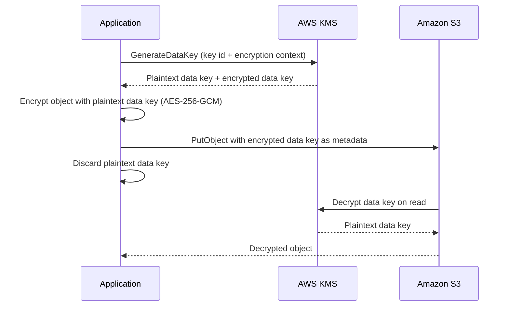
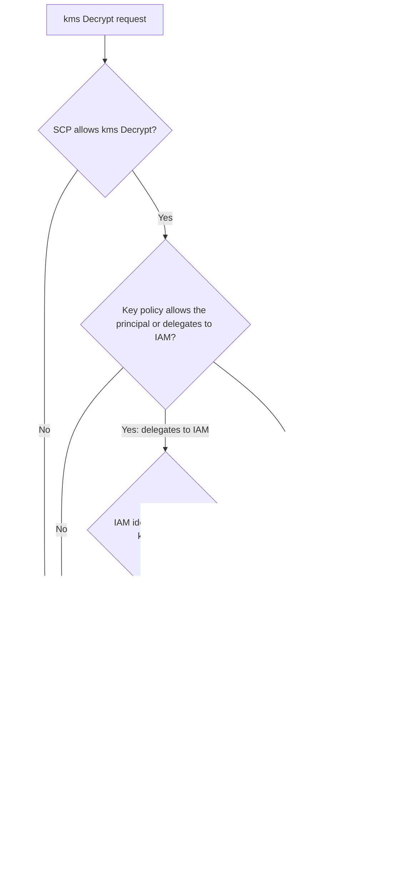
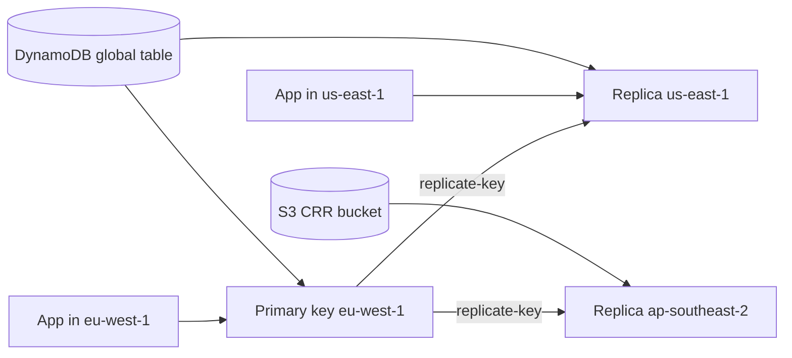

# 03 · AWS KMS

> **Phase 6 — Security and Governance** · Lesson 03 of 11
> ⬅️ Previous: [Identity Federation and IAM Identity Center](./02-identity-federation-and-iam-identity-center.md) · ➡️ Next: [AWS CloudHSM](./04-aws-cloudhsm.md) · 🏠 [Phase overview](./README.md)

## 🎯 Learning Objectives

By the end of this lesson you will be able to:

- Distinguish customer managed keys, AWS managed keys, and AWS owned keys, and pick the right one
- Explain envelope encryption and why AWS never needs your plaintext data key
- Write a key policy that stands on its own, and know when IAM policies or grants are the better tool
- Configure automatic and manual rotation, and build a multi-region key for cross-Region workloads
- Use encryption context to bind ciphertext to its purpose and make decryption auditable

**Estimated time:** 75 min · **Difficulty:** Intermediate

---

## 🧠 Core Concepts

**AWS Key Management Service (KMS)** manages the cryptographic keys that protect almost every encrypted byte in AWS — S3 objects, EBS volumes, RDS databases, Secrets Manager values, Lambda environment variables. A key in KMS is a logical resource backed by hardware security modules that AWS operates; KMS never exports the underlying key material in plaintext, and no API returns it. What you can do is ask KMS to encrypt, decrypt, or generate data keys.

Key **types** are the first decision. **Customer managed keys** are the ones you create: you own the key policy, you pay the monthly fee, you control rotation and deletion, and you can audit use. **AWS managed keys** (named `aws/service`) are created on your behalf the first time you enable encryption on a service — visible, free, auto-rotated yearly, but with a key policy you cannot edit, which makes them unsuitable for strict separation of duties. **AWS owned keys** are invisible: used by some services for cross-account bulk encryption at no cost, with no audit trail in your account.

The core mechanic is **envelope encryption**. KMS encrypts a small **data key** with your KMS key, and your application uses that plaintext data key to encrypt the actual payload locally with AES-256. You store the encrypted data key next to the ciphertext. Decryption reverses it: KMS unwraps the data key, and your application decrypts the payload. This is why KMS API calls stay cheap and fast even for terabytes of data — the KMS key never touches bulk data.

Authorization has two layers that trip people up. A **key policy** is a resource policy that is *always* required: no identity, not even the account root, can use a key unless the key policy allows it. **IAM policies** in the same account can widen access *only if* the key policy delegates to IAM (the classic pattern is a statement with `"Principal": {"AWS": "arn:aws:iam::111122223333:root"}` and `"Action": "kms:*"`, which effectively says "IAM decides"). **Grants** are the third mechanism — programmatic, temporary, revocable-delegation permission tickets used by services like EBS and RDS so they can use your key without you editing the key policy for every volume.

Two advanced features matter for real architectures. **Multi-region keys** are replicas of one logical key in several Regions: same key ID, same key material, so ciphertext encrypted in `eu-west-1` can be decrypted in `us-east-1` — essential for global tables, cross-Region DR, and multi-Region encrypted backups. **Encryption context** is a non-secret key-value map mixed into the encryption; decryption fails unless the exact same context is supplied. It binds ciphertext to a purpose (see the lab) and appears in CloudTrail, giving you a searchable audit trail per tenant or dataset.

### Key terminology

| Term | Meaning |
|------|---------|
| **Customer managed key** | A key you create and control, with a key policy you can edit and a monthly charge. |
| **AWS managed key** | A key AWS creates on your behalf for a service, free, auto-rotated, policy not editable. |
| **AWS owned key** | A key AWS owns for bulk encryption; not visible or auditable in your account. |
| **Data key** | A per-object or per-volume AES key that KMS generates and envelopes with your KMS key. |
| **Key policy** | The mandatory resource policy on a KMS key. No allow here means no access at all. |
| **Grant** | A temporary, scoped permission issued to a principal or service to use a key. |
| **Encryption context** | Non-secret key/value pairs bound into the ciphertext; must match exactly to decrypt. |
| **Multi-region key** | A primary key plus replicas in other Regions sharing the same key material and key ID. |
| **Symmetric / asymmetric** | Symmetric keys (`SYMMETRIC_DEFAULT`, AES-256-GCM) never leave KMS; asymmetric keys (RSA, ECC) expose a public key for outside use. |

---

## 🗺️ Architecture Diagram

Envelope encryption for an S3 object, showing that only the small data key travels to KMS:



How a KMS request is authorized — the key policy is never optional:



Multi-region keys for a global, encrypted workload:



---

## 🧪 Hands-on Lab: A Key Policy, a Grant, and an Encryption Context

**Goal:** Create a customer managed key with a least-privilege key policy, use it with an encryption context, and hand out temporary access with a grant instead of editing the policy.

**Prerequisites:** The CLI profile from Lesson 01 or any account administrator credentials, and permission to create IAM roles and KMS keys.

### Step 1 — Create the key with the alias, then check the default policy

```bash
# Create a symmetric key for encrypting application data
KEY_ID=$(aws kms create-key \
  --description "App data key for the orders service" \
  --key-usage ENCRYPT_DECRYPT \
  --key-spec SYMMETRIC_DEFAULT \
  --tags TagKey=CostCenter,TagValue=Payments TagKey=DataClass,TagValue=Confidential \
  --query 'KeyMetadata.KeyId' --output text)

# Give it a friendly alias so code does not hard-code a key ID
aws kms create-alias \
  --alias-name alias/orders-data \
  --target-key-id "$KEY_ID"

# Read the key policy AWS generated — note the account root statement
aws kms get-key-policy --key-id "$KEY_ID" --policy-name default --output text | python -m json.tool
```

### Step 2 — Replace the key policy with a least-privilege one

The key policy below keeps the account root as a break-glass administrator, but grants day-to-day use to exactly one role. Without the root statement you can lock yourself out permanently; without the role statement, IAM policies alone would grant nothing.

```json
{
  "Version": "2012-10-17",
  "Statement": [
    {
      "Sid": "EnableKeyAdministrationViaIAM",
      "Effect": "Allow",
      "Principal": {
        "AWS": "arn:aws:iam::111122223333:root"
      },
      "Action": [
        "kms:Create*",
        "kms:Describe*",
        "kms:Enable*",
        "kms:List*",
        "kms:Put*",
        "kms:Update*",
        "kms:Revoke*",
        "kms:Disable*",
        "kms:Get*",
        "kms:TagResource",
        "kms:UntagResource",
        "kms:ScheduleKeyDeletion",
        "kms:CancelKeyDeletion"
      ],
      "Resource": "*",
      "Condition": {
        "StringEquals": {
          "aws:PrincipalOrgID": "o-exampleorgid"
        }
      }
    },
    {
      "Sid": "AllowOrdersServiceToUseTheKey",
      "Effect": "Allow",
      "Principal": {
        "AWS": "arn:aws:iam::111122223333:role/orders-service"
      },
      "Action": [
        "kms:Encrypt",
        "kms:Decrypt",
        "kms:ReEncryptFrom",
        "kms:ReEncryptTo",
        "kms:GenerateDataKey",
        "kms:GenerateDataKeyWithoutPlaintext",
        "kms:DescribeKey"
      ],
      "Resource": "*",
      "Condition": {
        "StringEquals": {
          "kms:EncryptionContext:service": "orders",
          "kms:ViaService": "s3.eu-west-1.amazonaws.com"
        }
      }
    },
    {
      "Sid": "DenyKeyDeletionForNonAdmins",
      "Effect": "Deny",
      "Principal": "*",
      "Action": ["kms:ScheduleKeyDeletion", "kms:DisableKey"],
      "Resource": "*",
      "Condition": {
        "StringNotEquals": {
          "aws:PrincipalArn": "arn:aws:iam::111122223333:role/BreakGlassAdmin"
        }
      }
    }
  ]
}
```

```bash
# Apply the policy. Use put-key-policy, not create-key-policy, to replace it.
aws kms put-key-policy \
  --key-id "$KEY_ID" \
  --policy-name default \
  --policy file://key-policy.json

# Confirm the policy round-trips
aws kms get-key-policy --key-id "$KEY_ID" --policy-name default --output text | python -m json.tool
```

### Step 3 — Encrypt with an encryption context and prove it is binding

```bash
# Encrypt a small secret with a context that identifies the tenant
aws kms encrypt \
  --key-id alias/orders-data \
  --plaintext fileb://message.txt \
  --encryption-context service=orders,tenant=acme \
  --query CiphertextBlob --output text --cli-binary-format raw-in-base64-out > message.b64

# Decryption with the SAME context succeeds
aws kms decrypt \
  --ciphertext-blob fileb://message.b64 \
  --encryption-context service=orders,tenant=acme \
  --query Plaintext --output text --cli-binary-format raw-in-base64-out

# Decryption with a different tenant fails with InvalidCiphertextException
aws kms decrypt \
  --ciphertext-blob fileb://message.b64 \
  --encryption-context service=orders,tenant=other \
  --query Plaintext --output text
```

### Step 4 — Delegate with a grant instead of loosening the key policy

```bash
# Create a key grant for an EBS snapshot workflow, scoped and revocable
aws kms create-grant \
  --key-id "$KEY_ID" \
  --grantee-principal arn:aws:iam::111122223333:role/backup-automation \
  --operations Encrypt Decrypt GenerateDataKeyWithoutPlaintext DescribeKey \
  --constraints EncryptionContextSubset='{service=orders}' \
  --name backup-automation-grant

# Inspect grants and revoke one when the workflow is retired
aws kms list-grants --key-id "$KEY_ID"
aws kms revoke-grant --key-id "$KEY_ID" \
  --grant-id 0d1a2b3c4d5e6f7a8b9c0d1e2f3a4b5c6d7e8f9a0b1c2d3e4f5a6b7c8d9e0f1a2
```

### Step 5 — Enable rotation and see when it takes effect

```bash
# Symmetric customer managed keys support automatic rotation (90-2560 days)
aws kms enable-key-rotation --key-id "$KEY_ID" --rotation-period-in-days 180

# Confirm the current status and next rotation date
aws kms get-key-rotation-status --key-id "$KEY_ID"

# Force a rotation now (an on-demand rotation of a symmetric key with rotation enabled)
aws kms rotate-key-on-demand --key-id "$KEY_ID"
```

Rotation is transparent for symmetric keys: KMS keeps the old backing keys so existing ciphertext still decrypts, and only new encryptions use the new material. That is why rotation is not a data migration project — but also why it does not neutralize a compromised key revision that has already decrypted data.

### Step 6 — Create a multi-region key

```bash
# Primary key in eu-west-1
MR_KEY=$(aws kms create-key \
  --description "Multi-region key for global orders table" \
  --multi-region \
  --key-usage ENCRYPT_DECRYPT \
  --key-spec SYMMETRIC_DEFAULT \
  --query 'KeyMetadata.KeyId' --output text)

aws kms create-alias --alias-name alias/orders-global --target-key-id "$MR_KEY"

# Replicate into us-east-1 with a distinguishable alias
aws kms replicate-key \
  --key-id "$MR_KEY" \
  --replica-region us-east-1 \
  --description "Replica for us-east-1" \
  --tags TagKey=CostCenter,TagValue=Payments

# List the replicas and confirm they share the key ID
aws kms describe-key --key-id "$MR_KEY" --query 'KeyMetadata.MultiRegionConfiguration'
aws kms describe-key --key-id "$MR_KEY" --region us-east-1 --query 'KeyMetadata.KeyId'
```

### Step 7 — Verify

```bash
# Rotation is on, with the period you asked for
aws kms get-key-rotation-status --key-id "$KEY_ID" \
  --query '{Enabled:KeyRotationEnabled,Period:RotationPeriodInDays}'

# Grants exist for the backup role only
aws kms list-grants --key-id "$KEY_ID" \
  --query 'Grants[].{Name:Name,Principal:GranteePrincipal}'

# Every use of the key is in CloudTrail with its encryption context
aws cloudtrail lookup-events \
  --lookup-attributes AttributeKey=EventSource,AttributeValue=kms.amazonaws.com \
  --max-results 10
```

---

## 💻 CLI Reference

```bash
# Inventory keys and see which are customer managed versus AWS managed
aws kms list-keys
aws kms describe-key --key-id alias/orders-data
aws kms list-aliases --query 'Aliases[?starts_with(AliasName, `alias/`)]'

# Generate a data key for local envelope encryption
aws kms generate-data-key --key-id alias/orders-data --key-spec AES_256 \
  --encryption-context service=orders,tenant=acme

# Same call without returning the plaintext (for re-encrypt-only workflows)
aws kms generate-data-key-without-plaintext --key-id alias/orders-data --key-spec AES_256 \
  --encryption-context service=orders,tenant=acme

# Re-encrypt from one key to another without exposing plaintext
aws kms re-encrypt \
  --ciphertext-blob fileb://message.b64 \
  --source-key-id alias/orders-data \
  --destination-key-id alias/orders-archive \
  --source-encryption-context service=orders,tenant=acme \
  --destination-encryption-context service=orders-archive,tenant=acme

# Discover which AWS services use a key
aws kms list-key-policies --key-id alias/orders-data
aws kms describe-key --key-id alias/orders-data --query 'KeyMetadata.KeyManager'

# Safely destroy a key (7-30 day waiting period, reversible until it fires)
aws kms schedule-key-deletion --key-id "$KEY_ID" --pending-window-in-days 30
aws kms cancel-key-deletion --key-id "$KEY_ID"

# Turn off a key immediately without deleting it
aws kms disable-key --key-id "$KEY_ID"
```

| Command | Purpose |
|---------|---------|
| `aws kms create-key` | Creates a customer managed key you fully control |
| `aws kms put-key-policy` | Replaces the mandatory key policy — the real access control |
| `aws kms generate-data-key` | Produces the data key used for envelope encryption |
| `aws kms create-grant` | Delegates key use temporarily without editing the key policy |
| `aws kms enable-key-rotation` | Turns on automatic rotation and sets the period |
| `aws kms replicate-key` | Creates a multi-region replica sharing key material |
| `aws kms schedule-key-deletion` | Starts the irreversible, 7–30 day deletion countdown |

---

## ✅ Best Practices

| Practice | Why it matters |
|----------|----------------|
| Create customer managed keys for anything regulated | AWS managed key policies cannot enforce your separation of duties |
| Always keep an account-root administration statement in the key policy | Omitting it makes the key unmanageable and undeletable |
| Use aliases in application code, never key IDs | Rotation and re-pointing become a config change, not a redeploy |
| Bind every encryption to an encryption context | Decryption fails if the context is wrong, and CloudTrail records it for audit |
| Deny `kms:ScheduleKeyDeletion` and `kms:DisableKey` broadly | Losing a KMS key destroys the data it protects, irreversibly |
| Prefer grants over key policy edits for service integrations | Grants are scoped, named, and revocable in one call |
| Use multi-region keys only where the data is genuinely cross-Region | Each replica costs the same as a primary key |
| Rotate at least annually, and always on staff changes in the key-owning team | Rotation limits the value of an exfiltrated key revision |
| Delete keys only after 30 days and after confirming no ciphertext depends on them | Deletion is permanent; ciphertext protected by a deleted key is unrecoverable |

---

## ⚠️ Common Pitfalls

| Pitfall | Symptom | Fix |
|---------|---------|-----|
| Relying on an IAM policy alone | `AccessDeniedException` even though the IAM policy allows `kms:Decrypt` | Add a key policy statement with `Principal: account root` so IAM is consulted |
| Deleting the root delegation statement | Nobody can administer the key afterwards | Restore via the root user, then re-add the statement |
| Mismatched encryption context | `InvalidCiphertextException` on data that obviously exists | Supply the identical context used at encryption; check case and exact key names |
| Asymmetric key rotation expected | `UnsupportedOperationException` from `enable-key-rotation` | Rotate asymmetric keys manually by creating a new key and re-encrypting |
| Cross-Region decryption with a single-Region key | Decryption fails in the other Region | Use a multi-region key, or re-encrypt with a key in the target Region |
| Region-bound VPC endpoint confusion | KMS calls fail from a private subnet | Create a KMS interface endpoint in each Region you use, or allow KMS over the internet |
| Grant accumulation | Hundreds of stale grants nobody understands | Audit with `list-grants`, revoke on workflow retirement, and prefer retiring principals |

---

## 💰 Cost Considerations

KMS pricing has three components. **Keys** cost roughly **$1 per key per month**, prorated hourly, for each customer managed key — and each multi-region replica is a separate key with its own charge, so a primary plus three replicas is ~$4/month for that one logical key. **Requests** cost about **$0.03 per 10,000 requests**, with `GenerateDataKey`, `Encrypt`, `Decrypt`, and `ReEncrypt` all counting; grants and policy reads are free. **Custom key stores** (CloudHSM-backed) add a fixed hourly charge per cluster instead (see Lesson 04).

The dominant driver is not the key fee — it is *how often you call KMS*. Envelope encryption exists to keep this down: caching a data key for the lifetime of an object, or for a bounded TTL, is typically a 100x cost reduction versus calling `Decrypt` per record. A naive per-request `kms:Decrypt` in a high-throughput Lambda is a classic surprise bill, and it hurts latency too. Conversely, `AWS managed keys` cost nothing but give you no control, so teams often over-create customer managed keys per-tenant. Right-size by naming convention, not by creating a key per customer unless compliance actually demands it.

---

## 🔐 Security Considerations

- **Key policies are the root of trust.** Treat `kms:PutKeyPolicy` as an administrative privilege equivalent to "grant decryption to anyone", and alert on it in CloudTrail.
- **Separation of duties means different roles for key administration and key use.** In the lab policy the admin can manage the key but a service role encrypts and decrypts; do not collapse those into one role in regulated environments.
- **`kms:Decrypt` is effectively `read the data`.** Anyone with `kms:Decrypt` and access to the ciphertext reads everything. Scope it with `kms:ViaService` and encryption-context conditions rather than granting it broadly on `*`.
- **Consider `kms:GrantIsForAWSResource`** in conditions so only AWS services can create grants on the key, which prevents a compromised principal from silently delegating access.
- **Encryption context is not a secret** — do not put credentials in it — but it is logged, so use stable identifiers such as tenant, dataset, and environment to make per-tenant audit queries possible.
- **Multi-region keys expand the trust boundary.** A replica in another Region can decrypt your ciphertext, so replicate only into Regions your data residency policy permits.
- **Import your own key material (`--origin EXTERNAL`) only if you truly need it.** You gain the ability to destroy the key material by deleting it, but you also own rotation, availability, and the risk of an unbacked-up import.
- **Alarm on key state changes.** `DisableKey`, `ScheduleKeyDeletion`, `PutKeyPolicy`, and `CreateGrant` on production keys are the four events that signal an insider threat or ransomware staging.

---

## 🧩 Exercise

Build a two-tenant design on a single KMS key. Use an encryption context of `tenant=<name>` to encrypt two different files with the same key, then write an IAM identity policy for a role named `tenant-acme-reader` that grants `kms:Decrypt` on the key **only** when `kms:EncryptionContext:tenant` equals `acme`. Prove that the role can decrypt the Acme file and receives `AccessDeniedException` for the other tenant's file, then compare that with a design where each tenant gets its own customer managed key, and write three sentences on the cost and isolation trade-off.

Success looks like: `aws kms decrypt` succeeds for the Acme ciphertext and fails for the other with an authorization error rather than an integrity error, and you can explain when per-tenant keys are worth 12× the key fees.

---

## 📚 Resources

- [AWS KMS Developer Guide](https://docs.aws.amazon.com/kms/latest/developerguide/overview.html)
- [Key policies in AWS KMS](https://docs.aws.amazon.com/kms/latest/developerguide/key-policies.html)
- [Envelope encryption](https://docs.aws.amazon.com/kms/latest/developerguide/concepts.html#enveloping)
- [Encryption context](https://docs.aws.amazon.com/kms/latest/developerguide/encrypt_context.html)
- [Rotating AWS KMS keys](https://docs.aws.amazon.com/kms/latest/developerguide/rotate-keys.html)
- [Multi-Region keys in AWS KMS](https://docs.aws.amazon.com/kms/latest/developerguide/multi-region-keys-overview.html)
- [Grants in AWS KMS](https://docs.aws.amazon.com/kms/latest/developerguide/grants.html)
- [AWS KMS pricing](https://aws.amazon.com/kms/pricing/)

---

## ➡️ Next Steps

KMS is enough for the overwhelming majority of workloads, but it is a shared, multi-tenant service by design — AWS operates the HSMs. When a regulator, a payment network, or your own security team demands single-tenant hardware you control, you need CloudHSM, which is the next lesson.

> ⬅️ Previous: [Identity Federation and IAM Identity Center](./02-identity-federation-and-iam-identity-center.md) · ➡️ Next: [AWS CloudHSM](./04-aws-cloudhsm.md) · 🏠 [Phase overview](./README.md)
