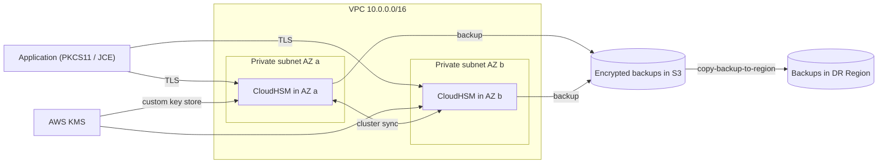
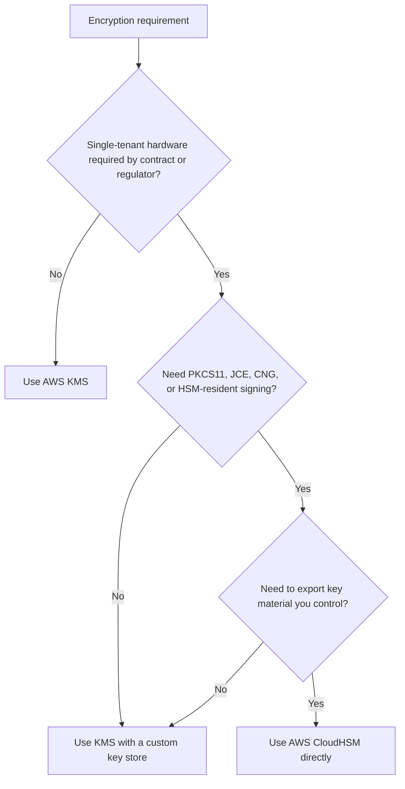
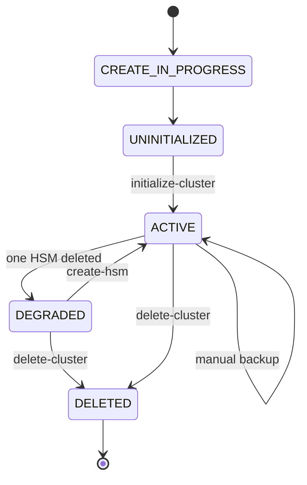

# 04 · AWS CloudHSM

> **Phase 6 — Security and Governance** · Lesson 04 of 11
> ⬅️ Previous: [AWS KMS](./03-aws-kms.md) · ➡️ Next: [Nitro Enclaves](./05-nitro-enclaves.md) · 🏠 [Phase overview](./README.md)

## 🎯 Learning Objectives

By the end of this lesson you will be able to:

- Explain the difference between a multi-tenant KMS service and single-tenant HSM hardware
- Describe what FIPS 140-2 Level 3 validation actually requires and which workloads demand it
- Decide when CloudHSM is worth the cost, and when KMS is the correct answer
- Create a CloudHSM cluster, initialize it, and back it up across Regions
- Explain key custody: who can extract, use, or destroy key material in each model

**Estimated time:** 60 min · **Difficulty:** Advanced

---

## 🧠 Core Concepts

**AWS CloudHSM** gives you dedicated hardware security modules inside AWS. The HSM is a physical device in an AWS data center, connected to your VPC by an elastic network interface in a subnet you choose — but the *cryptographic module* is single-tenant. No other AWS customer shares the device, the partitions, or the tamper-protected key store. That property, not raw performance, is the reason CloudHSM exists.

The compliance hook is **FIPS 140-2 Level 3**. Level 1 covers basic correctness; Level 2 adds tamper evidence; Level 3 adds *tamper resistance* — identity-based authentication, and physical mechanisms that cause keys to self-destruct when the chassis is opened. CloudHSM hardware is validated at Level 3, and the HSM is the place where keys are generated, stored, and used without ever existing as readable bytes outside the device. KMS is also built on Level 3 validated hardware, but the operations are a shared-service abstraction; CloudHSM hands you the device boundary itself.

The dividing line in practice is **key custody and non-AWS crypto**. Choose KMS unless you can answer "yes" to at least one of these: a regulator or contract requires single-tenant, FIPS 140-2 Level 3 hardware that you own; you must run standard PKCS#11, JCE, or CNG crypto operations (for example, signing with an HSM-resident key inside a Java application, or database Transparent Data Encryption offloading); you need to integrate an on-premises PKI or a third-party CA that speaks PKCS#11; or you need to export key material wrapped under a key you control.

Operationally, the interesting thing about CloudHSM is that **you are the key custodian**. There is no AWS-side recovery: if you lose every HSM and every backup, no support ticket restores your keys. Backups are encrypted under an **ephemeral backup key** stored on the HSM, with a wrap key you manage — lose all HSMs and backups at once and the data they protected is gone forever. High availability therefore means at least **two HSMs in different Availability Zones** in the same cluster, which is also where the cost lands.

You can get the best of both worlds with a **KMS custom key store**: point KMS at a CloudHSM cluster and KMS will use your single-tenant HSMs as the backing store for KMS keys, so applications keep using the plain KMS API and the control plane stays managed. The trade-offs are latency (KMS must reach your cluster) and availability (if the cluster is down, those keys are unusable).

### Key terminology

| Term | Meaning |
|------|---------|
| **HSM appliance** | The physical single-tenant device, joined to your VPC via an ENI. |
| **Cluster** | One or more HSMs in the same Region, sharing configuration, users, and backups. |
| **HSM type** | `hsm1.medium` (FIPS 140-2 Level 3 validated) or the newer generation `hsm2m.medium`, which requires choosing a FIPS mode. |
| **Crypto user (CU)** | The HSM user that performs crypto operations; authenticates against the cluster. |
| **Crypto officer (CO)** | The HSM user that creates and manages other users and keys. |
| **Backup** | Encrypted cluster state stored in S3 under a service-linked bucket, replicable across Regions. |
| **Ephemeral backup key** | Per-HSM random key stored on the device, used to encrypt backup data. |
| **Custom key store** | A KMS construct whose backing store is your CloudHSM cluster. |
| **Dedicated HSM** | A separate, older product: a single partition of a single device, with no clustering, no automatic backups, and no HA. |

---

## 🗺️ Architecture Diagram

Two CloudHSM appliances in two Availability Zones, plus a custom key store so KMS applications can use them:



Choosing between KMS and CloudHSM for a given requirement:



State of a cluster and its HSMs over time:



---

## 🧪 Hands-on Lab: Create a Two-AZ CloudHSM Cluster

**Goal:** Build a highly available CloudHSM cluster, initialize it with the client SDK, and confirm a backup exists.

**Prerequisites:** A VPC with two private subnets in different Availability Zones, an SSH key pair for cluster initialization, administrator credentials, and a budget that tolerates ~$3/hour while the lab is running.

### Step 1 — Create the cluster with one HSM

```bash
# Create the cluster in the first private subnet
CLUSTER=$(aws cloudhsmv2 create-cluster \
  --hsm-type hsm1.medium \
  --subnet-ids subnet-0a1b2c3d4e5f60718 \
  --backup-retention-policy Type=DAYS,Value=30 \
  --tags Key=Environment,Value=lab \
  --query 'Cluster.ClusterId' --output text)

echo "Cluster: $CLUSTER"

# Wait until the cluster reaches UNINITIALIZED — this can take several minutes
aws cloudhsmv2 describe-clusters --filters clusterIds="$CLUSTER" \
  --query 'Clusters[0].State'
```

### Step 2 — Get the CSR and sign it with your own CA

CloudHSM clusters authenticate with a customer-generated certificate, not an AWS-issued one. This is the root of the "you are the custodian" model.

```bash
# Download the certificate signing request generated by the first HSM
aws cloudhsmv2 describe-clusters --filters clusterIds="$CLUSTER" \
  --query 'Clusters[0].Certificates' > cluster-certs.json

# Extract the CSR and sign it with your own CA key (kept offline in production)
python -c "
import json
certs = json.load(open('cluster-certs.json'))
open('cluster.csr', 'wb').write(bytes.fromhex(certs['ClusterCsr']['Cert']))
"

openssl req -new -x509 -days 3650 -subj "/CN=cloudhsm-lab-ca" \
  -keyout customerCA.key -out customerCA.crt

openssl x509 -req -days 3650 -in cluster.csr \
  -CA customerCA.crt -CAkey customerCA.key -CAcreateserial \
  -out cluster-signed.crt -sha512
```

### Step 3 — Initialize the cluster

```bash
# The client SDK's configure tool initializes the cluster with the signed cert
# On macOS/Linux use the CloudHSM CLI; the classic SDK uses the same command name.
/opt/cloudhsm/bin/configure-cluster --cluster-id "$CLUSTER" --region eu-west-1

# Supply the customer CA certificate along with the cluster's own certificate
aws cloudhsmv2 initialize-cluster \
  --cluster-id "$CLUSTER" \
  --signed-cert file://cluster-signed.crt \
  --trust-anchor file://customerCA.crt

# Poll until the cluster is ACTIVE
aws cloudhsmv2 describe-clusters --filters clusterIds="$CLUSTER" \
  --query 'Clusters[0].State'
```

### Step 4 — Add a second HSM in another Availability Zone

```bash
# A single HSM is a downtime event waiting to happen; add one in a second AZ
aws cloudhsmv2 create-hsm \
  --cluster-id "$CLUSTER" \
  --availability-zone eu-west-1b

aws cloudhsmv2 describe-clusters --filters clusterIds="$CLUSTER" \
  --query 'Clusters[0].Hsms[].{Id:HsmId,AZ:AvailabilityZone,State:State}'
```

### Step 5 — Create HSM users and back up

```bash
# Crypto officer creates the crypto user used by applications.
# Run these interactively against the cluster with the CloudHSM CLI.
cloudhsm-cli user create --username admin-co --role crypto-officer --password 'REPLACE_ME'
cloudhsm-cli user create --username app-user --role crypto-user --password 'REPLACE_ME'

# Create a manual backup and copy it to another Region for DR
BACKUP=$(aws cloudhsmv2 create-backup --cluster-id "$CLUSTER" \
  --query 'Backup.BackupId' --output text)

aws cloudhsmv2 copy-backup-to-region \
  --backup-id "$BACKUP" \
  --destination-region us-east-1

aws cloudhsmv2 describe-backups --query 'Backups[].{Id:BackupId,State:BackupState}'
```

### Step 6 — Optional: hook KMS up to the cluster

```bash
# A custom key store lets KMS keys live on your single-tenant HSMs
aws kms create-custom-key-store \
  --custom-key-store-name cloudhsm-lab-store \
  --cloud-hsm-cluster-id "$CLUSTER" \
  --key-store-password 'REPLACE_ME' \
  --trust-anchor-certificate file://customerCA.crt

# Check connectivity before creating keys in it
aws kms describe-custom-key-stores --query 'CustomKeyStores[].{Name:CustomKeyStoreName,State:ConnectionState}'

# Create a key inside the custom key store
aws kms create-key \
  --origin AWS_CLOUDHSM \
  --custom-key-store-id cks-1234567890abcdef0 \
  --description "HSM-backed key for payment signing"
```

### Step 7 — Verify and then tear down

```bash
# Confirm the topology: two HSMs in two AZs, both healthy
aws cloudhsmv2 describe-clusters --filters clusterIds="$CLUSTER" \
  --query 'Clusters[0].{State:State,HSMs:Hsms[].HsmId,Subnets:SubnetMapping}'

# Verify a backup exists and where it lives
aws cloudhsmv2 describe-backups --filters clusterIds="$CLUSTER" \
  --query 'Backups[].{Id:BackupId,Region:BackupArn}'

# Delete the cluster when the lab is over — it bills hourly
aws cloudhsmv2 delete-cluster --cluster-id "$CLUSTER"
```

Deletion takes effect and stops billing once the final backup is written; keep the backup if any ciphertext in your environment still depends on those keys.

---

## 💻 CLI Reference

```bash
# Inventory clusters, HSMs, and their Availability Zones
aws cloudhsmv2 describe-clusters
aws cloudhsmv2 describe-clusters --filters states=ACTIVE

# Add or remove capacity
aws cloudhsmv2 create-hsm --cluster-id "$CLUSTER" --availability-zone eu-west-1c
aws cloudhsmv2 delete-hsm --cluster-id "$CLUSTER" --eni-id eni-0abc123def4567890 --eni-ip 10.0.1.25

# Backups: create, list, restore, copy across Regions
aws cloudhsmv2 create-backup --cluster-id "$CLUSTER"
aws cloudhsmv2 describe-backups --filters clusterIds="$CLUSTER"
aws cloudhsmv2 restore-backup --backup-id backup-1234567890abcdef0
aws cloudhsmv2 copy-backup-to-region --backup-id backup-1234567890abcdef0 --destination-region us-east-1

# Modify backup retention
aws cloudhsmv2 modify-backup-attributes \
  --backup-id backup-1234567890abcdef0 \
  --never-expires

# Manage the KMS custom key store bound to the cluster
aws kms describe-custom-key-stores
aws kms connect-custom-key-store --custom-key-store-id cks-1234567890abcdef0
aws kms disconnect-custom-key-store --custom-key-store-id cks-1234567890abcdef0

# Legacy single-tenant option (Dedicated HSM), separate API and Regions
aws cloudhsm list-hsms
aws cloudhsm describe-hsm --hsm-arn arn:aws:cloudhsm:us-east-1:111122223333:hsm/hsm-abc123
```

| Command | Purpose |
|---------|---------|
| `aws cloudhsmv2 create-cluster` | Provisions the first HSM and the cluster control plane |
| `aws cloudhsmv2 initialize-cluster` | Activates the cluster with your signed certificate |
| `aws cloudhsmv2 create-hsm` | Adds an HSM in another AZ for high availability |
| `aws cloudhsmv2 create-backup` | Captures encrypted cluster state you can restore elsewhere |
| `aws cloudhsmv2 copy-backup-to-region` | Prepares cross-Region disaster recovery |
| `aws kms create-custom-key-store` | Bridges the KMS API to your single-tenant HSMs |

---

## ✅ Best Practices

| Practice | Why it matters |
|----------|----------------|
| Always run at least two HSMs in two AZs | One HSM means a maintenance window is an outage |
| Keep the customer CA key offline, not in the account | It is the only way to add HSMs or restore backups; compromise means forged cluster auth |
| Separate crypto officer and crypto user roles, with different people | Mirrors hardware-security separation of duties |
| Enable backups and copy them to a second Region | Backups are the only recovery path — AWS cannot restore your keys |
| Use KMS with a custom key store when the API surface allows it | You keep managed control-plane features like audit and rotation |
| Pin the client SDK and app to the cluster's ENIs in private subnets | HSM traffic should never traverse the internet |
| Measure latency before committing | HSM round trips add milliseconds; high-throughput signing may need batching or KMS |
| Prefer newer `hsm2m.medium` for new clusters | Current generation hardware and security modes |

---

## ⚠️ Common Pitfalls

| Pitfall | Symptom | Fix |
|---------|---------|-----|
| Single HSM in a single AZ | Cluster DEGRADED after maintenance, crypto operations fail | Add a second HSM in another AZ before going live |
| Losing the customer CA private key | Cannot add HSMs, cannot restore backups | Store it in an offline HSM or split-knowledge safe; test recovery |
| Assuming AWS can restore keys | Support ticket ends with "no recovery possible" | Design backups and cross-Region copies as first-class requirements |
| Forgetting that latency is on the critical path | p99 latency spikes in payment flows | Batch operations, pool connections, or use KMS for high-volume paths |
| Deleting the cluster before checking dependents | Existing ciphertext becomes undecryptable | Inventory every key's consumers, keep final backups, and stage deletion |
| Using CloudHSM for ordinary S3/EBS encryption | Cost jumps by 100x with no added benefit | Use KMS default encryption; reserve HSM for keys that need single tenancy |
| Mixing Legacy Dedicated HSM with CloudHSM assumptions | No clustering, no backups, unexpected availability gaps | Use CloudHSM clusters, or explicitly design around Dedicated HSM's limits |

---

## 💰 Cost Considerations

CloudHSM is priced per HSM-hour and is by far the most expensive option in this phase. A single HSM costs roughly **$1.45 per hour** (us-east-1 list) which is about **$1,050 per month**; a production pair in two AZs is therefore around **$2,100 per month**, before any data transfer. Backups beyond the included retention, and cross-Region backup copies, add storage and transfer charges. Legacy Dedicated HSM is priced similarly per hour but gives you no clustering.

The only sane way to look at this bill is *per protected workload*: $2,100/month is trivial if it unlocks a payments contract or satisfies a regulator, and absurd if it protects a bucket of internal logs that KMS would encrypt for $1/month. Two cost controls matter. First, **delete lab clusters immediately** — an afternoon of experimentation costs about $10, but forgetting one returns in the next invoice as $1,050. Second, **avoid using CloudHSM as the backing store for bulk data encryption**; even with a custom key store, every KMS operation becomes an HSM round trip, which increases both request volume and latency-driven over-provisioning.

---

## 🔐 Security Considerations

- **You own custody, so you own the loss.** AWS has no escrow of your HSM keys. Document who holds the customer CA key, how backups are protected, and how recovery is tested at least annually.
- **The cluster certificate chain is the trust anchor for the cluster.** Anyone with the customer CA key can add an HSM to your cluster or forge cluster authentication, so treat that key as your highest-value secret.
- **HSM users are separate from IAM users.** `cloudhsm-cli user create` creates identities internal to the cluster; IAM controls who can call the CloudHSM *control plane* (`cloudhsmv2:*`) but not who is a crypto user on the device.
- **Control-plane privileges are destructive.** `cloudhsmv2:DeleteCluster` and `cloudhsmv2:DeleteHsm` can render keys permanently unusable; deny them in SCPs except for a break-glass role, and require MFA.
- **Backups contain key material** in encrypted form; protect the service-linked S3 bucket with the same rigor as the cluster, and restrict who can call `RestoreBackup`.
- **Enforce FIPS mode where required.** `hsm2m.medium` supports both FIPS and non-FIPS modes; a payment or government workload should be pinned to a FIPS mode cluster, and that decision recorded as evidence.
- **Network path matters.** Place HSMs in private subnets with no route to the internet, restrict security groups to the client subnets, and monitor for unexpected clients using VPC Flow Logs.
- **Alarm on control-plane changes.** Any `CreateHsm`, `DeleteHsm`, `RestoreBackup`, or `DeleteCluster` event is an emergency-worthy signal in a production account.

---

## 🧩 Exercise

Write a one-page decision record for a fictional payments platform that must sign card transactions with an HSM-resident key, store the signing key under dual control, and prove FIPS 140-2 Level 3 to an auditor. In the record, state whether you chose KMS, KMS with a custom key store, or CloudHSM directly; name the exact CLI commands you would use to provision it; and include a worked monthly cost estimate for a two-AZ production cluster plus a DR backup Region. Finish by listing the three events that would cause you to reconsider the decision.

Success looks like: a decision record with a defensible cost figure (within ~10% of the real hourly math), an explicit statement of who holds the customer CA key, and a named recovery test you would run in the first 90 days.

---

## 📚 Resources

- [AWS CloudHSM User Guide](https://docs.aws.amazon.com/cloudhsm/latest/userguide/introduction.html)
- [CloudHSM clusters](https://docs.aws.amazon.com/cloudhsm/latest/userguide/clusters.html)
- [CloudHSM backups](https://docs.aws.amazon.com/cloudhsm/latest/userguide/backups.html)
- [AWS KMS custom key stores](https://docs.aws.amazon.com/kms/latest/developerguide/custom-key-store-overview.html)
- [FIPS 140 compliance: cryptographic modules](https://aws.amazon.com/compliance/fips/)
- [AWS CloudHSM pricing](https://aws.amazon.com/cloudhsm/pricing/)
- [AWS Dedicated HSM](https://aws.amazon.com/cloudhsm/dedicated-hsm/)

---

## ➡️ Next Steps

CloudHSM protects keys, and KMS protects data at rest, but neither protects data *while a process is using it* on a shared instance — a root-level attacker on the host can read memory. The next lesson covers Nitro Enclaves, which carve out an isolated execution environment on a Nitro instance precisely for that gap.

> ⬅️ Previous: [AWS KMS](./03-aws-kms.md) · ➡️ Next: [Nitro Enclaves](./05-nitro-enclaves.md) · 🏠 [Phase overview](./README.md)
