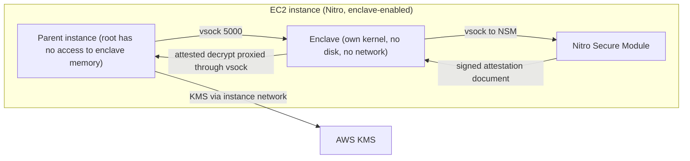
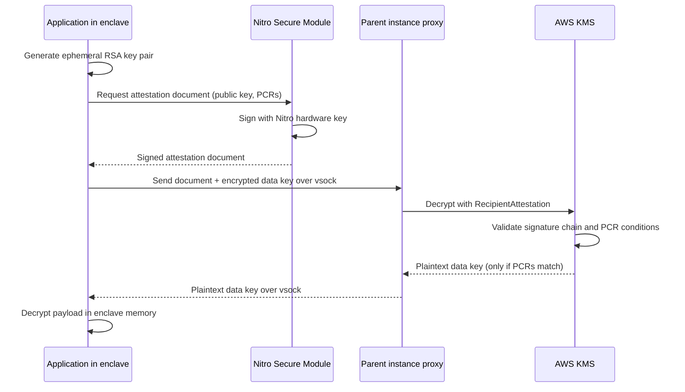
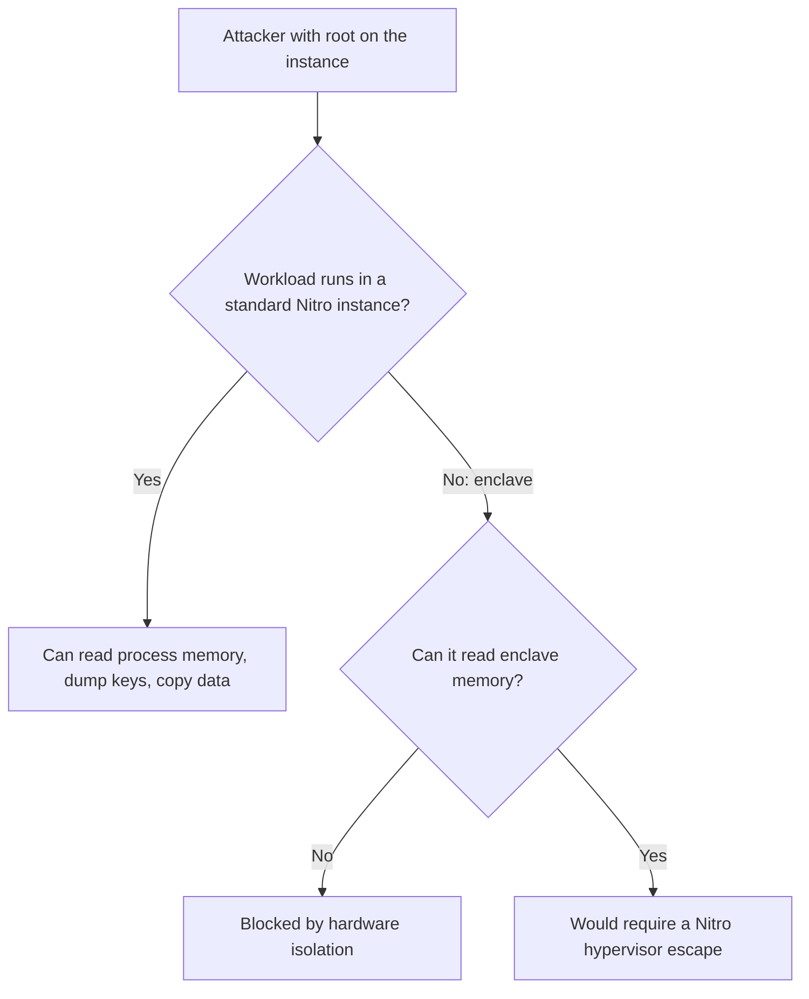

# 05 · Nitro Enclaves

> **Phase 6 — Security and Governance** · Lesson 05 of 11
> ⬅️ Previous: [AWS CloudHSM](./04-aws-cloudhsm.md) · ➡️ Next: [AWS Security Hub](./06-aws-security-hub.md) · 🏠 [Phase overview](./README.md)

## Learning Objectives

By the end of this lesson you will be able to:

- Describe how the Nitro system removes operator access to instance memory and storage
- Explain cryptographic attestation and how it lets KMS trust an enclave's identity
- Build, run, and debug an enclave with `nitro-cli` on an enclave-enabled instance
- State the limitations of enclaves and pick appropriate use cases such as PCI PIN key custody
- Write a KMS key policy that only permits decryption from your exact enclave image

**Estimated time:** 75 min · **Difficulty:** Advanced

---

## Core Concepts

**AWS Nitro System** is the platform underneath every modern EC2 instance. Networking, storage, and management are handled by dedicated hardware cards rather than by a hypervisor running on the host CPU, and the hypervisor itself is deliberately thin. The consequence that matters here is that **AWS operators have no ability to log into the host, read instance memory, or touch customer data** — there is no SSH path into the Nitro controller, and AWS describes this as a design goal rather than a policy.

**Nitro Enclaves** extend that isolation to a nested boundary inside your own instance. An enclave is a separate virtual machine created by the Nitro hypervisor, with its own kernel, its own memory, and **no persistent storage, no network interfaces, and no interactive access**. The parent instance can talk to the enclave only over a local virtual socket (**vsock**), which means an operator inside the parent instance — even root — cannot read enclave memory, attach a debugger, or copy data out except through the interfaces your enclave code exposes. The instance must be one of the Nitro-based, enclave-enabled families (C5/C6i, M5/M6i, R5/R6i, and their metal variants).

The trust mechanism is **attestation**. When an enclave starts, its measurements — a hash of the enclave image (PCR0), of the kernel and bootstrap (PCR1, PCR2), of the application (PCR3), and of the signing certificate (PCR8) — are computed and stored in the **Nitro Secure Module (NSM)**, a dedicated hardware component. When the enclave needs a secret, it requests a signed **attestation document** from the NSM that contains those measurements plus a public key. KMS verifies the signature against the AWS Nitro certificate chain and checks the PCRs against conditions in the key policy. Only then does it return plaintext — which the enclave decrypts locally with the ephemeral private key it generated. This is the cryptographic handshake that lets a public cloud service trust a specific, unmodified binary running inside your instance.

Real use cases follow directly from the property "root cannot read this memory". **PCI PIN** requires that PIN encryption keys are never accessible to operators, and enclaves satisfy the key-custody control without dedicated hardware. Stronger key custody for any application (a "customer-managed HSM substitute") uses the same attested KMS pattern. **Multi-party computation and privacy computing** benefit because two parties can process a joint dataset without either party's operators seeing the other's inputs. What unlocks each case is the same primitive: attested decryption, so the plaintext only ever exists in memory that no human can read.

### Key terminology

| Term | Meaning |
|------|---------|
| **Nitro System** | AWS-designed hardware and firmware stack that removes operator access from the data plane. |
| **Enclave** | Isolated VM with dedicated vCPUs and memory, no storage, no network, no interactive shell. |
| **EIF** | Enclave Image File — the signed, measured artifact produced by `nitro-cli build-enclave`. |
| **vsock** | Virtual socket used for the only communication path between parent instance and enclave. |
| **NSM** | Nitro Secure Module, the hardware component that signs attestation documents. |
| **PCR** | Platform Configuration Register holding a measurement of the enclave image or components. |
| **Attestation document** | NSM-signed statement of measurements, public key, and optional user data. |
| **kmstool-enclave-cli** | AWS-provided client that performs the attested KMS call from inside an enclave. |
| **Enclave CID** | Context identifier for the enclave's vsock endpoint, analogous to a port. |

---

## Architecture Diagram

The topology: an enclave inside a Nitro instance, with the only exits being vsock to the parent and an attested KMS call to the outside world:



The attestation flow, which is the heart of the lesson:



Comparison: what the same attacker can reach with and without an enclave:



---

## Hands-on Lab: Attested Decryption in an Enclave

**Goal:** Build an enclave image, run it on an enclave-enabled instance, and prove that KMS will only decrypt when the PCR measurement matches.

**Prerequisites:** An enclave-enabled instance (for example `m5.xlarge` or larger, or `c5.xlarge`), Amazon Linux 2023, Docker or Podman installed, the Nitro Enclaves CLI, and a KMS symmetric key.

### Step 1 — Enable enclaves and install the tooling

```bash
# Enable enclave support on the instance (requires a stop/start, not just reboot)
aws ec2 modify-instance-attribute \
  --instance-id i-0123456789abcdef0 \
  --enclave-options Enabled=true

# Confirm the instance reports enclave support
aws ec2 describe-instances \
  --instance-ids i-0123456789abcdef0 \
  --query 'Reservations[0].Instances[0].EnclaveOptions'

# On the instance itself: install the CLI and the allocator service
sudo dnf install -y aws-nitro-enclaves-cli aws-nitro-enclaves-cli-devel
sudo usermod -aG ne ec2-user
sudo systemctl enable --now nitro-enclaves-allocator.service

# Reserve resources for the enclave from the instance's pool
sudo sed -i 's/^cpu_count:.*/cpu_count: 2/' /etc/nitro_enclaves/allocator.yaml
sudo sed -i 's/^memory_mib:.*/memory_mib: 1024/' /etc/nitro_enclaves/allocator.yaml
sudo systemctl restart nitro-enclaves-allocator.service
```

### Step 2 — Write a minimal enclave application

The enclave app reads a ciphertext blob over vsock, obtains an attestation document, and asks KMS to decrypt — this is the pattern every real workload follows, just with more code.

```python
# app.py — runs inside the enclave; listens on vsock for base64 ciphertext
import socket, subprocess, json

VSOCK_PORT = 5000
CID_ANY = 0xFFFFFFFF

def handle(conn):
    payload = b""
    while True:
        chunk = conn.recv(4096)
        if not chunk:
            break
        payload += chunk
        if len(chunk) < 4096:
            break
    # kmstool-enclave-cli performs the attested KMS call from inside the enclave
    out = subprocess.run(
        ["/usr/bin/kmstool-enclave-cli", "--decrypt",
         "--ciphertext", payload.decode(), "--region", "eu-west-1"],
        capture_output=True, text=True,
    )
    conn.sendall(out.stdout.encode() or out.stderr.encode())

with socket.socket(socket.AF_VSOCK, socket.SOCK_STREAM) as s:
    s.bind((CID_ANY, VSOCK_PORT))
    s.listen(5)
    while True:
        conn, _ = s.accept()
        handle(conn)
        conn.close()
```

### Step 3 — Build the EIF and note the measurements

```bash
# Package the app in a Dockerfile that starts it on boot
cat > Dockerfile <<'EOF'
FROM amazonlinux:2023
RUN dnf install -y python3 aws-nitro-enclaves-cli
COPY app.py /app.py
CMD ["python3", "/app.py"]
EOF

docker build -t enclave-demo:latest .

# Build the signed, measured Enclave Image File
nitro-cli build-enclave --docker-uri enclave-demo:latest --output-file enclave-demo.eif
```

The command prints an `Measurements` block containing `PCR0`, `PCR1`, `PCR2`, and related hashes. **Record `PCR0`** — it is the identity of this exact image, and it is the value you will pin in the KMS key policy.

### Step 4 — Write the KMS key policy that trusts only this enclave

```json
{
  "Version": "2012-10-17",
  "Statement": [
    {
      "Sid": "AllowKeyAdministration",
      "Effect": "Allow",
      "Principal": {
        "AWS": "arn:aws:iam::111122223333:root"
      },
      "Action": [
        "kms:Create*",
        "kms:Describe*",
        "kms:Enable*",
        "kms:List*",
        "kms:Put*",
        "kms:Update*",
        "kms:Revoke*",
        "kms:Get*",
        "kms:TagResource",
        "kms:UntagResource",
        "kms:ScheduleKeyDeletion",
        "kms:CancelKeyDeletion"
      ],
      "Resource": "*"
    },
    {
      "Sid": "AllowOnlyThisEnclaveImageToDecrypt",
      "Effect": "Allow",
      "Principal": {
        "AWS": "arn:aws:iam::111122223333:role/parent-instance-role"
      },
      "Action": ["kms:Decrypt", "kms:GenerateDataKey"],
      "Resource": "*",
      "Condition": {
        "StringEquals": {
          "kms:RecipientAttestation:ImageSha384": "REPLACE_WITH_PCR0_MEASUREMENT"
        },
        "StringEqualsIgnoreCase": {
          "kms:EncryptionContext:service": "enclave-demo"
        }
      }
    }
  ]
}
```

Apply it with `aws kms put-key-policy --key-id alias/enclave-demo --policy-name default --policy file://enclave-key-policy.json`. The parent instance role still needs `kms:Decrypt` in its identity policy — the attestation condition is an additional gate, not a replacement.

### Step 5 — Run the enclave and prove the isolation

```bash
# Start the enclave with 2 vCPUs and 1 GiB of memory
nitro-cli run-enclave \
  --cpu-count 2 \
  --memory 1024 \
  --enclave-cid 16 \
  --eif-path enclave-demo.eif

# Inspect the running enclave: it has its own PID namespace and no network
nitro-cli describe-enclaves

# Look at the enclave's own kernel log
nitro-cli console --enclave-id "$(nitro-cli describe-enclaves | jq -r '.[0].EnclaveID')"

# From the parent: attach to the enclave and you see ONLY the app's own output —
# there is no shell, no filesystem to browse, and no way to read its memory
nitro-cli console --enclave-id "$(nitro-cli describe-enclaves | jq -r '.[0].EnclaveID')" --debug-mode
```

### Step 6 — Verify attestation is actually enforcing

```bash
# Create ciphertext bound to the enclave's encryption context
aws kms encrypt --key-id alias/enclave-demo \
  --plaintext fileb://secret.txt \
  --encryption-context service=enclave-demo \
  --query CiphertextBlob --output text > secret.b64

# 1. Decrypt with an unrestricted principal and NO attestation: must FAIL
aws kms decrypt --ciphertext-blob fileb://secret.b64 \
  --encryption-context service=enclave-demo

# 2. Decrypt from inside the enclave via vsock: must SUCCEED
./send-to-enclave.sh "$(cat secret.b64)"

# 3. Rebuild the enclave with one byte changed, then retry: must FAIL again,
#    because PCR0 changed and the key policy no longer matches
sed -i 's/VSOCK_PORT = 5000/VSOCK_PORT = 5001/' app.py
docker build -t enclave-demo:v2 . && nitro-cli build-enclave --docker-uri enclave-demo:v2 --output-file enclave-demo-v2.eif
```

Step 6 part 3 is the whole point of the lesson: the moment the code changes, the measurement changes, and KMS stops handing over the key. Treat `nitro-cli build-enclave` output as a deployment artifact you must record and review, because updating the key policy is how you approve a new enclave version.

### Step 7 — Clean up

```bash
# Stop the enclave so the instance can reclaim its resources
nitro-cli terminate-enclave --enclave-id "$(nitro-cli describe-enclaves | jq -r '.[0].EnclaveID')"

# Disable enclaves on the instance when the lab is finished
aws ec2 modify-instance-attribute --instance-id i-0123456789abcdef0 \
  --enclave-options Enabled=false
```

---

## CLI Reference

```bash
# Build an enclave image and print its measurements
nitro-cli build-enclave --docker-uri myapp:latest --output-file myapp.eif
nitro-cli build-enclave --docker-dir ./app --docker-uri myapp:latest --output-file myapp.eif --private-key signing.key --signing-certificate signing.crt

# Run, inspect, and stop enclaves
nitro-cli run-enclave --cpu-count 4 --memory 4096 --eif-path myapp.eif --enclave-cid 20
nitro-cli describe-enclaves
nitro-cli console --enclave-id enclave-1234567890abcdef0
nitro-cli terminate-enclave --enclave-id enclave-1234567890abcdef0
nitro-cli terminate-enclave --all

# Inspect the instance's enclave resource pool
nitro-cli allocator-info

# Read measurements of a built image without running it
nitro-cli describe-eif --eif-path myapp.eif

# Attested KMS operations from inside the enclave
kmstool-enclave-cli --decrypt --ciphertext "$CIPHERTEXT" --region eu-west-1

# Attested certificate retrieval (AWS Certificate Manager for Nitro Enclaves)
nitro-cli run-enclave --eif-path acm-enclave.eif --cpu-count 2 --memory 1024

# Verify from the parent instance that enclave support is on
aws ec2 describe-instances --instance-ids i-0123456789abcdef0 \
  --query 'Reservations[0].Instances[0].EnclaveOptions.Enabled'
```

| Command | Purpose |
|---------|---------|
| `nitro-cli build-enclave` | Turns a container into a signed, measured EIF |
| `nitro-cli describe-eif` | Prints the measurements you will pin in a KMS key policy |
| `nitro-cli run-enclave` | Starts the enclave with a fixed vCPU and memory allocation |
| `nitro-cli describe-enclaves` | Lists running enclaves, their CID, and their state |
| `nitro-cli console` | Streams the enclave's own kernel/application log |
| `kmstool-enclave-cli` | Performs the attested KMS call from inside the enclave |
| `aws ec2 modify-instance-attribute` | Enables or disables enclave support on the instance |

---

## Best Practices

| Practice | Why it matters |
|----------|----------------|
| Pin `PCR0` (or `ImageSha384`) in the KMS key policy | Attestation without a pinned measurement trusts any code that can reach your instance |
| Sign EIFs with your own certificate and record the measurements in the build log | Turns "which binary is this?" into an auditable supply-chain artifact |
| Keep the enclave's *only* output on a narrow vsock API | Every additional interface is an exfiltration path |
| Never enable `--debug-mode` in production | Debug mode allows a parent-instance console into the enclave and prints a loud warning |
| Reserve only the vCPUs and memory the enclave needs | The parent instance runs on what is left, so over-allocation starves your app |
| Design for enclave restart | An enclave is ephemeral; state lives in memory only, so plan for recovery and replay |
| Treat a new EIF as a new deployment | Changing code invalidates the attestation, which is a feature — pair it with change control |
| Use an instance with enough headroom (or a metal instance) | You pay for the whole instance, not just the enclave |

---

## Common Pitfalls

| Pitfall | Symptom | Fix |
|---------|---------|-----|
| Using a non-enclave-enabled instance type | `nitro-cli run-enclave` fails immediately | Move to an enclave-enabled family such as C5/C6i, M5/M6i, R5/R6i |
| Forgetting the allocator service | `Insufficient resources` errors on start | Enable and configure `nitro-enclaves-allocator.service`, then restart it |
| Docker instead of Podman on some bases | Unexpected image format problems | Both work, but keep the base image's tooling consistent across build and instance |
| Attestation conditions on a role that cannot call KMS anyway | Attestation "works" but nothing has ever been restricted | Ensure the parent role has `kms:Decrypt` and remove any broader unconditional grant |
| Expecting enclaves to persist data | Application state vanishes on restart | Keep state outside and re-derive or re-fetch it |
| Assuming the enclave can reach the internet | SDK calls time out inside the enclave | All egress goes through the parent over vsock; the enclave is network-isolated by design |
| Leaving the old key policy in place after rebuilding | New image version fails with `AccessDenied` | Update the pinned measurement as part of the deployment |
| Testing with `--debug-mode` and shipping it | Debug shell available to the parent instance | Gate debug mode behind an environment check and alarm on its use |

---

## Cost Considerations

Nitro Enclaves themselves are **free** — there is no line item for the feature, the NSM, or the attestation. You pay for the EC2 instance that hosts the enclave, and that is where the design decision shows up. The enclave's vCPUs and memory are *carved out* of the instance, so if a workload needs 4 vCPUs for the enclave plus 4 for the parent, you need an instance with at least 8 vCPUs — and the parent's memory footprint usually means sizing up one class rather than sharing one.

Metal instances remove that friction at a much higher price point: they let you configure CPU and memory pools exactly, but they cost far more per hour than a functionally equivalent virtual instance. The practical rule is to size for the parent's *measured* usage and add the enclosure, not to double defensively. Because instances are billed whether or not the enclave runs, remember to stop instances between experiments and to disable enclave options on instances that are permanently done with the feature.

---

## Security Considerations

- **Attestation is only as strong as the measurement you pin.** A key policy that allows `kms:Decrypt` without a `RecipientAttestation` condition provides no enclave-specific protection at all.
- **The parent instance remains a hostile environment by assumption.** Anyone with root on the parent can talk to your vsock API, so authenticate and validate every request the enclave accepts, and keep the API surface minimal.
- **Protect the EIF build pipeline.** If an attacker can build an EIF and update the key policy, they can run their own code inside an attested enclave. Treat the signing key and the key policy as production secrets under review.
- **Do not log secrets inside the enclave.** The console output is visible to the parent instance, so the enclave's own logs are not confidential.
- **Enclave memory is not persisted and not swappable**, which is a security benefit — but it means availability depends entirely on careful restart handling. Design a watchdog on the parent.
- **Use it where it earns its keep.** PCI PIN transactions, key custody, and privacy-preserving computation are textbook fits; using an enclave for a web tier adds cost and operational complexity without changing the threat model.
- **Alarm on `kms:Decrypt` failures with attestation conditions.** Persistent failures usually mean an image was rebuilt without a policy update — or someone is probing with a different image.
- **Pair enclaves with IMDSv2 and a strict instance role.** The parent role must be narrowly scoped, because the enclave's attested call inherits that role's authority.

---

## Exercise

Extend the lab into a two-version rollout. Rebuild the enclave image with a trivial application change, record both `PCR0` values, and write a KMS key policy that permits decryption from **both** attested images during a migration window. Then narrow it back to only the new image and demonstrate the old image failing. Document, in five bullet points, the deployment procedure you would put in a runbook so a rebuild never silently locks production out of its own data.

Success looks like: `kmstool-enclave-cli` returns plaintext for the approved image, `AccessDenied` for the unapproved one, and a runbook step that explicitly says "update the pinned measurement before rolling out a new EIF".

---

## Resources

- [AWS Nitro Enclaves User Guide](https://docs.aws.amazon.com/enclaves/latest/user/nitro-enclave.html)
- [Nitro Enclaves attestation](https://docs.aws.amazon.com/enclaves/latest/user/set-up-attestation.html)
- [Cryptographic attestation with AWS KMS](https://docs.aws.amazon.com/enclaves/latest/user/cmd-kmstool.html)
- [The AWS Nitro System](https://aws.amazon.com/ec2/nitro/)
- [Nitro Enclaves CLI reference](https://docs.aws.amazon.com/enclaves/latest/user/nitro-enclave-cli-ref.html)
- [AWS Certificate Manager for Nitro Enclaves](https://docs.aws.amazon.com/enclaves/latest/user/nitro-enclave-refapp.html)
- [NitroTPM](https://docs.aws.amazon.com/AWSEC2/latest/UserGuide/nitrotpm.html)

---

## Next Steps

You now control identity, keys, hardware custody, and isolated execution. The remaining gap is visibility: you need to know what is misconfigured, what is exposed, and what is actively attacking you — across every account. The next lesson starts that thread with Security Hub, the aggregation layer for all of it.

> ⬅️ Previous: [AWS CloudHSM](./04-aws-cloudhsm.md) · ➡️ Next: [AWS Security Hub](./06-aws-security-hub.md) · 🏠 [Phase overview](./README.md)
