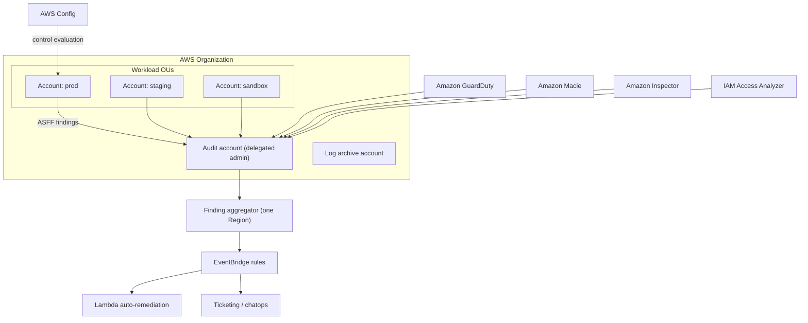
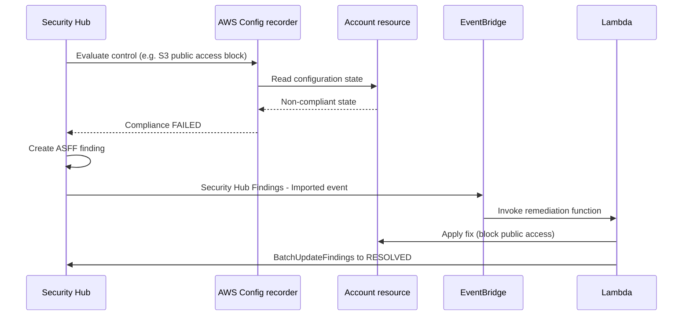
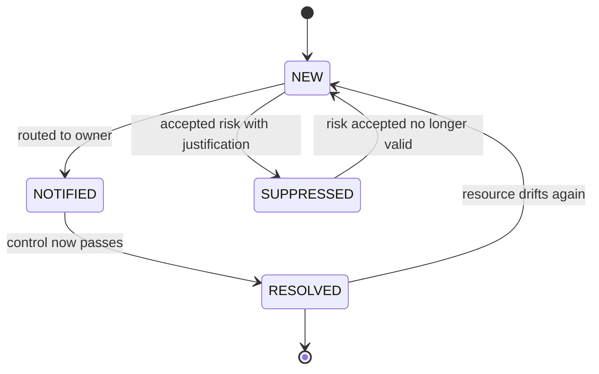

# 06 · AWS Security Hub

> **Phase 6 — Security and Governance** · Lesson 06 of 11
> ⬅️ Previous: [Nitro Enclaves](./05-nitro-enclaves.md) · ➡️ Next: [Amazon GuardDuty](./07-amazon-guardduty.md) · 🏠 [Phase overview](./README.md)

## 🎯 Learning Objectives

By the end of this lesson you will be able to:

- Explain what Security Hub aggregates and where its findings actually come from
- Enable the AWS Foundational Security Best Practices, CIS, and PCI DSS standards, and read the security score honestly
- Configure a delegated administrator and auto-enable for an entire organization
- Aggregate findings across accounts and Regions into a single view
- Automate triage and remediation using ASFF findings, EventBridge, and Lambda

**Estimated time:** 60 min · **Difficulty:** Intermediate

---

## 🧠 Core Concepts

**AWS Security Hub** is a findings aggregator, not a scanner of its own — with one important exception. Its job is to give you a single, normalized view of security posture across every account and Region: it runs **automated security checks** against **standards**, and it ingests findings from other services (GuardDuty, Macie, Inspector, IAM Access Analyzer, Firewall Manager, Config, and third-party partners) into a common format called **ASFF**, the AWS Security Finding Format. Every finding has an ID, severity, resource, compliance status, and remediation guidance in the same shape, which is what makes automation possible.

**Standards** are bundles of controls. The three you will enable first are **AWS Foundational Security Best Practices** (FSBP — AWS's own opinionated baseline, with severity-scored controls and per-control remediation), **CIS AWS Foundations Benchmark** (the Center for Internet Security baseline auditors recognize), and **PCI DSS** (for payment workloads). Enabling a standard makes Security Hub evaluate its controls against your account using **AWS Config**-style evaluation under the hood, so Config must be enabled in the account for many controls to produce results — if Config is off, controls sit in `NO_DATA` rather than `PASSED`.

The headline metric is the **security score**: the percentage of controls that pass. It is useful as a trend line and dangerous as a target. A score of 95% can hide a single critical control that fails everywhere, and a score of 60% may be perfectly acceptable in a sandbox account. Always read the score next to the count of **failed controls by severity**, and treat `CRITICAL` and `HIGH` failures as your actual work queue. Scores also only reflect the standards you enabled — passing FSBP says nothing about CIS.

At scale, three mechanics carry the weight. **Delegated administration** lets one account (typically the audit or security tooling account) manage Security Hub for the whole organization instead of running it per account. **Auto-enable** ensures new accounts are covered the moment they are created, instead of when someone remembers. **Finding aggregation** collects findings from linked Regions into one aggregator Region so you query one endpoint rather than managing N regional copies of your dashboards.

### Key terminology

| Term | Meaning |
|------|---------|
| **ASFF** | AWS Security Finding Format — the JSON schema every finding is normalized into. |
| **Control** | A single automated check inside a standard, with a defined pass/fail criterion. |
| **Standard** | A named bundle of controls (FSBP, CIS, PCI DSS) you enable per account. |
| **Security score** | Percentage of enabled controls currently passing, per standard and overall. |
| **Finding** | An instance of a control failure or an imported detection, with a workflow status. |
| **Delegated administrator** | The organization account that manages Security Hub for member accounts. |
| **Finding aggregator** | Region-level construct that links other Regions' findings into one view. |
| **Insight** | A saved, grouped query over findings (for example "resources with public IPs and open ports"). |
| **Workflow status** | `NEW`, `NOTIFIED`, `RESOLVED`, or `SUPPRESSED` — your triage state on a finding. |

---

## 🗺️ Architecture Diagram

The multi-account topology: a delegated administrator collecting from every account and Region into one view:



How a control becomes a finding and reaches a human:



Workflow state of a finding, which is what your team actually manages:



---

## 🧪 Hands-on Lab: Organization-Wide Security Hub with Aggregation

**Goal:** Turn on Security Hub across an organization with a delegated administrator, enable three standards, aggregate two Regions, and auto-remediate one control.

**Prerequisites:** AWS Organizations with the management account accessible, at least one member account, administrator credentials in both, and the Security Hub and Config service-linked roles allowed.

### Step 1 — Designate the delegated administrator

```bash
# Run in the MANAGEMENT account: let Organizations delegate Security Hub
aws organizations register-delegated-administrator \
  --account-id 111122223333 \
  --service-principal securityhub.amazonaws.com

# Confirm the delegation
aws organizations list-delegated-administrators \
  --service-principal securityhub.amazonaws.com
```

```bash
# Run in the DELEGATED ADMIN account: enable Security Hub itself
aws securityhub enable-security-hub --enable-default-standards

# Verify it is on and see which standards came with it
aws securityhub describe-hub
aws securityhub get-enabled-standards
```

### Step 2 — Auto-enable Security Hub for every account in the organization

```bash
# Run in the delegated admin account
aws securityhub update-organization-configuration --auto-enable

# Read back the organization configuration
aws securityhub get-organization-configuration

# Add every existing member account
aws securityhub create-members \
  --account-details AccountId=444455556666,Email=workloads@example.com

# Confirm membership status
aws securityhub list-members --only-associated
```

### Step 3 — Enable the three standards you care about

```bash
# AWS Foundational Security Best Practices
aws securityhub batch-enable-standards --standards-subscription-requests \
  StandardsArn="arn:aws:securityhub:eu-west-1::standards/aws-foundational-security-best-practices/v/1.0.0"

# CIS AWS Foundations Benchmark
aws securityhub batch-enable-standards --standards-subscription-requests \
  StandardsArn="arn:aws:securityhub:eu-west-1::standards/cis-aws-foundations-benchmark/v/1.4.0"

# PCI DSS (only meaningful if you process card data)
aws securityhub batch-enable-standards --standards-subscription-requests \
  StandardsArn="arn:aws:securityhub:eu-west-1::standards/pci-dss/v/3.2.1"

# List what is enabled and check each standard's state
aws securityhub get-enabled-standards \
  --query 'StandardsSubscriptions[].{Arn:StandardsArn,State:StandardsStatus}'
```

If controls sit in `NO_DATA`, AWS Config is not recording in that account. Enable it:

```bash
# Enable the configuration recorder and a delivery channel in each member account
aws configservice describe-configuration-recorders
aws configservice start-configuration-recorder --configuration-recorder-name default
```

### Step 4 — Aggregate findings across Regions

```bash
# Create the aggregator in the Region you want to be the single pane of glass
aws securityhub create-finding-aggregator \
  --region eu-central-1 \
  --finding-aggregation-region eu-west-1

# Link a second Region so its findings flow into the aggregator Region
aws securityhub create-finding-aggregator \
  --region eu-central-1 \
  --finding-aggregation-region us-east-1

# Verify the aggregation configuration
aws securityhub list-finding-aggregators --region eu-central-1
```

### Step 5 — Read the score and build a real work queue

```bash
# Overall security score across enabled standards
aws securityhub get-findings \
  --filters '{"ComplianceStatus":[{"Value":"FAILED","Comparison":"EQUALS"}]}' \
  --query 'Findings[].{Id:Id,Severity:Severity.Label,Title:Title,Resource:Resources[0].Id}' \
  --max-results 20

# Count failures by severity rather than trusting the percentage score
aws securityhub get-findings \
  --filters '{"ComplianceStatus":[{"Value":"FAILED","Comparison":"EQUALS"}]}' \
  --query 'length(Findings)'

# Inspect one control in detail, including its remediation text
aws securityhub get-findings \
  --filters '{"Title":[{"Value":"S3.8","Comparison":"PREFIX"}]}' \
  --max-results 5
```

### Step 6 — Auto-remediate one control

Create a rule that fires on imported findings for S3 public access, and a Lambda that applies the fix.

```bash
# Let EventBridge match Security Hub findings and target a function
aws events put-rule \
  --name securityhub-s3-public-access \
  --event-pattern '{
    "source": ["aws.securityhub"],
    "detail-type": ["Security Hub Findings - Imported"],
    "detail": {
      "findings": {
        "Compliance": {"Status": ["FAILED"]},
        "GeneratorId": [{"prefix": "aws-foundational-security-best-practices/v/1.0.0/S3.8"}]
      }
    }
  }'

aws events put-targets \
  --rule securityhub-s3-public-access \
  --targets 'Id=remediate,Arn=arn:aws:lambda:eu-west-1:111122223333:function:block-s3-public-access'
```

```python
import json, boto3

s3 = boto3.client("s3")

def handler(event, context):
    for finding in event["detail"]["findings"]:
        for resource in finding["Resources"]:
            if resource["Type"] != "AwsS3Bucket":
                continue
            bucket = resource["Id"]
            # Apply the control's remediation and mark the finding resolved
            s3.put_public_access_block(
                Bucket=bucket,
                PublicAccessBlockConfiguration={
                    "BlockPublicAcls": True,
                    "IgnorePublicAcls": True,
                    "BlockPublicPolicy": True,
                    "RestrictPublicBuckets": True,
                },
            )
            boto3.client("securityhub").batch_update_findings(
                FindingIdentifiers=[{
                    "Id": finding["Id"],
                    "ProductArn": finding["ProductArn"],
                }],
                Workflow={"Status": "RESOLVED"},
                Note={"Text": "Public access block applied automatically", "UpdatedBy": "auto-remediation"},
            )
    return {"statusCode": 200}
```

### Step 7 — Verify

```bash
# Confirm the score moved after remediation (allow a few minutes for re-evaluation)
aws securityhub get-findings \
  --filters '{"ComplianceStatus":[{"Value":"FAILED","Comparison":"EQUALS"}]}' \
  --query 'Findings[?contains(Title, `S3.8`)].Compliance.Status'

# Confirm the finding is marked resolved, with your note attached
aws securityhub get-findings --max-results 1 \
  --filters '{"WorkflowStatus":[{"Value":"RESOLVED","Comparison":"EQUALS"}]}' \
  --query 'Findings[0].Note'
```

---

## 💻 CLI Reference

```bash
# Enable, describe, and disable Security Hub in the current account
aws securityhub enable-security-hub --enable-default-standards
aws securityhub describe-hub
aws securityhub disable-security-hub

# Standards lifecycle
aws securityhub get-enabled-standards
aws securityhub batch-enable-standards --standards-subscription-requests StandardsArn="arn:aws:securityhub:eu-west-1::standards/aws-foundational-security-best-practices/v/1.0.0"
aws securityhub batch-disable-standards --standards-subscription-arns "arn:aws:securityhub:eu-west-1::standards/pci-dss/v/3.2.1"

# Triage findings
aws securityhub get-findings --filters '{"SeverityLabel":[{"Value":"CRITICAL","Comparison":"EQUALS"}]}'
aws securityhub batch-update-findings \
  --finding-identifiers Id="arn:aws:securityhub:eu-west-1:111122223333:securityhub:eu-west-1:111122223333:finding/abc123",ProductArn="arn:aws:securityhub:eu-west-1::product/aws/securityhub" \
  --workflow Status=SUPPRESSED \
  --note Text="Accepted risk until Q3",UpdatedBy="security-team"

# Import your own findings in ASFF for resources Security Hub cannot see
aws securityhub batch-import-findings --findings file://custom-findings.json

# Saved queries that group findings into themes
aws securityhub get-insights --query 'Insights[].Name'
aws securityhub create-insight --name "Public S3 buckets" --filters '{"ResourceType":[{"Value":"AwsS3Bucket","Comparison":"EQUALS"}],"ComplianceStatus":[{"Value":"FAILED","Comparison":"EQUALS"}]}'

# Organization management
aws securityhub list-members
aws securityhub get-organization-configuration
aws securityhub create-finding-aggregator --region eu-central-1 --finding-aggregation-region eu-west-1
aws securityhub list-finding-aggregators
```

| Command | Purpose |
|---------|---------|
| `enable-security-hub` | Turns on the service in one account; `--enable-default-standards` adds FSBP |
| `batch-enable-standards` | Enables CIS, PCI DSS, or FSBP controls for evaluation |
| `get-findings` | Queries findings with filters — your primary work-queue API |
| `batch-update-findings` | Sets workflow status and notes for triage automation |
| `batch-import-findings` | Pushes custom or partner findings in ASFF |
| `update-organization-configuration` | Auto-enables Security Hub for new organization accounts |
| `create-finding-aggregator` | Links Regions so findings appear in one aggregator Region |

---

## ✅ Best Practices

| Practice | Why it matters |
|----------|----------------|
| Use a delegated administrator, not per-account consoles | One place to see posture, one place to configure standards |
| Auto-enable for new accounts | Coverage gaps usually come from accounts created after rollout |
| Enable FSBP before CIS or PCI DSS | It has severity scoring and per-control remediation AWS maintains |
| Ensure AWS Config is recording everywhere | Without it, controls report `NO_DATA` and the score is meaningless |
| Track failed controls by severity, not just the score | A trending score can hide a persistent critical failure |
| Suppress with a written justification, never silently close | Suppression is a decision that must survive an audit |
| Aggregate Regions into one aggregator | Multi-Region accounts otherwise multiply your dashboards |
| Automate only high-confidence, reversible remediations | Auto-deleting resources from a false positive is worse than the finding |

---

## ⚠️ Common Pitfalls

| Pitfall | Symptom | Fix |
|---------|---------|-----|
| Config not enabled in a member account | Controls stuck in `NO_DATA`, score looks great | Enable the configuration recorder and delivery channel first |
| Treating the security score as a target | Score improves while real risk stays | Track counts of `CRITICAL` and `HIGH` failures over time |
| Enabling every standard and drowning | Thousands of findings, triage collapses | Start with FSBP plus the standard your auditor requires |
| Findings not in the region you are querying | Console and CLI show different totals | Use an aggregator, or query each Region explicitly |
| GuardDuty or Macie disabled in member accounts | Security Hub has zero imported detections despite being "on" | Enable the source service in the admin with auto-enable |
| Suppressing a finding to clean the dashboard | The resource stays misconfigured and the alarm never returns | Suppress with a note and an expiry review date |
| Auto-remediation loops | Lambda keeps triggering on the same finding | Add a workflow-status filter so `RESOLVED` findings are skipped |
| Ignoring custom findings | Resources outside AWS control appear invisible | Import ASFF findings from your own scanners |

---

## 💰 Cost Considerations

Security Hub charges per **security check** and per **finding ingestion event**, both roughly in the **$0.0010 per check** and **$0.00003 per 10 KB** range depending on Region, plus charges for the underlying Config records, GuardDuty, and Macie consumption. The practical driver is **how many controls you enable multiplied by how many accounts and Regions you enable them in**. Enabling all three standards across 40 accounts and three Regions is a large standing bill that never sleeps, and the cost scales with *resources*, not with incidents.

Three controls keep this predictable. First, enable only the standards you can act on — PCI DSS across a sandbox OU is pure waste. Second, monitor **findings ingestion volume**: a noisy custom integration can generate millions of low-value findings. Third, remember that `NO_DATA` controls are still billed in some configurations, so disable standards you are not using rather than leaving them on idly. The offsetting value is real: one automated fix of a public S3 bucket pays for years of checks.

---

## 🔐 Security Considerations

- **Security Hub is a target, not just a tool.** The delegated admin account can read findings across every account and reconfigure standards; protect it with a strict SCP, MFA, and no workload access.
- **Findings contain sensitive metadata.** Resource IDs, ARNs, IP addresses, and sometimes resource policies end up in findings; treat the aggregator account as confidential and restrict `securityhub:GetFindings`.
- **Correlate across sources before trusting one.** GuardDuty tells you something looked like an attack; Config and Security Hub tell you whether the resource was exposed. Read them together.
- **Automated remediation needs guardrails.** Scope Lambda roles to the exact actions the fix needs, prefer idempotent operations, and never let remediation delete a resource based on a single unverified finding.
- **Use the `Critical` and `High` noise floor deliberately.** Set severity-based routing so critical findings page a human and medium findings land in a queue, otherwise the whole system gets muted.
- **Audit configuration changes.** `DisableSecurityHub`, `BatchDisableStandards`, and `UpdateOrganizationConfiguration` should alarm — turning off the detector is a standard attacker move.
- **Keep an immutable record.** Findings are mutable and can be suppressed; export findings to the log archive account (or S3 with Object Lock) if you need evidence that cannot be quietly changed.

---

## 🧩 Exercise

Export your current failed controls into a spreadsheet-shaped report grouped by (a) control ID, (b) severity, and (c) account, using `get-findings` with a `--query` projection. Then choose the single control that appears most often and write a plan for eliminating it as a *class* rather than instance by instance — for example an SCP, an account baseline from Control Tower, or a Config remediation. Finally, write one paragraph explaining to a non-technical stakeholder why the remaining `MEDIUM` failures do not require the same urgency as the `CRITICAL` ones.

Success looks like: a table of failed controls with counts, one classified remediation approach per control family, and one finding suppressed with an explicit justification and review date rather than a silent close.

---

## 📚 Resources

- [AWS Security Hub User Guide](https://docs.aws.amazon.com/securityhub/latest/userguide/what-is-securityhub.html)
- [AWS Security Finding Format (ASFF)](https://docs.aws.amazon.com/securityhub/latest/userguide/securityhub-findings-format.html)
- [AWS Foundational Security Best Practices standard](https://docs.aws.amazon.com/securityhub/latest/userguide/securityhub-standards-fsbp.html)
- [Security Hub controls reference](https://docs.aws.amazon.com/securityhub/latest/userguide/securityhub-controls-reference.html)
- [Managing Security Hub in an organization](https://docs.aws.amazon.com/securityhub/latest/userguide/securityhub-accounts.html)
- [Cross-Region aggregation](https://docs.aws.amazon.com/securityhub/latest/userguide/finding-aggregation.html)
- [Automated response and remediation with EventBridge](https://docs.aws.amazon.com/securityhub/latest/userguide/securityhub-cloudwatch-events.html)
- [AWS Security Hub pricing](https://aws.amazon.com/security-hub/pricing/)

---

## ➡️ Next Steps

Security Hub tells you what is misconfigured. It does not tell you who is attacking you. The next lesson adds the detection layer that feeds it — GuardDuty, which watches your traffic, your API calls, and your DNS queries for evidence of compromise.

> ⬅️ Previous: [Nitro Enclaves](./05-nitro-enclaves.md) · ➡️ Next: [Amazon GuardDuty](./07-amazon-guardduty.md) · 🏠 [Phase overview](./README.md)
