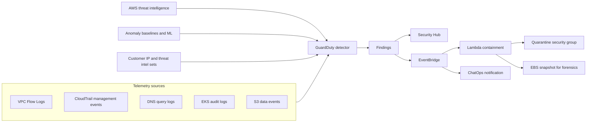
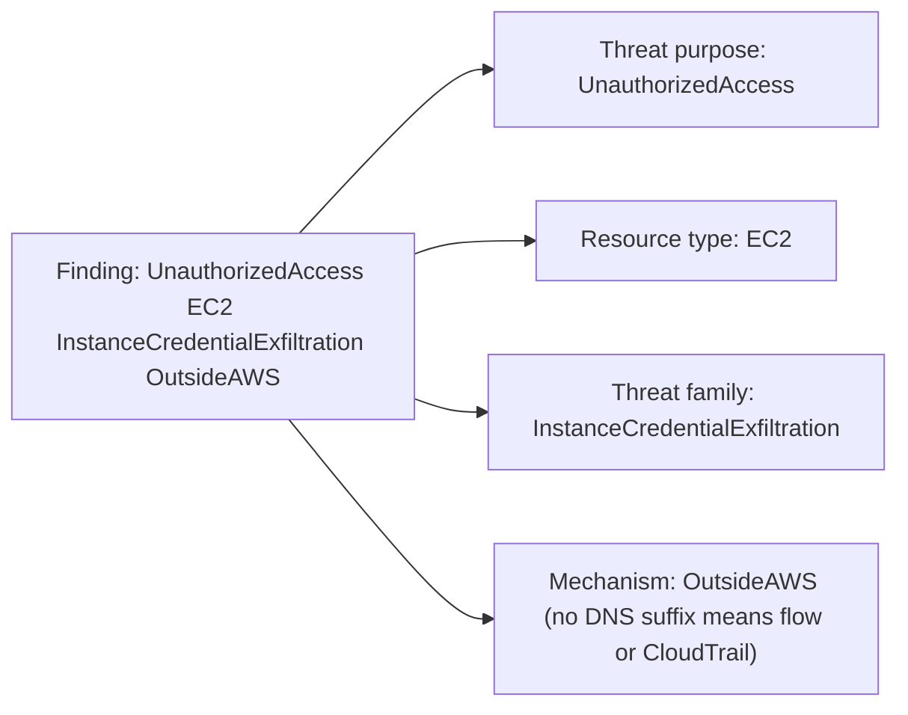
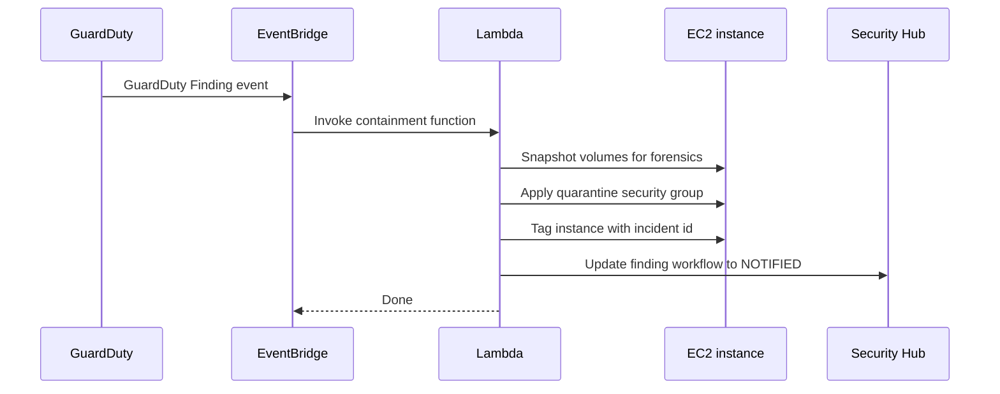

# 07 · Amazon GuardDuty

> **Phase 6 — Security and Governance** · Lesson 07 of 11
> ⬅️ Previous: [AWS Security Hub](./06-aws-security-hub.md) · ➡️ Next: [Amazon Macie](./08-amazon-macie.md) · 🏠 [Phase overview](./README.md)

## Learning Objectives

By the end of this lesson you will be able to:

- Describe which telemetry sources GuardDuty consumes and what each one can detect
- Read a finding ID and explain what caught it without opening the console
- Enable GuardDuty for an entire organization with a delegated administrator and auto-enable
- Turn on Malware Protection, S3 Protection, EKS Protection, and runtime monitoring
- Build an EventBridge and Lambda response that quarantines a compromised instance automatically

**Estimated time:** 65 min · **Difficulty:** Intermediate

---

## Core Concepts

**Amazon GuardDuty** is a managed threat-detection service built entirely on telemetry AWS already has, with no agents to install and no infrastructure to run. It applies machine learning, anomaly baselines, and AWS's own threat intelligence to detect activity that looks like compromise: credential theft, cryptocurrency mining, data exfiltration, and reconnaissance. It is the "who is attacking me" layer that complements Security Hub's "what is misconfigured" layer.

The **detection sources** are the key to reading it correctly. GuardDuty analyzes **VPC Flow Logs** (unusual data transfer, port scanning, outbound connections to known-bad IPs), **CloudTrail management events** (API calls from unexpected geographies, disabled logging, credential misuse), and **DNS query logs** (DNS exfiltration, malware callbacks, domain generation algorithms). Optional **protection plans** extend coverage: **S3 Protection** reads CloudTrail S3 data events to spot unusual bucket access, **EKS Protection** reads Kubernetes audit logs, **EKS Runtime Monitoring** and **Runtime Monitoring** watch process and container behavior, **Malware Protection for EC2** scans EBS volumes on suspicion, **RDS Protection** reads login activity, and **Lambda Protection** monitors network activity from functions.

**Finding IDs follow a fixed grammar** — `ThreatPurpose:ResourceType/ThreatFamilyName.DetectionMechanism`, for example `UnauthorizedAccess:IAMUser/InstanceCredentialExfiltration.OutsideAWS` or `CryptoCurrency:EC2/BitcoinTool.B!DNS`. Learning the grammar means you can triage from a log line: `Recon` means someone is probing, `UnauthorizedAccess` means credentials are being used badly, `CryptoCurrency` and `Impact` usually mean an instance is already compromised and costing you money. The `!DNS` suffix tells you the DNS logs caught it, which is useful when you must explain the evidence chain.

The final concept is **automatic response**. GuardDuty publishes every finding to EventBridge, so a rule can match a finding type and invoke a Lambda that isolates the resource — replace the security group with a quarantine group, snapshot the disk, notify the responders. This is what turns detection into containment: the difference between a five-minute incident and a five-day one is usually whether the first response was automated. The art is scoping automation to findings where the false-positive cost is lower than the breach cost.

### Key terminology

| Term | Meaning |
|------|---------|
| **Detector** | The GuardDuty configuration object for one account in one Region; it must be enabled to detect anything. |
| **Data source** | A telemetry feed GuardDuty analyzes: VPC Flow Logs, CloudTrail events, DNS logs, EKS audit logs, S3 data events. |
| **Protection plan** | An optional capability layered on a detector (S3, EKS, RDS, Lambda, Runtime Monitoring, Malware Protection). |
| **Finding type** | The structured ID explaining threat purpose, resource, family, and detection mechanism. |
| **Suppression filter** | A rule that automatically archives findings matching given criteria. |
| **Trusted IP set / threat intel set** | Your own allow-list or block-list of IPs loaded into GuardDuty for matching. |
| **Delegated administrator** | The organization account that manages GuardDuty detectors and members on behalf of all accounts. |
| **Malware Protection for EC2** | Agentless scanning of EBS volumes associated with suspicious findings. |
| **Runtime Monitoring** | Agent-based observation of process, file, and network events on EC2 and EKS workloads. |

---

## Architecture Diagram

The telemetry inputs, the detector, and the response paths:



The anatomy of a finding ID and what each segment tells you:



Automated containment when a finding fires:



---

## Hands-on Lab: Organization-Wide Detection with Automated Quarantine

**Goal:** Enable GuardDuty for an organization, switch on every protection plan, and quarantine an instance automatically when a high-severity finding fires.

**Prerequisites:** AWS Organizations, a designated security (delegated administrator) account, an EC2 instance you are willing to isolate, and a VPC with a quarantine security group.

### Step 1 — Delegate administration and enable the detector

```bash
# Management account: designate the security account as GuardDuty admin
aws organizations register-delegated-administrator \
  --account-id 111122223333 \
  --service-principal guardduty.amazonaws.com
```

```bash
# Security account: enable GuardDuty and capture the detector ID
DETECTOR=$(aws guardduty create-detector --enable \
  --finding-publishing-frequency FIFTEEN_MINUTES \
  --query DetectorId --output text)

# Confirm the detector exists and is enabled
aws guardduty list-detectors
aws guardduty get-detector --detector-id "$DETECTOR"
```

Note what you did **not** have to do: no flow logs to enable manually, no DNS resolver changes, no agents to install. GuardDuty reads the telemetry AWS already collects for the account.

### Step 2 — Turn on every protection plan

```bash
# Enable S3, EKS, Lambda, RDS and runtime monitoring on the detector
aws guardduty update-detector \
  --detector-id "$DETECTOR" \
  --features '[
    {"Name":"S3_DATA_EVENTS","Status":"ENABLED"},
    {"Name":"EKS_AUDIT_LOGS","Status":"ENABLED"},
    {"Name":"LAMBDA_NETWORK_LOGS","Status":"ENABLED"},
    {"Name":"RDS_LOGIN_EVENTS","Status":"ENABLED"},
    {"Name":"RUNTIME_MONITORING","Status":"ENABLED","AdditionalConfiguration":[{"Name":"EKS_ADDON_MANAGEMENT","Status":"ENABLED"},{"Name":"ECS_FARGATE_AGENT_MANAGEMENT","Status":"ENABLED"}]}
  ]'

# Malware Protection for EC2: scan EBS volumes attached to suspicious instances
aws guardduty update-malware-protection \
  --detector-id "$DETECTOR" \
  --enable \
  --malware-protection-configuration '{"ScanEc2InstanceWithFindings":{"EbsVolumes":true}}'

# Verify the full feature matrix
aws guardduty get-detector --detector-id "$DETECTOR" --query 'Features'
```

Runtime Monitoring needs an agent, installed as a managed add-on for EKS or via SSM for EC2. Confirm the add-on is deployed before you rely on it:

```bash
# EKS clusters show the runtime monitoring add-on as managed by GuardDuty
aws eks list-addons --cluster-name prod-cluster

# EC2 coverage is reported by SSM managed-instance inventory
aws ssm describe-instance-information \
  --query 'InstanceInformationList[].{Id:InstanceId,Ping:PingStatus}'
```

### Step 3 — Auto-enable for the whole organization

```bash
# Run in the delegated administrator account
aws guardduty update-organization-configuration \
  --detector-id "$DETECTOR" \
  --auto-enable-organization-members

# Confirm the organization configuration
aws guardduty describe-organization-configuration --detector-id "$DETECTOR"

# Check that existing accounts became members
aws guardduty list-members --detector-id "$DETECTOR" \
  --query 'Members[].{Id:AccountId,Status:RelationshipStatus}'
```

### Step 4 — Reduce noise with a suppression filter and a trusted IP set

```json
{
  "Criterion": {
    "service.action.networkConnectionAction.remoteIpDetails.ipAddressV4": {
      "Eq": ["203.0.113.10"]
    },
    "type": {
      "Eq": ["Recon:EC2/Portscan"]
    },
    "severity": {
      "Gte": 3
    }
  }
}
```

```bash
# Archive findings caused by your own vulnerability scanner
aws guardduty create-filter \
  --detector-id "$DETECTOR" \
  --name "IgnoreInternalScanner" \
  --action ARCHIVE \
  --finding-criteria file://filter-criteria.json \
  --rank 1

# Load the scanner's source IPs as trusted so they do not generate findings at all
aws guardduty create-ip-set \
  --detector-id "$DETECTOR" \
  --name "CorporateScanner" \
  --format TXT \
  --location s3://security-tooling-111122223333/guardduty/trusted-ips.txt \
  --activate
```

### Step 5 — Prove detection works with sample findings

```bash
# Generate synthetic findings — no real attack required
aws guardduty create-sample-findings \
  --detector-id "$DETECTOR" \
  --finding-types \
    UnauthorizedAccess:IAMUser/InstanceCredentialExfiltration.OutsideAWS \
    CryptoCurrency:EC2/BitcoinTool.B

# List what GuardDuty produced
aws guardduty list-findings --detector-id "$DETECTOR" --query 'FindingIds' --output text

# Read one finding end to end: severity, resource, and evidence
aws guardduty get-findings --detector-id "$DETECTOR" \
  --finding-ids "$(aws guardduty list-findings --detector-id "$DETECTOR" --query 'FindingIds[0]' --output text)" \
  --query 'Findings[0].{Type:Type,Severity:Severity,Resource:Resource,Action:Service.Action}'
```

### Step 6 — Wire up automatic quarantine

```bash
# EventBridge rule matching high-severity findings only
aws events put-rule \
  --name guardduty-high-severity \
  --event-pattern '{
    "source": ["aws.guardduty"],
    "detail-type": ["GuardDuty Finding"],
    "detail": {
      "severity": [{"numeric": [">=", 7]}]
    }
  }'

aws events put-targets \
  --rule guardduty-high-severity \
  --targets 'Id=quarantine,Arn=arn:aws:lambda:eu-west-1:111122223333:function:guardduty-quarantine'
```

```python
import json, os, boto3

ec2 = boto3.client("ec2")
sns = boto3.client("sns")

QUARANTINE_SG = os.environ["QUARANTINE_SG_ID"]
TOPIC_ARN = os.environ["ALERT_TOPIC_ARN"]


def handler(event, context):
    finding = event["detail"]
    severity = finding["severity"]
    ftype = finding["type"]

    # Only isolate compute resources; never touch data-plane services here
    instances = [
        r["InstanceDetails"]["InstanceId"]
        for r in [finding.get("resource", {})]
        if r.get("resourceType") == "Instance"
        and r.get("instanceDetails", {}).get("instanceId")
    ]

    for instance_id in instances:
        # Snapshot first so the forensics are preserved even if the instance is terminated
        volumes = ec2.describe_instances(
            InstanceIds=[instance_id]
        )["Reservations"][0]["Instances"][0]["BlockDeviceMappings"]
        for mapping in volumes:
            if "Ebs" not in mapping:
                continue
            volume_id = mapping["Ebs"]["VolumeId"]
            ec2.create_snapshot(
                VolumeId=volume_id,
                Description=f"Forensic snapshot for GuardDuty finding {ftype}",
                TagSpecifications=[{
                    "ResourceType": "snapshot",
                    "Tags": [{"Key": "Incident", "Value": finding["id"]}],
                }],
            )

        # Replace all security groups with the quarantine group: no ingress, no egress
        ec2.modify_instance_attribute(
            InstanceId=instance_id,
            Groups=[QUARANTINE_SG],
        )
        ec2.create_tags(
            Resources=[instance_id],
            Tags=[
                {"Key": "Quarantined", "Value": "true"},
                {"Key": "GuardDutyFinding", "Value": ftype},
            ],
        )

    sns.publish(
        TopicArn=TOPIC_ARN,
        Subject=f"GuardDuty severity {severity}: {ftype}",
        Message=json.dumps(finding, indent=2, default=str),
    )
    return {"quarantined": instances}
```

Create the quarantine security group with no rules at all — that is what makes it a quarantine:

```bash
# A security group with no ingress and no egress rules fully isolates the instance
aws ec2 create-security-group \
  --group-name quarantine-isolation \
  --description "No inbound or outbound rules: forensic isolation only" \
  --vpc-id vpc-0a1b2c3d4e5f60718
```

### Step 7 — Verify

```bash
# The rule exists and has a target
aws events list-rules --name-prefix guardduty
aws events list-targets-by-rule --rule guardduty-high-severity

# Run the function manually against the sample finding to test the containment path
aws lambda invoke --function-name guardduty-quarantine \
  --payload file://sample-finding-event.json \
  --cli-binary-format raw-in-base64-out response.json

# Confirm the instance was tagged and its security groups changed
aws ec2 describe-instances --instance-ids i-0123456789abcdef0 \
  --query 'Reservations[0].Instances[0].{Tags:Tags,SGs:SecurityGroups[].GroupId,State:State.Name}'
```

---

## CLI Reference

```bash
# Detector and configuration inventory
aws guardduty list-detectors
aws guardduty get-detector --detector-id "$DETECTOR" --query 'Features[]'
aws guardduty update-detector --detector-id "$DETECTOR" --finding-publishing-frequency ONE_HOUR

# Findings: filter, read, archive
aws guardduty list-findings --detector-id "$DETECTOR" --finding-criteria file://criteria.json
aws guardduty get-findings --detector-id "$DETECTOR" --finding-ids abc123def456
aws guardduty archive-findings --detector-id "$DETECTOR" --finding-ids abc123def456

# Suppression filters and custom intelligence
aws guardduty create-filter --detector-id "$DETECTOR" --name "IgnoreScanner" --action ARCHIVE --finding-criteria file://filter-criteria.json
aws guardduty list-filters --detector-id "$DETECTOR"
aws guardduty create-threat-intel-set --detector-id "$DETECTOR" --name "KnownBadC2" --format TXT --location s3://security-tooling-111122223333/guardduty/bad-ips.txt --activate

# Malware Protection status and scan control
aws guardduty get-malware-protection --detector-id "$DETECTOR"
aws guardduty start-malware-scan --detector-id "$DETECTOR" --resource-arn arn:aws:ec2:eu-west-1:111122223333:instance/i-0123456789abcdef0
aws guardduty get-malware-scan --scan-id abc123def456

# Organization management
aws guardduty list-members --detector-id "$DETECTOR"
aws guardduty describe-organization-configuration --detector-id "$DETECTOR"
aws guardduty enable-organization-admin-account --admin-account-id 111122223333

# Test the pipeline without an attacker
aws guardduty create-sample-findings --detector-id "$DETECTOR" --finding-types Recon:EC2/Portscan
```

| Command | Purpose |
|---------|---------|
| `create-detector` / `update-detector` | Turns GuardDuty on and enables protection features |
| `get-findings` | Reads full finding detail including evidence and resource context |
| `create-filter` | Auto-archives known-benign finding patterns to protect signal quality |
| `create-threat-intel-set` | Adds your own known-bad IPs and domains to detection |
| `start-malware-scan` | Runs an on-demand EBS malware scan against an instance |
| `update-organization-configuration` | Auto-enables detection for member accounts |
| `create-sample-findings` | Generates synthetic findings to test EventBridge wiring |

---

## Best Practices

| Practice | Why it matters |
|----------|----------------|
| Enable GuardDuty in every account and every Region you use | Attackers pick unused Regions precisely because nobody looks there |
| Use a delegated administrator with auto-enable | Detects compromise in accounts that were created last week |
| Turn on all relevant protection plans, not just the free tier ones | Flow/CloudTrail/DNS alone miss S3, EKS, and container-level attacks |
| Suppress noise with filters, never by disabling the detector | Keeps detection coverage intact while cutting the queue |
| Route by severity: page for 7+, queue for 4–6.9 | Prevents alert fatigue from drowning the real incident |
| Automate containment for a short, high-confidence list of finding types | Fast isolation is the single biggest lever on breach cost |
| Snapshot before you isolate or terminate | Forensics you did not capture cannot be recovered later |
| Keep the delegated admin account workload-free | A detector account running application code is a target itself |

---

## Common Pitfalls

| Pitfall | Symptom | Fix |
|---------|---------|-----|
| GuardDuty enabled in one Region only | Findings never appear for workloads in other Regions | Enable in all Regions, or enforce a Region SCP and document it |
| Runtime Monitoring "enabled" but no agents | No runtime findings despite suspicious processes | Verify the EKS add-on or SSM agent is installed and healthy |
| Noise suppression by disabling the detector | Zero findings, zero visibility | Use `create-filter` with a narrow criterion instead |
| Suppression filter too broad | Real incidents archived silently | Inspect filters quarterly with `list-filters` and review criteria |
| Malware scan on encrypted volumes with no KMS access | Scans fail or are skipped | Grant GuardDuty `kms:CreateGrant` on the key used by the volume |
| Lambda containment without scoped permissions | Function fails mid-incident, or can delete too much | Grant exactly `ec2:ModifyInstanceAttribute`, `ec2:CreateSnapshot`, `ec2:CreateTags` |
| Containment that catches only EC2 findings | Credential or S3 findings page nobody | Add rules for `UnauthorizedAccess:IAMUser/*` and `Exfiltration:S3/*` |
| Ignoring the sample finding loop | EventBridge rule never fires in testing | Confirm the event pattern matches the actual `detail-type` and severity shape |

---

## Cost Considerations

GuardDuty is priced per analyzed **volume of events**, not per finding. Expect roughly **$1–$4 per million CloudTrail management events**, **about $0.50–$1.50 per GB of VPC Flow Logs and DNS queries analyzed**, **$0.60–$1.00 per GB of S3 data events**, **around $1.50–$3.00 per GB of EKS audit logs**, plus separate charges for **Malware Protection scans** (per GB scanned) and **Runtime Monitoring** (per vCPU-hour for EC2 and per vCPU-hour or task for EKS). The analyzer being free-of-charge is a myth: the *finding* is free, the *analysis* is metered.

What drives the bill is traffic volume and event volume, so the biggest surprise is usually a chatty Region or a busy S3 bucket with data events enabled. Practical controls: enable **S3 Protection only on buckets that contain sensitive data** rather than globally if cost matters, monitor VPC Flow Log volume (a noisy NAT gateway can inflate analysis GB dramatically), and remember that **every Region you enable multiplies the baseline**. Runtime Monitoring is the most likely to surprise you on a large EKS estate, because it scales with vCPU count rather than with events. Against that: a single cryptomining incident costs more per hour than most accounts spend on GuardDuty per year.

---

## Security Considerations

- **GuardDuty is detection, not prevention.** It will happily report an attack in progress; pair it with SCPs and network controls so the interesting findings are hard to generate in the first place.
- **Findings are sensitive.** They contain account IDs, instance IDs, IP addresses, and sometimes credential IDs. Restrict `guardduty:GetFindings` to responders and the delegated admin.
- **Protect the detector configuration.** `DeleteDetector`, `UpdateDetector` with features disabled, and `DeleteMembers` are attacker moves — they are as important to alarm on as the findings themselves.
- **Do not let suppression filters become a blind spot.** A filter that archives `UnauthorizedAccess:*` because "it was noisy once" quietly removes your highest-value detection.
- **Trust the evidence chain when you escalate.** A cloud-only finding plus no host evidence is different from a finding plus a process tree from Runtime Monitoring; state which you have.
- **Guard the containment path.** The quarantine Lambda needs real permissions, which makes it a target: restrict who can modify it, keep its code in version control, and alert on any change to its IAM role.
- **Enable it on management and log archive accounts too**, not only workload accounts. Credential misuse in the management account is the worst-case scenario.
- **Combine with CloudTrail organization trails** so that GuardDuty findings can be replayed against the raw API history during an investigation.

---

## Exercise

Take the two sample findings from the lab and write an incident report for each using the finding JSON as your only evidence: what happened, which resource, what the attacker's likely next step is, and what you would do in the first ten minutes. Then build two additional EventBridge rules — one that notifies a chat channel for `UnauthorizedAccess:IAMUser/*` findings without auto-remediating, and one that disables an IAM access key automatically when `AccessKeyId` appears in a `CryptoCurrency` finding.

Success looks like: two written incident reports with a plausible timeline, plus a working rule whose Lambda disables exactly one access key and records the action in the finding's note.

---

## Resources

- [Amazon GuardDuty User Guide](https://docs.aws.amazon.com/guardduty/latest/ug/what-is-guardduty.html)
- [GuardDuty finding types](https://docs.aws.amazon.com/guardduty/latest/ug/guardduty_finding-types-active.html)
- [Malware Protection for EC2](https://docs.aws.amazon.com/guardduty/latest/ug/malware-protection.html)
- [GuardDuty S3 Protection](https://docs.aws.amazon.com/guardduty/latest/ug/s3-protection.html)
- [GuardDuty EKS Protection](https://docs.aws.amazon.com/guardduty/latest/ug/kubernetes-protection.html)
- [GuardDuty Runtime Monitoring](https://docs.aws.amazon.com/guardduty/latest/ug/runtime-monitoring.html)
- [Managing GuardDuty accounts with AWS Organizations](https://docs.aws.amazon.com/guardduty/latest/ug/guardduty_organizations.html)
- [Amazon GuardDuty pricing](https://aws.amazon.com/guardduty/pricing/)

---

## Next Steps

GuardDuty watches who is attacking. The next lesson watches something different and equally dangerous: your own sensitive data sitting in the wrong bucket, unencrypted, with no classification at all — Amazon Macie.

> ⬅️ Previous: [AWS Security Hub](./06-aws-security-hub.md) · ➡️ Next: [Amazon Macie](./08-amazon-macie.md) · 🏠 [Phase overview](./README.md)
