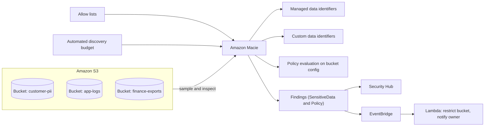
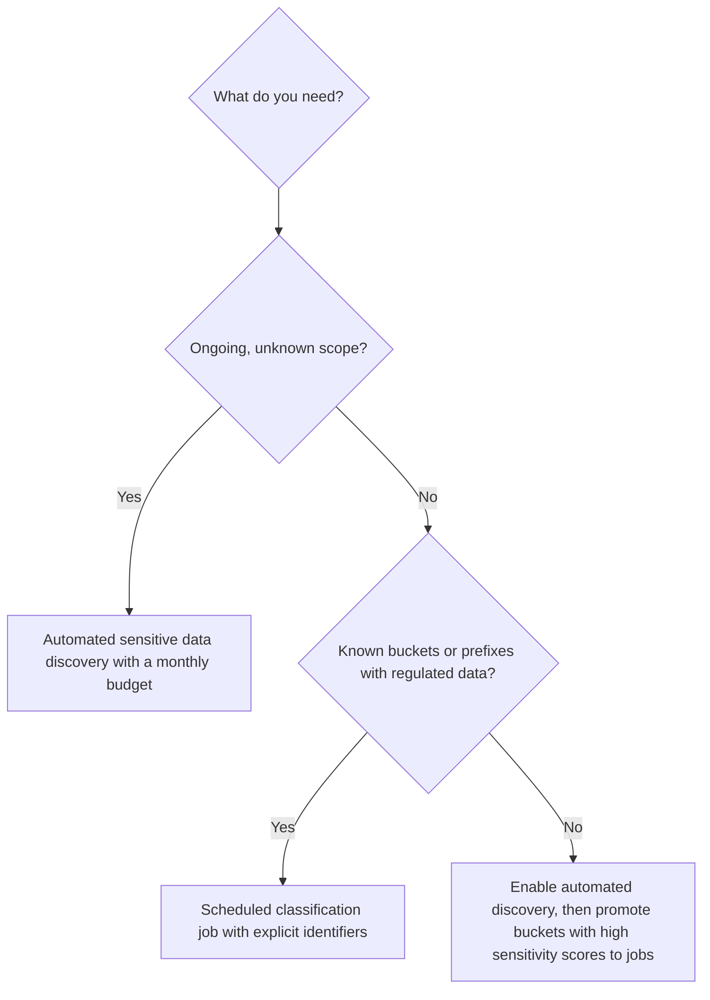
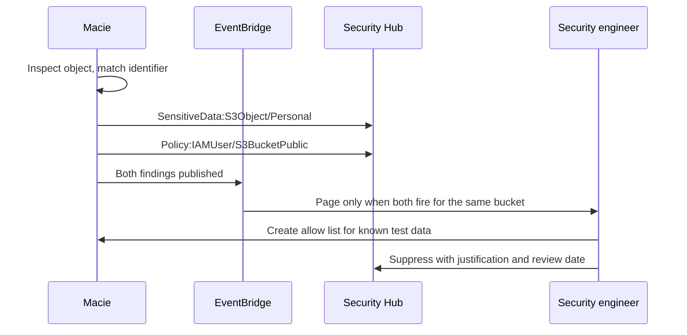

# 08 · Amazon Macie

> **Phase 6 — Security and Governance** · Lesson 08 of 11
> ⬅️ Previous: [Amazon GuardDuty](./07-amazon-guardduty.md) · ➡️ Next: [Compliance: HIPAA, PCI, FedRAMP](./09-compliance-hipaa-pci-fedramp.md) · 🏠 [Phase overview](./README.md)

## 🎯 Learning Objectives

By the end of this lesson you will be able to:

- Explain how Macie discovers and classifies sensitive data in S3 without you sending data anywhere
- Distinguish managed data identifiers from custom data identifiers, and write a working custom regex
- Choose between automated discovery and targeted classification jobs, and scope both for cost
- Read and act on Macie finding types, including the bucket-level policy findings
- Integrate Macie findings with Security Hub and EventBridge for automated response

**Estimated time:** 60 min · **Difficulty:** Intermediate

---

## 🧠 Core Concepts

**Amazon Macie** answers a question most organizations cannot answer confidently: *where is my sensitive data, and is it exposed?* It is an S3-only, fully managed service that samples and inspects objects, applies pattern matching and machine learning to identify personal data, financial information, and credentials, and then reports both the sensitive data it found and the bucket-level access problems that make that data reachable.

The engine is **managed data identifiers** — built-in detectors for hundreds of data types across regions and jurisdictions, from credit card numbers and social security numbers to driver's licenses, passports, and AWS secret access keys. Managed identifiers apply *context* and *validation*, not just regex: a 16-digit number is only reported as a credit card if it passes the Luhn checksum and appears near supporting keywords. That is why Macie's false-positive rate is far lower than a naive `grep`, and it is also why writing your own detector with raw regex usually performs worse than you expect.

Two detection modes matter. **Automated sensitive data discovery** continuously samples objects across your buckets using a managed, cost-aware budget, giving you ongoing coverage and a per-bucket sensitivity score without planning anything. **Classification jobs** are targeted, one-off or scheduled runs with explicit scope — a bucket, a prefix, a set of file types — where you choose which identifiers to look for and how deep to sample. The pragmatic combination is automated discovery everywhere plus targeted jobs on the buckets that contain regulated data, so you are not paying for full inspection of log files.

You also get **policy findings**, which are often the more urgent half. Macie evaluates bucket configuration and reports things like `Policy:IAMUser/S3BucketPublic`, `Policy:IAMUser/S3BucketSharedExternally`, `Policy:IAMUser/S3BucketReplicatedExternally`, and `Policy:IAMUser/S3BlockPublicAccessDisabled`. A `SensitiveData:S3Object/Personal` finding on a private bucket is a governance issue; the same finding on a bucket that Macie also flags as public is an incident. Reading the two finding families together is the whole skill.

### Key terminology

| Term | Meaning |
|------|---------|
| **Managed data identifier** | AWS-maintained detector for a data type (credit cards, SSNs, credentials, PHI), with validation and keyword context. |
| **Custom data identifier** | Your own detector built from a regex, with optional keyword proximity requirements. |
| **Automated sensitive data discovery** | Continuous, sampling-based evaluation of every bucket, governed by a budget you set. |
| **Classification job** | A scoped, scheduled or one-off inspection run over chosen buckets and prefixes. |
| **Allow list** | Text or regex patterns that suppress matched text from findings (for example your own test card numbers). |
| **Sensitivity score** | Per-bucket measure of how much sensitive data Macie found relative to what it sampled. |
| **Findings filter** | Rule that suppresses or groups findings before they reach your queue. |
| **Macie session** | The per-account, per-Region enablement object controlling frequency and status. |
| **Sensitive data finding** | `SensitiveData:S3Object/*` — describes what was found in an object. |
| **Policy finding** | `Policy:IAMUser/S3Bucket*` — describes a bucket configuration that creates exposure risk. |

---

## 🗺️ Architecture Diagram

How Macie inspects data and where findings flow:



Two discovery modes and when to use each:



Findings triage flow, contrasting the two families:



---

## 🧪 Hands-on Lab: Classify a Bucket and Automate the Public-Bucket Response

**Goal:** Enable Macie, write a custom identifier for an internal employee ID, run a scoped classification job, and restrict a bucket automatically when Macie finds it public and sensitive.

**Prerequisites:** An account with S3 buckets containing sample data, permission to create IAM roles for Macie, and a KMS key that can decrypt any encrypted objects you want inspected.

### Step 1 — Enable Macie and inspect the session

```bash
# Enable Macie in the current account and Region
aws macie2 enable-macie --finding-publishing-frequency FIFTEEN_MINUTES

# Confirm the session status
aws macie2 get-macie-session

# See which management type this account has (it changes what you can configure)
aws macie2 get-macie-session --query '{Status:status,Frequency:findingPublishingFrequency,ServiceRole:serviceRole}'
```

Macie creates a service-linked role that lets it read object metadata and, when required, object contents. If your objects use customer managed KMS keys, add a `kms:Decrypt` grant to that role's key policy or Macie will report objects as unscannable.

### Step 2 — Create a custom data identifier

Use custom identifiers only for data types Macie does not already cover — internal employee IDs, project codes, tenant-specific account formats.

```bash
# Employee IDs look like EMP-123456 followed within 30 characters by a keyword
aws macie2 create-custom-data-identifier \
  --name "Internal-Employee-ID" \
  --description "EMP-nnnnnn patterns in HR exports" \
  --regex 'EMP-\d{6}' \
  --keywords '["employee","staff","hr"]' \
  --maximum-match-distance 30

# Confirm it exists and note the generated ID
aws macie2 list-custom-data-identifiers
```

The `--keywords` and `--maximum-match-distance` arguments are what separate a usable detector from a flood of false positives: the regex match is only reported when one of the keywords appears nearby.

### Step 3 — Create an allow list so known test data stops generating findings

```json
{
  "regex": "4111-1111-1111-1111",
  "description": "Test card number used in integration fixtures"
}
```

```bash
# Allow lists suppress matched text, not whole objects
aws macie2 create-allow-list \
  --name "TestCardFixtures" \
  --description "Known test data in the payments fixtures bucket" \
  --criteria file://allow-list.json
```

### Step 4 — Run a scoped classification job

```bash
# Create a one-time job over one bucket, looking only for the identifiers that matter
JOB_ID=$(aws macie2 create-classification-job \
  --job-type ONE_TIME \
  --name "customer-pii-scan" \
  --description "Targeted inspection of the customer PII bucket" \
  --s3-job-definition '{
    "bucketDefinitions": [{
      "accountId": "111122223333",
      "buckets": ["customer-pii"]
    }]
  }' \
  --managed-data-identifier-selector "ALL" \
  --custom-data-identifier-ids "$(aws macie2 list-custom-data-identifiers --query 'items[0].id' --output text)" \
  --sampling-percentage 100 \
  --query jobId --output text)

echo "Job: $JOB_ID"

# Watch its status until it completes
aws macie2 describe-classification-job --job-id "$JOB_ID" \
  --query '{Status:jobStatus,Stats:statistics}'
```

Use `--job-type SCHEDULED` with `--schedule-frequency-details` for recurring scans:

```bash
# Weekly recurring scan of the finance exports bucket
aws macie2 create-classification-job \
  --job-type SCHEDULED \
  --name "finance-weekly" \
  --schedule-frequency-details '{"weekly":{"dayOfWeek":"SUNDAY"}}' \
  --managed-data-identifier-selector "ALL" \
  --s3-job-definition '{"bucketDefinitions":[{"accountId":"111122223333","buckets":["finance-exports"]}]}'
```

### Step 5 — Let automated discovery handle everything else, with a budget

```bash
# Turn on continuous, sampling-based discovery across all buckets
aws macie2 update-automated-discovery-configuration --status ENABLED

# Read the current configuration back
aws macie2 get-automated-discovery-configuration

# Find the buckets Macie considers most sensitive, so you can promote them to jobs
aws macie2 list-buckets --query 'buckets[?sensitivityScore>=50].{Name:bucketName,Score:sensitivityScore}' \
  --output table
```

### Step 6 — Automate the "public and sensitive" combination

```bash
# Fire only when a public-bucket policy finding names the same bucket as a sensitive-data finding
aws events put-rule \
  --name macie-public-sensitive \
  --event-pattern '{
    "source": ["aws.macie"],
    "detail-type": ["Macie Finding"],
    "detail": {
      "type": [{"prefix": "Policy:IAMUser/S3BucketPublic"}],
      "severity": {"description": ["High","Critical"]}
    }
  }'

aws events put-targets \
  --rule macie-public-sensitive \
  --targets 'Id=restrict,Arn=arn:aws:lambda:eu-west-1:111122223333:function:macie-restrict-bucket'
```

```python
import json, os, boto3

s3 = boto3.client("s3")
sns = boto3.client("sns")

TOPIC_ARN = os.environ["ALERT_TOPIC_ARN"]


def handler(event, context):
    detail = event["detail"]
    bucket = detail["resourcesAffected"]["s3Bucket"]["name"]

    # Block public access, then confirm no bucket policy still grants public read
    s3.put_public_access_block(
        Bucket=bucket,
        PublicAccessBlockConfiguration={
            "BlockPublicAcls": True,
            "IgnorePublicAcls": True,
            "BlockPublicPolicy": True,
            "RestrictPublicBuckets": True,
        },
    )
    s3.put_bucket_encryption(
        Bucket=bucket,
        ServerSideEncryptionConfiguration={
            "Rules": [{
                "ApplyServerSideEncryptionByDefault": {"SSEAlgorithm": "aws:kms"},
                "BucketKeyEnabled": True,
            }]
        },
    )
    sns.publish(
        TopicArn=TOPIC_ARN,
        Subject=f"Macie restricted bucket {bucket}",
        Message=json.dumps(detail, default=str, indent=2),
    )
    return {"bucket": bucket, "status": "restricted"}
```

### Step 7 — Verify

```bash
# Findings exist, grouped by type and severity
aws macie2 get-finding-statistics --group-by type --query 'countsByGroup[].{Type:groupKey,Count:count}'
aws macie2 list-findings --query 'findingIds' --output text

# Read one finding fully, including the sensitive data occurrence count
aws macie2 get-findings \
  --finding-ids "$(aws macie2 list-findings --query 'findingIds[0]' --output text)" \
  --query 'findings[0].{Type:type,Severity:severity,Bucket:resourcesAffected.s3Bucket.name,Objects:resourcesAffected.s3Object.path}'

# Confirm the bucket is now blocked from public access
aws s3api get-public-access-block --bucket customer-pii

# Confirm findings arrived in Security Hub
aws securityhub get-findings \
  --filters '{"ProductName":[{"Value":"Macie","Comparison":"EQUALS"}]}' \
  --query 'Findings[].{Title:Title,Severity:Severity.Label}'
```

If a bucket you expect to see is missing from findings, check that the objects are in a supported format, that the bucket is in the same Region as the Macie session, and that Macie's service-linked role can decrypt any customer managed keys involved.

---

## 💻 CLI Reference

```bash
# Session control
aws macie2 enable-macie --finding-publishing-frequency FIFTEEN_MINUTES
aws macie2 get-macie-session
aws macie2 update-macie-session --status PAUSED

# Custom detectors and exclusions
aws macie2 create-custom-data-identifier --name "TenantCode" --regex 'TEN-\d{4}-[A-Z]{2}'
aws macie2 list-custom-data-identifiers
aws macie2 list-managed-data-identifiers --query 'items[].id' --output text
aws macie2 create-allow-list --name "Fixtures" --criteria file://allow-list.json
aws macie2 list-allow-lists

# Jobs
aws macie2 create-classification-job --job-type ONE_TIME --name "adhoc" --s3-job-definition file://job.json
aws macie2 list-classification-jobs --query 'items[].{Id:jobId,Status:jobStatus}'
aws macie2 describe-classification-job --job-id "$JOB_ID"
aws macie2 update-classification-job --job-id "$JOB_ID" --job-status CANCELLED

# Automated discovery
aws macie2 update-automated-discovery-configuration --status ENABLED
aws macie2 get-automated-discovery-configuration
aws macie2 list-buckets --query 'buckets[].{Name:bucketName,Score:sensitivityScore,Objects:objectCount}'

# Findings and filters
aws macie2 get-finding-statistics --group-by type
aws macie2 list-findings --finding-criteria file://macie-criteria.json
aws macie2 create-findings-filter --name "IgnoreSandbox" --action SUPPRESS --finding-criteria file://filter.json

# Organization management
aws macie2 enable-organization-admin-account --admin-account-id 111122223333
aws macie2 update-organization-configuration --auto-enable
aws macie2 get-usage-totals --time-range START=2026-01-01T00:00:00Z,END=2026-02-01T00:00:00Z
```

| Command | Purpose |
|---------|---------|
| `enable-macie` | Turns on the account's Macie session |
| `create-custom-data-identifier` | Defines a detector for organization-specific data patterns |
| `create-allow-list` | Suppresses known-benign matches to protect signal quality |
| `create-classification-job` | Runs a scoped or scheduled inspection of chosen buckets |
| `update-automated-discovery-configuration` | Enables continuous, budget-governed sampling everywhere |
| `list-buckets` | Ranks buckets by sensitivity score so you can prioritize |
| `get-usage-totals` | Reports how much data was analyzed — your cost driver |

---

## ✅ Best Practices

| Practice | Why it matters |
|----------|----------------|
| Turn on automated discovery with an explicit monthly budget | Full inspection of every bucket is the classic surprise bill |
| Use managed identifiers first, custom ones only for internal formats | Managed detectors validate context and produce fewer false positives |
| Always pair custom regex with keywords and match distance | A bare regex over a large bucket is a false-positive generator |
| Use allow lists for test fixtures and synthetic data | Keeps real findings visible without disabling detectors |
| Treat policy findings as the priority triage queue | A public bucket plus sensitive data is an incident, not a report item |
| Tag buckets by data classification and scan by tag | Makes scope explicit and lets jobs follow classification rather than bucket names |
| Grant Macie's service role access to your KMS keys | Otherwise encrypted objects report as unscannable and your coverage is a guess |
| Re-review findings filters quarterly | Silence that was reasonable last quarter is a blind spot now |

---

## ⚠️ Common Pitfalls

| Pitfall | Symptom | Fix |
|---------|---------|-----|
| Objects encrypted with a customer managed key Macie cannot read | Findings show `UNSCANNABLE` or nothing at all | Add `kms:Decrypt` and `kms:GenerateDataKey` for the Macie service role in the key policy |
| Full sampling over a large bucket | Sudden large bill and long job runtimes | Lower `--sampling-percentage` or scope to prefixes |
| Custom identifier with a broad regex | Thousands of findings, all noise | Add keywords, tighten the pattern, and test on a sample object first |
| Macie in one Region only | Buckets in other Regions have no findings | Enable per Region; Macie is a Regional service |
| Expecting Macie to find non-S3 data | No findings for RDS, EFS, or on-premises data | Use Macie only for S3; classify other stores with different tooling |
| Suppressing a sensitive-data finding without fixing exposure | The bucket stays public and the evidence disappears | Fix exposure first, then suppress with an expiry review date |
| Assuming sampling means complete coverage | Some sensitive objects are never reported | Use targeted 100% jobs for buckets where completeness is a compliance requirement |
| Ignoring unscannable file types | Images, archives, and proprietary formats hide data | Normalize sensitive data into supported formats, or classify at the source |

---

## 💰 Cost Considerations

Macie pricing is simple and directly tied to how much data you look at: you pay a per-gigabyte rate (roughly **$0.10 per GB** in most Regions for classification jobs, varying by Region) for data inspected, plus a much smaller per-object metadata charge for automated discovery evaluations. There is typically a **30-day free trial** for new accounts, which is exactly the window to measure your real per-GB exposure.

The cost trap is scope, not rate. A single 5 TB bucket of Parquet logs scanned at 100% sampling is about $500 for one job — and if it is scheduled weekly, that is $26,000 a year to re-discover that your log bucket contains no personal data. The disciplined pattern is: **automated discovery with a budget cap everywhere** (which samples rather than inspecting everything), then **promote only the buckets with a high sensitivity score into full, scheduled jobs**. Also budget for the consequences: classification jobs and their findings often lead to re-architecture (moving data, adding bucket policies), which is where real engineering time goes. Watch the cost trend with `get-usage-totals` monthly and align it to the audited value you get from it.

---

## 🔐 Security Considerations

- **Macie reads your data.** Its service-linked role has broad S3 read access inside the account; treat that role as sensitive and review its key policy grants.
- **Findings reveal where the crown jewels are.** A Macie findings export is a map for an attacker. Restrict `macie2:GetFindings` and never ship raw findings to a broadly readable log bucket.
- **Allow lists and suppression filters are security decisions.** They are the mechanism by which findings quietly stop being reported; require a justification and a review date, and track them like any other risk acceptance.
- **Correlate policy and sensitivity findings before escalating.** Public and sensitive means contain now. Private and sensitive means fix the process that put it there.
- **Do not use Macie as your only control for encryption.** Findings describe what is inside objects; enforcement that objects are encrypted at rest still comes from bucket policies, SCPs, and KMS key policies.
- **Remember the sampling caveat when reporting.** "Macie found no sensitive data in this bucket" is a statement about a sample, not a proof of absence. For compliance evidence, use a 100% job and say so.
- **Scope delegated administration carefully.** The Macie administrator account can configure jobs and allow lists across the organization, which is effectively the ability to choose what gets detected.

---

## 🧩 Exercise

Take three buckets in your account representing different risk profiles — one with application logs, one with user-uploaded documents, and one with financial exports — and design a classification approach for each: automated discovery only, scheduled job, or 100% one-time inspection. Write the exact `create-classification-job` command for the bucket that needs inspection, including a custom data identifier for something domain-specific in your work. Then create a findings filter that suppresses matches from a synthetic-data prefix and prove that a real finding in another prefix still appears.

Success looks like: three documented scan strategies with a per-bucket estimated monthly cost using the ~$0.10/GB rate, one running custom identifier, one working suppression filter, and evidence that a genuine finding was not swallowed by it.

---

## 📚 Resources

- [Amazon Macie User Guide](https://docs.aws.amazon.com/macie/latest/user/what-is-macie.html)
- [Managed data identifiers](https://docs.aws.amazon.com/macie/latest/user/managed-data-identifiers.html)
- [Custom data identifiers](https://docs.aws.amazon.com/macie/latest/user/custom-data-identifiers.html)
- [Running sensitive data discovery jobs](https://docs.aws.amazon.com/macie/latest/user/discovery-jobs.html)
- [Automated sensitive data discovery](https://docs.aws.amazon.com/macie/latest/user/discovery-asdd.html)
- [Macie findings reference](https://docs.aws.amazon.com/macie/latest/user/findings-types.html)
- [Managing multiple accounts with Macie](https://docs.aws.amazon.com/macie/latest/user/accounts-mgmt.html)
- [Amazon Macie pricing](https://aws.amazon.com/macie/pricing/)

---

## ➡️ Next Steps

You now have encryption, detection, and data classification in place. The next lesson turns that engineering work into evidence — the shared responsibility model, BAAs, scope reduction, and the AWS services auditors actually ask you to produce artifacts from.

> ⬅️ Previous: [Amazon GuardDuty](./07-amazon-guardduty.md) · ➡️ Next: [Compliance: HIPAA, PCI, FedRAMP](./09-compliance-hipaa-pci-fedramp.md) · 🏠 [Phase overview](./README.md)
