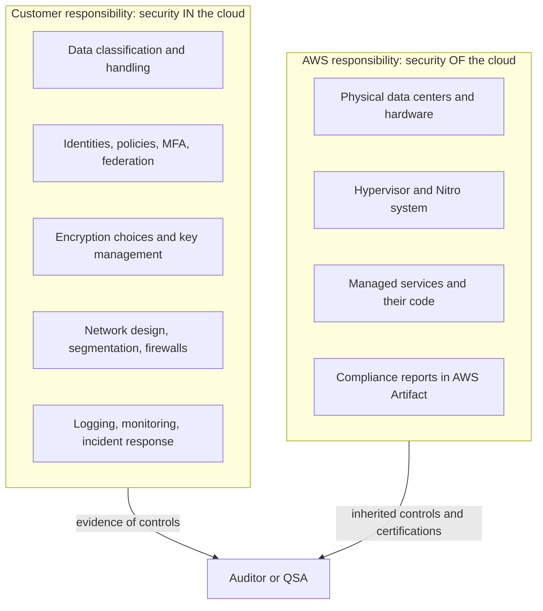
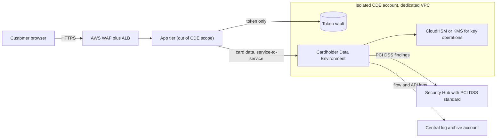
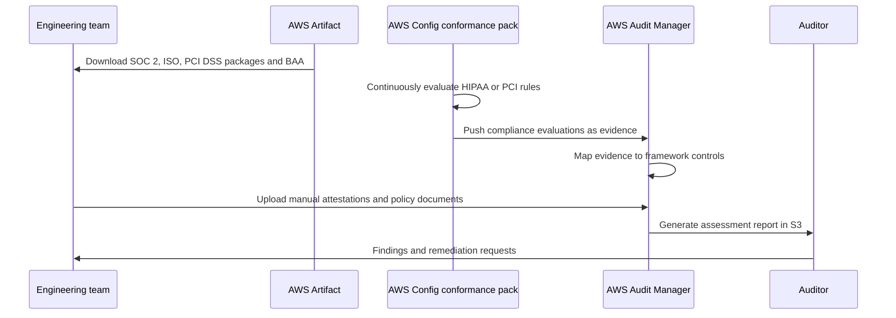

# 09 · Compliance: HIPAA, PCI, FedRAMP

> **Phase 6 — Security and Governance** · Lesson 09 of 11
> ⬅️ Previous: [Amazon Macie](./08-amazon-macie.md) · ➡️ Next: [AWS Organizations and Multi-Account Strategy](./10-aws-organizations-multi-account-strategy.md) · 🏠 [Phase overview](./README.md)

## 🎯 Learning Objectives

By the end of this lesson you will be able to:

- Apply the shared responsibility model to a compliance obligation and say exactly what stays with you
- Accept the HIPAA BAA, deploy a HIPAA-eligible architecture, and produce the evidence an auditor wants
- Reduce PCI DSS scope with segmentation and tokenization, and describe what remains in scope
- Explain the difference between FedRAMP Moderate and High authorizations and which partition you need
- Build continuous evidence with AWS Artifact, AWS Config conformance packs, and AWS Audit Manager

**Estimated time:** 70 min · **Difficulty:** Advanced

---

## 🧠 Core Concepts

Compliance is not a product you enable; it is a set of claims you make about your system that somebody else verifies. AWS can only make claims about the layer it operates — that is the **shared responsibility model**. AWS is responsible for security *of* the cloud: the physical data centers, the hypervisor, the managed service implementations, and the certifications that describe them. You are responsible for security *in* the cloud: your data classification, encryption choices, identity configuration, logging, and the accuracy of what you tell an auditor. Almost every compliance misunderstanding comes from assuming a certificate covers the customer's layer.

For **HIPAA**, the practical prerequisite is a **Business Associate Agreement (BAA)** with AWS, accepted through AWS Artifact. Until a BAA is in place, you may not process protected health information (PHI) on AWS at all. With it in place, the second constraint is the list of **HIPAA-eligible services**: only services on that list can hold PHI, and eligibility usually also requires configuration work — encryption in transit and at rest, audit logging, and appropriate key management. A HIPAA architecture therefore looks like an allow-list: encrypted S3, encrypted RDS, CloudTrail enabled in every account, Macie watching for PHI in the wrong places, and an SCP that prevents accidental use of non-eligible services.

**PCI DSS** is different in shape: the aim is not eligibility but **scope reduction**. Your cardholder data environment (CDE) is whatever stores, processes, or transmits account data, and every requirement applies to that scope. You shrink the CDE by isolating card data in its own accounts and VPCs, segmenting them so the rest of the estate is out of scope, and tokenizing so card numbers exist in exactly one place. AWS's own PCI DSS compliance covers the infrastructure, but you still validate your environment — using the same SCP, logging, and encryption controls, plus network segmentation the QSA can test. The newer PCI DSS v4.0 requirements push toward continuous control monitoring rather than annual snapshots, which is where Config and Security Hub earn their keep.

**FedRAMP** is an authorization program for cloud service providers, and for a *consumer* of AWS it means something specific: AWS GovCloud (US) and the commercial Regions that have a FedRAMP High authorization can host government data, with different requirements for which one you need. FedRAMP **Moderate** covers most federal workloads; **High** covers data whose loss would have catastrophic effect, and it demands stricter controls (for example, higher assurance on cryptography and continuous monitoring). Your own system inherits controls from AWS's authorization package — via AWS Artifact — and you must attest to the rest.

The last concept is **evidence engineering**. Controls that exist but cannot be demonstrated are, for audit purposes, absent. AWS Artifact supplies AWS's own reports and agreements; **AWS Config conformance packs** package sets of rules (including the Operational Best Practices for HIPAA and PCI DSS packs) so compliance state is evaluated continuously; and **AWS Audit Manager** collects the evidence — snapshots, Config evaluations, CloudTrail logs, and manual attestations — into audit-ready assessment reports against a framework such as SOC 2, PCI DSS, or HIPAA.

### Key terminology

| Term | Meaning |
|------|---------|
| **Shared responsibility model** | Division of security duties: AWS secures the cloud, you secure what you put in it. |
| **BAA** | Business Associate Agreement, the contract that permits handling PHI on AWS; accepted in AWS Artifact. |
| **PHI / ePHI** | Protected health information; the data type HIPAA governs. |
| **HIPAA-eligible service** | A service AWS has committed to support under the BAA, usually with required configuration. |
| **CDE** | Cardholder Data Environment — everything that stores, processes, or transmits account data. |
| **Scope reduction** | Architecting so fewer systems touch card data and fewer requirements apply. |
| **Tokenization** | Replacing card data with a surrogate value so the real number survives in one isolated store. |
| **FedRAMP authorization** | A formal, government-wide assessment of a cloud service at a given impact level. |
| **Conformance pack** | An AWS Config bundle of rules and remediation actions packaged around a framework. |
| **Audit Manager assessment** | A structured evidence collection against a framework, producing an audit-ready report. |

---

## 🗺️ Architecture Diagram

The shared responsibility split, which is the conversation every audit starts with:



A scope-reduced PCI architecture: card data touches only one isolated, segmented account:



How evidence flows from controls into an audit:



---

## 🧪 Hands-on Lab: Build the Evidence Chain for a HIPAA Workload

**Goal:** Accept the BAA, enforce HIPAA-oriented configuration continuously, and produce an assessment report an auditor can read.

**Prerequisites:** AWS Organizations, a management account with access to AWS Artifact, an existing workload account, and permission to create Config rules and Audit Manager assessments.

### Step 1 — Accept the BAA and record it

```bash
# List the agreements available to your organization
aws artifact list-customer-agreements \
  --query 'customerAgreements[].{Name:name,Id:agreementId,Status:status}'

# Accept the Business Associate Addendum (do this in the management account)
aws artifact get-customer-agreement \
  --agreement-id agreement-1234567890abcdef0 \
  --query '{Status:agreement.customerAgreementSummary.status}'

# Confirm the organization-wide Artifact settings for the management account
aws artifact get-account-settings
```

Once accepted, the BAA covers the accounts in the organization. Record the acceptance date, the Artifact document ID, and who accepted it — auditors ask for the artifact, not a screenshot of the console.

### Step 2 — Deploy the HIPAA conformance pack for continuous evaluation

```bash
# Create an S3 bucket for the conformance pack template if you use a custom one,
# then deploy the AWS-maintained pack instead of hand-wiring dozens of rules
aws configservice put-conformance-pack \
  --conformance-pack-name operational-best-practices-for-hipaa-security \
  --template-s3-uri s3://aws-config-conformance-packs-eu-west-1/Operational-Best-Practices-for-HIPAA-Security.yaml

# Watch deployment status
aws configservice describe-conformance-packs \
  --conformance-pack-names operational-best-practices-for-hipaa-security \
  --query 'ConformancePackDetails[0].{Status:ConformancePackStatus,Reason:ConformancePackStatusReason}'

# Read the aggregate compliance state
aws configservice get-conformance-pack-compliance-summary \
  --conformance-pack-name operational-best-practices-for-hipaa-security
```

Deploy the pack to every account with an organization conformance pack rather than per account:

```bash
# Organization-wide deployment: applies to all accounts in the organization
aws configservice put-organization-conformance-pack \
  --organization-conformance-pack-name org-operational-best-practices-for-hipaa-security \
  --template-s3-uri s3://aws-config-conformance-packs-eu-west-1/Operational-Best-Practices-for-HIPAA-Security.yaml
```

### Step 3 — Enforce the hard requirements with an SCP

Policy cannot be replaced by detection. This SCP prevents the most common HIPAA violations outright.

```json
{
  "Version": "2012-10-17",
  "Statement": [
    {
      "Sid": "DenyUnencryptedObjectUploads",
      "Effect": "Deny",
      "Action": "s3:PutObject",
      "Resource": "*",
      "Condition": {
        "StringNotEquals": {
          "s3:x-amz-server-side-encryption": "aws:kms"
        }
      }
    },
    {
      "Sid": "DenyDisablingSecurityServices",
      "Effect": "Deny",
      "Action": [
        "cloudtrail:StopLogging",
        "cloudtrail:DeleteTrail",
        "guardduty:DeleteDetector",
        "config:StopConfigurationRecorder",
        "macie2:DisableMacie"
      ],
      "Resource": "*"
    },
    {
      "Sid": "DenyPublicS3Policies",
      "Effect": "Deny",
      "Action": [
        "s3:PutBucketPublicAccessBlock",
        "s3:PutBucketPolicy"
      ],
      "Resource": "*",
      "Condition": {
        "StringEquals": {
          "s3:PublicAccessBlockConfiguration/BlockPublicPolicy": "false"
        }
      }
    }
  ]
}
```

### Step 4 — Create an assessment and let Audit Manager gather evidence

```json
{
  "awsAccounts": [
    { "id": "111122223333", "emailAddress": "workloads@example.com" }
  ],
  "awsServices": [
    { "serviceName": "s3" },
    { "serviceName": "rds" },
    { "serviceName": "kms" }
  ]
}
```

```bash
# One-time: register the account as an Audit Manager delegated administrator
aws auditmanager register-account \
  --delegated-admin-account 111122223333 \
  --kms-key arn:aws:kms:eu-west-1:111122223333:key/1234abcd-12ab-34cd-56ef-1234567890ab

# Find the framework that matches your obligation
aws auditmanager list-assessment-frameworks \
  --framework-type Standard \
  --query 'frameworkMetadataList[?name.contains(@, `HIPAA`)].{Id:id,Name:name}'

# Create the assessment against a scoped set of accounts and services
aws auditmanager create-assessment \
  --name "HIPAA-2026-Q1" \
  --description "Continuous evidence for the PHI workload" \
  --framework-id 12345678-1234-1234-1234-123456789012 \
  --assessment-reports-destination '{"s3BucketName":"audit-evidence-111122223333","s3KeyPrefix":"hipaa-2026-q1"}' \
  --scope file://assessment-scope.json \
  --roles '[{"roleType":"PROCESS_OWNER","roleArn":"arn:aws:iam::111122223333:role/AuditManagerProcessOwner"}]'
```

### Step 5 — Produce an assessment report

```bash
# Generate the report — this is the artifact you hand to the auditor
aws auditmanager create-assessment-report \
  --name "HIPAA-2026-Q1-report" \
  --description "Q1 evidence package" \
  --assessment-id a1b2c3d4-5678-90ab-cdef-1234567890ab

# Wait for it, then collect the S3 location
aws auditmanager list-assessment-reports \
  --query 'assessmentReports[].{Name:name,Status:status,Location:assessmentReportDestination}'

# Track which controls still lack evidence
aws auditmanager get-assessment --assessment-id a1b2c3d4-5678-90ab-cdef-1234567890ab \
  --query 'assessment.metadata.{Status:status,EvidenceCount:evidenceCount}'
```

### Step 6 — Verify with the auditor's own questions

```bash
# The BAA is accepted and archived
aws artifact list-customer-agreements --query 'customerAgreements[].name'

# Every HIPAA control in the pack has a current evaluation, not NO_DATA
aws configservice get-conformance-pack-compliance-summary \
  --conformance-pack-name operational-best-practices-for-hipaa-security \
  --query 'ConformancePackRuleComplianceList[?ComplianceType==`NON_COMPLIANT`]'

# PHI location is actually understood, not assumed
aws macie2 get-finding-statistics --group-by type

# Continuous monitoring is demonstrable, not annual
aws securityhub get-enabled-standards
```

---

## 💻 CLI Reference

```bash
# AWS Artifact: reports and agreements
aws artifact list-reports --query 'reports[].{Name:name,Id:id,Category:category}'
aws artifact get-report --report-id report-1234567890abcdef0 --term-arn arn:aws:artifact:::report-package/Certifications_and_Attestations --output text > soc2.pdf
aws artifact list-customer-agreements
aws artifact get-customer-agreement --agreement-id agreement-1234567890abcdef0

# AWS Config conformance packs
aws configservice put-conformance-pack --conformance-pack-name pci-dss-4 \
  --template-s3-uri s3://aws-config-conformance-packs-eu-west-1/Operational-Best-Practices-for-PCI-DSS-v4.0.yaml
aws configservice describe-conformance-packs
aws configservice get-conformance-pack-compliance-details --conformance-pack-name pci-dss-4
aws configservice put-organization-conformance-pack --organization-conformance-pack-name org-pci-dss-4 \
  --template-s3-uri s3://aws-config-conformance-packs-eu-west-1/Operational-Best-Practices-for-PCI-DSS-v4.0.yaml

# Check a specific rule's compliance across the organization
aws configservice describe-compliance-by-config-rule \
  --config-rule-names encrypted-volumes --compliance-types NON_COMPLIANT

# AWS Audit Manager
aws auditmanager list-assessment-frameworks --framework-type Standard
aws auditmanager get-assessment --assessment-id a1b2c3d4-5678-90ab-cdef-1234567890ab
aws auditmanager list-assessments --status ACTIVE
aws auditmanager create-assessment-report --name "audit-report" --assessment-id a1b2c3d4-5678-90ab-cdef-1234567890ab

# Confirm which partition you are operating in (aws versus aws-us-gov)
aws sts get-caller-identity --query Arn
aws ec2 describe-regions --all-regions --query 'Regions[].RegionName'
```

| Command | Purpose |
|---------|---------|
| `aws artifact list-reports` | Finds AWS's SOC 2, ISO, PCI DSS, and FedRAMP packages |
| `aws artifact get-customer-agreement` | Shows the accepted BAA or other agreement status |
| `put-conformance-pack` | Deploys a framework-aligned set of Config rules |
| `put-organization-conformance-pack` | Applies the pack to every account in the organization |
| `get-conformance-pack-compliance-summary` | Gives the pass/fail roll-up an auditor asks for first |
| `aws auditmanager create-assessment` | Starts continuous, framework-mapped evidence collection |
| `create-assessment-report` | Produces the deliverable you hand to the auditor |

---

## ✅ Best Practices

| Practice | Why it matters |
|----------|----------------|
| Accept the BAA in the management account before any PHI exists | Processing PHI without it is the violation, not the architecture |
| Keep an allow-list of eligible services for regulated workloads | Eligibility is per service, and it changes over time |
| Enforce with SCPs, then detect with Config | Preventive controls remove whole classes of audit findings |
| Deploy conformance packs organization-wide | Per-account drift is how audit surprises appear |
| Scope reduction is cheaper than more controls | Isolation and tokenization cut thousands of hours of assessment work |
| Map every control to an owner and an evidence source | Unowned controls fail silently until the audit |
| Treat evidence as a pipeline, not a project | Continuous collection beats a three-week scramble before assessment |
| Re-check service eligibility and certifications seasonally | Both lists change, and last year's assumption invalidates this year's report |

---

## ⚠️ Common Pitfalls

| Pitfall | Symptom | Fix |
|---------|---------|-----|
| Assuming the AWS certificate covers your application | Audit finding: controls unverified at the customer layer | Use the shared responsibility split to document which controls you own |
| PHI in a non-eligible service | Compliance violation discovered during an assessment | Maintain an SCP that denies unapproved services in regulated OUs |
| BAA accepted but encryption not configured | Auditor rejects the environment even with a BAA | Pair the BAA with encryption, logging, and access controls |
| Unclear PCI scope | Assessment effort balloons with no clear boundary | Draw the CDE boundary explicitly and prove segmentation with flow logs |
| Tokenized data still carrying card-like values | Macie and the QSA both flag the token store | Ensure tokens are non-reversible and contain no PAN-derived digits |
| Conformance packs deployed with no remediation | Hundreds of non-compliant rules, nobody acting | Pair rules with SSM remediation actions and alerting |
| Config rules reporting `NO_DATA` | Compliance summary looks clean because nothing was recorded | Verify the recorder and delivery channel in every account |
| FedRAMP High assumed from a Moderate authorization | Design rejected late in the process | Confirm the impact level and partition against the AWS services in scope list |

---

## 💰 Cost Considerations

The compliance services themselves are inexpensive relative to the engineering effort: **AWS Artifact is free**, **AWS Config** charges about **$0.003 per configuration item recorded** plus roughly **$0.001 per rule evaluation** per Region, **Audit Manager** is priced per assessment (approximately **$0.30 per resource assessed per month**), and **Security Hub** charges per check as covered in Lesson 06. A conformance pack with 200 rules across 40 accounts sounds cheap per rule and becomes a five-figure annual line item at scale.

The dominant costs are *organizational*, not technical. A broader PCI scope means more assessment hours, more evidence, and more controls to satisfy; scope reduction pays for itself faster than any discount. FedRAMP authorization efforts for your own system typically cost six figures and take the better part of a year — inheriting AWS's authorization through GovCloud (US) or a commercial High Region is the entire reason to architect that way. The pragmatic budget rule: spend on isolation and prevention first, on evidence automation second, and on manual audit preparation last, because only the first two compound.

---

## 🔐 Security Considerations

- **Compliance is a floor, not a goal.** Meeting PCI DSS does not mean your environment is hard to breach; it means it meets a baseline that many breached organizations also met.
- **The BAA defines what you may do with PHI**, including breach notification timelines. Read it — the obligations it places on you are operational, not administrative.
- **Scope reduction must be provable.** Segmentation claims backed only by a diagram will fail; back them with VPC Flow Logs, security group rules, and routing tables.
- **Audit evidence contains sensitive detail** — resource inventories, remediation history, and sometimes logs. Protect the evidence bucket with KMS, bucket policies, and Object Lock, and restrict who can write to it.
- **Delegated administrator accounts are high-value targets.** Compromise of the audit account gives an attacker the ability to alter evidence and disable detection.
- **Continuously monitor the controls that protect your evidence.** If CloudTrail stops, the assessment report still generates — it just describes a gap you will discover later.
- **Be precise in your claims.** Saying "we are HIPAA compliant" when you mean "we use HIPAA-eligible services under a BAA and enforce controls" is the kind of overstatement that creates liability.

---

## 🧩 Exercise

Pick one obligation you could plausibly face — HIPAA, PCI DSS, or FedRAMP Moderate — and write a two-page control mapping for a three-tier web application on AWS. For each of the areas below, name the AWS service or configuration that satisfies it, and state whether the control is **inherited from AWS**, **shared**, or **entirely yours**: encryption at rest, encryption in transit, key management, network segmentation, access control, logging and monitoring, vulnerability management, and incident response. Then deploy one conformance pack for that framework into a sandbox account and record the count of non-compliant rules before and after fixing the cheapest three.

Success looks like: a control table with a named implementation and a clear ownership label for each row, plus a before/after non-compliance count that you can explain to an auditor in one sentence per fixed rule.

---

## 📚 Resources

- [AWS Shared Responsibility Model](https://aws.amazon.com/compliance/shared-responsibility-model/)
- [HIPAA compliance on AWS](https://aws.amazon.com/compliance/hipaa-compliance/)
- [HIPAA-eligible services reference](https://aws.amazon.com/compliance/hipaa-eligible-services-reference/)
- [PCI DSS compliance on AWS](https://aws.amazon.com/compliance/pci-dss-level-1-faqs/)
- [FedRAMP compliance on AWS](https://aws.amazon.com/compliance/fedramp/)
- [AWS Artifact User Guide](https://docs.aws.amazon.com/artifact/latest/ug/what-is-aws-artifact.html)
- [AWS Config conformance packs](https://docs.aws.amazon.com/config/latest/developerguide/conformance-packs.html)
- [AWS Audit Manager User Guide](https://docs.aws.amazon.com/audit-manager/latest/userguide/what-is.html)
- [AWS services in scope by compliance program](https://aws.amazon.com/compliance/services-in-scope/)

---

## ➡️ Next Steps

Every control in this lesson assumes you have somewhere to put it: a set of accounts with boundaries that mean something, guardrails applied consistently, and logs in a place nobody can quietly edit. The next lesson builds exactly that foundation with AWS Organizations.

> ⬅️ Previous: [Amazon Macie](./08-amazon-macie.md) · ➡️ Next: [AWS Organizations and Multi-Account Strategy](./10-aws-organizations-multi-account-strategy.md) · 🏠 [Phase overview](./README.md)
