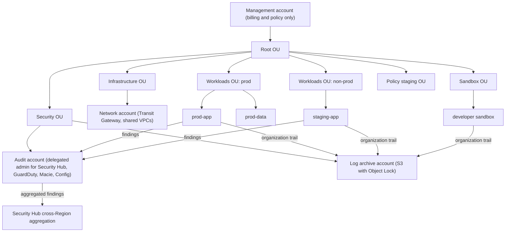
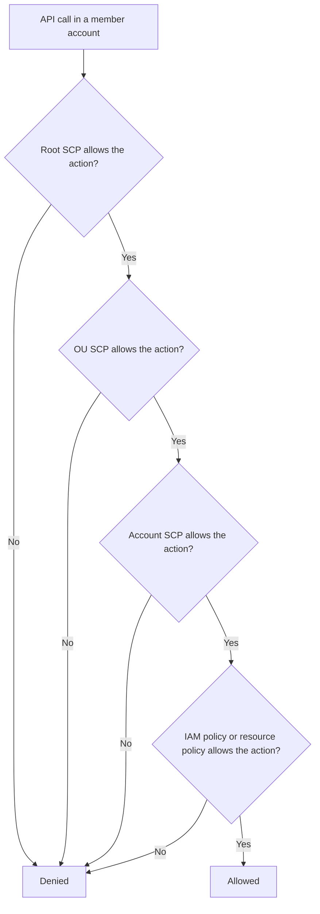
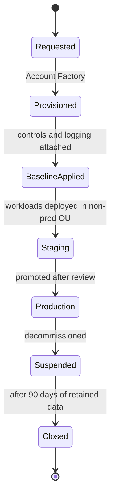

# 10 · AWS Organizations and Multi-Account Strategy

> **Phase 6 — Security and Governance** · Lesson 10 of 11
> ⬅️ Previous: [Compliance: HIPAA, PCI, FedRAMP](./09-compliance-hipaa-pci-fedramp.md) · ➡️ Next: [Project: Security Baseline](./11-project-security-baseline.md) · 🏠 [Phase overview](./README.md)

## Learning Objectives

By the end of this lesson you will be able to:

- Design an organizational unit structure that maps to blast radius rather than to your org chart
- Write SCPs that prevent the mistakes you fear most, and test them without breaking production
- Deploy AWS Control Tower landing zones and use Account Factory to provision new accounts
- Centralize logs, security findings, and Config data with delegated administration
- Choose between preventive and detective guardrails, and build a tagging strategy that ABAC can rely on

**Estimated time:** 80 min · **Difficulty:** Advanced

---

## Core Concepts

**AWS Organizations** is the container that makes multi-account architecture practical. An account is the strongest available boundary in AWS — separate IAM namespaces, separate quotas, separate bills, separate credential blast radius — and Organizations lets you create accounts programmatically, group them, apply policies at the group level, and consolidate billing. If you are doing anything at scale, the question is never "one account or many", it is "how many, and what is the grouping key".

The grouping key should be **blast radius and life cycle, not your reporting lines**. Two accounts in the same OU inherit the same guardrails, so putting production and development in one OU forces you to weaken controls for one of them. A structure that has proven durable: a **management** account that owns almost nothing, a **security** OU containing the delegated-administrator accounts (audit/security tooling), an **infrastructure** OU for shared networking and log archive, **workload** OUs split by environment (prod, non-prod, sandbox), **policy staging** for testing new SCPs, and **suspended** for accounts awaiting deletion. Org charts change quarterly; blast radius does not.

**Service Control Policies (SCPs)** are the preventive layer, and the mental model that gets people into trouble is inheritance. An SCP is attached to the root, an OU, or an account; it applies to every principal inside that target *except* the management account's root user. SCPs never grant permissions — they only filter what IAM can grant. The common composition pattern is: **root SCP** is a strict allow-list of regions and services, **OU SCPs** add environment-specific restrictions (for example, non-prod cannot use the `prod-*` KMS keys), and **account SCPs** exist rarely. One subtlety that causes real outages: SCPs must allow `sts:AssumeRole` and the service-linked roles that services need, or even the consoles break.

**AWS Control Tower** turns this from a build-it-yourself project into a managed baseline. It creates a landing zone: the OU structure, a **log archive** account holding centralized logs, an **audit** account that owns security tooling as delegated administrator, and a set of **controls** (AWS's word for fully managed guardrails) that come in three flavors — **preventive** (SCP-backed), **detective** (Config-rule-backed), and **proactive** (CloudFormation-hook-backed). **Account Factory** then provisions new accounts that are compliant on day one, with a VPC template, SSO access, baseline controls, and logging already wired. Prefer Control Tower controls to hand-written SCPs where a control exists: you inherit AWS's maintenance as new services and Regions appear.

The third pillar is **centralized visibility**, and the pattern is always the same shape: a dedicated account owns the data, and that account is registered as a **delegated administrator** for each service. CloudTrail organization trails write every account's API activity into the log archive account's locked S3 bucket. Config aggregators collect configuration and compliance from every account into the security account. GuardDuty, Security Hub, Macie, and Access Analyzer all use the same delegated-administration pattern. The management account is deliberately kept boring: billing, Organizations policy, and nothing else.

### Key terminology

| Term | Meaning |
|------|---------|
| **Management account** | Owns the organization and its policies; cannot be restricted by SCPs, so it should run no workloads. |
| **OU** | Organizational Unit — a group of accounts that share inheritable policies. |
| **SCP** | Service Control Policy; a filter on maximum permissions, evaluated for every request in a member account. |
| **Control Tower** | AWS service that builds and maintains a landing zone with accounts, OUs, and managed controls. |
| **Landing zone** | The baseline multi-account environment: OUs, log archive, audit account, and controls. |
| **Account Factory** | The provisioning workflow that creates compliant new accounts from a baseline template. |
| **Delegated administrator** | A member account authorized to manage an AWS service across the organization. |
| **Guardrail / control** | A rule that shapes behavior: preventive (blocks), detective (detects), or proactive (blocks at provision time). |
| **Tag policy** | An Organizations policy defining allowed tag keys and values, enforced with Config and IAM conditions. |
| **Config aggregator** | A cross-account, cross-Region view of configuration and compliance data. |

---

## Architecture Diagram

A reference landing zone with delegated administration and centralized logging:



SCP evaluation: how policies at different levels combine into an effective permission set:



Life cycle of a new account, from request to production:



---

## Hands-on Lab: A Landing Zone with SCP Guardrails and Centralized Logging

**Goal:** Build an OU structure, attach SCPs that prevent the classic mistakes, create a log archive account, and enable an organization trail into it.

**Prerequisites:** Two email addresses you control for new accounts, management account credentials, and permission to create organizations policies and CloudTrail trails.

### Step 1 — Create the organization and enable all features

```bash
# Create the organization in all-features mode (required for SCPs)
aws organizations create-organization --feature-set ALL

# Confirm the root ID, which is the target for root-level SCPs
aws organizations list-roots --query 'Roots[0].{Id:Id,Arn:Arn}' --output table

# Note the root ID for later commands
ROOT_ID=$(aws organizations list-roots --query 'Roots[0].Id' --output text)
```

### Step 2 — Build the OU structure

```bash
# Create the top-level OUs
aws organizations create-organizational-unit --parent-id "$ROOT_ID" --name Security
aws organizations create-organizational-unit --parent-id "$ROOT_ID" --name Infrastructure
aws organizations create-organizational-unit --parent-id "$ROOT_ID" --name Workloads-Prod
aws organizations create-organizational-unit --parent-id "$ROOT_ID" --name Workloads-NonProd
aws organizations create-organizational-unit --parent-id "$ROOT_ID" --name Sandbox
aws organizations create-organizational-unit --parent-id "$ROOT_ID" --name Policy-Staging
aws organizations create-organizational-unit --parent-id "$ROOT_ID" --name Suspended

# List the OU tree so you can copy the IDs you will attach policies to
aws organizations list-organizational-units-for-parent --parent-id "$ROOT_ID" \
  --query 'OrganizationalUnits[].{Name:Name,Id:Id}' --output table
```

### Step 3 — Create the log archive and audit accounts

```bash
# Create the log archive account, which will own the immutable log bucket
aws organizations create-account \
  --email logs@example.com \
  --account-name "Log Archive" \
  --role-name OrganizationAccountAccessRole

# Create the audit account, which becomes the delegated administrator
aws organizations create-account \
  --email security@example.com \
  --account-name "Audit" \
  --role-name OrganizationAccountAccessRole

# Watch the creation status until SUCCEEDED, then note both account IDs
aws organizations list-accounts \
  --query 'Accounts[].{Id:Id,Name:Name,Status:Status}' --output table

# Move them into the Security OU
aws organizations move-account \
  --account-id 444455556666 \
  --source-parent-id "$ROOT_ID" \
  --destination-parent-id ou-security-1234567890
```

### Step 4 — Write and attach guardrail SCPs

```json
{
  "Version": "2012-10-17",
  "Statement": [
    {
      "Sid": "DenyRootUserActions",
      "Effect": "Deny",
      "Action": "*",
      "Resource": "*",
      "Condition": {
        "StringLike": {
          "aws:PrincipalArn": "arn:aws:iam::*:root"
        },
        "Bool": {
          "aws:MultiFactorAuthPresent": "false"
        }
      }
    },
    {
      "Sid": "DenyRegionOutsideApprovedList",
      "Effect": "Deny",
      "NotAction": [
        "iam:*",
        "organizations:*",
        "sts:*",
        "cloudfront:*",
        "route53:*",
        "support:*",
        "budgets:*",
        "ce:*"
      ],
      "Resource": "*",
      "Condition": {
        "StringNotEquals": {
          "aws:RequestedRegion": ["eu-west-1", "eu-central-1"]
        }
      }
    },
    {
      "Sid": "DenyLeavingTheOrganization",
      "Effect": "Deny",
      "Action": ["organizations:LeaveOrganization", "account:CloseAccount"],
      "Resource": "*"
    },
    {
      "Sid": "ProtectGuardrails",
      "Effect": "Deny",
      "Action": ["cloudtrail:StopLogging", "config:StopConfigurationRecorder", "guardduty:DeleteDetector"],
      "Resource": "*"
    }
  ]
}
```

```bash
# SCPs must be enabled on the root before you can create any
aws organizations enable-policy-type --root-id "$ROOT_ID" --policy-type SERVICE_CONTROL_POLICY

# Create the guardrail policy
POLICY_ID=$(aws organizations create-policy \
  --name BaselineGuardrails \
  --description "Root-level preventive guardrails for all member accounts" \
  --type SERVICE_CONTROL_POLICY \
  --content file://scp-baseline.json \
  --query 'Policy.PolicySummary.Id' --output text)

# Attach it to the root so every member account inherits it
aws organizations attach-policy --policy-id "$POLICY_ID" --target-id "$ROOT_ID"

# Verify the attachment
aws organizations list-policies-for-target --target-id "$ROOT_ID" --filter SERVICE_CONTROL_POLICY
```

Add one environment-specific SCP that keeps non-prod away from production key material:

```json
{
  "Version": "2012-10-17",
  "Statement": [
    {
      "Sid": "DenyProductionKmsKeysInNonProd",
      "Effect": "Deny",
      "Action": ["kms:Decrypt", "kms:Encrypt", "kms:GenerateDataKey"],
      "Resource": "arn:aws:kms:*:111122223333:key/*",
      "Condition": {
        "StringEquals": {
          "aws:ResourceTag/Environment": "prod"
        }
      }
    }
  ]
}
```

```bash
# Attach the environment SCP to the non-prod OU only
aws organizations create-policy --name NonProdDataIsolation \
  --description "Non-production cannot use production-tagged keys" \
  --type SERVICE_CONTROL_POLICY --content file://scp-nonprod.json

aws organizations attach-policy --policy-id p-nonprod123 --target-id ou-nonprod-1234567890
```

### Step 5 — Test a new SCP without breaking production

This is what the Policy-Staging OU exists for: never test a guardrail where it can take down a live workload.

```bash
# Create the candidate policy (detached from everything)
aws organizations create-policy --name CandidateRegionGuardrail \
  --description "Candidate: adds ap-southeast-2 to denied Regions" \
  --type SERVICE_CONTROL_POLICY --content file://scp-candidate.json

# Attach it to the staging OU, which contains only a throwaway account
aws organizations attach-policy --policy-id p-candidate123 --target-id ou-staging-1234567890

# Prove the behavior: this must fail from the staging account
aws ec2 describe-instances --region ap-southeast-2 --profile staging-admin

# Once proven, promote the change to the root policy and detach the candidate
aws organizations update-policy --policy-id "$POLICY_ID" \
  --content file://scp-baseline-v2.json
aws organizations detach-policy --policy-id p-candidate123 --target-id ou-staging-1234567890
aws organizations delete-policy --policy-id p-candidate123
```

Because SCP changes take effect within minutes, a bad guardrail is immediately visible in the staging OU rather than at 3 a.m. in production.

### Step 6 — Delegate administration for security services

```bash
# Security Hub, GuardDuty, Config, and Macie all follow the same pattern
aws organizations register-delegated-administrator \
  --account-id 444455556666 \
  --service-principal securityhub.amazonaws.com

aws organizations register-delegated-administrator \
  --account-id 444455556666 \
  --service-principal guardduty.amazonaws.com

aws organizations register-delegated-administrator \
  --account-id 444455556666 \
  --service-principal config.amazonaws.com

aws organizations register-delegated-administrator \
  --account-id 444455556666 \
  --service-principal config-multiaccountsetup.amazonaws.com

aws organizations list-delegated-administrators \
  --service-principal guardduty.amazonaws.com
```

### Step 7 — Create the organization trail into the log archive account

```bash
# Run in the management account: one trail, every account, every Region
aws cloudtrail create-trail \
  --name organization-trail \
  --s3-bucket-name org-cloudtrail-logs-444455556666 \
  --is-organization-trail \
  --is-multi-region-trail \
  --enable-log-file-validation \
  --kms-key-id arn:aws:kms:eu-west-1:444455556666:key/1234abcd-12ab-34cd-56ef-1234567890ab

aws cloudtrail start-logging --name organization-trail

# Verify the trail covers the whole organization
aws cloudtrail describe-trails \
  --trail-name-list organization-trail \
  --query 'trailList[0].{Org:IsOrganizationTrail,MultiRegion:IsMultiRegionTrail,Home:HomeRegion}'
```

Protect the log bucket so that even an account administrator cannot quietly rewrite history:

```json
{
  "Version": "2012-10-17",
  "Statement": [
    {
      "Sid": "DenyNonTlsRequests",
      "Effect": "Deny",
      "Principal": "*",
      "Action": "s3:*",
      "Resource": [
        "arn:aws:s3:::org-cloudtrail-logs-444455556666",
        "arn:aws:s3:::org-cloudtrail-logs-444455556666/*"
      ],
      "Condition": {
        "Bool": {
          "aws:SecureTransport": "false"
        }
      }
    },
    {
      "Sid": "DenyDeletionOfLogs",
      "Effect": "Deny",
      "Principal": "*",
      "Action": ["s3:DeleteObject", "s3:DeleteBucket"],
      "Resource": [
        "arn:aws:s3:::org-cloudtrail-logs-444455556666",
        "arn:aws:s3:::org-cloudtrail-logs-444455556666/*"
      ]
    }
  ]
}
```

```bash
# Object Lock can only be enabled at bucket creation time, so recreate the bucket
# in the log archive account with --object-lock-enabled-for-bucket if it is not already
aws s3api create-bucket \
  --bucket org-cloudtrail-logs-444455556666 \
  --region eu-west-1 \
  --create-bucket-configuration LocationConstraint=eu-west-1 \
  --object-lock-enabled-for-bucket

# Object Lock makes the retention immutable, even for the bucket owner
aws s3api put-object-lock-configuration \
  --bucket org-cloudtrail-logs-444455556666 \
  --object-lock-configuration '{"ObjectLockEnabled":"Enabled","Rule":{"DefaultRetention":{"Mode":"COMPLIANCE","Days":2555}}}'
```

### Step 8 — Verify the whole baseline

```bash
# OU structure is what you designed
aws organizations list-organizational-units-for-parent --parent-id "$ROOT_ID" \
  --query 'OrganizationalUnits[].Name'

# The guardrail is attached at the root and non-prod has its extra policy
aws organizations list-policies-for-target --target-id "$ROOT_ID" --filter SERVICE_CONTROL_POLICY
aws organizations list-policies-for-target --target-id ou-nonprod-1234567890 --filter SERVICE_CONTROL_POLICY

# Centralized logging is live and organization-wide
aws cloudtrail get-trail-status --name organization-trail --query '{Logging:IsLogging,Latest:LatestDeliveryTime}'

# A Config aggregator gives you one compliance view
aws configservice put-configuration-aggregator \
  --configuration-aggregator-name org-aggregator \
  --organization-aggregation-source '{"RoleArn":"arn:aws:iam::444455556666:role/OrganizationAggregationRole","AllAwsRegions":{}}'
aws configservice describe-configuration-aggregators
```

---

## CLI Reference

```bash
# Organization inventory
aws organizations describe-organization
aws organizations list-accounts --query 'Accounts[].{Id:Id,Name:Name,Status:Status}' --output table
aws organizations list-organizational-units-for-parent --parent-id "$ROOT_ID"

# Account provisioning and movement
aws organizations create-account --email new@example.com --account-name "new-app-prod" --role-name OrganizationAccountAccessRole
aws organizations move-account --account-id 111122223333 --source-parent-id "$ROOT_ID" --destination-parent-id ou-prod-1234567890
aws organizations tag-resource --resource-id 111122223333 --tags Key=CostCenter,Value=Payments

# Policy management
aws organizations list-policies --filter SERVICE_CONTROL_POLICY
aws organizations describe-policy --policy-id "$POLICY_ID"
aws organizations update-policy --policy-id "$POLICY_ID" --content file://scp-v2.json
aws organizations list-targets-for-policy --policy-id "$POLICY_ID"
aws organizations create-policy --name TaggingStandard --type TAG_POLICY --content file://tag-policy.json

# Backups and EC2 declarative policies are also organization-level
aws organizations create-policy --name OrgBackupPlan --type BACKUP_POLICY --content file://backup-policy.json

# Control Tower
aws controltower list-landing-zones
aws controltower get-landing-zone --landing-zone-identifier arn:aws:controltower:eu-west-1:111122223333:landingzone/1A2B3C4D5E6F7G8H
aws controltower list-enabled-controls --target-identifier ou-prod-1234567890
aws controltower enable-control --control-identifier arn:aws:controltower:eu-west-1::control/AWS-GR_S3_BUCKET_PUBLIC_READ_PROHIBITED --target-identifier ou-prod-1234567890

# Account Factory (Service Catalog provisioning workflow)
aws servicecatalog search-products-as-admin --portfolio-id port-1234567890
aws servicecatalog provision-product --product-name AWSControlTowerAccountFactory \
  --provisioning-artifact-name AWSControlTowerAccountFactory \
  --provisioned-product-name "new-app-prod" \
  --provisioning-parameters ParameterKey=AccountEmail,ParameterValue=new@example.com ParameterKey=AccountName,ParameterValue=new-app-prod

# Drift and tagging hygiene
aws resourcegroupstaggingapi get-resources --tag-filters Key=Environment,Values=prod
aws resourcegroupstaggingapi get-compliance-summary
aws configservice describe-configuration-aggregators
```

| Command | Purpose |
|---------|---------|
| `create-organizational-unit` | Builds the OU hierarchy that policies attach to |
| `create-account` | Provisions a new account with an admin role for takeover |
| `enable-policy-type` | Turns on SCPs, tag policies, or backup policies for the organization |
| `create-policy` / `attach-policy` | Defines and applies guardrails at root, OU, or account level |
| `list-policies-for-target` | Shows exactly which guardrails apply to a given OU |
| `register-delegated-administrator` | Names the account that manages a service organization-wide |
| `create-trail --is-organization-trail` | Centralizes API logs from every account into one bucket |

---

## Best Practices

| Practice | Why it matters |
|----------|----------------|
| Group accounts by blast radius and life cycle, not by team | OUs determine inherited guardrails; the wrong grouping forces weaker controls |
| Keep the management account empty of workloads | It is the one account SCPs cannot restrict |
| Use Control Tower controls when one exists | You inherit AWS's maintenance as services and Regions change |
| Test every new SCP in a policy staging OU | Catch the console-breaking allow-list mistake before production |
| Take an allow-list approach at the root, deny-list only inside OUs | Allow-lists fail closed when AWS launches new services in new Regions |
| Centralize logs in a dedicated account with Object Lock | An account admin should not be able to edit their own audit trail |
| Delegate administration to a security account for every monitoring service | One configuration, one place to look, one account to protect |
| Adopt a mandatory tag taxonomy and enforce it with tag policies | Tags are the foundation of cost allocation, ABAC, and automation |
| Provision accounts through Account Factory or a pipeline | Manual accounts always lack a guardrail or a log destination |

---

## Common Pitfalls

| Pitfall | Symptom | Fix |
|---------|---------|-----|
| SCP denies a service the account needs to function | Console errors, broken Service Catalog provisioning, failing SSO | Scope denies narrowly, and always allow `sts:AssumeRole` for role-based services |
| Root SCP written as a deny-list only | New Regions silently allowed | Use an allow-list of Regions with explicit exceptions for global services |
| Testing SCPs in production OU | Outage during rollout | Use a policy staging OU with a throwaway account |
| Running workloads in the management account | Guardrails cannot protect it; audit findings | Move workloads out; keep only billing and policy |
| Per-account CloudTrail instead of an organization trail | Gaps whenever a new account is created | One organization trail, multi-Region, with log file validation |
| Log bucket writable by member accounts | Compromised account deletes its own logs | Deny delete actions and enable Object Lock in compliance mode |
| Delegated admin registered but service not enabled there | Findings never appear, members show as unconfigured | Enable the service in the admin account and auto-enable for members |
| Tags used for ABAC but enforced by nothing | Policies silently match nothing, or worse, match too much | Enforce tag policies and validate tags at creation with IAM conditions |

---

## Cost Considerations

AWS Organizations and SCPs are **free**. Control Tower has no additional charge for the landing zone itself, though several components it enables do: **AWS Config** records every supported resource in every account (roughly **$0.003 per configuration item** plus per-rule evaluation charges), **CloudTrail** charges for organization trails beyond the first copy of management events (**around $2.00 per 100,000 events** for additional trails, with no charge for the organization trail's first copy), and **Security Hub, GuardDuty, and Macie** bill per account and Region as covered in earlier lessons.

This is where multi-account costs turn into a multiplication exercise. Forty accounts each enabling Config, GuardDuty, Security Hub, and Macie across three Regions is not 40× a single account — it is 120 regional deployments of every service. The counters are: keep **sandbox and experimental accounts free of expensive monitoring services** where policy permits (or cap them with Config's recording scope), pick the **minimum Regions you actually operate in** and deny the rest with an SCP so nothing is silently enabled elsewhere, and revisit **Config recording scope** — recording only the resource types you care about can cut the bill substantially in accounts full of ephemeral resources. Cost allocation tags plus a shared-services account that centralizes tooling usually pay for themselves within a quarter.

---

## Security Considerations

- **The management account is the crown jewel.** It can modify SCPs, close accounts, and remove delegated administrators. Enforce MFA, remove all access keys, restrict human access to a break-glass role, and alarm on every login.
- **SCPs are a ceiling, not a permission.** A common false assumption is that an SCP grants access; it never does. Pair guardrails with IAM and resource policies, or you will find "allowed by SCP but denied by IAM" outages confusing.
- **Guardrails must protect themselves.** Deny `cloudtrail:StopLogging`, `config:StopConfigurationRecorder`, `guardduty:DeleteDetector`, and `organizations:LeaveOrganization` at the root, and alarm on attempts.
- **Log integrity is a security control.** Object Lock in compliance mode plus a bucket policy denying deletes means an attacker with account admin cannot erase their tracks.
- **The delegated administrator account should run no workloads.** It is the account with cross-organization visibility and configuration authority; keeping it clean keeps it trustworthy.
- **Service control policies do not apply to service-linked roles in every case**, so do not assume a guardrail covers actions a linked role performs on your behalf. Verify with CloudTrail.
- **Account email addresses are a security dependency.** Each account needs a unique, monitored email; a lost mailbox means a locked-out account or an unrecoverable root user.
- **Watch for policy drift between Control Tower-managed OUs and manually attached SCPs.** Conflicting guardrails produce access failures that are extremely hard to diagnose.

---

## Exercise

Design the account structure for a company with three product teams, one regulated payment workload, and a development sandbox. Produce (a) the OU tree with a one-line justification for each OU, (b) the guardrail matrix showing which SCP attaches where, and (c) a tagging taxonomy with three mandatory tag keys and their allowed values. Then implement it in a sandbox organization: create the OUs, attach one root SCP and one OU-level SCP, and prove with a deliberate attempt from a staging account that the guardrail held. Finally, write the two-sentence rollback plan for a guardrail that breaks a production workflow.

Success looks like: a diagram or table showing the OU structure, an SCP that demonstrably denies a real action in one OU but not another, and a documented promotion process that never tests guardrails for the first time in production.

---

## Resources

- [AWS Organizations User Guide](https://docs.aws.amazon.com/organizations/latest/userguide/orgs_introduction.html)
- [Service control policies](https://docs.aws.amazon.com/organizations/latest/userguide/orgs_manage_policies_scps.html)
- [AWS Control Tower User Guide](https://docs.aws.amazon.com/controltower/latest/userguide/what-is-control-tower.html)
- [Controls reference in Control Tower](https://docs.aws.amazon.com/controltower/latest/userguide/controls-reference.html)
- [Account Factory](https://docs.aws.amazon.com/controltower/latest/userguide/account-factory.html)
- [Tag policies](https://docs.aws.amazon.com/organizations/latest/userguide/orgs_manage_policies_tag-policies.html)
- [Organizing your AWS environment using multiple accounts](https://docs.aws.amazon.com/whitepapers/latest/organizing-your-aws-environment/organizing-your-aws-environment.html)
- [Creating a trail for an organization](https://docs.aws.amazon.com/awscloudtrail/latest/userguide/creating-trail-organization.html)

---

## Next Steps

You have every building block this phase teaches: cross-account identity, federation, encryption and custody options, threat detection, data classification, compliance evidence, and organizational guardrails. The capstone assembles them into one deployable, diagrammable security baseline — and includes the break-glass path you need when the guardrails work exactly as designed.

> ⬅️ Previous: [Compliance: HIPAA, PCI, FedRAMP](./09-compliance-hipaa-pci-fedramp.md) · ➡️ Next: [Project: Security Baseline](./11-project-security-baseline.md) · 🏠 [Phase overview](./README.md)
