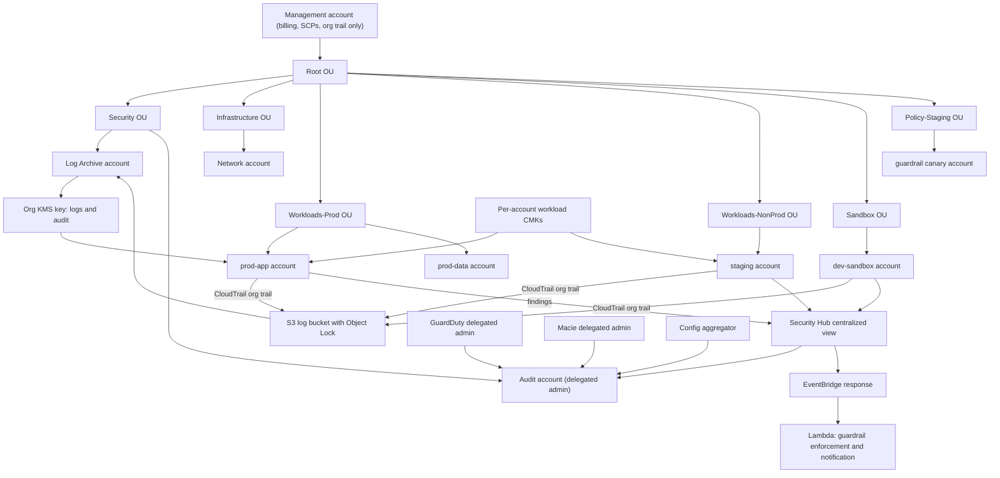
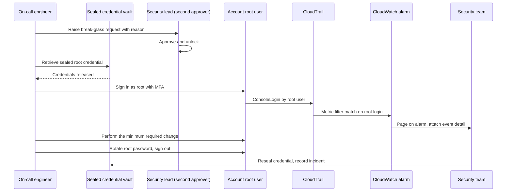
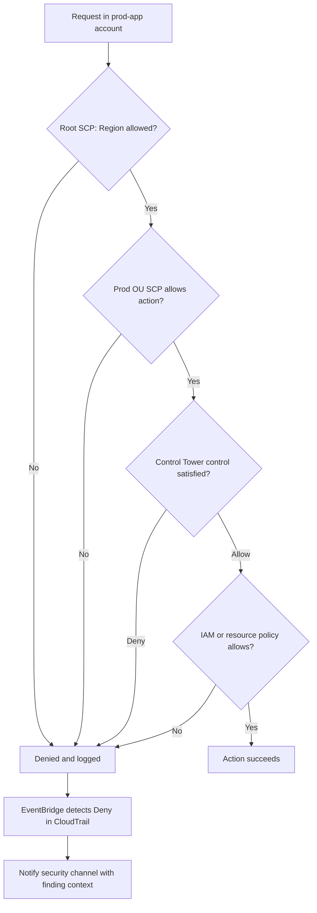

# 11 · Project: Multi-Account Security Baseline

> **Phase 6 — Security and Governance** · Lesson 11 of 11
> ⬅️ Previous: [AWS Organizations and Multi-Account Strategy](./10-aws-organizations-multi-account-strategy.md) · ➡️ Next: [Phase 7 — Edge and IoT](../phase-7-edge-and-iot/README.md) · 🏠 [Phase overview](./README.md)

## 🎯 Learning Objectives

By the end of this capstone you will have:

- A Control Tower landing zone with a log archive and audit account
- One organization CloudTrail trail writing immutable logs to the log archive account
- Three SCP guardrails that prevent root abuse, Region sprawl, and tampering with detection
- Security Hub and GuardDuty configured with delegated administration and cross-Region aggregation
- A tiered KMS key strategy with organization-level keys for logging and per-account keys for workloads
- A tested break-glass procedure for the root user, with an alarm that fires whenever it is used

**Estimated time:** 4–6 hours · **Difficulty:** Advanced

---

## 🧠 Core Concepts

This project is the assembly step. Every control you build here was introduced separately in this phase; the engineering value comes from making them reinforce each other rather than coexist. Three design principles hold the whole thing together.

First, **one owner per control, and that owner is never the management account**. The management account exists to hold the organization policy and pay the bill. Logs live in the log archive account, security tooling lives in the audit account, shared networking lives in a network account. The reason is not aesthetics: the management account cannot be restricted by SCPs, so any control that lives there is a control an attacker with management-account access can remove.

Second, **preventive beats detective, detective beats manual**. A card data leak prevented by an SCP never becomes an incident, an audit finding, or a support ticket. A leak detected by Macie ten minutes later is a breach notification. A leak found during next year's audit is a scandal. Build in the order: prevent the worst thing, detect what you could not prevent, and automate the response to what you detect.

Third, **the baseline must be reproducible**. An account created by hand will be missing a log destination, an SCP attachment, or a KMS key. Provision through Control Tower's Account Factory or your own pipeline so that "compliant on day one" is a property of the process rather than an achievement of an individual.

The break-glass path deserves its own mention because it is the control most often left untested. Your guardrails will, by design, block normal pathways when things go wrong — a misconfigured SSO trust, a lockout of the Identity Center instance, an IdP outage. When that happens you need a credential that still works: the account root user, with its password in a sealed physical or cryptographic vault, reachable only by two named people, and monitored by an alarm that pages the security team the moment the root user signs in. A break-glass account that has never been tested is a rumor, not a control.

### Key terminology

| Term | Meaning |
|------|---------|
| **Security baseline** | The minimum set of accounts, guardrails, logging, detection, and keys every account in the organization inherits. |
| **Landing zone** | The provisioned multi-account environment: OU structure, log archive, audit account, and attached controls. |
| **Log archive account** | The account that owns centralized, immutable log storage for the whole organization. |
| **Audit account** | The delegated administrator for security services; it holds tooling and findings, not workloads. |
| **Guardrail** | A preventive SCP, a detective Config rule, or a proactive CloudFormation hook that shapes behavior. |
| **Organization trail** | A single CloudTrail trail that records API activity from every account into one destination. |
| **Delegated administrator** | A member account authorized to manage a service across the organization. |
| **Organization key** | A KMS key in the log archive account used for logs and evidence, with usage pinned to the organization. |
| **Break-glass access** | The sealed, two-person, alarmed emergency path that uses the account root user. |
| **Attestation of coverage** | Proof that every account is actually enrolled in logging, detection, and guardrails. |

### Deliverables

| # | Deliverable | Evidence you can show |
|---|-------------|----------------------|
| 1 | Organization architecture | Diagram plus `aws organizations list-accounts` output |
| 2 | Landing zone | Control Tower status with the OU structure it created |
| 3 | Centralized logging | Organization trail status plus an object in the log archive bucket |
| 4 | SCP guardrails | `list-policies-for-target` for the root and each OU |
| 5 | Aggregated detection | Security Hub enabled standards plus GuardDuty member list |
| 6 | KMS strategy | Key inventory showing org keys and workload keys with their policies |
| 7 | Break-glass access | Runbook, sealed credential location, and a fired alarm in CloudWatch |

---

## 🗺️ Architecture Diagram

The complete baseline: OUs, accounts, delegated administration, centralized logging, and the key hierarchy.



Break-glass access: the flow, the two-person control, and the alarm that proves it was used.



Guardrail evaluation for a request in a workload account, and the response path when it is denied.



---

## 🧪 Build Guide

**Prerequisites:** A management account with no workloads, three email addresses you control, permission to create organizations policies, Control Tower, KMS, Security Hub, and GuardDuty, and a budget for the monitoring services across the accounts you create.

### Step 1 — Establish the organization and landing zone

If you are starting from nothing, Control Tower builds the OU structure, log archive, and audit accounts for you. If you already have an organization from Lesson 10, verify the landing zone still matches this design.

```bash
# Confirm the organization exists and note the root
aws organizations describe-organization --query 'Organization.{Id:Id,FeatureSet:FeatureSet}' --output table

# Bring up the landing zone (usually done in the console; the API supports automation)
aws controltower list-landing-zones

# Check which regions and baseline version it uses
aws controltower get-landing-zone \
  --landing-zone-identifier arn:aws:controltower:eu-west-1:111122223333:landingzone/1A2B3C4D5E6F7G8H \
  --query 'landingZone.{Status:status,Version:version,Drift:driftStatus}'
```

```bash
# Create the OU skeleton for anything Control Tower does not provide
ROOT_ID=$(aws organizations list-roots --query 'Roots[0].Id' --output text)

for OU in Workloads-Prod Workloads-NonProd Sandbox Policy-Staging; do
  aws organizations create-organizational-unit --parent-id "$ROOT_ID" --name "$OU"
done

aws organizations list-organizational-units-for-parent --parent-id "$ROOT_ID" \
  --query 'OrganizationalUnits[].{Name:Name,Id:Id}' --output table
```

### Step 2 — Provision workload accounts through Account Factory

```bash
# Find the Account Factory product in the Control Tower portfolio
aws servicecatalog search-products-as-admin \
  --query 'ProductViewSummaries[?Name==`AWSControlTowerAccountFactory`].ProductId' --output text

# Provision a compliant account: VPC baseline, SSO access, controls, and logging come with it
aws servicecatalog provision-product \
  --product-name AWSControlTowerAccountFactory \
  --provisioning-artifact-name AWSControlTowerAccountFactory \
  --provisioned-product-name prod-app \
  --provisioning-parameters \
    ParameterKey=AccountEmail,ParameterValue=prod-app@example.com \
    ParameterKey=AccountName,ParameterValue=prod-app \
    ParameterKey=SSOUserEmail,ParameterValue=platform-lead@example.com \
    ParameterKey=SSOUserFirstName,ParameterValue=Platform \
    ParameterKey=SSOUserLastName,ParameterValue,Lead \
    ParameterKey=ManagedOrganizationalUnit,ParameterValue=Workloads-Prod
```

Every account created this way is born with a log destination, a baseline VPC, SSO access, and the controls attached to its OU. Accounts created by hand are the ones that show up in audit findings.

### Step 3 — Centralize CloudTrail into the log archive account

```bash
# Run in the management account. One organization trail replaces per-account trails.
aws cloudtrail create-trail \
  --name org-security-trail \
  --s3-bucket-name org-cloudtrail-111122223333 \
  --is-organization-trail \
  --is-multi-region-trail \
  --enable-log-file-validation \
  --kms-key-id arn:aws:kms:eu-west-1:444455556666:key/1234abcd-12ab-34cd-56ef-1234567890ab \
  --cloud-watch-logs-log-group-arn arn:aws:logs:eu-west-1:444455556666:log-group:org-trail-logs:* \
  --cloud-watch-logs-role-arn arn:aws:iam::444455556666:role/CloudTrailToCloudWatchLogs

aws cloudtrail start-logging --name org-security-trail

# Data events for the buckets that matter most (S3 object-level logging is not free)
aws cloudtrail put-event-selectors \
  --trail-name org-security-trail \
  --advanced-event-selectors '[{"Name":"S3SensitiveBuckets","FieldSelectors":[{"Field":"eventCategory","Equals":["Data"]},{"Field":"resources.type","Equals":["AWS::S3::Object"]},{"Field":"resources.ARN","StartsWith":["arn:aws:s3:::prod-data-"]}]}]'
```

Enable the CloudTrail insights and CloudWatch Logs integration so you get metrics and alarms on top of the raw log:

```bash
aws cloudtrail put-insight-selectors \
  --trail-name org-security-trail \
  --insight-selectors '[{"InsightType":"ApiCallRateInsight"},{"InsightType":"ApiErrorRateInsight"}]'

# Prove delivery is working after a few minutes
aws cloudtrail get-trail-status --name org-security-trail \
  --query '{Logging:IsLogging,LatestDelivery:LatestDeliveryTime,LatestError:LatestDeliveryError}'

aws s3 ls s3://org-cloudtrail-111122223333/AWSLogs/ --recursive --human-readable | head
```

### Step 4 — Attach the SCP guardrails

Three guardrails carry most of the weight: **no unapproved Regions**, **no destructive root usage**, and **detection cannot be turned off**. A fourth protects the guardrails themselves.

```json
{
  "Version": "2012-10-17",
  "Statement": [
    {
      "Sid": "DenyActionsOutsideApprovedRegions",
      "Effect": "Deny",
      "NotAction": [
        "iam:*",
        "sts:*",
        "organizations:*",
        "cloudfront:*",
        "route53:*",
        "support:*",
        "budgets:*",
        "ce:*",
        "health:*"
      ],
      "Resource": "*",
      "Condition": {
        "StringNotEquals": {
          "aws:RequestedRegion": ["eu-west-1", "eu-central-1", "us-east-1"]
        }
      }
    },
    {
      "Sid": "DenyRootUserWithoutMfa",
      "Effect": "Deny",
      "Action": "*",
      "Resource": "*",
      "Condition": {
        "StringLike": {
          "aws:PrincipalArn": "arn:aws:iam::*:root"
        },
        "Bool": {
          "aws:MultiFactorAuthPresent": "false"
        }
      }
    },
    {
      "Sid": "DenyDisablingSecurityServices",
      "Effect": "Deny",
      "Action": [
        "cloudtrail:StopLogging",
        "cloudtrail:DeleteTrail",
        "cloudtrail:UpdateTrail",
        "config:StopConfigurationRecorder",
        "config:DeleteConfigurationRecorder",
        "guardduty:DeleteDetector",
        "guardduty:UpdateDetector",
        "securityhub:DisableSecurityHub",
        "securityhub:BatchDisableStandards",
        "macie2:DisableMacie",
        "organizations:LeaveOrganization",
        "account:CloseAccount"
      ],
      "Resource": "*"
    },
    {
      "Sid": "ProtectTheGuardrailItself",
      "Effect": "Deny",
      "Action": [
        "organizations:DeletePolicy",
        "organizations:DetachPolicy",
        "organizations:UpdatePolicy"
      ],
      "Resource": "*"
    }
  ]
}
```

```bash
# Enable SCPs on the root, then create and attach the guardrail
aws organizations enable-policy-type --root-id "$ROOT_ID" --policy-type SERVICE_CONTROL_POLICY

GUARDRAIL_ID=$(aws organizations create-policy \
  --name SecurityBaselineGuardrails \
  --description "Baseline guardrails: Regions, root user, detection tampering" \
  --type SERVICE_CONTROL_POLICY \
  --content file://security-baseline-scp.json \
  --query 'Policy.PolicySummary.Id' --output text)

aws organizations attach-policy --policy-id "$GUARDRAIL_ID" --target-id "$ROOT_ID"

# Canary test: the staging OU proves the guardrail works before you rely on it
aws organizations attach-policy --policy-id "$GUARDRAIL_ID" --target-id ou-staging-1234567890
aws ec2 describe-instances --region ap-southeast-2 --profile canary-admin   # must fail
```

Add a Control Tower control on the production OU so a managed detective rule backs up the preventive SCP:

```bash
aws controltower list-enabled-controls --target-identifier ou-prod-1234567890

aws controltower enable-control \
  --control-identifier arn:aws:controltower:eu-west-1::control/AWS-GR_RESTRICT_ROOT_USER \
  --target-identifier ou-prod-1234567890
```

### Step 5 — Delegate and aggregate detection

```bash
# Management account: name the audit account as delegated administrator
for SVCPRINCIPAL in securityhub.amazonaws.com guardduty.amazonaws.com macie2.amazonaws.com access-analyzer.amazonaws.com; do
  aws organizations register-delegated-administrator \
    --account-id 444455556666 \
    --service-principal "$SVCPRINCIPAL"
done

aws organizations list-delegated-administrators
```

```bash
# Audit account: enable Security Hub with the baseline standard, then auto-enable for the org
aws securityhub enable-security-hub \
  --enable-default-standards \
  --control-finding-generator SECURITY_CONTROL

aws securityhub update-organization-configuration --auto-enable
aws securityhub get-organization-configuration

# Add CIS on top of the foundational best practices
aws securityhub batch-enable-standards --standards-subscription-requests \
  StandardsArn="arn:aws:securityhub:eu-west-1::standards/cis-aws-foundations-benchmark/v/1.4.0"

# Aggregate every Region into one pane of glass
aws securityhub create-finding-aggregator --region eu-west-1 --finding-aggregation-region eu-central-1
aws securityhub create-finding-aggregator --region eu-west-1 --finding-aggregation-region us-east-1
```

```bash
# Audit account: GuardDuty detector with every protection plan, then auto-enable members
DETECTOR=$(aws guardduty create-detector --enable \
  --finding-publishing-frequency FIFTEEN_MINUTES \
  --query DetectorId --output text)

aws guardduty update-detector --detector-id "$DETECTOR" --features '[
  {"Name":"S3_DATA_EVENTS","Status":"ENABLED"},
  {"Name":"EKS_AUDIT_LOGS","Status":"ENABLED"},
  {"Name":"LAMBDA_NETWORK_LOGS","Status":"ENABLED"},
  {"Name":"RDS_LOGIN_EVENTS","Status":"ENABLED"},
  {"Name":"RUNTIME_MONITORING","Status":"ENABLED"}
]'

aws guardduty update-malware-protection --detector-id "$DETECTOR" --enable \
  --malware-protection-configuration '{"ScanEc2InstanceWithFindings":{"EbsVolumes":true}}'

aws guardduty update-organization-configuration \
  --detector-id "$DETECTOR" \
  --auto-enable-organization-members

aws guardduty list-members --detector-id "$DETECTOR" \
  --query 'Members[].{Id:AccountId,Status:RelationshipStatus}' --output table
```

```bash
# Audit account: one Config aggregator for cross-account compliance
aws configservice put-configuration-aggregator \
  --configuration-aggregator-name org-security-aggregator \
  --organization-aggregation-source '{"RoleArn":"arn:aws:iam::444455556666:role/OrganizationAggregationRole","AllAwsRegions":{}}'

aws configservice describe-configuration-aggregators \
  --configuration-aggregator-names org-security-aggregator
```

### Step 6 — Design the KMS key hierarchy

Two tiers keep cryptography governable. The **organization key** lives in the log archive account and is used only for logs and evidence; the **workload keys** are per-account CMKs that application teams can use but not administer. The organization key policy pins usage to the organization, which is what makes a leaked credential from outside the org useless.

```json
{
  "Version": "2012-10-17",
  "Statement": [
    {
      "Sid": "KeyAdministrationRestrictedToLogArchive",
      "Effect": "Allow",
      "Principal": {
        "AWS": "arn:aws:iam::444455556666:role/LogArchiveKeyAdmin"
      },
      "Action": [
        "kms:Create*",
        "kms:Describe*",
        "kms:Enable*",
        "kms:List*",
        "kms:Put*",
        "kms:Update*",
        "kms:Revoke*",
        "kms:Get*",
        "kms:TagResource",
        "kms:UntagResource"
      ],
      "Resource": "*",
      "Condition": {
        "StringEquals": {
          "aws:PrincipalOrgID": "o-example12345"
        }
      }
    },
    {
      "Sid": "AllowCloudTrailAndConfigToEncryptOrgWide",
      "Effect": "Allow",
      "Principal": {
        "AWS": "arn:aws:iam::111122223333:root"
      },
      "Action": [
        "kms:Encrypt",
        "kms:GenerateDataKey",
        "kms:DescribeKey"
      ],
      "Resource": "*",
      "Condition": {
        "StringEquals": {
          "aws:PrincipalOrgID": "o-example12345",
          "kms:CallerAccount": "111122223333"
        }
      }
    },
    {
      "Sid": "DenyKeyDisablingAndDeletion",
      "Effect": "Deny",
      "Principal": "*",
      "Action": [
        "kms:ScheduleKeyDeletion",
        "kms:DisableKey",
        "kms:PutKeyPolicy"
      ],
      "Resource": "*",
      "Condition": {
        "StringNotEquals": {
          "aws:PrincipalArn": "arn:aws:iam::444455556666:role/LogArchiveKeyAdmin"
        }
      }
    }
  ]
}
```

```bash
# Log archive account: create the organization key for logs and evidence
ORG_KEY=$(aws kms create-key \
  --description "Organization key for CloudTrail, Config and evidence buckets" \
  --key-usage ENCRYPT_DECRYPT \
  --key-spec SYMMETRIC_DEFAULT \
  --policy file://org-log-key-policy.json \
  --query 'KeyMetadata.KeyId' --output text)

aws kms create-alias --alias-name alias/org-security-logs --target-key-id "$ORG_KEY"
aws kms enable-key-rotation --key-id "$ORG_KEY" --rotation-period-in-days 180
aws kms get-key-rotation-status --key-id "$ORG_KEY"
```

```bash
# Workload account: a per-account key that teams use but cannot administer
WORKLOAD_KEY=$(aws kms create-key \
  --description "prod-app workload key" \
  --key-usage ENCRYPT_DECRYPT \
  --key-spec SYMMETRIC_DEFAULT \
  --tags TagKey=Environment,TagValue=prod TagKey=DataClass,TagValue=Confidential \
  --query 'KeyMetadata.KeyId' --output text)

aws kms create-alias --alias-name alias/prod-app-data --target-key-id "$WORKLOAD_KEY"
aws kms enable-key-rotation --key-id "$WORKLOAD_KEY" --rotation-period-in-days 90
```

Record the strategy as a short table in your deliverable: which tier, which account owns it, who can administer it, who can use it, and what its rotation period is.

### Step 7 — Build and test the break-glass path

The guardrails you just built will block ordinary access when the Identity Center trust breaks or your IdP is down. This is the credential you use then.

```bash
# 1. Confirm the root user has MFA and no access keys
aws iam get-account-summary --query 'SummaryMap.AccountMFAEnabled'
aws iam list-access-keys --user-name root 2>/dev/null || echo "No root access keys (expected)"

# 2. Create the metric filter and alarm that fires on ANY root console login
aws logs put-metric-filter \
  --log-group-name org-trail-logs \
  --filter-name RootAccountUsage \
  --filter-pattern '{ $.userIdentity.type = "Root" && $.userIdentity.invokedBy NOT EXISTS && $.eventType != "AwsServiceEvent" }' \
  --metric-transformations \
    metricName=RootAccountUsageCount,metricNamespace=SecurityBaseline,metricValue=1,defaultValue=0

aws cloudwatch put-metric-alarm \
  --alarm-name root-account-usage \
  --alarm-description "Root user signed in: possible break-glass event" \
  --metric-name RootAccountUsageCount \
  --namespace SecurityBaseline \
  --statistic Sum \
  --period 300 \
  --evaluation-periods 1 \
  --threshold 1 \
  --comparison-operator GreaterThanOrEqualToThreshold \
  --treat-missing-data notBreaching \
  --alarm-actions arn:aws:sns:eu-west-1:444455556666:security-alerts

# 3. Prove the alarm works by generating a synthetic finding is not enough here —
#    the real test is a scheduled, documented break-glass drill:
#    sign in as root from the vault, do nothing, sign out, and confirm the page fired.
aws cloudwatch describe-alarms --alarm-names root-account-usage \
  --query 'MetricAlarms[0].{State:StateValue,Reason:StateReason}'
```

Write the runbook, because an untested procedure is not a control. It must state:

| Element | Content |
|---------|---------|
| Trigger | IdP outage, Identity Center lockout, or a change only root can make |
| Approvers | Two named people, one from security, one from platform |
| Credential location | Sealed envelope in a safe, or a secret in a vault requiring the second approver |
| Steps | Sign in with MFA, make the minimum change, rotate the root password, sign out |
| Detection | The `root-account-usage` alarm plus the CloudTrail event in the log archive |
| Follow-up | Incident record, credential resealed within 24 hours, drill scheduled quarterly |

### Step 8 — Verify the whole baseline

```bash
# 1. Structure
aws organizations list-accounts --query 'Accounts[].{Id:Id,Name:Name,Status:Status}' --output table

# 2. Guardrails attached where expected
aws organizations list-policies-for-target --target-id "$ROOT_ID" --filter SERVICE_CONTROL_POLICY
aws organizations list-policies-for-target --target-id ou-prod-1234567890 --filter SERVICE_CONTROL_POLICY

# 3. Logging is live, multi-Region, organization-wide, and validated
aws cloudtrail describe-trails --trail-name-list org-security-trail \
  --query 'trailList[0].{Org:IsOrganizationTrail,MultiRegion:IsMultiRegionTrail,Validation:LogFileValidationEnabled}'
aws cloudtrail get-trail-status --name org-security-trail --query '{Logging:IsLogging,Latest:LatestDeliveryTime}'

# 4. Detection is aggregated with a delegated administrator
aws securityhub get-organization-configuration
aws securityhub list-members --only-associated
aws guardduty describe-organization-configuration --detector-id "$DETECTOR"

# 5. The key hierarchy exists with rotation on
aws kms list-aliases --query 'Aliases[?starts_with(AliasName, `alias/org-`) || starts_with(AliasName, `alias/prod-`)].AliasName'

# 6. Break-glass detection is armed
aws cloudwatch describe-alarms --alarm-names root-account-usage \
  --query 'MetricAlarms[0].{State:StateValue,Actions:AlarmActions}'

# 7. Nothing regressed: pull the security score and the failed critical controls
aws securityhub get-findings \
  --filters '{"SeverityLabel":[{"Value":"CRITICAL","Comparison":"EQUALS"}],"ComplianceStatus":[{"Value":"FAILED","Comparison":"EQUALS"}]}' \
  --query 'length(Findings)'
```

---

## 💻 CLI Reference

```bash
# Landing zone and accounts
aws controltower list-landing-zones
aws controltower list-enabled-controls --target-identifier ou-prod-1234567890
aws organizations list-accounts --query 'Accounts[].[Id,Name,Status]' --output table

# Guardrails
aws organizations create-policy --name SecurityBaselineGuardrails --type SERVICE_CONTROL_POLICY --content file://security-baseline-scp.json
aws organizations attach-policy --policy-id "$GUARDRAIL_ID" --target-id "$ROOT_ID"
aws organizations list-policies-for-target --target-id "$ROOT_ID" --filter SERVICE_CONTROL_POLICY

# Centralized logging
aws cloudtrail create-trail --name org-security-trail --s3-bucket-name org-cloudtrail-111122223333 --is-organization-trail --is-multi-region-trail --enable-log-file-validation
aws cloudtrail get-trail-status --name org-security-trail
aws s3api get-bucket-policy --bucket org-cloudtrail-111122223333

# Aggregated detection
aws securityhub get-organization-configuration
aws guardduty list-members --detector-id "$DETECTOR"
aws configservice describe-configuration-aggregators
aws macie2 get-automated-discovery-configuration

# Keys
aws kms list-keys --query 'Keys[].KeyId'
aws kms get-key-rotation-status --key-id "$ORG_KEY"
aws kms list-grants --key-id "$ORG_KEY"

# Break-glass monitoring
aws cloudwatch describe-alarms --alarm-names root-account-usage
aws logs describe-metric-filters --log-group-name org-trail-logs
aws cloudtrail lookup-events --lookup-attributes AttributeKey=Username,AttributeValue=root
```

| Command | Purpose |
|---------|---------|
| `controltower list-enabled-controls` | Audits which managed guardrails apply to an OU |
| `organizations list-policies-for-target` | Shows the effective SCP set for a target |
| `cloudtrail get-trail-status` | Proves the organization trail is actually delivering |
| `securityhub get-organization-configuration` | Confirms auto-enable and delegated administration |
| `guardduty list-members` | Confirms every account is covered, not just the audit account |
| `kms get-key-rotation-status` | Verifies rotation is on for the keys that matter |
| `cloudtrail lookup-events` for root | Finds every historical root activity across the organization |

---

## ✅ Best Practices

| Practice | Why it matters |
|----------|----------------|
| Keep the management account workload-free | SCPs cannot restrict it, so anything running there is unprotected |
| Provision accounts only through Account Factory or a pipeline | Handmade accounts are where baseline gaps live |
| Prevent first, detect second, automate third | Every prevented incident avoids an investigation entirely |
| Attach guardrails at the root and refine per OU | Inherited protection covers accounts you have not created yet |
| Make logs immutable with Object Lock in compliance mode | An account admin must not be able to edit their own audit trail |
| Pin behavior with `aws:PrincipalOrgID` conditions | Credentials from outside the org cannot assume your roles or keys |
| Delegate every monitoring service to the audit account | One configuration, one dashboard, one account to defend |
| Test guardrails in a canary OU, and test break-glass on a schedule | Untested controls fail exactly when they are needed |
| Document the key hierarchy as a table with owners and rotation periods | Cryptography that nobody owns is cryptography nobody rotates |

---

## ⚠️ Common Pitfalls

| Pitfall | Symptom | Fix |
|---------|---------|-----|
| Root SCP written as a deny-list of Regions | New Regions silently usable after AWS launches them | Use `NotAction` with an explicit Region allow-list, as in the lab |
| SCP blocks `sts:AssumeRole` or service-linked roles | Console errors, SSO failures, broken Control Tower provisioning | Always allow the role-assumption and service-linked-role actions services need |
| Organization trail created in a member account | Only that account's events are logged | Create it in the management account with `--is-organization-trail` |
| Log bucket in a member account | A compromised account deletes its own logs | Log archive account owns the bucket, with a deny-delete policy and Object Lock |
| Delegated admin registered but services not enabled there | Members show as unconfigured, no findings | Enable each service in the admin account before auto-enabling members |
| Auto-enable enabled after accounts were created | Silent coverage gap for older accounts | Re-run member onboarding, or check `list-members` for non-associated accounts |
| Break-glass credential in a wiki page | A permanent, unmonitored backdoor into every account | Seal it in a vault, require two approvers, alarm on every root login |
| Guardrails that assume global services are Region-bound | IAM, Route 53, or CloudFront calls fail after a Region SCP | List global services in `NotAction`, and test before promoting |

---

## 💰 Cost Considerations

Budget the baseline before you deploy it, because monitoring is what multi-account architecture costs. Expect the following monthly shape for a **10-account organization in two Regions** (rough indicative figures):

| Component | Driver | Rough monthly cost |
|-----------|--------|--------------------|
| Control Tower landing zone | Included with the accounts it manages | $0 |
| CloudTrail organization trail | First copy of management events free; data events and extra trails billed | $5–$50 |
| CloudWatch Logs for trail delivery | Ingestion and storage of log volume | $10–$40 |
| AWS Config | ~$0.003 per configuration item plus per-rule evaluation, × accounts × Regions | $50–$400 |
| Security Hub | Per check and per finding, × accounts × Regions × standards | $30–$200 |
| GuardDuty | Per GB of flow, DNS, CloudTrail, S3, EKS events analyzed | $30–$300 |
| KMS | ~$1 per key per month plus requests | $10–$30 |
| S3 log storage with Object Lock | Retention in compliance mode is irreversible; size for 7 years | $5–$100 |

Three levers keep this sane. **Region discipline** — every Region you enable multiplies Config, Security Hub, and GuardDuty, so an SCP that denies unapproved Regions is a cost control as much as a security one. **Config recording scope** — recording only the resource types you care about can cut the Config bill substantially in accounts full of ephemeral resources. **Log retention by class** — keep CloudTrail management events for the compliance period, but route high-volume data events to shorter retention, and consider S3 Lifecycle transitions to cheaper storage classes rather than deleting evidence you may need.

The counter-argument to all of this is the cost of the alternative: an unmonitored account is where the cryptomining instance, the exposed database, and the undiscovered breach live.

---

## 🔐 Security Considerations

- **The management account is the highest-value target in your organization.** Use a hardware MFA device, no access keys, no workloads, and an alarm on every sign-in. If it is compromised, every guardrail can be removed.
- **Guardrails must protect themselves.** The SCP in this lab denies `UpdatePolicy` and `DetachPolicy` for everyone, which means changing a guardrail requires using the management account deliberately — exactly the friction you want.
- **Centralized logs depend on a key you still control.** If the log archive's KMS key is disabled, logs stop being written. Alarm on `DisableKey` and keep the key policy's administration narrowly scoped.
- **Attestation of coverage is part of the baseline.** A member account silently missing from GuardDuty, Security Hub, or the trail is a blind spot that looks like coverage. Check `list-members` and trail status as part of every onboarding.
- **Break-glass is a two-person control with an audit trail.** Seal the credential, log every access, rotate after every use, and drill at least quarterly. An unrotated root password used in an emergency is a new incident.
- **Automate response only for high-confidence findings.** Quarantine a compromised instance automatically; do not automatically delete data because a rule matched.
- **Prefer organization-pinned conditions everywhere.** `aws:PrincipalOrgID` in trust policies and key policies prevents a future account from being used as a foothold.
- **Review the whole baseline quarterly.** Guardrails, delegated administrators, member coverage, key rotation, and alarm state all drift. Put a recurring task on the calendar and record the outcome as evidence.

---

## 🧩 Exercise

Hand your completed baseline to a colleague and ask them to break it. Specifically, ask them to attempt: (1) disabling CloudTrail in a workload account, (2) launching an instance in a Region you did not approve, (3) reading a production workload's KMS-encrypted data from the sandbox account, and (4) assuming a role in the audit account from outside the organization. For each attempt, capture the exact error, the CloudTrail event that recorded it, and the alert (if any) that fired. Then fix any attempt that succeeded — or that failed silently with no alert.

Success looks like: four documented break attempts, all four blocked by a named guardrail, at least two of them producing an alert you can show, and a written list of the gaps you found and closed.

---

## 📚 Resources

- [AWS Control Tower User Guide](https://docs.aws.amazon.com/controltower/latest/userguide/what-is-control-tower.html)
- [AWS Organizations User Guide](https://docs.aws.amazon.com/organizations/latest/userguide/orgs_introduction.html)
- [Service control policies](https://docs.aws.amazon.com/organizations/latest/userguide/orgs_manage_policies_scps.html)
- [Creating a trail for an organization](https://docs.aws.amazon.com/awscloudtrail/latest/userguide/creating-trail-organization.html)
- [AWS Security Hub cross-Region aggregation](https://docs.aws.amazon.com/securityhub/latest/userguide/finding-aggregation.html)
- [GuardDuty and AWS Organizations](https://docs.aws.amazon.com/guardduty/latest/ug/guardduty_organizations.html)
- [AWS KMS key policies](https://docs.aws.amazon.com/kms/latest/developerguide/key-policies.html)
- [Security Pillar — AWS Well-Architected Framework](https://docs.aws.amazon.com/wellarchitected/latest/security-pillar/welcome.html)
- [AWS Prescriptive Guidance — Organizing your AWS environment](https://docs.aws.amazon.com/whitepapers/latest/organizing-your-aws-environment/organizing-your-aws-environment.html)

---

## ➡️ Next Steps

You now have a landing zone with identity federation, immutable centralized logging, preventive guardrails, aggregated threat detection, a key hierarchy with clear ownership, and a tested emergency path. That baseline is the platform every later phase assumes: Phase 7 extends it to devices and edge locations, and the account structure you built here is what keeps those devices from becoming an unmanaged side channel.

> ⬅️ Previous: [AWS Organizations and Multi-Account Strategy](./10-aws-organizations-multi-account-strategy.md) · ➡️ Next: [Phase 7 — Edge and IoT](../phase-7-edge-and-iot/README.md) · 🏠 [Phase overview](./README.md)
