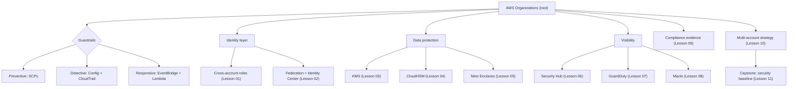

# Phase 6 — Security and Governance

This phase turns you from someone who *knows* IAM into someone who can design the security spine of a whole organization. Phase 1 taught you identities and policies inside a single account; here you extend those primitives across accounts, federate them to an external identity provider, and wrap them in encryption, threat detection, compliance evidence, and organization-wide guardrails. It comes at this point in the roadmap because every later phase — multi-account serverless platforms, data lakes, industry workloads — assumes you already know how to keep an account boundary meaningful.

## 🎯 Phase Goals

- Grant access across AWS accounts without ever sharing long-lived credentials
- Federate human identities from an external IdP and manage entitlements with IAM Identity Center
- Choose correctly between KMS, CloudHSM, and Nitro Enclaves for key custody and workload isolation
- Operate continuous security monitoring with Security Hub, GuardDuty, and Macie
- Produce audit evidence for HIPAA, PCI DSS, and FedRAMP using AWS Artifact, Config, and Audit Manager
- Govern dozens of accounts with AWS Organizations, SCPs, and Control Tower
- Build a complete multi-account security baseline as the phase capstone

## 🗺️ Phase Map

The diagram is the mental model for the whole phase: **Organizations** is the container, **guardrails** are the three modes of control, and the remaining lessons are the identity, encryption, and visibility layers that sit inside it.

## 📚 Lessons in this Phase

| # | Lesson | Focus | Difficulty |
|---|--------|-------|------------|
| 01 | [IAM Cross-Account Access](./01-iam-cross-account-access.md) | AssumeRole, trust vs identity policies, ExternalId, confused deputy | Intermediate |
| 02 | [Identity Federation and IAM Identity Center](./02-identity-federation-and-iam-identity-center.md) | SAML 2.0, OIDC, permission sets, ABAC vs RBAC, SCIM | Intermediate |
| 03 | [AWS KMS](./03-aws-kms.md) | CMKs, envelope encryption, key policies, grants, rotation, multi-region keys | Intermediate |
| 04 | [AWS CloudHSM](./04-aws-cloudhsm.md) | Dedicated HSM, FIPS 140-2 Level 3, key custody, cluster cost | Advanced |
| 05 | [Nitro Enclaves](./05-nitro-enclaves.md) | Attestation, isolated compute, PCI PIN and key custody use cases | Advanced |
| 06 | [AWS Security Hub](./06-aws-security-hub.md) | Aggregated findings, standards, security scores, delegated admin | Intermediate |
| 07 | [Amazon GuardDuty](./07-amazon-guardduty.md) | Threat detection sources, finding types, malware and EKS protection | Intermediate |
| 08 | [Amazon Macie](./08-amazon-macie.md) | Sensitive data discovery, custom identifiers, Security Hub integration | Intermediate |
| 09 | [Compliance: HIPAA, PCI, FedRAMP](./09-compliance-hipaa-pci-fedramp.md) | Shared responsibility, BAA, scope reduction, Artifact, Audit Manager | Advanced |
| 10 | [AWS Organizations and Multi-Account Strategy](./10-aws-organizations-multi-account-strategy.md) | OUs, SCPs at scale, Control Tower, centralized logging, tagging | Advanced |
| 11 | [Project: Security Baseline](./11-project-security-baseline.md) | Capstone — landing zone, log archive, guardrails, break-glass access | Advanced |

## 🛠️ Capstone Project

**Multi-Account Security Baseline** — build a landing zone you would actually run in production: Control Tower organization with a log archive and audit account, organization-wide CloudTrail into a locked-down S3 bucket, SCP guardrails that block root-user and region abuse, Security Hub and GuardDuty aggregated under a delegated administrator, a tiered KMS key strategy, and a documented break-glass procedure for the root user.

Deliverables:

- An organization architecture diagram (OUs, accounts, delegated administrators)
- Organization-wide CloudTrail trail writing to the log archive account with Object Lock
- At least three SCPs (deny root actions, deny unapproved regions, protect the guardrail itself)
- GuardDuty and Security Hub delegated admin configured and aggregating all member accounts
- A KMS key hierarchy (organization key for logging, per-account CMKs for workloads) with key policies
- A break-glass runbook plus the CloudWatch alarm that fires when root is used

Full instructions are in [Lesson 11](./11-project-security-baseline.md).

## ✅ Phase Checklist

- [ ] I can explain how a cross-account `AssumeRole` call is authorized by two policies at once
- [ ] I know when `ExternalId` is mandatory and what confused deputy means
- [ ] I have federated a human identity from an external IdP into an AWS permission set
- [ ] I can pick between KMS, CloudHSM, and Nitro Enclaves for a given custody requirement
- [ ] Security Hub, GuardDuty, and Macie are enabled with a delegated administrator
- [ ] I can pull the right AWS Artifact report for a customer due-diligence request
- [ ] SCPs exist that prevent — not just detect — the mistakes you fear most
- [ ] The capstone organization renders as a diagram and everything in it is deployed

## 📚 Phase Resources

- [Security Pillar — AWS Well-Architected Framework](https://docs.aws.amazon.com/wellarchitected/latest/security-pillar/welcome.html)
- [AWS Identity and Access Management User Guide](https://docs.aws.amazon.com/IAM/latest/UserGuide/introduction.html)
- [AWS Organizations User Guide](https://docs.aws.amazon.com/organizations/latest/userguide/orgs_introduction.html)
- [AWS Key Management Service Developer Guide](https://docs.aws.amazon.com/kms/latest/developerguide/overview.html)
- [AWS Security Hub User Guide](https://docs.aws.amazon.com/securityhub/latest/userguide/what-is-securityhub.html)
- [AWS Artifact](https://docs.aws.amazon.com/artifact/latest/ug/what-is-aws-artifact.html)
- [AWS Prescriptive Guidance — Organizing Your AWS Environment Using Multiple Accounts](https://docs.aws.amazon.com/whitepapers/latest/organizing-your-aws-environment/organizing-your-aws-environment.html)

## ➡️ Next Phase

Once the organization, its guardrails, and its key hierarchy hold together, you can safely push compute and data to the edge. Phase 7 takes the same least-privilege mindset and applies it to devices, gateways, and hybrid infrastructure that live outside the Region.

[Phase 7 — Edge and IoT](../phase-7-edge-and-iot/README.md)
