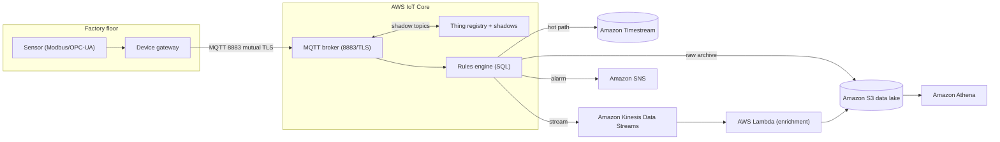
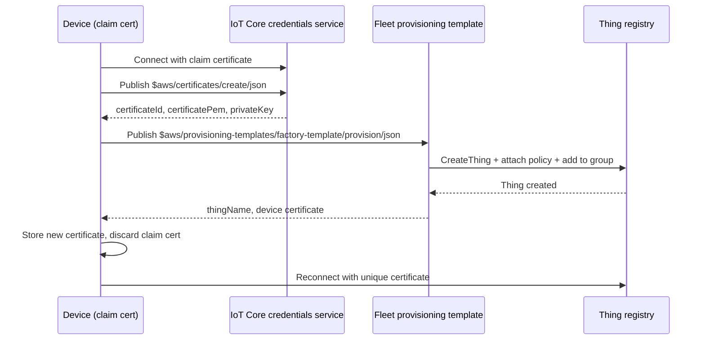
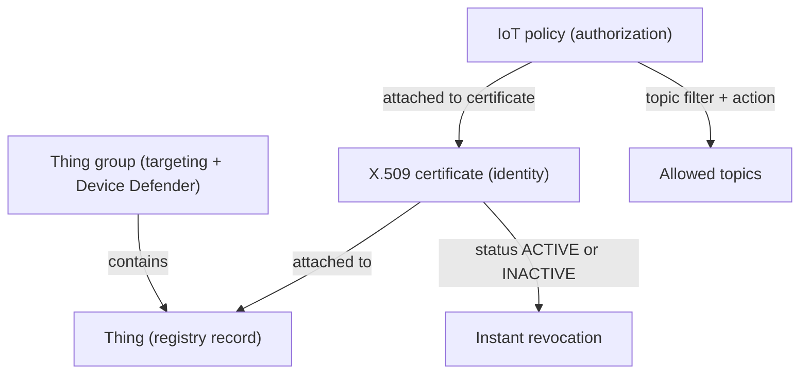

# 01 · AWS IoT Core

> **Phase 7 — Edge and IoT** · Lesson 01 of 09
> ⬅️ Previous: [Phase 6 — Security and Governance](../phase-6-security-and-governance/README.md) · ➡️ Next: [AWS IoT Greengrass](./02-aws-iot-greengrass.md) · 🏠 [Phase overview](./README.md)

## 🎯 Learning Objectives

By the end of this lesson you will be able to:

- Register a device in the AWS IoT thing registry and authenticate it with X.509 mutual TLS
- Write a least-privilege IoT policy and explain why the certificate, the policy, and the thing are three separate objects
- Use device shadows to read and write state for a device that is currently offline
- Route telemetry with the rules engine into Kinesis, Timestream, S3, DynamoDB, and Lambda
- Run remote actions on a fleet with AWS IoT Jobs
- Detect anomalous device behavior with AWS IoT Device Defender
- Onboard devices at scale with fleet provisioning instead of manual certificate copying

**Estimated time:** 90 min · **Difficulty:** Intermediate

---

## 🧠 Core Concepts

**AWS IoT Core** is a managed MQTT message broker plus a device registry. That is the whole product, and everything else is built on those two ideas. Devices connect to a per-account endpoint over TLS, authenticate with a client certificate, publish to topics, and subscribe to topics. The broker never lets a device talk to another device directly — every message can be inspected, transformed, and forwarded by AWS before anything downstream sees it. That is the difference between "a bunch of devices talking to a server" and an IoT platform: you get authorization, routing, and audit for the entire fleet.

The **thing registry** is the inventory. A *thing* is a logical device record with a name, attributes, and a type. It is deliberately decoupled from the credential: a thing can exist without a certificate, and a certificate can be attached to a thing later. Real fleets use *thing groups* to model hierarchy — `factory-berlin` containing `line-3` containing individual PLC gateways — and thing groups are what you target when you want to deploy a job or a Greengrass deployment to thousands of devices at once.

The **device shadow** solves the offline problem. A classic shadow is a JSON document per thing with three sections: `desired` (what an application wants the device to be), `reported` (what the device says it currently is), and `delta` (the computed difference). Applications write to `desired` even when the device is unplugged; when it reconnects it subscribes to `$aws/things/<name>/shadow/update/delta` and applies the change. The shadow is stored in the cloud, not on the device, and it is not a message queue — it always holds the latest state, never a history.

**Authentication is mutual TLS with per-device certificates.** The device presents an X.509 client certificate; AWS IoT Core presents the server certificate from the ATS endpoint (Amazon Trust Services). Authorization is a separate concern handled by an *IoT policy* — a JSON document attached to the certificate, not to the thing. This gives you two independent knobs: certificate status (ACTIVE or INACTIVE, so you can revoke one device instantly) and policy document (so you can change what an entire class of devices may do without touching them).

The **rules engine** is a SQL-like router that runs on every matching message. A rule has an SQL statement plus up to ten actions. `SELECT * FROM 'factory/+/telemetry'` matches every one-level-deep topic under `factory/`; `WHERE` clauses filter on message fields; functions like `timestamp()` and `topic()` enrich records. Actions fan out to Lambda, DynamoDB, S3, Kinesis, Timestream, SNS, SQS, Firehose, HTTPS endpoints, or another IoT topic (republish). Rules are what make IoT Core useful rather than merely reachable.

Two operational services complete the picture. **AWS IoT Jobs** delivers a document (a firmware instruction, a config change, a script) to a target — a thing or a thing group — and tracks per-device execution state so you can roll out to 5% of the fleet, abort automatically on failure, and see exactly which serial numbers are still pending. **AWS IoT Device Defender** continuously evaluates device and cloud-side metrics against a security profile of expected behavior (bytes out, connections, authorization failures, source IPs) and raises violations you can act on with a mitigation action.

For fleet onboarding, **fleet provisioning** replaces the "copy a certificate onto every device by hand" pattern. The manufacturer ships devices with either a claim certificate or a trusted user token; at first boot the device calls `$aws/certificates/create/json` and `$aws/provisioning-templates/<template>/provision/json`, and a provisioning template (a CloudFormation-Functions-Language document) creates the thing, the certificate, the policy attachment, and the group membership for it.

### Key terminology

| Term | Meaning |
|------|---------|
| **Endpoint (ATS)** | The account-specific MQTT hostname, e.g. `<id>-ats.iot.eu-west-1.amazonaws.com`. Use the ATS endpoint, not the legacy VeriSign one. |
| **Thing** | Registry record for a device: name, type, attributes, group memberships. Holds no credentials. |
| **Thing shadow** | Cloud-stored JSON `desired` / `reported` / `delta` state for a thing. Named shadows (up to 8) partition state. |
| **IoT policy** | JSON policy attached to a *certificate* or Cognito identity. Grants `iot:Publish`, `iot:Subscribe`, `iot:Receive`, `iot:Connect`. |
| **Rules engine** | SQL statement plus up to 10 actions, evaluated per published message. |
| **Basic Ingest** | Publishing to `$aws/rules/<ruleName>/<topic>` so the message bypasses the broker publish and goes straight to that one rule — cheaper at volume. |
| **Job** | A document plus a rollout policy, targeted at things or thing groups, with per-execution state. |
| **Security profile** | Device Defender definition of normal behavior, evaluated against fleet metrics. |
| **Fleet provisioning** | Template-driven first-boot enrollment that mints a unique certificate per device. |

---

## 🗺️ Architecture Diagram

End-to-end path from a sensor to an analytics destination, with the security objects called out:



The first-boot enrollment flow, which is what makes a fleet manageable instead of hand-built:



The three security objects of a single device, and why they are separate:



---

## 🧪 Hands-on Lab: Provision a Device and Route Its Telemetry

**Goal:** Register a simulated sensor with its own certificate, restrict it to one publish topic, then route that topic into Timestream and S3 with a single rule.

**Prerequisites:** AWS CLI v2 configured with permissions for `iot:*`, `iot-data:*`, `timestream:*`, `s3:*`, and `iam:PassRole`. A region where AWS IoT Core and Amazon Timestream are both available (for example `eu-west-1`).

### Step 1 — Create the thing and its type

```bash
# Export the values you will reuse in every command below
export AWS_REGION=eu-west-1
export THING_NAME=sensor-0001
export THING_GROUP=factory-berlin
export ACCOUNT_ID=$(aws sts get-caller-identity --query Account --output text)

# A thing type documents the device model; attributes describe this unit
aws iot create-thing-type --thing-type-name SoilSensor-v2

aws iot create-thing \
  --thing-name "$THING_NAME" \
  --thing-type-name SoilSensor-v2 \
  --attribute-payload '{"attributes":{"fw":"1.4.2","site":"berlin","line":"3"}}'

# Thing groups are the targeting unit for jobs and Greengrass deployments
aws iot create-thing-group --thing-group-name "$THING_GROUP"
aws iot add-thing-to-thing-group --thing-name "$THING_NAME" --thing-group-name "$THING_GROUP"
```

### Step 2 — Mint a certificate and write the policy

```bash
# One certificate per device. --set-as-active avoids a second API call.
aws iot create-keys-and-certificate \
  --set-as-active \
  --certificate-pem-outfile "$THING_NAME.cert.pem" \
  --public-key-outfile "$THING_NAME.public.key" \
  --private-key-outfile "$THING_NAME.private.key"
```

Copy the `certificateArn` printed above and use it in the next commands.

```bash
export CERT_ARN="arn:aws:iot:eu-west-1:123456789012:cert/abcdef0123456789"

# A least-privilege policy: this device may only connect as itself and publish one topic
```

```json
{
  "Version": "2012-10-17",
  "Statement": [
    {
      "Sid": "ConnectAsItselfOnly",
      "Effect": "Allow",
      "Action": "iot:Connect",
      "Resource": "arn:aws:iot:eu-west-1:123456789012:client/${iot:Connection.Thing.ThingName}"
    },
    {
      "Sid": "PublishOwnTelemetryOnly",
      "Effect": "Allow",
      "Action": "iot:Publish",
      "Resource": "arn:aws:iot:eu-west-1:123456789012:topic/factory/berlin/line-3/${iot:Connection.Thing.ThingName}/telemetry"
    },
    {
      "Sid": "ReadAndWriteOwnShadowOnly",
      "Effect": "Allow",
      "Action": ["iot:GetThingShadow", "iot:UpdateThingShadow"],
      "Resource": "arn:aws:iot:eu-west-1:123456789012:thing/${iot:Connection.Thing.ThingName}"
    }
  ]
}
```

The `${iot:Connection.Thing.ThingName}` policy variable is what makes one policy document safe for the whole fleet — each device is only ever allowed to act on its own name.

```bash
aws iot create-policy \
  --policy-name SoilSensorTelemetryPolicy \
  --policy-document file://sensor-policy.json

# Attach the policy to the certificate, then bind certificate to thing
aws iot attach-policy --policy-name SoilSensorTelemetryPolicy --target "$CERT_ARN"
aws iot attach-thing-principal --thing-name "$THING_NAME" --principal "$CERT_ARN"

# Confirm the binding from both directions
aws iot list-thing-principals --thing-name "$THING_NAME"
aws iot list-principal-policies --principal "$CERT_ARN"
```

### Step 3 — Read and write the device shadow

```bash
# Application side: request a sampling interval change while the device is offline
aws iot-data update-thing-shadow \
  --thing-name "$THING_NAME" \
  --payload '{"state":{"desired":{"sampleIntervalSec":30}}}' \
  /dev/stdout \
  --cli-binary-format raw-in-base64-out

# Inspect the resulting delta the device will receive on reconnect
aws iot-data get-thing-shadow --thing-name "$THING_NAME" --output text
```

### Step 4 — Route telemetry with the rules engine

Create the destination table first, then the rule. Replace the Timestream ARN with the one your account returns.

```bash
# Create a time-series table with a 7-day memory store and 365-day magnetic store
aws timestream-write create-database --database-name iotfactory
aws timestream-write create-table \
  --database-name iotfactory \
  --table-name telemetry \
  --retention-properties '{"MemoryStoreRetentionPeriodInHours":168,"MagneticStoreRetentionPeriodInDays":365}'
```

```json
{
  "sql": "SELECT topic(3) AS site, topic(5) AS line, thingName AS device, temperature, humidity, timestamp() AS ts FROM 'factory/+/line-+/+/telemetry'",
  "ruleDisabled": false,
  "awsIotSqlVersion": "2016-03-23",
  "actions": [
    {
      "timestream": {
        "roleArn": "arn:aws:iam::123456789012:role/IoTToTimestreamRole",
        "databaseName": "iotfactory",
        "tableName": "telemetry",
        "dimensions": [
          { "name": "device", "value": "${device}" },
          { "name": "site", "value": "${site}" }
        ],
        "timestamp": { "value": "${ts}", "unit": "MILLISECONDS" }
      }
    },
    {
      "s3": {
        "roleArn": "arn:aws:iam::123456789012:role/IoTToS3Role",
        "bucketName": "iot-factory-raw-eu-west-1",
        "key": "telemetry/${topic(3)}/${topic(5)}/${timestamp()}.json"
      }
    }
  ],
  "errorAction": {
    "sns": {
      "roleArn": "arn:aws:iam::123456789012:role/IoTErrorActionRole",
      "targetArn": "arn:aws:sns:eu-west-1:123456789012:iot-rule-errors"
    }
  }
}
```

```bash
aws iot create-topic-rule --rule-name FactoryTelemetryToTimestream --topic-rule-payload file://telemetry-rule.json

# The endpoint the device must connect to
aws iot describe-endpoint --endpoint-type iot:Data-ATS
```

### Step 5 — Verify

```bash
# Publish a test message as the device would, then read it back from Timestream
aws iot-data publish \
  --topic "factory/berlin/line-3/$THING_NAME/telemetry" \
  --payload '{"temperature":21.7,"humidity":48}' \
  --cli-binary-format raw-in-base64-out

# Confirm the rule exists and is enabled
aws iot get-topic-rule --rule-name FactoryTelemetryToTimestream --query 'rule.ruleDisabled'

# Confirm the shadow now reports the delta as resolved once the device reports back
aws iot-data get-thing-shadow --thing-name "$THING_NAME" --output text
```

A `ruleDisabled` value of `false` plus queryable rows in Timestream means the whole path works.

---

## 💻 CLI Reference

```bash
# List every device in a group — the inventory view you actually use in operations
aws iot list-things-in-thing-group --thing-group-name factory-berlin

# See what a device's shadow says right now, including delta
aws iot-data get-thing-shadow --thing-name sensor-0001 --output text

# Where are all the executions of the last OTA job?
aws iot list-job-executions-for-job --job-id ota-firmware-1.4.3 --query 'executionSummaries[].{thing:thingArn,status:executionSummary.status}'

# Which devices violated the security profile in the last day?
aws iot list-active-violations --max-results 20

# Deactivate a stolen device immediately — the certificate is the revocation switch
aws iot update-certificate --certificate-id abcdef0123456789 --new-status INACTIVE

# Turn on broker logging so you can see authorization failures
aws iot set-v2-logging-options --role-arn arn:aws:iam::123456789012:role/IoTLoggingRole --default-log-level INFO
```

| Command | Purpose |
|---------|---------|
| `create-keys-and-certificate` | Mints a unique device identity; one per device, never shared |
| `attach-policy` / `attach-thing-principal` | Binds authorization to identity, and identity to the registry record |
| `iot-data get-thing-shadow` | Reads last-known and desired state for an offline device |
| `create-topic-rule` | Compiles an SQL route from topic space into AWS services |
| `list-active-violations` | Fleet-wide security posture view from Device Defender |
| `update-certificate --new-status INACTIVE` | Instant per-device revocation |
| `set-v2-logging-options` | Makes broker-level deny decisions visible in CloudWatch Logs |

---

## ✅ Best Practices

| Practice | Why it matters |
|----------|----------------|
| One certificate per device | Lets you revoke a single compromised unit without bricking the fleet |
| Never embed a shared key or a static AWS credential | Devices in the field cannot be patched quickly; a shared secret leaks at the scale of the fleet |
| Use policy variables like `${iot:Connection.Thing.ThingName}` | One auditable policy replaces thousands of hand-written ones |
| Use `clientId` = thing name and enforce it in the policy | Prevents one device impersonating another on the broker |
| Target thing groups, not device lists, for jobs and deployments | Group membership is the only thing that scales past a few dozen devices |
| Add an `errorAction` to every rule | Silent rule failures are the most common "my data disappeared" incident |
| Use Basic Ingest for high-volume telemetry | Skips broker publish fan-out, which reduces cost on predictable pipelines |
| Set shadow documents small and named | Classic shadow is capped at 8 KB; named shadows keep unrelated state apart |

---

## ⚠️ Common Pitfalls

| Pitfall | Symptom | Fix |
|---------|---------|-----|
| Policy attached to the thing | Device connects but every publish is denied | IoT policies attach to certificates (or Cognito identities), not things |
| `iot:Subscribe` without `iot:Receive` | Subscription succeeds, no messages arrive | Grant both actions; the resource is `topicfilter/...` for subscribe and `topic/...` for receive |
| Using the legacy endpoint | TLS handshake fails on constrained devices | Use the `iot:Data-ATS` endpoint so clients trust the Amazon Trust Services chain |
| Shadow treated as a queue | Messages "lost" during outages | Shadows keep only latest state; buffer history on the device or in Greengrass stream manager |
| Message over the payload limit | Publish succeeds locally, rule never fires | Keep payloads under 128 KB and chunk larger firmware uploads |
| Rule SQL topic filter mismatch | Rule never triggers | MQTT wildcards are `+` and `#`; SQL uses those, not regex |
| Forgetting `iam:PassRole` | `create-topic-rule` fails with an authorization error | The caller needs `PassRole` on the rule's action role |

---

## 💰 Cost Considerations

IoT Core bills for **connectivity** and **messaging** separately, and that split drives most architecture decisions. Connectivity is charged per million minutes of connection (roughly $0.08 per million minutes), which is trivial for devices that stay connected but adds up for a fleet that reconnects constantly — a device that reconnects every 30 seconds pays far more than one that holds a session open. Messaging is charged per million messages in 5 KB blocks, so a 40 KB payload counts as eight messages. Shrinking payloads or switching to Basic Ingest is often cheaper than any instance-level optimization.

Rules engine actions are billed twice: once for the rule evaluation and again for the destination service. A rule that writes to both Timestream and S3 costs the IoT action charge plus Timestream writes plus S3 PUTs. Device shadows are charged per million requests and per million updates, so an application that polls `get-thing-shadow` in a tight loop is an easy and expensive mistake — subscribe to the `delta` topic instead. Jobs, Device Defender, and fleet provisioning are all metered per operation at low rates, and CloudWatch Logs for broker logging is frequently the surprise line item on a chatty fleet.

What drives the bill, in order: number and size of messages, then shadow and registry API calls, then logging. Model those three before picking a protocol or a reporting interval.

---

## 🔐 Security Considerations

- **Three separate controls, three separate jobs.** The certificate answers *who is this device*; the policy answers *what may it do*; the thing group answers *who do I target*. Review them independently.
- **Least privilege means topic-level precision.** A policy resource of `topic/#` grants the fleet authority to publish on top of other devices' topics. Scope every resource by thing name using policy variables.
- **Rotate and revoke.** Certificates should have a rotation plan; `update-certificate --new-status INACTIVE` is the emergency lever. Combine with a CloudWatch alarm on `iot:Connect` failures for stolen-credential detection.
- **Encrypt at rest and in transit.** All broker traffic is TLS; attach a customer-managed KMS key to your S3 destinations and Timestream tables so the data is protected end to end.
- **Audit with the right logs.** Broker logs show denied connects and publishes; CloudWatch Logs plus `set-v2-logging-options` is the minimum. Enable CloudTrail data events for the registry so you can see who created a certificate.
- **Device Defender is detective, not preventive.** A security profile raises violations; a mitigation action such as `update-device-certificate` makes it useful. Without an action, violations are just dashboard noise.
- **Never let a device reach the AWS control plane.** A device needs `iot:Publish` to its own topic — not `iam:*`, not S3 write. Provisioning templates should attach the narrowest possible policy.

---

## 🧩 Exercise

Take the lab device and make it a *classroom*: create two more things (`sensor-0002`, `sensor-0003`) that share the same policy document, and prove with the MQTT test client (or `aws iot-data publish` while impersonating each client ID) that each device can publish to its own telemetry topic and cannot publish to a sibling's topic.

Then write a second rule that detects a threshold breach — a temperature above 30 — and republishes to an alarms topic instead of writing to Timestream.

Success looks like: `aws iot list-principal-policies` shows the same single policy on all three certificates, a cross-device publish is denied by the broker, and the alarm rule fires only for the message that breaches the threshold.

---

## 📚 Resources

- [What Is AWS IoT Core?](https://docs.aws.amazon.com/iot/latest/developerguide/what-is-aws-iot.html)
- [AWS IoT Device Shadow Service](https://docs.aws.amazon.com/iot/latest/developerguide/iot-device-shadows.html)
- [AWS IoT Core Policies](https://docs.aws.amazon.com/iot/latest/developerguide/iot-policies.html)
- [AWS IoT SQL Reference](https://docs.aws.amazon.com/iot/latest/developerguide/iot-sql-reference.html)
- [AWS IoT Jobs](https://docs.aws.amazon.com/iot/latest/developerguide/iot-jobs.html)
- [AWS IoT Device Defender](https://docs.aws.amazon.com/iot/latest/developerguide/device-defender.html)
- [Fleet Provisioning](https://docs.aws.amazon.com/iot/latest/developerguide/provision-wo-cert.html)
- [AWS IoT Core Pricing](https://aws.amazon.com/iot-core/pricing/)

---

## ➡️ Next Steps

IoT Core gives every device a managed endpoint and a way to be *seen*. It does not give you anywhere to run code when the uplink is down, and it does not let a plant manager classify images on a local gateway. The next lesson puts a real runtime on the edge — AWS IoT Greengrass v2 — so the factory keeps working, and keeps its data, when the WAN does not.

> ⬅️ Previous: [Phase 6 — Security and Governance](../phase-6-security-and-governance/README.md) · ➡️ Next: [AWS IoT Greengrass](./02-aws-iot-greengrass.md) · 🏠 [Phase overview](./README.md)
