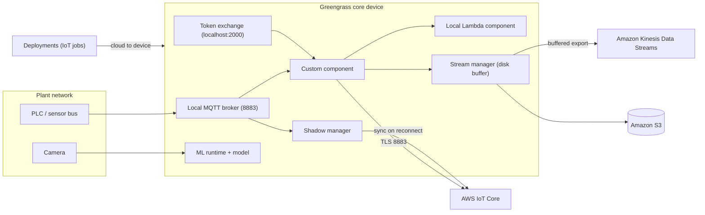
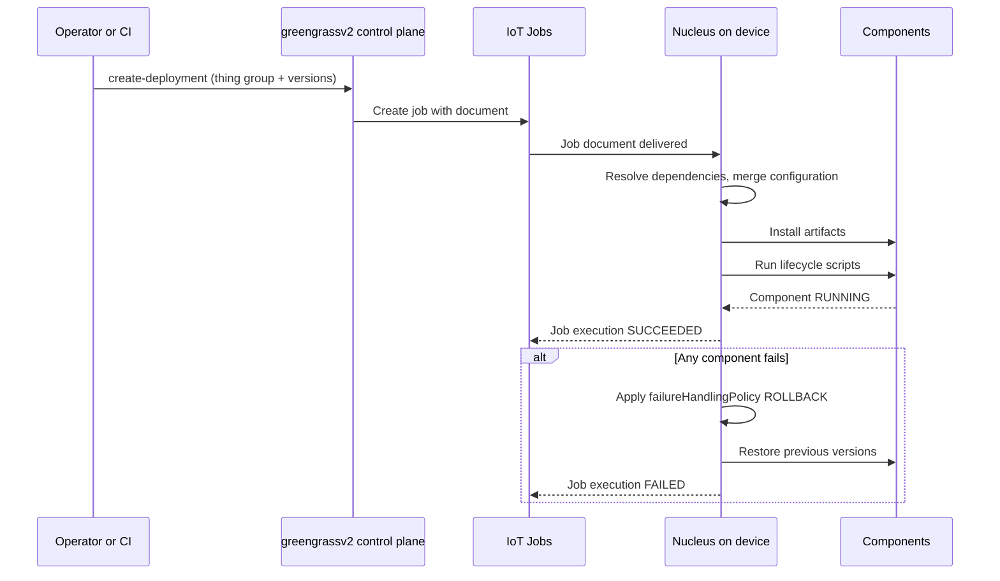
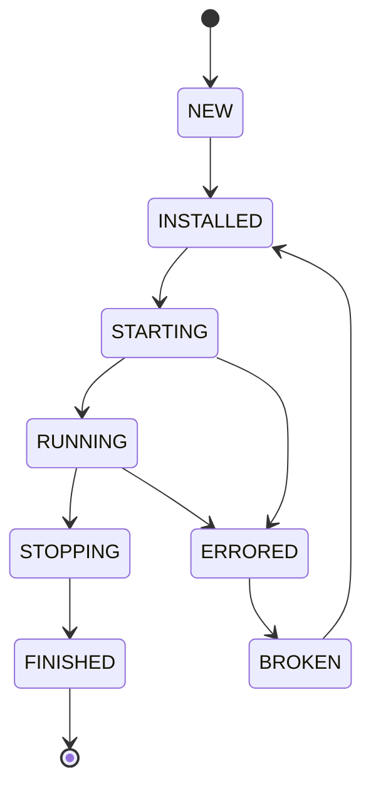

# 02 · AWS IoT Greengrass

> **Phase 7 — Edge and IoT** · Lesson 02 of 09
> ⬅️ Previous: [AWS IoT Core](./01-aws-iot-core.md) · ➡️ Next: [FreeRTOS](./03-freertos.md) · 🏠 [Phase overview](./README.md)

## Learning Objectives

By the end of this lesson you will be able to:

- Explain what a Greengrass core device is and why it uses the same certificate machinery as any other IoT thing
- Author a Greengrass v2 component with a recipe and lifecycle scripts, and version it in S3
- Create a deployment that targets a thing group and reason about failure and rollback policy
- Run a Lambda function locally while the uplink to AWS is down
- Buffer and forward streams with the stream manager so no telemetry is lost during outages
- Register and run a compiled ML model on the edge for local inference
- Decide when Greengrass is worth its operational overhead

**Estimated time:** 90 min · **Difficulty:** Intermediate

---

## Core Concepts

**AWS IoT Greengrass v2** is a runtime that turns a normal Linux machine — a gateway, an industrial PC, a Jetson — into an AWS-managed edge node. You install the **nucleus**, which is a Java-based process supervisor holding an MQTT connection (and a local broker) to AWS IoT Core, and then you install **components** on top of it. The nucleus is the only part you install by hand; everything after that arrives as a deployment you push from the cloud.

A **component** is the unit of deployment: a recipe (YAML or JSON) plus optional artifacts, plus a set of lifecycle scripts. The recipe declares `ComponentName`, `ComponentVersion`, dependencies on other components, default configuration values, and a `Manifests` list that maps each platform to its lifecycle commands. Components can be *generic* (a script or binary you write), *Lambda* components (a function you already have in AWS Lambda), or *Docker* components. Because components declare dependencies and the merge of `ComponentConfiguration` is computed at deployment time, a single cloud deployment can configure fifty gateways differently without maintaining fifty artifacts.

Deployments are the delivery mechanism. `aws greengrassv2 create-deployment` takes a target (a thing or a thing group) and a component version map, and creates an IoT job under the hood — which means you inherit the staged-rollout and abort semantics of IoT Jobs for free. Deployment policy matters more than people expect: `failureHandlingPolicy: ROLLBACK` reverts the whole deployment if any component fails, while `DO_NOTHING` leaves a partially deployed device and expects you to fix it. `componentUpdatePolicy` decides what happens to already-running components when new config arrives.

The decisive feature is **offline operation**. Once a core device is provisioned, its cloud connection is optional. Components keep running, the local MQTT broker keeps accepting messages from devices on the plant network, the **shadow manager** keeps serving local shadows so controllers never block on a cloud round trip, and the **stream manager** writes incoming messages to a local disk or memory cache that it drains to Kinesis, S3, Firehose, or IoT Analytics when connectivity returns. If you have ever lost a day of factory data to a dropped VPN, this is the feature that pays for the whole product.

Greengrass also gives you a **Local Debug Console** and a CLI for on-device work (`greengrass-cli`), and a **token exchange service** that hands components short-lived AWS credentials over `localhost:2000`. That last piece is subtle and important: your edge application does not store AWS keys, it asks the nucleus for credentials derived from the core device's IoT certificate.

For machine learning, Greengrass is the delivery vehicle for **pre-compiled models**. You train in SageMaker, compile for your target architecture with SageMaker Neo, and ship the artifact and a runtime (SageMaker Edge Manager agent, TensorFlow Lite, ONNX Runtime, or DLR) as components. Inference then happens locally, which removes network latency from the decision loop and keeps raw video or audio on-premises.

### Key terminology

| Term | Meaning |
|------|---------|
| **Nucleus** | `aws.greengrass.Nucleus` — the supervisor, local broker, and IoT Core connection. Always installed. |
| **Component** | Versioned deployable unit: recipe + artifacts + lifecycle scripts. |
| **Recipe** | YAML/JSON describing the component: name, version, dependencies, configuration, manifests. |
| **Deployment** | A component version map plus policies, applied to a thing or thing group via an IoT job. |
| **Stream manager** | `aws.greengrass.StreamManager` — durable local buffer that exports to Kinesis, Firehose, S3, IoT Analytics. |
| **Shadow manager** | `aws.greengrass.ShadowManager` — serves local shadows and syncs them to the cloud when online. |
| **TES** | Token Exchange Service; serves scoped AWS credentials on `localhost:2000` from the device certificate. |
| **Thing group** | The targeting unit for deployments. One group per device class, not per device. |
| **Local deployment** | A deployment created on-device with `greengrass-cli` for development, not managed by the cloud. |

---

## Architecture Diagram

What actually runs on a core device at a factory, and how it reaches AWS:



Deployment mechanics — one cloud call becomes many local component operations:



Component lifecycle states, which is what you read when a deployment stalls:



---

## Hands-on Lab: A Component That Survives an Outage

**Goal:** Deploy a custom component to a core device that samples simulated telemetry every five seconds, buffers it with the stream manager, and forwards it to Kinesis — including while the network is disconnected.

**Prerequisites:** A Linux host (EC2 instance, VM, or Raspberry Pi) with 4 GB RAM, Java 8+ or later, and outbound access on 443 and 8883. An AWS account with a Kinesis data stream created.

### Step 1 — Prepare the token exchange role

```bash
# Create the stream that buffered telemetry will be flushed into
aws kinesis create-stream --stream-name iot-telemetry --shard-count 1

# The installer expects this role and alias to exist; create them via CloudFormation
aws cloudformation create-stack \
  --stack-name GreengrassV2TokenExchangeRole \
  --template-url https://s3.amazonaws.com/greengrass/v2/TokenExchangeRole.yaml \
  --capabilities CAPABILITY_NAMED_IAM \
  --parameters ParameterKey=RoleName,ParameterValue=GreengrassV2TokenExchangeRole

# The role needs permission to write to the stream; add it as a managed policy inline
aws iam put-role-policy \
  --role-name GreengrassV2TokenExchangeRole \
  --policy-name KinesisWrite \
  --policy-document '{"Version":"2012-10-17","Statement":[{"Effect":"Allow","Action":["kinesis:PutRecords","kinesis:DescribeStream"],"Resource":"arn:aws:kinesis:eu-west-1:123456789012:stream/iot-telemetry"}]}'
```

### Step 2 — Install the nucleus and provision the core device

```bash
# The installer provisions the thing, its certificate, and a policy automatically (--provision)
sudo -E java -Droot="/greengrass/v2" -Dlog.store=FILE \
  -jar ./GreengrassInstaller/lib/Greengrass.jar \
  --aws-region eu-west-1 \
  --thing-name gg-gateway-001 \
  --thing-group-name factory-gateways \
  --tes-role-name GreengrassV2TokenExchangeRole \
  --tes-role-alias GreengrassV2TokenExchangeRoleAlias \
  --component-default-user ggc_user:ggc_group \
  --provision true \
  --setup-system-service true \
  --deploy-dev-tools true
```

`--deploy-dev-tools true` installs the Greengrass CLI so you can inspect the local state:

```bash
# Confirm the nucleus is RUNNING and see everything installed locally
sudo /greengrass/v2/bin/greengrass-cli component list
sudo /greengrass/v2/bin/greengrass-cli deployment list
```

### Step 3 — Write the component recipe

```bash
mkdir -p components/com.example.SensorSampler/artifacts
```

```yaml
---
RecipeFormatVersion: "2020-01-25"
ComponentName: com.example.SensorSampler
ComponentVersion: "1.0.0"
ComponentDescription: "Samples simulated telemetry and exports it through stream manager"
ComponentPublisher: "Roadmap Tutorial"
ComponentConfiguration:
  DefaultConfiguration:
    sampleIntervalSec: 5
    streamName: "iot-telemetry"
    batchSize: 10
    mergePolicy: "merge"
  # A runtime override here wins over the recipe default without a new version
  Reset: []
ComponentDependencies:
  aws.greengrass.StreamManager:
    VersionRequirement: "^2.0.0"
    DependencyType: HARD
  aws.greengrass.TokenExchangeService:
    VersionRequirement: "^2.0.0"
    DependencyType: HARD
Manifests:
  - Platform:
      os: linux
    Artifacts:
      - URI: "s3://iot-components-eu-west-1/com.example.SensorSampler/1.0.0/sampler.py"
        Unarchive: NONE
    Lifecycle:
      Install: "chmod +x {artifacts:decompressedPath}/sampler.py"
      Run: "python3 -u {artifacts:decompressedPath}/sampler.py --interval {configuration:/sampleIntervalSec} --stream {configuration:/streamName}"
      Startup: ""
      Shutdown: ""
```

### Step 4 — Publish the artifact and the component version

```bash
# The artifact must be uploaded before the recipe references it
aws s3 cp sampler.py s3://iot-components-eu-west-1/com.example.SensorSampler/1.0.0/sampler.py

# Registering a component version is idempotent per version string
aws greengrassv2 create-component-version --inline-recipe file://com.example.SensorSampler.recipe.yaml

# Confirm it is visible in the cloud
aws greengrassv2 list-components --scope PRIVATE
```

### Step 5 — Deploy to the thing group

```bash
# Deployment targets a group so every gateway in the class gets it
aws greengrassv2 create-deployment \
  --target-arn "arn:aws:iot:eu-west-1:123456789012:thinggroup/factory-gateways" \
  --deployment-name sensor-sampler-v1 \
  --components '{"com.example.SensorSampler":{"componentVersion":"1.0.0","configurationUpdate":{"merge":"{\"sampleIntervalSec\":\"5\"}"}}}' \
  --deployment-policies '{"failureHandlingPolicy":"ROLLBACK","componentUpdatePolicy":{"timeoutInSeconds":120,"action":"NOTIFY_COMPONENTS"}}'

# Watch the deployment reach the device
aws greengrassv2 list-deployments --target-arn "arn:aws:iot:eu-west-1:123456789012:thinggroup/factory-gateways"
```

### Step 6 — Verify, then break the network on purpose

```bash
# The component should be RUNNING locally
sudo /greengrass/v2/bin/greengrass-cli component list

# Tail the component log to see records being queued
sudo tail -f /greengrass/v2/logs/com.example.SensorSampler.log

# Now disconnect the uplink (change the security group, or drop the route) and keep watching.
# The component must keep running, the stream manager must keep accepting records,
# and Kinesis writes must resume once connectivity returns.
```

Success is a component that never restarts during the outage and a Kinesis stream whose record count catches up afterwards — not a component that crashed with `Connection refused`.

---

## CLI Reference

```bash
# Register an updated recipe as a new immutable version
aws greengrassv2 create-component-version --inline-recipe file://com.example.SensorSampler.recipe.yaml

# Inspect what a version actually declares
aws greengrassv2 describe-component \
  --arn arn:aws:greengrass:eu-west-1:123456789012:components/com.example.SensorSampler:versions:1.0.0

# Which components are installed on a specific core device right now?
aws greengrassv2 list-installed-components --core-device-thing-name gg-gateway-001

# Cancel a deployment that is still rolling out
aws greengrassv2 cancel-deployment --deployment-id 5f8c1e2a-0000-1111-2222-aaaaaaaaaaaa

# On-device diagnostics via the Greengrass CLI (installed with --deploy-dev-tools)
sudo /greengrass/v2/bin/greengrass-cli component list
sudo /greengrass/v2/bin/greengrass-cli deployment create --recipeDir ./recipes --artifactDir ./artifacts --merge "com.example.SensorSampler=1.0.0"
sudo /greengrass/v2/bin/greengrass-cli logs get --log-file com.example.SensorSampler.log

# The local debug console, opened over SSH tunnel to port 8443
sudo /greengrass/v2/bin/greengrass-cli get-debug-password
```

| Command | Purpose |
|---------|---------|
| `create-component-version` | Publishes an immutable component version from a recipe |
| `create-deployment` | Pushes versions plus configuration to a thing or thing group |
| `list-installed-components` | Shows the real state on one device, not the intended state |
| `cancel-deployment` | Stops a bad rollout mid-flight |
| `greengrass-cli deployment create --merge` | Local iteration without waiting for a cloud round trip |
| `greengrass-cli logs get` | Fastest way to see why a component is `BROKEN` |

---

## Best Practices

| Practice | Why it matters |
|----------|----------------|
| Treat a deployment as a staged rollout, always | Use `--iot-job-configuration` with `abortConfig` so a failing device set stops the rollout automatically |
| Keep configuration in `ComponentConfiguration`, not in code | Changing a sampling interval should not require a new artifact upload |
| Make components idempotent and restartable | The nucleus restarts components; scripts must tolerate being run twice |
| Depend on `aws.greengrass.TokenExchangeService` instead of storing credentials | Edge boxes are physically accessible; static keys are the worst case for theft |
| Use the stream manager for anything that must not be lost | It is the supported, disk-backed answer to intermittent connectivity |
| Pin dependency `VersionRequirement` ranges | Unbounded dependencies silently change behavior at the next deployment |
| Run the Greengrass component in a container or dedicated user | Limits blast radius if the component is compromised |
| Monitor component state with CloudWatch metrics | `ComponentState` changes are the earliest warning of an edge fleet going unhealthy |

---

## Common Pitfalls

| Pitfall | Symptom | Fix |
|---------|---------|-----|
| Artifact uploaded after the recipe | Deployment fails with a download error | Upload to S3 first, then create the component version |
| `ROLLBACK` on a fleet with one bad device | Whole deployment reverts, including healthy devices | Fix the component, or use `DO_NOTHING` with alerting for heterogeneous fleets |
| Assuming something still works offline without checking | Works in the lab, fails in the field | Explicitly disable connectivity and test; verify shadow manager, stream manager, and local broker behavior |
| Recipe YAML indentation | Deployment fails to parse | Validate the recipe with a YAML linter before creating the version |
| Credentials read once at component start | Component dies hours later with an expired credential | Request fresh credentials from TES per operation, or use the AWS IoT Device SDK for Python with a Greengrass credential provider |
| Local deployment left on a device | Cloud deployment removes it, or vice versa — confusing state | Use local deployments for development only; never mix on production devices |
| Wrong `Platform` in the manifest | Component skipped on the device with no error | Match `os` and `runtime` to the actual device platform |

---

## Cost Considerations

**AWS IoT Greengrass v2 software itself is free.** There is no per-device license fee and no core-device charge — unlike Greengrass v1, which was billed per device. Everything you pay for is the AWS service used behind the deployment: IoT Core connectivity and messaging for the nucleus and each device, IoT Jobs for the deployment itself, S3 storage and requests for artifacts, and the destinations that stream manager writes to.

That shifts the cost conversation to volume. A factory with 200 gateways each sending a 2 KB sample every five seconds generates about 3.5 million messages a month from the gateways alone, before counting field devices. The nucleus keeps an MQTT connection open continuously, so connectivity charges are the steady baseline. Artifacts are cheap but not free — a 300 MB ML model redeployed weekly across 500 devices is 500 downloads of 300 MB, so version models deliberately and use Kinesis or S3 as the model distribution channel rather than redeploying the whole component.

The real cost driver is usually indirect: a device without local buffering loses data, and lost industrial data is often unrecoverable. Compare the price of stream manager persistence against the price of a production incident before deciding to skip it.

---

## Security Considerations

- **The core device certificate is a machine identity with real authority.** It can subscribe to deployment topics and receive AWS credentials through TES. Treat a compromised gateway as a compromised identity: revoke the certificate with `aws iot update-certificate --new-status INACTIVE` and redeploy.
- **Scope the token exchange role narrowly.** The role assumed by TES is what every component can borrow. If it allows `s3:*` on `*`, one bad component is a data exfiltration path. Scope it to the exact streams, buckets, and topics components need.
- **Do not run components as root.** The installer's `--component-default-user` exists precisely so components run as an unprivileged user. Use it, and use `GreengrassContainer` mode for untrusted workloads.
- **Encrypt the local buffer.** Stream manager can write to disk; on physically accessible hardware, that disk should be encrypted at the OS level, and the data should be encrypted in transit with TLS.
- **Use Secure Tunneling for hands-on access.** `aws.greengrass.SecureTunneling` gives you an audited, revocable SSH-over-IoT path instead of opening a permanent port on a plant network.
- **Log centrally.** `aws.greengrass.LogManager` ships component logs to CloudWatch Logs. Edge devices are hard to inspect physically, so remote logs are your only forensic trail.
- **Verify artifact integrity.** Pull artifacts from versioned S3 objects in a bucket with Block Public Access, and sign or checksum anything you did not build yourself.

---

## Exercise

Add a second component, `com.example.ThresholdAlarm`, that subscribes to the local broker for the sampler's topic and publishes to a cloud alarm topic whenever a simulated temperature exceeds a threshold that you supply as a configuration value. Deploy it to the same thing group with a *runtime* configuration override on one device only, so the same component version behaves differently on that device.

Then deliberately break it: publish a component version whose lifecycle `Run` script exits with a non-zero code, and observe what `ROLLBACK` does to the healthy components on the device.

Success looks like: two components running side by side, differing configuration per device achieved without a second component version, and a documented observation of the exact failure and rollback sequence from `greengrass-cli component list`.

---

## Resources

- [What Is AWS IoT Greengrass?](https://docs.aws.amazon.com/greengrass/v2/developerguide/what-is-iot-greengrass.html)
- [Component Recipe Reference](https://docs.aws.amazon.com/greengrass/v2/developerguide/component-recipe-reference.html)
- [Create Deployments](https://docs.aws.amazon.com/greengrass/v2/developerguide/create-deployments.html)
- [Stream Manager](https://docs.aws.amazon.com/greengrass/v2/developerguide/stream-manager-component.html)
- [Run Lambda Functions on Greengrass](https://docs.aws.amazon.com/greengrass/v2/developerguide/run-lambda-functions.html)
- [Run Machine Learning Inference on Greengrass](https://docs.aws.amazon.com/greengrass/v2/developerguide/run-machine-learning-inference.html)
- [Token Exchange Service](https://docs.aws.amazon.com/greengrass/v2/developerguide/token-exchange-service-component.html)
- [AWS IoT Greengrass Pricing](https://aws.amazon.com/greengrass/pricing/)

---

## Next Steps

Greengrass covers gateways that have a filesystem, a JVM, and a few gigabytes of RAM. The next lesson goes three orders of magnitude smaller — a microcontroller with tens of kilobytes of RAM — where there is no operating system to install on top of, the network stack is your responsibility, and an update is a few hundred kilobytes flashed over the air onto a device you cannot physically touch.

> ⬅️ Previous: [AWS IoT Core](./01-aws-iot-core.md) · ➡️ Next: [FreeRTOS](./03-freertos.md) · 🏠 [Phase overview](./README.md)
