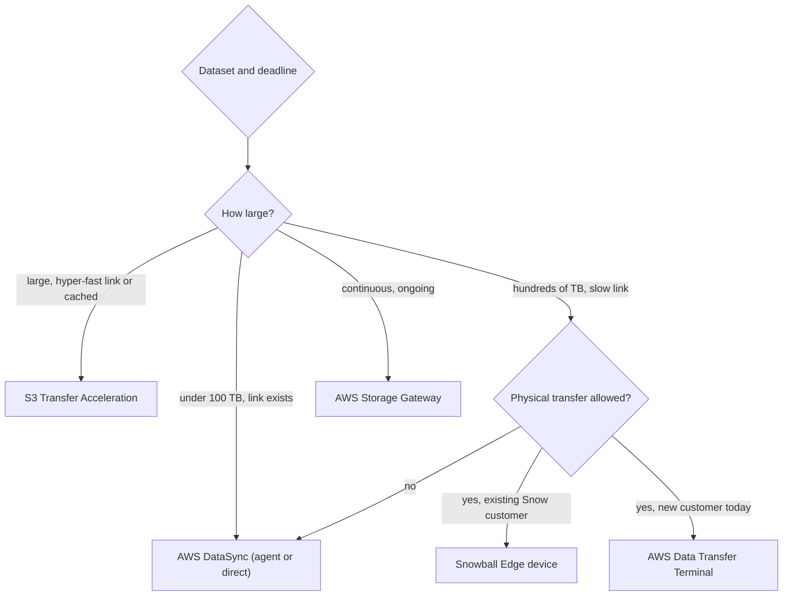
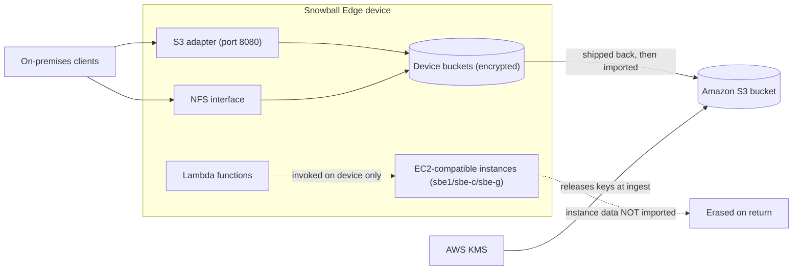

# 04 · Amazon Snow Family

> **Phase 7 — Edge and IoT** · Lesson 04 of 09
> ⬅️ Previous: [FreeRTOS](./03-freertos.md) · ➡️ Next: [AWS Outposts](./05-aws-outposts.md) · 🏠 [Phase overview](./README.md)

## 🎯 Learning Objectives

By the end of this lesson you will be able to:

- Calculate whether a dataset is faster to move over the wire or on a physical device
- Describe the difference between Snowball Edge Storage Optimized and Compute Optimized, and what each is for
- Run the full offline migration workflow: order, transfer, ship, verify, erase
- Explain the current status of the Snow family and which services replace it today
- Decide between disks, AWS DataSync, S3 Transfer Acceleration, and AWS Data Transfer Terminal
- Secure an offline transfer end to end, including key management and chain-of-custody

**Estimated time:** 60 min · **Difficulty:** Beginner

---

## 🧠 Core Concepts

**The Snow family** exists to answer one question: what do you do when the data is too big and the network is too small? The economics are unforgiving and worth doing arithmetic on before you order anything. A dedicated 1 Gbps upload link, running perfectly with zero overhead, moves roughly 10 TB per day. A 100 Mbps office link moves about 1 TB per day at best. If you have 500 TB to migrate and a 1 Gbps link, that is about seven weeks of continuous saturation — assuming nobody else needs the network. Ship a device, and the same 500 TB arrives in about a week and a half including transit.

> **Current status (read this first).** **AWS Snowball Edge is no longer available to new customers.** AWS directs new workloads to [AWS DataSync](https://aws.amazon.com/datasync/) for online transfers, [AWS Data Transfer Terminal](https://aws.amazon.com/data-transfer-terminal/) for secure physical transfers, or AWS Partner solutions. **AWS Snowcone**'s documentation now redirects into the Snowball Edge guide, and **AWS Snowmobile** — the 100 PB shipping container — is no longer offered. Existing customers and existing migration plans still work, and the concepts below remain the foundation of every offline transfer design, which is why this lesson teaches them properly. But before you build a plan on a Snow device today, confirm availability in your Region and check the alternatives first.

**Snowball Edge** came in two shapes. **Storage Optimized** is a data-mover: the current generation carries 210 TB of usable NVMe storage (device type `V3_5S`, capacity `T240`), with 104 vCPUs and 416 GB of memory available if you want to run something during transit. **Compute Optimized** (device type `V3_5C`, capacity `T32`) trades storage for CPUs: 28 TB of dedicated NVMe for compute instances plus 104 vCPUs and 416 GB of memory, with an optional GPU variant. The old 80 TB HDD Storage Optimized and the cable-sized **Snowcone** (8 TB HDD or 14 TB SSD) are the devices most tutorials still describe; treat those numbers as historical.

The reason Compute Optimized exists is that you can run **EC2-compatible instances and Lambda functions on the device** while it sits in a factory or a ship with no connectivity. Instance types are unique to the hardware (`sbe1` for Storage Optimized, `sbe-c` for compute, `sbe-g` for GPU), the AMIs must be registered in the cloud before the job is created, and — critically — **data produced inside those compute instances is not imported into AWS when the device returns**. Only data written through the S3 adapter or NFS interface lands in your bucket.

Devices also form **clusters**. A cluster of up to 16 Snowball Edge devices presents unified S3 storage with fault tolerance and lets you run EKS Anywhere or NFS workloads across nodes; a cluster job is created once with `--cluster-id` and per-node jobs inherit the parent's attributes. For data movement into the device you use the S3 adapter endpoint, an NFS mount, or AWS OpsHub, the graphical client that replaced most of the old `snowballEdge` CLI workflow.

When you return a device, AWS ingests whatever is in the device's buckets into your S3 bucket, verifies it, and then performs a complete erasure following **NIST 800-88** standards before the hardware is reused. The data on the device is encrypted with 256-bit keys; the keys never live on the device — they are held in AWS KMS and released only to authorised accounts, which is what makes a device sitting in a courier depot not a data breach.

### Key terminology

| Term | Meaning |
|------|---------|
| **Job** | The unit of work: an import or export between S3 and your site, with shipping and notification settings. |
| **Cluster** | Up to 16 Snowball Edge devices presenting unified storage, ordered as one job. |
| **Snowball Edge client** | The `snowballEdge` command-line tool for unlocking and configuring a device. |
| **AWS OpsHub** | Graphical desktop application for managing devices, transferring data, and launching instances. |
| **S3 adapter** | On-device S3-compatible endpoint (typically port 8080) used by the AWS CLI or SDKs. |
| **NFS interface** | Mount point on the device for clients that prefer file semantics over S3 API calls. |
| **Job manifest** | Encrypted file with credentials and unlock codes, downloaded with `get-job-manifest`. |
| **Long-term pricing** | Reservation that keeps a device for 1 or 3 years at a monthly rate instead of per-job pricing. |
| **Data Transfer Terminal** | Physical AWS location where you bring your own storage devices and upload at high throughput. |

---

## 🗺️ Architecture Diagram

The offline migration lifecycle, which is a real workflow with real paperwork:

```mermaid
flowchart LR
    plan["Size the dataset and pick devices"] --> order["Create job + address + manifest"]
    order --> ship["AWS ships device (E Ink label)"]
    ship --> unlock["Unlock with manifest credentials (OpsHub or CLI)"]
    unlock --> fill["Load data via S3 adapter or NFS"]
    fill --> compute["Optionally run EC2 instances / Lambda"]
    compute --> ret["Ship back with auto-generated label"]
    fill --> ret
    ret --> ingest["AWS ingests into S3 bucket"]
    ingest --> erase["NIST 800-88 erasure"]
    erase --> done["Job complete + data verified"]
```



Where Snowball Edge sits relative to the current alternatives:



The on-device layer, showing what does and does not reach AWS:



---

## 🧪 Hands-on Lab: Plan and Execute an Offline Transfer

**Goal:** Size a transfer, create an import job, and transfer data to a device through the S3 adapter the same way you would to a real bucket.

**Prerequisites:** An existing Snow-family job or long-term-priced device in your account. An address the device can ship to. AWS CLI v2 with `snowball` permissions. The lab below uses a device already in your possession so you can run it without ordering hardware.

### Step 1 — Do the arithmetic first

```bash
# Size the dataset precisely. Never estimate this — inconsistent units are how
# people order the wrong number of devices.
du -sh --si /data/archive | awk '{print $1}'

# Measure the sustained uplink you would actually get, not the link rate
speedtest-cli --simple
```

Work the numbers honestly: at 500 Mbps sustained and 90% efficiency you move about 5 TB per day, so 200 TB needs roughly 40 days of dedicated bandwidth. If the business wants it in two weeks, physics says ship something.

### Step 2 — Create the address and the job

```bash
# Snow jobs need a validated shipping address
aws snowball create-address \
  --address '{"Name":"Logistics Dept","Company":"Example GmbH","Street1":"Hafenstrasse 12","City":"Hamburg","PostalCode":"20457","StateOrProvince":"HH","Country":"DE","PhoneNumber":"+4940123456789","IsRestricted":false}' \
  --query AddressId --output text
```

```bash
# Request the storage-optimized 210 TB device (device type V3_5S, capacity T240 per the API topic)
aws snowball create-job \
  --job-type IMPORT \
  --resources '{"S3Resources":[{"BucketArn":"arn:aws:s3:::iot-factory-raw-eu-west-1"}]}' \
  --address-id ADID12345678-1234-1234-1234-123456789012 \
  --role-arn arn:aws:iam::123456789012:role/SnowballImportRole \
  --kms-key-arn arn:aws:kms:eu-west-1:123456789012:key/11111111-2222-3333-4444-555555555555 \
  --shipping-option SECOND_DAY \
  --snowball-type V3_5S \
  --snowball-capacity-preference T240 \
  --description "Factory archive 2019-2024"

# Watch the job state machine as AWS prepares and ships the device
aws snowball list-jobs --query 'JobList[].{id:JobId,state:JobState,type:JobType}'
```

Job states run `New` → `PreparingAppliance` → `PreparingShipment` → `InTransitToCustomer` → `WithCustomer` → `InTransitToAWS` → `WithAWSSortingFacility` → `AtAWS` → `Complete`. If you are stuck in `New`, the address or IAM role is usually the problem.

### Step 3 — Download the manifest and unlock the device

```bash
# The manifest contains the unlock code and credentials. Treat it as a secret.
aws snowball get-job-manifest --job-id JID12345678-1234-1234-1234-123456789012 --query ManifestURI --output text

# Using the Snowball Edge client on the machine connected to the device
snowballEdge configure
snowballEdge unlock-device
snowballEdge describe-device

# Retrieve the device's local credentials for the S3 adapter
snowballEdge list-access-keys
snowballEdge get-secret-access-key --access-key-id <local-access-key>
```

### Step 4 — Transfer data through the S3 adapter

```bash
# The S3 adapter speaks S3, so the AWS CLI works unchanged — only the endpoint differs
export DEVICE_IP=10.0.0.5
export AWS_ACCESS_KEY_ID=<local-access-key>
export AWS_SECRET_ACCESS_KEY=<local-secret-key>

aws s3 cp /data/archive/2019 s3://iot-factory-raw-eu-west-1/archive/2019/ \
  --recursive \
  --endpoint http://$DEVICE_IP:8080 \
  --no-verify-ssl

# Verify the object counts on both sides match before you seal the box
aws s3 ls --recursive --endpoint http://$DEVICE_IP:8080 s3://iot-factory-raw-eu-west-1/archive/2019/ | wc -l
find /data/archive/2019 -type f | wc -l
```

### Step 5 — Optionally process data while it is in transit

```bash
# Compute instances are launched through the device's EC2-compatible endpoint
export EC2_ENDPOINT=http://$DEVICE_IP:8008
aws ec2 describe-instance-types --endpoint $EC2_ENDPOINT
aws ec2 run-instances --image-id sbe-c-ami-12345678 --instance-type sbe-c.large --endpoint $EC2_ENDPOINT
```

Remember: whatever those instances write stays on the device and is erased on return. If a result must reach AWS, write it through the S3 adapter or into a device bucket.

### Step 6 — Verify

```bash
# After the device reaches AWS, the bucket is populated and the job completes
aws snowball describe-job --job-id JID12345678-1234-1234-1234-123456789012 --query 'JobMetadata.JobState'

# Confirm the data landed and matches the expected object count
aws s3 ls --recursive s3://iot-factory-raw-eu-west-1/archive/2019/ | wc -l
```

Success is `Complete` job state plus matching object counts and checksums on the destination side. If counts differ, open a support case before the device is wiped from your records.

---

## 💻 CLI Reference

```bash
# See every device and job in the account, with state and type
aws snowball list-jobs --query 'JobList[].{id:JobId,state:JobState,type:JobType,device:SnowballType}'

# Which long-term-priced devices do we already own?
aws snowball list-long-term-pricing --query 'LongTermPricingEntries[].{id:LongTermPricingId,type:SnowballType,end:CurrentActiveJob}'

# Reservation for a device you keep for a year of continuous edge work
aws snowball create-long-term-pricing --long-term-pricing-type "1_YEAR" --snowball-type EDGE

# Cluster management for multi-device deployments
aws snowball create-cluster --job-type LOCAL_USE --resources '{"S3Resources":[{"BucketArn":"arn:aws:s3:::iot-factory-raw-eu-west-1"}]}' --address-id ADID12345678-1234-1234-1234-123456789012 --role-arn arn:aws:iam::123456789012:role/SnowballImportRole --shipping-option SECOND_DAY --snowball-type EDGE
aws snowball list-clusters

# Cancel a job before the device ships
aws snowball update-job --job-id JID12345678-1234-1234-1234-123456789012 --cancel-job '{"jobId":"JID12345678-1234-1234-1234-123456789012"}'
```

| Command | Purpose |
|---------|---------|
| `create-address` | Registers the shipping destination; required before any job |
| `create-job` | Orders a device with a job type, capacity, and shipping option |
| `get-job-manifest` | Retrieves unlock codes and credentials — a secret, handle accordingly |
| `describe-job` | Tracks the state machine from order to ingestion |
| `create-long-term-pricing` | Converts per-job ordering into a monthly reservation for edge use |
| `create-cluster` | Orders multiple devices that present unified storage for EC2 or EKS workloads |

---

## ✅ Best Practices

| Practice | Why it matters |
|----------|----------------|
| Measure the real uplink and the real dataset before choosing | Offline transfer is a physics decision, and bad estimates cost weeks |
| Use a customer-managed KMS key per migration | Lets you audit and revoke access to a specific job's data independently |
| Do a small pilot device first | Validates tooling, checksums, and process before 500 TB is in flight |
| Verify object counts and checksums before shipping back | Once the device ships, finding a missing directory means starting over |
| Prefer `aws s3 sync` with `--endpoint` over ad-hoc scripts | It handles retries and resumption correctly |
| Never write compute-instance output expecting it in S3 | Data in EC2-compatible instances is not imported |
| Record chain of custody for each device | Auditors ask who had the hardware and when; make that answerable |
| Keep the manifest out of shared folders | It contains unlock credentials for a device holding encrypted customer data |

---

## ⚠️ Common Pitfalls

| Pitfall | Symptom | Fix |
|---------|---------|-----|
| Planning a new migration on Snowball Edge today | Ordering fails or you find the service is closed to new customers | Use DataSync, Data Transfer Terminal, or a partner; confirm availability first |
| Wrong capacity or device type for the job | Job rejected or device arrives too small | Match `--snowball-type` and `--snowball-capacity-preference` to real device capacities |
| Choosing Storage Optimized then trying to run compute | Instances fail to launch with a clear error | Only `sbe-c` and `sbe-g` run on Compute Optimized devices |
| Expecting compute data to be imported | Data missing after return | Route results through the S3 adapter into device buckets |
| Transferring with `--no-verify-ssl` over an untrusted network | Credentials exposed on the wire | The adapter is for the local device LAN; keep that segment isolated |
| IAM role missing S3 permissions | Job creation fails at `PreparingAppliance` | Grant the Snowball role write access to the target bucket and KMS access to the key |
| Losing the manifest or unlock code | Device unusable until support intervenes | Store it in Secrets Manager with restricted access |
| No reconciliation after ingest | Duplicate or missing objects noticed months later | Compare counts and spot-check checksums, then record the result |

---

## 💰 Cost Considerations

Offline transfer pricing has three components: a **per-job fee** that varies by device type and region, the **shipping** cost, and — the one people underestimate — **the time cost of the process**. For long-term edge deployments, `create-long-term-pricing` replaces per-job charges with a monthly reservation for 1 or 3 years, which is the right model for a device that stays on a factory floor.

The comparison you should actually make is not "device fee versus data transfer fee." It is total elapsed time and engineering effort versus the alternatives:

| Approach | Best for | Rough economics |
|----------|----------|-----------------|
| DataSync over an existing link | Ongoing, scheduled, or incremental movement; tens of TB | Charged per GB transferred plus agent infrastructure; no shipping or handling |
| S3 Transfer Acceleration | Latency-bound uploads over long-distance public internet, any size | Per-GB premium on top of normal transfer; effective when distance is the problem |
| Data Transfer Terminal | Bringing your own disks to an AWS location today | Facility and throughput based; no device logistics |
| Snowball Edge device | Very large one-time datasets on constrained links (existing customers) | Per-job fee plus shipping; a truck beats a slow link above roughly 10–100 TB depending on bandwidth |
| Storage Gateway | Continuous hybrid access to S3 with local caching | Monthly gateway fee plus storage and request charges |

Data transferred *into* S3 is never charged for ingress, and that is true for offline ingest as well — you pay for the device, not the bytes. What genuinely surprises people is the internal cost: staff time to load and verify hundreds of terabytes, plus the cost of an encrypted copy sitting on-premises while the device is in transit.

---

## 🔐 Security Considerations

- **Encryption keys never travel with the device.** Data is encrypted with 256-bit keys managed in AWS KMS; the device holds the ciphertext and the key material is released only to authorised accounts at ingest. Verify that the job uses the KMS key you expected by inspecting `KmsKeyARN`.
- **The manifest is a credential.** It contains the unlock code and local credentials. Store it in AWS Secrets Manager with a narrow resource policy, and delete it once the job completes.
- **The device LAN is a trust boundary.** Anyone on that segment can reach the S3 adapter and the local EC2 endpoint. Put the device on an isolated VLAN, disable the Wi-Fi configuration where you do not need it, and change the default local credentials.
- **Data in the cloud is not automatically restricted.** An import job writes into a bucket; combine it with Block Public Access, bucket policies scoped by `aws:SourceVpce` or IAM principal, and SSE-KMS so the freshly ingested data inherits your controls.
- **Erasure is verified, not assumed.** AWS follows NIST 800-88 for sanitisation before reuse, and the job report documents it. Retain that documentation as audit evidence for regulated data.
- **Chain of custody is a real control.** Record when the device was received, who handled it, where it was stored, and when it was returned. This is the offline equivalent of CloudTrail.
- **Do not reuse a device's local keys across sites.** Generate fresh credentials per device per site, and never leave the adapter reachable after the transfer window closes.

---

## 🧩 Exercise

Pick a real dataset you control — a photo library, a log archive, a backup set — and produce a written transfer plan with three numbers: total size in TB, sustained upload rate in Mbps, and the resulting wall-clock time both online and with a shipped device. Then choose a method and defend it in five sentences, including the case where the choice is wrong (what would have to change for your recommendation to flip).

Next, harden the plan: write the IAM policy a Snowball import role would need, granting only `s3:PutObject` on the target prefix and `kms:GenerateDataKey` on one key.

Success looks like: a plan with real measured numbers, an explicit break-even bandwidth where your recommendation flips, and a role policy that an auditor would accept without changes.

---

## 📚 Resources

- [AWS Snowball Edge Developer Guide](https://docs.aws.amazon.com/snowball/latest/developer-guide/whatisedge.html)
- [Snowball Edge Device Hardware Information](https://docs.aws.amazon.com/snowball/latest/developer-guide/device-differences.html)
- [Snowball Edge API Reference — CreateJob](https://docs.aws.amazon.com/snowball/latest/api-reference/API_CreateJob.html)
- [Using Amazon EC2-Compatible Compute Instances on Snowball Edge](https://docs.aws.amazon.com/snowball/latest/developer-guide/using-ec2.html)
- [AWS OpsHub for Snow Family](https://docs.aws.amazon.com/snowball/latest/developer-guide/aws-opshub.html)
- [AWS DataSync User Guide](https://docs.aws.amazon.com/datasync/latest/userguide/what-is-datasync.html)
- [AWS Data Transfer Terminal](https://aws.amazon.com/data-transfer-terminal/)
- [AWS Data Transfer Hub Solution](https://aws.amazon.com/solutions/implementations/data-transfer-hub/)

---

## ➡️ Next Steps

An offline device moves your data once, then goes back to AWS. The next lesson covers the opposite deal: AWS hardware that moves *into your building and stays there*, running real EC2 instances, EBS volumes, and S3 buckets under your own roof while remaining managed from the Region. That is AWS Outposts, and it is the only way to get single-digit millisecond access to AWS APIs from inside your own data center.

> ⬅️ Previous: [FreeRTOS](./03-freertos.md) · ➡️ Next: [AWS Outposts](./05-aws-outposts.md) · 🏠 [Phase overview](./README.md)
