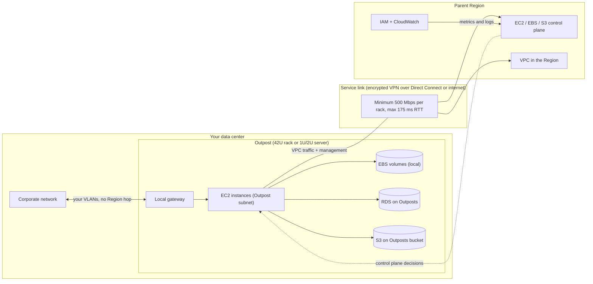
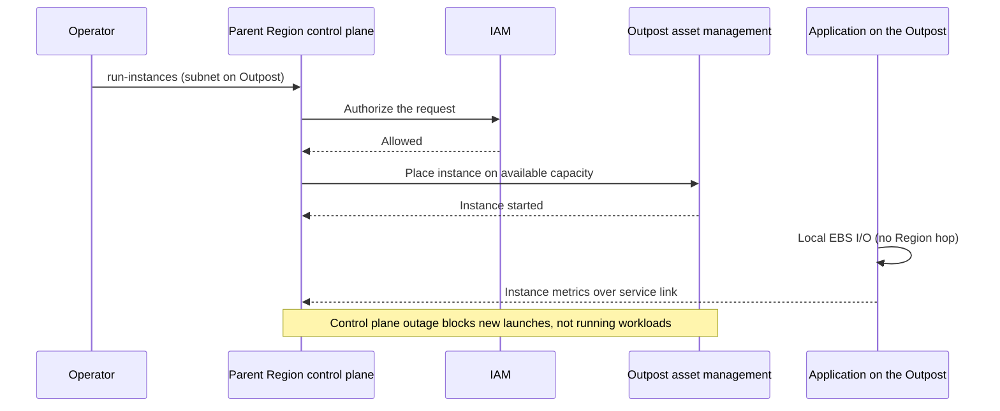
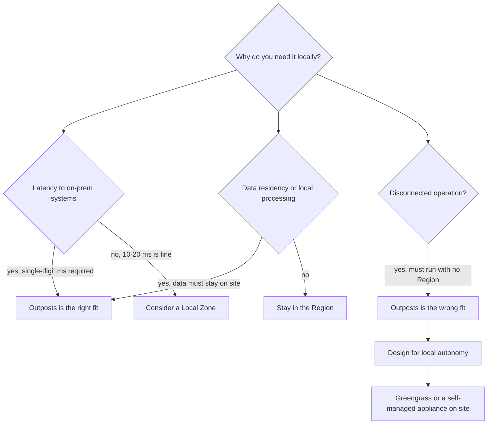

# 05 · AWS Outposts

> **Phase 7 — Edge and IoT** · Lesson 05 of 09
> ⬅️ Previous: [Amazon Snow Family](./04-aws-snow-family.md) · ➡️ Next: [AWS Wavelength](./06-aws-wavelength.md) · 🏠 [Phase overview](./README.md)

## 🎯 Learning Objectives

By the end of this lesson you will be able to:

- Explain what an Outpost is, how it differs from a Region, and what "the control plane stays in the Region" means in practice
- Choose an Outposts form factor and instance family for a given workload
- Design the networking: service link, local gateway, and subnets that live on the Outpost
- Describe the shared responsibility model for hardware AWS owns but you host
- Operate an Outpost safely during a service link outage
- Estimate the real cost and justify it against a Region or Local Zone deployment

**Estimated time:** 90 min · **Difficulty:** Advanced

---

## 🧠 Core Concepts

**AWS Outposts** puts AWS-owned, AWS-operated hardware in your building and makes it part of a Region. You create a subnet on the Outpost, launch EC2 instances into it, attach EBS volumes, create RDS instances, run ECS or EKS clusters — and all of it appears in the AWS console next to your Regional resources, because it *is* Regional infrastructure that happens to be physically somewhere else. There are two form factors: **Outposts racks** (an industry-standard 42U rack with servers, switches, a patch panel, and a power shelf) and **Outposts servers** (1U or 2U units for sites without rack space). Large deployments add **ACE racks** to aggregate network connectivity when you reach four or more compute racks.

The single most important architectural fact is the **split between control plane and data plane**. The control plane — APIs, IAM, the console, CloudWatch metrics, autoscaling decisions — lives in the **parent Region**. The data plane — instance compute, EBS I/O, S3 on Outposts reads and writes, RDS queries — is local. That is why an Outposts deployment gives you low-latency access to *your application* without also giving you a fully independent Region: you cannot survive an outage of the parent Region's control plane, and AWS is explicit that the rack "is not designed for disconnected operations."

Every request to the Outpost travels over the **service link**, an encrypted set of VPN connections to the home Region. AWS requires redundant connectivity of at least 500 Mbps per compute rack with a maximum round-trip latency of 175 ms, and the underlying network must support a 1500-byte MTU (traffic from an instance on the Outpost to an instance in the Region is limited to 1300 bytes because of encapsulation overhead). The service link is where your VPC traffic to and from the Region flows, alongside AWS's management, monitoring, and firmware traffic. In practice you provision the service link over AWS Direct Connect for predictability, with internet VPN as a backup path.

The second networking piece is the **local gateway (LGW)**, which is what lets instances on the Outpost talk to your existing on-premises network without hairpinning through the Region. Traffic between an Outpost subnet and your corporate VLAN stays on your own switches. Route tables and virtual interface groups define what the LGW will accept, and you can associate a VPC (and therefore a subnet) with a local gateway route table to control exactly which subnets can reach on-premises destinations.

**Capacity is finite and physical.** Unlike a Region, where an instance type is either available or not, an Outpost has a fixed pool of vCPUs, memory, and storage that AWS installs and you cannot add to on demand. Outposts supports self-service capacity management — you can reconfigure the split between compute and storage assets — but you are always allocating a fixed pie, and capacity planning becomes a first-class engineering activity rather than an operations detail.

**S3 on Outposts** deserves separate attention because people assume it is "normal S3, but local." It is not. You create a bucket *on* a specific Outpost, access it through an **access point** over a **VPC endpoint**, use the `OUTPOSTS` storage class, and accept that lifecycle features are limited — you cannot apply standard lifecycle transitions, and durability comes from spreading data across multiple devices and servers within that rack, not across Availability Zones in a Region. Replication to a Regional bucket or another Outpost is how you get an actual copy elsewhere.

### Key terminology

| Term | Meaning |
|------|---------|
| **Outpost site** | Your facility. It must meet AWS's temperature, airflow, weight, clearance, and power requirements. |
| **Outpost capacity** | The fixed compute and storage pool; manageable in the console or with self-service capacity management. |
| **Service link** | Encrypted, redundant connection to the home Region. **Not optional** and not for outage tolerance. |
| **Local gateway** | On-premises-facing gateway that routes Outpost subnet traffic to your network without going to the Region. |
| **Outpost subnet** | A subnet created with an Outpost ARN. Instances in it run on Outpost hardware. |
| **ACE rack** | Aggregation/Core/Edge rack that aggregates uplinks for multi-rack deployments. Required at four or more compute racks. |
| **S3 on Outposts** | Local object storage with the `OUTPOSTS` class, accessed through an access point and VPC endpoint. |
| **Home Region** | The Region the Outpost is an extension of. All control-plane calls land here. |

---

## 🗺️ Architecture Diagram

An Outpost in a data center, showing what crosses the service link and what does not:



Launching an instance, step by step, which is where the control-plane dependency becomes obvious:



Choosing an Outposts-shaped solution, or deciding you do not need one:



---

## 🧪 Hands-on Lab: Create an Outpost Subnet and Reach On-Premises Without the Region

**Goal:** Create a subnet on an Outpost, launch an instance into it, and configure a local gateway route so the instance reaches the corporate network directly.

**Prerequisites:** An active Outpost in your account (a long-term-priced Snowball Edge device can run EC2-compatible instances but is *not* an Outpost — this lab requires real Outposts hardware or a sandbox with one provisioned). A VPC in the parent Region. Permissions for `ec2:*` and `outposts:*`.

### Step 1 — Inspect what you actually have

```bash
# Every Outpost in the account, with its site and lifecycle state
aws outposts list-outposts --query 'Outposts[].{id:OutpostId,name:Name,site:SiteId,az:AvailabilityZone}'

# Which instance families did AWS actually install? Do not assume — ask.
aws outposts get-outpost-instance-types --outpost-id op-1234567890abcdef0

# Capacity view: what is left for compute instances and EBS
aws outposts list-assets --outpost-id op-1234567890abcdef0
```

### Step 2 — Create the subnet on the Outpost

```bash
# An Outpost subnet is a normal subnet with --outpost-arn added
aws ec2 create-subnet \
  --vpc-id vpc-0abc1234567890def \
  --cidr-block 10.10.20.0/24 \
  --outpost-arn arn:aws:outposts:eu-west-1:123456789012:outpost/op-1234567890abcdef0 \
  --availability-zone eu-west-1a

# Confirm the subnet reports the Outpost as its owner
aws ec2 describe-subnets --filters "Name=outpost-arn,Values=arn:aws:outposts:eu-west-1:123456789012:outpost/op-1234567890abcdef0"
```

### Step 3 — Launch a workload into the Outpost subnet

```bash
# Instance families differ between first- and second-generation racks,
# so list them first and pick from what the output shows.
aws ec2 run-instances \
  --image-id ami-0abcdef1234567890 \
  --instance-type m5.24xlarge \
  --subnet-id subnet-0123456789abcdef0 \
  --count 1 \
  --tag-specifications 'ResourceType=instance,Tags=[{Key=workload,Value=onprem-db-proxy}]'
```

### Step 4 — Give the Outpost subnet a path to your own network

```bash
# Discover the local gateway AWS provisioned with the Outpost
aws ec2 describe-local-gateways \
  --filters "Name=outpost-arn,Values=arn:aws:outposts:eu-west-1:123456789012:outpost/op-1234567890abcdef0"

# A local gateway route table controls which VPC subnets may reach on-premises
aws ec2 create-local-gateway-route-table --local-gateway-id lgw-0abcdef1234567890
aws ec2 create-local-gateway-route-table-vpc-association \
  --local-gateway-route-table-id lgw-rtb-0123456789abcdef0 \
  --vpc-id vpc-0abc1234567890def

# Route corporate traffic over the local gateway instead of the service link
aws ec2 create-local-gateway-route \
  --local-gateway-route-table-id lgw-rtb-0123456789abcdef0 \
  --destination-cidr-block 192.168.0.0/16 \
  --local-gateway-virtual-interface-group-id lgw-vif-grp-0abcdef1234567890

# Verify what the Outpost knows about
aws ec2 describe-local-gateway-route-tables
aws ec2 describe-local-gateway-virtual-interface-groups
```

Note what you just avoided: without this route, every packet to `192.168.x.x` would hairpin through the parent Region and back down the service link, adding latency and consuming your service link bandwidth for traffic that never needed to leave the building.

### Step 5 — Create S3 storage that lives on the site

```bash
# The bucket is tied to one Outpost and cannot be moved afterwards
aws s3control create-bucket \
  --account-id 123456789012 \
  --bucket iot-onprem-results \
  --outpost-id op-1234567890abcdef0

# Objects are only reachable through an access point + VPC endpoint
aws s3control create-access-point \
  --account-id 123456789012 \
  --name results-ap \
  --bucket iot-onprem-results

aws s3control get-bucket --account-id 123456789012 --name iot-onprem-results
```

### Step 6 — Verify

```bash
# Instance runs locally but is visible in the Region's inventory
aws ec2 describe-instances --instance-ids i-0123456789abcdef0 \
  --query 'Reservations[].Instances[].{az:Placement.AvailabilityZone,type:InstanceType,state:State.Name}'

# Prove local I/O stays local: EBS volumes attached to Outpost instances are local
aws ec2 describe-volumes --filters "Name=attachment.instance-id,Values=i-0123456789abcdef0"

# Prove on-premises reachability: from the instance, ping a host in 192.168.0.0/16
# (using SSM Session Manager, since the Outpost subnet may have no internet route)
aws ssm start-session --target i-0123456789abcdef0
```

Success looks like: an instance whose `Placement.AvailabilityZone` matches the Outpost's zone, local EBS volumes attached with no Region round trip, and a working path to a corporate host that never crosses the service link.

---

## 💻 CLI Reference

```bash
# All Outposts, their sites, and their CapacityReservation status
aws outposts list-outposts

# Which instance types this specific Outpost supports right now
aws outposts get-outpost-instance-types --outpost-id op-1234567890abcdef0

# Site-level view, useful when validating a new installation
aws outposts list-sites --query 'Sites[].{id:SiteId,name:Name,country:OperatingAddressCountryCode}'

# Local gateway plumbing
aws ec2 describe-local-gateways
aws ec2 describe-local-gateway-route-tables
aws ec2 describe-local-gateway-virtual-interface-groups

# S3 on Outposts inventory
aws s3control list-regional-buckets --account-id 123456789012
aws s3control get-access-point --account-id 123456789012 --name results-ap

# Capacity and asset detail for a rack
aws outposts list-assets --outpost-id op-1234567890abcdef0
```

| Command | Purpose |
|---------|---------|
| `outposts get-outpost-instance-types` | Authoritative answer to "can I run that family here?" |
| `ec2 create-subnet --outpost-arn` | Creates the placement boundary for Outpost workloads |
| `ec2 describe-local-gateways` | Finds the on-premises-facing gateway installed with the rack |
| `ec2 create-local-gateway-route` | Keeps corporate traffic local instead of hairpinning to the Region |
| `outposts list-assets` | Capacity and health view for the physical hardware |
| `s3control create-bucket --outpost-id` | Creates object storage that physically resides on the site |

---

## ✅ Best Practices

| Practice | Why it matters |
|----------|----------------|
| Model the service link as a hard dependency | The control plane lives in the Region; plan for what degrades when the link does |
| Use Direct Connect with a redundant backup path | A single 500 Mbps VPN is the minimum, not a resilient design |
| Route on-premises traffic over the local gateway | Hairpinning wastes service link bandwidth and adds latency |
| Reserve capacity before you need it | Outposts capacity is fixed; an instance type that does not fit cannot burst |
| Test application behavior with the service link failed | Running workloads usually continue; launches, autoscaling, and some APIs do not |
| Replicate S3 on Outposts data to a Regional bucket | Local durability is not multi-AZ durability |
| Pin AMIs and use launch templates | Region-side lookups during instance launch are exactly what breaks in an outage |
| Capacity-plan per workload, not per rack | Self-service capacity management lets you reconfigure, but only within installed hardware |

---

## ⚠️ Common Pitfalls

| Pitfall | Symptom | Fix |
|---------|---------|-----|
| Assuming the Outpost survives a Region control-plane outage | New launches fail while existing instances keep running | Accept it, or design an autonomous local fallback outside Outposts |
| Trying to attach an Outpost to a Local Zone or another Outpost | API rejects the configuration | An Outpost extends exactly one Availability Zone in one Region |
| MTU mismatch on the transport network | Intermittent packet loss, TLS handshakes stalling | Ensure 1500-byte MTU; remember instance-to-Region traffic is capped at 1300 bytes |
| Service link latency above 175 ms | Instance launches slow or fail; EBS attach sluggish | Fix routing or relocate the home Region |
| Assuming normal S3 lifecycle works on Outposts buckets | Lifecycle configuration rejected or ineffective | Plan replication to a Regional bucket for tiering and retention |
| Ignoring site requirements until installation week | Installation is delayed by power, cooling, or clearance issues | Validate facility requirements (temperature, airflow, weight, loading dock, seismic) months ahead |
| Capacity exhaustion during a deployment | `InsufficientInstanceCapacity` on an Outpost | Reserve capacity and monitor `list-assets` as part of release planning |
| Forgetting that EBS on Outposts is local | Snapshot and DR assumptions do not hold | Snapshot to the Region explicitly, and test the restore path |

---

## 💰 Cost Considerations

Outposts is priced as a **capacity subscription, not usage**. You pay for the rack or server configuration (a monthly instance fee plus a service fee, with typically a 3-year commitment for racks and shorter terms for servers) whether or not your workloads are running. That single sentence changes how you should think about it: a rack that sits half idle is a rack you are paying full price for, and there is no scale-to-zero.

The honest comparison is against a Regional deployment plus the business cost of latency:

| Option | Cost shape | When it wins |
|--------|-----------|--------------|
| Parent Region only | Per-second compute, elastic | Latency to on-prem systems is tolerable |
| AWS Local Zones | Regional pricing with a local premium, elastic | You need single-digit-ms to a metro population, not to your own rack |
| AWS Wavelength | Regional pricing with a carrier premium, elastic | Your users are on a 5G carrier network |
| AWS Outposts | Fixed subscription per rack or server, 3-year for racks | You need AWS APIs and services inside your own facility with data residency or machine latency |
| Self-managed on-premises hardware | CapEx plus your own operational labor | You need full autonomy with no Region dependency |

Costs that surprise people: the **service link** itself (you pay for the Direct Connect or VPN capacity, and AWS does not bill the service-link data transfer but your carrier does), the **engineering time** to operate a fixed-capacity environment, and the **opportunity cost** of a 3-year commitment on hardware you cannot grow. Conversely, not paying for it means paying in latency — which for a factory control loop or a patient-imaging device is often the more expensive outcome.

---

## 🔐 Security Considerations

- **Shared responsibility shifts, it does not disappear.** AWS owns the hardware, firmware, hypervisor patching, and sanitisation; you own the physical environment, power, cooling, network access to the Outpost, and everything you run on it. Your auditor will ask who patches what — write it down before they do.
- **The service link is a tunnel to your VPC.** It carries management and VPC traffic. Treat the transport network as untrusted, terminate on dedicated interfaces, and use Direct Connect with MACsec or an encrypted VPN rather than a shared internet path.
- **IAM and CloudTrail still apply.** Outpost API calls appear in CloudTrail in the home Region. Keep a trail active, and be aware that during a control-plane outage your audit and forensic visibility degrades with everything else.
- **Physical access is now an attack surface.** Anyone with rack access can attempt console-based attacks. Control who can enter the room, enable camera coverage, and log all physical access as you would for any data center asset.
- **Encrypt everything twice.** EBS volumes, S3 on Outposts buckets, and RDS storage support encryption; use customer-managed KMS keys so the key path is as local as the data.
- **Data residency claims need verification.** If the reason for Outposts is that data must not leave the country, confirm that metrics, backups, snapshots, and logs are not silently replicating across borders. Replication defaults are a common compliance gap.
- **S3 on Outposts access points are the only door.** Scope access point policies tightly; do not assume the bucket behaves like a Regional bucket with public access block and bucket policies doing the same work.

---

## 🧩 Exercise

Design an Outposts deployment for a hospital imaging archive: 12 TB of study data, five concurrent workstations that need sub-5 ms reads, and a compliance rule that patient data must not leave the facility. Produce a one-page design with the subnet layout, the instance family you would request (justify it against the available families), the service link sizing with your RTT budget, and the failure mode when the service link drops for four hours.

Then write the piece most designs forget: an operational runbook entry describing what still works, what does not, and how the on-call engineer distinguishes an Outpost problem from a Region problem.

Success looks like: a design where the local gateway carries all clinical traffic, the service link carries only control plane and telemetry, capacity is reserved with headroom, and the runbook names the exact CloudWatch metric or API call to check first in each failure mode.

---

## 📚 Resources

- [What Is AWS Outposts?](https://docs.aws.amazon.com/outposts/latest/userguide/what-is-outposts.html)
- [Site Requirements for Outposts Racks](https://docs.aws.amazon.com/outposts/latest/userguide/outposts-requirements.html)
- [Connectivity Through the Service Link](https://docs.aws.amazon.com/outposts/latest/userguide/service-links.html)
- [Local Gateways](https://docs.aws.amazon.com/outposts/latest/userguide/outposts-local-gateways.html)
- [What Is Amazon S3 on Outposts?](https://docs.aws.amazon.com/AmazonS3/latest/s3-outposts/S3onOutposts.html)
- [AWS Outposts Rack Instance Types](https://aws.amazon.com/outposts/rack/features/)
- [AWS Outposts Pricing](https://aws.amazon.com/outposts/pricing/)
- [Scaling Outposts Rack Deployments with ACE Racks](https://aws.amazon.com/blogs/compute/scaling-aws-outposts-rack-deployments-with-ace-racks/)

---

## ➡️ Next Steps

Outposts places AWS inside *your* building. The next lesson does the opposite: it places AWS inside *someone else's* network — specifically, inside a carrier's 5G core, where your instances sit a few milliseconds from a phone in a customer's hand. Wavelength is a different bet on the same question: how close can compute get before the network stops being the bottleneck?

> ⬅️ Previous: [Amazon Snow Family](./04-aws-snow-family.md) · ➡️ Next: [AWS Wavelength](./06-aws-wavelength.md) · 🏠 [Phase overview](./README.md)
