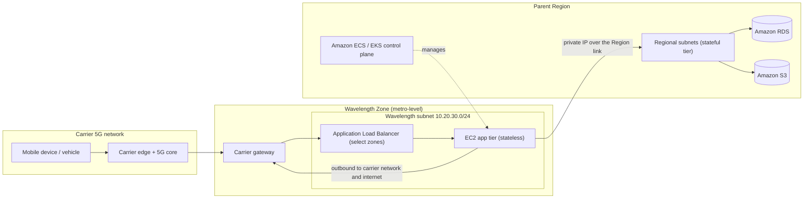
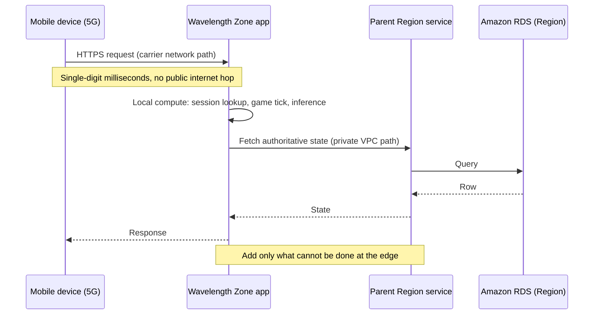
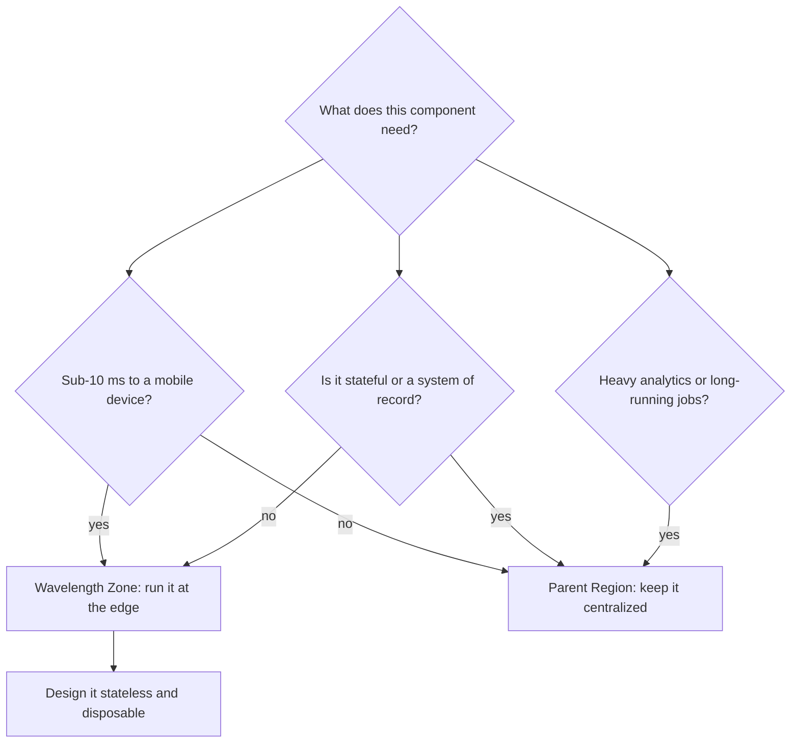

# 06 · AWS Wavelength

> **Phase 7 — Edge and IoT** · Lesson 06 of 09
> ⬅️ Previous: [AWS Outposts](./05-aws-outposts.md) · ➡️ Next: [AWS Local Zones](./07-aws-local-zones.md) · 🏠 [Phase overview](./README.md)

## 🎯 Learning Objectives

By the end of this lesson you will be able to:

- Explain what a Wavelength Zone is and how it differs from a Region and a Local Zone
- Extend an existing VPC into a Wavelength Zone with a carrier gateway and a Wavelength subnet
- Identify the workloads where single-digit-millisecond latency to a mobile device actually changes the product
- Design a hub-and-spoke architecture that keeps state and heavy processing in the parent Region
- Describe the supported service set and the networking restrictions you must design around
- Reason about Wavelength pricing versus the value of sub-10 ms round trips

**Estimated time:** 75 min · **Difficulty:** Advanced

---

## 🧠 Core Concepts

**AWS Wavelength** places AWS compute and storage *inside a communications service provider's network* — inside the 5G core, before traffic ever reaches the public internet. The unit of placement is a **Wavelength Zone**: a zone that belongs to a carrier location, is associated with a parent Region, and is managed by that Region's control plane. When a device on the carrier network talks to an application running in a Wavelength Zone, the packets travel from the device to the carrier's edge and into your subnet without a trip across the public internet and without a trip to the Region. That is where the single-digit-millisecond latency comes from.

The key architectural move is that you are **extending an existing VPC, not creating a new one**. Your VPC already spans Availability Zones in the parent Region; you add subnets in one or more Wavelength Zones, and resources in those subnets are addressed like any other subnet in the same VPC, over private IP addresses. The glue is the **carrier gateway**, which does two jobs at once: it accepts inbound traffic from the carrier network at that location and it provides outbound access to the carrier network and the internet for instances in the Wavelength subnet. There is no internet gateway and no NAT gateway in the Wavelength subnet — the carrier gateway replaces both, and it comes with fixed behaviour you do not control.

That fixed behaviour is worth memorizing because it breaks naive designs. In most Wavelength Zones, TCP from the internet is allowed outbound with responses, **UDP from the internet is denied**, and ICMP is allowed. Traffic between an instance and a device on the carrier network is allowed for TCP, UDP, and ICMP, which is the traffic pattern the service is actually built for. You cannot remove these controls.

There are two more restrictions that shape real architectures. First, **instances in two different Wavelength Zones in the same VPC cannot communicate with each other** — if you need zone-to-zone traffic, you use separate VPCs joined by a transit gateway. Second, the Wavelength Zone's inbound path is optimized for devices physically in that metro area on that carrier; there is no global anycast magic. A Wavelength Zone in the San Francisco Bay Area delivers low latency to devices in that metro on that carrier's network and normal internet latency to everyone else.

The recommendation from AWS is a **hub-and-spoke** model: put the latency-critical slice in the Wavelength Zone and keep the system of record, the databases, the queues, and the heavy analytics in the parent Region, connected over the reliable link between the zone and the Region. This keeps state in one place, keeps the edge tier stateless and replaceable, and keeps the scarce, more expensive edge capacity for what actually needs to be there.

### Key terminology

| Term | Meaning |
|------|---------|
| **Wavelength Zone** | AWS infrastructure deployed in a carrier location; a logical extension of a parent Region. |
| **Carrier gateway** | The gateway for a Wavelength subnet. Handles inbound carrier traffic and outbound carrier/internet traffic. |
| **Wavelength subnet** | A subnet created in a Wavelength Zone inside an existing VPC. |
| **Network border group** | The set of zones from which AWS advertises a given set of IP addresses; Wavelength Zones have their own. |
| **Zone group** | The opt-in unit, e.g. `us-east-1-wl1`. Opt in per account before use. |
| **Edge discovery** | Finding the nearest zone endpoint — commonly via AWS Cloud Map, carrier APIs, or client-side latency probing. |
| **Carrier IP address** | An IP from the carrier's pool, reachable from the carrier network. Distinct from an Elastic IP. |

---

## 🗺️ Architecture Diagram

Where the packets go, and — more importantly — where they do not:



The request lifecycle, showing which hops are local and which are Regional:



Choosing where each tier belongs:



---

## 🧪 Hands-on Lab: Extend a VPC into a Wavelength Zone

**Goal:** Opt in to a Wavelength Zone, create a Wavelength subnet inside an existing VPC, attach a carrier gateway, and route traffic so an edge instance can reach both the carrier network and its Regional backend.

**Prerequisites:** An existing VPC with a Regional subnet. Permissions for `ec2:*` on VPCs, carrier gateways, and route tables. A parent Region that has Wavelength Zones available (for example `us-east-1`).

### Step 1 — Opt in to the zone group

```bash
# Wavelength zones are opt-in per account per zone group
aws ec2 describe-availability-zones \
  --filters "Name=zone-type,Values=wavelength-zone" \
  --query 'AvailabilityZones[].{zone:ZoneName,group:GroupName,state:OptInStatus}'

aws ec2 modify-availability-zone-group \
  --group-name us-east-1-wl1 \
  --opt-in-status opted-in
```

Opting in is a per-account setting; it can take a few minutes to propagate.

### Step 2 — Create the Wavelength subnet

```bash
# Same VPC as the Region, different zone. This is the whole point.
aws ec2 create-subnet \
  --vpc-id vpc-0abc1234567890def \
  --cidr-block 10.20.30.0/24 \
  --availability-zone us-east-1-wl1-bos-wlz-1

# Tag it so operations staff can see it is edge capacity at a glance
aws ec2 create-tags \
  --resources subnet-0fedcba9876543210 \
  --tags Key=scope,Value=wavelength-edge
```

### Step 3 — Attach a carrier gateway

```bash
# The carrier gateway is the Wavelength subnet's door to the carrier network
aws ec2 create-carrier-gateway \
  --vpc-id vpc-0abc1234567890def \
  --availability-zone us-east-1-wl1-bos-wlz-1

aws ec2 describe-carrier-gateways

# Route all non-VPC traffic out through the carrier gateway
aws ec2 create-route \
  --route-table-id rtb-0abc1234567890def \
  --destination-cidr-block 0.0.0.0/0 \
  --carrier-gateway-id cgw-0abcdef1234567890
```

The Regional subnet in the same VPC keeps using the internet gateway or NAT gateway in the Region. Traffic between the Wavelength subnet and the Regional subnet stays inside the VPC and flows over the zone-to-Region link.

### Step 4 — Launch an edge instance

```bash
# Instance types are a small supported set: t3.medium, c5.2xlarge, r5.2xlarge,
# and GPU types in some zones. Check the current table before you design.
aws ec2 run-instances \
  --image-id ami-0abcdef1234567890 \
  --instance-type c5.2xlarge \
  --subnet-id subnet-0fedcba9876543210 \
  --security-group-ids sg-0abc1234567890def \
  --count 1 \
  --tag-specifications 'ResourceType=instance,Tags=[{Key=tier,Value=edge-stateless}]'
```

Instances in Wavelength Zones cannot be Dedicated Instances or Dedicated Hosts, and EC2 quotas are governed by the parent Region's quotas.

### Step 5 — Register the endpoint for discovery

```bash
# Clients need to find the nearest zone. AWS Cloud Map is a common registry.
aws servicediscovery create-http-namespace --name edge.example.internal

aws servicediscovery create-service \
  --name game-session-us-east-wl1 \
  --namespace-id ns-0abcdef1234567890 \
  --dns-config '{"NamespaceId":"ns-0abcdef1234567890","RoutingPolicy":"MULTIVALUE","DnsRecords":[{"Type":"A","TTL":60}]}'

# Register the Wavelength instance so carrier-side discovery can resolve it
aws servicediscovery register-instance \
  --service-id srv-0abcdef1234567890 \
  --instance-id wl1-edge-01 \
  --attributes AWS_INSTANCE_IPV4=10.20.30.15
```

In production, combine this with carrier edge-discovery APIs or a client-side latency probe across multiple zones, because a device's nearest zone depends on which carrier network it is attached to.

### Step 6 — Verify

```bash
# Confirm the subnet is a Wavelength subnet and the gateway is attached
aws ec2 describe-subnets --subnet-ids subnet-0fedcba9876543210
aws ec2 describe-route-tables --route-table-ids rtb-0abc1234567890def \
  --query 'RouteTables[].Routes[?CarrierGatewayId!=`null`]'

# From canary devices on the carrier network, measure the round trip:
#   curl -o /dev/null -s -w '%{time_total}\n' https://edge.example.com/ping
# Compare against the same request to the parent Region endpoint.
```

Success looks like a measured latency gap between the Wavelength Zone endpoint and the Regional endpoint from the same device on the same carrier, plus a confirmed private path from the edge instance to a Regional backend.

---

## 💻 CLI Reference

```bash
# Which Wavelength Zones exist, and are you opted in?
aws ec2 describe-availability-zones --filters "Name=zone-type,Values=wavelength-zone"

# Carrier gateway inventory and its associated VPC
aws ec2 describe-carrier-gateways

# Opt out of a zone group you no longer use (existing resources must be removed first)
aws ec2 modify-availability-zone-group --group-name us-east-1-wl1 --opt-in-status not-opted-in

# Zone-level detail, including the parent zone
aws ec2 describe-availability-zones --zone-names us-east-1-wl1-bos-wlz-1

# Confirm what the edge instance can reach
aws ec2 describe-route-tables --filters "Name=association.subnet-id,Values=subnet-0fedcba9876543210"

# Check quota headroom before a large edge rollout (quotas come from the parent Region)
aws service-quotas list-service-quotas --service-code ec2
```

| Command | Purpose |
|---------|---------|
| `modify-availability-zone-group` | Opt in or out of a Wavelength zone group for the account |
| `create-subnet --availability-zone <wavelength-zone>` | Adds edge capacity to an existing VPC |
| `create-carrier-gateway` | Provides the carrier-network and internet path for the Wavelength subnet |
| `create-route --carrier-gateway-id` | Sends non-VPC traffic through the carrier gateway |
| `describe-carrier-gateways` | Confirms the gateway state and VPC association |
| `servicediscovery register-instance` | Publishes the zone endpoint for client-side edge discovery |

---

## ✅ Best Practices

| Practice | Why it matters |
|----------|----------------|
| Keep the edge tier stateless | Edge capacity is scarce and expensive; state belongs where it can be duplicated |
| Use the hub-and-spoke model | Centralize data, queues, and observability in the parent Region |
| Measure latency from real devices on the real carrier | Lab benchmarks on a different carrier or metro prove nothing |
| Implement edge discovery explicitly | Clients must know which zone to call; do not hardcode one zone |
| Design for one zone failing | A zone is a metro, not a Region; a carrier event takes it offline |
| Account for the fixed carrier gateway controls | UDP from the internet is denied in most zones; some protocols simply will not work |
| Do not expect zone-to-zone traffic in one VPC | Instances in different Wavelength Zones cannot talk to each other directly |
| Re-check the supported instance list per zone | The list is small and varies by region |

---

## ⚠️ Common Pitfalls

| Pitfall | Symptom | Fix |
|---------|---------|-----|
| Assuming a Regional service is available at the edge | `InvalidParameterValue` or missing service in the zone | Only a small service set runs in Wavelength Zones; keep everything else in the Region |
| Trying to use an internet gateway or NAT gateway in the Wavelength subnet | Route creation fails or traffic black-holes | Use the carrier gateway; it handles both carrier and internet egress |
| UDP-based protocol on the public path | Packets silently dropped | UDP from the internet is denied in most zones; use TCP or route over the carrier network |
| Two Wavelength Zones in the same VPC | Instances cannot communicate | Separate VPCs joined by a transit gateway |
| Network Load Balancer at the edge | Creation fails | Only ALB is supported, and only in select zones |
| Latency measured from a non-carrier client | Numbers are indistinguishable from the Region | Test from a device on the carrier network in the zone's metro |
| Deploying state to the edge "for speed" | Data inconsistency and hard failovers | Keep the system of record in the Region |
| Forgetting to opt in | Zone lists are empty and subnet creation fails | `modify-availability-zone-group --opt-in-status opted-in` |

---

## 💰 Cost Considerations

Enabling Wavelength Zones costs nothing; you pay for what you run there, at prices **higher than the equivalent resources in the parent Region**. Compute and EBS carry a Wavelength premium, and data transfer is the part that catches people out: traffic from a Wavelength Zone to the internet, to the Region, and between Wavelength Zones is billed, and the rates differ from standard Regional transfer.

The comparison that matters is against the alternative you would build without Wavelength:

| Approach | Latency to a 5G device | Cost shape | Best when |
|----------|------------------------|------------|-----------|
| Parent Region only | Tens of milliseconds, plus public internet variability | Baseline Regional pricing | Latency is not part of the product promise |
| Local Zones | Single-digit ms to a metro over the internet | Regional pricing with a local premium | Users are on fixed or Wi-Fi networks in a metro |
| AWS Wavelength | Single-digit ms inside the carrier network | Premium over Regional plus edge data transfer | The device is on 5G and latency is the product |
| On-device compute | Sub-millisecond | Hardware cost plus your operational effort | The decision can be made without any network |

Because edge capacity is smaller and pricier, the cost lever is **placement discipline**: run only the latency-critical slice in the zone, and let it call back to cheap Regional capacity for everything else. A design with a stateless edge tier and a Regional backend typically costs a fraction of one that tries to run databases and analytics at the edge. Also watch egress: an edge app that streams video out through the carrier gateway pays for that path on every session.

---

## 🔐 Security Considerations

- **The carrier gateway admits inbound traffic from the carrier network.** Carrier devices on that 5G network can reach your Wavelength subnet, so security groups and application-level authentication are the actual control. Do not treat "it came from the carrier" as authentication.
- **You have no control over carrier gateway protocol filtering.** TCP outbound and responses are allowed, UDP from the internet is denied, ICMP is allowed. Design protocols around this instead of fighting it.
- **Use the same VPC controls as anywhere else.** NACLs, security groups, VPC Flow Logs, and IAM all apply to Wavelength subnets — enable flow logs, because a black-holed route in a zone is hard to diagnose without them.
- **Keep secrets out of the edge tier.** Stateless edge instances should get temporary credentials from IAM roles and fetch secrets from Secrets Manager at request boundaries, so a stolen edge instance grants little.
- **Prefer private paths for backend calls.** Traffic from the Wavelength Zone to the Region should use private IPs inside the VPC, not the public internet, and TLS should be terminated with certificates you manage.
- **Remember compliance scope changes.** Services in Wavelength Zones have different compliance validation than the same services in a Region. If your workload is regulated, confirm the zone's compliance posture before you commit to it.
- **Plan for physical and carrier-level incidents.** A zone is a single carrier facility; treat it like a single Availability Zone and make the fault domain explicit in your design doc.

---

## 🧩 Exercise

Pick a real-time application you know well — a multiplayer game, an AR try-on tool, or a live video moderation pipeline — and write a latency budget that sums the hops from device to response: radio access, carrier core, carrier gateway, edge compute, backend call to the Region, and response path. Assign a millisecond cost to each hop, then decide which components must live in the Wavelength Zone and which can stay in the Region without breaking the budget.

Then add the failure story: what the user experiences when the zone goes offline, and what the client does about it. Include the separate-VPC-with-transit-gateway topology for serving two zones.

Success looks like: a table of hops with realistic millisecond estimates, an explicit statement of which hops Wavelength removes, and a client-side failover design that does not require the Regional database to move.

---

## 📚 Resources

- [What Is AWS Wavelength?](https://docs.aws.amazon.com/wavelength/latest/developerguide/what-is-wavelength.html)
- [Architect Apps for Wavelength](https://docs.aws.amazon.com/wavelength/latest/developerguide/architecture.html)
- [Quotas and Considerations for Wavelength Zones](https://docs.aws.amazon.com/wavelength/latest/developerguide/wavelength-quotas.html)
- [Wavelength Zones in Amazon VPC](https://docs.aws.amazon.com/vpc/latest/userguide/wavelength-zones.html)
- [AWS Wavelength Pricing](https://aws.amazon.com/wavelength/pricing/)
- [AWS Wavelength — Carrier Partners](https://aws.amazon.com/wavelength/features/)
- [Compliance Validation for AWS Wavelength](https://docs.aws.amazon.com/wavelength/latest/developerguide/compliance-validation.html)

---

## ➡️ Next Steps

Wavelength puts compute inside a carrier's network for devices on that carrier's 5G. But most of your users are not on 5G, and most low-latency workloads are about being near a *city* rather than near a *radio*. The next lesson covers AWS Local Zones — the same "move compute closer" idea, without a carrier in the middle — and gives you a decision table across all three edge placements you have learned so far.

> ⬅️ Previous: [AWS Outposts](./05-aws-outposts.md) · ➡️ Next: [AWS Local Zones](./07-aws-local-zones.md) · 🏠 [Phase overview](./README.md)
