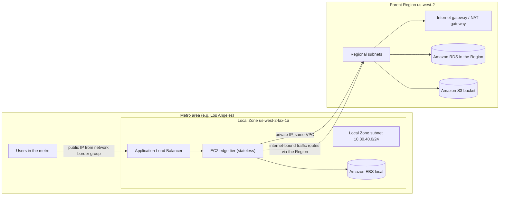
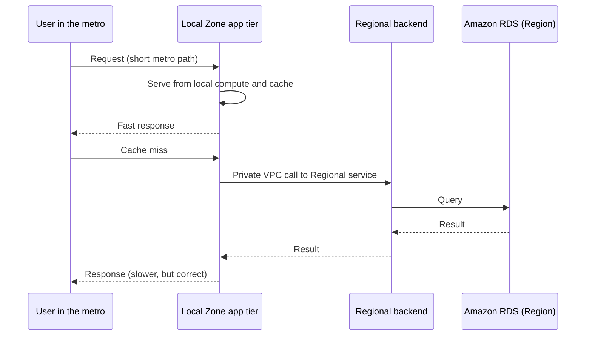
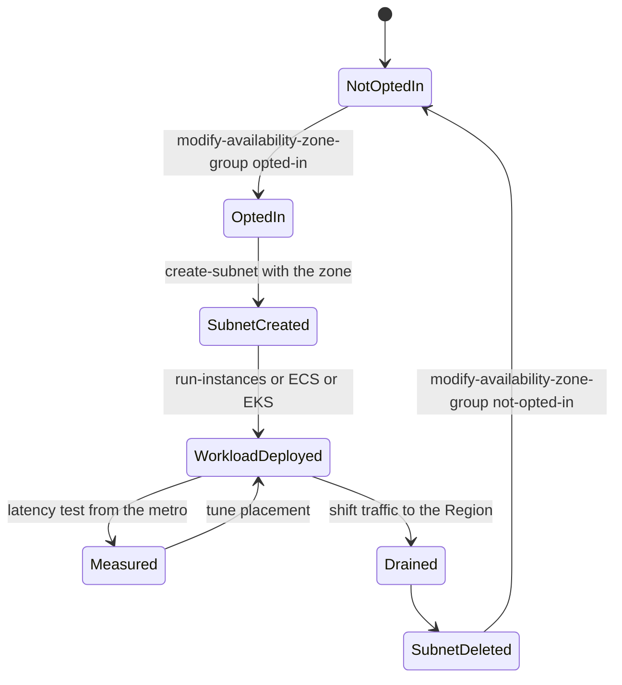

# 07 · AWS Local Zones

> **Phase 7 — Edge and IoT** · Lesson 07 of 09
> ⬅️ Previous: [AWS Wavelength](./06-aws-wavelength.md) · ➡️ Next: [Hybrid Cloud Patterns](./08-hybrid-cloud-patterns.md) · 🏠 [Phase overview](./README.md)

## 🎯 Learning Objectives

By the end of this lesson you will be able to:

- Explain what a Local Zone is, how it relates to its parent Region, and what traffic path it uses
- Opt in to a Local Zone group and create a subnet in it inside an existing VPC
- Place workloads for media rendering, gaming, and edge ML inference without moving state to the edge
- Compare Local Zones, Wavelength Zones, and Outposts on the dimensions that actually decide the choice
- Avoid the networking mistakes that make a Local Zone deployment indistinguishable from a Regional one
- Budget for the pricing premium and the egress paths

**Estimated time:** 75 min · **Difficulty:** Intermediate

---

## 🧠 Core Concepts

**AWS Local Zones** are AWS-owned infrastructure placed in large metropolitan areas, attached to a **parent Region**. Unlike a Wavelength Zone, which lives inside a carrier's 5G network, a Local Zone is simply AWS capacity that is physically much closer to a population center than the Region is, reachable over the ordinary internet. For a user in Los Angeles talking to `us-west-2-lax-1`, the added latency of a round trip to Oregon disappears — often 10 to 30 milliseconds of it. That is enough to change how a game feels, how responsive a virtual workstation is, and whether a real-time inference call fits in the interactive budget.

Mechanically, a Local Zone behaves like an extra Availability Zone in your account: you opt in, a **zone group** becomes available, you create a **subnet** with `--availability-zone us-west-2-lax-1a` inside an existing VPC, and you launch instances, EBS volumes, load balancers, containers, and in many zones RDS and ElastiCache into it. The VPC is the same VPC; private IPs address Local Zone resources the same way they address Regional ones; the control plane and the *zone group's parent zone* handle API calls from the parent Region.

The networking difference you must internalize is egress. A Local Zone has **no internet gateway of its own**. Internet-bound traffic from a Local Zone subnet is routed out through the parent Region — an internet gateway or NAT gateway in the Regional subnets — which means egress latency, egress cost, and egress failure modes are all Regional. Inbound traffic to Local Zone resources over the internet arrives with a public IP advertised from the Local Zone's **network border group**, so clients in the metro reach it without crossing to the Region. That asymmetry — local ingress, Regional egress — explains most surprising observations in a first Local Zone deployment.

Local Zones are still edge capacity with the usual constraints: a smaller supported instance list than a Region, no cross-zone load balancing tricks to lean on, and no Dedicated Hosts. Quotas are governed by the parent Region. Availability also changes over time — AWS adds zones, adjusts which services each zone supports, and retires locations — so always confirm the current list for a specific zone before you design around it.

Where Local Zones win is latency-sensitive work that has nothing to do with a 5G carrier: **virtual workstations and media rendering** for artists who cannot tolerate remote-desktop lag, **real-time game servers** that need to shave milliseconds off player-to-server round trips, **live video production** where a Regional round trip delays multi-camera sync, and **ML inference at the edge** where a user is waiting for a result — content moderation, biometric checks, or AR overlay. In all of these, the workload is stateless or near-stateless, and the durable data belongs in the Region.

### Key terminology

| Term | Meaning |
|------|---------|
| **Parent Region** | The Region a Local Zone belongs to. All control-plane calls and quotas come from here. |
| **Parent zone** | The Availability Zone in the parent Region that handles some Local Zone control-plane operations. |
| **Zone group** | The opt-in unit, e.g. `us-west-2-lax-1`. You opt in per account. |
| **Network border group** | The set of zones from which AWS advertises a given pool of public IPs; Local Zones have their own. |
| **Local Zone subnet** | A subnet created in a Local Zone within an existing VPC. |
| **Regional edge tier** | The Regional subnets that hold state, queues, and the system of record. |
| **Metro latency** | The single-digit-to-low-teens millisecond round trip a metro-local user sees vs. tens of ms to the Region. |

---

## 🗺️ Architecture Diagram

Local ingress, Regional egress — the asymmetry that defines Local Zone design:



The full traffic story, including what happens on a cache miss:



The opt-in and placement workflow:



---

## 🧪 Hands-on Lab: Put a Latency-Critical Tier in a Local Zone

**Goal:** Opt in to a Local Zone, add its subnet to an existing VPC, run a stateless web tier there behind an ALB, and confirm that internet egress still flows through the parent Region.

**Prerequisites:** A VPC in a parent Region with at least one public subnet that has an internet gateway (and a NAT gateway in a private subnet). Permissions for `ec2:*`. An EC2 key pair and a security group that allows HTTP from your address.

### Step 1 — Discover and opt in

```bash
# Which Local Zones exist for this parent Region, and what is your opt-in state?
aws ec2 describe-availability-zones \
  --region us-west-2 \
  --filters "Name=zone-type,Values=local-zone" \
  --query 'AvailabilityZones[].{zone:ZoneName,group:GroupName,status:OptInStatus,parent:ParentZoneName}'

# Opt in to the Los Angeles zone group
aws ec2 modify-availability-zone-group \
  --region us-west-2 \
  --group-name us-west-2-lax-1 \
  --opt-in-status opted-in
```

### Step 2 — Create the Local Zone subnet

```bash
# Same VPC, new zone. Do not create a second VPC for the Local Zone.
aws ec2 create-subnet \
  --region us-west-2 \
  --vpc-id vpc-0abc1234567890def \
  --cidr-block 10.30.40.0/24 \
  --availability-zone us-west-2-lax-1a

# Confirm the zone type is local-zone and the parent zone is the Regional AZ
aws ec2 describe-subnets --region us-west-2 --subnet-ids subnet-0abc1234567890lax
```

### Step 3 — Wire the route tables correctly

```bash
# Local Zone subnets need a route to the parent Region's IGW or NAT gateway for internet access.
# Find the existing public route table in the Regional subnets.
aws ec2 describe-route-tables --region us-west-2 \
  --filters "Name=association.main,Values=false" \
  --query 'RouteTables[].{id:RouteTableId,routes:Routes[].DestinationCidrBlock}'

# Associate the Local Zone subnet with that route table (or a copy of it)
aws ec2 associate-route-table \
  --region us-west-2 \
  --subnet-id subnet-0abc1234567890lax \
  --route-table-id rtb-0abc1234567890def

# And confirm the VPC's main route table still covers private traffic between zones
aws ec2 describe-route-tables --region us-west-2 --route-table-ids rtb-0abc1234567890def
```

If you skip this step, instances in the Local Zone can talk to Regional instances but cannot reach the internet at all — the single most common first-deployment symptom.

### Step 4 — Launch the edge tier behind a load balancer

```bash
# The supported instance list is smaller than a Region's; verify before you pick.
aws ec2 describe-instance-type-offerings \
  --region us-west-2 \
  --location-type availability-zone \
  --filters "Name=location,Values=us-west-2-lax-1a"

aws ec2 run-instances \
  --region us-west-2 \
  --image-id ami-0abcdef1234567890 \
  --instance-type c5.large \
  --subnet-id subnet-0abc1234567890lax \
  --security-group-ids sg-0abc1234567890def \
  --count 2 \
  --tag-specifications 'ResourceType=instance,Tags=[{Key=tier,Value=lax-edge}]'

# An ALB in the Local Zone gives metro users a local ingress point
aws elbv2 create-load-balancer \
  --region us-west-2 \
  --name lax-edge-alb \
  --type application \
  --subnets subnet-0abc1234567890lax

aws elbv2 create-target-group \
  --region us-west-2 \
  --name lax-edge-tg \
  --protocol HTTP \
  --port 80 \
  --vpc-id vpc-0abc1234567890def

aws elbv2 register-targets \
  --region us-west-2 \
  --target-group-arn arn:aws:elasticloadbalancing:us-west-2:123456789012:targetgroup/lax-edge-tg/abcdef1234567890 \
  --targets Id=i-0abc1234567890lax1 Id=i-0abc1234567890lax2
```

### Step 5 — Measure from the metro, not from your laptop

```bash
# Run this from a host in the metro (or a client with a metro-local network path)
# against the Local Zone endpoint:
for i in 1 2 3; do
  curl -o /dev/null -s -w 'total %{time_total}s\n' https://lax.example.com/health
done

# Then the same test against the Regional endpoint, for the comparison that matters:
for i in 1 2 3; do
  curl -o /dev/null -s -w 'total %{time_total}s\n' https://pdx.example.com/health
done
```

### Step 6 — Verify egress behaviour

```bash
# From an instance in the Local Zone subnet, check the public IP it appears as.
# It will be the Regional NAT gateway address, proving egress flows through the Region.
aws ssm start-session --target i-0abc1234567890lax1 --region us-west-2
# then inside the session:
curl -s https://checkip.amazonaws.com

# Compare with what the Local Zone advertises for inbound (network border group range)
aws ec2 describe-subnets --region us-west-2 --subnet-ids subnet-0abc1234567890lax \
  --query 'Subnets[].{group:NetworkBorderGroup,az:AvailabilityZone}'
```

Success looks like: measurably lower response times from a metro client, the same VPC addressing throughout, and outbound traffic showing a Regional NAT gateway address — which confirms your egress assumptions instead of leaving them to be discovered during an incident.

---

## 💻 CLI Reference

```bash
# Every Local Zone available to this parent Region with your opt-in state
aws ec2 describe-availability-zones --filters "Name=zone-type,Values=local-zone"

# Instance types actually offered in one Local Zone
aws ec2 describe-instance-type-offerings --location-type availability-zone \
  --filters "Name=location,Values=us-west-2-lax-1a"

# Subnets, and which of them live in Local Zones
aws ec2 describe-subnets --filters "Name=availability-zone,Values=us-west-2-lax-1a"

# Which Local Zones support the services you need, per zone group
aws ec2 describe-availability-zones --zone-names us-west-2-lax-1a
aws ec2 describe-availability-zones --all-availability-zones

# Opt out when a pilot ends (delete resources in the zone first)
aws ec2 modify-availability-zone-group --group-name us-west-2-lax-1 --opt-in-status not-opted-in

# Capacity and quota checks come from the parent Region
aws service-quotas get-service-quota --service-code ec2 --quota-code L-1216C47A
```

| Command | Purpose |
|---------|---------|
| `describe-availability-zones --filters zone-type=local-zone` | Finds usable zones and your opt-in state |
| `modify-availability-zone-group` | Opts in or out of a zone group per account |
| `describe-instance-type-offerings` | Shows what hardware this zone actually offers |
| `create-subnet --availability-zone` | Adds the Local Zone subnet to an existing VPC |
| `associate-route-table` | Gives the Local Zone subnet a working internet path via the Region |
| `service-quotas get-service-quota` | Confirms Regional quota headroom before scaling the edge tier |

---

## ✅ Best Practices

| Practice | Why it matters |
|----------|----------------|
| Keep the Local Zone tier stateless | Edge capacity is smaller and pricier; state belongs in the Region |
| Route the subnet through the Regional IGW or NAT gateway explicitly | Without it, the zone has no internet egress at all |
| Test from a real metro client | Latency benefits are invisible from a Regional test host |
| Prefer Local Zone local ingress, Regional private backend calls | Fast for users, consistent for data |
| Plan for the zone being one metro, not a Region | A zone failure should shift traffic to the Region, not break the product |
| Verify the supported instance types and services per zone | The list differs between zones and changes over time |
| Use the same IaC for edge and Regional tiers | Divergent pipelines produce divergent behavior at the worst time |
| Check the current zone list before designing | Availability and service support in Local Zones change |

---

## ⚠️ Common Pitfalls

| Pitfall | Symptom | Fix |
|---------|---------|-----|
| No egress route for the Local Zone subnet | Instances respond to private traffic, time out on anything on the internet | Associate the subnet with a route table pointing at the Regional IGW or NAT gateway |
| Forgetting to opt in | Subnet creation fails with an invalid zone error | `modify-availability-zone-group --opt-in-status opted-in` first |
| Assuming a Regional instance type exists in the zone | `InvalidParameterValue` or unsupported instance type | Query `describe-instance-type-offerings` for that zone |
| Designing for a service that is not available in the zone | Late re-architecture | Check the per-zone service support before committing |
| Expecting Local Zone egress to be local | Higher latency and Regional transfer charges | Accept that internet egress traverses the parent Region by design |
| Running the database in the Local Zone | Consistency and failover pain | Keep the system of record in the Region |
| Measuring from a laptop on a home connection | No perceptible improvement, wrong conclusion | Measure from a client in the metro with a realistic path |
| Treating the zone as a Region | Redundancy plans based on zone-to-zone failover inside one metro | Fail over to the parent Region instead |

---

## 💰 Cost Considerations

**Enabling Local Zones is free.** There is no charge for opting in — you pay only for the resources you create there, and those resources cost **more than the same resources in the parent Region**. The premium applies to compute, EBS, and the general-purpose resources you place in the zone, and data transfer follows Local Zone specific rates.

Two cost behaviours catch people out. First, **internet egress from a Local Zone travels through the parent Region**, so you are billed for the Local Zone to Region hop and then for Regional egress, rather than a single local egress charge. Media-heavy workloads that stream out of the zone should account for this explicitly. Second, the **capacity you pay for is capacity you must justify**: an edge tier running at 20 percent utilization for a latency benefit nobody measured is pure cost growth.

Use the following comparison when the decision is still open:

| Dimension | AWS Local Zones | AWS Wavelength | AWS Outposts |
|-----------|-----------------|----------------|--------------|
| Physical placement | AWS infrastructure in a metro area | Inside a communications service provider's 5G network | Inside your own data center |
| Who is nearby | Users on the internet in that metro | Devices on that carrier's network at that location | Your own on-premises systems and users |
| Latency achieved | Single-digit to low-teens ms from the metro | Single-digit ms from carrier devices | Sub-millisecond to local systems |
| Gateway for external traffic | None of its own; uses the parent Region's internet or NAT gateway | Carrier gateway (inbound carrier traffic, outbound carrier and internet) | Service link to the Region, plus a local gateway for on-premises traffic |
| State in the zone | Not advisable; keep it Regional | Not advisable; keep it in the Region | Possible, including RDS and S3 on Outposts |
| Works without AWS connectivity | No | No | Running workloads yes, control plane no |
| Pricing shape | Regional pricing plus a local premium, elastic | Regional pricing plus a carrier premium, elastic | Fixed subscription (typically 3 years for racks) |
| Typical workloads | Virtual workstations, media rendering, gaming, live video, edge ML inference | Connected vehicles, real-time AR on 5G, carrier-hosted media | Factory control, data residency, machine-latency workloads |

What drives the bill, in order: how much compute you place in the zone, how much data leaves through the Region, and how many zones you replicate into for coverage.

---

## 🔐 Security Considerations

- **Every control you use in a Region still applies.** Security groups, NACLs, IAM, VPC Flow Logs, KMS, and CloudTrail work in Local Zones; use them rather than inventing edge-specific trust.
- **Public IPs come from the zone's network border group.** Know which address ranges are advertised for your zone so firewall allow lists and WAF rules are correct — a Regional-only allow list will silently block metro users.
- **Egress inspection happens in the Region.** Traffic leaving a Local Zone crosses the parent Region, which is where you should place inspection, egress filtering, and logging.
- **Keep secrets Regional.** Do not copy credentials, database passwords, or key material into the edge tier; fetch them with short-lived credentials and cache minimally.
- **Encrypt edge storage.** EBS volumes in the Local Zone support KMS encryption; apply the same key policy you use in the Region so the audit story is uniform.
- **Treat the zone as a lower-trust placement only if it has to be.** A stateless tier with narrow IAM permissions limits the value of a compromised instance, and that is the cheapest security control you can adopt at the edge.
- **Watch what the zone's smaller footprint means for logging.** Ensure logs and metrics are shipped to the Region; do not rely on local files on an instance you plan to terminate.

---

## 🧩 Exercise

Design a cloud gaming backend for a title launching in two metros, using Local Zones for the game server tier and the parent Region for matchmaking, player profiles, and the economy service. Produce the topology diagram, with the ALB placement, the private routing between the zone and Regional subnets, and the failover path when one Local Zone is unavailable.

Then write the latency budget as a table: player input to server tick, server tick to state update, and state update back to the client for both a metro user and a non-metro user. Use the numbers to justify whether a second zone is worth its cost.

Success looks like: a design where matchmaking and profiles never leave the Region, game servers never hold durable state, and a zone outage degrades latency for one metro rather than taking the game offline.

---

## 📚 Resources

- [What Is AWS Local Zones?](https://docs.aws.amazon.com/local-zones/latest/ug/what-is-aws-local-zones.html)
- [Available Local Zones](https://docs.aws.amazon.com/local-zones/latest/ug/available-local-zones.html)
- [Extending a VPC to a Local Zone](https://docs.aws.amazon.com/vpc/latest/userguide/Extend_VPCs.html)
- [Local Zones Pricing](https://aws.amazon.com/about-aws/global-infrastructure/localzones/pricing/)
- [Architecture Patterns for Local Zones](https://docs.aws.amazon.com/local-zones/latest/ug/architecture.html)
- [AWS Wavelength Documentation](https://docs.aws.amazon.com/wavelength/latest/developerguide/what-is-wavelength.html)
- [AWS Outposts User Guide](https://docs.aws.amazon.com/outposts/latest/userguide/what-is-outposts.html)

---

## ➡️ Next Steps

You can now place compute in the Region, in a metro, inside a carrier network, and in your own data center. The remaining problem is everything in between: the files, databases, DNS names, and identities that live on-premises and must work seamlessly with all of it. The next lesson is the hybrid integration layer — Storage Gateway, DataSync, Direct Connect versus VPN, Route 53 Resolver, and IAM Roles Anywhere — where most real hybrid projects actually fail.

> ⬅️ Previous: [AWS Wavelength](./06-aws-wavelength.md) · ➡️ Next: [Hybrid Cloud Patterns](./08-hybrid-cloud-patterns.md) · 🏠 [Phase overview](./README.md)
