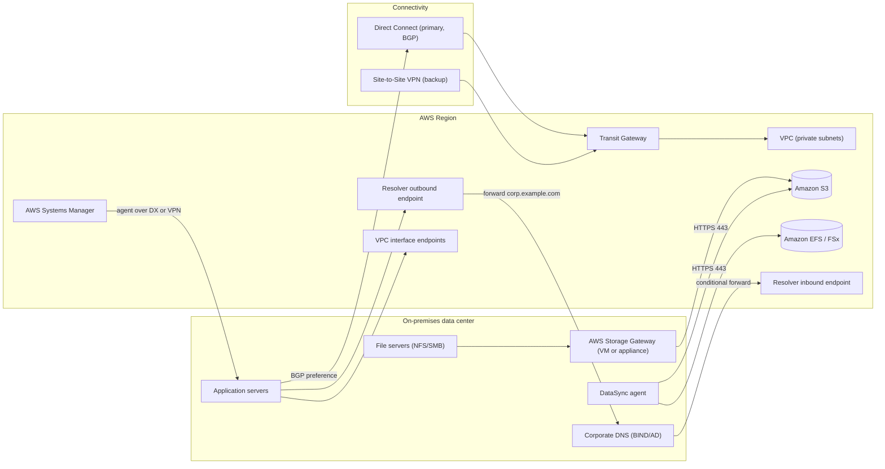
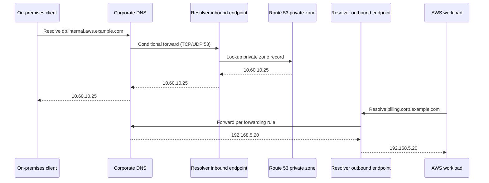
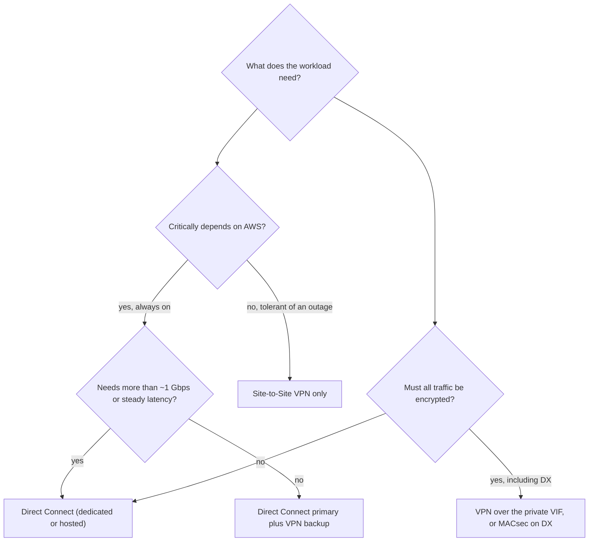
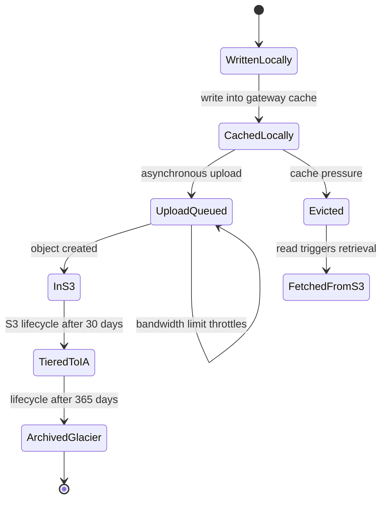

# 08 · Hybrid Cloud Patterns

> **Phase 7 — Edge and IoT** · Lesson 08 of 09
> ⬅️ Previous: [AWS Local Zones](./07-aws-local-zones.md) · ➡️ Next: [Project: Industrial IoT](./09-project-industrial-iot.md) · 🏠 [Phase overview](./README.md)

## 🎯 Learning Objectives

By the end of this lesson you will be able to:

- Choose between AWS Site-to-Site VPN and AWS Direct Connect for a given workload, and combine them for resilience
- Extend storage into S3, EBS, and Glacier with AWS Storage Gateway and move bulk data with AWS DataSync
- Make hybrid DNS work in both directions with Route 53 Resolver endpoints and forwarding rules
- Give on-premises workloads short-lived AWS credentials with IAM Roles Anywhere instead of static access keys
- Register on-premises servers with AWS Systems Manager for patching and session access
- Recognize the failure modes that make hybrid architectures unreliable in production

**Estimated time:** 90 min · **Difficulty:** Advanced

---

## 🧠 Core Concepts

Hybrid is not one architecture; it is a set of independent decisions that must agree with each other. There are five: **how traffic moves** (VPN or Direct Connect), **how data is stored** (Storage Gateway, DataSync, or local with replication), **how names resolve** (Route 53 Resolver endpoints, forwarding rules, and consistent DNS zones), **how identities authenticate** (IAM Roles Anywhere, SSM, or the older bad habit of static access keys), and **where the truth lives** for any given object. Get four right and the fifth will consume your on-call rotations.

**Traffic first.** AWS Site-to-Site VPN gives you two IPSec tunnels over the public internet in a few minutes, with BGP or static routing, for the price of the connection plus data transfer. It is fast to stand up, works anywhere you have internet, and its latency is at the mercy of the internet. AWS Direct Connect gives you a dedicated or hosted connection from a partner or Direct Connect location into AWS, with `private` virtual interfaces into your VPC, `transit` virtual interfaces into a transit gateway, or `public` virtual interfaces for AWS public services. It is more expensive, takes weeks to provision, and delivers predictable latency and bandwidth. The mature pattern is **both**: Direct Connect as the primary path, an internet VPN as backup, with BGP preferring the Direct Connect path and failing over automatically.

**Storage second.** AWS Storage Gateway presents AWS storage through on-premises-native interfaces. **S3 File Gateway** exposes NFS or SMB shares backed by S3 objects, with a local cache for low-latency reads and asynchronous upload of writes — applications keep writing files, and S3 becomes the durable system of record. **Volume Gateway** presents iSCSI block volumes backed by EBS snapshots, in cached mode (primary data in AWS, local cache) or stored mode (primary data local, snapshots to AWS). **Tape Gateway** presents a virtual tape library so existing backup software writes to S3 Glacier storage classes without knowing anything changed. Meanwhile **AWS DataSync** is the mover: an agent on-premises that copies files between NFS, SMB, HDFS, object storage, and AWS storage services at scale, with verification, scheduling, and incremental transfers.

**Names third, and this is where most projects break.** On-premises DNS has no idea your Route 53 private zones exist, and Route 53 has no idea your `corp.example.com` zone exists. Route 53 Resolver solves this with two endpoint types: an **inbound endpoint** (two or more IP addresses in your VPC) that on-premises DNS conditionally forwards AWS-resolved names to, and an **outbound endpoint** that your VPC uses to forward on-premises domains to your own DNS servers through **forwarding rules**. Both directions are required; teams routinely implement one, declare success, and then discover half their services cannot resolve each other.

**Identity fourth.** The old hybrid pattern was IAM users with access keys copied onto servers — which is exactly the pattern least-privilege programs exist to eliminate. **IAM Roles Anywhere** lets an on-premises workload exchange an X.509 certificate (from your own CA or AWS Private CA) for temporary AWS credentials, using a trust anchor and a profile. **AWS Systems Manager hybrid activations** register on-premises servers as managed nodes so you get patching, inventory, and Session Manager access without opening SSH. Both remove static secrets, which is the whole point.

The pattern that ties it together: on-premises systems should look like slightly awkward AWS resources. They authenticate with short-lived credentials, they resolve names consistently, they reach AWS APIs over private paths (VPC endpoints over Direct Connect or VPN rather than the internet), and their data lands in S3 or EBS where Regional tooling can manage it.

### Key terminology

| Term | Meaning |
|------|---------|
| **Virtual private gateway / transit gateway** | The AWS side of a VPN; a transit gateway scales to many VPCs and attachments. |
| **Direct Connect virtual interface** | A BGP peering on a DX connection: private (VPC), transit (TGW), or public (AWS services). |
| **Direct Connect Gateway** | Allows one DX connection to reach VPCs in multiple Regions via virtual interfaces. |
| **SiteLink** | Direct Connect feature for site-to-site connectivity between DX-connected sites. |
| **S3 File Gateway** | NFS/SMB file share backed by S3, with a local cache and bandwidth throttling. |
| **DataSync agent** | A VM or appliance that reads from a source file system and writes to AWS storage. |
| **Resolver endpoint** | Inbound (on-prem to AWS queries) or outbound (AWS to on-prem queries) DNS interface. |
| **Forwarding rule** | Outbound Resolver rule that forwards a domain to specified on-premises DNS servers. |
| **IAM Roles Anywhere** | Exchanges an X.509 certificate from a trust anchor for temporary AWS credentials. |
| **Hybrid activation** | SSM registration code that makes an on-premises server a managed node. |

---

## 🗺️ Architecture Diagram

A complete hybrid topology with both transport paths, storage integration, and DNS:



Hybrid DNS in both directions — the part that silently breaks when only half is built:



Choosing connectivity, given a budget and a deadline:



Where a file written on-premises actually goes, across a Storage Gateway:



---

## 🧪 Hands-on Lab: Wire a Hybrid Site End to End

**Goal:** Connect an on-premises network to a VPC with a VPN, make DNS resolve in both directions, register a server with Systems Manager, and move a directory into S3 with DataSync.

**Prerequisites:** A VPC with a private subnet, a transit gateway (or virtual private gateway), a customer gateway device or software VPN appliance with a public IP, an on-premises DNS server you control, and an AWS account with admin access. Route 53 Resolver endpoints require two subnets in different Availability Zones.

### Step 1 — Build the Site-to-Site VPN

```bash
# Customer gateway: your on-premises router's public IP and your BGP ASN
aws ec2 create-customer-gateway \
  --type ipsec.1 \
  --public-ip 203.0.113.10 \
  --bgp-asn 65000 \
  --tag-specifications 'ResourceType=customer-gateway,Tags=[{Key=Name,Value=onprem-router}]'

# Transit gateway for scalable attachment of many VPCs and VPNs
aws ec2 create-transit-gateway --description "hybrid-hub" --options '{"AmazonSideAsn":64512}'

# The VPN attaches to the transit gateway, so every attached VPC can reach on-premises
aws ec2 create-vpn-connection \
  --type ipsec.1 \
  --customer-gateway-id cgw-0abc1234567890def \
  --transit-gateway-id tgw-0abcdef1234567890 \
  --options '{"StaticRoutesOnly":false,"TunnelOptions":[{"TunnelInsideCidr":"169.254.10.0/30"},{"TunnelInsideCidr":"169.254.11.0/30"}]}'

# Advertise on-premises CIDRs from the TGW into the VPC route table
aws ec2 create-route \
  --route-table-id rtb-0abc1234567890def \
  --destination-cidr-block 192.168.0.0/16 \
  --transit-gateway-id tgw-0abcdef1234567890
```

Both tunnels come up by default; use BGP to prefer the Direct Connect path when you add it later.

### Step 2 — Add Direct Connect as the primary path

```bash
# Find a Direct Connect location near the site
aws directconnect describe-locations --query 'locations[].{code:locationCode,name:locationName}'

# A dedicated 1 Gbps connection at that location
aws directconnect create-connection \
  --location EqLD5 \
  --bandwidth 1Gbps \
  --connection-name onprem-primary

# A Direct Connect gateway lets this connection reach VPCs in multiple Regions
aws directconnect create-direct-connect-gateway \
  --direct-connect-gateway-name hybrid-dxgw \
  --amazon-side-asn 64512

# A transit virtual interface connects the DX connection to the transit gateway
aws directconnect create-transit-virtual-interface \
  --connection-id dxcon-0abc1234567890def \
  --new-transit-virtual-interface '{"virtualInterfaceName":"tgw-vif","vlan":200,"asn":65000,"authKey":"ExampleBgpKey1","amazonAddress":"169.254.20.1/30","customerAddress":"169.254.20.2/30","transitGatewayId":"tgw-0abcdef1234567890"}'

aws directconnect describe-virtual-interfaces --query 'virtualInterfaces[].{id:virtualInterfaceId,state:virtualInterfaceState,type:virtualInterfaceType}'
```

### Step 3 — Make DNS resolve both ways

```bash
# Outbound endpoint: AWS workloads ask this to reach on-premises DNS
aws route53resolver create-resolver-endpoint \
  --name hybrid-outbound \
  --direction OUTBOUND \
  --creator-request-id lab-dns-out-001 \
  --ip-addresses SubnetId=subnet-0abc1234567890def,Ip=10.0.1.10 SubnetId=subnet-0fedcba9876543210,Ip=10.0.2.10 \
  --security-group-ids sg-0abc1234567890def

# Forward everything under corp.example.com to the on-premises resolvers
aws route53resolver create-resolver-rule \
  --name corp-forward \
  --rule-type FORWARD \
  --domain-name corp.example.com \
  --resolver-endpoint-id rslvr-out-0abc1234567890def \
  --creator-request-id lab-dns-rule-001 \
  --target-ips Ip=192.168.5.10,Port=53 Ip=192.168.5.11,Port=53

aws route53resolver associate-resolver-rule \
  --resolver-rule-id rslvr-rr-0abc1234567890def \
  --vpc-id vpc-0abc1234567890def

# Inbound endpoint: on-premises DNS forwards AWS names here
aws route53resolver create-resolver-endpoint \
  --name hybrid-inbound \
  --direction INBOUND \
  --creator-request-id lab-dns-in-001 \
  --ip-addresses SubnetId=subnet-0abc1234567890def,Ip=10.0.1.11 SubnetId=subnet-0fedcba9876543210,Ip=10.0.2.11 \
  --security-group-ids sg-0abc1234567890def

# Log every query so you can debug resolution without guessing
aws route53resolver create-resolver-query-log-config \
  --name hybrid-dns-log \
  --destination-arn arn:aws:logs:eu-west-1:123456789012:log-group:/aws/route53resolver/hybrid
```

### Step 4 — Give on-premises servers AWS credentials without static keys

```bash
# Trust anchor: your own CA or an AWS Private CA
aws rolesanywhere create-trust-anchor \
  --name OnPremCA \
  --source '{"sourceType":"AWS_ACM_PCA","sourceData":{"acmPcaArn":"arn:aws:acm-pca:eu-west-1:123456789012:certificate-authority/11111111-2222-3333-4444-555555555555"}}' \
  --enabled

# Profile: which role an authenticated certificate may assume
aws rolesanywhere create-profile \
  --name OnPremAppProfile \
  --role-arns arn:aws:iam::123456789012:role/OnPremS3Writer \
  --enabled

# Register the server with Systems Manager for patching and session access
aws ssm create-activation \
  --iam-role SSMServiceRole \
  --registration-limit 5 \
  --default-instance-name onprem-app-01 \
  --description "Hybrid site activation"
```

On the on-premises host, the documented path is the IAM Roles Anywhere credential helper (used from your `~/.aws/config` as a `credential_process` entry) plus `amazon-ssm-agent -register` with the activation code and ID returned above.

### Step 5 — Move a directory into S3 with DataSync

```bash
# Deploy the DataSync agent VM on-premises, then activate it
aws datasync create-agent --activation-key ABCDE-12345-FGHIJ-67890 --agent-name onprem-agent-01

aws datasync create-location-nfs \
  --server-hostname 192.168.5.30 \
  --subdirectory /data/archive \
  --on-prem-config AgentArns=arn:aws:datasync:eu-west-1:123456789012:agent/agent-0abc1234567890def

aws datasync create-location-s3 \
  --s3-bucket-arn arn:aws:s3:::hybrid-archive-eu-west-1 \
  --s3-config '{"BucketAccessRoleArn":"arn:aws:iam::123456789012:role/DataSyncS3Role"}' \
  --subdirectory /archive

# Verify transferred files rather than trusting the size report
aws datasync create-task \
  --name archive-to-s3 \
  --source-location-arn arn:aws:datasync:eu-west-1:123456789012:location/loc-0abc1234567890def \
  --destination-location-arn arn:aws:datasync:eu-west-1:123456789012:location/loc-0fedcba9876543210 \
  --cloud-watch-log-group-arn arn:aws:logs:eu-west-1:123456789012:log-group:/aws/datasync \
  --options '{"VerifyMode":"ONLY_FILES_TRANSFERRED","OverwriteMode":"ALWAYS","PreserveDeletedFiles":"PRESERVE","LogLevel":"TRANSFER"}'

aws datasync start-task-execution --task-arn arn:aws:datasync:eu-west-1:123456789012:task/task-0abc1234567890def
```

### Step 6 — Verify

```bash
# Tunnel state: both tunnels should be UP, with one preferred by BGP
aws ec2 describe-vpn-connections \
  --query 'VpnConnections[].VgwTelemetry[].{outside:OutsideIpAddress,status:Status,asn:AcceptedRouteCount}'

# Direct Connect path state
aws directconnect describe-virtual-interfaces --query 'virtualInterfaces[].{id:virtualInterfaceId,state:virtualInterfaceState,bgp:bgpPeers[].bgpStatus}'

# DNS from both sides
aws route53resolver list-resolver-rules --query 'ResolverRules[].{name:Name,domain:DomainName,status:Status}'
# On-premises:   dig @192.168.5.10 db.internal.aws.example.com
# In the VPC:    dig billing.corp.example.com

# DataSync execution result and where the bytes landed
aws datasync describe-task-execution --task-execution-arn arn:aws:datasync:eu-west-1:123456789012:task/task-0abc1234567890def/execution/exec-0abc1234567890def \
  --query 'TaskExecutionResultDetail.{status:TaskExecutionResult,bytesTransferred:BytesTransferred}'
aws s3 ls s3://hybrid-archive-eu-west-1/archive/ | head
```

Success looks like: two VPN tunnels `UP`, a `bgpStatus` of `up` on the DX virtual interface, a forward-resolved name from on-premises and a reverse-resolved name inside the VPC, an SSM managed node listed, and a DataSync execution with `taskExecutionResult` of `SUCCESS` plus matching object counts in S3.

---

## 💻 CLI Reference

```bash
# Connectivity inventory
aws ec2 describe-vpn-connections --query 'VpnConnections[].{id:VpnConnectionId,state:State}'
aws directconnect describe-connections --query 'connections[].{id:connectionId,state:connectionState,bandwidth:bandwidth}'
aws directconnect describe-direct-connect-gateway-associations

# Storage Gateway operations
aws storagegateway list-gateways
aws storagegateway describe-gateway-information --gateway-arn arn:aws:storagegateway:eu-west-1:123456789012:gateway/sgw-0abc1234567890def
aws storagegateway describe-cache --gateway-arn arn:aws:storagegateway:eu-west-1:123456789012:gateway/sgw-0abc1234567890def
aws storagegateway refresh-cache --file-share-arn arn:aws:storagegateway:eu-west-1:123456789012:share/share-0abc1234567890def
aws storagegateway update-bandwidth-rate-limit \
  --gateway-arn arn:aws:storagegateway:eu-west-1:123456789012:gateway/sgw-0abc1234567890def \
  --average-upload-rate-limit-in-bits-per-sec 100000000 \
  --average-download-rate-limit-in-bits-per-sec 200000000

# DataSync task history and scheduling
aws datasync list-tasks
aws datasync list-task-executions --task-arn arn:aws:datasync:eu-west-1:123456789012:task/task-0abc1234567890def

# DNS troubleshooting
aws route53resolver list-resolver-endpoints --query 'ResolverEndpoints[].{name:Name,direction:Direction,status:Status}'
aws route53resolver list-resolver-rule-associations --query 'ResolverRuleAssociations[].{vpc:VpcId,status:Status}'

# Systems Manager hybrid fleet
aws ssm describe-instance-information --query 'InstanceInformationList[].{id:InstanceId,platform:PlatformType,ping:PingStatus}'
```

| Command | Purpose |
|---------|---------|
| `ec2 create-vpn-connection` | Establishes the IPSec backup path with two tunnels |
| `directconnect create-transit-virtual-interface` | Connects a DX connection to a transit gateway with BGP |
| `route53resolver create-resolver-rule` | Implements forward resolution for on-premises domains |
| `storagegateway update-bandwidth-rate-limit` | Protects the WAN from a gateway that would otherwise saturate it |
| `datasync start-task-execution` | Runs a verified, incremental file transfer |
| `ssm create-activation` | Registers on-premises servers as managed nodes without opening SSH |

---

## ✅ Best Practices

| Practice | Why it matters |
|----------|----------------|
| Run Direct Connect and VPN together, with BGP preference | The dedicated circuit is the fastest path; the VPN is the one that keeps working when it fails |
| Build DNS in both directions from day one | Half-configured hybrid DNS produces intermittent, hard-to-blame failures |
| Use IAM Roles Anywhere or SSM instead of long-lived access keys | On-premises servers are the most common place static keys leak from |
| Throttle gateway and DataSync bandwidth | A backup job that saturates the WAN becomes a business incident |
| Choose a single system of record per dataset | Dual-write patterns create divergence nobody can reconcile later |
| Log Resolver queries and VPC Flow Logs on hybrid paths | Without them, DNS and routing issues are undiagnosable |
| Use VPC endpoints over private connectivity | Keeps AWS API traffic off the internet and inside the DX or VPN |
| Automate VPN and DNS with IaC | Manual hybrid configuration drifts within weeks, and drift here means outages |

---

## ⚠️ Common Pitfalls

| Pitfall | Symptom | Fix |
|---------|---------|-----|
| Only one VPN tunnel configured | Outage whenever that tunnel drops | Configure both tunnels on diverse paths and monitor each |
| Asymmetric routing between DX and VPN | TCP sessions reset mid-transfer | Advertise consistent prefix lengths and prefer one path deterministically |
| Overlapping CIDRs between on-premises and VPC | Routes silently fail or traffic goes to the wrong destination | Plan IP ranges before either side is built |
| Forwarding loop between two DNS servers | Queries time out under load | Ensure each rule forwards to a resolver that will not forward back |
| MTU mismatch on VPN tunnels | Large packets dropped, TLS handshakes hang | Match tunnel MTU to the path, or rely on MSS clamping |
| Storage Gateway cache too small | Read latency spikes and repeated S3 retrieval charges | Size the cache for the working set, not the dataset |
| DataSync task runs during business hours at full speed | Saturated WAN, angry users | Schedule transfers and apply bandwidth limits |
| Static access keys on-premises discovered years later | Credential leak with no rotation history | Inventory and migrate to Roles Anywhere or SSM |

---

## 💰 Cost Considerations

Hybrid costs have four components, and each has a different optimization lever:

| Component | What you pay for | Lever |
|-----------|------------------|-------|
| Site-to-Site VPN | Per connection-hour plus data transfer out | Cost is small; the real cost is bandwidth on your internet circuit |
| AWS Direct Connect | Port fee at the location plus partner cross-connect, or a hosted connection fee | Right-size bandwidth; unused committed bandwidth is the classic waste |
| Data transfer out from AWS | Per GB out to on-premises over DX or VPN | Cache in the Region where possible; egress is the largest variable line |
| Storage Gateway, DataSync, and S3 | Gateway appliance or VM plus storage and requests; DataSync per GB | Lifecycle policies and incremental transfers dominate savings |

Two habits save the most money. First, **tier aggressively** — files that land in S3 from a File Gateway should move to S3 Infrequent Access and then Glacier classes on a lifecycle schedule, because the cold 80 percent of a file share is usually what makes hybrid storage expensive. Second, **make transfers incremental** — a DataSync task that is re-run nightly with correct change detection costs a fraction of a full copy, whereas repeated full copies bill you twice: once in transfer and once in wasted engineer time when someone has to reconcile them.

Where hybrid genuinely costs more than "just move it to AWS": every on-premises workload keeps a hardware, power, and facilities bill that does not appear in your AWS invoice but absolutely appears in your budget. If the only reason a workload is on-premises is history, hybrid is the expensive choice.

---

## 🔐 Security Considerations

- **Encrypt every path.** IPSec for VPN; for Direct Connect, either run VPN over the private virtual interface or use MACsec on the connection. Do not assume a private circuit is automatically an encrypted one.
- **Keep AWS API traffic off the public internet.** Use interface VPC endpoints and reach them over DX or VPN so credentials and payload headers never traverse the internet.
- **Eliminate static credentials on-premises.** IAM Roles Anywhere with a private CA, or SSM-managed roles, gives you rotation, scoping, and CloudTrail visibility. Audit for `AKIA` keys on servers as a standing task.
- **Restrict Resolver endpoints.** Inbound endpoints accept queries from anywhere that can route to their IPs. Scope security groups to your corporate CIDRs only, because an open inbound resolver is a DNS amplification and data-exfiltration primitive.
- **Isolate the hybrid network segment.** Hybrid paths should land in a dedicated connectivity VPC or subnet with its own inspection controls, not directly in application subnets.
- **Log and retain.** Enable Resolver query logs, VPC Flow Logs on VPN and DX-attached subnets, and CloudTrail for the roles used by on-premises workloads. Hybrid investigations fail without these.
- **Treat on-premises as a lower-trust zone.** Apply least privilege to Roles Anywhere profiles, require MFA for human access via Client VPN, and never let on-premises identity bypass the same guardrails as Regional workloads.
- **Watch the certificate chain.** IAM Roles Anywhere is only as strong as your CA hygiene: revoke via CRLs, keep trust anchors minimal, and monitor for expired certificates before they take a site offline.

---

## 🧩 Exercise

Design a hybrid architecture for a retailer with 40 stores, a small data center, and a growing AWS footprint. Requirements: nightly point-of-sale uploads, real-time inventory lookups against a Regional service, Direct Connect at the data center, unpredictable internet in stores, and no static credentials anywhere.

Produce the topology diagram, then answer these explicitly: which transport serves each site type, how stores resolve both corporate and AWS names, where the system of record for inventory lives, and how a store keeps selling when its WAN link is down.

Success looks like: a design where only the data center uses Direct Connect, stores use VPN over whatever internet they have with local buffering, DNS works in both directions with documented forwarding rules, and credential issuance is certificate-based with a stated revocation procedure.

---

## 📚 Resources

- [AWS Site-to-Site VPN User Guide](https://docs.aws.amazon.com/vpn/latest/s2svpn/VPC_VPN.html)
- [AWS Direct Connect User Guide](https://docs.aws.amazon.com/directconnect/latest/UserGuide/Welcome.html)
- [Direct Connect Resiliency Recommendations](https://aws.amazon.com/directconnect/resiliency-recommendation/)
- [AWS Storage Gateway User Guide](https://docs.aws.amazon.com/storagegateway/latest/userguide/WhatIsStorageGateway.html)
- [AWS DataSync User Guide](https://docs.aws.amazon.com/datasync/latest/userguide/what-is-datasync.html)
- [Route 53 Resolver](https://docs.aws.amazon.com/Route53/latest/DeveloperGuide/resolver.html)
- [IAM Roles Anywhere](https://docs.aws.amazon.com/rolesanywhere/latest/userguide/introduction.html)
- [Systems Manager Hybrid Activations](https://docs.aws.amazon.com/systems-manager/latest/userguide/activations.html)
- [AWS Prescriptive Guidance — Hybrid Cloud Architectures](https://docs.aws.amazon.com/prescriptive-guidance/latest/hybrid-cloud-architectures/welcome.html)

---

## ➡️ Next Steps

Everything in Phase 7 now has a place: devices, runtimes, microcontrollers, physical transfers, on-premises infrastructure, metro and carrier placements, and the hybrid plumbing that connects them. The capstone takes the whole phase and builds one system — an industrial IoT telemetry platform — where every piece you learned has to work at the same time, including when the network fails and when a device goes rogue.

> ⬅️ Previous: [AWS Local Zones](./07-aws-local-zones.md) · ➡️ Next: [Project: Industrial IoT](./09-project-industrial-iot.md) · 🏠 [Phase overview](./README.md)
