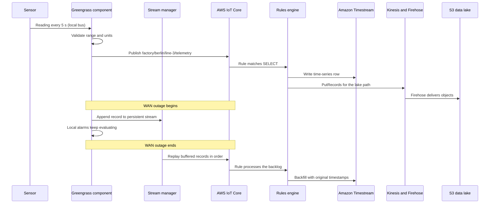
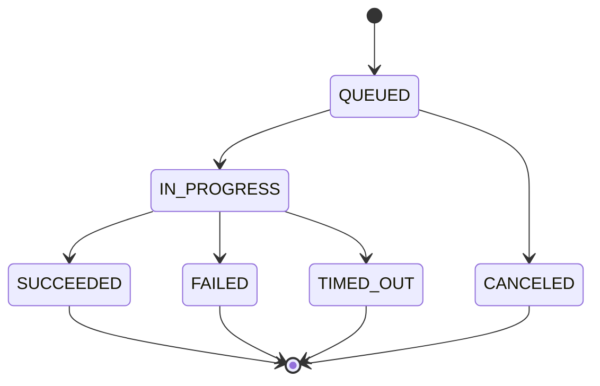

# 09 · Project: Industrial IoT

> **Phase 7 — Edge and IoT** · Lesson 09 of 09
> ⬅️ Previous: [Hybrid Cloud Patterns](./08-hybrid-cloud-patterns.md) · ➡️ Next: [Phase 8 — Industry Architectures](../phase-8-industry-architectures/README.md) · 🏠 [Phase overview](./README.md)

## 🎯 Learning Objectives

By the end of this capstone you will have:

- Built an end-to-end industrial telemetry pipeline from sensors to a QuickSight dashboard
- Run AWS IoT Greengrass v2 on a plant gateway so telemetry survives a WAN outage
- Routed data with the IoT rules engine into Amazon Timestream and Amazon Kinesis Data Streams
- Landed raw data in an S3 data lake that Athena can query and QuickSight can visualize
- Enabled AWS IoT Device Defender ML anomaly detection with an actionable mitigation
- Executed a staged OTA firmware rollout with rollout, abort, and timeout configuration
- Documented the architecture, the telemetry sequence, and the failure behavior

**Estimated time:** 4–6 hours · **Difficulty:** Advanced

---

## 🧠 Core Concepts

This project is the phase in one system. Sensors on a factory line speak OPC-UA or Modbus; a gateway runs Greengrass v2 for local processing, alarm evaluation, and buffering; telemetry flows to AWS IoT Core; the rules engine fans it out to a hot time-series store (Timestream) and to a stream (Kinesis) that lands durably in S3; Athena and QuickSight turn the lake into dashboards; Device Defender watches for devices behaving outside their profile; and IoT Jobs roll out firmware without a technician on the line.

The engineering discipline is deciding **what runs where**. Collection, alarm evaluation, and safety interlocks must survive a network outage, so they belong on the gateway with the stream manager holding records on local disk. Anything that must be queryable within seconds belongs on the rules-engine hot path into Timestream. Anything that must be durable for years belongs in S3 with lifecycle tiering. Anything classified stays on the plant network, and only derived results leave.

The **two-store pattern** is deliberate rather than duplication. Timestream answers "what is the current state of line 3" cheaply and expires data automatically, but it is a poor fit for long-horizon archival analytics where S3 plus Athena costs a fraction. One rules-engine SQL statement writes to both through two actions, matching each query pattern to the engine that serves it best.

**Device Defender with ML detection** replaces thresholds you thought of with anomalies you did not. An ML security profile learns the normal shape of each device's traffic and raises a violation when message size or authorization failures deviate. The second half matters just as much: a **mitigation action** such as deactivating a suspect certificate cuts a rogue device off the broker in one call, and a violation nobody acts on is decoration.

**OTA for a fleet is a rollout problem, not a download problem.** Lesson 03 covered the download mechanics; this project adds the operational controls — target a thing group, cap the rate with `maximumPerMinute`, abort automatically once the failure percentage crosses a threshold after a minimum sample, and set an in-progress timeout so a hung device is marked `TIMED_OUT` instead of stalling the rollout.

### Deliverables

| # | Deliverable | Evidence |
|---|-------------|----------|
| 1 | Architecture and sequence diagrams | Markdown that renders on GitHub |
| 2 | Thing type, thing group, provisioning template | `describe-thing-group` plus the template JSON |
| 3 | Greengrass component with local buffering | Recipe YAML and a demonstrated outage |
| 4 | Rules engine writing to Timestream and Kinesis | `get-topic-rule` output and queryable rows |
| 5 | S3 data lake with tiering and an Athena query | Lifecycle config plus a successful execution |
| 6 | QuickSight dataset and dashboard | Dataset ARN and a rendered dashboard |
| 7 | Device Defender ML profile plus mitigation | Profile JSON, a violation, a mitigation task |
| 8 | Staged OTA rollout | Job document, rollout and abort config, execution summary |

---

## 🗺️ Architecture Diagram

The complete platform, from the plant floor to the dashboard:

```mermaid
flowchart LR
    subgraph plant["Factory floor"]
        plcs["PLCs and sensors (OPC-UA / Modbus)"]
        gw["Plant gateway"]
    end
    subgraph edge["Greengrass v2 on the gateway"]
        ingest["Component: ingest and validate"]
        alum["Component: local alarms"]
        stream["Stream manager (disk buffer)"]
    end
    subgraph iot["AWS IoT Core"]
        broker["MQTT broker (8883)"]
        rules["Rules engine (SQL)"]
    end
    subgraph hot["Hot path"]
        ts[("Amazon Timestream")]
        sns["Amazon SNS alerts"]
    end
    subgraph lake["Data lake path"]
        kds["Amazon Kinesis Data Streams"]
        fh["Amazon Data Firehose"]
        s3raw[("Amazon S3 raw")]
        athena["Amazon Athena"]
        qs["Amazon QuickSight"]
    end
    subgraph sec["Security and operations"]
        dd["Device Defender (ML)"]
        jobs["AWS IoT Jobs + OTA"]
    end
    plcs --> ingest
    ingest --> alum
    ingest --> stream
    ingest -->|"publish telemetry"| broker
    stream -->|"buffered replay after outage"| broker
    broker --> rules
    rules --> ts
    rules --> kds
    rules --> sns
    kds --> fh
    fh --> s3raw
    s3raw --> athena
    athena --> qs
    s3raw -->|"lifecycle to Glacier"| glacier[("Amazon S3 Glacier tier")]
    dd -->|"security metrics"| broker
    dd -->|"violation drives mitigation"| jobs
    jobs -->|"deployments and firmware"| gw
```



The telemetry sequence, including what happens when the uplink dies mid-shift:



The rollout states you will read from `list-job-executions-for-job`:



---

## 🧪 Hands-on Lab: Build the Platform

**Goal:** Stand up the full pipeline and prove it works under two failure conditions — a WAN outage and a rogue device.

**Prerequisites:** Permissions for IoT, Greengrass, Timestream, Kinesis, Firehose, S3, Glue, Athena, QuickSight, SNS, and IAM. A Linux gateway host with 4 GB RAM and Java 11+ (or an EC2 instance standing in for the plant gateway). QuickSight enabled in the account.

### Step 1 — Things, groups, and fleet provisioning

```bash
export AWS_REGION=eu-west-1
export ACCOUNT_ID=$(aws sts get-caller-identity --query Account --output text)
export BUCKET=iot-factory-raw-eu-west-1

aws iot create-thing-type --thing-type-name FactorySensor-v1
aws iot create-thing-group --thing-group-name factory-sensors
aws iot create-thing-group --thing-group-name factory-gateways
aws iot create-thing --thing-name sensor-berlin-3-0001 --thing-type-name FactorySensor-v1
aws iot add-thing-to-thing-group --thing-name sensor-berlin-3-0001 --thing-group-name factory-sensors

# Reuse the least-privilege policy from Lesson 01, then onboard devices at scale
aws iot create-provisioning-template \
  --template-name factory-sensor-template \
  --template-body file://provisioning-template.json \
  --provisioning-role-arn arn:aws:iam::$ACCOUNT_ID:role/IoTProvisioningRole \
  --enabled
```

```json
{
  "Parameters": {
    "ThingName": { "Type": "String" },
    "Site": { "Type": "String" },
    "Line": { "Type": "String" }
  },
  "Resources": {
    "thing": {
      "Type": "AWS::IoT::Thing",
      "Properties": {
        "ThingName": { "Ref": "ThingName" },
        "ThingTypeName": "FactorySensor-v1",
        "AttributePayload": { "site": { "Ref": "Site" }, "line": { "Ref": "Line" } }
      }
    },
    "certificate": { "Type": "AWS::IoT::Certificate", "Properties": { "Status": "ACTIVE" } },
    "policy": { "Type": "AWS::IoT::Policy", "Properties": { "PolicyName": "FactorySensorTelemetryPolicy" } }
  }
}
```

### Step 2 — Local processing and buffering on the gateway

```yaml
---
RecipeFormatVersion: "2020-01-25"
ComponentName: com.factory.TelemetryIngest
ComponentVersion: "1.0.0"
ComponentConfiguration:
  DefaultConfiguration:
    site: "berlin"
    line: "3"
    sampleIntervalSec: 5
    streamName: "factory-telemetry"
ComponentDependencies:
  aws.greengrass.StreamManager:
    VersionRequirement: "^2.0.0"
    DependencyType: HARD
  aws.greengrass.ShadowManager:
    VersionRequirement: "^2.0.0"
    DependencyType: HARD
Manifests:
  - Platform:
      os: linux
    Artifacts:
      - URI: "s3://iot-components-eu-west-1/com.factory.TelemetryIngest/1.0.0/ingest.py"
        Unarchive: NONE
    Lifecycle:
      Install: "chmod +x {artifacts:decompressedPath}/ingest.py"
      Run: "python3 -u {artifacts:decompressedPath}/ingest.py --site {configuration:/site} --line {configuration:/line} --interval {configuration:/sampleIntervalSec} --stream {configuration:/streamName}"
```

```bash
aws s3 cp ingest.py s3://iot-components-eu-west-1/com.factory.TelemetryIngest/1.0.0/ingest.py
aws greengrassv2 create-component-version --inline-recipe file://com.factory.TelemetryIngest.recipe.yaml

# Roll out to the gateway class with automatic rollback and a rate limit
aws greengrassv2 create-deployment \
  --target-arn "arn:aws:iot:$AWS_REGION:$ACCOUNT_ID:thinggroup/factory-gateways" \
  --deployment-name telemetry-ingest-v1 \
  --components '{"com.factory.TelemetryIngest":{"componentVersion":"1.0.0"}}' \
  --deployment-policies '{"failureHandlingPolicy":"ROLLBACK","componentUpdatePolicy":{"timeoutInSeconds":120,"action":"NOTIFY_COMPONENTS"}}' \
  --iot-job-configuration '{"jobExecutionsRolloutConfig":{"maximumPerMinute":4},"abortConfig":{"criteriaList":[{"failureType":"FAILED","action":"ROLLBACK","thresholdPercentage":20,"minNumberOfExecutedThings":3}]}}'
```

### Step 3 — Hot path and lake path in one rule

```bash
aws s3api create-bucket --bucket $BUCKET --region $AWS_REGION \
  --create-bucket-configuration LocationConstraint=$AWS_REGION

# Tier raw telemetry aggressively; most of it is never read again
aws s3api put-bucket-lifecycle-configuration --bucket $BUCKET \
  --lifecycle-configuration '{"Rules":[{"ID":"tier-raw","Status":"Enabled","Filter":{"Prefix":"raw/"},"Transitions":[{"Days":30,"StorageClass":"STANDARD_IA"},{"Days":365,"StorageClass":"GLACIER"}]}]}'

aws kinesis create-stream --stream-name factory-telemetry --shard-count 2
```

```json
{
  "sql": "SELECT thingName AS device, topic(3) AS site, temperature, vibration, timestamp() AS ts FROM 'factory/+/line-+/+/telemetry' WHERE temperature IS NOT NULL",
  "ruleDisabled": false,
  "awsIotSqlVersion": "2016-03-23",
  "actions": [
    {
      "timestream": {
        "roleArn": "arn:aws:iam::123456789012:role/IoTToTimestreamRole",
        "databaseName": "iotfactory",
        "tableName": "telemetry",
        "dimensions": [{ "name": "device", "value": "${device}" }],
        "timestamp": { "value": "${ts}", "unit": "MILLISECONDS" }
      }
    },
    {
      "kinesis": {
        "roleArn": "arn:aws:iam::123456789012:role/IoTToKinesisRole",
        "streamName": "factory-telemetry",
        "partitionKey": "${device}"
      }
    }
  ],
  "errorAction": {
    "sns": {
      "roleArn": "arn:aws:iam::123456789012:role/IoTErrorActionRole",
      "targetArn": "arn:aws:sns:eu-west-1:123456789012:iot-rule-errors"
    }
  }
}
```

```bash
aws iot create-topic-rule --rule-name FactoryTelemetryFanout --topic-rule-payload file://fanout-rule.json

aws firehose create-delivery-stream \
  --delivery-stream-name factory-telemetry-to-s3 \
  --delivery-stream-type KinesisStreamAsSource \
  --kinesis-stream-source-configuration '{"KinesisStreamARN":"arn:aws:kinesis:eu-west-1:123456789012:stream/factory-telemetry","RoleARN":"arn:aws:iam::123456789012:role/FirehoseSourceRole"}' \
  --extended-s3-destination-configuration '{"RoleARN":"arn:aws:iam::123456789012:role/FirehoseS3Role","BucketARN":"arn:aws:s3:::iot-factory-raw-eu-west-1","Prefix":"raw/","BufferingHints":{"IntervalInSeconds":300,"SizeInMBs":5},"CompressionFormat":"GZIP"}'
```

### Step 4 — Make the lake queryable and visualizable

```bash
aws glue create-database --database-input '{"Name":"iotfactory"}'
aws glue create-crawler --name factory-raw-crawler --role arn:aws:iam::123456789012:role/GlueCrawlerRole \
  --database-name iotfactory --targets '{"S3Targets":[{"Path":"s3://iot-factory-raw-eu-west-1/raw/"}]}'
aws glue start-crawler --name factory-raw-crawler

aws athena start-query-execution \
  --query-string "SELECT device, max(temperature) AS peak_c, count(*) AS readings FROM iotfactory.raw GROUP BY device ORDER BY peak_c DESC LIMIT 20" \
  --query-execution-context Database=iotfactory \
  --result-configuration OutputLocation=s3://iot-factory-raw-eu-west-1/athena-results/

aws quicksight create-data-source --aws-account-id $ACCOUNT_ID --data-source-id factory-athena \
  --name "Factory Athena" --type ATHENA --data-source-parameters '{"AthenaParameters":{"WorkGroup":"primary"}}'

aws quicksight create-data-set --aws-account-id $ACCOUNT_ID --data-set-id factory-telemetry-ds \
  --name "Factory Telemetry" --import-mode SPICE \
  --physical-table-map '{"raw":{"RelationalTable":{"DataSourceArn":"arn:aws:quicksight:eu-west-1:123456789012:datasource/factory-athena","Catalog":"AwsDataCatalog","Schema":"iotfactory","Name":"raw","InputColumns":[{"Name":"device","Type":"STRING"},{"Name":"temperature","Type":"DECIMAL"}]}}}'
```

### Step 5 — Detect abnormal behavior and act on it

```json
{
  "name": "factory-threat-profile",
  "mlDetectionConfig": { "confidenceLevel": "MEDIUM" },
  "behaviors": [
    {
      "name": "AuthorizationFailures",
      "metric": "aws:num-authorization-failures",
      "criteria": {
        "comparisonOperator": "greater-than",
        "value": { "count": 5 },
        "durationSeconds": 300,
        "consecutiveDatapointsToAlarm": 1,
        "consecutiveDatapointsToClear": 1
      }
    }
  ]
}
```

```bash
aws iot create-security-profile --security-profile-name factory-threat-profile \
  --security-profile-description "ML plus fixed thresholds for the sensor fleet" \
  --behaviors file://security-profile.json

aws iot attach-security-profile --security-profile-name factory-threat-profile \
  --security-profile-target-arn "arn:aws:iot:$AWS_REGION:$ACCOUNT_ID:all/things"

# A reusable response: deactivate the certificate of a suspect device
aws iot create-mitigation-action --action-name QuarantineDevice \
  --role-arn arn:aws:iam::$ACCOUNT_ID:role/IoTMitigationRole \
  --action-params '{"updateDeviceCertificateParams":{"action":"DEACTIVATE"}}'
```

### Step 6 — Stage the OTA rollout

```bash
aws iot create-stream --stream-id firmware-1-5-0 \
  --files fileId=0,s3Location={bucket=iot-firmware-eu-west-1,key=signed/app-1.5.0.bin,version=signedVersionId} \
  --role-arn arn:aws:iam::$ACCOUNT_ID:role/IoTFirmwareStreamRole

# Canary first, then a rate-limited production rollout with an automatic abort
aws iot create-ota-update --ota-update-id firmware-1-5-0 \
  --targets "arn:aws:iot:$AWS_REGION:$ACCOUNT_ID:thinggroup/factory-sensors-canary" \
  --protocols MQTT --target-selection-config '{"continueOnFailure":false}' \
  --files file://ota-files.json --role-arn arn:aws:iam::$ACCOUNT_ID:role/IoTOTAUpdateRole

aws iot create-job --job-id ota-1-5-0-controlled \
  --targets "arn:aws:iot:$AWS_REGION:$ACCOUNT_ID:thinggroup/factory-sensors" \
  --document file://job-document.json \
  --job-executions-rollout-config '{"maximumPerMinute":5}' \
  --abort-config '{"criteriaList":[{"failureType":"FAILED","action":"CANCEL","thresholdPercentage":10,"minNumberOfExecutedThings":5}]}' \
  --timeout-config '{"inProgressTimeoutInMinutes":60}'
```

### Step 7 — Verify, then break things on purpose

```bash
# Data plane: both stores receive telemetry
aws timestream-query query \
  --query-string "SELECT device, count(*) AS n FROM iotfactory.telemetry WHERE time > ago(1h) GROUP BY device ORDER BY n DESC LIMIT 10"
aws s3 ls s3://iot-factory-raw-eu-west-1/raw/ --recursive | head

# Control plane: deployments and job executions
aws greengrassv2 list-deployments --target-arn "arn:aws:iot:$AWS_REGION:$ACCOUNT_ID:thinggroup/factory-gateways" \
  --query 'deployments[].{name:deploymentName,status:deploymentStatus}'
aws iot list-job-executions-for-job --job-id ota-1-5-0-controlled \
  --query 'executionSummaries[].{device:thingArn,status:executionSummary.status}'

# Security plane: violations and available mitigations
aws iot list-active-violations --query 'activeViolations[].{thing:thingName,behavior:behavior.name}'
```

**Drill 1 — WAN outage.** Cut the gateway uplink for 15 minutes (security group or route change). Expected: the component stays `RUNNING`, the stream manager holds records on disk, local alarms keep evaluating, and Timestream and Kinesis catch up afterwards with the original timestamps preserved. Inspect with `greengrass-cli component list` and `tail -f /greengrass/v2/logs/com.factory.TelemetryIngest.log`.

**Drill 2 — rogue device.** Publish oversized or repetitive traffic from one thing, then respond to the violation and confirm the device is locked out.

```bash
aws iot list-active-violations
aws iot start-detect-mitigation-actions-task \
  --task-id quarantine-drill \
  --target '{"violationIds":["<violation-id-from-the-previous-output>"]}' \
  --actions QuarantineDevice

# Must now be INACTIVE, and the device can no longer connect
aws iot describe-certificate --certificate-id <certificate-id> --query 'certificateDescription.status'
```

Success looks like: dashboards updating from a real pipeline, an outage that costs no data, a violation that produces a documented mitigation, and a rollout that either reaches `SUCCEEDED` or aborts for a reason you can name from the job output.

---

## 💻 CLI Reference

```bash
# Fleet inventory and edge state
aws iot list-things-in-thing-group --thing-group-name factory-sensors
aws greengrassv2 list-installed-components --core-device-thing-name gg-gateway-001

# Hot-path and lake-path queries
aws timestream-query query --query-string "SELECT avg(temperature) FROM iotfactory.telemetry WHERE time > ago(6h)"
aws athena start-query-execution --query-string "SELECT device, avg(temperature) FROM iotfactory.raw GROUP BY device" \
  --query-execution-context Database=iotfactory \
  --result-configuration OutputLocation=s3://iot-factory-raw-eu-west-1/athena-results/

# Rollouts and emergency stops
aws iot list-job-executions-for-job --job-id ota-1-5-0-controlled
aws iot cancel-job --job-id ota-1-5-0-controlled --force true
```

| Command | Purpose |
|---------|---------|
| `iot list-active-violations` | Fleet security posture in one view |
| `iot start-detect-mitigation-actions-task` | Applies a response instead of just listing findings |
| `greengrassv2 list-installed-components` | Confirms what is actually running on a gateway |
| `timestream-query query` | Answers operational questions on the hot path |
| `athena start-query-execution` | Answers long-horizon questions on the lake path |
| `iot cancel-job --force true` | Stops a firmware rollout that is going badly |

---

## ✅ Best Practices

| Practice | Why it matters |
|----------|----------------|
| Preserve original timestamps on replay | Backfilled data carrying replay time destroys trend analysis |
| Alarm locally as well as in the cloud | The cloud cannot raise an alarm while the WAN is down |
| Write to a hot store and a lake deliberately | Match the engine to the query pattern instead of forcing one to do both |
| Enable ML detection and a mitigation together | Detection without response is a dashboard nobody watches |
| Always rate-limit and abort OTA rollouts | A partly broken fleet with no automatic stop is the worst outcome |
| Alert on rule `errorAction` from day one | Silent rule failures lose data without failing loudly |
| Apply lifecycle policy to raw telemetry immediately | Object storage grows silently and forever |

---

## ⚠️ Common Pitfalls

| Pitfall | Symptom | Fix |
|---------|---------|-----|
| Stream manager without disk persistence | Outage loses records despite buffering being "on" | Configure persistent storage with enough size and test the outage |
| Missing `iam:PassRole` on rule roles | Rule creation fails, or the rule silently cannot write | Grant `PassRole` for every action role at creation time |
| Timestream rejecting malformed records | Row gaps while the rule looks healthy | Validate dimensions and timestamp units; watch the error action |
| Firehose delivery gaps | Objects in S3 with missing records | Check the Firehose error prefix and the stream's shard iterators |
| Crawler creating a partition per object prefix | Query cost explodes | Partition the raw prefix by date and schedule the crawler |
| QuickSight SPICE refresh forgotten | Dashboard showing yesterday's plant | Schedule refreshes and monitor dataset refresh history |
| Security profile enabled too broadly at first | Violation noise you do not care about | Start on one thing group, then widen |
| Unsigned image referenced by the job document | Devices reject the update in the field | Sign, then verify per-device execution results |

---

## 💰 Cost Considerations

| Component | What drives cost | Sizing habit |
|-----------|------------------|--------------|
| AWS IoT Core | Messages, 5 KB blocks, connection minutes | Aggregate on the gateway: one summarized message per minute beats 60 raw ones |
| Amazon Timestream | Writes and the memory store window | Size memory store to the dashboard horizon; magnetic store is far cheaper |
| Kinesis and Firehose | Shard hours and per-GB delivery | One shard per ~1 MB/s of ingest; buffer 300 s to cut object count |
| S3 and Athena | Storage class and bytes scanned per query | Partition by date, compress, never scan the whole prefix |
| Greengrass and QuickSight | No Greengrass software fee; QuickSight per author or reader | Prefer local processing; keep SPICE refreshes off the critical path |

The highest-leverage lever is **edge aggregation**. Five hundred sensors sampling every five seconds is roughly 260 million raw messages a month; summarizing to one-minute aggregates on the gateway cuts that by a factor of twelve while preserving the operational signal, and the local component can still retain raw samples on disk for a bounded investigation window. Combined with lifecycle tiering in S3 and a right-sized Timestream memory store, a well-designed version of this platform costs a small fraction of one that publishes everything and stores it all in the hottest tier forever. Model the message count before connecting the first device — it is the single number that predicts the bill.

---

## 🔐 Security Considerations

- **Per-device identity, always.** Every sensor and gateway has its own certificate and a policy scoped by thing name. Shared credentials in a factory are a breach waiting to be discovered.
- **Gateway credentials are high value.** The core device certificate can obtain AWS credentials through the token exchange service and receive deployments; scope that role to the exact streams, buckets, and rules the plant needs.
- **Segregate the plant network.** Sensors reach the local broker, not the internet; egress goes through the gateway on the narrowest possible path.
- **Least privilege on every rules-engine role.** `IoTToTimestreamRole` writes to one table, `IoTToKinesisRole` to one stream — anything wider is a lateral-movement path from a compromised device.
- **Encrypt at rest and in transit.** TLS on the wire, SSE-KMS on the lake, a customer-managed key on the Timestream table, and full-disk encryption on the gateway's local buffer.
- **Turn on every audit surface.** Broker logging for denied connects, CloudTrail for registry and job changes, Device Defender for behavior, VPC Flow Logs for anything crossing a VPC.
- **Treat OTA as a privileged operation.** Signing keys live in AWS Signer or a KMS-backed HSM, never in CI variables, and devices verify signatures before writing to the boot bank.
- **Have a revocation runbook.** Detecting a rogue device is half the job; the runbook must say who can deactivate a certificate, how the line keeps running, and how a replacement is provisioned.

---

## 🧩 Exercise

Extend the platform in two directions and document both.

First, add a **local inference component**: deploy a compiled model through Greengrass (TensorFlow Lite, ONNX Runtime, or SageMaker Edge Manager) that classifies vibration data on the gateway and publishes only the classification plus a confidence score. Measure the message reduction and state the cost impact.

Second, add a **second plant in a different Region**. Decide what is global (thing naming, security profile, OTA pipeline) and what is Regional (Timestream, Kinesis, S3, dashboards), then describe how one operations team watches both. Address cross-Region DNS and whether you would use a single account or per-Region accounts.

Success looks like: documented reductions in message volume and cost, one diagram showing both plants, and an explicit statement of what breaks if the second Region becomes unavailable.

---

## 📚 Resources

- [AWS IoT Core Developer Guide](https://docs.aws.amazon.com/iot/latest/developerguide/what-is-aws-iot.html)
- [AWS IoT Greengrass V2 Developer Guide](https://docs.aws.amazon.com/greengrass/v2/developerguide/what-is-iot-greengrass.html)
- [AWS IoT Device Defender](https://docs.aws.amazon.com/iot/latest/developerguide/device-defender.html)
- [AWS IoT Device Defender ML Detect](https://docs.aws.amazon.com/iot/latest/developerguide/device-defender-ml-detect.html)
- [AWS IoT Jobs and Over-the-Air Updates](https://docs.aws.amazon.com/iot/latest/developerguide/iot-jobs.html)
- [Amazon Timestream Developer Guide](https://docs.aws.amazon.com/timestream/latest/developerguide/what-is-timestream.html)
- [Amazon Data Firehose](https://docs.aws.amazon.com/firehose/latest/dev/what-is-this-service.html)
- [Amazon Athena User Guide](https://docs.aws.amazon.com/athena/latest/ug/what-is.html)
- [Amazon QuickSight User Guide](https://docs.aws.amazon.com/quicksight/latest/user/welcome.html)

---

## ➡️ Next Steps

You have finished Phase 7. You can connect a device fleet with per-device identity, run processing where the network cannot reach, size a physical or online transfer correctly, place AWS capacity in your own data center, a metro, or a carrier network, and make hybrid DNS, storage, and identity hold together. That is the full toolkit for computing outside the Region — and it is what Phase 8 assumes you already have, whether the workload is a payment terminal, a hospital imaging device, a game backend, or a live video pipeline.

> ⬅️ Previous: [Hybrid Cloud Patterns](./08-hybrid-cloud-patterns.md) · ➡️ Next: [Phase 8 — Industry Architectures](../phase-8-industry-architectures/README.md) · 🏠 [Phase overview](./README.md)
