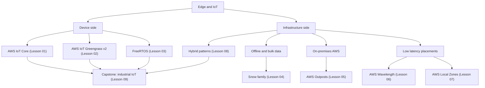

# Phase 7 — Edge and IoT

Every phase so far assumed your workloads live inside an AWS Region. This phase breaks that assumption. Here you connect physical devices, factory floors, retail stores, remote offices, and even customer premises to AWS — and you learn that the hard problems at the edge are not compute problems, they are *constraint* problems: intermittent connectivity, tiny memory budgets, certificates that must live on a chip, and millisecond latency budgets you cannot fix by adding another Availability Zone. Phase 7 comes after Security and Governance on purpose: an unmanaged fleet of devices with long-lived credentials is the single fastest way to lose an organization you just spent a phase hardening.

The phase has two halves. The first half (Lessons 01–03) is device-side: AWS IoT Core as the managed message broker and registry, AWS IoT Greengrass v2 as the on-premises runtime that keeps processing alive when the network dies, and FreeRTOS as the operating system embedded in microcontrollers where a 512 KB flash budget is normal. The second half (Lessons 04–08) is infrastructure-side: moving petabytes with the Snow family, running real EC2 and S3 inside your own data center with Outposts, pushing compute into carrier 5G networks with Wavelength, and putting AWS a few milliseconds from a metro population with Local Zones. The capstone stitches both halves together into an industrial telemetry platform.

## Phase Goals

- Register, authenticate, and manage device fleets with AWS IoT Core using X.509 mutual TLS — never shared credentials
- Run edge processing, local ML inference, and buffered store-and-forward with AWS IoT Greengrass v2
- Reason about microcontroller constraints and ship over-the-air firmware updates to a FreeRTOS fleet
- Choose the right data transfer method for a given dataset size, bandwidth, and deadline
- Extend VPCs, EC2, EBS, and S3 into on-premises data centers with AWS Outposts
- Place compute inside a 5G carrier network (Wavelength) or a metro area (Local Zones) and know which to pick
- Design a hybrid architecture with working DNS, routing, identity, and storage integration
- Build a complete industrial IoT pipeline as the phase capstone

## Phase Map

The map is the mental model for the phase: **things and runtimes** are the left branch, **placements and transport** are the right branch, and the capstone requires a working design from each side.

## Lessons in this Phase

| # | Lesson | Focus | Difficulty |
|---|--------|-------|------------|
| 01 | [AWS IoT Core](./01-aws-iot-core.md) | Thing registry, device shadows, MQTT, X.509 mutual TLS, IoT policies, rules engine, jobs, Device Defender, fleet provisioning | Intermediate |
| 02 | [AWS IoT Greengrass](./02-aws-iot-greengrass.md) | Greengrass v2 components, recipes, deployments, local Lambda, stream manager, offline operation, edge ML inference | Intermediate |
| 03 | [FreeRTOS](./03-freertos.md) | Kernel, AWS IoT Device SDK for Embedded C, coreMQTT and coreHTTP, OTA updates, demo boards, memory footprint | Advanced |
| 04 | [Amazon Snow Family](./04-aws-snow-family.md) | Snowcone, Snowball Edge Storage and Compute Optimized, Snowmobile, Data Transfer Hub, migration workflow | Beginner |
| 05 | [AWS Outposts](./05-aws-outposts.md) | Racks and servers, local EC2/EBS/S3, service link and local gateway, shared responsibility, cost | Advanced |
| 06 | [AWS Wavelength](./06-aws-wavelength.md) | 5G edge compute, Wavelength Zones, carrier gateway, sub-10 ms use cases, VPC extension, pricing | Advanced |
| 07 | [AWS Local Zones](./07-aws-local-zones.md) | Local Zones vs Wavelength vs Outposts, parent Region, opt-in, media and gaming use cases | Intermediate |
| 08 | [Hybrid Cloud Patterns](./08-hybrid-cloud-patterns.md) | Storage Gateway, DataSync, VPN vs Direct Connect, hybrid DNS with Route 53 Resolver, IAM for hybrid | Advanced |
| 09 | [Project: Industrial IoT](./09-project-industrial-iot.md) | Capstone — sensors to Greengrass to IoT Core to Timestream and S3 to QuickSight, Device Defender, OTA fleet updates | Advanced |

## Capstone Project

**Industrial IoT Telemetry Platform** — instrument a factory with sensors, run AWS IoT Greengrass v2 on the plant gateway so telemetry survives a WAN outage, stream to AWS IoT Core, route through the rules engine into Amazon Timestream and Amazon Kinesis, land raw data in an S3 data lake queryable by Athena, and visualize it in QuickSight. Then harden it: a Device Defender security profile with ML anomaly detection, and an OTA firmware rollout to the whole fleet using staged IoT jobs.

Deliverables:

- An end-to-end architecture diagram and a telemetry sequence diagram
- A thing type, thing group, and provisioning template that onboards a device without manual certificate copying
- A Greengrass v2 component and deployment that buffers telemetry locally when the uplink is cut
- Rules engine SQL routes into Timestream and Kinesis (with an error action, not just a happy path)
- An S3 data lake with lifecycle tiering plus an Athena query over the raw data
- A Device Defender security profile, a violation observed in a lab, and a mitigation action
- An OTA job document with rollout and abort configuration, executed against a thing group

Full instructions are in [Lesson 09](./09-project-industrial-iot.md).

## Phase Checklist

- [ ] I can provision a device with a unique certificate and a least-privilege IoT policy, and prove which topics it can and cannot publish to
- [ ] I can explain the difference between a device shadow, a Greengrass local shadow, and a rules engine destination
- [ ] I know why a Greengrass component still processes data when the internet is down, and what changes when it reconnects
- [ ] I can estimate the flash and RAM cost of adding TLS plus MQTT to a microcontroller
- [ ] I can decide between DataSync, S3 Transfer Acceleration, Snowcone, and Snowball for a given dataset
- [ ] I know when an Outposts rack is justified over a Local Zone or a plain Region deployment
- [ ] I can describe the DNS path that lets an on-premises server resolve a private Route 53 zone and vice versa
- [ ] The capstone pipeline renders as a diagram, and every hop in it is something I built

## Phase Resources

- [AWS IoT Core Developer Guide](https://docs.aws.amazon.com/iot/latest/developerguide/what-is-aws-iot.html)
- [AWS IoT Greengrass V2 Developer Guide](https://docs.aws.amazon.com/greengrass/v2/developerguide/what-is-iot-greengrass.html)
- [AWS IoT Device SDK for Embedded C](https://github.com/aws/aws-iot-device-sdk-embedded-C)
- [FreeRTOS — AWS IoT Libraries and Demos](https://www.freertos.org/iot-freertos/index.html)
- [AWS Snow Family Documentation](https://docs.aws.amazon.com/snowball/)
- [AWS Outposts User Guide](https://docs.aws.amazon.com/outposts/latest/userguide/what-is-outposts.html)
- [AWS Wavelength Documentation](https://docs.aws.amazon.com/wavelength/latest/developerguide/what-is-wavelength.html)
- [AWS Local Zones](https://docs.aws.amazon.com/local-zones/latest/ug/what-is-aws-local-zones.html)
- [AWS Storage Gateway User Guide](https://docs.aws.amazon.com/storagegateway/latest/userguide/WhatIsStorageGateway.html)
- [AWS DataSync User Guide](https://docs.aws.amazon.com/datasync/latest/userguide/what-is-datasync.html)
- [Hybrid Cloud DNS — Route 53 Resolver](https://docs.aws.amazon.com/Route53/latest/DeveloperGuide/resolver.html)
- [AWS Prescriptive Guidance — Hybrid Cloud Architectures](https://docs.aws.amazon.com/prescriptive-guidance/latest/hybrid-cloud-architectures/welcome.html)

## Next Phase

With device fleets connected and AWS placed wherever the workload demands it, you have all the primitives the roadmap needs. Phase 8 stops introducing new infrastructure and starts applying everything to whole industries — payments, patient records, game backends, live media, and government-grade isolation.

[Phase 8 — Industry Architectures](../phase-8-industry-architectures/README.md)
