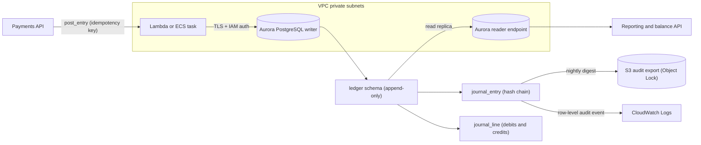
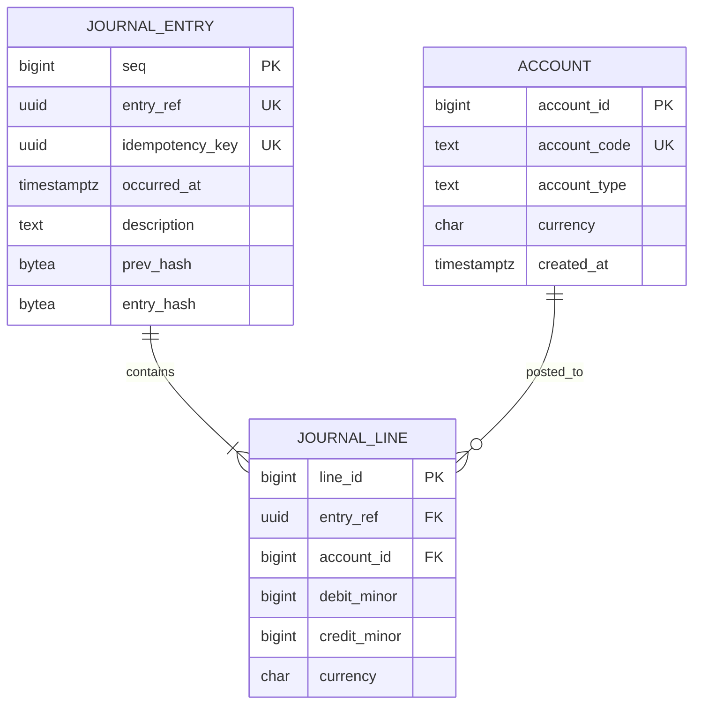
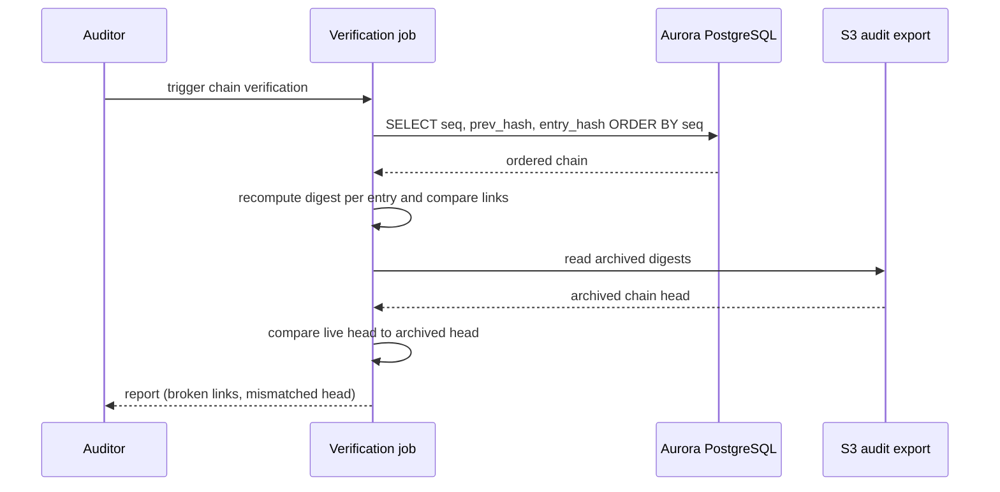

# 01 · Fintech Ledger Databases

> **Phase 8 — Industry Architectures** · Lesson 01 of 08
> ⬅️ Previous: [Roadmap home](../README.md) · ➡️ Next: [Fraud Detection Pipelines](./02-fraud-detection-pipelines.md) · 🏠 [Phase overview](./README.md)

## 🎯 Learning Objectives

By the end of this lesson you will be able to:

- Explain why a financial ledger is modelled as an append-only, hash-chained log rather than an updatable balance table
- Design a double-entry accounting schema with enforced balance invariants and minor-unit money types
- Implement a tamper-evident hash chain on Aurora PostgreSQL, including immutability triggers and a chain verification function
- Explain why Amazon QLDB can no longer be chosen for new workloads and which patterns replace it
- Build a change-audit trail for DynamoDB-backed balances using DynamoDB Streams and point-in-time recovery

**Estimated time:** 75 min · **Difficulty:** Advanced

---

## 🧠 Core Concepts

A ledger is not a table of balances. It is a **log of facts** that were true at a point in time, with balances derived from that log. The distinction is not academic: if you `UPDATE accounts SET balance = balance - 100`, you have destroyed the previous state, and there is no way to prove after the fact that the change was legitimate. A ledger instead appends an entry that says "on this date, 100 units moved from account A to account B", and the balance is a `SUM` over the entries. Corrections are new, opposite entries — never edits.

**Double-entry** accounting is the oldest integrity mechanism in finance and it is still the most effective. Every transaction is recorded as a set of lines whose total debits equal total credits. A bug in a transfer routine that "loses" money cannot balance the entry, so the transaction fails at commit time instead of corrupting the books silently. Enforce this in the database, not just in application code.

**Hash chaining** turns a log into tamper-evident evidence. Each entry stores a cryptographic digest of its own contents plus the digest of the previous entry, so the chain is `h(n) = H(h(n-1) || canonical(n))`. Changing any historical row breaks that row's digest, and because the next row committed the old digest, every subsequent link fails verification too. Recomputing the whole chain is the only way to hide an edit, and that requires write access to production data you should not have.

### ⚠️ Amazon QLDB is retired — plan around it

Amazon QLDB (Quantum Ledger Database) **reached end of support on 31 July 2025**. Existing ledgers were made read-only before that date, and the service **cannot be used for new workloads**. If you are following an older tutorial that starts with "create a QLDB ledger", that path is closed. AWS guidance points to building the same guarantees on general-purpose managed databases:

| QLDB capability | Current recommended replacement |
|-----------------|--------------------------------|
| Immutable journal | Aurora PostgreSQL append-only tables with a `BEFORE UPDATE OR DELETE` trigger that raises an exception |
| Cryptographic verification | `pgcrypto` `digest()` hash chain over canonical row contents, verified by a scheduled job |
| Document revisions | DynamoDB Streams with `NEW_AND_OLD_IMAGES`, landed into an immutable S3 prefix or audit table |
| Historical queries | Aurora PostgreSQL with temporal tables (system-versioned by trigger) or a read replica of the append-only journal |
| Ledger export | `aws rds start-export-task` to S3 in Parquet, retained under Object Lock |

The migration is real work, not a drop-in substitute. The advantage is that you keep the guarantees where you can also control the query engine, the storage cost, and the operational maturity of PostgreSQL.

### Key terminology

| Term | Meaning |
|------|---------|
| **Journal entry** | One atomic accounting event; owns two or more lines that balance to zero |
| **Line** | A debit or credit against one account for one entry |
| **Minor units** | Money stored as an integer in the smallest denomination (cents, pence, satoshi) — never a float |
| **Hash chain** | Each record commits to the previous record's hash, making history tamper-evident |
| **Idempotency key** | Client-supplied unique key that makes retried writes safe — enforced with a unique constraint |
| **Append-only** | UPDATE and DELETE are rejected by the database, not merely discouraged by convention |
| **Advisory lock** | A PostgreSQL lock you take explicitly (`pg_advisory_xact_lock`) to serialize chain appends |
| **Canonical serialization** | The exact, deterministic byte form of a record that the digest is computed over |

---

## 🗺️ Architecture Diagram

The write path for a money movement, from API call to verified chain:



The double-entry data model. Note that money is an integer and every constraint is enforced in the schema:



What verification looks like as a request lifecycle:



---

## 🧪 Hands-on Lab: Build a Verifiable Ledger on Aurora PostgreSQL

**Goal:** Create an append-only double-entry ledger with a SHA-256 hash chain, prove that tampering is detected, and prove that the database refuses edits.

**Prerequisites:** An AWS account, AWS CLI v2 configured, a VPC with private subnets and a security group that allows PostgreSQL (5432) from your bastion or client, and `psql` installed locally.

### Step 1 — Create an Aurora PostgreSQL cluster

Serverless v2 keeps the lab cheap because it scales down when idle. Confirm the current engine version before you run this.

```bash
# Find a supported Aurora PostgreSQL version for your Region
aws rds describe-db-engine-versions \
  --engine aurora-postgresql \
  --query 'DBEngineVersions[?Status==`available`].[EngineVersion]' \
  --output text | tail -5

# Create the writer cluster with IAM database authentication and audit logs shipped to CloudWatch
aws rds create-db-cluster \
  --db-cluster-identifier fintech-ledger \
  --engine aurora-postgresql \
  --engine-version 16.4 \
  --database-name ledgerdb \
  --master-username ledgeradmin \
  --manage-master-user-password \
  --enable-iam-database-authentication \
  --serverless-v2-scaling-configuration MinCapacity=0.5,MaxCapacity=8 \
  --enable-cloudwatch-logs-exports postgresql \
  --vpc-security-group-ids sg-0123456789abcdef0 \
  --backup-retention-period 35 \
  --storage-encrypted \
  --kms-key-id arn:aws:kms:eu-west-1:123456789012:key/11111111-2222-3333-4444-555555555555

# Add one serverless v2 instance to the cluster
aws rds create-db-instance \
  --db-instance-identifier fintech-ledger-1 \
  --db-cluster-identifier fintech-ledger \
  --engine aurora-postgresql \
  --db-instance-class db.serverless

# Wait until the cluster reports available before connecting
aws rds wait db-instance-available --db-instance-identifier fintech-ledger-1

# Capture the writer endpoint
aws rds describe-db-clusters --db-cluster-identifier fintech-ledger \
  --query 'DBClusters[0].[Endpoint,EngineVersion,Status]' --output text
```

### Step 2 — Create the schema

Connect as the master user, then create a dedicated writer role. IAM database authentication is granted with the `rds_iam` role rather than a password.

```bash
# Connect to the writer endpoint
psql "host=fintech-ledger.cluster-abc123.eu-west-1.rds.amazonaws.com port=5432 dbname=ledgerdb user=ledgeradmin sslmode=require"
```

```sql
-- Hashes come from pgcrypto, which Aurora PostgreSQL ships
CREATE EXTENSION IF NOT EXISTS pgcrypto;

CREATE SCHEMA IF NOT EXISTS ledger;

-- Least privilege: the application never logs in as the master user
CREATE ROLE ledger_writer LOGIN;
GRANT rds_iam TO ledger_writer;

CREATE TABLE ledger.account (
    account_id   bigint GENERATED ALWAYS AS IDENTITY PRIMARY KEY,
    account_code text   NOT NULL UNIQUE,
    account_name text   NOT NULL,
    account_type text   NOT NULL CHECK (account_type IN ('ASSET','LIABILITY','EQUITY','REVENUE','EXPENSE')),
    currency     char(3) NOT NULL,
    created_at   timestamptz NOT NULL DEFAULT now()
);

-- The journal is the source of truth. seq gives a total order; entry_ref is the hash identity
CREATE TABLE ledger.journal_entry (
    seq             bigint GENERATED ALWAYS AS IDENTITY PRIMARY KEY,
    entry_ref       uuid   NOT NULL UNIQUE DEFAULT gen_random_uuid(),
    idempotency_key uuid   NOT NULL UNIQUE,
    occurred_at     timestamptz NOT NULL,
    recorded_at     timestamptz NOT NULL DEFAULT now(),
    description     text   NOT NULL,
    prev_hash       bytea,
    entry_hash      bytea  NOT NULL,
    CONSTRAINT entry_hash_is_sha256 CHECK (octet_length(entry_hash) = 32),
    CONSTRAINT prev_hash_is_sha256  CHECK (prev_hash IS NULL OR octet_length(prev_hash) = 32)
);

CREATE TABLE ledger.journal_line (
    line_id     bigint GENERATED ALWAYS AS IDENTITY PRIMARY KEY,
    entry_ref   uuid   NOT NULL REFERENCES ledger.journal_entry(entry_ref),
    account_id  bigint NOT NULL REFERENCES ledger.account(account_id),
    debit_minor bigint NOT NULL DEFAULT 0 CHECK (debit_minor  >= 0),
    credit_minor bigint NOT NULL DEFAULT 0 CHECK (credit_minor >= 0),
    currency    char(3) NOT NULL,
    CONSTRAINT one_side_only CHECK ((debit_minor = 0) <> (credit_minor = 0))
);

-- Balances are a view, never a stored column you mutate
CREATE VIEW ledger.account_balance AS
SELECT a.account_id,
       a.account_code,
       a.currency,
       COALESCE(SUM(l.debit_minor - l.credit_minor), 0) AS balance_minor
  FROM ledger.account a
  LEFT JOIN ledger.journal_line l USING (account_id)
 GROUP BY a.account_id, a.account_code, a.currency;
```

### Step 3 — Make the journal physically append-only

A convention is not a control. Two mechanisms are needed: a trigger that raises on mutation, and revoked privileges so even a careless migration cannot rewrite history.

```sql
-- Any UPDATE or DELETE against the journal aborts the transaction
CREATE OR REPLACE FUNCTION ledger.block_mutation() RETURNS trigger
LANGUAGE plpgsql AS $$
BEGIN
    RAISE EXCEPTION 'ledger is append-only: % on %.% is not permitted',
        TG_OP, TG_TABLE_SCHEMA, TG_TABLE_NAME USING ERRCODE = 'restrict_violation';
END;
$$;

CREATE TRIGGER journal_entry_append_only
    BEFORE UPDATE OR DELETE ON ledger.journal_entry
    FOR EACH ROW EXECUTE FUNCTION ledger.block_mutation();

CREATE TRIGGER journal_line_append_only
    BEFORE UPDATE OR DELETE ON ledger.journal_line
    FOR EACH ROW EXECUTE FUNCTION ledger.block_mutation();

-- Revoke write paths even from the schema owner's default privileges
REVOKE UPDATE, DELETE, TRUNCATE ON ledger.journal_entry, ledger.journal_line FROM PUBLIC;
GRANT USAGE ON SCHEMA ledger TO ledger_writer;
GRANT SELECT, INSERT ON ledger.journal_entry, ledger.journal_line TO ledger_writer;
GRANT SELECT ON ledger.account TO ledger_writer;
GRANT USAGE ON ALL SEQUENCES IN SCHEMA ledger TO ledger_writer;
```

### Step 4 — Add the canonical digest and the posting function

The digest must be computed over a deterministic byte string. Sort the lines so that the same economic event always produces the same digest, regardless of insertion order.

```sql
-- Canonical form of one entry, then its SHA-256 digest chained to the previous entry
CREATE OR REPLACE FUNCTION ledger.entry_digest(
    p_prev_hash bytea,
    p_entry_ref uuid,
    p_occurred  timestamptz,
    p_desc      text,
    p_lines     text
) RETURNS bytea
LANGUAGE sql IMMUTABLE AS $$
    SELECT digest(
        COALESCE(p_prev_hash, ''::bytea)
        || convert_to(
             'v1|' || p_entry_ref::text
             || '|' || to_char(p_occurred AT TIME ZONE 'UTC', 'YYYY-MM-DD"T"HH24:MI:SS.MS"Z"')
             || '|' || p_desc
             || '|' || p_lines,
             'UTF8'),
        'sha256');
$$;

-- Post a balanced entry atomically. Balances are validated before anything is written
CREATE OR REPLACE FUNCTION ledger.post_entry(
    p_idempotency_key uuid,
    p_occurred_at     timestamptz,
    p_description     text,
    p_lines           jsonb
) RETURNS uuid
LANGUAGE plpgsql
SECURITY DEFINER
SET search_path = ledger, pg_catalog AS $$
DECLARE
    v_entry_ref uuid := gen_random_uuid();
    v_prev_hash bytea;
    v_canonical text;
    v_hash      bytea;
    v_debits    bigint;
    v_credits   bigint;
    v_line      jsonb;
BEGIN
    -- Serialize appends so two writers cannot read the same chain tail
    PERFORM pg_advisory_xact_lock(hashtext('ledger.chain'));

    SELECT COALESCE(SUM((l->>'debit_minor')::bigint), 0),
           COALESCE(SUM((l->>'credit_minor')::bigint), 0)
      INTO v_debits, v_credits
      FROM jsonb_array_elements(p_lines) AS l;

    IF v_debits <> v_credits OR v_debits = 0 THEN
        RAISE EXCEPTION 'unbalanced entry: debits % <> credits %', v_debits, v_credits;
    END IF;

    -- Deterministic ordering is what makes the digest reproducible later
    SELECT COALESCE(string_agg((l->>'account_id')::text || ':' ||
                               COALESCE(l->>'debit_minor','0') || ':' ||
                               COALESCE(l->>'credit_minor','0'), ';'
                               ORDER BY (l->>'account_id')::bigint,
                                        COALESCE(l->>'debit_minor','0'),
                                        COALESCE(l->>'credit_minor','0')), '')
      INTO v_canonical
      FROM jsonb_array_elements(p_lines) AS l;

    SELECT entry_hash INTO v_prev_hash
      FROM ledger.journal_entry ORDER BY seq DESC LIMIT 1;

    v_hash := ledger.entry_digest(v_prev_hash, v_entry_ref, p_occurred_at, p_description, v_canonical);

    INSERT INTO ledger.journal_entry
        (entry_ref, idempotency_key, occurred_at, description, prev_hash, entry_hash)
    VALUES
        (v_entry_ref, p_idempotency_key, p_occurred_at, p_description, v_prev_hash, v_hash);

    FOR v_line IN SELECT * FROM jsonb_array_elements(p_lines) LOOP
        INSERT INTO ledger.journal_line
            (entry_ref, account_id, debit_minor, credit_minor, currency)
        VALUES
            (v_entry_ref,
             (v_line->>'account_id')::bigint,
             COALESCE((v_line->>'debit_minor')::bigint, 0),
             COALESCE((v_line->>'credit_minor')::bigint, 0),
             v_line->>'currency');
    END LOOP;

    RETURN v_entry_ref;
END;
$$;

REVOKE ALL ON FUNCTION ledger.post_entry(uuid, timestamptz, text, jsonb) FROM PUBLIC;
GRANT EXECUTE ON FUNCTION ledger.post_entry(uuid, timestamptz, text, jsonb) TO ledger_writer;
```

### Step 5 — Post a transfer and read the derived balance

```sql
-- Two accounts, one in USD
INSERT INTO ledger.account (account_code, account_name, account_type, currency) VALUES
  ('1000-CUSTOMER-FUNDS', 'Customer funds held', 'ASSET',     'USD'),
  ('2000-CUSTOMER-WALLET','Customer wallet',     'LIABILITY', 'USD'),
  ('4000-FEE-REVENUE',    'Transfer fee revenue','REVENUE',   'USD');

-- Move 100.00 USD from customer funds to wallet, with a 0.50 USD fee
SELECT ledger.post_entry(
  '9f1c2c9e-0f2b-4c1a-9d3e-6b0a1f5e7c21'::uuid,
  now(),
  'Wallet top-up with fee',
  '[
     {"account_id": 1, "debit_minor": 10050, "credit_minor": 0, "currency": "USD"},
     {"account_id": 2, "debit_minor": 0, "credit_minor": 10000, "currency": "USD"},
     {"account_id": 3, "debit_minor": 0, "credit_minor": 50, "currency": "USD"}
   ]'::jsonb);

-- A retry with the same idempotency key fails on the unique constraint instead of double-posting
SELECT ledger.post_entry(
  '9f1c2c9e-0f2b-4c1a-9d3e-6b0a1f5e7c21'::uuid, now(), 'Retry', '[]'::jsonb);

-- Balances come from the journal
SELECT account_code, currency, balance_minor / 100.0 AS balance
  FROM ledger.account_balance ORDER BY account_code;
```

### Step 6 — Verify the chain

```sql
-- Canonical form of an already-stored entry, reused by both posting and verification
CREATE OR REPLACE FUNCTION ledger.canonical_entry(p_entry_ref uuid) RETURNS text
LANGUAGE sql STABLE AS $$
    SELECT COALESCE(string_agg(l.account_id::text || ':' ||
                               l.debit_minor::text  || ':' ||
                               l.credit_minor::text, ';'
                               ORDER BY l.account_id, l.debit_minor, l.credit_minor), '')
      FROM ledger.journal_line l
     WHERE l.entry_ref = p_entry_ref;
$$;

-- Recompute one entry's digest from stored contents, never from the stored hash
CREATE OR REPLACE FUNCTION ledger.verify_entry(p_entry_ref uuid) RETURNS boolean
LANGUAGE sql STABLE AS $$
    SELECT e.entry_hash = ledger.entry_digest(e.prev_hash, e.entry_ref,
                                              e.occurred_at, e.description,
                                              ledger.canonical_entry(e.entry_ref))
      FROM ledger.journal_entry e
     WHERE e.entry_ref = p_entry_ref;
$$;

-- Cheap check: every entry must point at its predecessor's hash
SELECT count(*) FILTER (WHERE expected_prev IS DISTINCT FROM prev_hash) AS broken_links
  FROM (SELECT prev_hash, lag(entry_hash) OVER (ORDER BY seq) AS expected_prev
          FROM ledger.journal_entry) o;

-- Full check: no rows returned means the chain is intact
SELECT e.seq, e.entry_ref, e.occurred_at
  FROM ledger.journal_entry e
 WHERE NOT ledger.verify_entry(e.entry_ref)
 ORDER BY e.seq;
```

### Step 7 — Prove tampering is detected and blocked

Attempting the tamper itself must fail, which is the point of Step 3.

```sql
-- This must raise "ledger is append-only" — the failure itself is audit-worthy
UPDATE ledger.journal_entry SET description = 'adjusted' WHERE seq = 1;

-- Even if a privileged user disables the trigger, verification still catches the edit
ALTER TABLE ledger.journal_entry DISABLE TRIGGER journal_entry_append_only;
UPDATE ledger.journal_entry SET description = 'adjusted' WHERE seq = 1;
ALTER TABLE ledger.journal_entry ENABLE TRIGGER journal_entry_append_only;

-- Expect the tampered entry to be listed
SELECT e.seq, e.entry_ref FROM ledger.journal_entry e
 WHERE NOT ledger.verify_entry(e.entry_ref);
```

### Step 8 — Add a DynamoDB audit trail for balances that live outside the ledger

Some hot paths keep a materialized balance in DynamoDB. You cannot make DynamoDB append-only, so you record every change as a stream event and land it in immutable storage.

```bash
# Enable a stream that carries both the old and the new image of each item
aws dynamodb update-table \
  --table-name wallet_balances \
  --stream-specification StreamEnabled=true,StreamViewType=NEW_AND_OLD_IMAGES

# Point-in-time recovery gives a 35-day rollback target for the materialized view
aws dynamodb update-continuous-backups \
  --table-name wallet_balances \
  --point-in-time-recovery-specification PointInTimeRecoveryEnabled=true
```

A Lambda consumer attached to `arn:aws:dynamodb:eu-west-1:123456789012:table/wallet_balances/stream/2026-01-01T00:00:00.000` writes each `eventName` + `dynamodb.OldImage` + `dynamodb.NewImage` as one JSON object per line into an S3 prefix under Object Lock. Because the source is the stream, not the table, an in-place edit cannot hide the change from the audit log.

---

## 💻 CLI Reference

```bash
# Confirm the engine version you are pinning to
aws rds describe-db-engine-versions --engine aurora-postgresql --query 'DBEngineVersions[0].EngineVersion'

# Snapshot before a risky migration
aws rds create-db-cluster-snapshot --db-cluster-identifier fintech-ledger \
  --db-cluster-snapshot-identifier fintech-ledger-pre-migration

# Roll the cluster back in time (Aurora PostgreSQL supports backtrack too)
aws rds restore-db-cluster-to-point-in-time \
  --source-db-cluster-identifier fintech-ledger \
  --db-cluster-identifier fintech-ledger-restored \
  --restore-to-time 2026-02-01T09:00:00Z

# Export the verified journal to S3 as Parquet for auditors
aws rds start-export-task \
  --export-task-identifier ledger-jan-2026 \
  --source-arn arn:aws:rds:eu-west-1:123456789012:cluster-snapshot:fintech-ledger-pre-migration \
  --s3-bucket-name fintech-ledger-audit-export \
  --s3-prefix journal/2026-01 \
  --iam-role-arn arn:aws:iam::123456789012:role/rds-s3-export \
  --kms-key-id arn:aws:kms:eu-west-1:123456789012:key/11111111-2222-3333-4444-555555555555

# Read the stream to confirm audit events are flowing
aws dynamodb describe-table --table-name wallet_balances \
  --query 'Table.StreamSpecification'

# Write a balanced pair of balance moves atomically in DynamoDB
aws dynamodb transact-write-items --transact-items file://ledger-txn.json
```

| Command | Purpose |
|---------|---------|
| `rds describe-db-engine-versions` | Avoids hard-coding a retired engine version |
| `rds create-db-cluster-snapshot` | Cheap, restorable point before schema or backfill changes |
| `rds restore-db-cluster-to-point-in-time` | Recovery path when verification fails and you must go back |
| `rds start-export-task` | Hands auditors Parquet instead of database credentials |
| `dynamodb update-table --stream-specification` | Turns a mutable table into an auditable one |
| `dynamodb transact-write-items` | Moves two balances or neither, preserving the double-entry invariant |

---

## ✅ Best Practices

| Practice | Why it matters |
|----------|----------------|
| Store money as integer minor units | Floating point rounding errors are indistinguishable from fraud in reconciliation |
| Derive balances from the journal | A stored balance that disagrees with the journal is an incident, not a cache miss |
| Enforce debits = credits in the database | Application bugs then fail fast instead of quietly unbalancing the books |
| Hash a canonical serialization, versioned | Timestamp formatting or key ordering changes must not invalidate valid history — include a `v1` prefix |
| Serialize chain appends | Two writers reading the same chain tail forks the chain and breaks verification |
| Verify on a schedule, not on demand | A chain that is checked quarterly leaves months of exposure |
| Anchor the chain head outside the database | Export digests to immutable storage so a database-level rewrite is still detectable |
| Never mutate the journal to correct an error | Post a reversing entry; the original mistake is part of the record |
| Keep reporting on a replica | Heavy aggregation queries should not compete with the posting path |

---

## ⚠️ Common Pitfalls

| Pitfall | Symptom | Fix |
|---------|---------|-----|
| Digest over non-deterministic input | `verify_chain()` returns false for legitimate rows | Sort lines and format timestamps in a fixed time zone before hashing |
| Missing advisory lock | Verification fails at random after concurrent writes | `pg_advisory_xact_lock` held for the whole posting transaction |
| Autovacuum or a bulk job rewriting rows | Chain break appears with no application change | Append-only triggers plus revoked `UPDATE` privileges |
| Retry after a timeout double-posts | Duplicate money movement | Unique constraint on `idempotency_key`, and return the existing `entry_ref` on conflict |
| Treating the trigger as the only control | A privileged operator disables it and edits silently | External export of the chain head plus scheduled verification alerts |
| Assuming QLDB is still available | Console errors, docs that no longer apply | Build on Aurora PostgreSQL or DynamoDB Streams as described above |
| One giant chain for all tenants | Every append contends on a single lock | Chain per ledger (per tenant, per product) with a separate head pointer |
| Storing currency on the account only | Cross-currency entries silently mis-sum | Currency on every line, with a `CHECK` that the entry is single-currency |

---

## 💰 Cost Considerations

Aurora Serverless v2 is billed in **ACUs** (roughly 2 GiB of memory plus proportional CPU). At the time of writing, US-East-1 pricing is about **$0.12 per ACU-hour**, and a 0.5 ACU minimum costs roughly **$43 per month** if it never scales in. For a ledger that is write-heavy but consistent, that is usually far cheaper than provisioning `db.r6g.large` at about **$0.29 per hour** (~$210 per month) with the same storage.

What drives the bill, in order:

1. **Storage growth.** The journal only grows. At **$0.10 per GB-month** of Aurora storage, 200 million entries at ~400 bytes each is ~80 GB, or roughly **$8 per month** — the real cost is the indexes and the read replica needed to keep reporting off the writer.
2. **I/O.** Standard Aurora storage bills **$0.20 per million requests**; an I/O-Optimized cluster (created with `--storage-type aurora-iopt1`) removes I/O charges but raises the compute price by roughly 30%. Model your write amplification before choosing.
3. **Backups.** Continuous backup beyond the free window is billed on change-rate; 35-day retention on a high-write ledger is a real line item. Cheaper: keep a nightly snapshot plus the S3 Parquet export under Object Lock for the long tail.
4. **Verification compute.** `verify_chain()` is a full scan. Running it hourly on a large chain costs more than the storage. Incremental verification from the last verified `seq` is the standard answer.
5. **Cross-Region audit copies.** Every GB exported and replicated to the audit account is billed twice.

---

## 🔐 Security Considerations

- **IAM database authentication over passwords.** `--enable-iam-database-authentication` plus `GRANT rds_iam TO ledger_writer` gives short-lived credentials from the instance role. No password in a secret is a password that cannot leak.
- **Two personas, two roles.** The posting role gets `EXECUTE` on `ledger.post_entry` and `INSERT`/`SELECT` on the journal. The reporting role gets `SELECT` and nothing else, on the reader endpoint.
- **`SECURITY DEFINER` must be locked down.** `post_entry` runs as its owner, so revoke `PUBLIC` execute and `SET search_path` explicitly to prevent search-path hijacking.
- **Encrypt with a customer managed KMS key**, not the AWS managed key, so you can scope `kms:Decrypt` with a key policy and audit every use in CloudTrail. Rotate annually.
- **Log the reads too.** Journal reads are as sensitive as writes. Enable Aurora audit logging to CloudWatch Logs and ship to a separate log archive account.
- **Protect the chain head outside the trust boundary.** Export `(seq, entry_hash)` pairs to an S3 bucket under Object Lock in a different account. A rewrite inside the database then contradicts an artifact the database team cannot delete.
- **Alert on verification failure.** An EventBridge rule on a failed verification Lambda should page; a broken chain is a security incident, not a data-quality ticket.
- **Resist "we will just fix the row".** Any process that needs to modify the journal needs a documented, two-person-approved reversal instead.

---

## 🧩 Exercise

Extend the lab into a multi-tenant ledger: add a `ledger_id` column to `journal_entry` and `journal_line`, create one independent hash chain per tenant, and change `post_entry` to accept a `ledger_id` and lock only that tenant's chain. Then write a verification function that reports, per tenant, the number of broken links and whether the chain head matches a value you exported earlier.

Success looks like: two tenants can post concurrently without blocking each other, `verify_chain(tenant)` returns zero broken links for both, and after a deliberate out-of-band edit to one tenant's row only that tenant's verification fails.

---

## 📚 Resources

- [Amazon QLDB — end of support notice](https://aws.amazon.com/qldb/)
- [Amazon Aurora PostgreSQL](https://docs.aws.amazon.com/AmazonRDS/latest/AuroraUserGuide/Aurora.AuroraPostgreSQL.html)
- [PostgreSQL `pgcrypto` — `digest()`](https://www.postgresql.org/docs/current/pgcrypto.html)
- [PostgreSQL advisory locks](https://www.postgresql.org/docs/current/explicit-locking.html)
- [IAM database authentication for Aurora](https://docs.aws.amazon.com/AmazonRDS/latest/AuroraUserGuide/UsingWithRDS.IAMDBAuth.html)
- [DynamoDB Streams and change data capture](https://docs.aws.amazon.com/amazondynamodb/latest/developerguide/Streams.html)
- [AWS Prescriptive Guidance — immutable ledger patterns](https://docs.aws.amazon.com/prescriptive-guidance/latest/patterns/aws-industry-solutions.html)

---

## ➡️ Next Steps

You now have a ledger that can be trusted, and a rule you can reuse everywhere: if the industry requires evidence, the evidence has to be generated at write time and stored where the writer cannot erase it. The next lesson consumes the events this ledger produces and turns them into a real-time decision — is this transaction fraudulent, right now, before it settles?

> ⬅️ Previous: [Roadmap home](../README.md) · ➡️ Next: [Fraud Detection Pipelines](./02-fraud-detection-pipelines.md) · 🏠 [Phase overview](./README.md)
