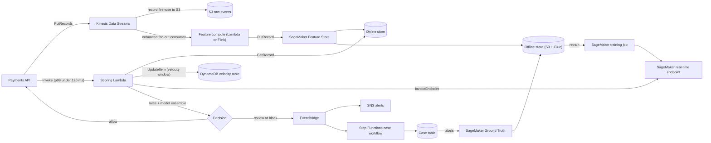
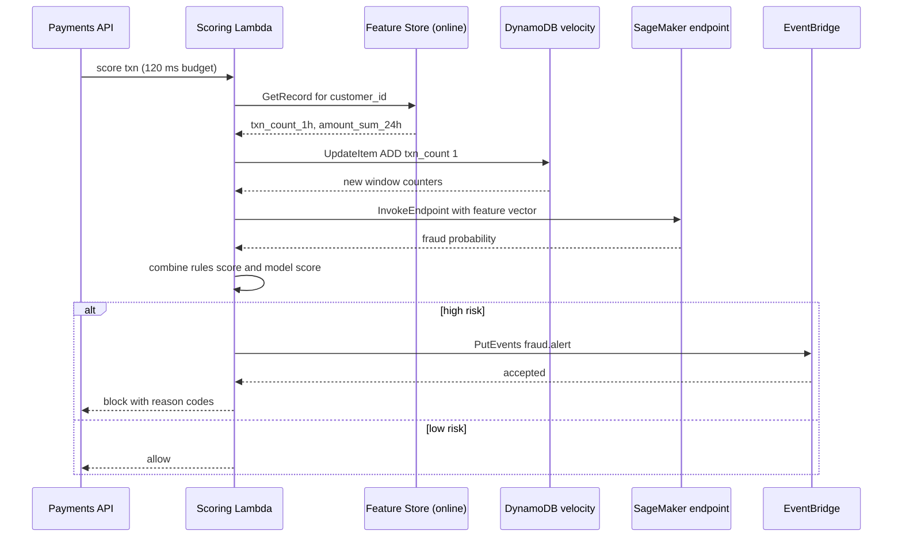
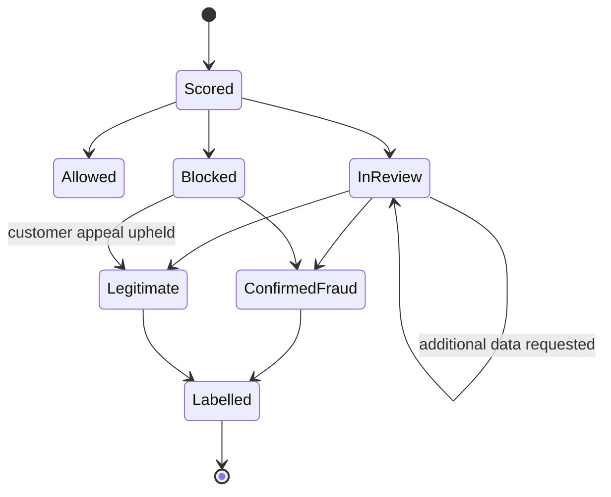

# 02 · Fraud Detection Pipelines

> **Phase 8 — Industry Architectures** · Lesson 02 of 08
> ⬅️ Previous: [Fintech Ledger Databases](./01-fintech-ledger-databases.md) · ➡️ Next: [Healthcare FHIR APIs](./03-healthcare-fhir-apis.md) · 🏠 [Phase overview](./README.md)

## 🎯 Learning Objectives

By the end of this lesson you will be able to:

- Design a real-time fraud scoring path with an explicit latency budget and explain where each millisecond goes
- Compute streaming features with Kinesis and persist them for both online and offline use with SageMaker Feature Store
- Implement atomic velocity checks in DynamoDB with tumbling windows and TTL expiry
- Combine a deterministic rules engine with a machine learning model into a single decision, and explain why neither alone is sufficient
- Close the feedback loop so decisions become training labels, and alert on high-risk outcomes through EventBridge and SNS

**Estimated time:** 75 min · **Difficulty:** Advanced

---

## 🧠 Core Concepts

Fraud detection is a **decision problem under a latency budget**. You are not building a report; you are making a call on a live transaction, usually in under 100 ms, and the transaction is blocked or allowed based on that call. Everything else in the design — stream processing, feature store, model hosting — exists to fit inside that budget. Say the budget out loud before you draw anything: "p99 end-to-end decision in 120 ms, of which 40 ms is feature lookup and 30 ms is model inference."

The signal that catches fraud is rarely in the single transaction. A $12 purchase is unremarkable; the fourth $12 purchase from a new device in a country the customer has never used, eleven minutes apart, is not. That means the pipeline has two halves: **streaming feature computation** (how many, how much, how fast, from where, on what device) and **scoring** (what those features mean right now). Features must be computed once and reused, which is what a feature store is for — the same `txn_count_1h` must be available with sub-10 ms reads at scoring time and as a consistent historical value at training time.

**Rules and models fail differently, so you run both.** Rules encode what you already know and cannot be wrong about ("block any card used in a country on the sanctions list", "decline if the account was created in the last 5 minutes"). They are auditable, explainable, and instantly deployable, and a regulator or a disputes team can read them. Models catch the patterns nobody wrote down, but they drift, they are hard to explain, and they need labels. The industry answer is an **ensemble**: rules produce a hard block or a score contribution, the model produces a probability, and a decision layer combines them into `allow`, `review`, or `block` with a reason code attached.

The **feedback loop** is what separates a demo from a production pipeline. Every `review` outcome eventually becomes a label (`confirmed_fraud`, `legitimate`), those labels land in the offline store, and periodic retraining picks them up. Without this loop the model silently rots: fraud patterns shift within weeks and a model trained on last year's labels loses most of its lift.

### Key terminology

| Term | Meaning |
|------|---------|
| **Velocity feature** | A count or sum over a trailing window, such as transactions per hour per card |
| **Online store** | Low-latency, single-digit-millisecond key-value read of the latest feature values for scoring |
| **Offline store** | Historical, point-in-time-correct feature values in S3 plus a Glue catalog, used for training |
| **Point-in-time correctness** | Reconstructing what a feature looked like at the moment of a past transaction, avoiding label leakage |
| **Rules engine** | Deterministic, versioned predicates that contribute to or override the final decision |
| **Ensemble** | A combined score from rules and one or more models, weighted and thresholded |
| **Reason code** | The machine-readable explanation attached to a decision, required for disputes and model governance |
| **Drift** | The distribution of inputs or outcomes changing so that model performance degrades over time |
| **Decision band** | Threshold ranges that map a score to allow, review, or block |

---

## 🗺️ Architecture Diagram

The end-to-end scoring path. Note that the hot path never queries the offline store — training reads it, scoring does not.



The request lifecycle, including the fail-open path when a dependency is unavailable:



The alert and case lifecycle, which is where labels come from:



---

## 🧪 Hands-on Lab: Streaming Features, Ensemble Scoring, and Alerts

**Goal:** Score a transaction in real time using online features from Feature Store, an atomic DynamoDB velocity check, and a model endpoint, then route the decision to EventBridge and SNS.

**Prerequisites:** AWS CLI v2, Python 3.11+, an IAM role for Lambda, a SageMaker execution role, and an existing SageMaker model deployed as a real-time endpoint (a scikit-learn container is enough — the model itself is not the point of this lab).

### Step 1 — Create the stream and produce events

```bash
# Four shards supports roughly 4 MB/s of ingress; start small and scale on WriteProvisionedThroughputExceeded
aws kinesis create-stream --stream-name txn-events --shard-count 4

# Confirm all shards are ACTIVE before producing
aws kinesis describe-stream-summary --stream-name txn-events \
  --query 'StreamDescriptionSummary.[StreamStatus,OpenShardCount]'

# Produce three transactions for the same card, seconds apart
aws kinesis put-records --stream-name txn-events --records '[
  {"Data":"{\"txn_id\":\"t1\",\"customer_id\":\"C123\",\"card_id\":\"K9\",\"amount_minor\":1200,\"mcc\":\"5411\",\"country\":\"IE\",\"device_id\":\"new-dv-71\",\"event_time\":\"2026-02-01T10:00:00Z\"}","PartitionKey":"K9"},
  {"Data":"{\"txn_id\":\"t2\",\"customer_id\":\"C123\",\"card_id\":\"K9\",\"amount_minor\":1250,\"mcc\":\"5411\",\"country\":\"IE\",\"device_id\":\"new-dv-71\",\"event_time\":\"2026-02-01T10:11:00Z\"}","PartitionKey":"K9"},
  {"Data":"{\"txn_id\":\"t3\",\"customer_id\":\"C123\",\"card_id\":\"K9\",\"amount_minor\":480000,\"mcc\":\"7995\",\"country\":\"BR\",\"device_id\":\"new-dv-71\",\"event_time\":\"2026-02-01T10:14:00Z\"}","PartitionKey":"K9"}
]'
```

Partition on `card_id` rather than `customer_id` if a customer can hold many cards — a single hot partition key throttles the whole scoring path. Note the `Data` value must be base64-encoded for the CLI; add `--cli-binary-format raw-in-base64-out` if you want to pass raw JSON directly.

### Step 2 — Register a feature group with an online and offline store

The feature group definition must match the records you will write, and the event time feature is mandatory.

```bash
# Create the feature group. Offline store writes require a Glue catalog database (created automatically)
aws sagemaker create-feature-group \
  --feature-group-name txn-velocity-v1 \
  --record-identifier-feature-name customer_id \
  --event-time-feature-name event_time \
  --feature-definitions '[
     {"FeatureName":"customer_id","FeatureType":"String"},
     {"FeatureName":"event_time","FeatureType":"String"},
     {"FeatureName":"txn_count_1h","FeatureType":"Fractional"},
     {"FeatureName":"txn_count_24h","FeatureType":"Fractional"},
     {"FeatureName":"amount_sum_24h","FeatureType":"Fractional"},
     {"FeatureName":"distinct_devices_24h","FeatureType":"Fractional"},
     {"FeatureName":"distinct_countries_24h","FeatureType":"Fractional"}
   ]' \
  --online-store-config EnableOnlineStore=true \
  --offline-store-config 'S3StorageConfig={S3Uri=s3://fraud-features-offline/}' \
  --role-arn arn:aws:iam::123456789012:role/sagemaker-feature-store-role

# Wait for Created, then confirm the online store is enabled
aws sagemaker describe-feature-group --feature-group-name txn-velocity-v1 \
  --query 'OnlineStoreConfig.EnableOnlineStore'
```

### Step 3 — Write and read online features

```bash
# The feature-compute consumer writes the latest window values after each event
aws sagemaker put-record --feature-group-name txn-velocity-v1 --record '[
  {"FeatureName":"customer_id","ValueAsString":"C123"},
  {"FeatureName":"event_time","ValueAsString":"2026-02-01T10:14:05Z"},
  {"FeatureName":"txn_count_1h","ValueAsString":"3"},
  {"FeatureName":"txn_count_24h","ValueAsString":"19"},
  {"FeatureName":"amount_sum_24h","ValueAsString":"496900"},
  {"FeatureName":"distinct_devices_24h","ValueAsString":"2"},
  {"FeatureName":"distinct_countries_24h","ValueAsString":"2"}
]'

# Scoring reads exactly one record by identifier — no query language, no joins
aws sagemaker get-record --feature-group-name txn-velocity-v1 \
  --record-identifier-value-as-string C123
```

### Step 4 — Add an atomic velocity window in DynamoDB

Feature Store gives you the last computed aggregate. DynamoDB gives you an **authoritative counter you increment at scoring time**, so two concurrent scorers cannot both see a stale value.

```bash
# Create the table. The sort key is the tumbling window start, so each window is its own item
aws dynamodb create-table \
  --table-name txn_velocity_windows \
  --attribute-definitions AttributeName=pk,AttributeType=S AttributeName=window_start,AttributeType=N \
  --key-schema AttributeName=pk,KeyType=HASH AttributeName=window_start,KeyType=RANGE \
  --billing-mode PAY_PER_REQUEST \
  --tags Key=purpose,Value=fraud-velocity

# Increment atomically. TTL expires the window item once it can no longer contribute to any query
aws dynamodb update-item \
  --table-name txn_velocity_windows \
  --key '{"pk":{"S":"C123#K9"},"window_start":{"N":"1770000000"}}' \
  --update-expression "ADD txn_count :one, amount_minor :amt SET expires_at = :ttl" \
  --expression-attribute-values '{
      ":one":{"N":"1"},
      ":amt":{"N":"480000"},
      ":ttl":{"N":"1770200000"}
    }' \
  --return-values UPDATED_NEW

# Read the current window and the previous window to build a rolling 30-minute value
aws dynamodb get-item --table-name txn_velocity_windows \
  --key '{"pk":{"S":"C123#K9"},"window_start":{"N":"1770000000"}}' \
  --consistent-read
```

DynamoDB TTL deletion is best-effort and can lag by up to 48 hours. Always include `window_start` in the evaluated range rather than trusting that an expired item is gone.

### Step 5 — Score with rules plus model in one Lambda

```python
# scoring/handler.py — deterministic rules first, model second, ensemble last
import json
import os
import time

import boto3

fs = boto3.client("sagemaker-featurestore-runtime")
ddb = boto3.client("dynamodb")
sm = boto3.client("sagemaker-runtime")
events = boto3.client("events")

FEATURE_GROUP = os.environ["FEATURE_GROUP"]
VELOCITY_TABLE = os.environ["VELOCITY_TABLE"]
ENDPOINT = os.environ["ENDPOINT"]

# Rules are versioned so every decision can be replayed against the ruleset that produced it
RULESET_VERSION = "2026-02-01.3"


def read_features(customer_id):
    record = fs.get_record(FeatureGroupName=FEATURE_GROUP,
                           RecordIdentifierValueAsString=customer_id)["Record"]
    return {f["FeatureName"]: f["ValueAsString"] for f in record}


def velocity(pk, window_start):
    item = ddb.update_item(
        TableName=VELOCITY_TABLE,
        Key={"pk": {"S": pk}, "window_start": {"N": str(window_start)}},
        UpdateExpression="ADD txn_count :one SET expires_at = :ttl",
        ExpressionAttributeValues={
            ":one": {"N": "1"},
            ":ttl": {"N": str(window_start + 3600)},
        },
        ReturnValues="UPDATED_NEW",
    )["Attributes"]
    return int(item["txn_count"]["N"])


def apply_rules(features):
    reasons, score = [], 0.0
    if float(features.get("distinct_countries_24h", 1)) >= 2:
        reasons.append("R_NEW_COUNTRY")
        score += 0.25
    if float(features.get("txn_count_1h", 0)) >= 3:
        reasons.append("R_VELOCITY_1H")
        score += 0.20
    if features.get("device_new_24h") == "true":
        reasons.append("R_NEW_DEVICE")
        score += 0.10
    return min(score, 1.0), reasons


def decide(probability, rule_score, amount_minor):
    # Weighted ensemble; the weights are tuned against labelled outcomes, not guessed once
    blended = 0.65 * probability + 0.35 * rule_score
    if amount_minor > 400000 and probability > 0.5:
        return "block", blended, ["R_HIGH_VALUE_LOW_TRUST"]
    if blended >= 0.75:
        return "block", blended, []
    if blended >= 0.45:
        return "review", blended, []
    return "allow", blended, []


def lambda_handler(event, context):
    txn = json.loads(event["detail"]) if "detail" in event else event
    started = time.perf_counter()
    features = read_features(txn["customer_id"])
    window_start = int(txn["event_time_epoch"] // 3600) * 3600
    features["txn_count_window"] = str(velocity(f"{txn['customer_id']}#{txn['card_id']}", window_start))

    vector = [
        float(features.get("txn_count_1h", 0)),
        float(features.get("txn_count_24h", 0)),
        float(features.get("amount_sum_24h", 0)),
        float(features.get("distinct_devices_24h", 0)),
        float(features.get("distinct_countries_24h", 0)),
        float(txn["amount_minor"]),
    ]
    probability = float(
        sm.invoke_endpoint(
            EndpointName=ENDPOINT,
            ContentType="application/json",
            Body=json.dumps({"instances": [vector]}),
        )["Body"].read()
    )
    rule_score, reasons = apply_rules(features)
    decision, blended, extra = decide(probability, rule_score, txn["amount_minor"])
    reasons += extra

    if decision != "allow":
        events.put_events(Entries=[{
            "Source": "fraud.scoring",
            "DetailType": "FraudDecision",
            "Detail": json.dumps({
                "txn_id": txn["txn_id"],
                "customer_id": txn["customer_id"],
                "decision": decision,
                "blended_score": round(blended, 4),
                "reasons": reasons,
                "ruleset_version": RULESET_VERSION,
                "model_endpoint": ENDPOINT,
            }),
        }])

    return {
        "decision": decision,
        "score": round(blended, 4),
        "reasons": reasons,
        "latency_ms": round((time.perf_counter() - started) * 1000, 1),
    }
```

### Step 6 — Route alerts with EventBridge and SNS

```bash
# Create the topic first so the rule target ARN exists
aws sns create-topic --name fraud-alerts

# Match only block and review decisions
aws events put-rule \
  --name fraud-decision-alert \
  --event-pattern '{"source":["fraud.scoring"],"detail-type":["FraudDecision"],"detail":{"decision":["block","review"]}}'

# Fan out to the on-call topic
aws events put-targets \
  --rule fraud-decision-alert \
  --targets 'Id=alert-sns,Arn=arn:aws:sns:eu-west-1:123456789012:fraud-alerts'

# Optional: subscribe a queue for the analyst workbench so no alert is lost if email fails
aws sns subscribe --topic-arn arn:aws:sns:eu-west-1:123456789012:fraud-alerts \
  --protocol sqs --notification-endpoint arn:aws:sqs:eu-west-1:123456789012:fraud-review-queue
```

### Step 7 — Orchestrate the case workflow and capture labels

Blocked and reviewed cases should not be handled by one Lambda. A Step Functions state machine retries transient analyst-tool failures, times out on stale cases, and writes the final label.

```json
{
  "Comment": "Fraud case handling with retry and a terminal label write",
  "StartAt": "EnrichCase",
  "States": {
    "EnrichCase": {
      "Type": "Task",
      "Resource": "arn:aws:lambda:eu-west-1:123456789012:function:fraud-enrich-case",
      "Retry": [
        { "ErrorEquals": ["States.TaskFailed"], "IntervalSeconds": 2, "MaxAttempts": 3, "BackoffRate": 2.0 }
      ],
      "Catch": [
        { "ErrorEquals": ["States.ALL"], "Next": "MarkForManualTriage" }
      ],
      "Next": "AwaitAnalyst"
    },
    "AwaitAnalyst": {
      "Type": "Task",
      "Resource": "arn:aws:states:::lambda:invoke.waitForTaskToken",
      "Parameters": {
        "FunctionName": "fraud-notify-analyst",
        "Payload": { "taskToken.$": "$$.Task.Token", "caseId.$": "$.caseId" }
      },
      "TimeoutSeconds": 259200,
      "Next": "WriteLabel"
    },
    "WriteLabel": {
      "Type": "Task",
      "Resource": "arn:aws:lambda:eu-west-1:123456789012:function:fraud-write-label",
      "Next": "Done"
    },
    "MarkForManualTriage": { "Type": "Pass", "Next": "Done" },
    "Done": { "Type": "Succeed" }
  }
}
```

```bash
# Deploy the state machine
aws stepfunctions create-state-machine \
  --name fraud-case-workflow \
  --definition file://case-workflow.asl.json \
  --role-arn arn:aws:iam::123456789012:role/fraud-step-functions-role

# Enable data capture on the endpoint so every inference is available for monitoring and retraining
aws sagemaker create-endpoint-config \
  --endpoint-config-name fraud-scorer-capture \
  --production-variants '[{"VariantName":"primary","ModelName":"fraud-xgb-2026-02","InitialInstanceCount":2,"InstanceType":"ml.m5.large","InitialVariantWeight":1.0}]' \
  --data-capture-config 'EnableCapture=true,InitialSamplingPercentage=100,DestinationS3Uri=s3://fraud-capture/,CaptureOptions=[{CaptureMode=Input},{CaptureMode=Output}]'
```

Labels flow from the case state machine into the offline store as new rows in the same feature group, sampled at the transaction timestamp. Retraining reads the offline store with point-in-time correctness so that a feature never contains information from after the label it is meant to predict.

---

## 💻 CLI Reference

```bash
# Inspect stream health before blaming the scoring code
aws kinesis describe-stream-summary --stream-name txn-events

# Dedicated throughput for the scoring consumer so it never contends with other readers
aws kinesis register-stream-consumer --stream-arn arn:aws:kinesis:eu-west-1:123456789012:stream/txn-events \
  --consumer-name fraud-scorer

# Confirm the feature group's online store and event time configuration
aws sagemaker describe-feature-group --feature-group-name txn-velocity-v1

# Invoke the scorer endpoint directly to measure inference latency in isolation
aws sagemaker-runtime invoke-endpoint --endpoint-name fraud-scorer \
  --content-type application/json --body file://sample-txn.json /dev/stdout

# Start a case workflow execution manually for a disputed transaction
aws stepfunctions start-execution --state-machine-arn arn:aws:states:eu-west-1:123456789012:stateMachine:fraud-case-workflow \
  --input '{"caseId":"CASE-2026-0001","customer_id":"C123"}'

# Inspect the rule that matched a decision
aws events list-rules --name-prefix fraud-decision
```

| Command | Purpose |
|---------|---------|
| `kinesis describe-stream-summary` | Separates producer throttling from consumer lag |
| `register-stream-consumer` | Isolates scoring throughput from analytics readers |
| `sagemaker describe-feature-group` | Catches a missing online store before you deploy |
| `invoke-endpoint /dev/stdout` | Measures model latency without the rest of the pipeline |
| `stepfunctions start-execution` | Reproduces a case for debugging or appeal |
| `events list-rules` | Confirms alerts are still wired after a refactor |

---

## ✅ Best Practices

| Practice | Why it matters |
|----------|----------------|
| Write the latency budget down and test against it | A pipeline that "works" at p50 can miss most transactions at p99 |
| Compute features once, serve them two ways | Training and scoring features must be identical or the model learns the wrong thing |
| Make scoring idempotent on `txn_id` | Retries from the payments API otherwise inflate velocity counters and block good customers |
| Version every ruleset and model | Decisions must be explainable months later during a dispute |
| Always return reason codes | Analysts and regulators need "why", and so does your own debugging |
| Fail open or fail closed deliberately | Decide per rule: an unavailable model should degrade to rules, not silently allow everything |
| Sample and store all inferences | You cannot monitor or retrain on data you did not keep |
| Separate review from block | Reviewing genuinely ambiguous cases is how you generate high-quality labels |
| Never block a customer on a feature you cannot recompute | Unexplainable features become unexplainable decisions |

---

## ⚠️ Common Pitfalls

| Pitfall | Symptom | Fix |
|---------|---------|-----|
| Label leakage in training data | Offline AUC above 0.99, production performance far worse | Build the training set from the offline store with point-in-time lookups only |
| Hot partition key in Kinesis | `WriteProvisionedThroughputExceededException` on one shard | Partition on the highest-cardinality sensible key and add shards |
| Velocity counters incremented on retry | Legitimate customers blocked after a client retry storm | Idempotency by `txn_id` plus conditional writes |
| TTL trusted for correctness | Counts include long-expired items | Filter on `window_start` range instead of assuming deletion |
| Feature group name reused with a new schema | `put-record` rejections and inconsistent training data | Version feature groups (`txn-velocity-v2`) and migrate deliberately |
| Model endpoint scaled for average load | Latency spikes during fraud campaigns, just when you need the model | Provisioned concurrency or autoscaling on `InvocationsPerInstance` |
| Feedback loop only records fraud | The model sees 100% positives and predicts fraud for everyone | Sample and label declined-and-legitimate cases too |
| Alerts with no deduplication | Analysts drown and stop reading | Aggregate by customer and card per window before notifying |

---

## 💰 Cost Considerations

The scoring path is cheap per event and expensive per mistake. At the time of writing in `eu-west-1`, approximate rates are **$0.015 per shard-hour** for Kinesis Data Streams plus **$0.014 per million PUT payload units**, **$0.000001 per 1 KB** DynamoDB write request unit in on-demand mode, and SageMaker Feature Store online storage billed per GB-month (~$0.45) with **$0.0001 per read unit** and **$0.0005 per 1 KB write**.

What drives the bill:

1. **Shard count, not throughput.** Four shards is about **$44 per month** whether or not you use them. If you are consistently below 50% utilization, switch the stream to on-demand mode, which is billed per GB ingested.
2. **Feature store writes on both stores.** Writing every transaction to online *and* offline doubles your cost. Route low-value events to the offline store only via a separate Firehose to S3.
3. **Online store reads.** Scoring 10 million transactions a month at one read each is only about $1,000 in read units — but a scorer that reads three records per decision triples that.
4. **The model endpoint is the single biggest line.** Two `ml.m5.large` instances run about **$0.23 per instance-hour**, roughly **$340 per month** if left running. Use serverless inference or a scheduled endpoint for low-traffic products.
5. **Data capture on the endpoint.** Storing 100% of inputs and outputs is the correct default for governance, but it multiplies your S3 footprint. Lifecycle the capture prefix to Infrequent Access after 30 days and delete after 400 unless a policy says otherwise.
6. **Ground Truth labelling** is per labelled object and is usually the largest *variable* cost in the loop. Label a stratified sample, not everything.

---

## 🔐 Security Considerations

- **PII in feature names is a liability.** Hash or tokenize `customer_id` and `device_id` before they reach the feature store, and keep the mapping in a separate, tightly scoped service.
- **Encrypt the feature stores with a customer managed key.** Online store, offline store S3 bucket, DynamoDB table, and the capture prefix all need their own grants so you can revoke one without touching the rest.
- **Least privilege on the scoring role.** The Lambda needs `sagemaker:InvokeEndpoint` on one endpoint ARN, `sagemaker:GetRecord` on one feature group, and `dynamodb:UpdateItem` on one table. There is no reason for it to read the offline store.
- **Model a two-person rule for threshold changes.** Changing a block threshold is a business decision with legal consequences; put it behind a change record and a code review, not a console edit.
- **CloudTrail data events on the feature store and case table.** Access to a fraud case is itself sensitive; you need to know which analyst opened it.
- **Guard against adversarial input.** Fraudsters probe your rules. Do not return reason codes to the customer-facing API — keep them in internal events only.
- **Retain decision evidence per your regulator.** In many jurisdictions a declined payment must be explainable for years; the case table, the ruleset version, and the model version belong in the same record.
- **Scan stored free text with Macie and model artifacts with GuardDuty** if the pipeline handles identity documents or bank statements at any point.

---

## 🧩 Exercise

Replace the fixed ensemble weights and thresholds with a configuration the pipeline reads from AWS AppConfig, with a validation step that rejects a configuration where the `review` band is empty or the weights do not sum to 1.0. Then run a replay of 10,000 historical transactions against two configurations and report the change in block rate and in the number of `review` cases created.

Success looks like: an invalid configuration is rejected before it reaches the scorer, a valid one is deployed without a code change, and your replay report shows both the decision shift and the analyst workload shift, not just the model's AUC.

---

## 📚 Resources

- [Amazon Kinesis Data Streams Developer Guide](https://docs.aws.amazon.com/streams/latest/dev/introduction.html)
- [Amazon SageMaker Feature Store](https://docs.aws.amazon.com/sagemaker/latest/dg/feature-store.html)
- [Amazon DynamoDB — atomic counters and conditional writes](https://docs.aws.amazon.com/amazondynamodb/latest/developerguide/WorkingWithItems.html)
- [Amazon EventBridge event patterns](https://docs.aws.amazon.com/eventbridge/latest/userguide/eb-event-patterns.html)
- [AWS Step Functions — callback patterns with task tokens](https://docs.aws.amazon.com/step-functions/latest/dg/connect-to-resource.html)
- [Amazon SageMaker Model Monitor and data capture](https://docs.aws.amazon.com/sagemaker/latest/dg/model-monitor.html)
- [AWS Prescriptive Guidance — real-time fraud detection](https://docs.aws.amazon.com/prescriptive-guidance/latest/patterns/aws-industry-solutions.html)

---

## ➡️ Next Steps

You now have a pipeline that decides in milliseconds and learns from its own outcomes. The next lesson moves to the industry where the data model is dictated by a standard rather than by your team: healthcare, where the patients' records arrive as HL7 FHIR resources and where the authorization model must be verifiable to a regulator.

> ⬅️ Previous: [Fintech Ledger Databases](./01-fintech-ledger-databases.md) · ➡️ Next: [Healthcare FHIR APIs](./03-healthcare-fhir-apis.md) · 🏠 [Phase overview](./README.md)
