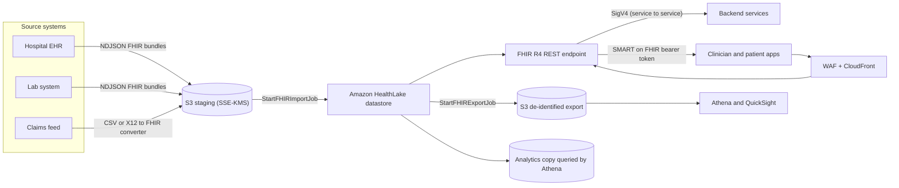
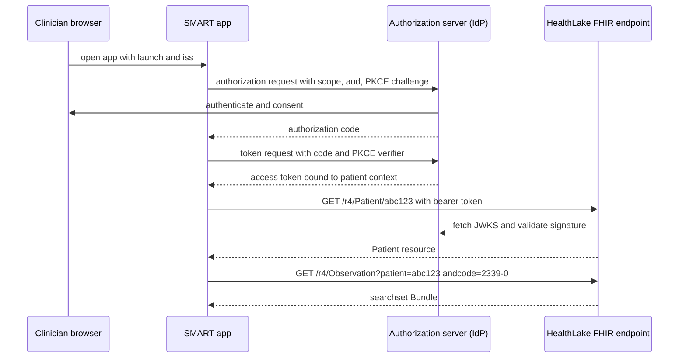
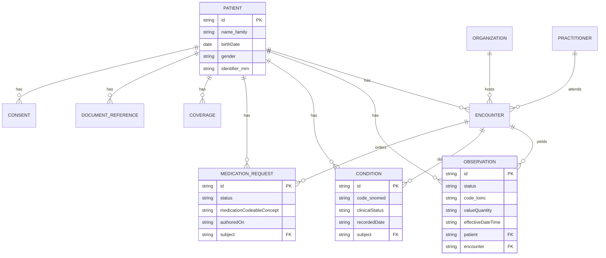

# 03 · Healthcare FHIR APIs

> **Phase 8 — Industry Architectures** · Lesson 03 of 08
> ⬅️ Previous: [Fraud Detection Pipelines](./02-fraud-detection-pipelines.md) · ➡️ Next: [HIPAA-Ready Storage](./04-hipaa-ready-storage.md) · 🏠 [Phase overview](./README.md)

## Learning Objectives

By the end of this lesson you will be able to:

- Read and write HL7 FHIR R4 resources through a managed AWS FHIR REST endpoint backed by Amazon HealthLake
- Import and export FHIR bundles in bulk using the `$import` and `$export` workflow
- Choose between AWS IAM (SigV4) authorization and SMART on FHIR OAuth 2.0 with fine-grained scopes
- De-identify free-text clinical notes with Amazon Comprehend Medical and explain why de-identification is not anonymization
- Model the core FHIR resources and their relationships, and query them with real search parameters

**Estimated time:** 70 min · **Difficulty:** Intermediate

---

## Core Concepts

Healthcare interoperability used to mean HL7 v2 pipe-delimited messages and CSV extracts bolted onto each EHR. **HL7 FHIR** (Fast Healthcare Interoperability Resources) replaced that with a REST API over a defined resource model: `Patient`, `Encounter`, `Observation`, `Condition`, `MedicationRequest`, `Practitioner`, `Organization`, `Coverage`, and about 145 others. A `Patient` is a JSON resource with a stable `id`, standard search parameters, and references to related resources. FHIR R4 is the version regulators standardized on, including the US ONC Cures Act rules and the CMS Interoperability and Patient Access final rule.

**Amazon HealthLake** is a managed, HIPAA-eligible FHIR R4 datastore. You get a real FHIR REST endpoint, a transaction bundle endpoint that is atomic across resources, FHIR search with standard parameters plus `_include` and `_revinclude`, the `$expand` operation against built-in terminologies, and bulk `$export`. HealthLake also normalizes imported data into an analytics form you can query with Athena, which matters because "give me every diabetic patient with an HbA1c over 9 in the last year" is a SQL question, not a REST question.

**Authorization is the hard part.** A FHIR endpoint exposes an entire population's clinical record, so the access model is not "is this caller authenticated?" but "exactly which patient's data may this caller read, for what purpose?" HealthLake supports two strategies. **AWS IAM (SigV4)** is appropriate for backend services, analytics jobs, and bulk export pipelines where the caller identity is a role you control. **SMART on FHIR** is the patient- and clinician-facing standard: an OAuth 2.0 authorization code flow with PKCE, a launch context, and scopes such as `patient/Observation.read`, `user/Patient.read`, or `system/*.read`. The `patient/` prefix binds the access token to one patient, so a bug in your front end cannot leak another person's chart.

**De-identification is a data flow, not a button.** HIPAA's Safe Harbor method names 18 identifier categories that must be removed; the Expert Determination method requires a statistician to certify re-identification risk. Amazon Comprehend Medical's `DetectPHI` finds those identifiers in free text, including names, dates, ages over 89, geographic data smaller than a state, phone numbers, URLs, and identifiers in clinical context. What it cannot do is guarantee that a de-identified dataset is not re-identifiable by combination, which is a property of the dataset as a whole, not of any single field.

### Key terminology

| Term | Meaning |
|------|---------|
| **Resource** | A JSON object with a type (`Patient`), an `id`, and a versioned history — the unit of everything in FHIR |
| **Bundle** | A container for multiple resources, used for `transaction`, `batch`, `searchset`, and `collection` |
| **Reference** | A typed link such as `Patient/abc123` — FHIR's equivalent of a foreign key, resolvable over HTTP |
| **Search parameter** | A defined query term (`birthdate`, `family`, `code`, `date`, `_lastUpdated`) with prefixes like `eq`, `ge`, `gt`, `lt` |
| **CapabilityStatement** | The resource that advertises what a FHIR server supports — read it before you build a client |
| **`_include` / `_revinclude`** | Server-side joins that return a referenced resource in the same searchset bundle |
| **SMART on FHIR** | The OAuth 2.0 profile that defines FHIR scopes, launch context, and token binding to a patient or user |
| **Fine-grained authorization** | Per-request policy evaluation (typically an IdP Lambda authorizer) over the JWT claims |
| **Safe Harbor / Expert Determination** | The two HIPAA de-identification methods, with different evidence requirements |
| **PHI** | Protected Health Information — health data plus any of the 18 direct identifiers |

---

## Architecture Diagram

The ingestion and consumption paths. Import and export move through S3, which is where your encryption and access controls live:



The SMART on FHIR authorization code flow with PKCE, as it actually runs for a clinician-facing app:



The core clinical resource model. This is the shape any healthcare integration converges on:



---

## Hands-on Lab: A FHIR Datastore with SMART Authorization and De-Identified Export

**Goal:** Create a HealthLake FHIR datastore, load NDJSON bundles, query resources over the FHIR REST API, run a bulk export, and redact PHI from a clinical note.

**Prerequisites:** An AWS account with a signed HIPAA BAA (HealthLake will not accept PHI without one), a KMS customer managed key, an S3 staging bucket, and the `us-east-1` or `us-west-2` Region — check the HealthLake endpoint list for current availability.

### Step 1 — Create the datastore with encryption and SMART on FHIR authorization

```bash
# The datastore needs its own customer managed key; data cannot be moved to another key later
aws healthlake create-fhir-datastore \
  --datastore-name meridian-clinical \
  --datastore-type-version R4 \
  --sse-configuration 'CmkType=CUSTOMER_MANAGED_KMS_KEY,KmsEncryptionConfig={KmsKeyId=arn:aws:kms:us-east-1:123456789012:key/22222222-3333-4444-5555-666666666666}'

# Capture the datastore ID and endpoint URL
aws healthlake list-fhir-datastores \
  --query 'DatastorePropertiesList[].[DatastoreId,DatastoreName,Status,DatastoreEndpoint]' --output table

# Note the endpoint form: https://healthlake.us-east-1.amazonaws.com/datastore/<datastore-id>/r4/
export HL_ID=2a0b1c3d4e5f6a7b8c9d0e1f2a3b4c5d
export HL_URL="https://healthlake.us-east-1.amazonaws.com/datastore/${HL_ID}/r4"
```

### Step 2 — Publish the authorization server metadata

For clinician-facing apps, configure SMART on FHIR v1 with fine-grained authorization. HealthLake validates the bearer token's signature against your authorization server's JWKS and then calls an IdP Lambda authorizer with the token claims for the final decision.

```json
{
  "authorization_endpoint": "https://auth.meridian-health.example/oauth2/authorize",
  "token_endpoint": "https://auth.meridian-health.example/oauth2/token",
  "introspection_endpoint": "https://auth.meridian-health.example/oauth2/introspect",
  "revocation_endpoint": "https://auth.meridian-health.example/oauth2/revoke",
  "jwks_uri": "https://auth.meridian-health.example/.well-known/jwks.json",
  "issuer": "https://auth.meridian-health.example"
}
```

```bash
# Switch the datastore to SMART on FHIR with per-request authorization decisions
aws healthlake update-fhir-datastore \
  --datastore-id "${HL_ID}" \
  --identity-provider-configuration '{
      "AuthorizationStrategy": "SMART_ON_FHIR_V1",
      "FineGrainedAuthorizationEnabled": true,
      "Metadata": "file://smart-metadata.json",
      "IdpLambdaArn": "arn:aws:lambda:us-east-1:123456789012:function:smart-authorizer"
    }'

# Confirm the strategy took effect
aws healthlake describe-fhir-datastore --datastore-id "${HL_ID}" \
  --query 'DatastoreProperties.IdentityProviderConfiguration'
```

The IdP Lambda authorizer receives the decoded token and returns an allowed/disallowed decision per requested resource and operation. This is where `patient/` scopes are enforced against the token's patient context claim — the datastore does not do it for you.

### Step 3 — Stage and import FHIR bundles

HealthLake imports newline-delimited JSON (NDJSON) where each line is one resource or a bundle.

```bash
# Stage NDJSON in S3. One resource per line, no trailing commas, no enclosing array
aws s3 cp ./fhir/patients.ndjson s3://meridian-fhir-staging/import/patients.ndjson \
  --sse aws:kms --sse-kms-key-id arn:aws:kms:us-east-1:123456789012:key/22222222-3333-4444-5555-666666666666

# Start the import job
aws healthlake start-fhir-import-job \
  --job-name initial-load-2026-02 \
  --datastore-id "${HL_ID}" \
  --input-data-config 'S3Uri=s3://meridian-fhir-staging/import/' \
  --job-output-data-config 'S3Configuration={S3Uri=s3://meridian-fhir-staging/import-output/,KmsKeyId=arn:aws:kms:us-east-1:123456789012:key/22222222-3333-4444-5555-666666666666}' \
  --data-access-role-arn arn:aws:iam::123456789012:role/healthlake-import-role

# Poll until COMPLETED; failures land in the output prefix as per-resource errors
aws healthlake list-fhir-import-jobs --datastore-id "${HL_ID}" \
  --query 'ImportJobPropertiesList[].[JobId,JobStatus,JobProgressReport]' --output json
```

### Step 4 — Read and write resources over the FHIR REST API

For service-to-service calls, sign with SigV4. The CLI has no data-plane FHIR commands, so use `curl` with AWS Signature Version 4.

```bash
# Read a Patient. SigV4 signed directly against the datastore endpoint
curl --aws-sigv4 "aws:amz:us-east-1:healthlake" \
     --user "${AWS_ACCESS_KEY_ID}:${AWS_SECRET_ACCESS_KEY}" \
     -H "x-amz-security-token: ${AWS_SESSION_TOKEN}" \
     -H "Accept: application/fhir+json" \
     "${HL_URL}/Patient/abc123"

# Create a Patient. FHIR responds 201 Created with a Location header containing the new id
curl -X POST \
     --aws-sigv4 "aws:amz:us-east-1:healthlake" \
     --user "${AWS_ACCESS_KEY_ID}:${AWS_SECRET_ACCESS_KEY}" \
     -H "x-amz-security-token: ${AWS_SESSION_TOKEN}" \
     -H "Content-Type: application/fhir+json" \
     -H "Accept: application/fhir+json" \
     -d @patient.json \
     "${HL_URL}/Patient"
```

```json
{
  "resourceType": "Patient",
  "identifier": [
    { "system": "urn:oid:1.2.840.114350.1.13.0.1.7.5.737384.14", "value": "MRN-88213" }
  ],
  "active": true,
  "name": [ { "family": "Okafor", "given": ["Ade"] } ],
  "gender": "female",
  "birthDate": "1979-04-12",
  "address": [ { "city": "Boston", "state": "MA", "postalCode": "02118", "country": "US" } ]
}
```

### Step 5 — Search with real FHIR parameters

```bash
# Read the CapabilityStatement first — do not guess which search parameters are supported
curl -s --aws-sigv4 "aws:amz:us-east-1:healthlake" \
     --user "${AWS_ACCESS_KEY_ID}:${AWS_SECRET_ACCESS_KEY}" \
     "${HL_URL}/metadata" | jq '.rest[0].resource[] | select(.type=="Patient") | .searchParam[].name'

# Find patients by family name, active status, and birthdate with a comparison prefix
curl -s --aws-sigv4 "aws:amz:us-east-1:healthlake" \
     --user "${AWS_ACCESS_KEY_ID}:${AWS_SECRET_ACCESS_KEY}" \
     "${HL_URL}/Patient?family=Okafor&active=true&birthdate=ge1970-01-01&_count=20" | jq '.entry | length'

# Pull observations in one round trip, including the patient each one belongs to
curl -s --aws-sigv4 "aws:amz:us-east-1:healthlake" \
     --user "${AWS_ACCESS_KEY_ID}:${AWS_SECRET_ACCESS_KEY}" \
     "${HL_URL}/Observation?patient=abc123&code=2339-0&date=ge2025-02-01&_include=Observation:patient"

# Confirm the patient's record is paginated rather than truncated, then follow the next link
curl -s --aws-sigv4 "aws:amz:us-east-1:healthlake" \
     --user "${AWS_ACCESS_KEY_ID}:${AWS_SECRET_ACCESS_KEY}" \
     "${HL_URL}/Condition?patient=abc123&clinical-status=active&_count=50" | jq '.link'
```

### Step 6 — Export a de-identified cohort

Export writes FHIR NDJSON to S3. Keep the de-identified export in a **separate bucket in a separate account**, because a "de-identified" dataset sitting next to the identified one is one misconfigured role away from being re-identified.

```bash
# Export only what the analytics team needs, since _since reduces both volume and exposure
aws healthlake start-fhir-export-job \
  --job-name analytics-cohort-2026-02 \
  --datastore-id "${HL_ID}" \
  --output-data-config 'S3Uri=s3://meridian-fhir-deid/export/,S3Configuration={S3Uri=s3://meridian-fhir-deid/export/,KmsKeyId=arn:aws:kms:us-east-1:123456789012:key/33333333-4444-5555-6666-777777777777}' \
  --data-access-role-arn arn:aws:iam::123456789012:role/healthlake-export-role \
  --export-type "PATIENT"

# Bulk export status and the manifest that lists every output file
aws healthlake describe-fhir-export-job --datastore-id "${HL_ID}" --job-id <export-job-id> \
  --query 'ExportJobProperties.[JobStatus,OutputDataConfig]'
```

### Step 7 — Detect and redact PHI in free text

Comprehend Medical is a HIPAA-eligible service and the right tool for `DocumentReference` and unstructured note text.

```bash
# Detect PHI categories and offsets in a clinical note
aws comprehendmedical detect-phi \
  --text "Patient Ade Okafor, MRN 88213, DOB 04/12/1979, seen at Boston Medical Center on 02/03/2026. Contact 617-555-0134."

# Map clinical text to standardized codes for analytics
aws comprehendmedical infer-icd10-cm \
  --text "Type 2 diabetes mellitus with diabetic nephropathy, stage 3 chronic kidney disease"
```

The response is a list of entities with `Category`, `Type`, `Text`, `BeginOffset`, and `EndOffset`. Redact by replacing each `[BeginOffset, EndOffset)` span with a masked token, working **from the end of the text backwards** so that earlier offsets stay valid. For note volumes, run the batch jobs instead of per-call requests:

```bash
# Batch PHI detection over an S3 prefix, with masked output written to another prefix
aws comprehendmedical start-phi-detection-job \
  --job-name notes-phi-2026-02 \
  --input-data-config 'S3Bucket=s3://meridian-notes-raw/,InputFormat=ONE_DOC_PER_LINE' \
  --output-data-config 'S3Bucket=s3://meridian-notes-deid/' \
  --data-access-role-arn arn:aws:iam::123456789012:role/comprehend-medical-role
```

---

## CLI Reference

```bash
# Inventory your datastores and their endpoints
aws healthlake list-fhir-datastores

# Datastore details including encryption and identity configuration
aws healthlake describe-fhir-datastore --datastore-id "${HL_ID}"

# Import and export history with progress reports
aws healthlake list-fhir-import-jobs --datastore-id "${HL_ID}"
aws healthlake list-fhir-export-jobs --datastore-id "${HL_ID}"

# Tag the datastore so cost allocation reports can separate product lines
aws healthlake tag-resource --resource-arn arn:aws:healthlake:us-east-1:123456789012:datastore/fhir/${HL_ID} \
  --tags Key=domain,Value=population-health

# Real-time PHI detection for a single note or message
aws comprehendmedical detect-phi --text "MRN 88213, DOB 04/12/1979"

# Normalize medications and conditions to standard terminologies
aws comprehendmedical infer-rx-norm --text "started metformin 500mg twice daily"
aws comprehendmedical infer-snomedct --text "heart attack"
```

| Command | Purpose |
|---------|---------|
| `healthlake list-fhir-datastores` | Confirms the endpoint URL and Region before you build a client |
| `describe-fhir-datastore` | Verifies KMS key and authorization strategy after any change |
| `start-fhir-import-job` | Bulk load; far cheaper and faster than one resource per HTTP call |
| `start-fhir-export-job` | Feeds analytics and de-identified datasets from a controlled pipeline |
| `comprehendmedical detect-phi` | First line of defense before free text reaches storage or a log |
| `comprehendmedical infer-icd10-cm` | Turns narrative diagnoses into codes usable in SQL |

---

## Best Practices

| Practice | Why it matters |
|----------|----------------|
| Read the `CapabilityStatement` before coding | Search parameters and supported operations vary by server and version |
| Use `$export` for analytics, not paginated REST reads | Bulk reads over REST are slow, expensive, and hammer the transactional path |
| Put `patient/` or `user/` scopes in front of every token | A leaked token then exposes one chart instead of the whole population |
| Validate the token's `aud` claim against your datastore endpoint | Prevents tokens minted for another FHIR server from being replayed at yours |
| Keep `DocumentReference` bodies out of search results by default | Notes are the highest-risk data and the least useful in a list view |
| Use CodeableConcept codes, not free text, for anything analytic | Free text cannot be joined, aggregated, or reliably validated |
| Version and date-stamp every de-identified extract | Re-identification risk and Safe Harbor rules change; you must reproduce the method |
| Retain `Consent` resources and honor them in your authorizer | Consent is a legal artifact, not documentation |
| Treat US Core profiles as the minimum, not the target | Payer and provider exchange will test against them |

---

## Common Pitfalls

| Pitfall | Symptom | Fix |
|---------|---------|-----|
| NDJSON with an enclosing array or trailing commas | Import job completes with per-resource errors | One resource per line, NDJSON only, validate before upload |
| References to resources that were never imported | `_include` returns nothing, `404` on reference resolution | Import in dependency order or use transaction bundles that reference `urn:uuid` |
| No BAA in place | Console and API refusals, or worse, non-compliant storage | Sign the BAA and verify each service against the eligible services list |
| PHI in URLs | Search parameter values end up in access logs and CloudTrail | Use POST search (`_search`) for sensitive criteria, and never log query strings |
| De-identified data in the same account as the source | A single role misconfiguration re-identifies the whole dataset | Separate account, separate key, separate bucket |
| Assuming `DetectPHI` is a compliance certificate | Safe Harbor or Expert Determination documentation is missing at audit time | Record the method, the tool version, and the residual risk assessment |
| Authorizer that only checks token validity | Any authenticated clinician can read any patient | Enforce per-patient access in the IdP Lambda using token claims and a policy store |
| Unbounded `_count` on large searches | Timeouts and memory pressure on both sides | Paginate with `_count` and follow `link[rel=next]` |

---

## Cost Considerations

HealthLake is priced on **data stored per GB-month** plus **per API request**, with separate charges for import and export jobs. As a rough planning figure at the time of writing, storing a few hundred GB of FHIR data and serving single-digit millions of REST requests a month lands in the low hundreds of dollars — but the drivers are what matter:

1. **Datastore size, not request count, dominates at scale.** A population-scale datastore grows continuously because FHIR resources are versioned; every update adds a version. Retention of old versions is the single biggest lever.
2. **REST request volume.** Polling clients are the usual culprit. Cache reference data, use `_count` efficiently, and never poll for changes — use `_since` based exports or a change feed instead.
3. **Import and export jobs** are billed on the volume processed. Batch your imports; a per-resource import is the expensive anti-pattern.
4. **Comprehend Medical** is billed per character (in units of 100 characters) for real-time calls and per unit for batch jobs. Detecting PHI on every note twice is a real cost multiplier — detect once at ingest, store the redacted form, and keep the original under Object Lock.
5. **Athena over the analytics copy** is billed per TB scanned. Partition by date and use columnar formats, or your "one dashboard" costs more than the datastore.
6. **Cross-Region copies for DR** double storage and inter-Region transfer. Only the analytics copy and the export bucket usually need to exist in a second Region.

---

## Security Considerations

- **The datastore is PHI from the first byte.** Encryption with a customer managed KMS key, restrictive key policy, and CloudTrail on `kms:Decrypt` are the baseline, not the goal.
- **Two authorization strategies, two threat models.** SigV4 for service-to-service calls keeps a long-lived role off the internet; SMART on FHIR puts a token in a browser. Do not let a browser-facing token be usable by a backend.
- **Fine-grained authorization must be authoritative.** The IdP Lambda should decide per resource and operation against a policy source you can audit, and it should default to deny when that source is unreachable.
- **CloudTrail records management events but not FHIR resource reads at the payload level.** Enable HealthLake logging and use CloudWatch Logs or Kinesis delivery to a log archive account, and keep `_count` low, since each read is an audit entry.
- **Never let PHI reach a log, a tag, an error message, or an SNS subject.** Configure CloudWatch Logs data protection policies to mask known PHI patterns as a safety net, and check for PHI in `User-Agent` and request IDs from proxies.
- **Constrain bulk export with an IAM role that can only read one S3 prefix under one key.** An export job is the highest-volume egress path in the system.
- **Use VPC endpoints (AWS PrivateLink) for HealthLake and S3** so traffic never traverses the public internet, and pair them with endpoint policies and a `aws:SourceVpce` condition.
- **Run Macie on the export and analytics buckets** to catch PHI that a bug wrote to the wrong place, and GuardDuty for the credentials that could have done it.
- **Keep the de-identification method documented and reproducible.** "We used DetectPHI" is not a defensible answer at audit; "Safe Harbor, DetectPHI cover, residual risk register entry 14" is.

---

## Exercise

Build a SMART on FHIR authorizer Lambda that allows a token to read only the patient bound to its `patient` launch context claim, denies any request carrying a `system/*` scope from a browser-facing client, and writes a decision record (token subject, patient, resource type, operation, decision, reason) to a separate audit log group. Then write three test events: one legitimate `patient/Observation.read`, one attempt to read a different patient's `Observation`, and one `system/*.read` from the same client.

Success looks like: the first returns allow, the second and third return deny with distinct reason codes, and all three appear as structured records in the audit log group with the token subject but no PHI.

---

## Resources

- [HL7 FHIR R4 specification](https://hl7.org/fhir/R4/)
- [Amazon HealthLake Developer Guide](https://docs.aws.amazon.com/healthlake/latest/devguide/what-is-amazon-health-lake.html)
- [HealthLake FHIR REST API operations](https://docs.aws.amazon.com/healthlake/latest/devguide/reference-fhir-operations.html)
- [SMART on FHIR and HealthLake authorization](https://docs.aws.amazon.com/healthlake/latest/devguide/manage-smart-on-fhir.html)
- [Amazon Comprehend Medical Developer Guide](https://docs.aws.amazon.com/comprehend-medical/latest/dev/comprehendmedical-welcome.html)
- [HIPAA de-identification guidance (HHS)](https://www.hhs.gov/hipaa/for-professionals/privacy/special-topics/de-identification/index.html)
- [US Core Implementation Guide](https://hl7.org/fhir/us/core/)

---

## Next Steps

You can now expose clinical data through a standards-based API with patient-scoped authorization. The next lesson takes the same data and answers the storage questions underneath it: which services you may actually put PHI in, how the encryption and retention evidence is produced, and how to prove to an auditor that a record could not have been altered or deleted early.

> ⬅️ Previous: [Fraud Detection Pipelines](./02-fraud-detection-pipelines.md) · ➡️ Next: [HIPAA-Ready Storage](./04-hipaa-ready-storage.md) · 🏠 [Phase overview](./README.md)
