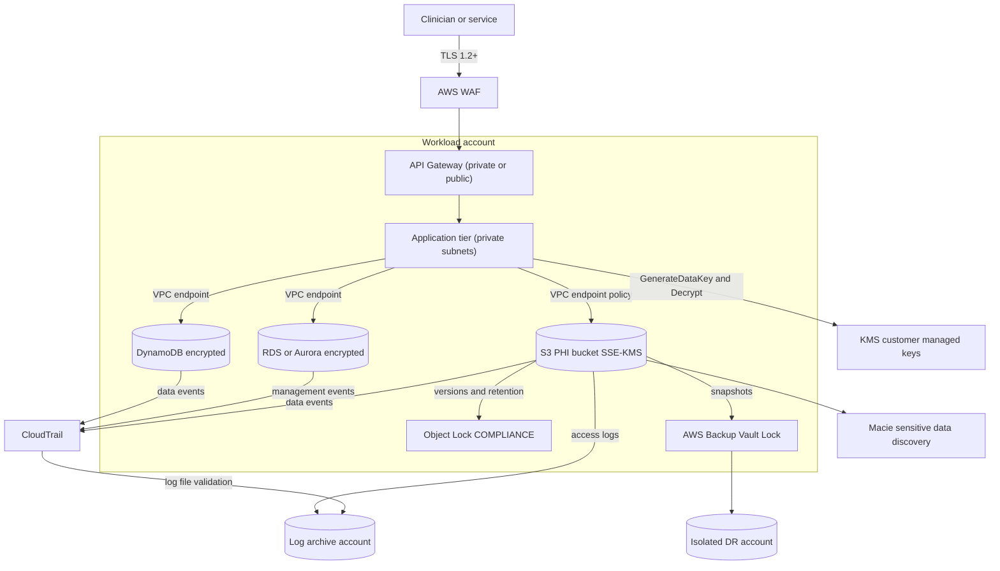
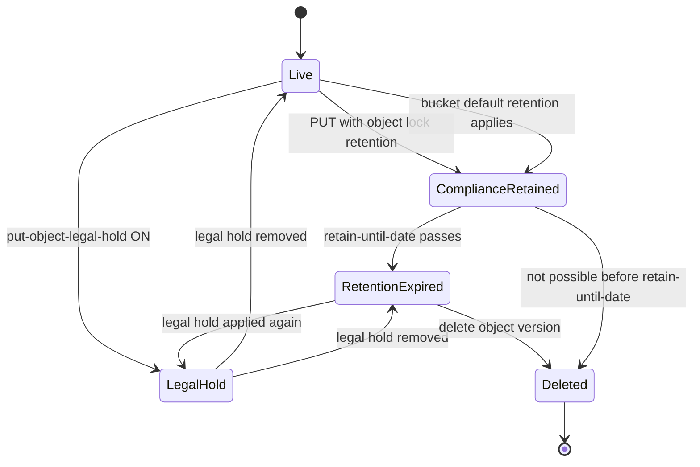
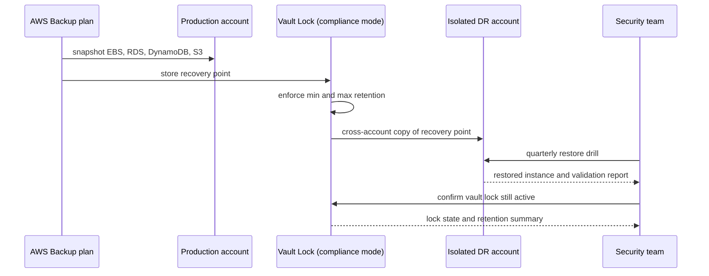

# 04 · HIPAA-Ready Storage

> **Phase 8 — Industry Architectures** · Lesson 04 of 08
> ⬅️ Previous: [Healthcare FHIR APIs](./03-healthcare-fhir-apis.md) · ➡️ Next: [Gaming — GameLift and Scaling](./05-gaming-gamelift-and-scaling.md) · 🏠 [Phase overview](./README.md)

## 🎯 Learning Objectives

By the end of this lesson you will be able to:

- Explain the Business Associate Addendum, what it covers, and how to verify that every service holding PHI is on the HIPAA eligible list
- Encrypt PHI at rest and in transit with customer managed KMS keys scoped by service and network path
- Make S3 objects provably undeletable with Object Lock in compliance mode, and explain the difference from governance mode
- Produce audit evidence with CloudTrail (including S3 data events) and AWS Config managed rules
- Design immutable backups with AWS Backup Vault Lock and a tested restore path

**Estimated time:** 70 min · **Difficulty:** Intermediate

---

## 🧠 Core Concepts

HIPAA is not a certification and AWS is not "HIPAA certified". The **HIPAA Privacy, Security, and Breach Notification Rules** apply to covered entities (providers, plans, clearinghouses) and to their business associates. When you put PHI in AWS, AWS acts as your business associate, and the relationship is governed by the **Business Associate Addendum (BAA)** in your AWS account. Practical consequences follow immediately: a service is only usable for PHI if it appears on the **HIPAA eligible services list** *and* is covered by your BAA, and no amount of configuration makes a non-eligible service acceptable.

Within that boundary, the Security Rule splits the work. AWS secures the **security of the cloud** — physical facilities, hardware, the hypervisor, and the managed service control planes. You secure **security in the cloud** — encryption choices, key policies, identity and access design, network exposure, logging, and your own application. This split is why "encrypt PHI at rest" is a design decision you make, not a feature you buy: HIPAA says encryption is an *addressable* implementation specification, which in practice means "implement it or document why an equivalent control is better". Nearly every organization implements it, because encryption is what lets you argue PHI was rendered "unusable, unreadable, or indecipherable" and therefore may not require breach notification.

Two more Security Rule concepts drive the architecture. **Minimum necessary** means access is scoped to the smallest set of records needed for the task, which is an account- and role-level design problem, not a permission tweak. **Audit controls** require recording and examining activity in systems containing ePHI, which means CloudTrail data events, S3 server access logs, and query-level logging — not just control-plane API calls. A design that logs `CreateBucket` but never `GetObject` cannot answer "who read this patient's record?"

### Key terminology

| Term | Meaning |
|------|---------|
| **PHI / ePHI** | Protected Health Information, and its electronic form — health data plus any of 18 identifiers tied to an individual |
| **Covered entity** | Provider, health plan, or clearinghouse directly regulated by HIPAA |
| **Business associate** | A party handling PHI on behalf of a covered entity, including AWS, under a BAA |
| **BAA** | The Business Associate Addendum — the contract that makes AWS services permissible for PHI |
| **HIPAA eligible service** | A service listed by AWS as covered by the BAA; anything else is out of bounds for PHI |
| **Addressable specification** | Must be implemented, or a documented equivalent alternative must be justified |
| **Minimum necessary** | Access limited to the least data needed for the specific purpose |
| **Object Lock** | S3 feature using a write-once-read-many model to prevent object deletion or overwrite |
| **Compliance mode** | Retention that cannot be shortened or bypassed by any user, including the root user |
| **Governance mode** | Retention that privileged users with `s3:BypassGovernanceRetention` can shorten |
| **Vault Lock** | AWS Backup enforcement of minimum and maximum retention in a vault, in compliance mode |

---

## 🗺️ Architecture Diagram

The control envelope for PHI storage. Every layer here produces evidence an auditor can read:



How an S3 object's retention state actually changes. Note that compliance mode has no reverse transition:



The backup path, which is where most HIPAA designs are weakest because the restore has never been tested:



---

## 🧪 Hands-on Lab: A PHI Bucket That Cannot Be Erased and a Fully Audited Path

**Goal:** Create an S3 bucket with customer managed encryption, TLS-only and encryption-enforced policies, compliance-mode Object Lock, CloudTrail data events, Config rules, and an immutable backup vault.

**Prerequisites:** AWS CLI v2, an account with a BAA, permission to create KMS keys and IAM roles, and a separate S3 bucket (or account) for log archival.

### Step 1 — Create the customer managed key with a restrictive key policy

```json
{
  "Version": "2012-10-17",
  "Id": "phi-store-key",
  "Statement": [
    {
      "Sid": "KeyAdministration",
      "Effect": "Allow",
      "Principal": { "AWS": "arn:aws:iam::123456789012:root" },
      "Action": [
        "kms:Create*", "kms:Describe*", "kms:Enable*", "kms:List*", "kms:Put*",
        "kms:Update*", "kms:Revoke*", "kms:Disable*", "kms:Get*", "kms:TagResource",
        "kms:ScheduleKeyDeletion", "kms:CancelKeyDeletion"
      ],
      "Resource": "*"
    },
    {
      "Sid": "IngestRoleUsesKeyOnlyViaS3",
      "Effect": "Allow",
      "Principal": { "AWS": "arn:aws:iam::123456789012:role/phi-ingest-role" },
      "Action": ["kms:Decrypt", "kms:GenerateDataKey", "kms:DescribeKey"],
      "Resource": "*",
      "Condition": {
        "StringEquals": { "kms:ViaService": "s3.us-east-1.amazonaws.com" }
      }
    },
    {
      "Sid": "DenyKeyDeletionWithoutApproval",
      "Effect": "Deny",
      "Principal": "*",
      "Action": "kms:ScheduleKeyDeletion",
      "Resource": "*",
      "Condition": { "StringNotEquals": { "aws:PrincipalArn": "arn:aws:iam::123456789012:role/security-admin" } }
    }
  ]
}
```

```bash
# Create the key and a stable alias. The alias is what bucket policies and apps reference
aws kms create-key \
  --description "PHI object storage key us-east-1" \
  --policy file://phi-key-policy.json \
  --tags TagKey=data-classification,TagValue=phi

# Point an alias at it so the ARN in policies never has to change on rotation
aws kms create-alias --alias-name alias/phi-store --target-key-id <key-id>

# Rotate on a fixed schedule; rotation keeps the same key ARN and rewraps data keys
aws kms enable-key-rotation --key-id <key-id> --rotation-period-in-days 365

# Confirm rotation and the key state
aws kms get-key-rotation-status --key-id <key-id>
aws kms describe-key --key-id alias/phi-store --query 'KeyMetadata.[KeyState,KeyManager,KeyId]'
```

### Step 2 — Create the PHI bucket with Object Lock from the start

Object Lock can only be enabled at bucket creation, so this has to be right the first time.

```bash
# Object Lock requires versioning, which this flag enables implicitly
aws s3api create-bucket \
  --bucket meridian-phi-store \
  --region us-east-1 \
  --object-lock-enabled-for-bucket

# 7 years of default compliance-mode retention on every object written to the bucket
aws s3api put-object-lock-configuration --bucket meridian-phi-store \
  --object-lock-configuration '{
      "ObjectLockEnabled": "Enabled",
      "Rule": {
        "DefaultRetention": { "Mode": "COMPLIANCE", "Days": 2555 }
      }
    }'

# SSE-KMS with a bucket key so each object does not call KMS for every part
aws s3api put-bucket-encryption --bucket meridian-phi-store \
  --server-side-encryption-configuration '{
      "Rules": [{
        "ApplyServerSideEncryptionByDefault": {
          "SSEAlgorithm": "aws:kms",
          "KMSMasterKeyID": "arn:aws:kms:us-east-1:123456789012:key/22222222-3333-4444-5555-666666666666"
        },
        "BucketKeyEnabled": true
      }]
    }'

# Block every form of public access, including future changes
aws s3api put-public-access-block --bucket meridian-phi-store \
  --public-access-block-configuration 'BlockPublicAcls=true,IgnorePublicAcls=true,BlockPublicPolicy=true,RestrictPublicBuckets=true'

# Turn on versioning explicitly for readability, even though Object Lock implies it
aws s3api put-bucket-versioning --bucket meridian-phi-store \
  --versioning-configuration Status=Enabled
```

### Step 3 — Enforce TLS and encryption with a bucket policy

Split the encryption deny into two statements so each condition is evaluated independently. Combining both conditions in one `StringNotEquals` would weaken the check. When a request omits the encryption headers entirely, S3 evaluates these condition keys against the bucket's default encryption settings, so the deny still reflects reality.

```json
{
  "Version": "2012-10-17",
  "Statement": [
    {
      "Sid": "DenyNonTLS",
      "Effect": "Deny",
      "Principal": "*",
      "Action": "s3:*",
      "Resource": [
        "arn:aws:s3:::meridian-phi-store",
        "arn:aws:s3:::meridian-phi-store/*"
      ],
      "Condition": { "Bool": { "aws:SecureTransport": "false" } }
    },
    {
      "Sid": "DenyUnencryptedPuts",
      "Effect": "Deny",
      "Principal": "*",
      "Action": "s3:PutObject",
      "Resource": "arn:aws:s3:::meridian-phi-store/*",
      "Condition": {
        "StringNotEquals": { "s3:x-amz-server-side-encryption": "aws:kms" }
      }
    },
    {
      "Sid": "DenyNonApprovedKeyPuts",
      "Effect": "Deny",
      "Principal": "*",
      "Action": "s3:PutObject",
      "Resource": "arn:aws:s3:::meridian-phi-store/*",
      "Condition": {
        "StringNotEquals": {
          "s3:x-amz-server-side-encryption-aws-kms-key-id": "arn:aws:kms:us-east-1:123456789012:key/22222222-3333-4444-5555-666666666666"
        }
      }
    },
    {
      "Sid": "DenyGovernanceBypass",
      "Effect": "Deny",
      "Principal": "*",
      "Action": "s3:BypassGovernanceRetention",
      "Resource": "arn:aws:s3:::meridian-phi-store/*"
    }
  ]
}
```

```bash
# Apply the policy
aws s3api put-bucket-policy --bucket meridian-phi-store --policy file://phi-bucket-policy.json

# Ship server access logs to the log archive account
aws s3api put-bucket-logging --bucket meridian-phi-store \
  --bucket-logging-status '{
      "LoggingEnabled": {
        "TargetBucket": "meridian-log-archive",
        "TargetPrefix": "s3-access/meridian-phi-store/",
        "TargetGrants": [{ "Grantee": {"Type": "Group", "URI": "http://acs.amazonaws.com/groups/s3/LogDelivery"}, "Permission": "WRITE" }]
      }
    }'
```

### Step 4 — Prove an object cannot be deleted

```bash
# Write a record with an explicit retention date far in the future
aws s3api put-object \
  --bucket meridian-phi-store \
  --key phi/2026/02/encounter-88213.json \
  --body ./encounter-88213.json \
  --object-lock-mode COMPLIANCE \
  --object-lock-retain-until-date 2033-02-01T00:00:00Z

# Confirm the retention state that the service recorded
aws s3api get-object-retention --bucket meridian-phi-store --key phi/2026/02/encounter-88213.json

# This must fail with AccessDenied, even as an account administrator
aws s3api delete-object --bucket meridian-phi-store --key phi/2026/02/encounter-88213.json --version-id <version-id>

# A legal hold adds an independent block that can be removed; retention cannot
aws s3api put-object-legal-hold --bucket meridian-phi-store \
  --key phi/2026/02/encounter-88213.json --legal-hold Status=ON
aws s3api put-object-legal-hold --bucket meridian-phi-store \
  --key phi/2026/02/encounter-88213.json --legal-hold Status=OFF
```

In compliance mode there is no escape hatch — not for the root user, not for AWS Support. That is precisely why it satisfies a records retention requirement, and precisely why you test it in a non-production bucket before enabling it on a general-purpose one.

### Step 5 — Turn on CloudTrail with S3 data events and log file validation

```bash
# Create a multi-Region trail writing to a dedicated, locked log bucket
aws cloudtrail create-trail \
  --name phi-audit-trail \
  --s3-bucket-name meridian-log-archive \
  --s3-prefix cloudtrail \
  --is-multi-region-trail \
  --enable-log-file-validation \
  --kms-key-id arn:aws:kms:us-east-1:123456789012:key/44444444-5555-6666-7777-888888888888

# Data events are what let you answer "who read this record?" — management events alone cannot
aws cloudtrail put-event-selectors --trail-name phi-audit-trail \
  --advanced-event-selectors '[{
      "Name": "S3DataEventsForPhi",
      "FieldSelectors": [
        { "Field": "eventCategory", "Equals": ["Data"] },
        { "Field": "resources.ARN", "StartsWith": ["arn:aws:s3:::meridian-phi-store/"] }
      ]
    }]'

aws cloudtrail start-logging --name phi-audit-trail

# Verify the trail is actually logging and validated
aws cloudtrail get-trail-status --name phi-audit-trail \
  --query '[IsLogging,LatestDeliveryTime,LatestDigestDeliveryTime]'
```

### Step 6 — Record configuration and evaluate compliance continuously

```bash
# Recorder and delivery channel
aws configservice put-configuration-recorder \
  --configuration-recorder name=default,roleARN=arn:aws:iam::123456789012:role/config-recorder-role \
  --recording-group allSupported=true,includeGlobalResourceTypes=true

aws configservice put-delivery-channel \
  --delivery-channel name=default,s3BucketName=meridian-log-archive,s3KeyPrefix=config/

aws configservice start-configuration-recorder --configuration-recorder-name default
```

```json
{
  "ConfigRuleName": "phi-bucket-encryption-enabled",
  "Description": "Compliant when the PHI bucket has default encryption with the approved key",
  "Scope": { "ComplianceResourceTypes": ["AWS::S3::Bucket"] },
  "Source": {
    "Owner": "AWS",
    "SourceIdentifier": "S3_BUCKET_SERVER_SIDE_ENCRYPTION_ENABLED",
    "SourceDetails": [
      { "EventSource": "aws.s3", "MessageType": "ConfigurationItemChangeNotification" }
    ]
  }
}
```

```bash
# Deploy the rule and check the others that matter for a PHI boundary
aws configservice put-config-rule --config-rule file://rule-s3-encryption.json

aws configservice put-config-rule --config-rule '{
  "ConfigRuleName": "phi-kms-rotation-enabled",
  "Scope": { "ComplianceResourceTypes": ["AWS::KMS::Key"] },
  "Source": { "Owner": "AWS", "SourceIdentifier": "CMK_BACKING_KEY_ROTATION_ENABLED",
              "SourceDetails": [{"EventSource": "aws.kms","MessageType": "ConfigurationItemChangeNotification"}] }
}'

aws configservice put-config-rule --config-rule '{
  "ConfigRuleName": "phi-cloudtrail-encrypted",
  "Scope": { "ComplianceResourceTypes": ["AWS::CloudTrail::Trail"] },
  "Source": { "Owner": "AWS", "SourceIdentifier": "CLOUD_TRAIL_ENCRYPTION_ENABLED",
              "SourceDetails": [{"EventSource": "aws.cloudtrail","MessageType": "ConfigurationItemChangeNotification"}] }
}'

# Ask Config for the current compliance summary
aws configservice describe-compliance-by-config-rule --config-rule-names phi-bucket-encryption-enabled \
  --query 'ComplianceByConfigRules[0].Compliance'
```

### Step 7 — Immutable backups with Vault Lock

```json
{
  "BackupPlanName": "phi-daily",
  "Rules": [
    {
      "RuleName": "daily-with-dr-copy",
      "TargetBackupVaultName": "phi-vault",
      "ScheduleExpression": "cron(0 2 * * ? *)",
      "StartWindowMinutes": 60,
      "CompletionWindowMinutes": 180,
      "Lifecycle": { "MoveToColdStorageAfterDays": 30, "DeleteAfterDays": 365 },
      "CopyActions": [
        {
          "DestinationBackupVaultArn": "arn:aws:backup:us-west-2:123456789012:backup-vault:phi-vault-dr",
          "Lifecycle": { "DeleteAfterDays": 365 }
        }
      ]
    }
  ]
}
```

```bash
# Vaults in both Regions before the plan references them
aws backup create-backup-vault --backup-vault-name phi-vault \
  --encryption-key-arn arn:aws:kms:us-east-1:123456789012:key/22222222-3333-4444-5555-666666666666

# Lock the vault. After changeable-for-days elapses, even you cannot delete recovery points early
aws backup put-backup-vault-lock \
  --backup-vault-name phi-vault \
  --min-retention-days 35 \
  --max-retention-days 3650 \
  --changeable-for-days 3

# Register the plan and run a job immediately to validate it
aws backup create-backup-plan --backup-plan file://phi-backup-plan.json

aws backup start-backup-job \
  --backup-vault-name phi-vault \
  --resource-arn arn:aws:rds:us-east-1:123456789012:db:meridian-clinical \
  --iam-role-arn arn:aws:iam::123456789012:role/aws-backup-role

# Confirm the lock and the retained recovery points
aws backup describe-backup-vault --backup-vault-name phi-vault \
  --query '[BackupVaultName,Locked,MinRetentionDays,MaxRetentionDays]'
```

### Step 8 — Encrypt everything else by default

```bash
# New EBS volumes are encrypted without anyone remembering to tick a box
aws ec2 enable-ebs-encryption-by-default
aws ec2 modify-ebs-default-kms-key-id \
  --kms-key-id arn:aws:kms:us-east-1:123456789012:key/22222222-3333-4444-5555-666666666666

# Confirm the account default
aws ec2 get-ebs-encryption-by-default

# Discover PHI that leaked into a bucket it does not belong in
aws macie2 create-classification-job \
  --job-type ONE_TIME \
  --name phi-sweep-2026-02 \
  --s3-job-definition '{
      "BucketDefinitions": [{
        "accountId": "123456789012",
        "buckets": ["meridian-analytics-scratch"]
      }]
    }'
```

---

## 💻 CLI Reference

```bash
# Every customer managed key with its rotation state
aws kms list-keys --query 'Keys[].KeyId' --output text | xargs -n1 aws kms describe-key --key-id

# Bucket-level encryption, versioning, and Object Lock in one view
aws s3api get-bucket-encryption --bucket meridian-phi-store
aws s3api get-object-lock-configuration --bucket meridian-phi-store
aws s3api get-bucket-versioning --bucket meridian-phi-store

# Who changed a bucket policy, and when
aws cloudtrail lookup-events \
  --lookup-attributes AttributeKey=EventName,AttributeValue=PutBucketPolicy \
  --start-time 2026-02-01T00:00:00Z

# Validate that trail log files were not modified after delivery
aws cloudtrail validate-logs \
  --trail-arn arn:aws:cloudtrail:us-east-1:123456789012:trail/phi-audit-trail \
  --start-time 2026-02-01T00:00:00Z

# All non-compliant resources for a rule
aws configservice get-compliance-details-by-config-rule \
  --config-rule-name phi-bucket-encryption-enabled \
  --compliance-types NON_COMPLIANT

# Vault lock state and retention bounds
aws backup describe-backup-vault --backup-vault-name phi-vault
```

| Command | Purpose |
|---------|---------|
| `kms get-key-rotation-status` | Evidence that key rotation is on, requested by nearly every auditor |
| `s3api get-object-retention` | Proves a specific object's retention mode and date |
| `cloudtrail put-event-selectors` | The only way to record who read a specific object |
| `cloudtrail validate-logs` | Detects retroactive modification of audit logs |
| `configservice get-compliance-details-by-config-rule` | Produces the non-compliant resource list for a finding |
| `backup describe-backup-vault` | Confirms Vault Lock is active and cannot be shortened |

---

## ✅ Best Practices

| Practice | Why it matters |
|----------|----------------|
| Verify every service against the HIPAA eligible list before use | A single non-eligible service in the data path invalidates the design |
| Use customer managed keys, not AWS managed keys | Only customer managed keys give you a policy you can scope and an audit trail you control |
| Make `kms:ViaService` a condition, not an afterthought | A key usable from anywhere is a key usable from a compromised principal anywhere |
| Separate accounts by data classification | Blast radius is an account boundary, not a tag |
| Treat logs as PHI-adjacent and lock them too | Access logs reveal who touched which record even when they contain no clinical data |
| Test the restore, not the backup | A backup that has never been restored is an assumption, not a control |
| Pin Object Lock retention to a documented legal requirement | "Forever" is not a retention policy and it multiplies storage cost |
| Enable S3 data events selectively, per high-value prefix | Data events at account scale are expensive; scope them to what matters |
| Remove unused permissions continuously with IAM Access Analyzer | Minimum necessary erodes silently as teams grant each other access |

---

## ⚠️ Common Pitfalls

| Pitfall | Symptom | Fix |
|---------|---------|-----|
| Creating the bucket without Object Lock | `InvalidBucketState` when you try to enable it later | Recreate the bucket with `--object-lock-enabled-for-bucket` and migrate |
| Assuming governance mode is enough | A privileged user deletes a record under legal hold | Use compliance mode where retention is legally required |
| Enabling data events for every bucket | A four-figure monthly CloudTrail bill | Scope `advanced-event-selectors` to specific prefixes |
| Logging request bodies or query strings | PHI in CloudWatch Logs and in the audit trail itself | Log identifiers and outcomes, never payloads; use Logs data protection policies |
| Backup plan with no cross-account copy | Ransomware or a compromised admin deletes production and its backups | Copy recovery points to an isolated account with Vault Lock |
| Rotation enabled but key policy blocks it | `kms:EnableKeyRotation` silently not applied | Grant the admin role explicit rotation permissions and check with `get-key-rotation-status` |
| Config recorder stopped after a Region rollout | Compliance history has gaps exactly where the gap matters | Monitor `ConfigurationRecorderStatus` and alert on `IsRecording=false` |
| Relying on the account default key for RDS | Snapshots and replicas use a different key than you audited | Specify `--kms-key-id` on every encrypted resource explicitly |

---

## 💰 Cost Considerations

The controls here are inexpensive per unit and expensive in aggregate, so scope them deliberately. Approximate US-East-1 rates at the time of writing: **KMS customer managed keys are about $1 per key per month** plus **$0.03 per 10,000 requests**, **CloudTrail data events are about $0.10 per 100,000 events**, **AWS Config is about $0.003 per configuration item recorded per Region** plus roughly $0.001 per rule evaluation, and **AWS Backup storage is about $0.05 per GB-month** on warm storage.

What drives the bill:

1. **CloudTrail data events.** An S3 bucket serving 50 million reads a month generates about 50 million data events, or roughly **$50 per month** for that bucket alone. Scope by prefix and reserve full coverage for PHI buckets.
2. **Config item recording across all resources in every Region.** This is the most commonly underestimated line. If you record all supported resource types in ten Regions, you pay per item per Region.
3. **KMS request volume.** `$0.03 per 10,000` sounds trivial until an unbatched ingest pipeline calls `GenerateDataKey` per object. Bucket keys on S3 and key caching in the application cut this by an order of magnitude.
4. **Object Lock retention versus storage class.** Compliance retention does not require expensive storage. Use lifecycle transitions to Glacier Instant Retrieval or Glacier Flexible Retrieval for records you must keep but rarely read, and keep the retention mode unchanged.
5. **Backup copies in two Regions.** A cross-Region copy doubles storage and adds inter-Region transfer. Copy only what your recovery objectives require, and use the cold-storage lifecycle rule to cut warm storage costs after 30 days.
6. **Macie** is billed per GB of S3 data evaluated and is the fastest-growing line when scoped to a data lake rather than to sensitive prefixes.

The cheapest possible HIPAA architecture is one where PHI exists in exactly one account, in a small number of encrypted stores, with tightly scoped logging — because every additional copy adds storage, transfer, and audit cost at the same time.

---

## 🔐 Security Considerations

- **Minimum necessary is an identity design.** Grant per-dataset roles, not per-team roles, and deny broad `s3:GetObject` on the PHI bucket to everyone except the ingest and read paths that need it.
- **Break-glass access must be auditable and loud.** An emergency admin role that assumes into the PHI account should require MFA, notify a channel on assumption, and have a session duration measured in minutes.
- **Person or entity authentication under the Security Rule** means unique identities, no shared credentials, and MFA for human access — including to the AWS accounts that can read PHI.
- **Transmission security** means TLS 1.2 or later enforced by bucket policy and by an ALB or API Gateway TLS security policy, plus VPC endpoints so traffic never leaves the AWS network.
- **Integrity controls** mean CloudTrail log file validation, checksum validation on ingest, and Object Lock on records whose evidentiary value matters.
- **Alert on control-plane changes to your controls.** An EventBridge rule for `DisableKeyRotation`, `PutBucketPublicAccessBlock`, `StopLogging`, `DeleteTrail`, `StopConfigurationRecorder`, and `PutBackupVaultLockConfiguration` is the highest-value detective control you can build in an afternoon.
- **Encrypt the DR copy with its own key and its own account.** A key you can delete from production must not be the only thing protecting the disaster copy.
- **Never place PHI in resource names, tags, SNS subjects, or CloudWatch metric dimensions.** These surfaces are widely readable and often replicated to third-party tools.
- **Document the encryption decision.** HIPAA's addressable specification means the auditor will ask what you chose and why; a one-page decision record per data store answers it permanently.

---

## 🧩 Exercise

Build the detective control set for a PHI boundary in a single EventBridge rule plus one Lambda: alert on any of `StopLogging`, `DeleteTrail`, `PutBucketPublicAccessBlock`, `PutBucketPolicy`, `DisableKeyRotation`, `ScheduleKeyDeletion`, `StopConfigurationRecorder`, and an S3 `DeleteObject` against a compliance-mode bucket. Include the resource ARN, the principal, the source IP, and the event time in the notification, and exclude your own change-management role.

Success looks like: a simulated `aws cloudtrail stop-logging` on a scratch trail pages the channel within two minutes with the principal and IP, and a normal policy change made by your change-management role does not.

---

## 📚 Resources

- [HIPAA Eligible Services Reference](https://aws.amazon.com/compliance/hipaa-eligible-services-reference/)
- [AWS HIPAA compliance page](https://aws.amazon.com/compliance/hipaa-compliance/)
- [HHS — Security Rule guidance](https://www.hhs.gov/hipaa/for-professionals/security/index.html)
- [Amazon S3 Object Lock](https://docs.aws.amazon.com/AmazonS3/latest/userguide/object-lock.html)
- [AWS CloudTrail data events with advanced event selectors](https://docs.aws.amazon.com/awscloudtrail/latest/userguide/logging-data-events-with-cloudtrail.html)
- [AWS Config managed rules](https://docs.aws.amazon.com/config/latest/developerguide/managed-rules-by-aws-config.html)
- [AWS Backup Vault Lock](https://docs.aws.amazon.com/aws-backup/latest/devguide/vault-lock.html)
- [AWS KMS best practices](https://docs.aws.amazon.com/kms/latest/developerguide/best-practices.html)

---

## ➡️ Next Steps

You can now hold PHI in a defensible way: the right services, the right keys, provable retention, and an audit trail that survives tampering. The rest of this phase keeps the same discipline while changing the workload entirely — starting with games, where the constraint shifts from "prove you did not delete it" to "prove a player in Frankfurt gets a session in under 40 ms".

> ⬅️ Previous: [Healthcare FHIR APIs](./03-healthcare-fhir-apis.md) · ➡️ Next: [Gaming — GameLift and Scaling](./05-gaming-gamelift-and-scaling.md) · 🏠 [Phase overview](./README.md)
