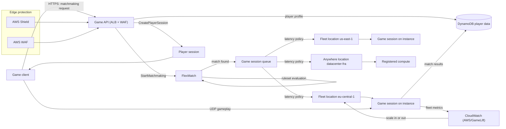
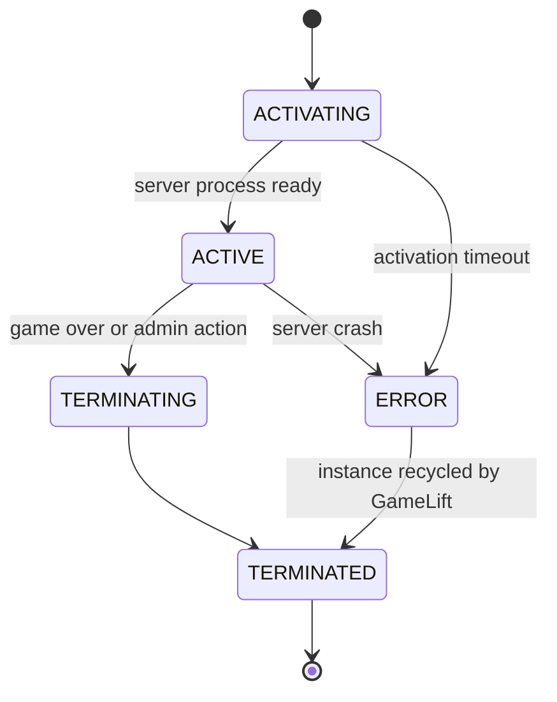
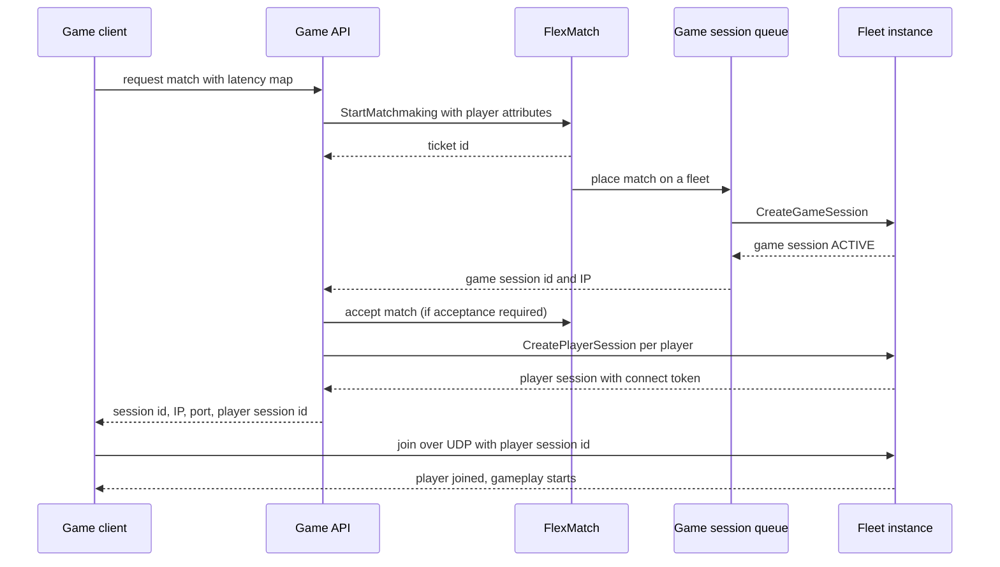

# 05 · Gaming — GameLift and Scaling

> **Phase 8 — Industry Architectures** · Lesson 05 of 08
> ⬅️ Previous: [HIPAA-Ready Storage](./04-hipaa-ready-storage.md) · ➡️ Next: [Media — IVS, Transcoder, and CDN](./06-media-ivs-transcoder-and-cdn.md) · 🏠 [Phase overview](./README.md)

## Learning Objectives

By the end of this lesson you will be able to:

- Choose between EC2 fleets and Anywhere fleets, and between on-demand and Spot, based on latency, cost, and infrastructure constraints
- Deploy a game build to a multi-location fleet with session protection and a health-based scaling policy
- Write a FlexMatch ruleset with latency, skill, and team-balance rules, plus progressive expansions
- Place sessions with latency-based queue policies so players land in the closest healthy location
- Protect the game API and protect player data with Shield, WAF, and an authoritative-server data model

**Estimated time:** 75 min · **Difficulty:** Advanced

---

## Core Concepts

Multiplayer games need something most web applications never do: a **stateful, authoritative server process** that several clients connect to simultaneously, on a machine chosen for proximity to those clients. You cannot put a game server behind an auto-scaling group of stateless containers and hope for the best, because the session's state lives in one process and every player's client is sending inputs to it dozens of times per second. **Amazon GameLift Servers** (the service formerly branded simply as Amazon GameLift, and still `gamelift` in the CLI and API) solves the parts that are genuinely hard: placing sessions on hosts, keeping capacity warm in several Regions, replacing unhealthy instances, and connecting players to the right process.

A **build** is your compiled game server plus the GameLift Server SDK integration. A **fleet** is a managed group of instances running that build in one or more locations. Fleets come in two computing models. **EC2 fleets** are the default: GameLift launches instances in your selected instance types across your Regions and locations, and you never see or manage them. **Anywhere fleets** let you register your own hardware — on-premises racks, another cloud, or bare metal you already own — while still using GameLift for matchmaking, session placement, and queueing. Anywhere is the escape hatch for the latency or licensing requirement that EC2 cannot satisfy, and it is the reason GameLift is usable for a hybrid deployment.

**Matchmaking is a search problem with a patience budget.** FlexMatch takes a ticket per player, containing player attributes and measured latency to each Region, and evaluates a ruleset that combines a latency rule, distance rules over attributes such as skill, and team composition. When a rule cannot be satisfied immediately, **expansions** progressively loosen it over time — that is how you avoid a player waiting four minutes for a perfect match in a small population. The output is a match that a **game session queue** turns into a session on a specific fleet instance, honoring latency policy first and your priority order after that.

### Key terminology

| Term | Meaning |
|------|---------|
| **Build** | Your game server binaries plus Server SDK integration, uploaded to and managed by GameLift |
| **Fleet** | A managed set of instances running one build, in one or more locations |
| **Anywhere fleet** | A fleet whose compute you register yourself (on-premises or another cloud) instead of GameLift-managed EC2 |
| **Alias** | A stable name pointing at a fleet, so clients never hard-code a fleet ID |
| **Game session** | One running instance of a match hosted by one server process on one instance |
| **Player session** | A reservation that authorizes one player to join one game session, with a unique ID |
| **Queue** | An ordered set of fleet destinations with latency and priority policies, used for placement |
| **FlexMatch** | The managed matchmaking service that evaluates a ruleset against tickets |
| **Ruleset** | The JSON definition of latency, distance, comparison, and compound rules plus expansions |
| **Expansion** | A time-based relaxation of a rule's value, applied while a ticket waits |
| **FleetIQ** | The underlying Spot-capable instance management capability GameLift exposes for game servers |
| **Scaling policy** | Target-based or rule-based autoscaling over fleet metrics such as available session percentage |

---

## Architecture Diagram

The path from a player tapping "Find Match" to a connected session on the nearest healthy host:



The game session lifecycle, which is what the client must poll and what your timeouts must match:



The end-to-end matchmaking sequence, including acceptance and the reconnect path:



---

## Hands-on Lab: A Multi-Location Fleet with FlexMatch and Latency-Aware Placement

**Goal:** Upload a game build, run it on a fleet in two locations, publish a FlexMatch ruleset that prefers low latency and balanced skill, place sessions through a latency-aware queue, and attach a target-tracking scaling policy.

**Prerequisites:** AWS CLI v2, a compiled game server with the GameLift Server SDK integrated (a minimal server that calls `InitSDK`, `ProcessReady`, and accepts `onStartGameSession` is enough), and an IAM role for the fleet to reach your data stores.

### Step 1 — Create and upload the build

```bash
# Operating system and server SDK version must match how you compiled the server
aws gamelift create-build \
  --name "arena-server" \
  --version "1.4.0" \
  --operating-system AMAZON_LINUX_2 \
  --server-sdk-version 5.2.0

# Upload the build directory. This can take a while; it streams straight to the GameLift S3 bucket
aws gamelift upload-build \
  --build-id build-1111aaaa-2222-3333-4444-555566667777 \
  --name "arena-server" \
  --build-version "1.4.0" \
  --build-root ./dist/server \
  --operating-system AMAZON_LINUX_2 \
  --server-sdk-version 5.2.0

# Wait for READY before creating a fleet from it
aws gamelift describe-build --build-id build-1111aaaa-2222-3333-4444-555566667777 \
  --query 'Build.Status'
```

### Step 2 — Create a two-location fleet with session protection

Two concurrent server processes per instance keeps utilization high; two additional game session activations allowed beyond that prevents a burst of slow activations from failing outright.

```bash
aws gamelift create-fleet \
  --name "arena-ranked" \
  --description "Ranked arena, EU and US East" \
  --build-id build-1111aaaa-2222-3333-4444-555566667777 \
  --ec2-instance-type c6i.large \
  --fleet-type ON_DEMAND \
  --compute-type EC2 \
  --locations 'Location=eu-central-1' 'Location=us-east-1' \
  --runtime-configuration '{
      "ServerProcesses": [
        { "LaunchPath": "/local/game/bin/arena-server", "ConcurrentExecutions": 2 }
      ],
      "GameSessionActivationTimeoutSeconds": 300,
      "MaxConcurrentGameSessionActivations": 4
    }' \
  --new-game-session-protection-policy 'GameSessionFullProtection=true' \
  --resource-creation-limit-policy 'NewGameSessionsPerCreator=8,PolicyPeriodInMinutes=2' \
  --ec2-inbound-permissions '[
      {"FromPort":7777,"ToPort":7777,"IpProtocol":"UDP","IpRange":"0.0.0.0/0"},
      {"FromPort":7779,"ToPort":7780,"IpProtocol":"TCP","IpRange":"0.0.0.0/0"}
    ]' \
  --instance-role-arn arn:aws:iam::123456789012:role/gamelift-instance-role \
  --metric-groups "arena-production"
```

`GameSessionFullProtection=true` means a new game session is not created if it cannot be fully placed with the requested player slots — it fails fast instead of half-filling a match. `NewGameSessionsPerCreator` limits how many sessions one creator (one client identifier) can start per two minutes, which blunts a trivial abuse loop.

### Step 3 — Add a stable alias and verify capacity

```bash
# Clients use the alias, so fleet replacement never requires a client update
aws gamelift create-alias \
  --name "arena-ranked-alias" \
  --routing-strategy SIMPLE \
  --description "Ranked arena fleet alias"

# Point the alias at the new fleet
aws gamelift update-alias \
  --alias-id alias-9999bbbb-8888-7777-6666-555544443333 \
  --routing-strategy SIMPLE

# Capacity view per location tells you whether to scale or to rebalance locations
aws gamelift describe-fleet-capacity --fleet-ids fleet-1234abcd-5678-90ef-1111-222233334444
aws gamelift describe-fleet-location-capacity \
  --fleet-id fleet-1234abcd-5678-90ef-1111-222233334444

# Confirm the fleet reports ACTIVE in both locations before matchmaking points at it
aws gamelift describe-fleet-attributes \
  --fleet-ids fleet-1234abcd-5678-90ef-1111-222233334444 \
  --query 'FleetAttributes[0].[Status,InstanceType,FleetType,ComputeType]'
```

### Step 4 — Scale on available sessions, not on instance count

Scaling on `PercentAvailableGameSessions` keeps headroom for session creation latency, which is what players feel. Scaling on average instance utilization reacts too late, because a session takes tens of seconds to activate.

```bash
# Keep at least 10 percent of sessions free at all times
aws gamelift put-scaling-policy \
  --fleet-id fleet-1234abcd-5678-90ef-1111-222233334444 \
  --name "keep-headroom" \
  --scaling-adjustment-type ChangeInCapacity \
  --scaling-adjustment 1 \
  --metric-name PercentAvailableGameSessions \
  --comparison-operator GreaterThanThreshold \
  --threshold 10 \
  --evaluation-periods 5

# Do not let idle capacity accumulate: scale in when more than 70 percent of sessions are free
aws gamelift put-scaling-policy \
  --fleet-id fleet-1234abcd-5678-90ef-1111-222233334444 \
  --name "trim-idle" \
  --scaling-adjustment-type ChangeInCapacity \
  --scaling-adjustment -1 \
  --metric-name PercentAvailableGameSessions \
  --comparison-operator GreaterThanThreshold \
  --threshold 70 \
  --evaluation-periods 5

# List what is currently attached
aws gamelift describe-scaling-policies --fleet-id fleet-1234abcd-5678-90ef-1111-222233334444
```

For fleets that must never show a queue, add a second policy on `PercentIdleInstances` with a demand-based adjustment, and pair the whole thing with a **game session queue** so demand spills to another location instead of waiting.

### Step 5 — Write a FlexMatch ruleset

```json
{
  "name": "ranked-2v2",
  "ruleLanguageVersion": "1.0",
  "playerAttributes": [
    { "name": "skill", "type": "number", "default": 1000 },
    { "name": "platform", "type": "string" }
  ],
  "teams": [
    { "name": "red", "minPlayers": 2, "maxPlayers": 2 },
    { "name": "blue", "minPlayers": 2, "maxPlayers": 2 }
  ],
  "rules": [
    { "name": "latencyRule", "type": "latency", "maxLatency": 150, "maxDistance": 5 },
    {
      "name": "skillRule",
      "type": "distance",
      "measurements": ["avg(players.attributes[skill])"],
      "referenceValue": 50,
      "maxDistance": 200
    },
    {
      "name": "teamBalance",
      "type": "distance",
      "measurements": ["avg(teams[*].players.attributes[skill])"],
      "referenceValue": 100,
      "maxDistance": 150
    },
    { "name": "samePlatform", "type": "comparison", "measurements": ["flatten(teams[*].players.attributes[platform])"], "operation": "equal" }
  ],
  "expansions": [
    {
      "target": "rules[skillRule].maxDistance",
      "steps": [
        { "waitTimeSeconds": 15, "value": 300 },
        { "waitTimeSeconds": 30, "value": 500 }
      ]
    },
    {
      "target": "rules[latencyRule].maxLatency",
      "steps": [
        { "waitTimeSeconds": 20, "value": 200 }
      ]
    }
  ],
  "algorithm": { "batchingPreference": "sorted", "sortBy": "latency" },
  "backfillMode": "automatic"
}
```

```bash
# Register the ruleset. The body is validated on creation, which catches syntax errors early
aws gamelift create-matchmaking-rule-set \
  --name ranked-2v2 \
  --rule-set-body file://ranked-2v2.json

# Create the queue first, then the matchmaking configuration that targets it
aws gamelift create-game-session-queue \
  --name "ranked-queues" \
  --destinations '[
      {"DestinationArn":"arn:aws:gamelift:eu-central-1:123456789012:fleet/fleet-1234abcd-5678-90ef-1111-222233334444"},
      {"DestinationArn":"arn:aws:gamelift:us-east-1:123456789012:fleet/fleet-1234abcd-5678-90ef-1111-222233334444"}
    ]' \
  --player-latency-policies '[{"MaximumIndividualPlayerLatencyMilliseconds":150,"PolicyDurationSeconds":30}]' \
  --priority-configuration 'PriorityOrder=["LATENCY","COST","DESTINATION"]'

aws gamelift create-matchmaking-configuration \
  --name "ranked-2v2-config" \
  --description "Ranked 2v2 with skill expansion" \
  --rule-set-name ranked-2v2 \
  --request-timeout-seconds 60 \
  --game-session-queue-arns arn:aws:gamelift:eu-central-1:123456789012:gamesessionqueue/ranked-queues \
  --acceptance-required \
  --acceptance-timeout-seconds 30 \
  --notification-target arn:aws:sns:eu-central-1:123456789012:arena-matchmaking-events
```

### Step 6 — Start and observe a matchmaking ticket

```bash
aws gamelift start-matchmaking \
  --ticket-id ticket-2026-02-01-0001 \
  --configuration-name ranked-2v2-config \
  --players '[
      {
        "PlayerId": "player-4471",
        "PlayerAttributes": { "skill": {"N": 1180}, "platform": {"S": "pc"} },
        "LatencyInMs": { "eu-central-1": 28, "us-east-1": 122 }
      },
      {
        "PlayerId": "player-9930",
        "PlayerAttributes": { "skill": {"N": 1205}, "platform": {"S": "pc"} },
        "LatencyInMs": { "eu-central-1": 41, "us-east-1": 118 }
      }
    ]'

# Poll the ticket. Status moves through QUEUED, SEARCHING, REQUIRES_ACCEPTANCE, PLACING, COMPLETED
aws gamelift describe-matchmaking --ticket-ids ticket-2026-02-01-0001 \
  --query 'TicketList[0].[Status,GameSessionConnectionInfo,Players]'

# Accept the proposed match if acceptance was required, within the timeout
aws gamelift accept-match \
  --ticket-id ticket-2026-02-01-0001 \
  --player-ids player-4471 player-9930 \
  --acceptance-type ACCEPT
```

### Step 7 — Reserve player sessions

Nothing connects to a game server without a player session. This is the mechanism that makes the fleet's ports less interesting to attackers: an unauthorized UDP packet has no valid session ID and is dropped by the integrated server SDK.

```bash
# Reserve one slot per player on the placed game session
aws gamelift create-player-sessions \
  --game-session-id gs-2026-02-01-abc123 \
  --player-ids player-4471 player-9930 \
  --player-data "ranked:1"

# Inspect a reservation; the returned PlayerSessionId is the client's join credential
aws gamelift describe-player-sessions \
  --game-session-id gs-2026-02-01-abc123 \
  --player-id player-4471

# A single backend-created session, for example when the game API places a private match
aws gamelift create-player-session \
  --game-session-id gs-2026-02-01-abc123 \
  --player-id player-4471 \
  --player-data "private-match"
```

### Step 8 — Register on-premises compute as an Anywhere location

Use Anywhere when a licensed or latency-critical environment cannot be replaced by EC2, while keeping GameLift's placement and queueing.

```bash
# Create a custom location that represents your own datacenter
aws gamelift create-location --location-name "datacenter-fra"

# An Anywhere fleet reports the cost per instance-hour so queue priority logic can price it
aws gamelift create-fleet \
  --name "arena-onprem" \
  --compute-type ANYWHERE \
  --anywhere-configuration 'Cost=0.18' \
  --instance-role-arn arn:aws:iam::123456789012:role/gamelift-instance-role

# Register each machine. The agent on that host then negotiates the session locally
aws gamelift register-compute \
  --fleet-id fleet-onprem-0000-1111-2222-333344445555 \
  --compute-name "fra-rack1-node3" \
  --ip-address 10.20.30.40 \
  --location "datacenter-fra"

# Confirm the compute is registered and the fleet is usable in the queue
aws gamelift describe-compute \
  --fleet-id fleet-onprem-0000-1111-2222-333344445555 \
  --compute-name "fra-rack1-node3"

# Add the on-premises fleet as a lower-priority queue destination
aws gamelift update-game-session-queue \
  --name "ranked-queues" \
  --destinations '[
      {"DestinationArn":"arn:aws:gamelift:eu-central-1:123456789012:fleet/fleet-1234abcd-5678-90ef-1111-222233334444"},
      {"DestinationArn":"arn:aws:gamelift:eu-central-1:123456789012:fleet/fleet-onprem-0000-1111-2222-333344445555"}
    ]'
```

### Step 9 — Store player data and results

Game sessions should report results to your own data layer, never write state the client can forge.

```bash
# Create a small table for profiles and aggregate stats
aws dynamodb create-table \
  --table-name arena_player_stats \
  --attribute-definitions AttributeName=player_id,AttributeType=S AttributeName=ladder,AttributeType=S \
  --key-schema AttributeName=player_id,KeyType=HASH \
  --global-secondary-indexes '[{"IndexName":"ladder-score","KeySchema":[{"AttributeName":"ladder","KeyType":"HASH"}],"Projection":{"ProjectionType":"INCLUDE","NonKeyAttributes":["score"]}}]' \
  --billing-mode PAY_PER_REQUEST

# Atomic update after a match. ADD on a number is a single-item, conflict-free increment
aws dynamodb update-item \
  --table-name arena_player_stats \
  --key '{"player_id":{"S":"player-4471"}}' \
  --update-expression "ADD score :delta, matches_played :one SET last_match_at = :ts, ladder = :ladder" \
  --expression-attribute-values '{
      ":delta":{"N":"25"},
      ":one":{"N":"1"},
      ":ts":{"S":"2026-02-01T21:04:00Z"},
      ":ladder":{"S":"ranked-2v2"}
    }' \
  --return-values UPDATED_NEW
```

### Step 10 — Protect the edge

```bash
# Shield Advanced covers specific resource types, not the managed fleet instances themselves
aws shield describe-subscription

# Protect the public game API behind your load balancer
aws shield create-protection \
  --name "arena-game-api" \
  --resource-arn arn:aws:elasticloadbalancing:eu-central-1:123456789012:loadbalancer/app/arena-api/50dc6c495c0c9188

# Rate-limit matchmaking at the WAF layer so a bot cannot exhaust tickets
aws wafv2 create-web-acl \
  --name arena-api-acl \
  --scope REGIONAL \
  --default-action Allow={} \
  --visibility-config SampledRequestsEnabled=true,CloudWatchMetricsEnabled=true,MetricName=arenaApiAcl \
  --rules '[
      {
        "Name": "rate-limit-matchmaking",
        "Priority": 1,
        "Action": { "Block": {} },
        "Statement": {
          "RateBasedStatement": { "Limit": 2000, "AggregateKeyType": "IP", "EvaluationWindowSec": 300 }
        },
        "VisibilityConfig": { "SampledRequestsEnabled": true, "CloudWatchMetricsEnabled": true, "MetricName": "matchmakingRate" }
      }
    ]'
```

Client-side telemetry from your game server (via the CloudWatch agent on EC2 fleet instances, or from your own agent on Anywhere compute) complements the `AWS/GameLift` metrics, which cover capacity and session counts but not frame time or tick overrun.

---

## CLI Reference

```bash
# All fleets and their status, one line each
aws gamelift list-fleets --query 'FleetIds' --output text

# Fleet capacity split by location, the input to any rebalancing decision
aws gamelift describe-fleet-location-capacity --fleet-id <fleet-id>

# Metrics available for scaling decisions
aws gamelift describe-fleet-utilization --fleet-ids <fleet-id>

# Validate a ruleset before publishing it
aws gamelift describe-matchmaking-rule-sets --names ranked-2v2

# Ticket backlog and current matchmaking activity
aws gamelift describe-matchmaking --ticket-ids <ticket-id>
aws gamelift list-matchmaking-configurations

# Queue configuration, including latency policy and priority order
aws gamelift describe-game-session-queues --names ranked-queues

# Remove a ticket that a player abandoned so it stops consuming matchmaking work
aws gamelift stop-matchmaking --ticket-id <ticket-id>
```

| Command | Purpose |
|---------|---------|
| `describe-fleet-location-capacity` | Shows which location is short before players notice a queue |
| `describe-fleet-utilization` | Confirms the scaling metric you chose is the one that matters |
| `describe-matchmaking-rule-sets` | Catches a ruleset that was created but never successfully validated |
| `accept-match` | Completes the acceptance step that prevents mismatched lobbies |
| `stop-matchmaking` | Prevents abandoned tickets from skewing matchmaking load |
| `describe-compute` | Verifies Anywhere hardware is actually registered and reporting |

---

## Best Practices

| Practice | Why it matters |
|----------|----------------|
| Make the server authoritative for all state | A client that can report its own score is a client that will |
| Scale on session availability, not CPU | Instance CPUs look idle during fill time while players wait |
| Give every fleet a queue with two or more destinations | A single-location fleet turns a zonal event into an outage |
| Use a fleet alias in clients | Fleet replacement becomes an operational task, not a release |
| Always reserve player sessions before connecting | It is your only gate on who may speak to the game port |
| Set `GameSessionFullProtection` for team modes | Half-filled matches are worse than a short queue |
| Write expansions for every hard rule | A perfect-match-only ruleset abandons the long tail of players |
| Keep the Anywhere location in the same queue | Your own hardware should absorb spills, not sit idle |
| Treat game server logs as production telemetry | Cheating investigations and crash triage both need them, and both arrive after the fact |

---

## Common Pitfalls

| Pitfall | Symptom | Fix |
|---------|---------|-----|
| Session activation timeouts set too low | Game sessions stuck in `ERROR` under load | Raise `GameSessionActivationTimeoutSeconds` and `MaxConcurrentGameSessionActivations` |
| Scaling on `ActiveInstances` | Oversized fleet with a large bill and no latency benefit | Scale on `PercentAvailableGameSessions` |
| Matchmaking without a latency rule | Players placed across an ocean, complaining about hit registration | Add a latency rule and a latency policy on the queue, and collect real `LatencyInMs` values from clients |
| Skills rule with no expansion | Long queues for high-skill players | Add expansion steps with generous `maxDistance` values |
| Uploading a build compiled against a different SDK version | Fleet reports `ACTIVE` but sessions never activate | Pin `--server-sdk-version` to the version your build links against |
| Hard-coded fleet ID in the client | Fleet replacement ships a client patch | Use an alias |
| Assuming Shield Advanced protects fleet instances | Protection gaps on the game port itself | Protect the edge resources, and rely on player session gating plus per-creator session limits |
| Client writes its own stats | A trivially cheatable leaderboard | Accept results only from the game server, authenticated as your role |
| One Region, one location | Any regional event is a full outage | Two locations minimum for ranked queues |

---

## Cost Considerations

GameLift is priced per **instance-hour** of running fleet capacity, per **GB of data transfer out**, and per **matchmaking request**, with Spot fleets offering a substantial discount over on-demand in exchange for interruption tolerance. GameLift instance rates track slightly above equivalent EC2 on-demand prices, which is the price of the managed placement, replacement, and session layer.

What drives the bill:

1. **Idle capacity is the dominant cost.** A fleet of 20 `c6i.large` instances costs very roughly **$0.13 to $0.20 per instance-hour**, so 20 instances is on the order of **$2,000 to $2,900 per month** whether or not anyone plays. Off-peak scale-in policies are worth more than any other optimization here.
2. **Over-scaling for latency headroom.** Keeping 10% of sessions free is cheap; keeping 50% free doubles the bill. Measure the queue time your players actually tolerate and size to that.
3. **Multi-location fleets double the floor.** Every location needs its own minimum. Consider a primary location with a queue that spills to a second location instead of a permanently warm fleet in both.
4. **Data transfer out from game sessions.** Real-time gameplay is high-frequency and low-payload, but a large concurrent player count adds up. GameLift bills egress from the fleet; a chatty netcode design costs more than a client-interpolated one.
5. **Spot capacity** can reduce compute cost substantially, and it is a good fit for non-ranked modes where a mid-match interruption is recoverable. Do not put your competitive ladder on Spot without a reconnect story.
6. **FlexMatch** is billed per matchmaking request, so a client that retries matchmaking aggressively on failure multiplies cost and queue load. Back off and reuse tickets.
7. **Anywhere fleets** shift compute cost to hardware you already pay for, and you are charged for the managed services around them — usually the cheapest per-player option if the latency genuinely requires it.

---

## Security Considerations

- **The client is hostile.** Assume every value from a client is attacker-controlled until the server validates it: movement vectors, scores, item counts, and matchmaking attributes.
- **Player sessions are the door.** Reserve them server-side, with a short expiry, and never allow a client to request one for a game session it was not matched into.
- **Authorize matchmaking with your own identity layer.** The GameLift API has no notion of "this is player X" — your API must authenticate the player and pass the verified `PlayerId` in, never a client-supplied one.
- **Keep AWS credentials out of the game client and off the game server** where possible. If the server must reach DynamoDB, use the fleet instance role so the server obtains scoped temporary credentials, never long-lived keys baked into the build.
- **Protect the game port with more than a security group.** Fleet inbound permissions must be as narrow as the protocol allows, and player session validation at the server SDK layer is your real access control.
- **DDoS is a design constraint.** Shield Standard is always on; Shield Advanced and WAF belong on the public API where matchmaking and authentication live. Add per-IP and per-player rate limiting on matchmaking and on login, and expect volumetric games of "how fast can we make the queue expensive".
- **Log game session creation, join, and abandonment** to a central store with the player ID and source IP, and alert on unusual patterns such as one creator starting many sessions or one IP joining from many accounts.
- **Encrypt player data end to end**, including leaderboards and chat, and treat a player's IP address as personal data under GDPR and similar regimes — it is not telemetry you should log casually.
- **Rotate fleet credentials and build artifacts.** A leaked build with embedded backend keys compromises your data layer even if the game itself is fine.

---

## Exercise

Design and implement a spill-over placement strategy: a queue whose primary destination is a two-instance minimum warm fleet in the closest location, with a second destination that has zero warm capacity but scales on demand, plus a `PercentAvailableGameSessions` scaling policy on the warm fleet and a stricter one on the spill fleet. Instrument the matchmaking path so you can report, per ticket, which destination served it and how long the player waited.

Success looks like: a synthetic burst of 200 tickets is served without any ticket exceeding the request timeout, no more than a defined percentage of sessions land in the far location, and capacity returns to the two-instance floor within thirty minutes of the burst ending.

---

## Resources

- [Amazon GameLift Servers Developer Guide](https://docs.aws.amazon.com/gamelift/latest/developerguide/gamelift-intro.html)
- [GameLift FlexMatch ruleset reference](https://docs.aws.amazon.com/gamelift/latest/flexmatchguide/match-rulesets.html)
- [GameLift scaling with target-based policies](https://docs.aws.amazon.com/gamelift/latest/developerguide/fleets-autoscaling.html)
- [GameLift Anywhere fleets](https://docs.aws.amazon.com/gamelift/latest/developerguide/fleets-creating-anywhere.html)
- [GameLift game session queues and latency policy](https://docs.aws.amazon.com/gamelift/latest/developerguide/queues-intro.html)
- [AWS Shield Advanced protections](https://docs.aws.amazon.com/waf/latest/developerguide/ddos-overview.html)
- [AWS WAF rate-based rules](https://docs.aws.amazon.com/waf/latest/developerguide/waf-rule-statement-type-rate-based.html)

---

## Next Steps

You now have the shape of a real-time, latency-bound, adversarial workload: capacity that must be warm in the right place, placement that must respect physics, and an edge that must absorb abuse. The next lesson keeps the real-time requirement but changes the payload from game state to video, where the scaling unit becomes bitrate and the CDN does most of the work.

> ⬅️ Previous: [HIPAA-Ready Storage](./04-hipaa-ready-storage.md) · ➡️ Next: [Media — IVS, Transcoder, and CDN](./06-media-ivs-transcoder-and-cdn.md) · 🏠 [Phase overview](./README.md)
