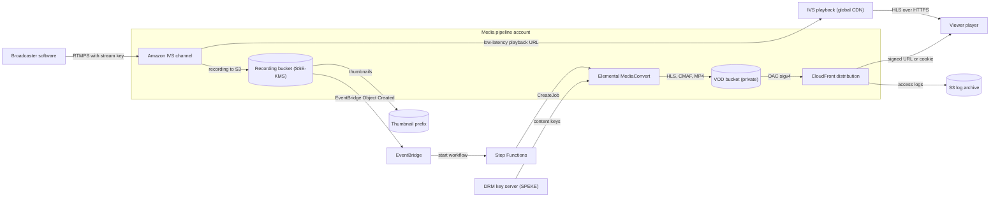
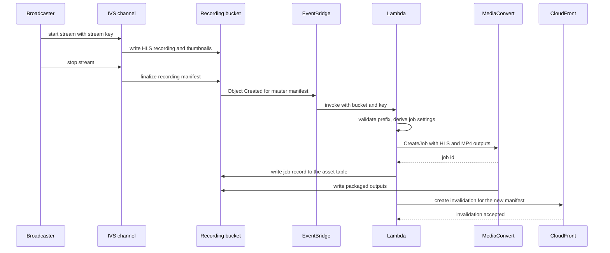
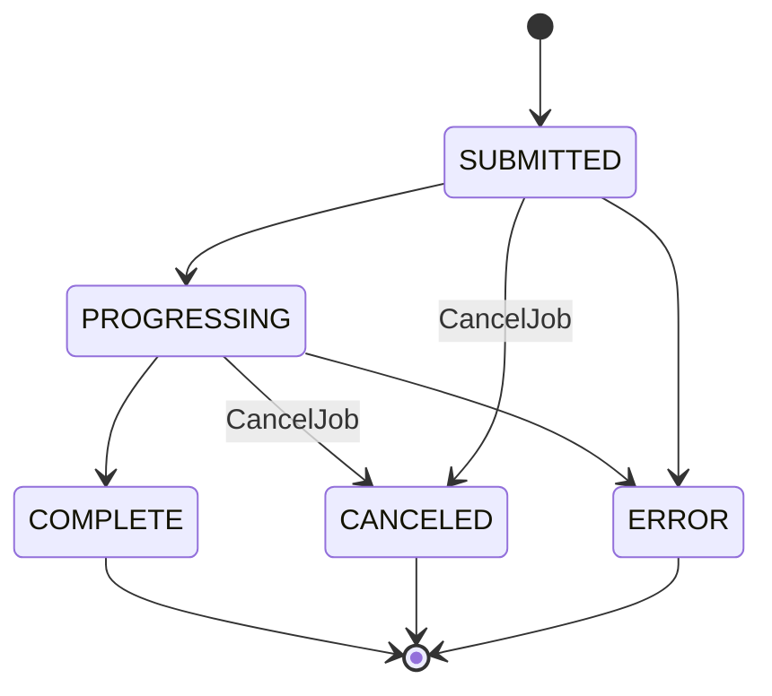

# 06 · Media — IVS, Transcoder, and CDN

> **Phase 8 — Industry Architectures** · Lesson 06 of 08
> ⬅️ Previous: [Gaming — GameLift and Scaling](./05-gaming-gamelift-and-scaling.md) · ➡️ Next: [Government — Air-Gapped Regions](./07-government-air-gapped-regions.md) · 🏠 [Phase overview](./README.md)

## 🎯 Learning Objectives

By the end of this lesson you will be able to:

- Build a live streaming path with Amazon IVS channels, including ingest security, recording, and playback URLs
- Explain the latency tiers available on AWS and pick the right one for interactive versus broadcast use cases
- Design a bitrate ladder for on-demand transcoding with Elemental MediaConvert and run it from the CLI
- Deliver content with CloudFront using origin access control, cache policies, and signed URLs or cookies
- Automate a live-to-VOD workflow that turns a finished broadcast into a permanent, DRM-aware asset

**Estimated time:** 70 min · **Difficulty:** Intermediate

---

## 🧠 Core Concepts

Every video architecture is a chain of **contribution, processing, packaging, and delivery**, and the only thing that changes between use cases is how much latency each stage is allowed to add. A live quiz show needs sub-second so answers feel simultaneous; a keynote needs a few seconds; a VOD library has no latency requirement at all and cares only about cost per delivered GB. Being explicit about the latency budget for each stage is what stops you from over-engineering a solution — and from shipping a "live" product that is actually 30 seconds behind the chat.

**Amazon IVS** covers the low-latency live end. A **channel** gives you an RTMPS ingest endpoint and a stream key for the broadcaster, and a playback URL for viewers. IVS handles the transcoding, packaging, and delivery, including a global CDN, so you do not operate MediaLive, MediaPackage, and a distribution of your own. IVS also handles **recording to your S3 bucket** and can emit thumbnails, which is the hook for everything downstream. For genuinely interactive video — where a host and guests talk to each other — the sub-300 ms tier is **IVS real-time streaming** with stages and participants, not a low-latency channel.

**Elemental MediaConvert** is the file-based transcoder. It takes a mezzanine or an HLS recording, applies a **bitrate ladder** (the set of resolutions and bitrates you publish so players can switch), and writes packaged outputs: HLS, DASH, CMAF, or plain MP4. The quality of the ladder matters more than the encoder settings: too few rungs and mobile viewers on a bad connection stall, too many and you pay for renditions nobody requests. Use **QVBR** rather than fixed bitrate so complex scenes get the bits they need and static ones do not.

**CloudFront** is the delivery layer you should not skip, even when the origin is already a managed service. It caches segments at the edge, reduces origin egress, and gives you the access control primitives that make paid or private content possible: **signed URLs** for single objects, **signed cookies** for HLS playback where hundreds of segment requests would each need a token, and **origin access control (OAC)** so the S3 bucket behind the distribution is never public. For premium content, DRM via **SPEKE** integrates a key server with the packager so the content key never touches your code; multi-DRM in practice means CMAF with CENC for Widevine and PlayReady, and HLS with SAMPLE-AES for FairPlay.

### Key terminology

| Term | Meaning |
|------|---------|
| **Contribution feed** | The video source sent by the broadcaster to the ingest endpoint — RTMPS for IVS channels |
| **Glass-to-glass latency** | Capture on camera to display in the viewer's player, the number that matters to the product |
| **Bitrate ladder** | The resolution/bitrate rungs published in a manifest so players can adapt |
| **QVBR** | Quality-defined variable bitrate — target a quality level, cap with `MaxBitrate` |
| **Packaging** | Wrapping encoded video into HLS, DASH, or CMAF manifests and segments |
| **OAC** | CloudFront origin access control, the SigV4 mechanism that lets only the distribution read the bucket |
| **Signed URL / cookie** | A time-limited credential that authorizes delivery of specific content |
| **Cache policy / origin request policy** | What CloudFront caches versus what it forwards to the origin |
| **SPEKE** | Secure Packager and Encoder Key Exchange, the API between the packager and a DRM key server |
| **Live-to-VOD** | Converting a finished live broadcast into a permanent on-demand asset automatically |

---

## 🗺️ Architecture Diagram

The live path and the VOD path, which meet in the recording bucket:



The live-to-VOD workflow as it actually executes, including the wait for the recording to be complete:



The MediaConvert job lifecycle, which you should poll rather than assume:



---

## 🧪 Hands-on Lab: A Live Channel, a Transcode Ladder, and Signed Delivery

**Goal:** Create an IVS channel with recording, upload a source file, transcode it into an adaptive HLS ladder plus an MP4, deliver it through CloudFront with OAC, and restrict access with a signed URL.

**Prerequisites:** AWS CLI v2, an S3 bucket for recordings, an S3 bucket for VOD outputs, a mezzanine source file in S3, and the MediaConvert service role (`MediaConvert_Default_Role` or your own).

### Step 1 — Create the IVS channel and its recording configuration

```bash
# Recording configuration must exist before it can be attached to a channel
aws ivs create-recording-configuration \
  --name "arena-vod-recording" \
  --destination-configuration 's3={bucketName=arena-ivs-recordings}' \
  --thumbnail-configuration 'recordingMode=INTERVAL,targetIntervalSeconds=30' \
  --recording-reconnect-window-seconds 60

# Low latency mode is what keeps glass-to-glass in the low single-digit seconds
aws ivs create-channel \
  --name "arena-main" \
  --latency-mode LOW \
  --recording-configuration-arn arn:aws:ivs:eu-central-1:123456789012:recording-configuration/abcd1234

# Take the ingestEndpoint, playbackUrl, and stream key from the response and store them safely
aws ivs list-channels --query 'channels[].{name:name,arn:arn,url:playbackUrl}'
```

The stream key is a secret. Store it in AWS Secrets Manager, rotate it if it leaks, and never put it in a client application — anyone with the key can broadcast to your channel.

```bash
# Rotate a compromised key: create the replacement first, then disable ingest on the old one
aws ivs create-stream-key --channel-arn arn:aws:ivs:eu-central-1:123456789012:channel/abcd1234efgh

# List keys to confirm which are still live, then delete the retired one
aws ivs list-stream-keys --channel-arn arn:aws:ivs:eu-central-1:123456789012:channel/abcd1234efgh
aws ivs delete-stream-key --arn arn:aws:ivs:eu-central-1:123456789012:stream-key/oldkey1234

# Confirm the channel is actually receiving video during a broadcast
aws ivs get-stream --channel-arn arn:aws:ivs:eu-central-1:123456789012:channel/abcd1234efgh \
  --query 'stream.[state,health,startTime]'
```

### Step 2 — Restrict playback with IVS playback authorization

Unauthenticated playback URLs can be hotlinked. IVS playback authorization binds playback to a signed JWT issued by your own auth service.

```bash
# Register the public half of the key pair your backend signs tokens with
aws ivs create-playback-key-pair \
  --name "arena-playback-2026" \
  --public-key-material fileb://arena-playback-public.pem

# Turn on authorization for the channel, then play back only with a valid token
aws ivs update-channel \
  --arn arn:aws:ivs:eu-central-1:123456789012:channel/abcd1234efgh \
  --authorized
```

Your backend mints a short-lived JWT for the viewer, signed with the matching private key, and the player appends it as a `token` query parameter to the playback URL. Keep the token lifetime shorter than a typical session-abuse window — a minute or two for interactive content.

### Step 3 — Find your MediaConvert endpoint

MediaConvert is a per-account, per-Region service with its own endpoint hostname. Every API call needs `--endpoint-url`.

```bash
# Save the account-specific endpoint; it is not the generic mediaconvert.<region>.amazonaws.com host
export MC_ENDPOINT=$(aws mediaconvert describe-endpoints --region eu-central-1 \
  --query 'Endpoints[0].Url' --output text)
echo "${MC_ENDPOINT}"

# Confirm the service role and check for existing presets you can reuse
aws mediaconvert list-presets --endpoint-url "${MC_ENDPOINT}" --max-results 5
aws mediaconvert list-queues --endpoint-url "${MC_ENDPOINT}" \
  --query 'Queues[].{name:Name,status:Status,type:Type}'
```

### Step 4 — Build a bitrate ladder and run the job

A four-rung ladder from 1080p to 234p covers phone-on-cellular through desktop. QVBR with `MaxBitrate` caps are what keep the top rung from becoming expensive on high-motion content.

```json
{
  "Role": "arn:aws:iam::123456789012:role/MediaConvert_Default_Role",
  "Settings": {
    "TimecodeConfig": { "Source": "ZEROBASED" },
    "OutputGroups": [
      {
        "Name": "HLS",
        "OutputGroupSettings": {
          "Type": "HLS_GROUP_SETTINGS",
          "HlsGroupSettings": {
            "SegmentLength": 6,
            "MinSegmentLength": 0,
            "Destination": "s3://arena-vod-output/hls/lesson-101/",
            "ManifestDurationFormat": "INTEGER",
            "OutputSelection": "MANIFESTS_AND_SEGMENTS"
          }
        },
        "Outputs": [
          {
            "NameModifier": "_1080p",
            "ContainerSettings": { "Container": "M3U8" },
            "VideoDescription": {
              "Width": 1920, "Height": 1080, "ScalingBehavior": "DEFAULT", "TimecodeInsertion": "DISABLED",
              "CodecSettings": {
                "Codec": "H_264",
                "H264Settings": {
                  "RateControlMode": "QVBR", "QvbrSettings": { "QvbrQualityLevel": 7 },
                  "MaxBitrate": 5100000, "CodecProfile": "HIGH", "CodecLevel": "AUTO",
                  "GopSize": 2, "GopSizeUnits": "SECONDS", "FramerateControl": "INITIALIZE_FROM_SOURCE"
                }
              }
            },
            "AudioDescriptions": [
              { "CodecSettings": { "Codec": "AAC", "AacSettings": { "Bitrate": 128000, "CodingMode": "CODING_MODE_2_0", "SampleRate": 48000 } } }
            ]
          },
          {
            "NameModifier": "_720p",
            "ContainerSettings": { "Container": "M3U8" },
            "VideoDescription": {
              "Width": 1280, "Height": 720, "ScalingBehavior": "DEFAULT",
              "CodecSettings": {
                "Codec": "H_264",
                "H264Settings": {
                  "RateControlMode": "QVBR", "QvbrSettings": { "QvbrQualityLevel": 7 },
                  "MaxBitrate": 3000000, "CodecProfile": "MAIN", "CodecLevel": "AUTO", "GopSize": 2, "GopSizeUnits": "SECONDS"
                }
              }
            },
            "AudioDescriptions": [
              { "CodecSettings": { "Codec": "AAC", "AacSettings": { "Bitrate": 128000, "CodingMode": "CODING_MODE_2_0", "SampleRate": 48000 } } }
            ]
          },
          {
            "NameModifier": "_480p",
            "ContainerSettings": { "Container": "M3U8" },
            "VideoDescription": {
              "Width": 854, "Height": 480, "ScalingBehavior": "DEFAULT",
              "CodecSettings": {
                "Codec": "H_264",
                "H264Settings": {
                  "RateControlMode": "QVBR", "QvbrSettings": { "QvbrQualityLevel": 7 },
                  "MaxBitrate": 1400000, "CodecProfile": "MAIN", "CodecLevel": "AUTO", "GopSize": 2, "GopSizeUnits": "SECONDS"
                }
              }
            },
            "AudioDescriptions": [
              { "CodecSettings": { "Codec": "AAC", "AacSettings": { "Bitrate": 96000, "CodingMode": "CODING_MODE_2_0", "SampleRate": 48000 } } }
            ]
          }
        ]
      },
      {
        "Name": "ProgressiveMP4",
        "OutputGroupSettings": {
          "Type": "FILE_GROUP_SETTINGS",
          "FileGroupSettings": { "Destination": "s3://arena-vod-output/mp4/lesson-101/" }
        },
        "Outputs": [
          {
            "NameModifier": "_720p_mp4",
            "ContainerSettings": { "Container": "MP4", "Mp4Settings": { "CttsVersion": 0, "FreeSpaceBox": "EXCLUDE", "MoovPlacement": "PROGRESSIVE_DOWNLOAD" } },
            "VideoDescription": {
              "Width": 1280, "Height": 720,
              "CodecSettings": {
                "Codec": "H_264",
                "H264Settings": { "RateControlMode": "QVBR", "QvbrSettings": { "QvbrQualityLevel": 7 }, "MaxBitrate": 3000000, "CodecProfile": "MAIN" }
              }
            },
            "AudioDescriptions": [
              { "CodecSettings": { "Codec": "AAC", "AacSettings": { "Bitrate": 128000, "CodingMode": "CODING_MODE_2_0", "SampleRate": 48000 } } }
            ]
          }
        ]
      }
    ],
    "Inputs": [
      {
        "FileInput": "s3://arena-source/mezzanine/lesson-101.mp4",
        "AudioSelectors": { "Audio Selector 1": { "DefaultSelection": "DEFAULT" } },
        "VideoSelector": { "ColorSpace": "FOLLOW" },
        "TimecodeSource": "ZEROBASED"
      }
    ]
  }
}
```

```bash
# Submit the job. Add AccelerationSettings for a premium-price fast turnaround on long files
aws mediaconvert create-job \
  --endpoint-url "${MC_ENDPOINT}" \
  --role arn:aws:iam::123456789012:role/MediaConvert_Default_Role \
  --settings file://job-ladder.json \
  --queue arn:aws:mediaconvert:eu-central-1:123456789012:queues/Default \
  --user-metadata '{"assetId":"lesson-101","tier":"standard"}' \
  --tags Project=arena-vod

# Poll the job instead of assuming success
aws mediaconvert get-job --id 1234567890123-abcdef --endpoint-url "${MC_ENDPOINT}" \
  --query 'Job.[Status,JobPercentComplete,ErrorMessage]'

# List recent failures, which is where a broken input path shows up
aws mediaconvert list-jobs --endpoint-url "${MC_ENDPOINT}" --status ERROR --max-results 10 \
  --query 'Jobs[].[Id,ErrorMessage]'
```

| Rung | Resolution | Max bitrate | Use case |
|------|-----------|-------------|----------|
| 4 | 1920×1080 | 5.1 Mbps | Desktop, fast broadband, TV |
| 3 | 1280×720 | 3.0 Mbps | Laptop and tablet |
| 2 | 854×480 | 1.4 Mbps | Mobile on Wi-Fi |
| 1 | 426×240 | 0.4 Mbps | Mobile on congested cellular |

### Step 5 — Deliver with CloudFront, with the bucket private

```bash
# OAC is what replaces the old public-origin or origin access identity patterns
aws cloudfront create-origin-access-control \
  --origin-access-control-config 'Name=arena-vod-oac,SigningProtocol=sigv4,SigningBehavior=always,OriginAccessControlOriginType=s3'

# A cache policy tuned for video segments: long TTLs, no headers in the cache key
aws cloudfront create-cache-policy --cache-policy-config '{
    "Name": "vod-segments",
    "Comment": "Long TTL for immutable video segments",
    "DefaultTTL": 86400,
    "MaxTTL": 31536000,
    "MinTTL": 1,
    "ParametersInCacheKeyAndForwardedToOrigin": {
      "EnableAcceptEncodingGzip": true,
      "EnableAcceptEncodingBrotli": true,
      "CookiesConfig": { "CookieBehavior": "none" },
      "HeadersConfig": { "HeaderBehavior": "none" },
      "QueryStringsConfig": { "QueryStringBehavior": "none" }
    }
  }'
```

```json
{
  "CallerReference": "arena-vod-2026-02-01",
  "Comment": "Arena VOD delivery",
  "Enabled": true,
  "Aliases": { "Quantity": 1, "Items": ["vod.arena.example"] },
  "Origins": {
    "Quantity": 1,
    "Items": [
      {
        "Id": "vod-s3-origin",
        "DomainName": "arena-vod-output.s3.eu-central-1.amazonaws.com",
        "OriginAccessControlId": "E3ABCDEFGHIJK",
        "S3OriginConfig": { "OriginAccessIdentity": "" }
      }
    ]
  },
  "DefaultCacheBehavior": {
    "TargetOriginId": "vod-s3-origin",
    "ViewerProtocolPolicy": "redirect-to-https",
    "CachePolicyId": "658327ea-f89d-4fab-a63d-7e88639e58f6",
    "Compress": true,
    "TrustedSigners": { "Enabled": true, "Quantity": 1, "Items": ["self"] },
    "TrustedKeyGroups": { "Enabled": true, "Quantity": 1, "Items": ["K2ABCDEFGHIJK"] },
    "MinTTL": 0
  },
  "PriceClass": "PriceClass_100",
  "Restrictions": { "GeoRestriction": { "RestrictionType": "none", "Quantity": 0 } },
  "Logging": {
    "Enabled": true,
    "IncludeCookies": false,
    "Bucket": "arena-cf-logs.s3.amazonaws.com",
    "Prefix": "vod/"
  }
}
```

```bash
# Create the public key and key group that authorize signed delivery
aws cloudfront create-public-key --public-key-config '{
    "Name": "arena-signing-2026",
    "CallerReference": "arena-signing-2026",
    "EncodedKey": "LS0tLS1CRUdJTiBQVUJMSUMgS0VZLS0tLS0...",
    "Comment": "Signing key for VOD"
  }'

aws cloudfront create-key-group --key-group-config '{
    "Name": "arena-signed-group",
    "Items": ["K2ABCDEFGHIJK"]
  }'

# Deploy the distribution
aws cloudfront create-distribution --distribution-config file://vod-distribution.json \
  --query 'Distribution.[Id,DomainName,Status]'

# Sign a playback URL valid for two hours
aws cloudfront sign \
  --url "https://vod.arena.example/hls/lesson-101/index.m3u8" \
  --key-pair-id K2ABCDEFGHIJK \
  --private-key file://arena-signing-private.pem \
  --date-less-than 2026-02-02T00:00:00Z

# Invalidate only when content changes at a stable path
aws cloudfront create-invalidation --distribution-id E1ABCDEFGHIJKLM \
  --paths "/hls/lesson-101/index.m3u8"
```

Sign **cookies** rather than URLs for HLS playback in a browser. A single manifest can reference hundreds of segments across several renditions, and per-object URL signing does not survive that pattern.

### Step 6 — Automate live-to-VOD

```bash
# Ask S3 to send its events to EventBridge for the recording bucket
aws s3api put-bucket-notification-configuration \
  --bucket arena-ivs-recordings \
  --notification-configuration '{"EventBridgeConfiguration": {}}'

# Match only finalized recordings, not every segment written
aws events put-rule \
  --name ivs-recording-complete \
  --event-pattern '{
      "source": ["aws.s3"],
      "detail-type": ["Object Created"],
      "detail": {
        "bucket": { "name": ["arena-ivs-recordings"] },
        "object": { "key": [{ "suffix": ".m3u8" }] }
      }
    }'

# Start a Step Functions workflow that submits the MediaConvert job and records the asset
aws events put-targets \
  --rule ivs-recording-complete \
  --targets '[{"Id":"start-live-to-vod","Arn":"arn:aws:states:eu-central-1:123456789012:stateMachine:live-to-vod"}]'
```

Deduplicate inside the workflow: IVS writes several manifests, and a naive one-job-per-manifest rule will transcode the same broadcast twice. Key your idempotency on the recording prefix plus the broadcast session ID.

### Step 7 — Understand what DRM changes

For premium content, packaging must encrypt with keys from a license server rather than serving plain HLS. Elemental MediaConvert and MediaPackage integrate with DRM key servers through **SPEKE**: your job configuration points at the key provider's endpoint with a `resourceId` and a `systemId`, MediaConvert requests content keys during transcoding, and the player requests a license from that provider using the viewer's entitlement. Multi-DRM in practice means producing CMAF with CENC so a single set of segments serves both Widevine and PlayReady, plus FairPlay HLS with SAMPLE-AES for Apple clients.

Two architectural consequences: you cannot encrypt content that is already published, so DRM must be a setting in the packaging job and not a later step; and license issuance becomes an availability dependency in the playback path, which means caching and a degraded-mode decision are part of the design, not an afterthought.

---

## 💻 CLI Reference

```bash
# Live channel state during a broadcast
aws ivs get-stream --channel-arn <channel-arn> --query 'stream.[state,health,viewerCount]'

# Stop a runaway ingest without deleting the channel
aws ivs stop-stream --channel-arn <channel-arn>

# Recording configurations and their destinations
aws ivs list-recording-configurations

# MediaConvert job history filtered by status
aws mediaconvert list-jobs --endpoint-url "${MC_ENDPOINT}" --status COMPLETE --max-results 20

# Cancel a job that is still progressing
aws mediaconvert cancel-job --id <job-id> --endpoint-url "${MC_ENDPOINT}"

# CloudFront distribution configuration and cache behavior summary
aws cloudfront get-distribution --id E1ABCDEFGHIJKLM \
  --query 'Distribution.DistributionConfig.[DefaultCacheBehavior,Origins.Items[0].DomainName]'

# Top requested objects, once CloudFront standard logging or real-time logs are enabled
aws logs start-query \
  --log-group-name "arn:aws:logs:us-east-1:123456789012:log-group:/aws/cloudfront/arena-vod" \
  --start-time "$(date -v-1H +%s)" --end-time "$(date +%s)" \
  --query-string 'fields @timestamp, cs-uri-stem, sc-status | sort @timestamp desc | limit 20'
```

| Command | Purpose |
|---------|---------|
| `ivs get-stream` | Confirms a broadcaster is actually connected before debugging playback |
| `ivs stop-stream` | Kills an abusive or runaway ingest without touching the channel config |
| `mediaconvert list-jobs --status ERROR` | Turns a silent pipeline failure into a specific error message |
| `mediaconvert cancel-job` | Stops the cost of a job submitted with wrong settings |
| `cloudfront get-distribution` | Verifies OAC and the cache policy are actually attached |
| `cloudfront create-invalidation` | Clears a stale manifest at a stable path after a re-publish |

---

## ✅ Best Practices

| Practice | Why it matters |
|----------|----------------|
| Choose the latency tier before choosing services | It determines whether you need IVS real-time, an IVS low-latency channel, or only MediaConvert |
| Never use insecure RTMP ingest | RTMPS exists; plaintext stream keys are trivially captured |
| Rotate stream keys on a schedule and on any leak | One key gives full broadcast rights to your channel |
| Keep the VOD bucket private and use OAC | A public bucket is a hotlinking bill and a data-leak risk at once |
| Use QVBR with a `MaxBitrate` cap | Predictable cost with better quality than fixed bitrate |
| Sign cookies for HLS in browsers, URLs for single objects | Segment-heavy playback makes per-object signing impractical |
| Keep token lifetimes short and content-scoped | A leaked token should expire before it matters |
| Make live-to-VOD idempotent per recording | Duplicate transcodes are pure waste and confuse the VOD catalog |
| Use cache policies rather than forwarding everything | Forwarding headers or query strings destroys cache hit rate and raises origin cost |
| Test a ladder against real devices | A ladder that is correct in theory can still stutter on the device your users own |

---

## ⚠️ Common Pitfalls

| Pitfall | Symptom | Fix |
|---------|---------|-----|
| Calling the generic MediaConvert hostname | `Endpoint not found` or signature errors | Always pass the account endpoint from `describe-endpoints` |
| HLS output with 10-second segments | Long startup time and slow bitrate adaptation | Use 4 to 6 second segments and align GOPs to segment boundaries |
| Missing `GopSize` alignment to segment length | Player switches renditions mid-GOP and shows artifacts | Set `GopSize` to match `SegmentLength` |
| Distribution without OAC, bucket made public | Content discoverable and delivered without your control | Attach an OAC and remove the public bucket policy |
| Signed URL used for HLS in a browser | Playback fails after the first segment with 403 | Sign a cookie for the path instead |
| CloudFront cache policy forwarding `Authorization` | Cache hit rate collapses, origin cost rises | Use signed URLs or cookies, not viewer authorization headers, for media |
| Every manifest triggers a transcode | Duplicate jobs and duplicated storage | Idempotency keyed on recording prefix plus session |
| DRM added after publishing | Content is already available unencrypted | Encrypt during packaging, in the production job |
| Long `MaxTTL` on a mutable manifest path | New content invisible until the TTL expires | Use versioned paths and keep invalidations rare |

---

## 💰 Cost Considerations

Media is the most variable-cost workload in this phase, because you pay per unit of video rather than per request. Amazon IVS charges for the video ingested into a channel and for the video delivered out, plus recording storage per GB-month. Elemental MediaConvert charges **per minute of output produced**, so a job that writes five renditions costs five times a single-rendition job of the same duration. CloudFront charges per GB delivered plus per request, with regional rates that fall as volume rises.

What drives the bill:

1. **The number of ladder rungs.** Going from three to six renditions doubles your transcoding and storage cost immediately, even if only 20% of viewers ever select the top rung. Audit which renditions are actually requested.
2. **Delivered GB.** This dominates at scale. A single 1080p hour streamed to 10,000 viewers is roughly 5 TB of delivery, and at CloudFront rates in the range of **$0.08 per GB** that is several hundred dollars for one hour of one event.
3. **Recording retention.** IVS recordings and their segments accumulate silently. Lifecycle recordings to Infrequent Access after 30 days and expire anything already published as VOD.
4. **Mezzanine storage and re-transcodes.** Every re-run of a job re-produces every output. Version your ladder settings in the job template and test on a short clip first.
5. **Accelerated transcoding.** It is convenience priced at a premium — enable it only where turnaround time has a business value.
6. **IVS recording versus IVS playback duplication.** If you re-publish a recording through CloudFront, you are paying to store it and to deliver it, so make sure the IVS playback path and the VOD path do not both serve the same content indefinitely.
7. **DRM licensing** is usually a per-license or per-asset cost from a third-party provider, and it scales with viewers, not with your infrastructure.

Price class matters too: `PriceClass_100` (North America and Europe only) is materially cheaper than `PriceClass_All` and is the right default if your audience is regional.

---

## 🔐 Security Considerations

- **Treat the stream key as a production secret.** Store it in Secrets Manager, restrict who can read it, and rotate it on staff changes and on any suspicion of exposure.
- **Authorize playback deliberately.** IVS playback authorization with short-lived signed tokens for live, and CloudFront signed cookies or URLs for VOD. An open playback URL is an open bandwidth bill and a content-licensing violation.
- **Keep the origin bucket private.** OAC plus a bucket policy that allows only the distribution is the complete pattern; `s3:GetObject` on `Principal: "*"` is not.
- **Enforce HTTPS end to end.** `ViewerProtocolPolicy: redirect-to-https` on the distribution and TLS-only bucket policies.
- **Geo-restrict when licensing requires it.** CloudFront `Restrictions.GeoRestriction` is a licensing control, not a security control — a VPN defeats it, so pair it with entitlement checks where the stakes are high.
- **Protect DRM licenses with real entitlement decisions.** The license server is the last gate; it must verify the viewer's subscription, not just possession of a token.
- **Watch for hotlinking and abuse in access logs.** Spikes in 403 and 404 responses on segment paths usually mean someone is probing signed delivery patterns.
- **Encrypt recordings and outputs with a customer managed KMS key**, restrict the MediaConvert role to the specific source and destination prefixes, and require TLS on all S3 access.
- **Watermark or fingerprint premium content** where leakage is a business risk — visible or forensic watermarking is what makes a leak traceable to an account.
- **Log and alert on channel creation and playback key changes.** A new channel or a new playback key pair in a media account is worth a notification.

---

## 🧩 Exercise

Add an entitlement layer to the delivery path: an API that authenticates the viewer, checks a subscription record, and returns either a CloudFront signed cookie set for the VOD path or an IVS playback token, with an expiry no longer than two hours. Then measure what happens to delivery cost and error rates when you reduce the ladder from four rungs to three based on actual rendition request data from the access logs.

Success looks like: an unauthenticated request receives 403 from CloudFront, an authenticated but unentitled request receives 403 with a distinct reason, an entitled viewer plays without stalling, and your report shows the quality impact of removing the least-requested rung alongside the delivery cost saved.

---

## 📚 Resources

- [Amazon IVS User Guide](https://docs.aws.amazon.com/ivs/latest/LowLatencyUserGuide/what-is.html)
- [Amazon IVS playback authorization](https://docs.aws.amazon.com/ivs/latest/LowLatencyUserGuide/private-channels.html)
- [AWS Elemental MediaConvert User Guide](https://docs.aws.amazon.com/mediaconvert/latest/ug/what-is.html)
- [MediaConvert QVBR and rate control](https://docs.aws.amazon.com/mediaconvert/latest/ug/rate-control-modes.html)
- [CloudFront origin access control](https://docs.aws.amazon.com/AmazonCloudFront/latest/DeveloperGuide/private-content-restricting-access-to-s3.html)
- [CloudFront signed URLs and signed cookies](https://docs.aws.amazon.com/AmazonCloudFront/latest/DeveloperGuide/private-content-signed-urls.html)
- [SPEKE v2 for DRM integration](https://docs.aws.amazon.com/speke/latest/documentation/what-is-speke.html)

---

## ➡️ Next Steps

You now have the delivery layer for content at scale, including the parts that are commercially rather than technically motivated — signed delivery, geo licensing, and DRM. The next lesson takes a harder constraint and asks what happens when the answer to "which Region?" is not a latency or cost question at all, but a legal one.

> ⬅️ Previous: [Gaming — GameLift and Scaling](./05-gaming-gamelift-and-scaling.md) · ➡️ Next: [Government — Air-Gapped Regions](./07-government-air-gapped-regions.md) · 🏠 [Phase overview](./README.md)
