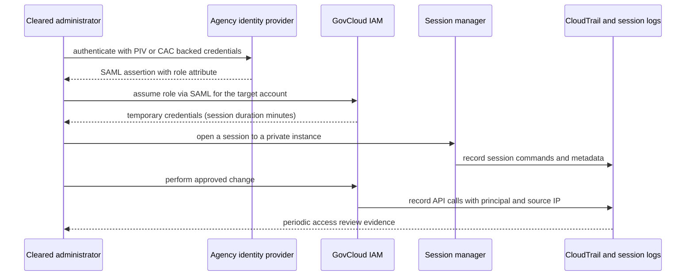

# 07 · Government — Air-Gapped Regions

> **Phase 8 — Industry Architectures** · Lesson 07 of 08
> ⬅️ Previous: [Media — IVS, Transcoder, and CDN](./06-media-ivs-transcoder-and-cdn.md) · ➡️ Next: [Capstone — Industry Reference Architecture](./08-project-industry-reference-architecture.md) · 🏠 [Phase overview](./README.md)

## Learning Objectives

By the end of this lesson you will be able to:

- Explain the difference between a commercial Region, an isolated Government Region, and a genuinely disconnected classified Region
- Operate across partitions correctly, including why ARNs, credentials, and IAM policies cannot cross between them
- Map ITAR, FedRAMP High, and DoD SRG impact levels to concrete architecture decisions
- Describe the GovCloud (US) account provisioning process and how it differs from commercial sign-up
- Move an artifact from a commercial build pipeline into a Government partition through a controlled promotion process

**Estimated time:** 65 min · **Difficulty:** Advanced

---

## Core Concepts

AWS is divided into **partitions**. A partition is a fully separate deployment of the AWS control plane with its own identity system, its own key management, and its own ARN namespace. There are three commonly encountered partitions: `aws` (commercial), `aws-us-gov` (AWS GovCloud (US)), and `aws-cn` (China, operated under separate arrangements). The partition appears in every ARN: a GovCloud role is `arn:aws-us-gov:iam::123456789012:role/...`, and that string is meaningless in the commercial partition. Nothing about this is cosmetic. An IAM principal in one partition cannot assume a role in another, an S3 bucket policy in one partition cannot grant access to a principal in another, and a KMS key in one partition cannot decrypt data in another.

**AWS GovCloud (US)** consists of two Regions, `us-gov-west-1` and `us-gov-east-1`, and it exists so that US government customers and their contractors can run workloads that are subject to ITAR and to FedRAMP High requirements. AWS states that GovCloud is operated by US persons on US soil, that access to it is restricted accordingly, and that it is designed to allow ITAR-controlled data. It is **isolated** from commercial AWS, but it is **not air-gapped** — GovCloud has internet connectivity, its own public service endpoints, and the ability to reach the public internet through its own gateways. That distinction is the single most commonly confused point in government cloud conversations.

**Genuinely disconnected** environments are the classified Regions: the AWS Secret Region and the AWS Top Secret Region, built for the US Intelligence Community and operated by AWS for cleared customers with the appropriate accreditation. These have no connectivity to the public internet or to commercial AWS, and their service catalog, procedures, and access requirements are not publicly documented — engagement happens through your AWS government representative. If your project requires an air-gapped environment, you are not looking for GovCloud; you are looking for a program that has a specific accreditation path and a specific AWS sponsor.

**Compliance frameworks** drive the design constraints. **ITAR** restricts access to US Munitions List technical data to US persons, which makes the personnel-access restriction on GovCloud the relevant feature. **FedRAMP High** is the authorization level most civilian agency workloads require, and GovCloud services carry it; your own system still needs its own Authority to Operate, built on AWS's FedRAMP package. **DoD SRG impact levels** are cumulative: IL2 covers public-facing workloads, IL4 covers controlled unclassified information, and IL5 covers national security systems handling controlled unclassified information — IL6 and above live in the classified Regions. Not every GovCloud service is authorized at every level, and the gaps are what break architectures that were drawn without checking.

### Key terminology

| Term | Meaning |
|------|---------|
| **Partition** | A separate AWS deployment boundary — `aws`, `aws-us-gov`, `aws-cn` — reflected in every ARN |
| **GovCloud (US)** | The two isolated US government Regions, `us-gov-west-1` and `us-gov-east-1` |
| **Isolated** | Logically separated from commercial AWS, with its own control plane, but still internet-connected |
| **Air-gapped** | No network path to the public internet or to other partitions; a property of classified Regions |
| **ITAR** | International Traffic in Arms Regulations — US persons only access to defense articles and technical data |
| **FedRAMP High** | The federal authorization baseline for systems where a breach has severe or catastrophic impact |
| **DoD SRG** | The DoD Security Requirements Guide, defining impact levels IL2 through IL6 |
| **ATO** | Authority to Operate — the authorization your system needs, built on top of AWS's own package |
| **US person** | Citizen, lawful permanent resident, or protected individual, as defined for ITAR purposes |
| **Cross-partition** | Any operation touching both a commercial account and a GovCloud account — IAM cannot do this |

---

## Architecture Diagram

The three environments and the boundaries that cannot be crossed with an API call:

```mermaid
flowchart TD
    subgraph comm["Commercial partition (aws)"]
        creg["Regions worldwide"]
        ciam["IAM, KMS, S3, Organizations"]
    end
    subgraph govp["GovCloud partition (aws-us-gov)"]
        gw["us-gov-west-1"]
        ge["us-gov-east-1"]
        giam["Separate IAM, KMS, S3, Organizations"]
    end
    subgraph class["Classified and disconnected"]
        sec["AWS Secret Region"]
        top["AWS Top Secret Region"]
    end
    creg -.->|"payment method and contract only"| gw
    ciam -.->|"no IAM trust, no data path"| giam
    govp -.->|"no network connectivity"| class
```

Terraform, IAM roles, KMS keys, and cross-account trust arrows simply stop at the partition line; only commercial mechanisms such as contracts, invoicing, and support cases cross it.

The artifact promotion path that replaces a cross-partition deployment pipeline:

```mermaid
flowchart LR
    dev["Developer in commercial partition"] --> build["Build and unit test"]
    build --> scan["SAST, dependency scan, SBOM"]
    scan --> sign["Sign artifact and record hashes"]
    sign --> board["Change control approval"]
    board --> transfer["Approved transfer process"]
    transfer --> landing[("GovCloud landing bucket (KMS)")]
    landing --> verify["Verify signature and hash"]
    verify --> cfn["CloudFormation or Terraform apply in GovCloud"]
    cfn --> prod["GovCloud production workload"]
    prod --> evidence["Control evidence to the ATO package"]
```



The access path for a person, which is deliberately shorter and more audited than in a commercial account:



---

## Hands-on Lab: Operate Across Partitions Correctly

**Goal:** Configure a GovCloud CLI profile, verify the isolation boundary from the inside, prove that a commercial principal cannot be granted access to a GovCloud resource, and deploy a compliance evidence baseline.

**Prerequisites:** An existing AWS GovCloud (US) account with a root user and at least one administrative IAM user or role, IAM permission to create KMS keys and buckets, and the AWS CLI v2 installed locally.

### Step 1 — Configure a separate profile

GovCloud credentials are not interchangeable with commercial credentials, so the profile is a separate identity entirely.

```bash
# Configure a dedicated profile with GovCloud credentials
aws configure --profile govcloud
# AWS Access Key ID: <govcloud access key>
# AWS Secret Access Key: <govcloud secret key>
# Default region name: us-gov-west-1
# Default output format: json

# Confirm which identity and partition you are actually talking to
aws sts get-caller-identity --profile govcloud

# Note the ARN prefix: it starts with arn:aws-us-gov, not arn:aws
```

If `sts get-caller-identity` with the GovCloud profile returns an ARN beginning `arn:aws:iam::`, you have configured commercial credentials against a GovCloud region, or the reverse, and nothing else you run will behave as expected.

### Step 2 — Verify the service and Region landscape

```bash
# Every Region visible to this account
aws ec2 describe-regions --all-regions --profile govcloud \
  --query 'Regions[].RegionName' --output text

# Confirm the partition in the CLI's endpoint resolution for S3
aws s3api list-buckets --profile govcloud --query 'Buckets[].Name'

# Check whether a service you depend on is available in the second Region, not just the first
aws ecs list-clusters --profile govcloud --region us-gov-east-1

# Service availability differs by Region and by authorization level — always verify per service
aws service-quotas list-service-quotas --service-code ec2 --profile govcloud \
  --query 'Quotas[?QuotaName==`Running On-Demand Standard instances`].Value' --output text
```

Two habits matter here. First, test your design in **both** GovCloud Regions before committing to a multi-Region claim, because service availability is not symmetric. Second, check the authorization level for each service you plan to use; a service that exists in GovCloud may not be authorized at the impact level your accreditation requires.

### Step 3 — Prove the partition boundary holds

```bash
# Create a GovCloud bucket and a GovCloud KMS key, and note the partition in the key ARN
aws kms create-key --profile govcloud \
  --description "GovCloud workload key" \
  --tags TagKey=data-classification,TagValue=cui
aws kms create-alias --profile govcloud --alias-name alias/gov-workload --target-key-id <key-id>
```

Now attempt to extend access to a commercial principal. Apply the policy below to a GovCloud bucket and observe that the commercial principal cannot use it: the account exists in a different partition, and no amount of policy grants access across that line.

```json
{
  "Version": "2012-10-17",
  "Statement": [
    {
      "Sid": "AttemptedCrossPartitionGrant",
      "Effect": "Allow",
      "Principal": { "AWS": "arn:aws:iam::123456789012:role/commercial-app-role" },
      "Action": "s3:GetObject",
      "Resource": "arn:aws-us-gov:s3:::gov-workload-data/*"
    }
  ]
}
```

```bash
# Apply it, then confirm from the commercial side that nothing changed
aws s3api put-bucket-policy --profile govcloud --bucket gov-workload-data \
  --policy file://attempted-cross-partition.json

# Run this with commercial credentials: it fails, and the failure is expected
aws s3api head-object --bucket gov-workload-data \
  --key reports/summary.pdf --profile commercial-admin
```

The practical consequence: **any cross-partition data flow must be implemented as an application-level transfer**, not as an IAM trust. Either a process in each partition reads and writes through an intermediary you operate, with its own audit trail, or a human moves the artifact through an approved channel. Design that process deliberately, because ad hoc copying is how controlled data leaks.

### Step 4 — Baseline the account for compliance evidence

```yaml
# nist-high-baseline.yaml — a conformance pack that produces per-resource compliance evidence
Resources:
  EncryptedVolumes:
    Type: AWS::Config::ConfigRule
    Properties:
      ConfigRuleName: gov-encrypted-volumes
      Source:
        Owner: AWS
        SourceIdentifier: ENCRYPTED_VOLUMES
  RootAccountMFA:
    Type: AWS::Config::ConfigRule
    Properties:
      ConfigRuleName: gov-root-account-mfa-enabled
      Source:
        Owner: AWS
        SourceIdentifier: ROOT_ACCOUNT_MFA_ENABLED
  CloudTrailEnabled:
    Type: AWS::Config::ConfigRule
    Properties:
      ConfigRuleName: gov-multi-region-cloud-trail-enabled
      Source:
        Owner: AWS
        SourceIdentifier: MULTI_REGION_CLOUD_TRAIL_ENABLED
  IamPasswordPolicy:
    Type: AWS::Config::ConfigRule
    Properties:
      ConfigRuleName: gov-iam-password-policy
      Source:
        Owner: AWS
        SourceIdentifier: IAM_PASSWORD_POLICY
  S3PublicReadProhibited:
    Type: AWS::Config::ConfigRule
    Properties:
      ConfigRuleName: gov-s3-public-read-prohibited
      Source:
        Owner: AWS
        SourceIdentifier: S3_BUCKET_PUBLIC_READ_PROHIBITED
```

```bash
# Upload the template, then deploy it as a conformance pack so evidence is continuous
aws s3 cp nist-high-baseline.yaml s3://gov-config-templates/ --profile govcloud

aws configservice put-conformance-pack --profile govcloud \
  --conformance-pack-name gov-nist-high-baseline \
  --template-s3-uri s3://gov-config-templates/nist-high-baseline.yaml

# Compliance summary per rule, which is what you attach to the ATO evidence set
aws configservice describe-conformance-pack-compliance --profile govcloud \
  --conformance-pack-name gov-nist-high-baseline \
  --query 'ConformancePackRuleComplianceList[].[ConfigRuleName,ComplianceType]' --output table
```

Deploy the same pack through an **organization conformance pack** so that every account in the GovCloud organization is covered and cannot opt out.

### Step 5 — Constrain the organization to the Government Regions

```bash
# A service control policy that denies every action outside the GovCloud Regions
aws organizations create-policy \
  --profile govcloud \
  --name DenyOutsideGovRegions \
  --description "Restrict all activity to us-gov-west-1 and us-gov-east-1" \
  --type SERVICE_CONTROL_POLICY \
  --content '{
      "Version": "2012-10-17",
      "Statement": [{
        "Sid": "DenyWrongRegion",
        "Effect": "Deny",
        "NotAction": [
          "iam:*", "organizations:*", "route53:*", "cloudfront:*",
          "sts:*", "support:*", "ce:*", "waf:*", "budgets:*"
        ],
        "Resource": "*",
        "Condition": {
          "StringNotEquals": { "aws:RequestedRegion": ["us-gov-west-1", "us-gov-east-1"] }
        }
      }]
    }'

# Attach it to the organizational unit that contains workload accounts
aws organizations attach-policy \
  --profile govcloud \
  --policy-id <policy-id> \
  --target-id ou-abc1-12345678
```

Exclude global services and the few genuinely global APIs from a Region-deny policy, or you will block IAM and billing operations along with everything else.

### Step 6 — Prepare the human and artifact paths

Two operational differences catch teams out. First, human access is normally **federated** from an agency identity provider with PIV or CAC-backed credentials, with short session durations and session-manager logging for shell access — not long-lived IAM users with access keys. Second, there is no shared CI/CD runner between partitions. Promote artifacts explicitly:

```bash
# In the commercial partition: record the hash of the artifact you intend to promote
shasum -a 256 ./build/app-1.4.0.tar.gz

# In the GovCloud partition: after the approved transfer, verify before deploying
shasum -a 256 /mnt/staging/app-1.4.0.tar.gz

# Upload to the landing bucket and let CloudFormation reference the verified object
aws s3 cp /mnt/staging/app-1.4.0.tar.gz \
  s3://gov-artifact-landing/app/1.4.0/app-1.4.0.tar.gz \
  --profile govcloud --sse aws:kms \
  --sse-kms-key-id arn:aws-us-gov:kms:us-gov-west-1:123456789012:key/11111111-2222-3333-4444-555555555555
```

---

## CLI Reference

```bash
# Identity, with the partition visible in the ARN
aws sts get-caller-identity --profile govcloud

# Regions available in the partition
aws ec2 describe-regions --all-regions --profile govcloud

# GovCloud account list in a GovCloud organization
aws organizations list-accounts --profile govcloud

# CloudTrail in the Government partition, verified for integrity
aws cloudtrail get-trail-status --name gov-audit-trail --profile govcloud \
  --query '[IsLogging,LatestDigestDeliveryTime]'

# Conformance pack status across the organization
aws configservice describe-organization-conformance-pack-statuses --profile govcloud

# Confirm a KMS key's partition before hard-coding an ARN
aws kms describe-key --key-id alias/gov-workload --profile govcloud --query 'KeyMetadata.Arn'
```

| Command | Purpose |
|---------|---------|
| `sts get-caller-identity --profile govcloud` | The fastest way to catch a partition or profile mix-up |
| `ec2 describe-regions --all-regions` | Confirms whether a service has both GovCloud Regions before you promise multi-Region |
| `organizations list-accounts` | Drives account-level compliance reporting for the ATO evidence set |
| `cloudtrail get-trail-status` | Shows whether audit logging is actually live in the partition |
| `describe-organization-conformance-pack-statuses` | Detects accounts where the baseline silently failed to apply |
| `kms describe-key` | Prevents an ARN with the wrong partition ending up in a policy |

---

## Best Practices

| Practice | Why it matters |
|----------|----------------|
| Keep partitions strictly separate in tooling | A single hard-coded `arn:aws:` prefix in a template breaks the deployment at the worst moment |
| Parameterize the partition, never assume it | CloudFormation pseudo parameters and Terraform data sources resolve the partition for you |
| Verify service availability and authorization level per Region | The architecture that works in `us-gov-west-1` may not exist in `us-gov-east-1` |
| Federate human access and keep sessions short | ITAR and FedRAMP both care about who can reach the data, not just what they can do |
| Promote artifacts through an approved, hash-verified process | There is no continuous deployment path across a partition boundary |
| Deploy compliance baselines organization-wide | Opt-out accounts are the ones that appear in a finding |
| Model the isolation honestly in diagrams | Drawing GovCloud as air-gapped sets wrong expectations for everyone downstream |
| Use GovCloud Organizations and separate KMS keys | Keys and organizations do not span partitions, and neither does trust |
| Keep an explicit data-flow register | Which controlled data crosses which boundary, why, and under whose authority |

---

## Common Pitfalls

| Pitfall | Symptom | Fix |
|---------|---------|-----|
| Assuming GovCloud is air-gapped | Internet egress works, and the security model was designed around the wrong assumption | Treat GovCloud as isolated but connected; air-gapped means classified Regions |
| Reusing commercial credentials | `InvalidClientTokenId` or unexpected `AccessDenied` | Create and use GovCloud-scoped credentials for every profile |
| Hard-coded `arn:aws:` in templates | Deployments fail only in the Government partition | Use partition-aware ARNs and pseudo parameters |
| Expecting an IAM trust across partitions | Cross-account roles that can never be assumed | Implement an application-level transfer with its own audit trail |
| Assuming full service parity | A service referenced in the design does not exist in GovCloud | Check the GovCloud service list and per-Region availability before designing |
| Assuming all GovCloud services meet the impact level | An authorization finding at IL5 | Confirm the authorization level per service against the SRG requirements |
| Region-deny SCP without global service exceptions | IAM and billing break in workload accounts | Exclude global services from the Region condition |
| Long-lived IAM users with access keys | Fails a FedRAMP control review | Federate through the agency identity provider with short sessions |
| Copying data across partitions by hand | Unlogged, uncontrolled movement of controlled data | Formalize the transfer with approvals, hashes, and logging |
| Same Terraform state used for both partitions | Confusing plans and accidental applies against the wrong account | Separate state, separate backends, separate credentials per partition |

---

## Cost Considerations

GovCloud (US) pricing is set separately from commercial pricing, is generally **higher for the same instance types**, and has no Free Tier, so a lift-and-shift cost model derived from commercial rates will be wrong. Use the GovCloud pricing pages for every estimate and expect a premium, particularly for compute and managed services.

What drives the bill:

1. **No Free Tier and no volume discounts carried over.** A lab that costs a few dollars a month commercially can cost tens of dollars in GovCloud because there is no free allowance for storage, requests, or instance hours.
2. **Two Regions feel like two accounts.** Duplicating a workload for multi-Region resilience in `us-gov-east-1` roughly doubles compute, and inter-Region replication adds transfer costs.
3. **Compliance tooling at scale.** AWS Config, CloudTrail with data events, Security Hub, and GuardDuty all bill per account, per resource, or per event. An organization with 40 accounts multiplies every one of those lines.
4. **Support plans** are a meaningful share of the bill for regulated workloads and are priced differently from commercial support.
5. **Staff and process costs dominate, not infrastructure.** Review boards, session logging, artifact promotion, and continuous monitoring are real labor. Budget the architecture effort accordingly, and keep the technology cost model separate so the two do not get confused in a business case.
6. **Data transfer out** is billed on the same model as commercial AWS but with Government rates, and it commonly appears in workloads that publish to the public internet rather than staying inside the partition.

If cost is the binding constraint, the levers are the same as in commercial AWS — right-sizing, storage lifecycle, and consolidating accounts, since per-account charges are the most surprising multiplier in a large Government organization.

---

## Security Considerations

- **Personnel restrictions are architectural, not administrative.** If ITAR applies, assume only US persons on US soil may access the environment, including support paths and third-party tools.
- **Use GovCloud Organizations with SCPs as the primary guardrail.** Centralize the Region restrictions, the encryption requirements, and the denial of unapproved services so no team can drift.
- **Encrypt with GovCloud KMS keys and keep them in the partition.** A key that cannot exist in the commercial partition is a feature; do not design around exporting key material.
- **Federate everything and log assumed roles.** Short-lived sessions from the agency identity provider, MFA on the federation path, and CloudTrail on `AssumeRole` give you an access review you can actually perform.
- **Log interactive sessions.** Session Manager logging to S3 plus CloudWatch gives you a record of what was typed on a privileged host, which is what a forensic review needs.
- **Treat the artifact landing zone as the highest-value target.** The bucket that receives promoted binaries is the natural supply-chain attack point; enforce signature verification, restrict write access to the transfer process, and alert on unexpected writers.
- **Continuous monitoring is the deliverable, not the side effect.** Config conformance packs, Security Hub findings, and GuardDuty detections need a documented cadence, an owner, and an escalation path to satisfy continuous-monitoring controls.
- **Accreditation boundaries are data boundaries.** Document which systems consume the ATO and which do not; an unaccredited system touching the enclave invalidates the boundary.
- **Classified Regions are engagement-driven.** Assume nothing public about their service catalog or connectivity, and involve your AWS government representative before designing anything that assumes them.

---

## Exercise

Write a one-page **data flow and isolation register** for a workload that ingests controlled technical data from a commercial SaaS tool, processes it in GovCloud, and publishes results to an agency dashboard. For each arrow, state the partitions involved, the mechanism that carries the data, the identity that authorizes it, the encryption applied, and the evidence produced (logs, config items, or signed transfer records). Then list every arrow that cannot be implemented with an IAM trust and explain the alternative you chose.

Success looks like: no arrow crosses a partition using IAM, every cross-partition arrow names a concrete mechanism and an approval, and an auditor can read the register and identify each control that satisfies ITAR personnel restrictions and FedRAMP High monitoring.

---

## Resources

- [AWS GovCloud (US) User Guide](https://docs.aws.amazon.com/govcloud-us/latest/UserGuide/what-is-govcloud.html)
- [AWS GovCloud (US) sign-up and account provisioning](https://docs.aws.amazon.com/govcloud-us/latest/UserGuide/getting-set-up.html)
- [AWS services in scope — FedRAMP](https://aws.amazon.com/compliance/services-in-scope/FedRAMP/)
- [DoD Cloud Computing SRG impact levels](https://public.cyber.mil/dccs/)
- [AWS ITAR compliance](https://aws.amazon.com/compliance/itar/)
- [AWS Organizations service control policies](https://docs.aws.amazon.com/organizations/latest/userguide/orgs_manage_policies_scps.html)
- [AWS Config conformance packs](https://docs.aws.amazon.com/config/latest/developerguide/conformance-packs.html)

---

## Next Steps

You now know where the hard boundaries are and what they cost to work inside. The capstone puts every constraint in this phase together: a regulated vertical, an explicit control set, a residency decision, and a cost model — delivered the way a real architecture engagement is delivered.

> ⬅️ Previous: [Media — IVS, Transcoder, and CDN](./06-media-ivs-transcoder-and-cdn.md) · ➡️ Next: [Capstone — Industry Reference Architecture](./08-project-industry-reference-architecture.md) · 🏠 [Phase overview](./README.md)
