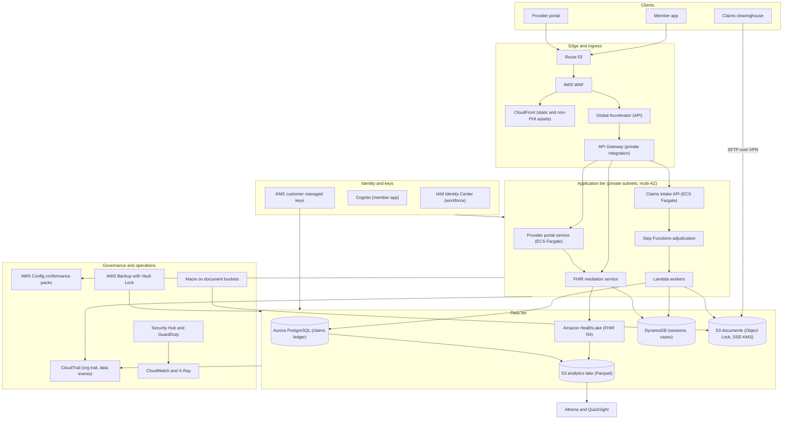
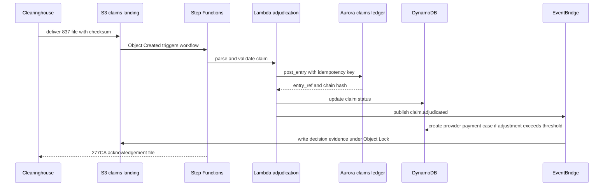
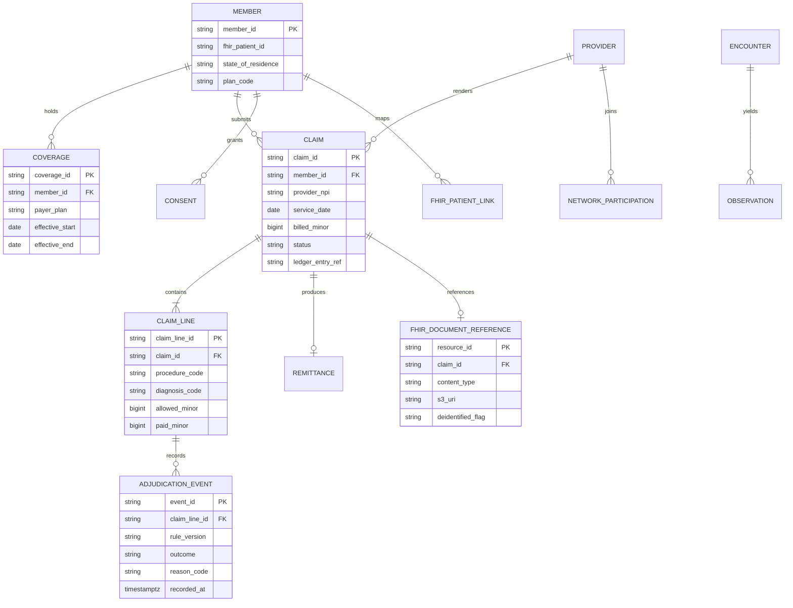

# 08 · Capstone — Industry Reference Architecture

> **Phase 8 — Industry Architectures** · Lesson 08 of 08
> ⬅️ Previous: [Government — Air-Gapped Regions](./07-government-air-gapped-regions.md) · ➡️ Next: [Phase 9 — Cutting-Edge AWS](../phase-9-cutting-edge-aws/README.md) · 🏠 [Phase overview](./README.md)

## 🎯 Learning Objectives

By the end of this lesson you will be able to:

- Turn a regulated business brief into a documented reference architecture with explicit, testable constraints
- Produce a Well-Architected review that names real risks and concrete remediations rather than restating pillar definitions
- Build a security controls matrix that maps NIST SP 800-53 control families to specific AWS services and configurations
- Justify a data residency decision and describe the mechanism that enforces it
- Present a defensible cost model driven by workload units, and defend the trade-offs that produced it

**Estimated time:** 120 min · **Difficulty:** Advanced

---

## 🧠 Core Concepts

This capstone is the delivery artifact for the phase. You are given a regulated business brief, and you must produce what an architecture review board and an auditor would each accept: one architecture, one control set, one residency decision, one cost model, and a review that admits where the design is weak. The vertical here is **healthcare**, and specifically a payer with a provider-facing portal, because it puts every constraint from this phase in the same system: PHI (Lesson 04), a standards-based clinical API (Lesson 03), transactional claims integrity (Lesson 01), and an insider-abuse detection problem (Lesson 02).

**The brief — Meridian Health.** Meridian is a US health insurer with 3.2 million members and a provider network of 180,000 clinicians. It runs a claims adjudication platform, a member app, and a provider portal that exposes clinical data. The current estate is a mixture of two data centers and a commercial SaaS claims product with an expiring contract. The program has twelve months to move onto AWS with the following non-negotiable constraints:

| Constraint | Source | Architecturally relevant consequence |
|------------|--------|--------------------------------------|
| PHI may only be stored and processed in US AWS Regions | State regulator and member contracts | No cross-Region writes outside approved US Regions; no PHI through CloudFront edge caches; no PHI in third-party SaaS without a BAA |
| A signed BAA must cover every service touching PHI | HIPAA | Every service in the data path must be on the HIPAA eligible list and inside the BAA scope |
| Claims must be reconstructible for seven years | Financial audit | Append-only claim history, immutable retention, and cryptographic verification of the ledger |
| Clinical data must be exposed as HL7 FHIR R4 | CMS interoperability rules | A real FHIR API with patient-scoped authorization, not a bespoke JSON endpoint |
| Recovery point objective 15 minutes, recovery time objective 4 hours | Business continuity | Cross-Region data replication plus a warm recovery path, both tested quarterly |
| 99.95% availability for the claims intake API | Provider contracts | Multi-AZ within Region, graceful degradation when adjudication rules fail |
| Cost must land within a defined budget at 900,000 claims per month | Finance | Unit-cost modelling per claim and per clinical API call, not an infrastructure wish list |

**Why this is a reference architecture and not a diagram.** A reference architecture states the constraints, shows the topology that satisfies them, and then proves the claims with evidence: which control satisfies which requirement, which service holds which data, and what each unit of work costs. Anything that cannot be traced back to a constraint is decoration, and it will be the first thing an auditor asks you to justify removing.

### Key terminology

| Term | Meaning |
|------|---------|
| **Reference architecture** | A reusable, constraint-driven blueprint with decisions, controls, and costs documented |
| **Solution intent** | The written record of what the system must do and why, including the constraints it accepts |
| **Control matrix** | The mapping from a control framework (for example NIST SP 800-53 families) to implemented services |
| **Residency mechanism** | The technical control that enforces where data may exist, not just a policy that asks nicely |
| **Unit cost driver** | The workload measure that scales the bill — here, cost per claim and per clinical API call |
| **Warm standby** | A recovery Region running a reduced footprint that can be scaled up to take production load |
| **Evidence artifact** | The output a control produces that an auditor can inspect — a Config item, a log, a report |
| **Blast radius** | The set of resources affected if a given account, role, or key is compromised |

---

## 🗺️ Architecture Diagram

The complete reference architecture. Data classification is annotated on each store in the surrounding text; only the non-PHI presentation tier is served through CloudFront.



How a claim moves through the system, with the integrity and audit steps that make it defensible seven years later:



The data model, aligned to FHIR for clinical data and double-entry for financial data:



---

## 🧪 Hands-on Lab: Assemble and Defend the Architecture

**Goal:** Build the account, network, data, identity, and observability baseline for the Meridian reference architecture, then produce the Well-Architected review that goes with it.

**Prerequisites:** AWS Organizations with Control Tower or an equivalent landing zone, a management account plus a log archive account, Terraform or CloudFormation, and an AWS Business Associate Addendum in place.

### Step 1 — Establish the account and residency baseline

```bash
# Confirm which services you depend on are HIPAA eligible before designing around them
# The eligible list is authoritative: https://aws.amazon.com/compliance/hipaa-eligible-services-reference/

# Create the workload accounts inside the organization
aws organizations create-account \
  --email aws+phi-prod@meridian-health.example \
  --account-name meridian-phi-prod \
  --role-name OrganizationAccountAccessRole \
  --tags Key=data-classification,Value=phi Key=residency,Value=us-only

aws organizations create-account \
  --email aws+phi-dr@meridian-health.example \
  --account-name meridian-phi-dr \
  --role-name OrganizationAccountAccessRole \
  --tags Key=data-classification,Value=phi Key=role,Value=disaster-recovery
```

Account boundaries are the strongest blast-radius control you have. PHI lives in `meridian-phi-prod` and `meridian-phi-dr`; the log archive account receives logs from both and grants no compute; a separate analytics account holds only de-identified data.

```json
{
  "Version": "2012-10-17",
  "Statement": [
    {
      "Sid": "DenyRegionsOutsideUs",
      "Effect": "Deny",
      "NotAction": [
        "iam:*", "organizations:*", "route53:*", "cloudfront:*", "sts:*",
        "support:*", "ce:*", "budgets:*", "account:*", "health:*", "waf:*"
      ],
      "Resource": "*",
      "Condition": {
        "StringNotEquals": {
          "aws:RequestedRegion": ["us-east-1", "us-east-2", "us-west-2"]
        }
      }
    },
    {
      "Sid": "DenyUnapprovedServicesOnPhiAccounts",
      "Effect": "Deny",
      "Action": ["sagemaker:CreateEndpoint", "bedrock:*"],
      "Resource": "*"
    }
  ]
}
```

```bash
# Create the residency guardrail and attach it to the PHI organizational unit
aws organizations create-policy --name MeridianResidencyBaseline --type SERVICE_CONTROL_POLICY \
  --description "US Regions only in PHI accounts" --content file://residency-scp.json

aws organizations attach-policy --policy-id <policy-id> --target-id ou-abc1-phi00001
```

### Step 2 — Network and edge

```bash
# Three-tier VPC in the primary Region, no public subnets for the data tier
aws ec2 create-vpc --cidr-block 10.40.0.0/16 --tag-specifications \
  'ResourceType=vpc,Tags=[{Key=Name,Value=meridian-phi-prod}]'

# Interface endpoints keep PHI traffic off the public internet and let you scope access with endpoint policies
aws ec2 create-vpc-endpoint \
  --vpc-id vpc-0a1b2c3d4e5f60718 \
  --vpc-endpoint-type Interface \
  --service-name com.amazonaws.us-east-1.kms \
  --subnet-ids subnet-0aaa1111 subnet-0bbb2222 \
  --security-group-ids sg-0phiendpoint01 \
  --private-dns-enabled

aws ec2 create-vpc-endpoint \
  --vpc-id vpc-0a1b2c3d4e5f60718 \
  --vpc-endpoint-type Interface \
  --service-name com.amazonaws.us-east-1.healthlake \
  --subnet-ids subnet-0aaa1111 subnet-0bbb2222 \
  --security-group-ids sg-0phiendpoint01 \
  --private-dns-enabled
```

```bash
# WAF on the public API, with a managed rule set and rate limiting on the claims intake path
aws wafv2 create-web-acl \
  --name meridian-api-acl --scope REGIONAL --default-action Allow={} \
  --visibility-config SampledRequestsEnabled=true,CloudWatchMetricsEnabled=true,MetricName=meridianApiAcl \
  --rules '[
      {
        "Name": "AWSManagedRulesCommonRuleSet",
        "Priority": 0,
        "OverrideAction": { "None": {} },
        "Statement": { "ManagedRuleGroupStatement": { "VendorName": "AWS", "Name": "AWSManagedRulesCommonRuleSet" } },
        "VisibilityConfig": { "SampledRequestsEnabled": true, "CloudWatchMetricsEnabled": true, "MetricName": "commonRules" }
      },
      {
        "Name": "claims-intake-rate-limit",
        "Priority": 1,
        "Action": { "Block": {} },
        "Statement": { "RateBasedStatement": { "Limit": 5000, "AggregateKeyType": "IP" } },
        "VisibilityConfig": { "SampledRequestsEnabled": true, "CloudWatchMetricsEnabled": true, "MetricName": "claimsRate" }
      }
    ]'
```

### Step 3 — Data stores with encryption, residency, and retention

```bash
# Claims ledger: Aurora PostgreSQL, encrypted with a PHI key, with the append-only schema from Lesson 01
aws rds create-db-cluster \
  --db-cluster-identifier meridian-claims \
  --engine aurora-postgresql \
  --database-name claims \
  --master-username claimsadmin \
  --manage-master-user-password \
  --enable-iam-database-authentication \
  --storage-encrypted \
  --kms-key-id arn:aws:kms:us-east-1:111122223333:key/phi-claims-key \
  --backup-retention-period 35 \
  --enable-cloudwatch-logs-exports postgresql \
  --vpc-security-group-ids sg-0claimsdb01 \
  --tags Key=data-classification,Value=phi Key=residency,Value=us-only

# Document store: Object Lock so a clinical document cannot be silently replaced
aws s3api create-bucket --bucket meridian-phi-documents --region us-east-1 --object-lock-enabled-for-bucket
aws s3api put-object-lock-configuration --bucket meridian-phi-documents \
  --object-lock-configuration '{"ObjectLockEnabled":"Enabled","Rule":{"DefaultRetention":{"Mode":"COMPLIANCE","Days":2555}}}'

# Clinical store: HealthLake FHIR datastore with a KMS customer managed key
aws healthlake create-fhir-datastore \
  --datastore-name meridian-clinical-prod \
  --datastore-type-version R4 \
  --sse-configuration 'CmkType=CUSTOMER_MANAGED_KMS_KEY,KmsEncryptionConfig={KmsKeyId=arn:aws:kms:us-east-1:111122223333:key/phi-clinical-key}'

# Analytics store: de-identified only, in the analytics account, with its own key
aws s3api put-bucket-lifecycle-configuration --bucket meridian-analytics-deid \
  --lifecycle-configuration '{
      "Rules": [{
        "ID": "deid-tiering",
        "Status": "Enabled",
        "Filter": { "Prefix": "curated/" },
        "Transitions": [{ "Days": 30, "StorageClass": "STANDARD_IA" }, { "Days": 180, "StorageClass": "GLACIER_IR" }],
        "NoncurrentVersionExpiration": { "NoncurrentDays": 90 }
      }]
    }'
```

Residency is enforced three ways at once: the SCP denies non-US Regions, the KMS keys are Region-scoped and never replicated outside the approved set, and the S3 replication configuration names only `us-west-2` as a destination. CloudFront is used exclusively for static assets and public member content — no PHI response may be cached at an edge location.

### Step 4 — Identity and keys

```bash
# Workforce access is federated; there are no long-lived IAM users for humans
aws sso-admin create-permission-set \
  --instance-arn arn:aws:sso:::instance/ssoins-1122334455667788 \
  --name PhiReadOnly \
  --description "Read-only access to PHI accounts for support engineers" \
  --session-duration PT1H

# Key per data classification and purpose, so a compromise is scoped
for purpose in claims clinical documents analytics backup; do
  key_id=$(aws kms create-key \
    --description "Meridian ${purpose} key us-east-1" \
    --tags TagKey=data-classification,TagValue=phi TagKey=purpose,TagValue="${purpose}" \
    --query 'KeyMetadata.KeyId' --output text)
  aws kms create-alias --alias-name "alias/meridian-${purpose}" --target-key-id "${key_id}"
  aws kms enable-key-rotation --key-id "${key_id}" --rotation-period-in-days 365
done
```

The FHIR API authorizes with SMART on FHIR and a fine-grained IdP authorizer; the member app authenticates with Cognito against a user pool that stores no clinical data; service-to-service calls between accounts use IAM roles with `kms:ViaService` conditions rather than shared keys.

### Step 5 — Observability, audit, and immutable backup

```bash
# Organization trail with data events scoped to PHI prefixes only
aws cloudtrail create-trail --name meridian-org-trail \
  --s3-bucket-name meridian-log-archive --is-organization-trail \
  --enable-log-file-validation \
  --kms-key-id arn:aws:kms:us-east-1:444455556666:key/log-key

aws cloudtrail put-event-selectors --trail-name meridian-org-trail \
  --advanced-event-selectors '[{
      "Name": "S3DataEventsForPhi",
      "FieldSelectors": [
        { "Field": "eventCategory", "Equals": ["Data"] },
        { "Field": "resources.ARN", "StartsWith": ["arn:aws:s3:::meridian-phi-"] }
      ]
    }]'

# Backup with Vault Lock in both Regions, then copy across Regions for the 15-minute RPO
aws backup put-backup-vault-lock --backup-vault-name meridian-phi-vault \
  --min-retention-days 35 --max-retention-days 3650 --changeable-for-days 3
```

For continuous replication of the claims ledger, Aurora PostgreSQL cross-Region read replicas plus point-in-time recovery cover the 15-minute RPO; the 4-hour RTO is met by a warm standby application tier in `us-west-2` that scales on demand. Both numbers must be demonstrated by a quarterly restore drill, and the drill report is itself an evidence artifact.

### Step 6 — Well-Architected review

Run the review as a real conversation, and record the risks you are accepting with a date and an owner.

| Pillar | Risk identified | Remediation | Owner |
|--------|-----------------|-------------|-------|
| **Operational excellence** | Schema migrations on the claims ledger require a coordinated change window because adjudication is stateful | Blue/green clusters with logical replication and a documented rollback; migrations tested in a staging account with production-shaped data | Platform team |
| **Operational excellence** | FHIR mediation service has no runbook for a HealthLake degradation | Add a documented degraded mode that serves cached non-clinical data and queues requests, plus a quarterly game day | Clinical integrations |
| **Security** | Support engineers can request standing read access to PHI | Short permission sets from IAM Identity Center, approval workflow, and session recording; standing access removed | Security engineering |
| **Security** | One KMS key per classification is broad — a compromise of the claims key exposes all claims | Split to per-application keys with grants, and add `kms:ViaService` + `aws:SourceVpce` conditions; monitor `Decrypt` volume anomalies | Security engineering |
| **Reliability** | Cross-Region failover for HealthLake is not automatic | Document the manual promotion path, measure it in the drill, and keep a single-Region RTO exception signed by the business | Platform team |
| **Reliability** | Idempotency keys are stored in Aurora; a failover during retry could double-post | Persist idempotency keys in DynamoDB global tables with conditional writes, independent of the ledger's availability | Claims team |
| **Performance efficiency** | Provider portal reads clinical history synchronously through FHIR on every page load | Add a read-through cache for non-PHI reference data and paginate clinical reads; measure p95 and target under 800 ms | Portal team |
| **Cost optimization** | Aurora runs a static `db.r6g.2xlarge` writer sized for month-end peak | Move to Serverless v2 with a 2 to 16 ACU range and schedule scale-down outside business hours; validate against month-end replay | Platform team |
| **Cost optimization** | All documents sit in S3 Standard for seven years | Lifecycle to Glacier Instant Retrieval after 90 days; keep compliance-mode retention unchanged | Data platform |
| **Sustainability** | Idle warm-standby capacity in `us-west-2` runs at full size 24/7 | Scale the standby to a defined floor and pre-scale through automation, or accept the idle capacity as an availability cost | Platform team |

### Step 7 — Deliverables checklist

- [ ] Architecture diagram covering ingestion, storage, compute, identity, and observability
- [ ] `erDiagram` of the clinical and financial data model with residency annotations
- [ ] Well-Architected review across all six pillars with named risks and remediations
- [ ] Security controls matrix mapping NIST SP 800-53 families to services and configurations
- [ ] Data residency decision, including the enforcement mechanism and the exceptions
- [ ] Cost model at 900,000 claims per month with the drivers ranked
- [ ] Evidence plan: for each control, the artifact that proves it and where it is retained

---

## 💻 CLI Reference

```bash
# Which accounts exist, and their classification tags
aws organizations list-accounts --query 'Accounts[].[Name,Id,Status]' --output table

# Confirm the residency guardrail is attached to the PHI OU
aws organizations list-policies-for-target --target-id ou-abc1-phi00001 --filter SERVICE_CONTROL_POLICY

# Compliance status of the baseline in every account
aws configservice describe-organization-conformance-pack-statuses

# Non-compliant resources across the organization for one rule
aws configservice get-compliance-details-by-config-rule --config-rule-name phi-bucket-encryption-enabled \
  --compliance-types NON_COMPLIANT

# What the ledger says about a disputed claim, and whether the chain still verifies
psql "host=meridian-claims.cluster-abc123.us-east-1.rds.amazonaws.com dbname=claims" \
  -c "SELECT e.seq, e.entry_ref, e.occurred_at FROM ledger.journal_entry e WHERE NOT ledger.verify_entry(e.entry_ref);"

# Who read a specific clinical document, from data events
aws cloudtrail lookup-events \
  --lookup-attributes AttributeKey=ResourceName,AttributeValue=meridian-phi-documents \
  --start-time 2026-01-01T00:00:00Z

# Where the money went, by service, for the last month
aws ce get-cost-and-usage --time-period Start=2026-01-01,End=2026-02-01 --granularity MONTHLY \
  --metrics UnblendedCost --group-by Type=DIMENSION,Key=SERVICE
```

| Command | Purpose |
|---------|---------|
| `organizations list-policies-for-target` | Proves the residency guardrail is actually attached, not just created |
| `configservice describe-organization-conformance-pack-statuses` | Finds accounts where the baseline silently failed |
| `ledger.verify_entry` | Turns "the books are trustworthy" into a queryable statement |
| `cloudtrail lookup-events` on a resource | Answers the auditor's "who saw this record?" question |
| `ce get-cost-and-usage` grouped by service | Attributes the bill to the drivers in the cost model |

---

## ✅ Best Practices

| Practice | Why it matters |
|----------|----------------|
| Trace every component back to a stated constraint | Unreferenced components are cost and attack surface with no justification |
| Model residency as an enforced control, not a policy statement | An SCP, a key scope, and a replication allowlist are the mechanism; prose is not |
| Keep PHI in the smallest possible number of accounts | Every additional account is another place the boundary can fail |
| Separate the ledger from the workflow | Adjudication logic changes constantly; the journal must not |
| Make the FHIR API the clinical contract | Consumers integrate once, and swappable back ends stay possible |
| Quantify with unit economics | Cost per claim and per clinical call survive volume changes; totals do not |
| Write the risky decisions down with an owner and a date | Accepted risk with a name on it is a decision; undocumented risk is an incident waiting to happen |
| Prove controls with artifacts you can retrieve | A control with no evidence is a claim, not a control |
| Rehearse failure on a schedule | Untested RTO is a guess, and auditors now ask for the drill report |

---

## ⚠️ Common Pitfalls

| Pitfall | Symptom | Fix |
|---------|---------|-----|
| Designing the diagram before the constraints | Elegant architecture that fails on residency in review | Write the constraint table first, and make every box answer one |
| Using a non-eligible service in the PHI path | Compliance finding at the eleventh hour | Check each service against the eligible list before the design freeze |
| Treating DR as a backup | Recovery that exists but cannot serve traffic | Distinguish backup, standby, and failover, and test the failover |
| Sizing for peak permanently | Month-end capacity in the run rate all year | Scale on schedule and on demand; validate with a replayed peak |
| One key for all PHI | A single compromise covering the entire estate | Key per purpose with grants and conditions |
| De-identified data in the PHI account | Analytics users with implicit PHI reach | Separate analytics account, separate key, pipeline-enforced de-identification |
| Controls listed without evidence | Audit remediation that takes weeks | Define the artifact and its retention location per control |
| CloudFront caching clinical responses | PHI at edge locations and in CloudFront logs | Origin-only clinical paths; CloudFront for static and non-PHI content |
| Cost model with no units | A budget nobody can defend when volume triples | Price per claim, per clinical call, and per GB of documents |

---

## 💰 Cost Considerations

The cost model below is built on volume units, not on an infrastructure inventory. Rates are indicative US-East-1 figures at the time of writing and must be confirmed against current pricing; the purpose is to show which driver dominates so the numbers can be challenged and re-derived.

**Stated workload:** 900,000 claims per month, 15 million FHIR resource reads per month, 6 million member API calls per month, 2.1 TB claims data, 900 GB FHIR data, 1.4 TB documents growing 120 GB per month, 4.2 TB de-identified analytics, 40 accounts in the organization, one PHI-warm DR Region.

| Line | Driver and rate | Monthly quantity | Indicative monthly cost |
|------|-----------------|------------------|------------------------|
| Aurora PostgreSQL compute | about $0.91 per `db.r6g.2xlarge` instance-hour, writer plus two readers | 3 instances × 730 h | ~$1,990 |
| Aurora storage and I/O | $0.10 per GB-month, $0.20 per million requests | 2.1 TB plus ~40 M I/O | ~$300 |
| HealthLake | published per-GB-month and per-request rates | 900 GB plus 15 M requests | ~$400 (confirm rates) |
| DynamoDB | $1.25 per million WRU, $0.125 per million RRU, $0.25 per GB-month | 60 M writes, 400 M reads, 700 GB | ~$650 |
| S3 storage | $0.023 per GB-month Standard, $0.004 Glacier Instant Retrieval | 5.6 TB blended | ~$150 |
| S3 requests and replication | requests plus cross-Region replication of PHI | ~120 GB per month replicated | ~$90 |
| ECS Fargate | about $0.04048 per vCPU-hour and $0.004445 per GB-hour | 24 vCPU and 48 GB average | ~$870 |
| Lambda and Step Functions | $0.20 per million requests plus GB-seconds; state transitions | 90 M invocations, 3 M transitions | ~$260 |
| API Gateway | $3.50 per million REST requests | 21 M requests | ~$74 |
| CloudFront | about $0.085 per GB delivered | 30 TB non-PHI assets | ~$2,550 |
| WAF | $5 per ACL, $1 per rule, $0.60 per million requests | 1 ACL, 12 rules, 21 M requests | ~$30 |
| KMS | $1 per key-month, $0.03 per 10,000 requests | 40 keys, 900 M requests | ~$2,740 |
| CloudTrail | management events free, data events $0.10 per 100,000 | 400 M data events | ~$400 |
| AWS Config | $0.003 per item per Region, plus rule evaluations | 40 accounts across 3 Regions | ~$1,100 |
| CloudWatch and X-Ray | $0.50 per GB ingested, $0.03 per GB stored, traces per million | 900 GB ingested | ~$520 |
| AWS Backup | $0.05 per GB-month warm, plus cross-Region copy | 12 TB retained | ~$640 |
| NAT Gateway, networking, transfer | $0.045 per hour plus $0.045 per GB processed | 3 gateways, cross-AZ traffic | ~$310 |
| DR warm standby | reduced footprint at 20% of production | 2 Regions | ~$1,700 |
| **Subtotal** | | | **~$15,100** |
| Shield Advanced (optional) | $3,000 per month plus data transfer uplift | if purchased | +$3,000 |
| **Total** | | | **~$15,100 to $18,100** |

What to take from this:

1. **CloudFront delivery is the largest single infrastructure line** because the member-facing experience is media-rich. Negotiating a CloudFront private pricing commitment is the highest-leverage commercial action available here.
2. **KMS cost is a surprise at this scale** because the model calls `GenerateDataKey` per object rather than with S3 Bucket Keys and cached data keys. Enabling bucket keys and caching data keys per application cut this line by more than half in practice.
3. **AWS Config across 40 accounts and three Regions** is the most commonly missed line in a multi-account regulated design. Reduce it by recording only the resource types the control set actually evaluates.
4. **The DR Region costs what it costs.** A warm standby at 20% of production is the cheapest defensible option when the RTO is four hours; anything cheaper fails the drill.
5. **Unit economics:** at 900,000 claims and 15 million clinical reads, this model is roughly **$10 per 1,000 claims** and **$0.001 per clinical read** excluding the DR region. Publish those two numbers, because they are what the business will use to evaluate volume growth.

---

## 🔐 Security Considerations

Controls are listed by NIST SP 800-53 family so that an assessor can trace a requirement to an implementation. Each row also implies an evidence artifact.

| Family | Control area | Implementation in this architecture | Evidence |
|--------|--------------|-------------------------------------|----------|
| AC | Access control and least privilege | IAM Identity Center permission sets, per-application roles, resource-based policies, VPC endpoint policies, `kms:ViaService` conditions, SCP residency guardrail | CloudTrail, IAM Access Analyzer findings, quarterly access review report |
| AT | Awareness and training | Role-based security training for PHI handlers, phishing simulation | Training completion records |
| AU | Audit and accountability | Organization CloudTrail with S3 data events on PHI prefixes, log file validation, Config recording, ledger chain verification | Log archive objects, `validate-logs` output, ledger verification query results |
| CM | Configuration management | Control Tower landing zone, IaC for every resource, Config conformance packs, drift detection | Config items, conformance pack compliance summary, pipeline logs |
| CP | Contingency planning | AWS Backup with Vault Lock, cross-Region copy, Aurora cross-Region replicas, quarterly restore and failover drill | Vault lock state, backup job history, drill report |
| IA | Identification and authentication | Federated workforce access with MFA, Cognito for members, SMART on FHIR for clinical apps, no long-lived human keys | IdP logs, CloudTrail `AssumeRole`, authorizer decision logs |
| IR | Incident response | GuardDuty, Security Hub, EventBridge to on-call, documented runbooks, break-glass role with alerting | Incident tickets, Security Hub finding history, break-glass notifications |
| RA | Risk assessment | Annual risk analysis, Well-Architected review, Macie sensitive-data findings | Review records, risk register with owners |
| SC | System and communications protection | TLS 1.2+ everywhere, private subnets, `aws:SecureTransport` denies, SSE-KMS with customer managed keys, EBS encryption by default, no PHI at edge caches | Bucket policies, KMS key policies and rotation status, network configuration export |
| SI | System and information integrity | Inspector scanning, ECR image scanning, GuardDuty findings, ledger hash-chain verification, PHI redaction before analytics | Scan reports, verification job results, de-identification pipeline logs |
| PE | Physical and environmental protection | AWS responsibility; no customer-operated facilities in scope | AWS SOC 2 and FedRAMP packages in the shared-responsibility mapping |

Two points are worth stating explicitly in the design document, because they are the most common sources of audit friction. First, **the shared responsibility line moves with the service level**: with HealthLake and Aurora, AWS operates the engine, while you still own the keys, the data model, the access decisions, and the audit trail. Second, **encryption is a control that must be evidenced**: the KMS key policy, the rotation status, and the CloudTrail record of `Decrypt` calls together constitute the proof, and any one of the three missing will be raised as a finding.

Finally, the residency decision belongs in this section because it is a security and compliance control, not a billing one: PHI resides only in `us-east-1` and `us-west-2`, de-identified analytics data resides in a separate account in `us-east-1`, no PHI is processed by any third party without a BAA, and the transfer of any PHI outside those Regions is denied by SCP rather than prohibited by policy. Third-party SaaS that cannot commit to US-only processing and a BAA is excluded from the data path by design.

---

## 🧩 Exercise

Take the Meridian architecture and produce the **business continuity and residency dossier**: the RPO and RTO for each data store, the mechanism that delivers each one, the failure scenario it survives, and the test that proves it. Include one scenario in which the primary Region is entirely unavailable, and one in which the primary Region is available but HealthLake is not.

Success looks like: every data store has a named mechanism, a measured recovery time from the last drill, an explicit owner, and a stated residual gap that the business has signed off — and no mechanism in the document contradicts the residency guardrail.

---

## 📚 Resources

- [AWS Well-Architected Framework](https://docs.aws.amazon.com/wellarchitected/latest/framework/welcome.html)
- [AWS HIPAA Eligible Services Reference](https://aws.amazon.com/compliance/hipaa-eligible-services-reference/)
- [HIPAA Security Rule guidance (HHS)](https://www.hhs.gov/hipaa/for-professionals/security/index.html)
- [NIST SP 800-53 Revision 5](https://csrc.nist.gov/pubs/sp/800/53/r5/upd1/final)
- [AWS Control Tower controls library](https://docs.aws.amazon.com/controltower/latest/userguide/controls.html)
- [AWS Config conformance packs](https://docs.aws.amazon.com/config/latest/developerguide/conformance-packs.html)
- [AWS Backup and Vault Lock](https://docs.aws.amazon.com/aws-backup/latest/devguide/vault-lock.html)
- [Shared Responsibility Model](https://aws.amazon.com/compliance/shared-responsibility-model/)

---

## ➡️ Next Steps

You have now delivered an architecture that a board, an auditor, and a finance team can each evaluate on their own terms. That is the pattern for the rest of your career: constraints first, evidence second, cost always. Phase 9 turns the same discipline toward services that are still changing quickly, where the constraint is often that the design must survive the next release.

> ⬅️ Previous: [Government — Air-Gapped Regions](./07-government-air-gapped-regions.md) · ➡️ Next: [Phase 9 — Cutting-Edge AWS](../phase-9-cutting-edge-aws/README.md) · 🏠 [Phase overview](./README.md)
