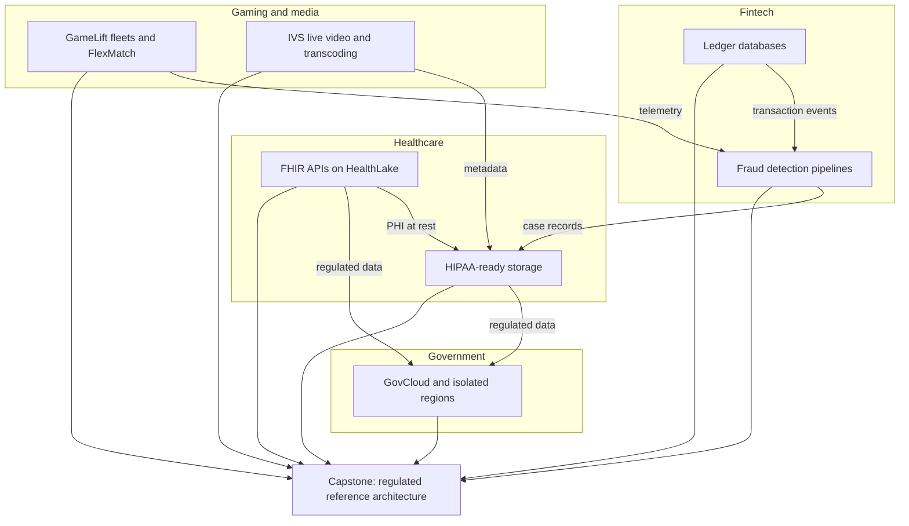
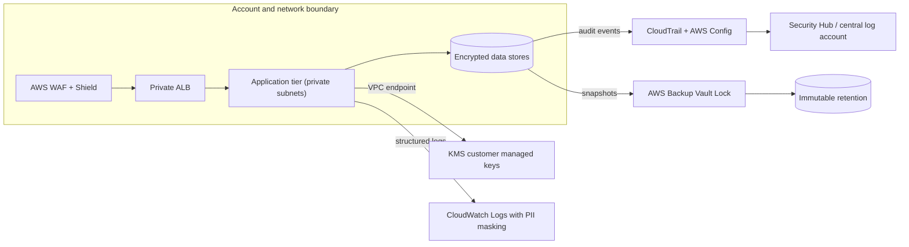

# Phase 8 — Industry Architectures

Phases 1–7 taught you the building blocks, the architecture patterns, the automation, the security tooling, and the edge. Phase 8 asks the harder question: **what changes when the industry tells you what you are allowed to build?** A fintech ledger cannot rewrite yesterday's balance. A fraud pipeline must score in under 100 milliseconds. A hospital API must speak HL7 FHIR and never leak PHI into a log line. A game must place players in a region with 30 ms latency. A government workload cannot exist in a commercial region at all.

The services stop being interchangeable here. Compliance, residency, and latency become the primary design constraints, and everything else — instance types, database engines, queue depths — falls out of them. Every lesson in this phase follows the same shape: the regulatory or industry constraint first, then the architecture that satisfies it, then the cost of that architecture.

## Phase Goals

- Design append-only, cryptographically verifiable ledgers on Aurora PostgreSQL and DynamoDB after the retirement of Amazon QLDB
- Build a real-time fraud scoring pipeline that blends deterministic rules with a machine learning model and feeds outcomes back into training
- Expose healthcare data as standards-compliant HL7 FHIR REST endpoints with SMART on FHIR authorization and controlled de-identification
- Apply HIPAA controls end to end: BAA scope, PHI encryption, Object Lock, access logging, immutable backups, and minimum necessary access
- Operate low-latency multiplayer game backends with GameLift fleets, FlexMatch matchmaking, latency-based placement, and DDoS protection
- Deliver live and on-demand video with IVS, Elemental MediaConvert, DRM, and CloudFront signed delivery
- Understand AWS GovCloud (US), isolated regions, ITAR, and FedRAMP High, and why a commercial architecture cannot simply be copied across the boundary
- Produce a complete, defended reference architecture for a regulated vertical as the phase capstone

## Phase Map

The unifying diagram — every lesson in this phase is a variation of this control envelope:

## Lessons in this Phase

| # | Lesson | Focus | Difficulty |
|---|--------|-------|------------|
| 01 | [Fintech Ledger Databases](./01-fintech-ledger-databases.md) | Append-only tables, hash chaining, double-entry schema, cryptographic verification, QLDB retirement and its replacements | Advanced |
| 02 | [Fraud Detection Pipelines](./02-fraud-detection-pipelines.md) | Kinesis streaming features, SageMaker Feature Store, Lambda and Step Functions scoring, DynamoDB velocity checks, rules plus ML ensemble, feedback loops | Advanced |
| 03 | [Healthcare FHIR APIs](./03-healthcare-fhir-apis.md) | HealthLake, HL7 FHIR R4 REST endpoints, SMART on FHIR scopes, Comprehend Medical de-identification, FHIR resource model | Intermediate |
| 04 | [HIPAA-Ready Storage](./04-hipaa-ready-storage.md) | HIPAA-eligible services, BAA scope, PHI encryption, S3 Object Lock, access logging, CloudTrail and Config, KMS strategy, immutable backups | Intermediate |
| 05 | [Gaming — GameLift and Scaling](./05-gaming-gamelift-and-scaling.md) | Fleets and Anywhere, FlexMatch rulesets, session queues, target tracking scaling, latency placement, Shield, player data | Advanced |
| 06 | [Media — IVS, Transcoder, and CDN](./06-media-ivs-transcoder-and-cdn.md) | IVS channels, low-latency ingest and playback, MediaConvert bitrate ladders, CloudFront caching and signed URLs, DRM, live-to-VOD | Intermediate |
| 07 | [Government — Air-Gapped Regions](./07-government-air-gapped-regions.md) | GovCloud (US), isolated and classified regions, ITAR, FedRAMP High, partition isolation, service gaps, account provisioning | Advanced |
| 08 | [Capstone — Industry Reference Architecture](./08-project-industry-reference-architecture.md) | Full regulated reference architecture: Well-Architected review, controls matrix, residency, cost model, diagrams | Advanced |

## Capstone Project

**Meridian Health — a HIPAA-regulated payer and provider data platform.**

The capstone takes a single regulated vertical and documents it the way a real engagement would be delivered: a requirements-driven architecture with an explicit control set, a data residency decision, and a defensible cost model. You will produce the diagrams an architecture review board actually asks for, plus the mappings that auditors ask for.

**Deliverables:**

- A full architecture diagram covering ingestion, storage, compute, identity, and observability
- An `erDiagram` of the FHIR-aligned data model with encryption and residency annotations in the surrounding text
- A Well-Architected review across all six pillars with named risks and concrete improvements
- A security controls matrix mapping NIST SP 800-53 control families to specific AWS services and configurations
- A data residency and cross-border transfer decision, including which services are in scope
- A cost model for a stated workload volume, broken down by driver

## Phase Checklist

- [ ] Explain why an append-only ledger with hash chaining detects tampering that plain audit tables do not
- [ ] Create an Aurora PostgreSQL schema with a hash chain, an append-only trigger, and a chain verification function
- [ ] Capture a change-audit trail from DynamoDB Streams into an immutable store
- [ ] Stream transactions through Kinesis and compute rolling velocity features in near real time
- [ ] Register a SageMaker Feature Store feature group and read online features at scoring time
- [ ] Combine a rules engine with an ML model behind a single scoring API and route decisions to EventBridge
- [ ] Create a HealthLake FHIR datastore and read a Patient resource over a FHIR REST endpoint
- [ ] Describe the SMART on FHIR authorization flow and the scopes required for a provider-facing app
- [ ] Detect and redact PHI in free text with Comprehend Medical before it reaches storage
- [ ] Identify which services in a design are covered by a HIPAA BAA and which are not
- [ ] Lock an S3 bucket and object into compliance-mode retention and prove the object cannot be deleted
- [ ] Configure a CloudFront distribution with signed URLs for paid media
- [ ] Build a FlexMatch ruleset and start a matchmaking ticket
- [ ] State three concrete differences between an AWS GovCloud (US) region and a commercial region
- [ ] Ship the Meridian Health capstone with all six deliverables

## Phase Resources

- [AWS Compliance Programs](https://aws.amazon.com/compliance/programs/)
- [HIPAA Eligible Services Reference](https://aws.amazon.com/compliance/hipaa-eligible-services-reference/)
- [AWS GovCloud (US) User Guide](https://docs.aws.amazon.com/govcloud-us/latest/UserGuide/what-is-govcloud.html)
- [AWS Well-Architected Framework](https://docs.aws.amazon.com/wellarchitected/latest/framework/welcome.html)
- [Amazon HealthLake Developer Guide](https://docs.aws.amazon.com/healthlake/latest/devguide/what-is-amazon-health-lake.html)
- [Amazon GameLift Servers Developer Guide](https://docs.aws.amazon.com/gamelift/latest/developerguide/gamelift-intro.html)
- [Amazon IVS User Guide](https://docs.aws.amazon.com/ivs/latest/LowLatencyUserGuide/what-is.html)
- [AWS Prescriptive Guidance — Industry blueprints](https://docs.aws.amazon.com/prescriptive-guidance/latest/patterns/aws-industry-solutions.html)

## Next Phase

[Phase 9 — Cutting-Edge AWS](../phase-9-cutting-edge-aws/README.md)
