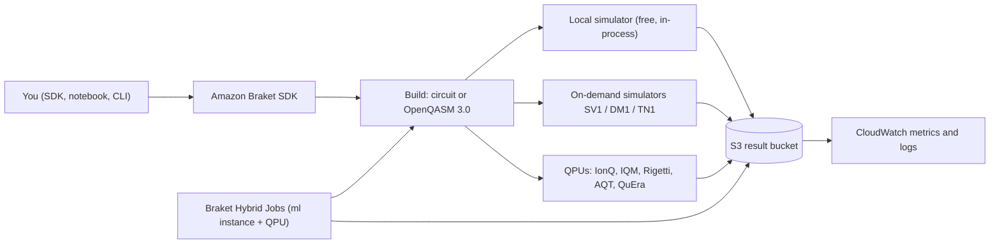
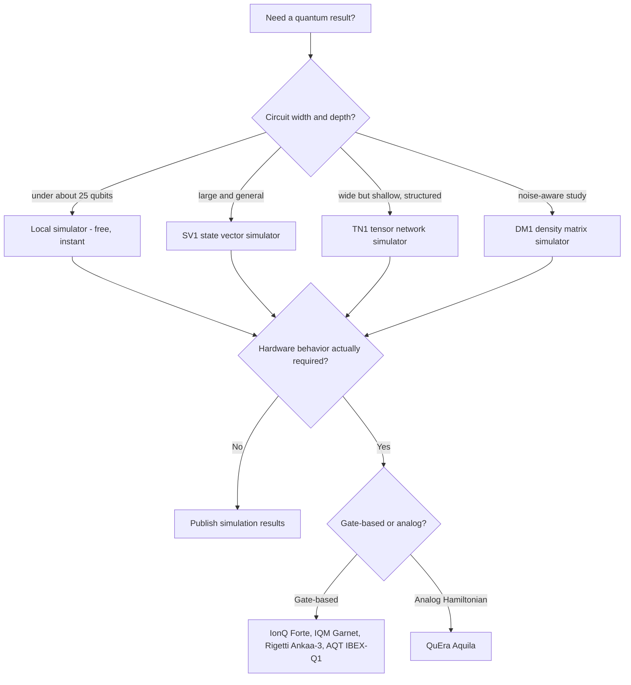
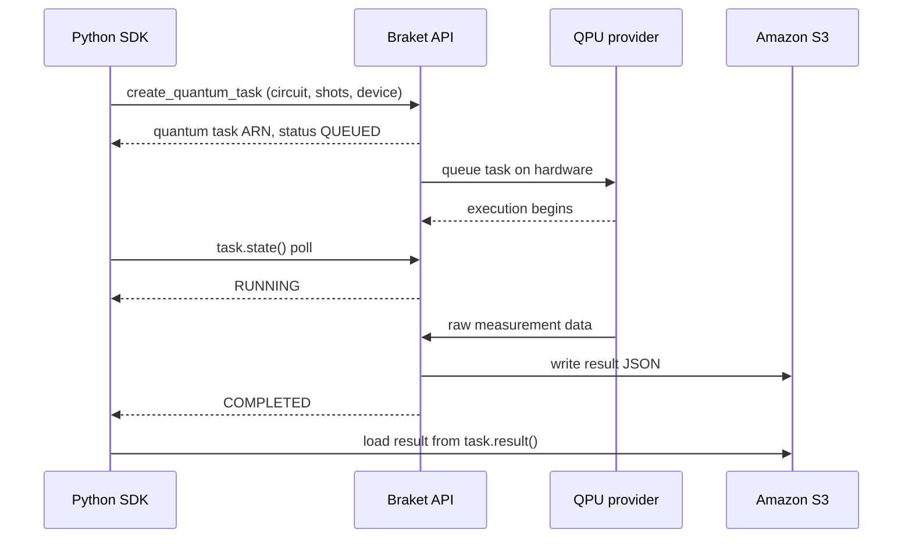
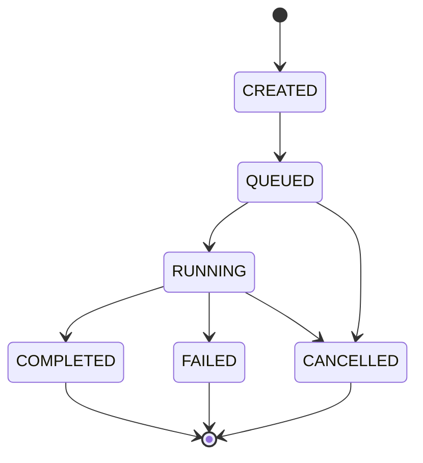

# 01 · Amazon Braket

> **Phase 9 — Cutting-Edge AWS** · Lesson 01 of 06
> ⬅️ Previous: [Phase 9 overview](./README.md) · ➡️ Next: [Robotics on AWS](./02-aws-robomaker.md) · 🏠 [Phase overview](./README.md)

## Learning Objectives

By the end of this lesson you will be able to:

- Explain qubits, superposition, entanglement, and measurement without hand-waving
- Describe the Amazon Braket service structure: SDK, local simulators, on-demand simulators, QPUs, and hybrid jobs
- Run the same circuit on a free local simulator, a paid managed simulator, and a real QPU
- Decide when a quantum workload is genuinely worth paying for, and when it is not

**Estimated time:** 75 min · **Difficulty:** Intermediate

---

## Core Concepts

A classical bit is always 0 or 1. A **qubit** is a two-level quantum system that holds a superposition of both until it is measured. Written in the Braket `bra-ket` notation that gives the service its name, a qubit state is `α|0⟩ + β|1⟩`, where α and β are complex amplitudes. The catch is that you can never read α and β directly: measurement collapses the state and returns a single classical bit, with probability `|α|²` for 0 and `|β|²` for 1. That is why quantum programs are always run for many **shots** and you reason statistically about the resulting `measurement_counts`.

**Entanglement** is the other non-classical resource. Two qubits in an entangled state — the Bell state produced by a Hadamard followed by a CNOT is the canonical example — have correlated measurement outcomes that cannot be described by any local hidden variables. Entanglement is not a communication channel (no, it does not let you signal faster than light), but it is the resource that makes algorithms like teleportation and many error-correction schemes work.

Between the gates and the measurement sits **interference**. Quantum algorithms are not "try all answers at once and pick the best", which is the most common misconception. They are carefully designed sequences of gates that make the amplitudes of wrong answers cancel out (destructive interference) and the amplitudes of right answers add up (constructive interference). Grover's algorithm gets a quadratic speedup from this; Shor's algorithm gets an exponential one for factoring by using the quantum Fourier transform. Getting the interference right is the entire discipline of quantum algorithm design.

Real hardware today is in the **NISQ** era — Noisy Intermediate-Scale Quantum. Qubits decohere, two-qubit gates have error rates in the 10⁻³ to 10⁻² range, and no universal, fault-tolerant quantum computer exists. AWS states this plainly in its own documentation. The practical consequence is that in 2026 the algorithm that works is a **hybrid algorithm**: a classical optimizer in a loop, calling a parametrized quantum circuit, measuring expectation values, and updating the parameters. Variational Quantum Eigensolver (VQE) and QAOA are the two most studied examples. This is also why Amazon Braket Hybrid Jobs exist — you need a classical compute instance and a QPU in the same workflow.

Two paradigms are on offer. **Gate-based** devices (IonQ, IQM, Rigetti, AQT) run circuits built from a native gate set. **Analog Hamiltonian Simulation** (QuEra Aquila) does not take gates at all: you specify a time-dependent Hamiltonian and the device physically evolves under it — useful for condensed-matter and many-body physics, useless for running Shor's algorithm.

You do not have to write Braket circuits by hand. AWS maintains first-party framework integrations so you can keep the tooling your team already knows:

| Framework | Package | How it works |
|-----------|---------|--------------|
| PennyLane | `amazon-braket-pennylane-plugin` | Use `qml.device("braket.aws.qubit", device_arn=..., shots=...)` in a QML or variational workflow |
| Qiskit | `qiskit-braket-provider` | Execute Qiskit circuits on Braket devices through a provider backend |
| NVIDIA CUDA-Q | NVIDIA-maintained, shown in the Braket examples repo | Compile CUDA-Q kernels for Braket QPUs and simulators |
| Anything else | OpenQASM 3.0 | Braket accepts OpenQASM 3.0 directly for gate-based devices and simulators |

```python
# The same Bell state expressed through the PennyLane plugin
import pennylane as qml

dev = qml.device("braket.aws.qubit",
                 device_arn="arn:aws:braket:::device/quantum-simulator/amazon/sv1",
                 s3_destination_folder=("amazon-braket-123456789012", "pennylane"),
                 wires=2, shots=1000)

@qml.qnode(dev)
def bell():
    qml.Hadamard(wires=0)
    qml.CNOT(wires=[0, 1])
    return qml.probs(wires=[0, 1])

print(bell())
```

One honesty note: **Cirq is not currently a first-party Braket integration.** AWS's own example notebooks cover PennyLane, Qiskit, and NVIDIA CUDA-Q. Cirq users either export to OpenQASM 3.0 and submit that, or rely on a community bridge — which means version drift is your problem, not AWS's.

### Key terminology

| Term | Meaning |
|------|---------|
| **Qubit** | A two-level quantum system; the unit of quantum information |
| **Shot** | One execution of a circuit followed by measurement; results are aggregated over shots |
| **Gate** | A unitary operation applied to one or more qubits (H, X, CNOT, RX, ...) |
| **Circuit** | An ordered list of gates and measurements on a set of qubits |
| **QPU** | Quantum Processing Unit — real quantum hardware behind a device ARN |
| **Device ARN** | The identifier for a QPU or managed simulator, e.g. `arn:aws:braket:::device/quantum-simulator/amazon/sv1` |
| **Hybrid job** | A managed execution of an algorithm that uses classical compute plus quantum tasks |
| **Error mitigation** | Classical post-processing that reduces the effect of noise without full error correction |
| **Verbatim compilation** | Submitting native gates with no transpilation, when you know the hardware precisely |
| **Braket Direct** | Reserved, dedicated QPU capacity plus access to AWS quantum specialists |

---

## Architecture Diagram

The three-stage Braket workflow — build, test, run — and where the money is spent:



Which device to reach for, in order of increasing cost and decreasing certainty:



A quantum task is asynchronous. The SDK returns a handle immediately; the classical process polls until the device is done:



The lifecycle the SDK exposes for a task:



---

## Hands-on Lab: From Local Simulator to Real Hardware

**Goal:** Build a Bell state, verify it on the free local simulator, then run the identical circuit on a paid managed simulator and a real QPU, and compare the results.

**Prerequisites:**

- An AWS account with Amazon Braket enabled (console → Braket → Get Started, which creates the service-linked role)
- Acceptance of the third-party device agreement — required only for partner QPUs, once per account
- An S3 bucket for results, in a Braket-supported Region (the simulator and device Regions differ, see below)
- Python 3.10+ with `pip install amazon-braket-sdk`

### Step 1 — Install and simulate locally

```bash
# The SDK ships a local state-vector simulator: no AWS calls, no cost
python -m venv .venv && source .venv/bin/activate
pip install --quiet amazon-braket-sdk boto3
```

```python
# bell_local.py
from braket.circuits import Circuit
from braket.devices import LocalSimulator

# Ask for the output probabilities as well as the raw shot counts
bell = Circuit().h(0).cnot(0, 1).probability()

device = LocalSimulator()
task = device.run(bell, shots=1000)
result = task.result()

print(result.measurement_counts)
# Counter({'00': 496, '11': 504}) - roughly half zeros, half ones, never mixed
print("probabilities:", result.values[0].value)
# [0.5 0. 0. 0.5] - the 01 and 10 amplitudes are exactly zero
```

The probability vector shows the amplitudes; the counts show that the two qubits always agree. That correlation is entanglement.

### Step 2 — Submit the same circuit to a managed simulator

```python
# bell_sv1.py
from braket.aws import AwsDevice
from braket.circuits import Circuit

bell = Circuit().h(0).cnot(0, 1)

sv1 = AwsDevice("arn:aws:braket:::device/quantum-simulator/amazon/sv1")
task = sv1.run(bell, shots=1000, s3_destination_folder=("amazon-braket-123456789012", "braket-output"))
result = task.result()

print(task.id, task.state())          # <uuid> COMPLETED
print(result.measurement_counts)
print(result.task_metadata.shots)
```

Managed simulators scale to circuits your laptop cannot hold, and they are billed per minute of simulation with a three-second minimum. `SV1` and `DM1` are available in `us-east-1`, `us-west-1`, `us-west-2`, and `eu-west-2`; `TN1` is available in `us-east-1`, `us-west-2`, and `eu-west-2`.

### Step 3 — Cost-check before touching hardware

```python
# Check the device is online, see its queue depth, and read its native gates
from braket.aws import AwsDevice

ionq = AwsDevice("arn:aws:braket:us-east-1::device/qpu/ionq/Forte-1")
print(ionq.is_available)
print(ionq.queue_depth().quantum_tasks)
print(ionq.properties.paradigm.nativeGateSet)
print(ionq.properties.service.executionWindows)
```

Never submit to a QPU without first checking `is_available`, the queue depth, and — critically — the device's `executionWindows`, because some devices are only online during published maintenance windows.

### Step 4 — Run on real hardware with a deliberately small shot count

```python
# bell_qpu.py - keep shots low; every shot costs money
from braket.aws import AwsDevice
from braket.circuits import Circuit

bell = Circuit().h(0).cnot(0, 1).probability()

ionq = AwsDevice("arn:aws:braket:us-east-1::device/qpu/ionq/Forte-1")
task = ionq.run(bell, shots=100, s3_destination_folder=("amazon-braket-123456789012", "braket-output"))
result = task.result()
print(task.id)
print(result.measurement_counts)
print(result.values[0].value)   # probabilities, now showing the noise leakage
```

### Step 5 — Verify

Compare the three result sets:

```bash
# Every task persists a result object in S3 plus metrics in CloudWatch
aws s3 ls s3://amazon-braket-123456789012/braket-output/ --recursive | head
aws cloudwatch get-metric-statistics \
  --namespace AWS/Braket \
  --metric-name Shots \
  --start-time "$(date -u -v-1H +%Y-%m-%dT%H:%M:%SZ)" \
  --end-time "$(date -u +%Y-%m-%dT%H:%M:%SZ)" \
  --period 3600 \
  --statistics Sum
```

Success looks like: the local simulator reports roughly 50/50 `00` and `11` with no `01` or `10`; SV1 matches it; and the QPU shows the same bias but with a small number of `01`/`10` outcomes. That leakage is hardware noise, and being able to see it is the point of the exercise.

---

## CLI Reference

```bash
# List the devices you can address (the only supported filter name today is deviceArn)
aws braket search-devices \
  --filters name=deviceArn,values=arn:aws:braket:::device/quantum-simulator/amazon/sv1

# Read the properties of a specific device - gate set, topology, calibration
aws braket get-device --device-arn arn:aws:braket:us-east-1::device/qpu/ionq/Forte-1

# Submit an OpenQASM 3.0 program as a quantum task (no role ARN needed; Braket uses a service-linked role)
aws braket create-quantum-task \
  --device-arn arn:aws:braket:::device/quantum-simulator/amazon/sv1 \
  --shots 1000 \
  --output-s3-bucket amazon-braket-123456789012 \
  --output-s3-key-prefix tasks \
  --action '{"braketSchemaVersion":"1.0","irType":"OPENQASM","ir":"OPENQASM 3.0;\nqubit[2] q;\nh q[0];\ncnot q[0], q[1];\nbit[2] c;\nc = measure q;"}'

# Poll a task or cancel it if the device queue is long
aws braket get-quantum-task --quantum-task-arn arn:aws:braket:us-east-1:123456789012:quantum-task/11111111-2222-3333-4444-555555555555
aws braket cancel-quantum-task --quantum-task-arn arn:aws:braket:us-east-1:123456789012:quantum-task/11111111-2222-3333-4444-555555555555

# Create a hybrid job from scripts in S3 (role ARN is required for jobs)
aws braket create-job \
  --job-name vqe-h2-demo \
  --role-arn arn:aws:iam::123456789012:role/BraketExecutionRole \
  --algorithm-specification '{"scriptModeConfig":{"entryPoint":"vqe.py","s3Uri":"s3://amazon-braket-123456789012/jobs/","compressionType":"NONE"},"containerImage":{"uri":"123456789012.dkr.ecr.us-east-1.amazonaws.com/amazon-braket-base-v1.0:latest"}}' \
  --instance-config '{"instanceType":"ml.m5.xlarge"}' \
  --output-data-config '{"s3Path":"s3://amazon-braket-123456789012/jobs-output/","kmsKeyId":"alias/braket-results"}' \
  --device-config '{"deviceArn":"arn:aws:braket:::device/quantum-simulator/amazon/sv1"}' \
  --stopping-condition '{"maxRuntimeInSeconds":3600}'

# Track running jobs
aws braket search-jobs --filters name=jobName,values=vqe-h2-demo
```

| Command | Purpose |
|---------|---------|
| `search-devices` | Enumerate devices by device ARN |
| `get-device` | Read topology, native gates, and calibration data |
| `create-quantum-task` | Submit one circuit (via SDK, OpenQASM 3.0, or JSON IR) |
| `get-quantum-task` / `cancel-quantum-task` | Poll or abort a queued task |
| `create-job` | Launch a managed hybrid job with classical compute plus quantum tasks |
| `get-job` / `search-jobs` | Inspect hybrid job status and artifacts |

---

## Best Practices

| Practice | Why it matters |
|----------|----------------|
| Develop entirely on the local simulator | It is free, instant, and catches most bugs before you pay |
| Take the state vector, not counts, during development | Counts hide amplitude and phase errors |
| Always set `shots` explicitly and keep it small on QPUs | Cost scales linearly with shots and gate count |
| Check `is_available`, queue depth, and execution windows first | A task submitted to an offline device wastes money and time |
| Use `AwsDevice` ARNs as configuration, never hard-coded per notebook | Moves a circuit between simulators and QPUs with one line |
| Pin the SDK version in notebooks | The SDK changes quickly; example notebooks break otherwise |
| Use error mitigation rather than re-running into noise | Zero-noise extrapolation and readout mitigation are cheaper than brute force |
| Use Hybrid Jobs instead of notebook polling for real experiments | Jobs survive notebook closure, checkpoint, and log metrics to CloudWatch |

---

## Common Pitfalls

| Pitfall | Symptom | Fix |
|---------|---------|-----|
| Believing "tries all answers at once" | Algorithms designed around parallelism never converge | Learn interference-based design; VQE/QAOA are the realistic entry points |
| Comparing simulator output to QPU output as if equal | QPU counts include noise, simulators do not | Compare trends with error bars, not exact counts |
| Forgetting the S3 output folder | `ValueError` on `run()` for QPU tasks | Pass `s3_destination_folder` or set a default `AwsSession` |
| Using a device ARN in the wrong Region | `Device not found` or authorization failure | Use the Region embedded in the ARN and match the CLI `--region` |
| Skipping the third-party device agreement | Permissions error only when hitting partner QPUs | Accept once per account in the Braket console |
| Assuming Cirq has a first-party Braket plugin | No supported package to install | Use OpenQASM 3.0 export or PennyLane/Qiskit, which AWS does support |
| Long-running loops inside notebooks | Lost results, idle QPU spend | Move to Hybrid Jobs with checkpointing to S3 |
| Assuming verbatim compilation is supported everywhere | Submission rejected | Verbatim works only on selected devices; check device properties |
| Ignoring device topology when transpiling | Fidelity collapses on multi-qubit gates | Let the SDK transpile, or design for the device coupling map |

---

## Cost Considerations

Braket bills along five independent dimensions, and it is easy to pay for two of them without noticing:

| Billing dimension | Notes |
|-------------------|-------|
| QPU per-task fee | Fixed charge on every task you submit, regardless of shots |
| QPU per-shot fee | Rate differs per device and per provider; dominates for large shot counts |
| On-demand simulators | Billed per minute of simulation, in millisecond increments, three-second minimum |
| Local simulator | Free — it runs inside your own process |
| Hybrid job instance | Billed for the EC2 capacity (`ml.m5.xlarge` and similar) for the job duration, plus any QPU usage |

Because of the per-task fee, the cheapest QPU experiment is usually **few tasks, more shots each** — but because of per-shot pricing, the optimal point is device-specific. Do this arithmetic before every hardware run:

- Illustration only: if a device charged `$0.30` per task and `$0.01` per shot, then 1,000 shots in a single task costs `0.30 + 10.00 = $10.30`, while the same 1,000 shots split across 1,000 tasks would cost `1000 × 0.30 + 10.00 = $310`. Rates change and differ per device — read the current numbers on the Braket pricing page before you submit.
- Iterate on the local simulator until the algorithm is stable, then spend on one clean hardware run to validate.
- A managed simulator run of a few minutes typically costs cents; a deep circuit on a QPU can cost hundreds of dollars. The ratio is not close.
- Also budget the boring parts: Braket notebook instances are EC2 plus EBS, and result objects accumulate in S3 forever unless you add a lifecycle policy.

Braket publishes a monthly free tier for on-demand simulation time — check the current terms, because free-tier shapes change.

---

## Security Considerations

- **The service-linked role does the S3 write.** Braket creates an SLR when you enable the service; it can write result objects to the buckets you specify. That is why `create-quantum-task` does not need a role ARN but `create-job` does.
- **Use a dedicated results bucket, not a general-purpose one.** Enable S3 Block Public Access, enforce SSE-KMS, and add a bucket policy that denies `s3:PutObject` unless `aws:PrincipalArn` is the Braket service principal.
- **Encrypt hybrid job artifacts with your own KMS key.** `create-job` accepts `--output-data-config kmsKeyId`; use a customer-managed key so you control rotation and revocation.
- **Treat quantum circuits as intellectual property, not just data.** Hybrid job code, input channels, and result JSON live in S3 — version them, and restrict bucket access the same way you would for proprietary source.
- **CloudTrail records every API call.** `CreateQuantumTask`, `CreateJob`, and `GetDevice` are all management events; alert on unexpected QPU spend, which is the practical failure mode of a leaked key.
- **Scope IAM tightly.** Prefer a custom policy that allows only the specific device ARNs and specific buckets a project needs, rather than attaching the broad `AmazonBraketFullAccess` managed policy.
- **Results are experiment data.** For regulated work, check residency: several QPUs live in `us-east-1` or `eu-north-1`, and task metadata travels with them.

---

## Exercise

Take the Bell state and turn it into a three-qubit GHZ state (`h(0)`, then `cnot(0,1)`, then `cnot(0,2)`). Run it on the local simulator with 2,000 shots, then on `SV1`, and finally on a QPU with 100 shots. Record `measurement_counts` for each, and compute how far each result deviates from the ideal 50/50 split between `000` and `111`.

Success looks like: a short table of three rows with the counts, an observation that the QPU leaks probability into `001`, `010`, and similar states, and a one-paragraph explanation of that leakage in terms of gate error and decoherence.

---

## Resources

- [What is Amazon Braket?](https://docs.aws.amazon.com/braket/latest/developerguide/what-is-braket.html)
- [Amazon Braket supported devices and Regions](https://docs.aws.amazon.com/braket/latest/developerguide/braket-devices.html)
- [Braket terms and concepts](https://docs.aws.amazon.com/braket/latest/developerguide/braket-terms.html)
- [Run your circuits with OpenQASM 3.0](https://docs.aws.amazon.com/braket/latest/developerguide/braket-openqasm.html)
- [Amazon Braket PennyLane plugin](https://pypi.org/project/amazon-braket-pennylane-plugin/)
- [Qiskit-Braket provider](https://pypi.org/project/qiskit-braket-provider/)
- [Amazon Braket Hybrid Jobs](https://docs.aws.amazon.com/braket/latest/developerguide/braket-jobs.html)
- [Amazon Braket examples on GitHub](https://github.com/amazon-braket/amazon-braket-examples)
- [Amazon Braket pricing](https://aws.amazon.com/braket/pricing/)

---

## Next Steps

Quantum computing reshapes what a computation *is*. The next lesson moves to the opposite end of the stack — physical machines that sense and move — and to the awkward reality of a service AWS has since retired.

> ⬅️ Previous: [Phase 9 overview](./README.md) · ➡️ Next: [Robotics on AWS](./02-aws-robomaker.md) · 🏠 [Phase overview](./README.md)
